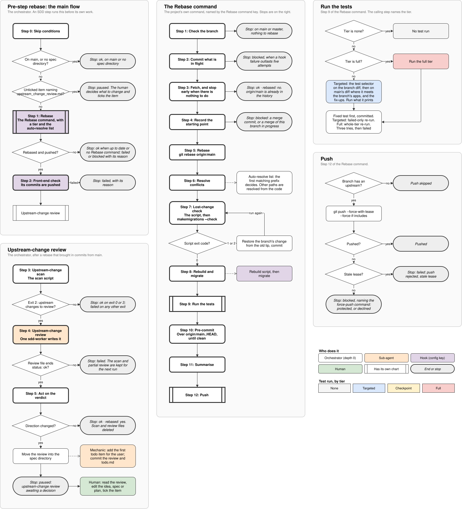

# Spec-Driven Development (SDD)

A step-by-step workflow from a rough idea to a merged pull request. Each step produces an artifact that feeds the next, so you can pause, review and correct course between stages.

## The workflow at a glance

1. **Spec** → turn the idea into a researched, reviewed specification.
2. **Plan** → turn the spec into an implementation plan and a QA plan, and review the plan.
3. **Implementation and QA** → execute the plan, then run the QA plan.
4. **Documentation and pull request** → run the documentation hooks, open the PR.
5. **Cleanup** → finish the worktree: land it on main and remove the worktree and branch.

These are the five sections of the `todo.md` checklist. Capturing the idea comes before them.


The overview has one box per command, in the order of the `todo.md` sections. A box with a diagram links to it. The red box is the full test run (see "When the full suite runs"). The plain grey boxes are commands you run when you need them. In the other diagrams, every `Step N` box carries its heading's text, and a legend gives the fill for each kind of test run. A diagram holds one or more flowcharts, each in its own titled frame: one main flow of the steps, and one chart per sub-flow. A box with double sides in one chart has a chart of its own, titled with the same name. The fill also says who does the work: white for the orchestrator, orange for a sub-agent, purple for a hook, green for you.

> `/sdd:start` is the entry point: it creates the `todo.md` checklist next to the spec/idea **and** an isolated worktree, moves the session into the worktree, registers a design when `design_prompt.md` is present and writes the spec. When it ends, the session is already inside the worktree, so everything after it runs there.


`/sdd:start` checks the roadmap and warns about unmet blockers. It creates `todo.md`, moves the spec to "in progress" and commits, then creates the worktree and moves the session into it. It ends by registering a design when one is present and writing the spec.

Why it runs in this order: Step 3 waits for Step 2's commit because the new worktree must branch off a clean, up-to-date branch that already contains the move. A blocker that is not yet met is a warning, never a block, because a feature's notes sometimes allow a spec to start before a blocker lands. `commands/protected/start_worktree.md` makes the worktree from its own parent directory, with an absolute path and the current branch as the base, so the worktree can never land inside another one and always holds the move commit. Running `cd ..` first would branch it off the bare repo's `HEAD` instead of the branch that holds the move.

> **One-time setup:** any setup a project's hooks need before the first SDD run (for example a diagram a plan review brief reads) is documented by that hook, not here.

## Setting up a project

Run `/sdd:init` once per project. It writes `.claude/sdd/config.md`, adds `.gitignore` lines, the launcher and the permission entries the commands need.

- The first checks of the preflight (P1 to P3b) are stops, not warnings, so the command can never write `.claude/sdd/config.md` and a `.gitignore` line and then discover it cannot finish.
- P3b checks the `--plugin-dir` arguments themselves because P1 and P2 are not enough. A project that predates the `claude_plugins/` layout already has a `claude.sh` and a `.claude/settings.json`, so file-existence checks pass, and the command would add its line to a launcher that still points at a plugin directory that no longer exists. With `<MAY_CREATE>` false the launcher edit skips L4 and cannot retire that argument, so the launcher would stay broken.
- The script allow entries exist because the commands call the scripts by that path. Without them every call prompts, and a non-interactive agent returns `blocked`.
- `worktree.baseRef: head` applies to every worktree Claude Code creates in the project. It branches a sub-agent's worktree from the current branch, so a batch worktree starts from the feature branch.
- The `git worktree remove --force --force` entry is safe because the commands that use it build the name from the last path component of a `git worktree list` line, never from free text.

---

## Step 0: The spec roadmap

`spec_dd/1. next/roadmap.md` is the spec roadmap: what is being built next. It opens with "Up next" (specs in progress, specs ready to start, specs that need work on main first, and a diagram of the next four levels of dependencies), then has one section per feature: every spec waiting or in flight with its state, an SVG dependency diagram and lean notes. Specs are always named by directory name, and finished work is left out. `docs/product/roadmap.md` is the product roadmap, a different file.

- `/sdd:roadmap` with no argument syncs the file with the directories: adds bullets for new directories, drops finished ones, and runs `scripts/roadmap.py` to set statuses, regenerate "Up next" and redraw the diagrams.
- `/sdd:roadmap <dir>` cuts an idea that is too big for one SDD run into ordered sibling specs, each with a decision-complete `idea.md` under `spec_dd/1. next/`, and adds them to the roadmap as a feature with its diagram and notes. The cut goes by user-visible outcome, never by line count.
- `spec_dd/1. next/priority.md` lists specs and effort parents under priority headings, highest first, with a fixed `## Priority not set` section the script fills with anything unlisted. A spec inherits the highest priority of every spec that depends on it. The roadmap orders features and "Up next" by priority and colours them by level.
- A spec whose bullet ends `Before starting:` has work to do on main first, such as a cut, and is listed under "Needs work on main first" instead of "Ready to start".
- `/sdd:start` warns when a spec has a precursor or unmet blockers, and the script marks it `in progress`. `/sdd:finish_worktree` removes its bullet and reruns the script, which unblocks whatever waited on it; when the last spec of a cut effort finishes, the feature's section is archived into the parent directory and the parent moves to done.

The format and the bullet grammar live in `claude_plugins/sdd/resources/roadmap_format.md`.

Two choices behind the roadmap command. It never uses the `Workflow` tool for its fan-out, because that tool puts a permission dialog in front of the owner. It pushes only off `main`, because roadmap bookkeeping on `main` normally happens with no worktree and, as in `protected/move_spec_to_in_progress.md`, commits there without pushing.

## Step 1: Capture the idea

1. Create an idea file manually (a markdown file describing what you want to build and why). If it is too big for one PR, run `/sdd:roadmap <dir>` first and continue with one of the specs it produces.
2. If the work has a design in Claude, run `/sdd:register_design [dir] <design artifact link>`. On a feature branch it registers the design on that branch's own spec directory and commits it to that branch; on `main` it takes the spec (or a cut effort's parent) you name. The command takes the link of a Design Artifact in Claude (or a handoff prompt holding one), reads the canvas with the `Artifact` tool and writes `design_prompt.md`, `design_source/`, `design_screenshots/` and `design.md`. `design.md` tells every later step how to read them. The design is a visual reference only: the specs and the existing functionality decide what gets built, and the project's own theme, tokens and icons style it. See **Registering a design** below.

## Step 2: Spec

1. Run `/sdd:spec_from_idea`. It researches the idea, writes the specification, runs the review wave and commits, all in one run.

   

   Research workers run in parallel while the orchestrator asks its first question batch. The orchestrator writes the spec once the research is on disk and commits it. A second wave of reviewers checks it, the orchestrator applies the clear fixes and asks about the rest, then commits again.
2. Review the spec and edit it manually where needed.
3. After substantial hand edits, run `/sdd:spec_review` to run the review wave again. It is not needed otherwise.

`/sdd:spec_from_idea`, `/sdd:plan_from_spec`, `/sdd:roadmap` and `/sdd:spec_review` each fan their work out at depth 0 by the recipe in `claude-code-authoring/resources/fanout_recipe.md`. The recipe also explains why: no subagent nesting, fan-out only at depth 0, `AskUserQuestion` is orchestrator-only, file-based hand-off and model tiering. The commands name the recipe instead of carrying a copy.

## Step 3: Plan

Run `/sdd:plan_from_spec`. This produces:

- an implementation plan, and
- a QA plan.

The plan review runs the built-in dimensions and the briefs listed under `## Plan Review Hooks` in `.claude/sdd/config.md`. It leaves every callout decided or recorded as an assumed default.

The plan is implementation only. Anything the spec asks for that the plan does not build and no documentation hook covers (a skill row, a roadmap note, a glossary term) becomes a `(cmd)` item in `todo.md`, placed right after the `/sdd:document` item; `/sdd:document` executes it before it opens the pull request, and lists it in its report if it could not.


The orchestrator reads the spec and orders the work as vertical slices. A scan of skills and MCP servers runs as a fan-out. The review runs one reviewer per dimension, plus one per brief under `## Plan Review Hooks`, and the orchestrator decides every callout.

A QA test copies the design checklist from the plan instead of judging against the screenshot. When the design changes after QA, `sdd:capture-feedback` rewrites those checklist lines and the screenshot stays as drawn.

An optional suffix argument (`/sdd:plan_from_spec <spec> 2b`) selects a second plan in the same spec directory: `2b. plan.md` and `3b. frontend_qa.md` instead of `2. plan.md` and `3. frontend_qa.md`.

## Step 4: Implementation and QA

### Implement


The orchestrator reads the plan and forms batch waves from the batches whose predecessors are done. Each batch sub-agent implements its steps, requests the tests for its change and commits. When that run fails, the sub-agent fixes it and requests only the failed tests again, with the fix's own change. The integration run after a wave and each fix batch take the same failed-only re-run. After a batch, the Design check compares screenshots with the design, and the Batch review applies the `Comment standard` and `Test standard` hooks to the added lines. Step 3 requests the whole suite once, at the end. The main flow is the chart at the top left; the batch wave, the batch sub-agent, the Design check, the Batch review and the final verification each have their own chart.

Run `/implement_plan` to execute the implementation plan. It runs batch waves: up to `Parallel batches` (the key in `.claude/sdd/config.md`) independent batches at a time, each in its own batch worktree. When the batches are done it continues into the QA command. An optional suffix argument (`/implement_plan 2b`) selects the plan `2b. plan.md`, commits its batches as `[batch 2b.N]` and resumes only from those commits. Without a suffix, it runs `2. plan.md` with `[batch N]` commits. After each slice that builds a designed screen, it runs the design check through the `Design check` hook in `.claude/sdd/config.md`, and sends any design misses (unmet lines of the plan's design checklist) to fix batches.

The project's own pre-commit checks and Claude Code's `/security-review` cover the code diff ad hoc; no SDD step runs a security review.

Three choices behind the command:

- A batch commits its own work, instead of delegating the commit to `sdd:sdd-mechanic`, so the work and its completion marker are atomic. A crash between "work done" and "marker written" cannot leave an uncommitted batch that the resume scan would re-run over a dirty tree. That guarantee outweighs tiering the one commit down to Haiku.
- Batch sub-agents run on `model: "sonnet"`, so non-interactive batch work uses a mid-tier model rather than the session model. A user whose batch needs heavier reasoning can override a spawn to `model: "opus"` or set `CLAUDE_CODE_SUBAGENT_MODEL`.
- Surviving design misses are written to `todo.md` only at Step 4, because a batch commit or a failed batch's reset would otherwise take the item with it.

### QA

Run the project's QA command: the `QA command` key under `## QA Hooks` in `.claude/sdd/config.md`.
`/sdd:start` writes it into `todo.md` as the QA step. A project with no QA command runs the QA plan
by hand.


`/sdd:do_qa` scopes the run from the diff, starts a dev server and drives Playwright at three viewports. A worker writes the report from the run's records. Each bug a test proves gets one fixer attempt and a test run. When at least one bug is fixed, a test run over the fix commits follows.

How the QA command handles skipped tests, missing test data or the bugs it finds is its own
business: read its documentation and check `qa_report.md` for the outcome.

The `qa-bugfixer` agent's report lists its `## Files modified`, and the depth-0 caller makes two decisions from that list. If a modified file is imported by more than one view or app, the fix touched shared code, and adjacent pages get re-checked. A failed re-verification of a committed fix is undone with `git revert --no-edit <commit>`, which needs the hash, not the paths. For an uncommitted fix the caller restores the working tree from the created and modified lists. The split has to be accurate either way. The agent's targeted run omits `-x` because the orchestrator skips re-driving the regression layer on the strength of that run, so it has to be the whole tier. The commit hooks run the project's checks, not the test suite, so the targeted run is the regression proof.

### Decide and fix


The orchestrator collects the open items and researches each, with one worker per item when there are four or more. It asks you one question per item, then fixes test-first. A fix that changes a page is checked in a browser and screenshotted. A targeted run over the fix commits and the todo update close the command. The main flow is the chart on the left; fixing one item, the `qa-bugfixer` and the visual check each have their own chart.

Run `/sdd:qa_fix` when QA leaves `(user)` items in `todo.md`: a bug that turns on a decision, a fix
that failed, a file to keep or delete. It researches each item, asks you for one decision at a
time with a recommendation, then makes the fixes test-first, tests the fixes, ticks what it
closed and commits. An item you answer "Leave for later" stays unticked. A decision about how a
page looks, behaves or reads goes through `sdd:capture-feedback` on the way. A fix that changes
what a page shows counts as fixed only once a screenshot shows it; the screenshots land in
`<spec-dir>/screenshots/fixed/`. A fix that changes nothing on screen is proven by its test alone. A passing test does not prove a page looks right: a fix whose test passes can leave the page visibly broken, so every fix that changes what a page shows is screenshotted and looked at before it counts as fixed. The command runs at depth 0 because asking you and spawning agents are legal only there.

Feedback you give on the QA report, a screenshot or a page goes through `sdd:capture-feedback`
(`/sdd:capture_feedback` by hand) before the fix, so the rule lands in one of the files `## Rule
Files` in `.claude/sdd/config.md` names. It also rewrites the passages of the spec, plan and QA
plan that the feedback overrides. The next QA run reads those documents as the current design, so
it passes the changed page instead of flagging it or fixing it back.

Why capture-feedback exists: feedback that stays in the conversation is lost at the end of it. Writing each general point as a rule into the file that holds rules on its subject means the next agent reads it before building and QA fails on it afterwards. A point about one feature goes into that feature's spec documents instead, so rule files stay short and true everywhere they apply. Rewriting the in-progress spec's documents to match means the next QA run reads the feedback as the design and never undoes it.

## Step 5: Document


The orchestrator runs each hook under `Documentation Hooks` in config order and commits after each. It then works through the documentation items in `todo.md`, ticks and commits, and opens the pull request.

Run `/sdd:document`. It reads `## Documentation Hooks` in `.claude/sdd/config.md` and invokes each listed skill in order, committing per hook. A project that lists no hooks skips that part. It then executes the documentation items in `todo.md` and opens the pull request.

## Step 6: Pull request

1. `/sdd:document` opens the pull request itself; run `/sdd:make_pr_quickly` to open it on its own. It runs `gh pr create --head <branch> --base main --title <branch> --body ""`, falling back to `gh pr view` when the pull request exists; it reads nothing else.

## Step 7: Cleanup

Run `/sdd:finish_worktree` when you want the branch on `main`. It never looks at the pull request, so it does not wait for an approval. It rebases, archives the spec and its roadmap row, lands the close-out on `main` by fast-forward push and brings the main worktree up to date. It stops, changing nothing on `main`, if the main worktree has uncommitted work or an operation in progress. Nobody runs `git merge` in the main worktree by hand. Once the landing passes, it removes the worktree (with `--force`, so a worktree holding submodules goes too) and deletes the local branch.


The command rebases the branch, requests the landing run and tears down per-worktree resources. It archives the spec, removes the roadmap row, commits the close-out and lands the branch on `main` by fast-forward. When `origin/main` moves in the meantime, the main-moved loop rebases and requests the landing run. The main flow is the chart at the top left, with each stopping state to its right; the landing run, flaky tests, landing on main, the main-moved loop and a dirty main worktree each have their own chart. "How `finish_worktree` recovers" lists what the command fixes by itself and what stops it.

Two choices behind the order. Step 0.5 runs the main-worktree sync before anything is committed, so a parked operation on `main` is found before the branch is touched, and Step 7 does not need a second rebase when local `main` was ahead of `origin`. The pre-test rebuild runs even when the branch needed no rebase, because built assets such as compiled CSS are often gitignored: a branch can hold output older than its templates.

`/sdd:commit_quickly` is the fast commit path for use during implementation: it stages the already-staged index if there is one, otherwise the files Claude touched this conversation (`mine`; `all` stages everything), and commits without running the test suite. Use it mid-implementation, when you already know the state of the work and want it recorded. When the commit is a checkpoint you have not verified, use a commit command that tests the change first, if the project has one.

`/sdd:hotfix <what is broken>` fixes one small bug in the main worktree, with no spec, plan or worktree. It adds a test only when the fix changes behaviour that no test covers, and prefers adding a case to an existing test; a wording or documentation fix gets none. It makes the fix, requests the tests for the files it touched, commits to `main` as `hotfix: <what was broken>` and pushes. It never runs the whole suite unasked: when the project's test runner needs it, the command asks first. It stops and recommends `/sdd:start` when the fix needs a migration, a new dependency, a product decision or more than a handful of files. After the push it corrects any doc the fix made wrong, as a second commit. It does not run the documentation hooks, which need a spec directory.


## The pre-step rebase



Every feature-branch command starts by following `commands/protected/pre_step_rebase.md`. It does nothing on `main`, when no spec directory matches the branch, or when the project has no `Rebase command`. Otherwise it follows the project's Rebase command, then the Front-end check hook, then reads what main brought in.

- **Tests.** The caller passes `<tests>` (`none`, `change` or `everything`) to the Rebase command. `/sdd:finish_worktree` passes `none` because its own test run follows.
- **Conflicts.** The helper passes the Rebase command the list in `resources/rebase_auto_resolve.md`. A conflict under the spec root resolves without asking: the branch's side for the branch's own spec directory, main's side for any other spec path. `spec_dd/1. next/roadmap.md` and its companions keep both sides' removals and are regenerated with `scripts/roadmap.py`. A conflict anywhere else stops the rebase with `blocked`.
- **Upstream changes.** When the rebase replayed commits, `scripts/upstream_change_scan.sh` lists the paths main brought in. When all of them sit under the spec root, nothing pauses and no review worker starts. Otherwise one worker decides whether the change alters the direction the spec builds on (`resources/upstream_change_review.md`). A `changed` verdict pauses the spec and adds a `todo.md` item, and re-running the command after you decide continues.
- **Up to date.** A branch that needs no rebase never reads the scan and review text.
- **Push.** The rebase force-pushes with `--force-with-lease --force-if-includes`. A stale lease re-fetches and tries again. Any other refusal returns `blocked` with the exact command to run.

## When the full suite runs

SDD never names a test command. Every step that needs tests follows `commands/protected/run_tests.md`, which hands one request to the file the `Test runner` key under `## Test Hooks` names and returns that file's `tests:` line. The project's runner decides which tests a request takes and how they run. A blank `Test runner` stops the step with `status: blocked`.

One step asks for the whole suite outright, and the overview diagram marks it in red.

**`/sdd:implement_plan` Step 3** requests `everything`, once, after the last batch. When it fails, the fix sub-agent requests `one test` for each failing test until it passes, then requests `failed` with the failed set and the fix's commits. It does not request `everything` again. The landing run in `finish_worktree` covers the fixes.

A batch requests `change` for its uncommitted work. `do_qa` (after the last fix) and `qa_fix` Step 7 request `change` for their fix commits. `/sdd:hotfix` requests `change` with `<widen>: no`, so a change that takes the whole suite asks you first.

**The landing run** is what `finish_worktree` Step 1 requests before the close-out commits, and what its main-moved loop requests after each rebase. It is the request `before landing`: the last proof before the branch lands. The runner decides how much that takes, and may run nothing when an earlier run already covers the branch. A `tests: nothing to run` line says why and never reads as a pass.

## How `finish_worktree` recovers

`/sdd:finish_worktree` fixes what it can, continues, and lists each fix in its report: the number of loop passes, a main-worktree commit, "main pushed", each auto-resolved conflict with its side, each flaky-test fix with its commit, and every test report line.

**What it fixes by itself**

- **Main moved.** When `origin/main` moves after the preflight, `land` exits 7 and the main-moved loop starts. Each pass rebases, requests the landing run and tries `land` again. A pass that starts before Step 7 (a stale lease in Step 0, a main-worktree commit in Step 0.5) only rebases, then continues from the main-worktree preflight, so nothing lands before the close-out commits. The loop calls the Rebase command directly, because the pre-step rebase skips a spec already under `3. done/`. No upstream-change review runs for a finished spec.
- **An unpushed main.** When local `main` is ahead of `origin` and no worktree has `main` checked out, the script pushes it with `git push origin main:main`. If `origin/main` moves during that push, origin rejects it, `main` has diverged and the command stops with `blocked` (reason 6 below).
- **A dirty main worktree.** When uncommitted changes overlap the incoming files, the command never stashes, resets or edits them, because another process may be working on them. It asks you, naming the paths. If you choose "Commit and push them to main for me", it commits exactly those paths as their own commit in the main worktree, rebases that commit onto `origin/main` with `git pull --rebase`, pushes `main` and enters the main-moved loop.
- **Spec-only upstream changes and conflicts.** A change that touches only the spec root does not pause the rebase. A conflict whose paths all sit under the spec root resolves by the auto-resolve list.
- **A stale lease.** A force-push rejected for a stale lease re-fetches and runs a loop pass.
- **Flaky tests.** When a landing run fails, each failing test is requested on its own, three times. A test that passes at least once is flaky. One `general-purpose` sub-agent per flaky test finds the root cause on the current branch, using the project's `Flaky test guide`. It never skips, deletes or marks the test. It proves the fix with 10 consecutive passes and commits it as `fix flaky test <test id>`. The run that failed then runs again.

**What still stops it**, starting with the one you meet most:

1. **Other uncommitted changes in the main worktree block the rebase of a main-worktree commit.** The commit stays on local `main` and the command returns `paused` with git's message. Commit or set aside those changes and re-run. The same `paused` status comes back when you choose "I'll commit main, then continue", when the main-worktree commit conflicts with `origin/main` (the rebase is aborted) and when a hook rejects the commit.
2. **A code conflict**, in a path outside the auto-resolve list: `blocked`. A pull request that was squash-merged on GitHub replays as conflicts for the same reason. The fix is to point the branch at `origin/main` and re-run.
3. **A real test failure**: a test that fails all three re-runs is `failed`. Nothing moves until you fix it.
4. **A flaky test not fixed after two attempts**: `failed`, with the diagnosis.
5. **A refused force-push**: `paused` with the exact command. Run it, then re-run the command.
6. **A parked operation or a diverged main**: a merge, rebase, cherry-pick, revert or bisect in flight in the main worktree, or a `main` that has diverged from `origin`. `blocked`, with the script's output.
7. **Five passes in a row with the same blocker**: `blocked`, for example `origin/main moved 5 times in a row`.

A `paused` return adds an item to `todo.md` first. Re-running `/sdd:finish_worktree` continues from where it stopped.

## Registering a design

1. The design is a Design Artifact in Claude: an Artifact made from the Design Artifact type, at a `claude.ai/artifact/<id>` link. Its owner moves a design still in standalone Claude Design into Claude before 14 December 2026. A project that cannot move is redrawn in Claude.
2. The person running the command can edit the design: they own it, or the owner shared it with edit access. A design shared for viewing only reads back as a summary, and the command stops.
3. Copy the design's link. A handoff prompt Claude generates for the design also works if it contains that link.
4. Either paste the link into `<spec-dir>/design_prompt.md` before `/sdd:start`, which registers it while it sets up the worktree, or run `/sdd:register_design <link> [notes]` on the feature branch.
5. Check the report: the canvas title, version, artboards, synced files and assets, any missing asset, the screenshots.
6. After the design changes in Claude, register it again. The same command re-syncs `design_source/` and rewrites `design.md`.

Why the command treats a design the way it does:

- A design is drawn on a separate platform that knows nothing of the project's features, plans or theme, so it invents controls, screens and data the project does not have and styles them in another theme. That is why the command treats it as a visual reference only and asks you nothing about what it draws.
- The command does not rebase: it only adds spec files to the current branch, and the next SDD step's pre-step rebase picks main up.
- The canvas probe runs before anything in `design_source/` is touched, so a design that cannot be read leaves the previous sync in place.
- `support.js` is moved into `design_source/project/` because every artboard loads `./support.js` from its own folder and the canvas serves it only at run time. The screenshot script serves that one copy under every artboard folder.

---

## How the workflow runs

2. **Model tiering & the override knob.** Defaults: mechanical work (test runs, commits, file moves, todo ticking) → the `sdd:sdd-mechanic` agent (Haiku); non-interactive fan-out (research topics, review dimensions, scans) → the `sdd:sdd-worker` agent (Sonnet); interactive authoring/review commands run at depth 0 on the **user's session model** (so run the session on a strong model). To change a step's model, **edit the agent file's `model:` frontmatter** (`claude_plugins/sdd/agents/sdd-mechanic.md`, `sdd-worker.md`). The env var `CLAUDE_CODE_SUBAGENT_MODEL` forces one model for **all** subagents, but it **overrides every per-agent `model:` frontmatter**, so leave it **unset (or `inherit`)** for normal tiered operation.

3. **Aliases vs pinned IDs.** The agents use aliases (`haiku`/`sonnet`). For frozen, reproducible automation, pin dated IDs (e.g. `claude-haiku-4-5`) in the agent files instead.

4. **Target Claude Code version.** These files target the **2.1.x** line: per-agent/per-command `model:` frontmatter, `AskUserQuestion`, non-nesting subagents, and "commands merged into skills" all hold here. No runtime version check enforces it.

5. **Every artifact command commits and pushes itself.** Any command that writes or edits an SDD artifact ends by delegating a commit and push to `sdd:sdd-mechanic`, following `claude_plugins/sdd/resources/commit_and_push.md`. A command run in hook mode keeps its commit; `/sdd:document` commits for a hook that has no commit step. The commit subject always leads with the spec directory name, so `git log` reads as a per-spec history. Nothing is committed on `main`/`master`, and nothing unrelated is staged. The one exception is `spec_dd/` bookkeeping that has no worktree yet (`/sdd:start`'s move to in progress, `/sdd:roadmap`'s edits): that is committed on `main` and not pushed.

6. **Why it runs this way.** The **`claude-code-authoring`** skill is the canonical reference for the mechanics behind all of the above: no subagent nesting or fan-out, no slash commands from subagents, no `AskUserQuestion` in subagents, model tiering, and file-based hand-off.

7. **Why the skills, agents and resources exist.**
   - `capture-feedback`: see "Decide and fix".
   - `planning-references-in-code`: references to planning documents rot. Numbers repeat, because every effort has its own spec 1, slice 3, section 4b and QA Bug 2, so "spec 6" names a different document in every effort. Documents move, since spec directories go from `next` to `in progress` to archived and sections get renumbered. A section number in a history comment (`§4c additions`) means nothing once the diff is merged.
   - `claude-code-authoring`: the `resources/` files carry the source citations and reasons behind each rule. The skill itself states the constraints only.
   - `domain_vocabulary.md`: a document that invents a synonym for an existing concept makes every later reader carry a translation table. Invented names survive into the code, and field, `related_name` and constraint names survive as database identifiers, where a wrong word costs a migration rather than an edit.
   - `outstanding-items`: you work from the spec's `todo.md`, not from the chat, and an outstanding item that lives only in a reply is lost in the scroll.
   - `update-claude-project-settings`: `.claude/settings.json` is shared by everyone on the project and accumulates duplicate, overlapping or stale entries, while useful permissions sometimes live only in a developer's local settings.
   - `sdd-worker`: a worker has no `Bash` or rename tool and needs none, because the `status:` footer is the completeness contract (a shell-style temp-then-rename would need `mv`, which these workers deliberately lack). Workers and the mechanic fail fast and follow helper files instead of invoking slash commands, for the reasons in the `claude-code-authoring` skill.

---

## The `todo.md` checklist

`/sdd:start` creates a `todo.md` checklist in the spec directory that tracks every step above, in five sections. Commands tick their own item (and add follow-up tasks where relevant) by invoking the protected helper at `claude_plugins/sdd/commands/protected/update_todo.md` as their final step; you never run it yourself. Commands tick their own item, including `/sdd:make_pr_quickly` through `/sdd:document`; the human ticks the `(user)` items. The commit-and-push step runs straight after it.

## Editing a diagram

Each diagram is an `.drawio.svg` file: an SVG that GitHub renders, with the draw.io XML embedded in it.

1. Open the file in draw.io and save it. The save keeps the embedded XML.
2. Run `python3 claude_plugins/sdd/scripts/check_diagrams.py`. It fails when a `Step N` heading in a command has no label starting with the same text, or when a `Step N` label names a step the command lacks. Rename the label with the heading. `overview` is exempt, so none of its labels starts with `Step`.
3. Keep each flowchart small. When a step holds a loop, a retry or a sub-agent's own steps, draw that as a separate flowchart in the same file, under its own title, and leave one double-sided box named after it in the main flow.

To write a diagram as XML instead, save uncompressed draw.io XML (`<mxfile><diagram><mxGraphModel>…`) as `.sdd-work/diagram_<name>.drawio` in the project, export it, delete the source by name and run the check:

```
drawio -x -f svg --embed-diagram -u -o claude_plugins/sdd/docs/diagrams/<name>.drawio.svg .sdd-work/diagram_<name>.drawio
```

The export needs a display. Without one, run it under `xvfb-run`. Commit only the `.drawio.svg`. A new diagram also needs a row in the table at the top of `check_diagrams.py`, listing the command files whose steps it shows.
