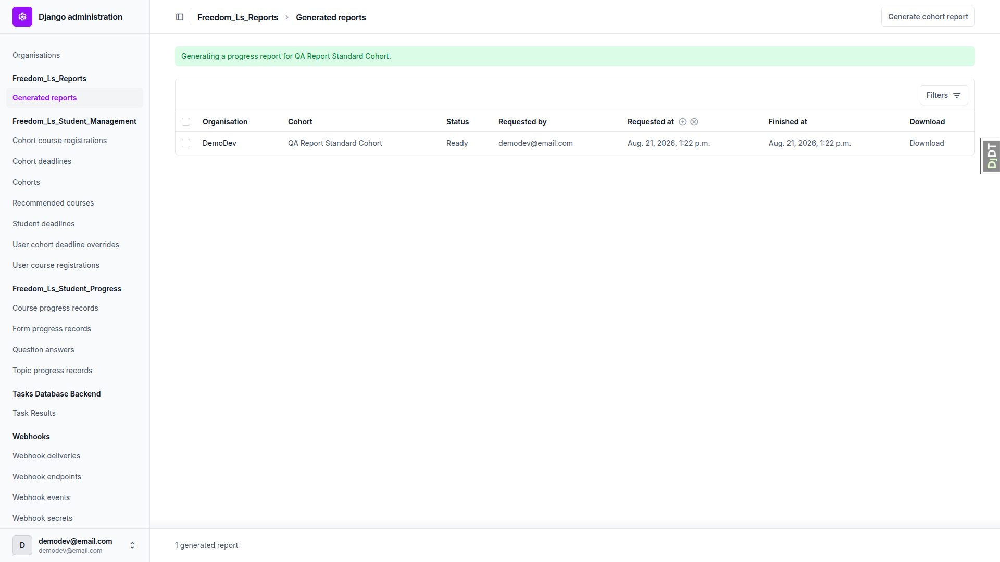
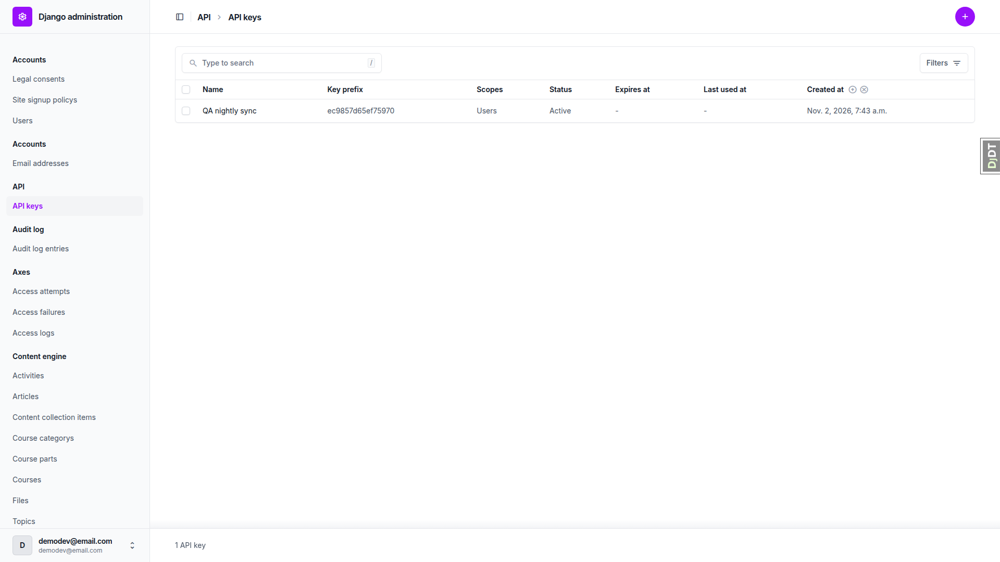
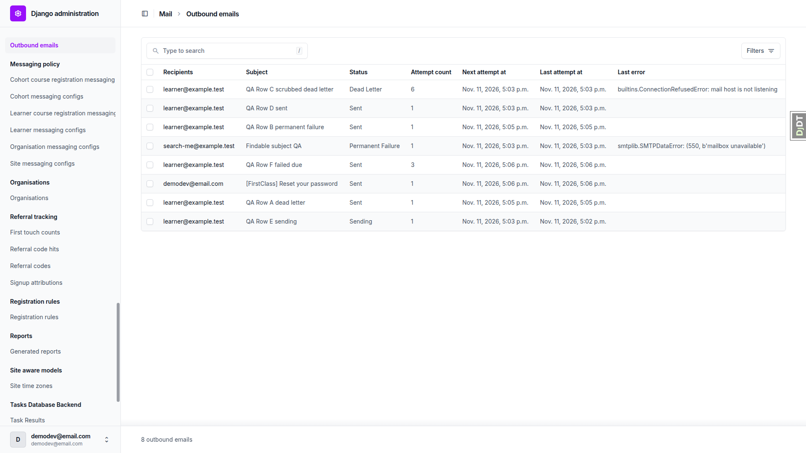

# Admin Interface

_Last updated: 2026-11-24_

## Summary

- The Django admin is enhanced with the Unfold UI framework, preserving all standard Django admin behaviour.
- Educator roles are not assigned in the admin. An organisation's permissions tab governs admin access only; educator-interface and report access come from [role assignments](./educator-interface.md#access-control).
- Organisations are created, renamed, and given a logo — optionally a second, reversed one for a dark background — entirely through the admin, with no delete and no merge. An organisation can also have a profile logo and a short bio, both optional.
- The admin holds no learners, cohorts, course registrations, content or form definitions. Learners, cohorts and registrations are managed in the [educator interface](./educator-interface.md); content comes from the content repository only. See [Content and Forms Are Not in the Admin](#content-and-forms-are-not-in-the-admin).
- Learner progress and form answers are view-only for every user, superusers included; submitted answers can still be read and answer files downloaded. See [Learner Progress](#learner-progress).
- Deadline overrides, and pausing and extending a learner's course, have no screen anywhere in the product. Pauses and extensions already recorded stay readable, and a paused course can be resumed from its pause's page. See [Pausing and extending](#pausing-and-extending).
- An administrator sets a deadline policy per site, organisation, course, cohort or registration: whether the Missed deadline mark shows, whether items close and course access ends after a grace window, and what a learner whose access has ended can still see. See [Deadline policy](#deadline-policy).
- A staff user generates a cohort's progress report from the admin by picking a cohort and triggering generation; the choice is limited to cohorts that user is allowed to see, generation runs in the background, and the finished PDF downloads through a permission-checked link rather than a public URL.
- Course applications are read in the admin: a list to find one by applicant, course, state (Not submitted, Waiting for review, Approved, Declined or Withdrawn), verified or unverified email, and created date, and a page that shows the applicant's answers read-only, with any attached file downloadable. Applications from anonymous visitors appear as soon as they are submitted, flagged as unverified until the applicant follows their emailed link. Staff granted the standard view permissions can read them; nobody can add, edit or delete an application there. There is no review workflow yet.
- The Users list and the Course applications list export to CSV, either the ticked rows or the whole filtered list, for staff who can view them. See [Exporting Users and Applications](#exporting-users-and-applications).
- Messaging configuration sets whether learners may start conversations with their educators, cohort peers and course peers, and which educator roles learners are offered. These settings take effect once [direct messaging](./messaging.md) is turned on. The messages themselves are not shown in the admin; oversight of learner-educator conversations is in the educator interface.
- The admin path is configurable via `DJANGO_ADMIN_URL`, so production can move it off the default location.
- Legal consent records are fully read-only — they cannot be added, changed, or deleted.
- Signup attribution records and the daily first-touch tally are read-only too, filterable by source, medium and campaign, and exportable to CSV.
- Referral codes are managed in the admin: created and deactivated, but never deleted, with the code text locked once saved. Visits to a code are logged in a separate read-only list, and both lists export to CSV. See [referral codes](./referral-codes.md).
- HR attributes are an optional extra. When that app is installed, the admin lists each organisation's job titles, departments and locations, which can be deactivated rather than deleted. An entry a learner holds cannot be deleted. A learner's own job title, department, location and start dates have no edit screen. See [HR attributes](./hr-attributes.md).
- Registration rules are an optional extra on top of HR attributes. When that app is installed, the admin has a Registration rules screen where an administrator sets, per organisation and course, who is registered automatically, with a preview before any change that affects who is registered. See [registration rules](./registration-rules.md).
- Webhook endpoints have a test-send action for verifying configuration without waiting for a real event.
- API keys are issued and revoked in the admin. A key's text is shown once, when it is issued, and a key cannot be deleted. See [API Keys](#api-keys).
- Erasing a user from the admin is refused while that user has course progress or form progress records.
- Superusers can see outgoing email, with its status and last error but never its body, and resend one that failed. See [Outgoing Email](#outgoing-email).

## Unfold

The admin uses [Unfold](https://github.com/unfoldadmin/django-unfold) as a drop-in enhancement over Django's standard admin. It provides an improved layout while leaving standard admin behaviour intact.

Site-scoped admin pages are automatically filtered to the current site, consistent with [multi-tenancy and isolation](./multi-tenancy-and-isolation.md). Unfold's branding customisation (site title, header colour, logo) is present in settings but commented out, so admin branding is not configured in a default installation.

## Organisation Permissions

Each organisation's admin page carries a permissions tab. It governs what a staff user can do with that object in the admin, and nothing else: it does not grant access in the educator interface or to cohort reports. Those come from [role assignments](./educator-interface.md#access-control), which have no admin page. Organisation admins manage organisation and cohort roles from the educator interface's [Staff section](./educator-interface.md#staff-and-roles); site admin is assigned by a developer.

## Organisation Management

Organisations are managed entirely through the Django admin: an administrator creates an organisation, renames it, and uploads a logo. An organisation can also supply a second, reversed logo for use on a strong colour fill; it is optional, and no screen draws it yet. Two further optional fields shape how the organisation appears to learners: a profile logo, shown in a circle beside its name on course cards and the course page (without one, the light-background logo is shown), and a bio of up to 500 plain-text characters, shown on the course page. See [learner experience](./learner-experience.md) for where these appear. What an organisation is, and where it sits relative to a site, is described in [multi-tenancy and isolation](./multi-tenancy-and-isolation.md#organisations). When the optional HR attributes app is installed, the page also carries an "HR settings" panel with one "Registration rules enabled" switch, off by default. With [registration rules](./registration-rules.md) installed, the switch decides whether the organisation's rules act at all. See [HR attributes](./hr-attributes.md).

There is no delete and no merge — both are refused outright. This is a deliberate limit for this release, not an oversight. There is also no bulk import, and no way to manage organisations outside the admin. An organisation's cohorts and learners are managed in the [educator interface](./educator-interface.md).

Logo uploads accept PNG, JPEG, and WebP; SVG is rejected deliberately. A maximum file size and minimum and maximum pixel dimensions apply, and each upload is validated against its actual image bytes rather than trusted by filename — see [security and data handling](./security-and-data-handling.md).

## Learner Progress

Topic progress, course progress and course form attempts are listed in the admin for reading only: nobody, superusers included, can add, change or delete one. The lists filter by whether an item is finished, by course, cohort and organisation, and by when it was finished. To find one learner's records, search for their email. Course progress also filters by completion percentage and by when the learner was last active, for finding learners who have gone quiet. A course progress record's page shows the learner's current deadlines, the deadline policy that applies and the topics and form attempts behind it. Form attempts sat outside any course are read on the form progress list, which names the course each was sat in, or nothing when it was sat on its own. Form progress, answers and answer files are read-only in the same way. Full tracking semantics — what a progress record means and how it is derived — are covered in [learner tracking](./learner-tracking.md).

Course [applications](./learner-experience.md#applying-to-a-course) have their own read-only list in the admin, showing every application and its state: Not submitted, Waiting for review, Approved, Declined or Withdrawn. An administrator finds one by searching or filtering on applicant, course, state, verified email and created date, then opens it to read the applicant's answers page by page. Questions the applicant skipped are marked "Not answered", questions their answers never led them to are marked "Not asked", and an attached file appears with a download link. The form progress page shows the same answers the same way and links to its application.

Anonymous visitors can apply before they have an account, so their applications show up as soon as they are submitted and can be found by the applicant's email. Until the applicant follows the emailed claim link, the application is flagged "Unverified email" on the list, the application page, and the form-answer and uploaded-file screens. Anonymous applicants also have their own read-only list, searchable by email, whose only action is delete: deleting one erases that applicant's application, answers and files, which is how an erasure request is handled before an account exists. An applicant who has already claimed their application is protected from that delete, because the application, answers and files now belong to their user account. The admin can't erase that account either: it refuses to delete a user with form progress records, and a claimed applicant always has one. Until erasure comes back to the admin, an operator handles that request outside it. Nothing is purged automatically; see [security and data handling](./security-and-data-handling.md). An applicant can correct their own email address, both while the application is a draft and after submitting it while the address is still unverified, so match an erasure request against the application's current address. "Verified email" does not mean the application is submitted: an applicant who follows their claim link on an unfinished draft is verified and has an account while the application is still a draft, and an unverified application may still be a draft. The applicant's side is described under [applying to a course](./learner-experience.md#applying-to-a-course).

Access follows the standard view permissions, so a staff user granted them can read applications, answers and files without being a superuser; see [security and data handling](./security-and-data-handling.md#applicant-uploads-built). Applications cannot be added, edited or deleted in the admin, and there is no review, approve or reject action yet; see [roadmap](./roadmap.md).

## Exporting Users and Applications

The Users list and the Course applications list each export to CSV: the ticked rows, or everything the current search and filters leave showing. Anyone who can view a list can export it; there is no separate export permission. The files are safe to open directly in a spreadsheet.

- **Users.** One row per user: name, email, whether the email is verified, active and staff flags, when the account was created, and last login. Passwords, the superuser flag, groups and permissions are never included.
- **Applications.** One row per application, anonymous applicants' and drafts included, with the applicant, course, state, verified-email and submitted flags, and when it was submitted. Every question on every form in the export gets its own column, so one file can mix several courses' applications. A question the applicant's path never reached reads "Not asked" in its column, while one they reached and skipped is left empty. A file-upload answer exports the file's name only, never the file.

Exports are CSV only. Registration-form answers, consent records and signup attribution are not in the Users export; attribution has [its own export](./signup-attribution.md).

## Pausing and extending

Deadline overrides for a cohort's registration or a single learner, and pausing and extending a learner's course, cannot be done anywhere in the product: there is no screen for them in the admin or the [educator interface](./educator-interface.md). Pauses and extensions already recorded stay visible, read-only, on the learner's course progress page, with who made each and why, and the learner's current deadlines include them. A course that is still paused can be resumed: its pause's page in the admin offers "Resume course", which asks for a reason, ends the pause and moves the learner's deadlines forward by the days paused. This is the only way to end a pause that has no planned resume day. What the learner sees is in [learner experience](./learner-experience.md#deadlines).

## Deadline policy

Course authors set due dates and time limits in the course content; see [content editing workflow](./content-editing-workflow.md#course-frontmatter-options).

A deadline policy decides what a missed deadline leads to. Administrators set it for a site, an organisation, a course, a cohort, a cohort's course registration, or one learner's course registration, and each setting can inherit from the broader level.

- **Missed deadline mark.** Whether a past due date is flagged to the learner.
- **Closing items.** Whether incomplete items close once a grace window after their deadline has passed.
- **Ending access.** Whether course access ends once the same grace window after the time limit has passed, and what the learner can still see of the course afterwards.
- **Notify educators.** The setting can be saved, but nothing is sent yet; see [roadmap](./roadmap.md#deadlines).
- **Learner pausing.** Whether learners may pause their own course, how many times, and for how many days in total. These can be saved and inherited like the others, but learners cannot pause themselves yet and nothing enforces the limits.

A learner's course progress page shows the policy that applies to them and which level set each value. With no policy set anywhere, nothing closes and no access ends; the deployment-wide default is described in [configuration and extension](./configuration-and-extension.md#deadline-policy). What learners see is covered in [learner experience](./learner-experience.md#deadlines).

Policy is admin-only: the educator interface has no screen for it. Nothing in the product restores ended access.

## Site Time Zone

Each site can be given one time zone in the admin, and a choice whether to show that zone's name to learners. Without one, the server's time zone is used. The admin shows deadline dates and times in this zone, with the zone named. Learners see dates in their own browser's zone, and see the site's zone label only when **show time zone to learners** is switched on; it is off by default.

## Course Interest

Who has expressed interest in each course is read here, searchable by user and course. Interest is expressed against a course site-wide with no organisation involved, which is why it sits in the admin rather than in the organisation-scoped [educator interface](./educator-interface.md#courses), where only the per-course interest count is shown.

## Cohort Progress Reports

A staff user generates a cohort's progress report from the admin: they pick a cohort from a dropdown and trigger generation with one click. The dropdown only ever offers cohorts that user's [roles](./educator-interface.md#access-control) cover, so any other cohort is never offered, and a request naming one anyway is refused. What the finished report contains is described in [cohort reports](./reports.md).

- Generation runs in the background: the report appears in the list right away and updates once it finishes, either becoming available to download or showing a readable explanation of why it failed. Starting a second report for a cohort that already has one generating is refused with a message; a finished or failed report never blocks a new one.
- The finished PDF is fetched through a permission-checked download link in the list, never a public media URL. See [security and data handling](./security-and-data-handling.md) for the access posture behind that link.
- Reports are produced by the system, not authored by hand: they cannot be added or edited from the admin, only viewed, downloaded, and deleted. Deleting a report also deletes its stored PDF.
- Cohort names are unique per organisation rather than per site, so both the list and the generation dropdown name each cohort's organisation alongside the cohort.

## Messaging Configuration

A site admin decides whether learners may start conversations with their **educators**, their **cohort peers** and their **course peers**. Each is open or closed, and can be set for the site, an organisation, a cohort or an individual learner, and course peers also for a single course registration. A level left to inherit defers to the next one up.

These settings take effect once [direct messaging](./messaging.md) is turned on, which it is not by default. Messages and conversations are deliberately not shown in the Django admin, so an administrator cannot read them there. Organisation admins and site admins can instead read a learner's conversations with their educators from the educator interface; see [messaging](./messaging.md).

- **Out of the box:** educators may message the learners they teach, and learners may message their educators (by default their cohort admins). Colleagues may message each other. A learner cannot start a conversation with a cohort peer or course peer until an admin opens it. Educators and colleagues cannot be closed from here; to stop an educator, deactivate their role. The deployment-wide defaults are described in [configuration and extension](./configuration-and-extension.md#messaging-policy).
- **Offered educators:** the site's messaging configuration chooses which educator roles a learner may message, which can be none. A superuser is an educator only through a role assignment.

## Configurable Admin URL

The admin is mounted at the path given by the `DJANGO_ADMIN_URL` environment variable. Changing it in production moves the admin off its default location, reducing exposure to automated discovery. No code change is required.

## Read-Only Consent and Attribution Records

Legal consent records are registered read-only: the admin disables add, change, and delete. This preserves the append-only integrity of the consent audit trail, described in [authentication](./authentication.md).

The same posture covers where a signup came from: one record per signed-up user, plus a daily tally of first-time tracked arrivals per campaign. Both lists filter by source, medium and campaign, drill down by date, and export the ticked rows or the whole filtered list to CSV with every recorded field included, safe to open in a spreadsheet even when a value has been crafted to look like a formula. Read access has to be granted as a permission; staff status alone does not show them. Deleting a user still takes their attribution record with it. What is recorded, and the privacy obligations that come with it, is in [signup attribution](./signup-attribution.md).

## Content and Forms Are Not in the Admin

Authored content — courses, course parts, topics, articles, activities, files and course categories — and form definitions with their pages, questions, content blocks and options are not in the admin: they cannot be viewed, added, changed or deleted there. Content is authored in files and loaded from the content repository, which is the only way it changes; a course's price comes from its course file too. See [content editing workflow](./content-editing-workflow.md). Educators see a course's [reference parts](./content-editing-workflow.md#course-frontmatter-options) in the course outline in the [educator interface](./educator-interface.md).

Underneath the admin the same protection holds for anything reaching the database another way: a form question a learner has answered, a course anyone is registered for, and the form progress record behind a course application cannot be deleted while those records exist.

## Webhook Test-Send

A webhook endpoint's admin detail page exposes an action that sends a test payload to the configured URL, so an administrator can confirm the endpoint is reachable and its authentication headers are correct before a live event triggers delivery. The full control set is in [webhooks](./webhooks.md).

## API Keys

An administrator issues keys here for scripts that read the site's data over the [API](./authentication.md#api-client-authentication). A key has a name, one or more API scopes and an optional expiry date, and belongs to the site the admin is being used on. Its full text is shown once, on the page after saving, and never again: a lost key is replaced by issuing a new one and revoking the old.

The list shows each key's scopes, status (active, expired or revoked), expiry and when it was last used. One or several keys are revoked after a confirmation page, and scripts using a revoked key stop at once. Once issued, only an active key's name can be changed, and keys are never deleted, so revoked keys stay listed. How keys are stored and what is recorded about their use is in [security and data handling](./security-and-data-handling.md#api-access-built).

## Outgoing Email

Superusers can see the email the system sends, such as password resets, to find out whether a particular message went out and, if not, why. The list is searchable by recipient and subject and filterable by status, and each email's page shows its status, how many attempts were made and the last error, never the message body. Nobody can add, edit or delete an email there, and staff who are not superusers do not see it.

A superuser can resend an email in the Permanent Failure or Dead Letter state, one at a time or several at once. An email that was sent, is still being retried, or whose body has already been removed is skipped, with a message saying why; once the body is gone, the only way to send it again is to repeat the original action, such as requesting a new password reset. Nothing resends a failed email automatically after its retries run out. How long bodies and records are kept is in [security and data handling](./security-and-data-handling.md#queued-email).
