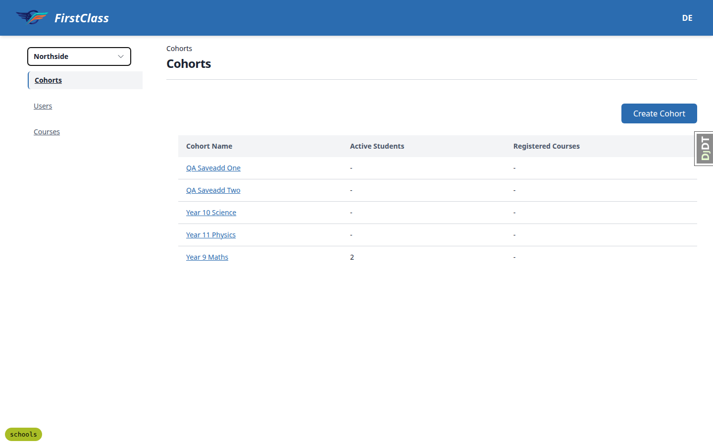
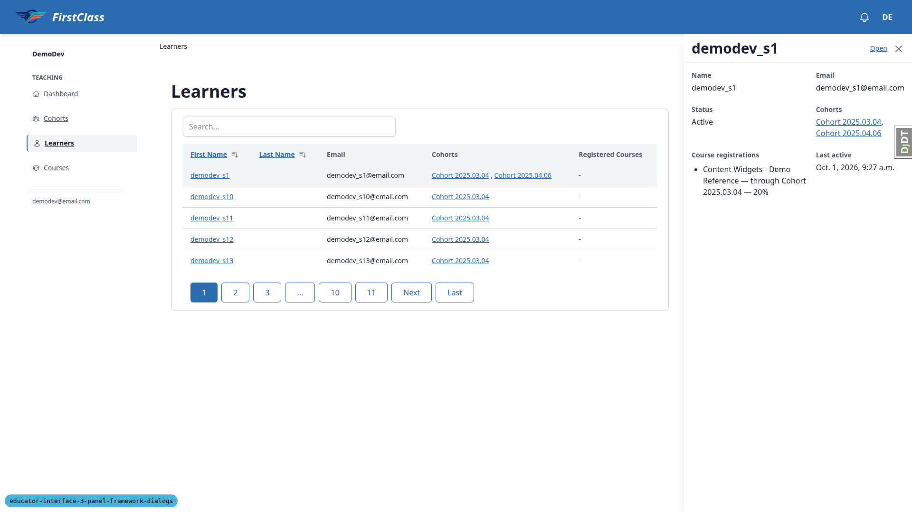
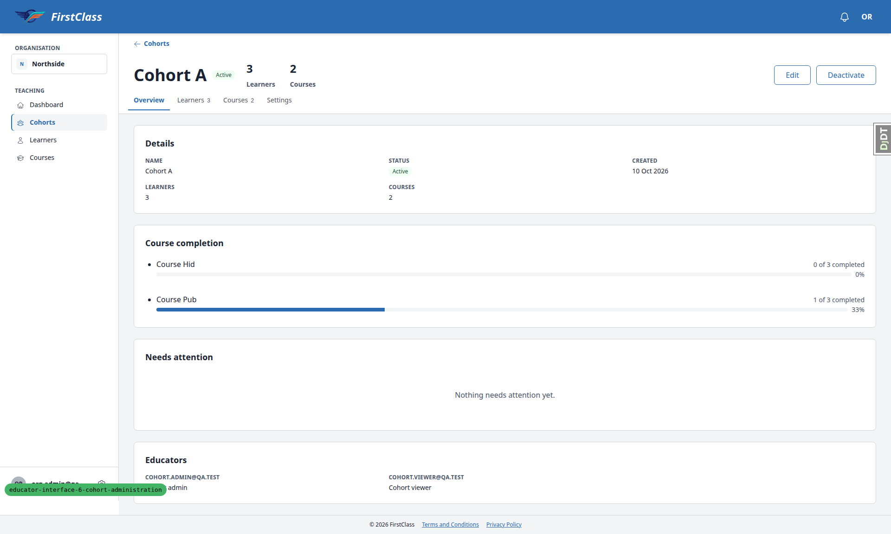
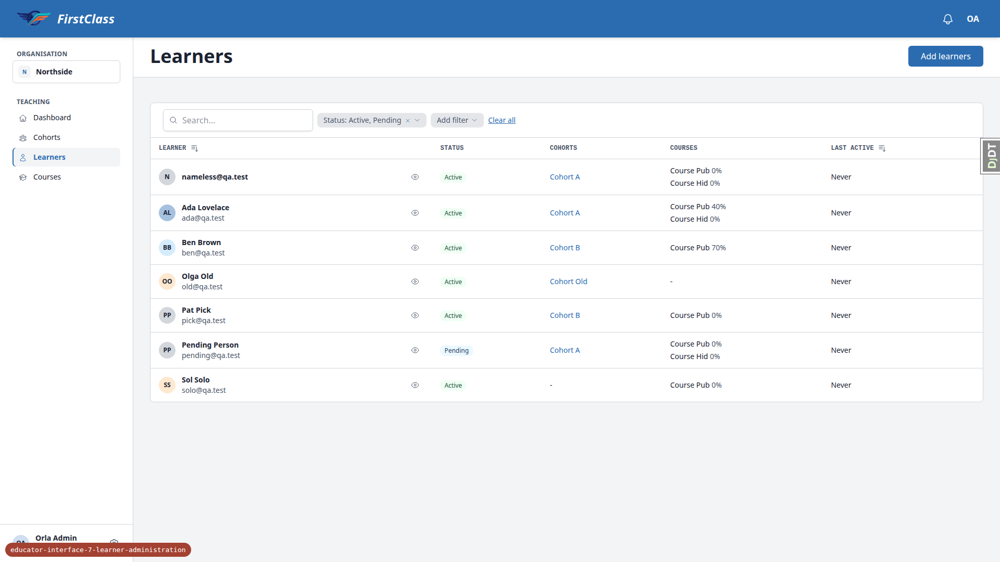
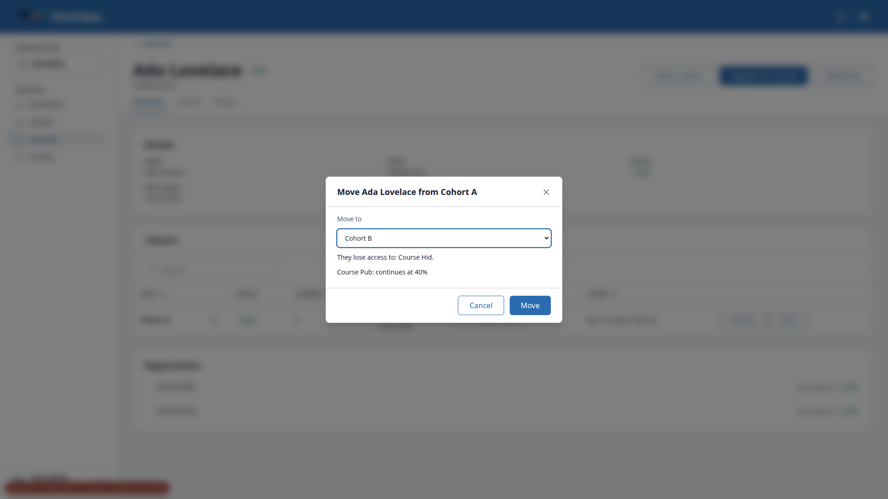
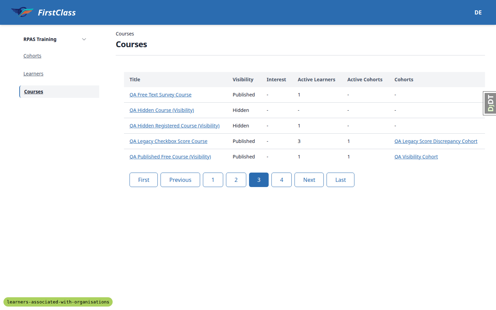
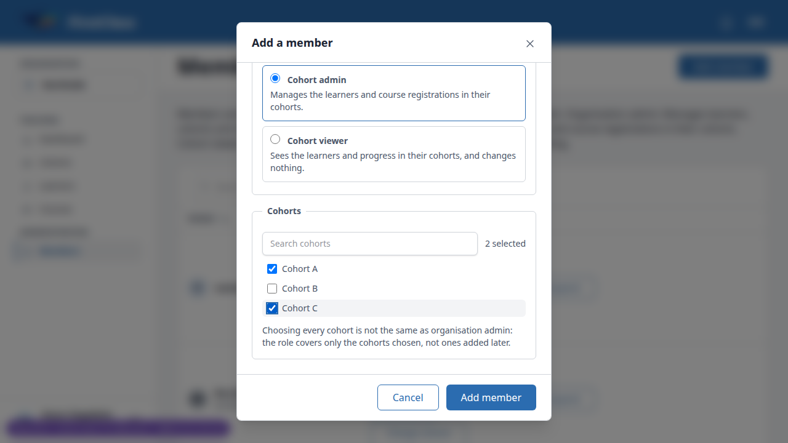
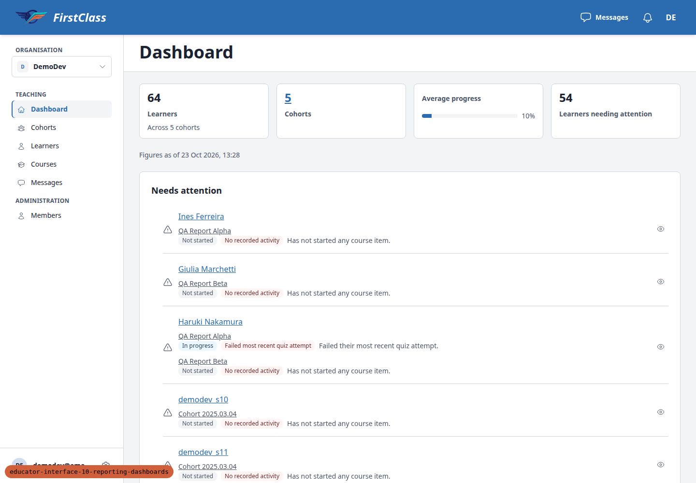
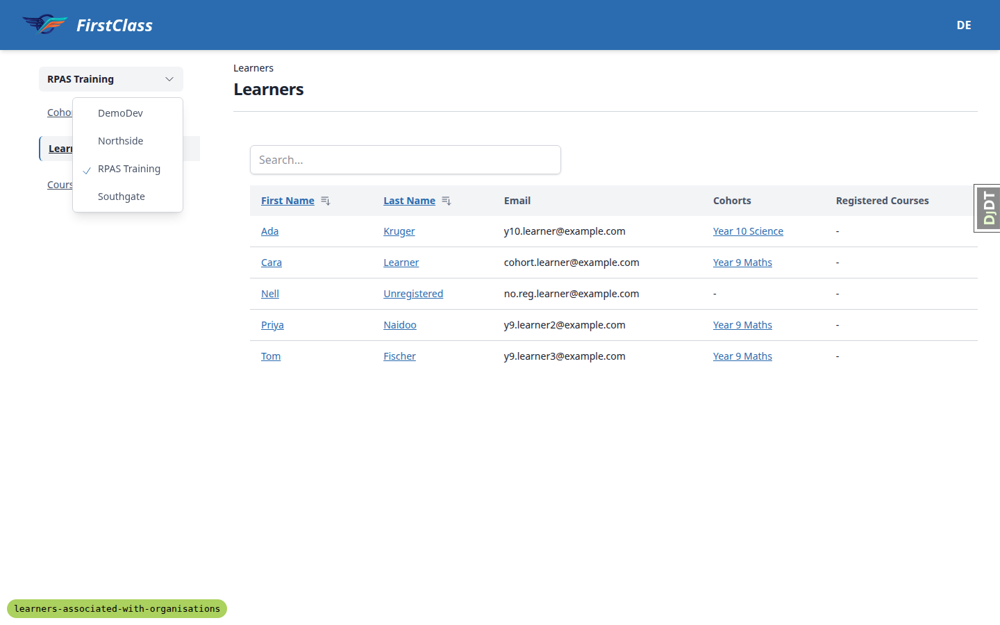

# Educator Interface

_Last updated: 2026-10-25_

## Summary

- Educators use a single-page HTMX panel with three sections: Cohorts, Learners, and Courses, plus Messages when direct messaging is turned on. Organisation admins also get a Members section, under Administration.
- A learner or cohort can be previewed in a quick-view drawer without leaving the list.
- The interface is scoped to one organisation at a time, chosen with a switcher and carried in the URL. See [Organisation Scope](#organisation-scope).
- Educators can create, edit, deactivate and delete cohorts, and register a cohort for courses or deactivate that registration. A cohort's page shows an overview with per-course completion, then Learners, Courses, Report and Settings tabs. See [Cohorts](#cohorts).
- The landing page is a dashboard of the cohorts the educator can see: totals, the learners who need attention, and each cohort's progress. A cohort's Report tab shows its progress report on screen, with the PDF to download. See [Reporting](#reporting).
- Educators can add learners by email, see whether each is active, pending or inactive, put them in or move them between cohorts, register them for courses, and deactivate or reactivate them. See [Learners](#learners).
- The Courses list shows each course's visibility and an interest count. Visibility is read-only here.
- When direct messaging is turned on, educators can message learners from a Messages section or from a learner's quick view. See [Messages](#messages).
- **Access is granted by role**: site admin, organisation admin, cohort admin or cohort viewer. Cohorts, Learners and Courses are all scoped to the current organisation and filtered to what the educator's roles cover. See [Access Control](#access-control).
- Organisation admins add members, assign and deactivate their roles, and deactivate or reactivate them from the Members section. See [Members and roles](#members-and-roles).
- Site and organisation admins see a record of who changed what and when, on a History tab on learner and cohort pages and in an Audit log section. See [History](#history).
- **Limits:** educators cannot see or set deadlines, and there are no bulk learner operations. See [Limits](#limits).

## Panel Interface

The educator interface is a single-page application, scoped to one organisation at a time — see [Organisation Scope](#organisation-scope). Navigation within it is HTMX-driven: selecting a section or item updates the main panel, sidebar, and breadcrumb without a full page reload.

**Quick view.** Clicking a learner's or cohort's name opens a summary in a drawer beside the list, with a link through to the full page. On a wide screen the drawer docks beside the page, and on a phone it opens as a sheet. For a learner it shows email, status, cohorts, course registrations with progress, and when they were last active in a course. For a cohort it shows status, learner count and courses. It shows only what the educator could already see on the full page. Courses have no quick view. When direct messaging is turned on, a learner's quick view also has a box showing the latest messages with that learner and a composer to reply.

Creating, editing, deactivating and deleting a cohort, and registering it for a course or deactivating that registration, happen in a dialog over the current page rather than on a separate page.

### Cohorts

- **List view** — each cohort in the current organisation the educator has access to, with its status, learner count and registered courses. Inactive cohorts are hidden until **Show inactive** is switched on, and the list can be filtered by course.
- **Creating and renaming** — a name is all a cohort needs, and names must be unique within an organisation. **Save and add another** keeps the dialog open for creating several in a row. An active cohort is renamed from its page header.
- **Detail page** — five tabs. *Overview* shows the cohort's details, completion for each course it is registered for, the educators assigned to it with their roles, and a needs-attention card listing the cohort's flagged learners. *Learners* lists the cohort's learners. *Courses* lists the cohort's course registrations. *Report* shows the cohort's progress report on screen — see [Reporting](#reporting). *Settings* holds deactivation and deletion. Only a cohort the educator has access to can be opened — see [Access Control](#access-control).
- **Registering for courses** — the Courses tab registers the cohort for any course that is not coming soon, and deactivates a registration from its row. Deactivating a registration is reversible and everyone keeps their progress. The confirmation says how many learners lose access and names the learners who keep it through another registration. A course not open to the cohort's organisation is not offered, and registering for one is refused with a message.
- **Learners tab** — add learners to the cohort, and remove or move a learner from their row. An inactive cohort takes no membership action. See [Learners](#learners).
- **Deactivating** — an inactive cohort's registrations grant no access to their courses and the cohort becomes read-only; learners keep their place and progress, and reactivating restores access. See [learner tracking](./learner-tracking.md#what-is-recorded).
- **Deleting** — only while the cohort has no learners and no course registrations, inactive learners and inactive registrations included; otherwise the Settings tab says what still depends on it. Deleting a cohort also deletes the cohort roles held on it.

Renaming, deactivating, reactivating and deleting need an organisation admin or site admin; a cohort admin can register their own cohort for courses and deactivate those registrations. An organisation admin can add a member to the cohort from the Overview's educators panel; their roles are changed and deactivated from [Members](#members-and-roles). Not built: bulk actions.

### Learners

Lists the learners of the current organisation the educator has access to — learners in cohorts they can see, plus, for an educator holding an organisation-wide role, everyone associated with the organisation, whether or not they have enrolled in anything yet. Someone studying with more than one organisation appears once per organisation, showing only the cohort memberships and course registrations belonging to the one currently in view. Each learner has a status: **active**, **pending** (staff created their account and they have not yet set a password and signed in) or **removed**. Removed learners are hidden until the Status filter asks for them. Detail pages carry the same access check as the listing; see [Access Control](#access-control).

- **Adding learners** — organisation admins and site admins paste up to 50 email addresses, optionally with names, and can put them straight into a cohort. An address that already has an account on the site joins the organisation; a new one gets an account and an **account setup email** with a link to choose a password, which can be resent from the learner's page. The dialog reports what happened to each address. Staff-created people still meet the site's terms and registration forms at first login.
- **Learner page** — a header with name, email, status and actions, and tabs for an overview, courses, and history. The Courses tab gives each course the learner is registered for its completion, a progress status and any at-risk flags, the items completed and the last one, and every quiz attempt with its score and the quiz's pass mark. The History tab lists the recorded changes to the learner. See [History](#history).
- **Cohort membership** — add a learner to a cohort, remove them, or **move** them to another active cohort in the organisation. Each confirmation names the courses the learner loses access to. A move carries course progress across, keeping whichever record is further along for a course both cohorts grant; nothing is deleted.
- **Course registration** — register a learner for any course that is not coming soon, deactivate and reactivate the registration. Deactivating a registration keeps their progress and says whether a cohort still gives them the course. Registering a learner for a course not open to their organisation, or reactivating such a registration, is refused with a message.
- **Deactivating** — removes the learner's access to this organisation's courses while keeping their cohorts, registrations and progress, which return on reactivation. On the site's default organisation a learner can undo a deactivation, of the learner or of a registration, by registering themselves for an open course.
- **Editing** — only a site admin can edit a learner's name. Email is the learner's login for every organisation, so it is changed only in the Django admin.
- **Export CSV** — the list, and a cohort's Learners tab, export what they show as a spreadsheet-safe CSV: name, email, status, cohorts, courses and last active date, narrowed by the current search and filters.

Cohort admins manage membership and course registrations within the cohorts they are assigned to; adding, deactivating and reactivating learners, and resending the setup email, need an organisation admin or site admin. Each action sends a [webhook](./webhooks.md) event.

### Courses

The Courses section is read-only and scoped to the current organisation. It lists every published course, plus any course registered to a cohort or learner the educator can see, so a hidden or coming-soon course appears only where this organisation uses it. A course that belongs to other organisations, and is not public, is not listed (see [multi-tenancy and isolation](./multi-tenancy-and-isolation.md#organisations)). Cohorts are registered for courses from the cohort page.

Each course shows its **visibility** — published, coming soon, or hidden — its active learner and cohort counts, and the cohorts registered for it. Counts and cohort links include only what the educator can see, and inactive cohorts are not counted. Visibility filtering only ever applies to learners, never to educator or admin views.

Each course also shows an **interest count**: the number of learners who have expressed interest through the coming-soon waitlist, counted site-wide rather than per organisation. The count is shown for every course, so a course that has since launched still shows the demand it attracted. Who expressed that interest, and when, is read in the Django admin — see [admin interface](./admin-interface.md).

The course detail view shows the title and category, the cohorts registered for the course with each cohort's status, and any direct non-cohort registrations, limited to what the educator can see. A course outside the organisation's scope returns "not found".

Visibility is **read-only** here and in the Django admin. It is set solely in the course's content frontmatter and takes effect on import — see [content editing workflow](./content-editing-workflow.md). The learner-facing experience of coming-soon and hidden courses is covered in [learner experience](./learner-experience.md).

### Members and roles

Members are the people who help run an organisation, whether or not they teach. A member holds one or more of these roles in the organisation:

- **Organisation admin**: Manages learners, cohorts and members in this organisation.
- **Cohort admin**: Manages the learners and course registrations in their cohorts.
- **Cohort viewer**: Sees the learners and progress in their cohorts, and changes nothing.

A fourth role, **Site admin**, gives full access to every organisation on this site. It is not given from this interface (see [Limits](#limits)), and a site admin is listed as a member of an organisation only through a role they hold in it. A learner is a member only if they also hold one of these roles.

The Members section, under Administration in the navigation, is visible only to organisation admins and site admins. It lists each member with their roles, the cohorts a cohort role covers, and who added each role and when, and can be searched and filtered by role. From it an organisation admin can:

- **Add a member** by email. An address that already has an account shows that person's name and email before anything is saved; a new address gets an account and an [account setup email](#learners). The admin picks one role and, for a cohort role, the cohorts it covers. A cohort role covers only the cohorts chosen, not cohorts added later.
- **Change the cohorts** on a cohort role.
- **Deactivate a role.** The person keeps their account, their other roles and any place as a learner.
- **Deactivate** a member, which stops everything they can do in this organisation while keeping their roles, and **reactivate** them.

Admins can give only roles at or below their own. Any change that gives someone access they did not have, or takes access away, is confirmed first and says what changes. Roles add up: to change someone's role, assign the new one and deactivate the old. The person is not notified when a role is assigned or deactivated, a setup email cannot be resent from this section, members have no page of their own, and role changes and member deactivations are recorded in the [Audit log](#history).

### History

The educator interface records who changed what, and when, for the actions educators take here: learner changes, cohort membership and course registrations, cohort changes, and member roles and deactivations. The record shows as a **History** tab on a learner's page and on a cohort's page, and as an **Audit log** section under Administration. A move between cohorts appears on the learner and on both cohorts. Each row shows when, who, what and any details, and the cohort tab and the Audit log also name the person each row is about. Deleting a cohort also records each role that went with it. Changes with no user behind them show as "System".

Confirming a removal or deactivation (removing a learner from a cohort, deactivating a course registration, deactivating a learner or cohort, deleting a cohort, deactivating a role, deactivating a member) offers an optional **Reason**, shown in the history to staff only.

Only site admins and organisation admins see the History tabs and the Audit log; cohort admins and cohort viewers do not. The Audit log lists the current organisation's entries, newest first, filtered by who, by what and by when.

Not recorded: anything before the feature was installed (there is no backfill), records edited directly in the Django admin, and logins. The log has no search or CSV export, and entries cannot be edited or undone. For how long entries are kept and how they are protected, see [security and data handling](./security-and-data-handling.md#audit-log-built).

### Messages

When direct messaging is turned on, the sidebar has a Messages link with a count of unread conversations. It lists the educator's conversations with learners in the current organisation, with a **New message** action to start another; conversations with colleagues stay in the shared inbox. Who an educator may message is decided by the messaging policy. See [messaging](./messaging.md).

### Reporting

The dashboard is the first page an educator sees. It covers every active cohort they can see in the current organisation: tiles for learners, cohorts, average progress and learners needing attention, a list of flagged learners across those cohorts, and one progress row per cohort. A cohort larger than the report's learner limit is left out, and the dashboard says so. There are no charts.

A cohort's **Report** tab shows the [cohort report](./reports.md) on screen: the cohort at a glance, the learners needing attention, a progress summary per course with quiz scores, and the quiz confusions. Per-learner detail stays in the PDF. From the same tab an educator with the report download capability can generate the PDF and download the latest one; the button shows it is working until the report is being generated, and a report that has not finished after ten minutes can be started again. A learner with nothing to do yet, because their cohort is not registered for a course, is never flagged as needing attention, and nor is a learner who has finished everything.

The on-screen figures are recalculated every few minutes rather than on every page view (see `REPORTS_SCREEN_CACHE_SECONDS` in [configuration and extension](./configuration-and-extension.md#settings-reference)). Adding or removing a learner, or registering a course or deactivating a registration, shows at once; new progress shows at the next recalculation, or when the Report tab's Refresh is pressed.

Dashboard and report figures are recalculated every few minutes rather than live. Each page says when its figures are from, and the Report tab can be refreshed.

## Organisation Scope

The educator interface is scoped to one **organisation** at a time — a grouping layer within a site, sitting above cohorts and course registrations. See [multi-tenancy and isolation](./multi-tenancy-and-isolation.md#organisations) for what an organisation is and where the isolation boundary actually sits, and [admin interface](./admin-interface.md#organisation-management) for how organisations are created.

The current organisation is part of every page's URL rather than being remembered in the session, so two browser tabs can sit on two different organisations at once, the back button behaves correctly, and any page can be linked to directly.

A switcher at the top of the left sidebar always names the current organisation. Where an educator can reach more than one, the name opens a list to switch between them; where they can reach only one, the name is still shown, as static text.

Switching on a list page reloads it for the newly selected organisation. Switching while viewing a cohort or learner that does not belong to the newly selected organisation returns to the equivalent list with an inline notice rather than an error page.

## Access Control

Access to the educator interface and to cohort reports comes from **role assignments**. Permissions granted on a cohort or organisation in the Django admin have no effect here. The four built-in roles are described in [Members and roles](#members-and-roles).

A person holding several roles gets all of them. A role on an organisation covers every cohort in it, including ones created later; a role on a cohort covers that cohort and its learners. Organisation and cohort roles count only while the person is an active member of that organisation: deactivating a member switches off their access there without deleting their roles, and reactivating restores it. Organisation admins can assign roles only within their own organisation, nobody can change their own roles, and an organisation's last admin can have the role deactivated, or be deactivated as a member, only by a site admin.

**What is enforced.** The Cohorts, Learners and Courses listings are scoped to the selected organisation and filtered to what the educator's roles cover. Their detail pages carry the same check: an educator who navigates directly to one outside their access gets a "not found" response, the same response a record that does not exist would give, so identifiers cannot be probed by guessing URLs. Every write is checked before it runs, and a control the educator's role does not allow is hidden rather than shown disabled.

If an educator acts from a page that was open when their access was removed, a dialog says the action can no longer be used there and names who to ask: the organisation's admins by name where the educator may see the organisation's members, otherwise "an administrator". It offers close only, never retry. If the object itself has left their access, the dialog says it is no longer available.

**Site isolation is unaffected.** All educator interface queries remain scoped to the current site, so nothing here crosses a tenant boundary. See [multi-tenancy and isolation](./multi-tenancy-and-isolation.md).

## Limits

These operations are not available in the educator interface:

- **Bulk learner operations** — adding more than 50 people at once, importing from a file, and acting on several learners at once.
- **Email changes** — a learner's email is changed in the [Django admin](./admin-interface.md#learner-rosters).
- **Deleting a learner** — learners are deactivated, never deleted, here.
- **Site admin** — the site admin role is not assigned or deactivated from the educator interface, nor from the Django admin.
- **Deadlines** — due dates, time limits, deadline overrides and overdue status are not shown or set here, and overdue learners do not appear in the needs-attention list. Overrides are set in the Django admin; see [admin interface](./admin-interface.md#deadline-overrides).

Educators cannot send email to learners from FLS, and there is no group or broadcast messaging; see [messaging](./messaging.md#not-built).
