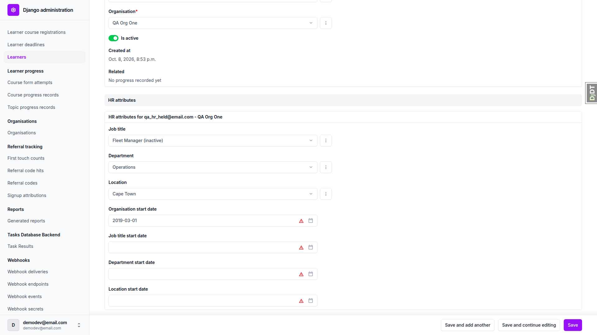

# HR Attributes

_Last updated: 2026-10-22_

## Summary

- **An administrator can record each learner's job title, department and location in the Django admin**, plus four dates: when the learner joined the organisation, and when they started in their current job title, department and location. Built.
- **Job titles, departments and locations are chosen from lists the administrator maintains for each organisation.** Built.
- **List entries are deactivated rather than deleted once in use.** An entry that a learner holds, or that a registration rule names, cannot be deleted. Built.
- **Each organisation has a "Registration rules enabled" switch, off by default, that controls whether its [registration rules](./registration-rules.md) act.** Built where the registration rules app is installed.
- **The app is optional.** A project that leaves it out sees no change. See [configuration and extension](./configuration-and-extension.md#custom-app-extension-model).
- **The data is admin-only.** No learner, educator-interface or CSV surface exists. Not built.

## What Is Recorded

The attributes appear as a panel on a learner's admin page, and the registration rules switch as a panel on the organisation's admin page; the lists have their own admin screens. See [admin interface](./admin-interface.md). An organisation here is the grouping described in [multi-tenancy and isolation](./multi-tenancy-and-isolation.md#organisations).

Every field is independent and optional. A date can be set with no matching list entry, dates are not checked against each other, and future dates are accepted, because rehires and acquisitions produce real data that an ordering rule would reject. These are personal data about a learner; see [security and data handling](./security-and-data-handling.md#personal-data-collected).

## The Organisation Lists

Each organisation has its own job title, department and location lists, and a learner can only be given entries from their own organisation. Names are unique within an organisation regardless of case or surrounding spaces; two organisations can use the same name.

A deactivated entry drops out of the choices for other learners, but a learner who already holds it keeps it and can still be saved. Admin actions deactivate or reactivate a selection. Deleting an entry that a learner holds is refused, with the holders listed. Deleting an entry that a [registration rule](./registration-rules.md) names is refused too; deactivate it instead.

Moving a learner to another organisation is refused until their job title, department and location are cleared, since those entries belong to the old organisation.

## Registration Rules Switch

The switch exists for each organisation and is off by default. [Registration rules](./registration-rules.md) only act for an organisation while it is ticked; with the registration rules app not installed, ticking it changes nothing.

## Not Built

- Educator-interface screens, a learner-facing view, or CSV import of these attributes.
- SSO or SCIM sync from a directory.
- Hierarchies in the lists, merging entries, or organisation-defined custom attributes.
