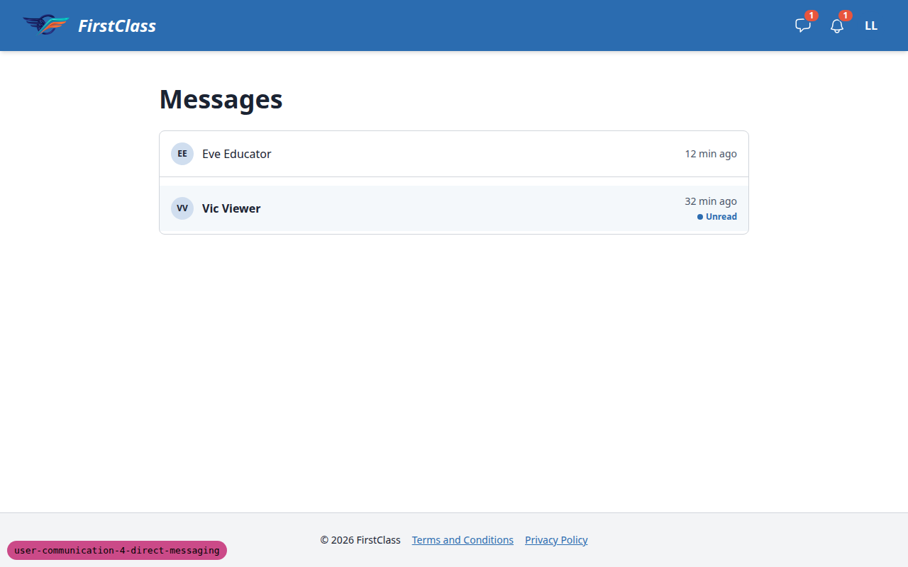

# Direct Messaging

_Last updated: 2026-10-18_

## Summary

- Two users on a site can hold a private, one-to-one conversation inside FLS. Learners and educators both get an inbox, a thread and a composer.
- A Messages button with an unread count sits in the shared header. Educators also get a Messages section in the educator interface and a message box in the learner quick view.
- Who may message whom is decided by the [messaging policy](./configuration-and-extension.md#messaging-policy), and every send is checked against it.
- Messaging is **off by default**.
- Not built: group or broadcast messaging, attachments, editing or deleting, reporting and blocking, email, typing indicators and presence.

## Inbox, Thread and Composer

Every signed-in user has an inbox listing their conversations, newest activity first. Each row shows the other person, the time of the last message and an unread marker. Opening a conversation shows its thread with a composer beneath it. On a wide screen the inbox and the open thread sit side by side; on a phone they are separate views with a back control. A user starts a new conversation by searching for a person they are allowed to message; a learner who has nobody to message simply sees an empty inbox. There is one conversation per pair of users on a site.

Messages are plain text with a length limit. Web addresses and email addresses in them become links; nothing else is formatted. A user only ever sees conversations they take part in.

The header Messages button opens the inbox for everyone, educators included, and carries a count of conversations with unread messages. Each unread conversation raises one [notification](./notifications.md); further messages in it update that notification rather than adding more.

New messages arrive by polling, not push: an open thread, the inbox and the header count refresh themselves every so often, so a reply can take a few seconds to show. A draft in the composer is never overwritten by a refresh, and a send that is repeated by a double click or a retry is stored once.

## Who May Message Whom

The [messaging policy](./configuration-and-extension.md#messaging-policy) decides who can start a conversation and who can reply, and the composer and the new-conversation search only offer people the policy allows. If a policy change means a person can no longer be messaged, the conversation stays readable by both people, is marked "Read only" in the inbox, and its composer is replaced by a note; a send that is refused keeps the text in the box. If one participant's account is deleted, the conversation and its messages are kept and the other person sees the sender as "Deleted user"; see [security and data handling](./security-and-data-handling.md).

## For Educators

The educator interface has a Messages section listing the educator's conversations with learners in the selected organisation, with an unread count on its sidebar link. Conversations with colleagues appear only in the shared inbox. Educators can start a conversation from the section. The learner quick view also has a message box showing the latest few messages and a composer, so an educator can reply without leaving the learner they are looking at.

## Turning It On

Messaging is hidden until a project sets `MESSAGING_ENABLED`. While it is off, no messaging button, section or box is shown and the messaging pages do not exist.

Messages are not registered in the Django admin, so site staff cannot browse them there.

## Not Built

- **Group conversations and broadcasts.** A conversation has exactly two people. There is no cohort-wide or all-learners message.
- **Attachments, editing and deleting.** A message is text and cannot be changed or removed once sent.
- **Reporting and blocking.** A user cannot report a message or block a sender.
- **Email.** A new message produces an in-app notification only; there is no email, preference or digest.
- **Typing indicators and presence.** Nothing shows that the other person is online or typing.
- **Instant delivery.** Messages arrive by polling, not WebSockets.

See the [roadmap](./roadmap.md#direct-messaging) for what else is missing.
