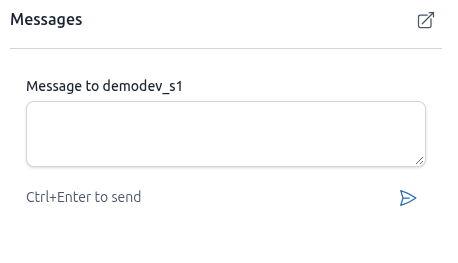
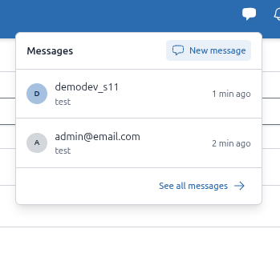
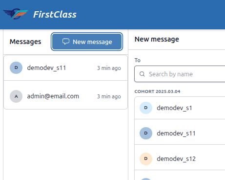
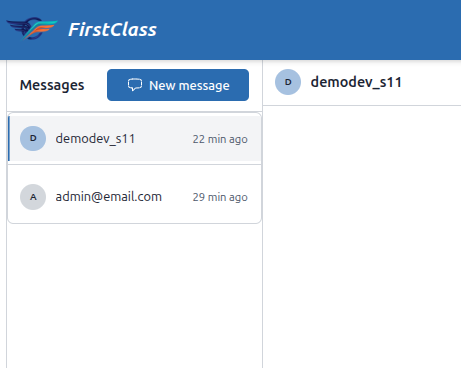
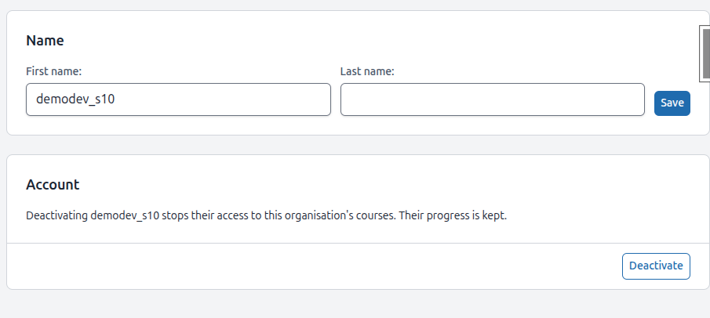

http://127.0.0.1:8003/educator/organisations/demodev/staff
- allow resend of invitation email
- see who has not yet accepted their invitation, show when it was sent

http://127.0.0.1:8003/educator/organisations/demodev/cohorts/5632c32c-b586-46ef-8d46-cd8423d1f56d/__tabs/learners
in the quick view panel, remove the the hr under the "messages" heading

Learner Messages tab
http://127.0.0.1:8003/educator/organisations/demodev/learners/9921d14d-facd-4189-98ce-5017928e6c0d/__tabs/messages
Should be able to send messages from here

Dashboard
http://127.0.0.1:8003/educator/organisations/demodev/dashboard
The learners block should link to the learners list
The cohorts block should link to the cohorts list
Individual cohort progress should link to cohort details page
Make sure that when we mention a thing on the dashboard we can quickly navigate to that thing
When mentioning an idividual cohort, learner, ehatever, the quick view panel is also available

Messages new:
http://127.0.0.1:8003/messages/new/
the search function does not seem to filter by email. Allow filter by email, names, cohort

When choosing to make a new message from the button in the dropdown we go to the wrong place:

This takes us to a full page that only allows us to select who to message. It should not be a seperat page.
 when clicking "new message" from the messages panel, then the righthand side gets populated. This is the correct behavior.
Make both "new message" buttons behave in the exact same way and link to the exact same thing.

http://127.0.0.1:8003/messages
In the right hand panel, we need to see who is staff and who is a learner. Use a chip to show staff. For learners, show their cohorts as chips

http://127.0.0.1:8003/educator/organisations/demodev/learners/6bd97d3b-3b72-4172-b849-dcf074aea596/__tabs/messages
When viewing conversations frm  different staff, we can only see the latest message. We need to see the full message history.

http://127.0.0.1:8003/educator/organisations/demodev/learners/6bd97d3b-3b72-4172-b849-dcf074aea596/__tabs/overview
When looking at any person, we should be able to quickly open chat. Perhaps a quick view panel

http://127.0.0.1:8003/educator/organisations/demodev/staff
We should be able to quickly message staff from the quick view panel

http://127.0.0.1:8003/educator/organisations/demodev/staff
This should be visible to anyone with staff viewer access

http://127.0.0.1:8003/educator/organisations/demodev/cohorts/5632c32c-b586-46ef-8d46-cd8423d1f56d
If someone can see a cohort, they should see the staff assigned to that cohort. Make a seperate "staff" tab instead of having staff under settings
If you can see a staff member, you can message them

http://127.0.0.1:8003/messages/17bbfd86-1608-429a-8cf9-0d53aae2b7d8/
When we type a message here or in any other place then save a draft. Add a chip to the message navigator to say there is a draft. Autofill the message textbox with the draft
 remove the borders around individual users. Use whitespace, not borders

Whole educator interface:
Dont use admonitions from the content engine. Update skills and resources so it doesn't happen again. use the django messages framework for once-off messages.  If we need to show error messages in a more perminant way then we need something built specifically for the panels framework

http://127.0.0.1:8003/educator/organisations/demodev/learners/04ba8560-b04a-4515-96d2-a4db1e6d3746/__tabs/settings
show the learner email, dont allow it to change

The [save] button should be under the form. The color of the button is right, but the style is inconsistent.
A panel can have a footer area for buttons, these types of buttons should be displayed in a consistent way across all panels. The deactivate button looks right. Make sure we use standardardised templates to display panel footer buttons consistently

Data tables: Buttons are too big in all data tables. Either use text-only buttons, or make super-tight buttons that have less padding
