# Spec roadmap

What gets built next, grouped by feature. Run `/sdd:roadmap` to update it. The format is in
`claude_plugins/sdd/resources/roadmap_format.md`. The product roadmap is `docs/product/roadmap.md`.

## Up next

Generated by the sdd roadmap script from the feature sections below. Do not edit by hand.

### In progress

- `auto-run-tailwind-watch` (Tooling and operations)
- `compliance-form-randomization` (Forms and applications)
- `content_snapshots` (Learner experience)
- `deadlines-3-extensions-and-pause` (Deadlines)
- `design_educator-interface-bulk-action` (Educator interface)
- `downstream_bugs_oct_29` (Tooling and operations)
- `educator-interface-13-staff-roles` (Educator interface)
- `educator-interface-course-content-preview` (Educator interface)
- `in-app-feedback` (Learner experience)
- `learner-facing-ux-refinements` (Learner experience)
- `new-register-design-process` (Tooling and operations)
- `phone-number-form-field` (Forms and applications)
- `qa-boy-scout-throwaway` (Test organisation and hygiene)
- `test-organisation-and-hygene-2-sdd-review-and-boy-scout` (Test organisation and hygiene)

### Ready to start

- `audit-log-coverage-gaps` (Educator interface)
- `cookie-banner` (Referral tracking and marketing)
- `corporate-job-course-recommendations-4-educator-interface-screens` (Registration rules)
- `corporate-job-course-recommendations-5-attribute-csv-import` (Registration rules)
- `deadlines-7-educator-at-risk` (Deadlines)
- `educator-interface-dark-mode` (Educator interface)
- `educator-interface-data-table-filter-design` (Educator interface)
- `educator-interface-misc-polish` (Educator interface)
- `failed-login-follow-up` (Referral tracking and marketing)
- `file-scanning` (Forms and applications)
- `forced-site-name-for-host-based-site-lookup` (Tooling and operations)
- `form-engine-branch-logic-2-and-conditions` (Forms and applications)
- `housekeeping-sentry-cron-checkin` (Tooling and operations)
- `landing-page-component-kit` (Referral tracking and marketing)
- `learner-import-management-command` (Tooling and operations)
- `referral-attribution-over-time` (Referral tracking and marketing)
- `referral-tracking-referer-host-normalisation` (Referral tracking and marketing)
- `retry-sent-emails` (Tooling and operations)
- `server-side-conversion-tracking` (Referral tracking and marketing)
- `test-organisation-and-hygene-10-content-engine-and-markdown-rendering` (Test organisation and hygiene)
- `test-organisation-and-hygene-11-reports` (Test organisation and hygiene)
- `test-organisation-and-hygene-12-accounts` (Test organisation and hygiene)
- `test-organisation-and-hygene-13-learner-interface-part-1` (Test organisation and hygiene)
- `test-organisation-and-hygene-15-educator-interface` (Test organisation and hygiene)
- `test-organisation-and-hygene-5-foundational-apps` (Test organisation and hygiene)
- `test-organisation-and-hygene-6-small-apps` (Test organisation and hygiene)
- `test-organisation-and-hygene-7-course-access-and-applications` (Test organisation and hygiene)
- `user-communication-6-moderation` (User communication)
- `user-communication-help-desk` (User communication)

### Needs work on main first

- `mega-qa` (Tooling and operations): cut it with `/sdd:roadmap mega-qa` (three ideas: staging reset, then the suite, then downstream propagation).

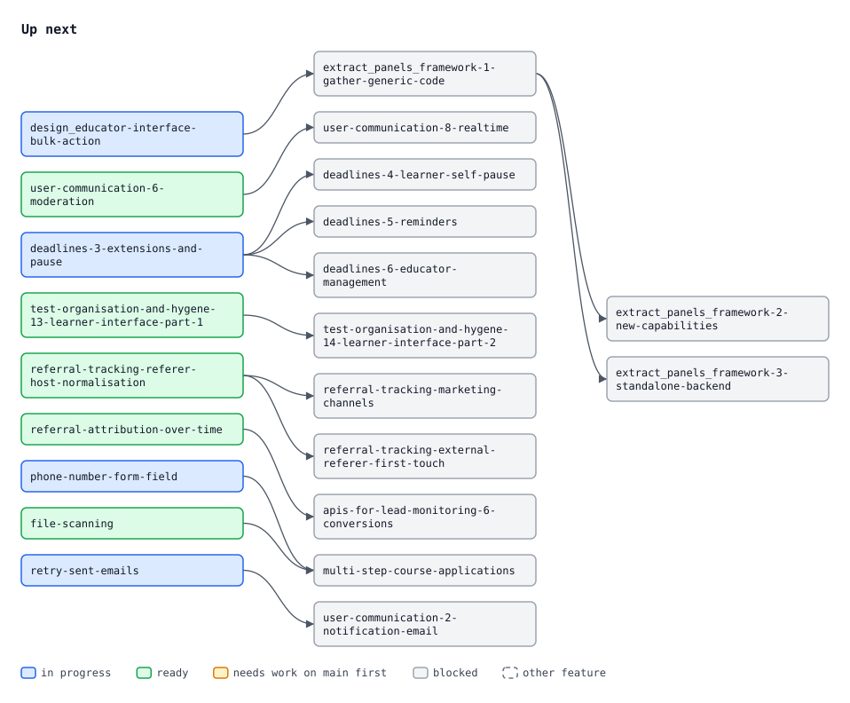

## Educator interface

Org admins manage learners, cohorts, registrations and staff. Parent: `educator-interface-full-polish`.

- `educator-interface-13-staff-roles` — **in progress** — A person holds different roles on different cohorts. Add role grants one, cohort Settings changes or removes it, and Add staff searches people as you type.
- `educator-interface-course-content-preview` — **in progress** — Educators preview course content in a modal.
- `design_educator-interface-bulk-action` — **in progress** — Restyle the bulk-action bar to the Claude Design mock: a selection count, select and clear all, a More menu and a confirmation modal.
- `educator-interface-misc-polish` — **ready** — Polish found while walking the interface: optional learner names, cohort settings sub-panels, show and hide table columns, help icons, smaller mobile buttons.
- `educator-interface-data-table-filter-design` — **ready** — One button per filter on data tables, instead of a single long drop-down. The UX still needs designing.
- `educator-interface-dark-mode` — **ready** — Dark token values for both shipped themes. They follow `prefers-color-scheme`, and a user can choose explicitly.
- `audit-log-coverage-gaps` — **ready** — The audit log also records Django admin edits, system admin role changes and report downloads, and marks the date its history starts.

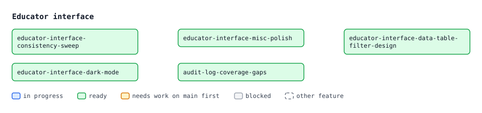

**Notes**
- `educator-interface-13-staff-roles` edits only `educator_interface`, so it can run beside the `extract_panels_framework-*` specs.
- `design_educator-interface-bulk-action`, `educator-interface-misc-polish`, `educator-interface-data-table-filter-design` and `educator-interface-dark-mode` change framework templates or JS. Land them before `extract_panels_framework-1-gather-generic-code` where possible; otherwise rebase onto it.
- Decided: deactivate, never delete. Admins grant only their own level and below, inside their own scope. Only `site_admin` grants `site_admin`.
- Access rules: anything outside the user's scope returns 404. An action the user has lost permission for returns 403 with a message. Controls the user can't use are hidden. No new dependencies.
- Not yet cut: `educator-interface-full-polish/application-review-ui/`, the application review workflow (a state machine on `CourseApplication`, a reviewer role, an inbox).
- References: the mockups in `educator-interface-full-polish/Educator LMS Interface Design/` (layout only, not scope), and `brand-guidelines` and `fls-dev:panel-framework`.

## Panel framework extraction

The panel framework moves into its own installable package, because another Django project needs it. Parent: `extract_panels_framework`.

- `extract_panels_framework-1-gather-generic-code` — **blocked** by `design_educator-interface-bulk-action` — Generic panel code moves into the framework from `educator_interface`, `base`, `comms` and `deployment`. Framework tests cover every component.
- `extract_panels_framework-2-new-capabilities` — **blocked** by `extract_panels_framework-1-gather-generic-code` — Adds a required-reason dialog, an `as_of` stamp on lazy panels, and expandable rows with a compact density.
- `extract_panels_framework-3-standalone-backend` — **blocked** by `extract_panels_framework-1-gather-generic-code` — The framework's Python stops importing FLS: its own settings, CSV helpers and request-site hook, with standalone unit tests.
- `extract_panels_framework-4-template-contract` — **blocked** by `extract_panels_framework-2-new-capabilities` — Templates, JS and CSS stop assuming FLS: a checked host contract, its own primitives and stylesheet, standalone browser tests.
- `extract_panels_framework-5-package-and-install` — **blocked** by `extract_panels_framework-3-standalone-backend`, `extract_panels_framework-4-template-contract` — The public `django-panel-framework` repo, tagged `v0.1.0`. FLS installs it by git tag and drops the old table.
- `extract_panels_framework-6-claude-plugin` — **blocked** by `extract_panels_framework-5-package-and-install` — A generic `panel-framework` Claude Code plugin and developer doc in the package repo. `fls-dev` keeps only a pointer.

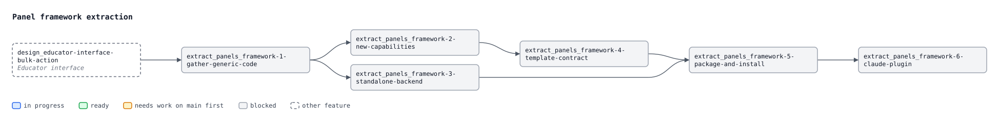

**Notes**
- `extract_panels_framework-1-gather-generic-code` runs alone, after `design_educator-interface-bulk-action`. Specs touching `educator_interface`, `comms`, `reports` or `learner_management` must rebase onto it, and onto `extract_panels_framework-5-package-and-install` once that changes the import prefix.
- `extract_panels_framework-2-new-capabilities` and `extract_panels_framework-3-standalone-backend` run in parallel. Both edit `tests/conftest.py`.
- Decided: a public MIT repo released by git tag; no PyPI and no submodule. App label `panel_framework` starting from a clean `0001`, and no data is migrated. FLS pins it with a PEP 508 git URL in `[project].dependencies`.
- Decided: multi-site stays. A settings-declared site resolver defaults to `get_current_site`.
- Assumed: there is no shared core package. If one turns out to be needed, stop and say so. The package ships overridable primitives, and the host schedules the bulk-run sweep.
- Open questions:
  - where `sidePanel` and `refreshTimer` live (`extract_panels_framework-1-gather-generic-code`);
  - how package primitives avoid clashing with host components (`extract_panels_framework-4-template-contract`);
  - the uv editable-install spike (`extract_panels_framework-5-package-and-install`).
- The other project must not install the package before `extract_panels_framework-5-package-and-install`.
- References: `research_packaging_and_distribution.md` and `research_coupling_audit.md`, both in the parent.

## User communication

Notifications and direct messaging between learners and educators. Parent: `user-communication`.

- `user-communication-2-notification-email` — **blocked** by `retry-sent-emails` — Email delivery. Per-category immediate, daily, weekly or off preferences, quiet hours, unsubscribe, and a digest sweep in housekeeping.
- `user-communication-6-moderation` — **ready** — Users report a message or block a user. Site admins work a report queue and can hide messages. Nothing is hard deleted.
- `user-communication-8-realtime` — **blocked** by `user-communication-6-moderation` — Optional Django Channels push for the unread badge and open threads. Off by default, with polling as the fallback.
- `user-communication-help-desk` — **ready** — Learners ask for help about specific content from the course player. Requests land in a shared queue that educators pick up.

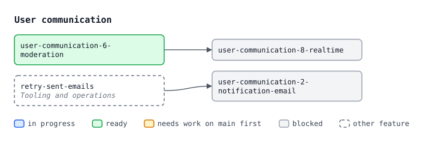

**Notes**
- `user-communication-2-notification-email` and `user-communication-6-moderation` run in parallel. UI specs build to the design registered in `user-communication/design.md`.
- Email contract: a backend re-reads the notification when it sends and skips it if read. Updating a notification queues nothing. Messages raise no notification, so message email needs its own trigger.
- Decided: polling is the transport. Messaging permissions are layered and closed by default, through a swappable policy class. Moderation is report, hide and block.
- `user-communication-help-desk` needs its own queue model, because a `Conversation` is between exactly two users.
- Assumed: configuration is edited in the Django admin. Conversations are one-to-one with no read receipts. Background work passes `site_id` explicitly.
- Open questions:
  - where the report queue lives (`user-communication-6-moderation`);
  - what a digest holds and where a user's timezone comes from (`user-communication-2-notification-email`).
- Out of scope: announcements, forums, group conversations, SMS and push, reply-by-email.

## Deadlines

Due dates and course time limits, with consequences, pause, reminders and at-risk views. Parent: `deadlines`.

- `deadlines-3-extensions-and-pause` — **in progress** — In the admin, staff extend a learner's deadlines and pause or resume their course. The clock stops and dates shift, with webhooks.
- `deadlines-4-learner-self-pause` — **blocked** by `deadlines-3-extensions-and-pause` — Learners pause and resume their own course within the policy's limits, giving a reason.
- `deadlines-5-reminders` — **blocked** by `deadlines-3-extensions-and-pause` — A housekeeping sweep sends learners reminders, educators rolled-up overdue notices, and fires a `deadline.missed` webhook.
- `deadlines-6-educator-management` — **blocked** by `deadlines-3-extensions-and-pause` — In the educator interface, staff set deadlines, extend them (also in bulk), and pause or resume courses. Every change is audit-logged.
- `deadlines-7-educator-at-risk` — **ready** — Overdue and due-soon learners appear in Needs attention and on the dashboard, and the cohort report gets an at-risk rule.

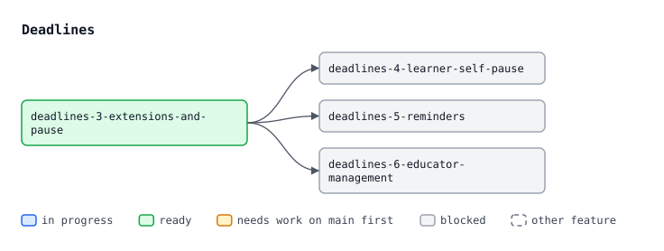

**Notes**
- `deadlines-7-educator-at-risk` runs beside `deadlines-3-extensions-and-pause`. `deadlines-4-learner-self-pause`, `deadlines-5-reminders` and `deadlines-6-educator-management` run in parallel after it.
- Collisions:
  - `deadlines-3-extensions-and-pause` and `deadlines-4-learner-self-pause` both edit the player gates.
  - `deadlines-5-reminders` adds a housekeeping sweep, as do `retry-sent-emails` and `file-scanning`.
  - `deadlines-7-educator-at-risk` edits `reports/at_risk.py`.
- Decided: pause stops the clock and nothing opens while paused. Learners self-pause with no approval. Once a time limit ends access, only staff can restore it. Policy lives in the Django admin.
- Assumed: a deadline attaches to the placement (`ContentCollectionItem`). The start is `CourseProgress.created_at`. The most permissive deadline wins. Ending access leaves `is_active` alone.
- Assumed notifications: staff pauses and extensions notify the learner; self-pauses don't. Reminders stay in-app until `user-communication-2-notification-email` lands.
- Open questions:
  - the pause and extension records (`deadlines-3-extensions-and-pause`);
  - reminder offsets and the educator rollup (`deadlines-5-reminders`);
  - the due-soon window (`deadlines-7-educator-at-risk`).
- Out of scope: recertification, retakes, line-manager escalation, score penalties, SMS, calendar export.

## Registration rules

Rules that register or recommend courses based on a learner's HR attributes. Parent: `corporate-job-course-recommendations`.

- `corporate-job-course-recommendations-4-educator-interface-screens` — **ready** — Educator-interface screens for attribute lists, a learner's attributes, and registration rules with their preview.
- `corporate-job-course-recommendations-5-attribute-csv-import` — **ready** — Import learners' HR attributes by CSV through the bulk import flow, with a preview, and evaluate rules once per import.

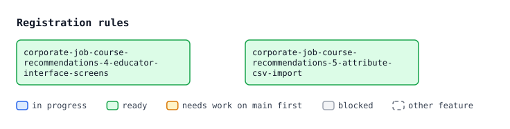

**Notes**
- Both run in parallel. Both edit educator-interface learner views; whichever lands second rebases.
- Only `organisation_admin` and `site_admin` manage lists and rules. A preview lists the learners affected, not a count.
- CSV import updates `Learner` attributes only, never `User` details. Open: an unknown list value becomes an error row (the default) or is created on confirm.
- Out of scope: SCIM and SSO sync, custom attributes, rule-filled cohorts.

## Lead monitoring API

A read-only REST API that marketing scripts use to track leads. Parent: `apis-for-lead-monitoring`.

- `apis-for-lead-monitoring-6-conversions` — **blocked** by `referral-attribution-over-time` — Scripts read attribution touches and conversions under the `referral_data` scope.

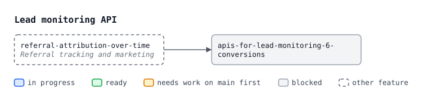

**Notes**
- It follows the existing API conventions: DRF, API-key auth bound to a site, cursor pagination on `(updated_at, id)`, `updated_since`. It adds its endpoint to the API docs page.

## Test organisation and hygiene

Tests sit where readers expect them and import only what their app depends on. Parent: `test-organisation-and-hygene`.

- `test-organisation-and-hygene-2-sdd-review-and-boy-scout` — **in progress** — `implement_plan` writes tests with the testing skills loaded, reviews them, and runs a boy scout that tidies touched tests.
- `qa-boy-scout-throwaway` — **in progress** — Throwaway spec to QA `test-organisation-and-hygene-2-sdd-review-and-boy-scout`. Local branch only, never merged.
- `test-organisation-and-hygene-5-foundational-apps` — **ready** — `site_aware_models`, `role_based_permissions`, `organisations`, `base`: local stub models replace borrowed downstream models.
- `test-organisation-and-hygene-6-small-apps` — **ready** — The apps with one violation or none.
- `test-organisation-and-hygene-7-course-access-and-applications` — **ready** — Cross-app imports in the `course_access` and `course_applications` tests.
- `test-organisation-and-hygene-10-content-engine-and-markdown-rendering` — **ready** — Re-home the demo-content and KaTeX tests; `markdown_rendering` tests stop reaching into `content_engine`.
- `test-organisation-and-hygene-11-reports` — **ready** — `reports`: conftest helpers moved out and `role_based_permissions` imports removed.
- `test-organisation-and-hygene-12-accounts` — **ready** — `accounts` tests that reach into seven apps. Its integration tests move to an app that depends on everything they touch.
- `test-organisation-and-hygene-13-learner-interface-part-1` — **ready** — `learner_interface` dashboard, listing and course player tests, its conftest and its cross-app edges.
- `test-organisation-and-hygene-14-learner-interface-part-2` — **blocked** by `test-organisation-and-hygene-13-learner-interface-part-1` — `learner_interface` form, quiz and required-question tests.
- `test-organisation-and-hygene-15-educator-interface` — **ready** — Re-audit `educator_interface` and `panel_framework` tests and clear their remaining baseline entries.

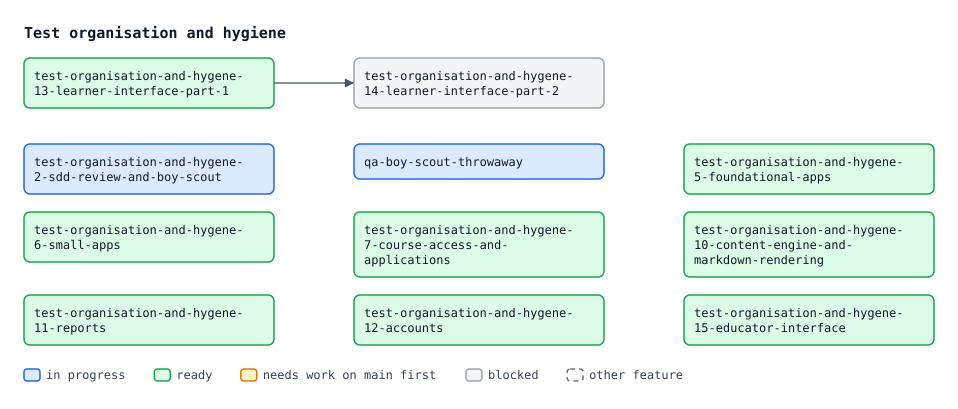

**Notes**
- The cleanups run in parallel. Each touches only its own apps' tests and deletes its own baseline lines. Run them after `test-organisation-and-hygene-2-sdd-review-and-boy-scout` lands where you can.
- Move test files in a commit of their own so the rename survives a rebase.
- Collisions:
  - `test-organisation-and-hygene-11-reports` meets `deadlines-7-educator-at-risk` in `reports`.
  - If `test-organisation-and-hygene-15-educator-interface` runs after `extract_panels_framework-5-package-and-install`, it covers `educator_interface` only.
- Decided: hygiene means placement plus layering, not test quality. The rules live in `ds:testing`, enforced by pre-commit and CI against a hand-edited baseline.
- Assumed:
  - mirroring is literal, subpackages included;
  - any app may use `UserFactory`;
  - a string-label relation counts as a runtime dependency;
  - a test that spans apps lives in the lowest app that depends on all of them.
- Open questions:
  - where `accounts` integration tests go (`test-organisation-and-hygene-12-accounts`);
  - where the demo-content tests go (`test-organisation-and-hygene-10-content-engine-and-markdown-rendering`).
- References: `research_test_layout_audit.md` in the parent, and `docs/app_structure.md`.

## Referral tracking and marketing

Where signups come from, and what visitors are told about tracking.

- `referral-tracking-referer-host-normalisation` — **ready** — Helpers that turn a stored referer into a comparable host.
- `referral-tracking-marketing-channels` — **blocked** by `referral-tracking-referer-host-normalisation` — Classify a signup's first touch into a marketing channel (search, social, email, referral, direct; paid or organic).
- `referral-tracking-external-referer-first-touch` — **blocked** by `referral-tracking-referer-host-normalisation` — An opt-in first touch for visitors who arrive untagged from another site.
- `referral-attribution-over-time` — **ready** — A per-user timeline of referral touches, plus an append-only conversion record at signup, application, interest and self-registration.
- `server-side-conversion-tracking` — **ready** — Send conversions from the server to the Meta, TikTok and Google APIs, deduplicated against the browser tags.
- `cookie-banner` — **ready** — A cookie banner explains tracking. Once dismissed, it stays dismissed.
- `failed-login-follow-up` — **ready** — Staff find visitors stuck at login without an account, and what they were trying to reach.
- `landing-page-component-kit` — **ready** — Theme-role cotton components and layouts for building course and campaign landing pages.

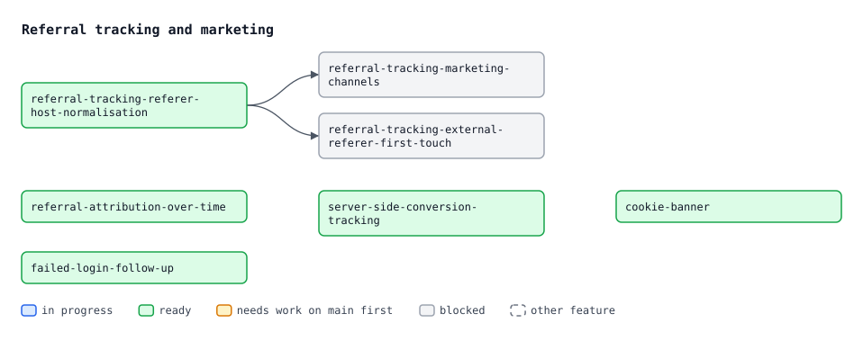

**Notes**
- `referral-tracking-external-referer-first-touch` must agree with the touch list in `referral-attribution-over-time`.
- `referral-attribution-over-time` adds three app-structure edges to approve at plan time, and expects a consent-gate spec that doesn't exist yet.
- `failed-login-follow-up`: how intent is captured is still open. See `research_capturing_failed_signin_intent.md`.
- The `referral-tracking-*` specs and `landing-page-component-kit` are pull-ins from First-Class-LMS. `landing-page-component-kit` first needs a decision on whether FLS owns marketing pages.

## Forms and applications

Form engine features and the course application flow.

- `compliance-form-randomization` — **in progress** — Randomised question order, and a per-attempt draw from a question bank for compliance and exam forms.
- `form-engine-branch-logic-2-and-conditions` — **ready** — Show a page, question or content block only when several conditions all hold.
- `phone-number-form-field` — **in progress** — A phone number field with a country code and validation.
- `file-scanning` — **ready** — Applicant uploads are malware-scanned in a background task. Reviewer downloads wait behind a quarantine gate, and a sweep catches stuck rows.
- `multi-step-course-applications` — **blocked** by `phone-number-form-field`, `file-scanning` — Applicants complete requirements in any order, with reviewer verdicts, uploads and help requests. Before starting: cut it with `/sdd:roadmap multi-step-course-applications` (its idea lists six parts).

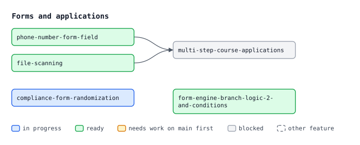

**Notes**
- `compliance-form-randomization` and `form-engine-branch-logic-2-and-conditions` both change the form engine's per-attempt and condition code. Whichever lands second rebases.
- `file-scanning` adds housekeeping sweeps, as do `retry-sent-emails` and `deadlines-5-reminders`.
- `multi-step-course-applications` builds on `educator-interface-full-polish/application-review-ui/`.

## Learner experience

- `learner-facing-ux-refinements` — **in progress** — Compact course rows below `lg`, a single Back link on course detail, and a restyled "Your applications" panel.
- `in-app-feedback` — **in progress** — Configurable feedback prompts at natural pause points, with a rating and free text.
- `content_snapshots` — **in progress** — Immutable snapshots of content, recording what a learner saw on the day.

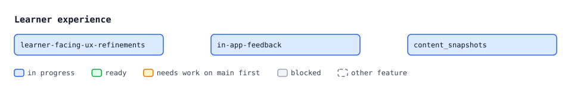

## Tooling and operations

Developer tooling, deployment and downstream fixes.

- `retry-sent-emails` — **ready** — Persist every queued email. Retry transient SMTP failures, sweep stuck rows, and give admins a resend action.
- `housekeeping-sentry-cron-checkin` — **ready** — When a monitor slug is configured, `fls_run_housekeeping` checks in with Sentry Crons.
- `learner-import-management-command` — **ready** — A management command that previews and commits the learner CSV import for one named site.
- `forced-site-name-for-host-based-site-lookup` — **ready** — `FORCE_SITE_NAME` reaches host-based site lookup in development, so every dev port works.
- `auto-run-tailwind-watch` — **in progress** — One command starts the dev server and the Tailwind watch, with Tailwind's errors visible.
- `downstream_bugs_oct_29` — **in progress** — Fix the bugs a downstream project flagged, so it can drop its workarounds.
- `new-register-design-process` — **in progress** — A new procedure for bringing Claude Design designs into the repo, and an updated `register_design`.
- `mega-qa` — **ready** — Staging reset endpoint, a whole-system QA suite, and downstream projects inheriting the plans. Before starting: cut it with `/sdd:roadmap mega-qa` (three ideas: staging reset, then the suite, then downstream propagation).

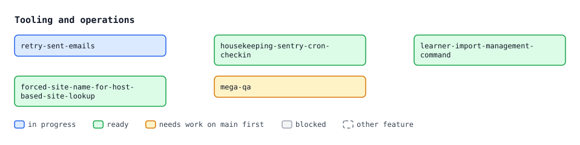

**Notes**
- `retry-sent-emails` is the transport that `user-communication-2-notification-email` sends through.
- `housekeeping-sentry-cron-checkin`, `learner-import-management-command` and `forced-site-name-for-host-based-site-lookup` are pull-ins from First-Class-LMS.
