# Spec roadmap

What gets built next, grouped by feature. Run `/sdd:roadmap` to update it. The format is in
`claude_plugins/sdd/resources/roadmap_format.md`. The product roadmap is `docs/product/roadmap.md`.

## Up next

Generated by the sdd roadmap script from the feature sections below and `priority.md`. Do not edit by hand.

Priority: 🔴 High · 🟠 Medium · 🟡 Low · ⚪ Priority not set

### In progress

- 🔴 High · `reference-material-content-1-authoring` (Reference material)
- 🔴 High · `sacaa-compliance-3-question-pools` (SACAA compliance)
- 🔴 High · `sacaa-compliance-4-attempt-review` (SACAA compliance)
- 🟠 Medium · `faster-test-runs-5-full-suite-on-github-actions` (Faster test runs)
- 🟠 Medium · `faster-test-runs-6-prune-slow-tests` (Faster test runs)
- 🟠 Medium · `educator-interface-refactor-6-cohort` (Educator interface code layout)
- 🟠 Medium · `learner-interface-features-3-revision-questions` (Learner interface features, via `content-widget-sayit-reveal`)

### Ready to start

- 🔴 High · `sacaa-compliance-content-versions-and-access-2-retire-removed-content` (SACAA content versions and access)
- 🔴 High · `sacaa-compliance-content-versions-and-access-4-question-access` (SACAA content versions and access)
- 🔴 High · `extract_panels_framework-5-package-and-install` (Panel framework extraction)
- 🔴 High · `learner-public-profile-2-profile-and-page` (Learner public profiles)
- 🔴 High · `multi-step-course-applications-2-reviewers-and-inbox` (Multi-step course applications)
- 🔴 High · `multi-step-course-applications-4-reopen-form` (Multi-step course applications)
- 🟠 Medium · `faster-test-runs-12-reliable-full-run-record` (Faster test runs)
- 🟠 Medium · `faster-test-runs-13-checkpoint-shared-paths` (Faster test runs)
- 🟠 Medium · `faster-test-runs-2-reuse-test-database` (Faster test runs)
- 🟠 Medium · `faster-test-runs-9-machine-wide-test-run-limit` (Faster test runs)
- 🟠 Medium · `content-widget-sayit-reveal-4-audio-access-control` (Audio content widgets)
- 🟠 Medium · `deadlines-4-learner-self-pause` (Deadlines)
- 🟠 Medium · `deadlines-5-reminders` (Deadlines)
- 🟠 Medium · `deadlines-6-educator-management` (Deadlines)
- 🟠 Medium · `deadlines-7-educator-at-risk` (Deadlines)
- 🟠 Medium · `form-engine-branch-logic-2-and-conditions` (Forms and applications)
- 🟠 Medium · `user-communication-2-notification-email` (User communication)
- 🟠 Medium · `user-communication-6-moderation` (User communication)
- 🟠 Medium · `user-communication-help-desk` (User communication)
- 🟠 Medium · `corporate-job-course-recommendations-4-educator-interface-screens` (Registration rules)
- 🟠 Medium · `corporate-job-course-recommendations-5-attribute-csv-import` (Registration rules)
- 🟠 Medium · `referral-tracking-marketing-channels` (Referral tracking and marketing)
- 🟠 Medium · `referral-tracking-external-referer-first-touch` (Referral tracking and marketing)
- 🟠 Medium · `server-side-conversion-tracking` (Referral tracking and marketing)
- 🟠 Medium · `cookie-banner` (Referral tracking and marketing)
- 🟡 Low · `audit-log-coverage-gaps` (Educator interface)
- 🟡 Low · `bulk-run-audit-summary` (Educator interface)
- 🟡 Low · `educator-interface-data-table-filter-design` (Educator interface)
- 🟡 Low · `educator-interface-misc-polish` (Educator interface)
- 🟡 Low · `educator-interface-more polish` (Educator interface)
- 🟡 Low · `landing-page-component-kit` (Referral tracking and marketing)
- 🟡 Low · `lead-capture-forms` (Referral tracking and marketing)
- 🟡 Low · `dev-site-bootstrap-command` (Tooling and operations)
- 🟡 Low · `forced-site-name-for-host-based-site-lookup` (Tooling and operations)
- 🟡 Low · `from-address-system-check` (Tooling and operations)
- ⚪ Priority not set · `learner-interface-features-2-test-out` (Learner interface features)
- ⚪ Priority not set · `learner-interface-features-5-protected-video` (Learner interface features)
- ⚪ Priority not set · `housekeeping-sentry-cron-checkin` (Tooling and operations)
- ⚪ Priority not set · `audit-log-describe-test-flake` (Tooling and operations)
- ⚪ Priority not set · `extract-semantic-icons-app-2-host-icons` (Semantic icons extraction)
- ⚪ Priority not set · `panel-framework-close-and-toast-response` (Panel framework)
- ⚪ Priority not set · `panel-framework-dialogs-without-javascript` (Panel framework)
- ⚪ Priority not set · `sacaa-complianc-deletion-and-declaration-1-force-delete` (SACAA record retention and declarations)
- ⚪ Priority not set · `sacaa-complianc-deletion-and-declaration-2-quiz-declaration` (SACAA record retention and declarations)

### Needs work on main first

- ⚪ Priority not set · `panel-framework-tech-debt-polish` (Panel framework): cut it with `/sdd:roadmap panel-framework-tech-debt-polish` (the directory is empty).

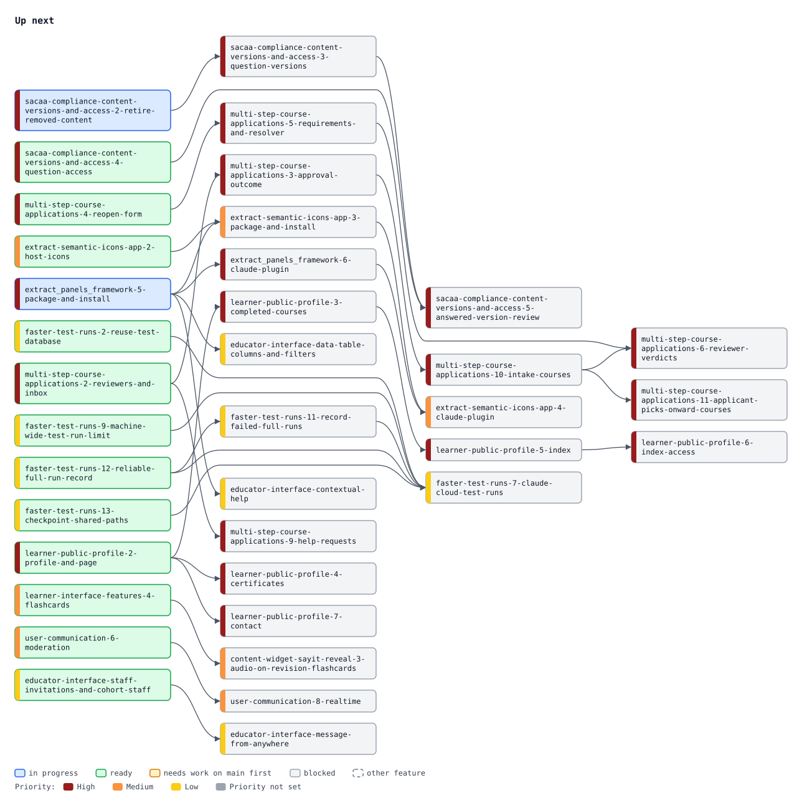

## Reference material

Priority: 🔴 High

Reference parts, such as regulations, that learners consult at any time beside a course's learning path, and courses that are only libraries. Parent: `reference-material-content`.

- `reference-material-content-1-authoring` — **in progress** — Authors attach reference parts to a course with a `reference:` key; `content_save` stores, validates and cleans them up.
- `reference-material-content-2-learner-reference` — **blocked** by `reference-material-content-1-authoring` — Registered learners open a course's reference listing and read reference topics from any player page, with nothing tracked.
- `reference-material-content-3-educator-reference` — **blocked** by `reference-material-content-1-authoring` — Educators see a course's reference parts in the course outline and preview reference topics.
- `reference-material-content-4-library-courses` — **blocked** by `reference-material-content-2-learner-reference`, `reference-material-content-3-educator-reference` — A course with only reference material opens its reference listing, shows no progress anywhere and can never be finished.

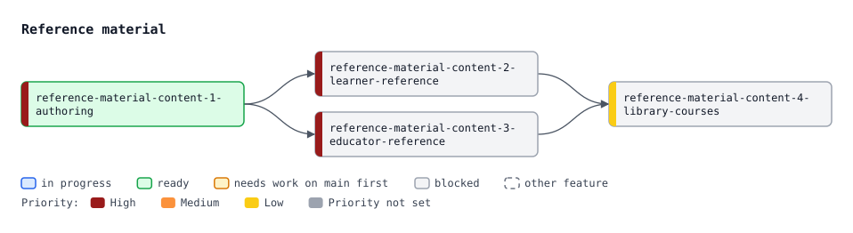

**Notes**
- Build order: `reference-material-content-1-authoring` first; then `reference-material-content-2-learner-reference` and `reference-material-content-3-educator-reference` in parallel; `reference-material-content-4-library-courses` last, at low priority.
- Collisions: `reference-material-content-1-authoring` changes `content_save`, the schema and the validator, like `sacaa-compliance-content-versions-and-access-1-content-save-safety` and `sacaa-compliance-content-versions-and-access-2-retire-removed-content`; whichever lands second rebases. `reference-material-content-4-library-courses` touches the learner and cohort progress panels that `educator-interface-refactor-5-learner` and `educator-interface-refactor-6-cohort` move.
- Decided: reference parts are `CoursePart` rows attached by a new `CourseReferencePart(course, course_part, order)`; `Course.items` stays the learning path. Reference parts hold topics only, one level deep.
- Decided: a part listed under `reference:` makes `content_save` delete that course's old collection item placing it, with its overrides and due dates, and report what it removed.
- Decided: reading reference material records nothing (no progress, resume pointer or `started_at`) and follows lesson access, so it is closed while paused and after the time limit ends.
- Decided: a library-only course shows no progress or completion anywhere and cannot be finished.
- Assumed: a topic may sit in both a learning-path part and a reference part; only a whole part is barred from both lists of one course.
- Out of scope: nesting deeper than part, then topics (planned later), PDFs and files, search, forms in reference.
- References: `research_learner_player.md` and `research_educator_content.md` in the parent.

## SACAA compliance

Priority: 🔴 High

Quiz randomisation and a per-attempt record of the paper served, for training organisations audited by SACAA. Parent: `sacaa-compliance`.

- `sacaa-compliance-3-question-pools` — **in progress** — Authors set a quiz page to draw N questions per attempt; every learner is scored out of the same total.
- `sacaa-compliance-4-attempt-review` — **in progress** — Educators see one learner's quiz attempt: paper served, answers and score. The form export carries the served order.

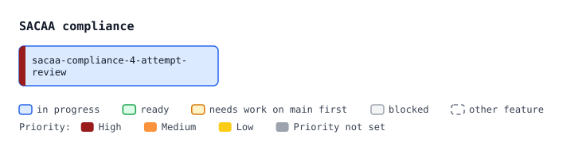

**Notes**
- Build order: `sacaa-compliance-2-shuffle`, then `sacaa-compliance-3-question-pools`. `sacaa-compliance-4-attempt-review` runs beside them once `educator-interface-refactor-5-learner` lands.
- Collisions: `sacaa-compliance-2-shuffle` and `sacaa-compliance-3-question-pools` both change the form schema, validator and `content_save`, so they run in series.
- Decided: randomisation is opt-in per quiz form and off by default; existing quizzes behave exactly as today.
- Decided: one seed per attempt and the served paper saved at attempt start; a retake is a new attempt with a fresh draw and order.
- Decided: scoring, results, export and review read the served paper, never a re-derived shuffle or the whole form, and a draw keeps `max_score` the same for every attempt.
- Assumption: randomisation applies to quiz forms only, which already ban `when` conditions, so shuffles and draws cannot break a condition.
- Assumption: no SACAA text found mandates a randomisation mechanic; the client's ATO manual is the audit reference, so the effort ships common practice.
- Out of scope: exam time limits, retake waiting periods, frozen copies of question text (`content_snapshots`, paused), difficulty-weighted draws, banks shared across forms, draws by course section.
- References: `sacaa-compliance/research_sacaa_requirements.md` and `sacaa-compliance/research_form_engine_seams.md`.

## SACAA content versions and access

Priority: 🔴 High

Question versions, retired content, safer content saves and logged access to question banks, for SACAA audits. Parent: `sacaa-compliance-content-versions-and-access`.

- `sacaa-compliance-content-versions-and-access-2-retire-removed-content` — **ready** — One `content_save` covers a site's whole source; content gone from it is retired, served to no one, kept for audit.
- `sacaa-compliance-content-versions-and-access-3-question-versions` — **blocked** by `sacaa-compliance-content-versions-and-access-2-retire-removed-content` — Every question change saves an immutable version; attempts keep the version served; results, export and admin answers read it.
- `sacaa-compliance-content-versions-and-access-4-question-access` — **ready** — A new role may view course questions and answers in the educator interface; each view is audited; admin question pages go.
- `sacaa-compliance-content-versions-and-access-5-answered-version-review` — **blocked** by `sacaa-compliance-4-attempt-review`, `sacaa-compliance-content-versions-and-access-3-question-versions`, `sacaa-compliance-content-versions-and-access-4-question-access` — Educators reviewing an attempt see the question version answered, when it changed, and whether it is still served.

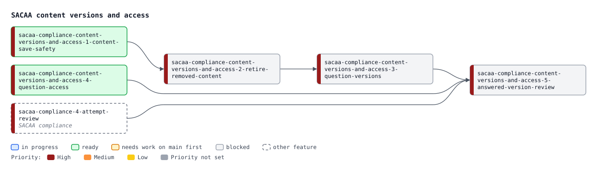

**Notes**
- Build order: `sacaa-compliance-content-versions-and-access-1-content-save-safety`, `sacaa-compliance-content-versions-and-access-2-retire-removed-content`, `sacaa-compliance-content-versions-and-access-3-question-versions` in series; `sacaa-compliance-content-versions-and-access-4-question-access` runs beside them; `sacaa-compliance-content-versions-and-access-5-answered-version-review` last.
- Collisions: the first three all change `content_save`; `sacaa-compliance-content-versions-and-access-3-question-versions` changes the served paper after `sacaa-compliance-2-shuffle` and collides with `sacaa-compliance-3-question-pools`.
- Decided: each source path is a git repo with a clean tree before the save, checked on disk only; `--generate-uuids` dirties it afterwards by design; the commit hash is recorded.
- Decided: retired content is served to no one; progress, answers and attempts are kept; content back in the source is un-retired; nothing is deleted.
- Decided: `FormQuestion` keeps its uuid and each change makes an immutable version; an attempt pins its versions at start and finishes on them.
- Decided: a new organisation-scoped role holds the question-viewing permission. It gates the content preview, the cohort report quiz panel (screen and PDF) and the answered-version review. Every view is audited, superusers' included.
- Decided: the Django admin loses its question and option pages and QUIZ answer views; survey and application answers stay.
- Assumption: a version covers question text, type, required, bounds and every option's text, value, order and correctness; `FormContent` and `FormPage` are not versioned.
- Out of scope: `content_snapshots` (paused), versioning topics or courses, regrading, the learner's `quiz_show_incorrect` results.
- References: `research_content_save_pipeline.md` and `research_question_versioning_prior_art.md`, both in the parent.

## Panel framework extraction

Priority: 🔴 High

The panel framework moves into its own installable package, because another Django project needs it. Parent: `extract_panels_framework`.

- `extract_panels_framework-5-package-and-install` — **ready** — The public `django-panel-framework` repo, tagged `v0.1.0`. FLS installs it by git tag and drops the old table.
- `extract_panels_framework-6-claude-plugin` — **blocked** by `extract_panels_framework-5-package-and-install` — A generic `panel-framework` Claude Code plugin and developer doc in the package repo. `fls-dev` keeps only a pointer.

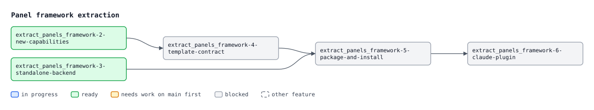

**Notes**
- Specs touching `educator_interface`, `comms`, `reports` or `learner_management` rebase onto `extract_panels_framework-5-package-and-install` once it changes the import prefix.
- Decided: a public MIT repo released by git tag; no PyPI and no submodule. App label `panel_framework` starting from a clean `0001`, and no data is migrated. FLS pins it with a PEP 508 git URL in `[project].dependencies`.
- Decided: multi-site stays. A settings-declared site resolver defaults to `get_current_site`.
- Assumed: there is no shared core package. If one turns out to be needed, stop and say so. The package ships overridable primitives, and the host schedules the bulk-run sweep.
- Open: the uv editable-install spike (`extract_panels_framework-5-package-and-install`).
- The other project must not install the package before `extract_panels_framework-5-package-and-install`.
- References: `research_packaging_and_distribution.md` and `research_coupling_audit.md`, both in the parent.

## Learner public profiles

Priority: 🔴 High

Learners publish a profile to help them find work, and visitors browse an index of them. Parent: `learner-public-profile`.

- `learner-public-profile-2-profile-and-page` — **ready** — Learners switch on a shareable public profile with blurb, work experience, place, open to work and links.
- `learner-public-profile-3-completed-courses` — **blocked** by `learner-public-profile-2-profile-and-page` — Courses a learner completed on the site appear on their public profile. The learner can hide each one.
- `learner-public-profile-4-certificates` — **blocked** by `learner-public-profile-2-profile-and-page` — Learners upload self-reported certificates. Organisation staff upload certificates on the educator-interface learner page.
- `learner-public-profile-5-index` — **blocked** by `learner-public-profile-3-completed-courses` — A public index of switched-on profiles, named per site, with search, filters and sorts.
- `learner-public-profile-6-index-access` — **blocked** by `learner-public-profile-5-index` — Placeholder: decide who may see the index in each concrete project. Before starting: settle the design with the product owner and rewrite this idea.
- `learner-public-profile-7-contact` — **blocked** by `learner-public-profile-2-profile-and-page` — Placeholder: decide how a profile viewer gets in touch with a learner. Before starting: settle the design with the product owner and rewrite this idea.

**Notes**
- Order: `learner-public-profile-2-profile-and-page` first. After it, `learner-public-profile-3-completed-courses` and `learner-public-profile-4-certificates` run in parallel, and `learner-public-profile-5-index` follows `learner-public-profile-3-completed-courses`.
- Collisions: `learner-public-profile-3-completed-courses` and `learner-public-profile-4-certificates` both add sections to the profile page and the edit page.
- Decided: profiles are opt-in, off by default, with consent recorded. The learner's own link always works while the profile is on, and is a 404 when it is off. Only the index is ever restricted, and it is public for now.
- Decided: per-site settings hold the feature switch (off by default) and its display name, e.g. "Talent Database". Place is a country select with a city select filtered by country, and the country autofills.
- Decided: the picture is every user's avatar. Organisation-issued certificates are labelled as such and learner uploads as self-reported, with no moderation queue.
- Decided: learner editing from `learner-public-profile-2-profile-and-page` on is panels in the account area (see "Account area on panels"). Profile pages and the index are `noindex`. Skills and per-field visibility are not in this effort.
- Open questions:
  - the city data source and the autofill source (`learner-public-profile-2-profile-and-page`);
  - the certificate storage alias (`learner-public-profile-4-certificates`).
- Out of scope: educator views of profiles, Open Badges, generated completion certificates.
- References: `research_existing_profile_code.md` and `research_comparable_systems.md` in the parent.

## Multi-step course applications

Priority: 🔴 High

Applications become steps an applicant works through over weeks, decided by a deployment's rules and cleared by organisation reviewers. Parent: `multi-step-course-applications`.

- `multi-step-course-applications-2-reviewers-and-inbox` — **ready** — Organisation reviewers get an applications inbox and review screen, approve or reject, and move applications between organisations.
- `multi-step-course-applications-3-approval-outcome` — **blocked** by `multi-step-course-applications-2-reviewers-and-inbox` — A deployment seam decides what approval does; FLS's default registers the applicant for the course.
- `multi-step-course-applications-4-reopen-form` — **ready** — Applicants reopen their submitted application form, answers prefilled, until it is approved.
- `multi-step-course-applications-5-requirements-and-resolver` — **blocked** by `multi-step-course-applications-4-reopen-form` — Applicants work through a requirements page; a deployment resolver, or the course's fixed list, decides the requirements.
- `multi-step-course-applications-6-reviewer-verdicts` — **blocked** by `multi-step-course-applications-5-requirements-and-resolver`, `multi-step-course-applications-10-intake-courses` — Reviewers accept or turn down requirements with a reason, preview the consequence; requirements hold back approval or registration.
- `multi-step-course-applications-7-upload-requirements` — **blocked** by `multi-step-course-applications-6-reviewer-verdicts` — Applicants upload documents for requirements, re-upload when asked, and see past uploads; reviewers see every version.
- `multi-step-course-applications-8-choices` — **blocked** by `multi-step-course-applications-6-reviewer-verdicts` — The resolver offers either-or requirement groups; applicants switch options until one is accepted.
- `multi-step-course-applications-9-help-requests` — **blocked** by `multi-step-course-applications-2-reviewers-and-inbox` — Applicants ask for a callback from any application page; reviewers are notified and a webhook feeds the CRM.
- `multi-step-course-applications-10-intake-courses` — **blocked** by `multi-step-course-applications-3-approval-outcome` — Authors mark a course apply-only and list its onward courses; reviewers register approved applicants for them.
- `multi-step-course-applications-11-applicant-picks-onward-courses` — **blocked** by `multi-step-course-applications-10-intake-courses` — Applicants for an intake course pick the onward courses they want; reviewers see the picks.

**Notes**
- Order: `multi-step-course-applications-1-review-states` starts now. Then `multi-step-course-applications-2-reviewers-and-inbox` and `multi-step-course-applications-4-reopen-form` run in parallel. `multi-step-course-applications-10-intake-courses` follows `multi-step-course-applications-3-approval-outcome`. `multi-step-course-applications-6-reviewer-verdicts` needs it and `multi-step-course-applications-5-requirements-and-resolver`; `multi-step-course-applications-7-upload-requirements` and `multi-step-course-applications-8-choices` follow it, and `multi-step-course-applications-9-help-requests` can start once `multi-step-course-applications-2-reviewers-and-inbox` lands.
- Collisions: `multi-step-course-applications-7-upload-requirements` and `multi-step-course-applications-8-choices` both change the reconcile step and the requirements page; whichever lands second rebases. `multi-step-course-applications-2-reviewers-and-inbox` adds `panels/applications/` and a line in `interface_config`, which the educator-interface refactor also edits.
- Decided: no workflow graph. The resolver is a pure function of the application's data, re-run after every event by one reconcile function; superseded requirements are kept.
- Decided: states are `TextChoices` and service functions, no FSM library. Reviewer and system actions go in `audit_log`, never the applicant's name. No `changes_requested` or `under_review` states.
- Decided: reviewers hold a new organisation role checked with `can()`; each inbox is per organisation; the Django admin stays read-only.
- Decided: what approval does is a deployment seam whose default registers the applicant. Anything beyond the application form, and approval itself, needs a claimed account.
- Decided: an intake course is applied for and never registered for. Its content lists onward courses, and a reviewer registers the applicant for each by hand from their answers. Applicants are registered, never recommended courses; nothing picks an organisation, enforces course order or prices a bundle.
- Assumed: a new application takes the course's only owning organisation, else the site default. Re-applying after reject or withdraw makes a new application. No `application.*` webhooks except `application.help_requested`.
- Open questions:
  - who sees an organisation move in the audit log (`multi-step-course-applications-2-reviewers-and-inbox`);
  - `add_learner` or `ensure_learner` (`multi-step-course-applications-3-approval-outcome`);
  - what a resolver failure does (`multi-step-course-applications-5-requirements-and-resolver`).
- Out of scope: outside systems reporting a step done, provider lists and distance ranking, more than one sign-off, and scanning uploaded files (not planned).
- References: `research_review_foundations.md`, `research_help_requests.md` and `intake_courses_case.md` in the parent.

## Faster test runs

Priority: 🟠 Medium

Cut the time and machine load of test runs so several worktrees can work at once. Parent: `faster-test-runs`.

- `faster-test-runs-2-reuse-test-database` — **ready** — A pytest run reuses the test database and rebuilds it only when migrations change.
- `faster-test-runs-5-full-suite-on-github-actions` — **in progress** — The full suite runs on free GitHub runners in parallel jobs, started on demand by an SDD run.
- `faster-test-runs-6-prune-slow-tests` — **in progress** — Remaining slow and redundant tests are merged or removed from a measured per-test ranking.
- `faster-test-runs-7-claude-cloud-test-runs` — **blocked** by `faster-test-runs-2-reuse-test-database`, `faster-test-runs-5-full-suite-on-github-actions`, `faster-test-runs-6-prune-slow-tests`, `faster-test-runs-9-machine-wide-test-run-limit`, `faster-test-runs-11-record-failed-full-runs`, `faster-test-runs-12-reliable-full-run-record`, `faster-test-runs-13-checkpoint-shared-paths` — Fallback: a test run or SDD batch is handed to a Claude Code cloud session.
- `faster-test-runs-9-machine-wide-test-run-limit` — **ready** — Test runs from every worktree share one CPU and memory limit, and a waiting run says so.
- `faster-test-runs-11-record-failed-full-runs` — **blocked** by `faster-test-runs-12-reliable-full-run-record` — A failed full run records its failed tests, so the next checkpoint re-runs those, not the whole suite.
- `faster-test-runs-12-reliable-full-run-record` — **ready** — Every full run writes its own record, or prints why it recorded nothing.
- `faster-test-runs-13-checkpoint-shared-paths` — **ready** — A `finish_worktree` checkpoint tests main's change to a file the branch changed earlier as main's change.

**Notes**
- Every spec can start now and run in parallel, except `faster-test-runs-7-claude-cloud-test-runs` and the two below.
- `faster-test-runs-11-record-failed-full-runs` extends the record `faster-test-runs-12-reliable-full-run-record` makes reliable; `faster-test-runs-13-checkpoint-shared-paths` changes the selector after `faster-test-runs-8-narrower-targeted-tier`.
- Suggested order by saving: `faster-test-runs-1-fast-password-hasher`, `faster-test-runs-2-reuse-test-database`, then the rest.
- `faster-test-runs-7-claude-cloud-test-runs` waits on the others because the owner wants it only if they are not enough.
- Collision: `faster-test-runs-2-reuse-test-database` and `faster-test-runs-5-full-suite-on-github-actions` both change the test tier definition and its runner.
- Collision: `faster-test-runs-8-narrower-targeted-tier` changes the test selector, `faster-test-runs-9-machine-wide-test-run-limit` the runner, and `faster-test-runs-10-rerun-only-failures-in-a-batch` the tier definition.
- Collision: `faster-test-runs-12-reliable-full-run-record` may change the runner too, beside `faster-test-runs-9-machine-wide-test-run-limit`.
- Decision: generic `sdd` and `ds` plugins stay generic; project values reach them through per-project configuration.
- Decision: no spec reduces what is tested without naming the test that still covers it.
- Assumption: every spec reports its before and after timings against `faster-test-runs/research_test_timings.md`.
- Open: whether coverage is still enforced across parallel jobs (owned by `faster-test-runs-5-full-suite-on-github-actions`).
- Out of scope: paid runners, squashing migrations, changes to the First Class workflow.
- References: `faster-test-runs/research_test_timings.md`, `faster-test-runs/research_batch_test_load.md`, `faster-test-runs/research_finish_worktree_reruns.md`.

## Educator interface code layout

Priority: 🟠 Medium

The educator interface's `views.py` and `actions.py` split into one `panels/<area>/` package per area, with tests mirrored. Parent: `educator-interface-refactor`.

- `educator-interface-refactor-6-cohort` — **in progress** — Moves the cohort area, including reports and report download, into `panels/cohort/`, and migrates stored bulk-action paths.
- `educator-interface-refactor-7-cleanup` — **blocked** by `educator-interface-refactor-6-cohort` — Deletes the emptied flat modules, trims `views.py` to the shell, and sweeps up old paths, docs and baselines.

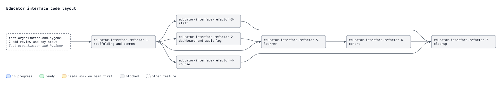

**Notes**
- `educator-interface-refactor-3-staff` and `educator-interface-refactor-4-course` run in parallel with `educator-interface-refactor-2-dashboard-and-audit-log`. `educator-interface-refactor-5-learner` and then `educator-interface-refactor-6-cohort` follow it, and `educator-interface-refactor-7-cleanup` comes last.
- Collisions: the parallel specs all cut ranges from `views.py`, `actions.py`, `test_views.py` and `test_actions.py`, and add lines to one import block. Each removes only its own ranges, so the conflicts stay mechanical.
- Land the effort before `extract_panels_framework-5-package-and-install` and before the specs that add educator panels (`deadlines-6-educator-management`, `deadlines-7-educator-at-risk`, `corporate-job-course-recommendations-4-educator-interface-screens`, `audit-log-coverage-gaps`). Otherwise rebase them onto it.
- Decided: a pure move. URL names, paths, the app label and template paths stay. There's no re-export shim. Each spec repoints every import and `mock.patch` string for what it moves.
- Decided: an area holds `config.py`, `data_tables.py`, `data_table_panels.py`, `panels.py`, `instance_view.py` (a file), `actions.py`, `bulk_actions.py`, `filters.py` and `quick_view.py`, each only where it has content. Every `__init__.py` is empty.
- Decided: a spec that moves registered bulk actions adds a new data migration rewriting `BulkActionRun.action_path`, with a reverse, and sets `requires_migrations: true`.
- Decided: tests move with their code to `tests/panels/<area>/test_<module>.py`. `invariants/`, `playwright/` and `migrations/` stay where they are.
- Assumed: `course` and `staff` are two areas. A cross-subclassed table lives in the area whose rows it lists. Learner import views go in `learner/import_views.py`.
- Out of scope: any behaviour, UI, URL or template change, and the flat domain modules (`forms.py`, `staff.py`, `learner_import.py`, `messaging.py`).
- References: `research_code_inventory.md`, `research_collisions.md` and `research_downstream_imports.md`, all in the parent.

## Learner interface features

Priority: 🟠 Medium

Test out of sections, revise with spaced repetition and flashcards, and watch access-controlled video. Parent: `learner-interface-features`.

- `learner-interface-features-2-test-out` — **ready** — Learners take a pretest and skip sections they already know; the skip is recorded as its own kind of completion.
- `learner-interface-features-3-revision-questions` — **in progress** — Learners revise questions from finished sections, scheduled by spaced repetition, with explanations and weak sections highlighted.
- `learner-interface-features-4-flashcards` — **blocked** by `learner-interface-features-3-revision-questions` — Authors add flashcards to sections; learners rate their confidence and the revision schedule brings them back.
- `learner-interface-features-5-protected-video` — **ready** — Course content embeds video that only learners with access to the course can play; shared links stop working.
- `educator-revision-analytics` — **blocked** by `learner-interface-features-3-revision-questions` — Educators see the revision questions learners miss most, per-option answer counts and each learner's weak sections.

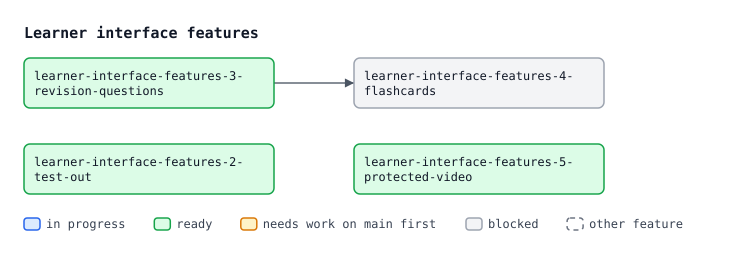

**Notes**
- Order is set by dependencies only. `learner-interface-features-2-test-out` and `learner-interface-features-3-revision-questions` run in parallel. `learner-interface-features-5-protected-video` can start any time.
- Collision: `learner-interface-features-2-test-out` adds a new kind of completion, and `learner-interface-features-3-revision-questions` adds a section's questions to the bank when the section completes. Whichever lands second makes test-out completion count.
- Decided: design questions (what a section is, the pretest's shape, the scheduler, the video host) are settled in each spec's own research, not in the cut. Flashcards are their own spec.
- Assumed: the `youtube` component stays as it is beside protected video.
- Open questions:
  - the pretest's shape, how a skip is recorded and reported, renewal registrations, and the "recertification not planned" lines here and in `docs/product/roadmap.md` (`learner-interface-features-2-test-out`);
  - scheduler, explanations, and history when an author edits a question (`learner-interface-features-3-revision-questions`);
  - video host and build or buy (`learner-interface-features-5-protected-video`).
- Out of scope: the other features in section 4 of `research_learner_features.md`.
- References: `research_learner_features.md` and `research_question_model.md` in the parent.

## Audio content widgets

Priority: 🟠 Medium

Course content that plays audio: clips, say-it-then-reveal practice and audio on revision flashcards. Parent: `content-widget-sayit-reveal`.

- `content-widget-sayit-reveal-3-audio-on-revision-flashcards` — **blocked** by `learner-interface-features-4-flashcards` — Scheduled revision flashcards carry audio that plays when the learner reveals the card.
- `content-widget-sayit-reveal-4-audio-access-control` — **ready** — Decide and enforce who may play a course's audio through its open redirect link.

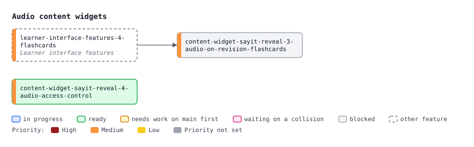

**Notes**
- Decided: say-it-then-reveal is a self-check; no microphone, no speech recognition, nothing recorded.
- Decided: audio is the author's recorded files, loaded as course media (the loader already stores audio); no text-to-speech.
- Decided: until scheduled flashcards land, courses practise with the static `c-flashcard` widget, which gains audio.
- Assumed: mp3 recommended; nothing plays on page load, only on a Reveal click; each clip has a visible text alternative.
- Assumed: the in-page widgets store nothing and have no self-rating; the letter list is `c-audio` inside existing layout widgets.
- Assumed: FLS demo content shows each widget with a few licensed clips; the phonetic-alphabet course belongs to the concrete project.
- Open: how a card names its clip (`content-widget-sayit-reveal-3-audio-on-revision-flashcards`).
- Out of scope: speech recognition, text-to-speech, recording the learner, speed control.
- References: `research_content_media.md` and `research_audio_widgets.md` in the parent.

## Deadlines

Priority: 🟠 Medium

Due dates and course time limits, with consequences, pause, reminders and at-risk views. Parent: `deadlines`.

- `deadlines-4-learner-self-pause` — **ready** — Learners pause and resume their own course within the policy's limits, giving a reason.
- `deadlines-5-reminders` — **ready** — A housekeeping sweep sends learners reminders, educators rolled-up overdue notices, and fires a `deadline.missed` webhook.
- `deadlines-6-educator-management` — **ready** — Staff set and extend deadlines (also in bulk) and pause or resume courses in the educator interface, all audit-logged.
- `deadlines-7-educator-at-risk` — **ready** — Overdue and due-soon learners appear in Needs attention and on the dashboard, and the cohort report gets an at-risk rule.

**Notes**
- `deadlines-4-learner-self-pause`, `deadlines-5-reminders`, `deadlines-6-educator-management` and `deadlines-7-educator-at-risk` run in parallel.
- Collision: `deadlines-7-educator-at-risk` edits `reports/at_risk.py`.
- Decided: pause stops the clock and nothing opens while paused. Learners self-pause with no approval. Once a time limit ends access, only staff can restore it. Policy lives in the Django admin.
- Assumed: a deadline attaches to the placement (`ContentCollectionItem`). The start is `CourseProgress.created_at`. The most permissive deadline wins. Ending access leaves `is_active` alone.
- Assumed notifications: staff pauses and extensions notify the learner; self-pauses don't. Reminders stay in-app until `user-communication-2-notification-email` lands.
- Settled in code:
  - Records: `CoursePause` (one open per course progress record, with a reason, optional planned resume date and the resume fields) and `DeadlineExtension` (`days` on a collection item, the time limit or the whole course). Staff act on the course progress record through `pause_course`, `resume_course`, `announce_planned_resume` and `extend_deadline` in `freedom_ls/deadlines/actions.py`.
  - Shift rule: whole days, rounded up, added to the deadline's local date. It is computed when read, never stored, and an open pause counts up to now. It applies to an item only if the item was unmet when the shift began. Extensions stack by addition.
  - Pause limits (`learners_may_pause`, `max_pauses`, `max_pause_days`) are stored and resolved in the policy but enforced by nobody yet (`deadlines-4-learner-self-pause`).
- Open questions:
  - reminder offsets and the educator rollup (`deadlines-5-reminders`);
  - the due-soon window (`deadlines-7-educator-at-risk`).
- Out of scope: recertification, retakes, line-manager escalation, score penalties, SMS, calendar export.

## Forms and applications

Priority: 🟠 Medium

Form engine features and the course application flow.

- `form-engine-branch-logic-2-and-conditions` — **ready** — Show a page, question or content block only when several conditions all hold.

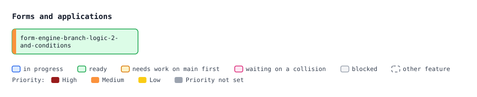

## User communication

Priority: 🟠 Medium

Notifications and direct messaging between learners and educators. Parent: `user-communication`.

- `user-communication-2-notification-email` — **ready** — Email delivery. Per-category immediate, daily, weekly or off preferences, quiet hours, unsubscribe, and a digest sweep in housekeeping.
- `user-communication-6-moderation` — **ready** — Users report messages or block users. Site admins work a report queue and hide messages. Nothing is hard deleted.
- `user-communication-8-realtime` — **blocked** by `user-communication-6-moderation` — Optional Django Channels push for the unread badge and open threads. Off by default, with polling as the fallback.
- `user-communication-help-desk` — **ready** — Learners ask for help on specific content from the course player, into a shared queue educators pick up.

**Notes**
- `user-communication-2-notification-email` and `user-communication-6-moderation` run in parallel. UI specs build to the design registered in `user-communication/design.md`.
- Email contract: a backend re-reads the notification when it sends and skips it if read. Updating a notification queues nothing. Messages raise no notification, so message email needs its own trigger.
- Decided: polling is the transport. Messaging permissions are layered and closed by default, through a swappable policy class. Moderation is report, hide and block.
- `user-communication-help-desk` needs its own queue model, because a `Conversation` is between exactly two users.
- Assumed: configuration is edited in the Django admin. Conversations are one-to-one with no read receipts. Background work passes `site_id` explicitly.
- Open questions:
  - where the report queue lives (`user-communication-6-moderation`);
  - what a digest holds and where a user's timezone comes from (`user-communication-2-notification-email`).
- Out of scope: announcements, forums, group conversations, SMS and push, reply-by-email.

## Registration rules

Priority: 🟠 Medium

Rules that register or recommend courses based on a learner's HR attributes. Parent: `corporate-job-course-recommendations`.

- `corporate-job-course-recommendations-4-educator-interface-screens` — **ready** — Educator-interface screens for attribute lists, a learner's attributes, and registration rules with their preview.
- `corporate-job-course-recommendations-5-attribute-csv-import` — **ready** — Import learners' HR attributes by CSV through the bulk import flow, with a preview, and evaluate rules once per import.

**Notes**
- Both run in parallel. Both edit educator-interface learner views; whichever lands second rebases.
- Only `organisation_admin` and `site_admin` manage lists and rules. A preview lists the learners affected, not a count.
- CSV import updates `Learner` attributes only, never `User` details. Open: an unknown list value becomes an error row (the default) or is created on confirm.
- Out of scope: SCIM and SSO sync, custom attributes, rule-filled cohorts.

## Referral tracking and marketing

Priority: 🟠 Medium

Where signups come from, and what visitors are told about tracking.

- `referral-tracking-marketing-channels` — **ready** — Classify a signup's first touch into a marketing channel (search, social, email, referral, direct; paid or organic).
- `referral-tracking-external-referer-first-touch` — **ready** — An opt-in first touch for visitors who arrive untagged from another site.
- `server-side-conversion-tracking` — **ready** — Send conversions from the server to the Meta, TikTok and Google APIs, deduplicated against the browser tags.
- `cookie-banner` — **ready** — A cookie banner explains tracking. Once dismissed, it stays dismissed.
- `landing-page-component-kit` — **ready** — Theme-role cotton components and layouts for building course and campaign landing pages.
- `lead-capture-forms` — **ready** — Site-aware enquiry forms storing leads with first-touch attribution, with staff notification emails and CSV export.

**Notes**
- `referral-tracking-external-referer-first-touch` must agree with the existing attribution touch list.
- The `referral-tracking-*` specs and `landing-page-component-kit` are pull-ins from First-Class-LMS. `landing-page-component-kit` first needs a decision on whether FLS owns marketing pages.

## Educator interface

Priority: 🟡 Low

Org admins manage learners, cohorts, registrations and staff. Parent: `educator-interface-full-polish`.

- `educator-interface-misc-polish` — **ready** — Interface polish: optional learner names, cohort settings sub-panels, show and hide table columns, help icons, smaller mobile buttons.
- `educator-interface-data-table-filter-design` — **ready** — One button per filter on data tables, instead of a single long drop-down. The UX still needs designing.
- `audit-log-coverage-gaps` — **ready** — The audit log also records Django admin edits, system admin role changes and report downloads, and marks where history starts.
- `bulk-run-audit-summary` — **ready** — Bulk actions write one run summary with folded per-object entries in the Audit log, and take an optional reason.
- `educator-interface-more polish` — **ready** — Educators resend staff invitations and see who hasn't accepted, plus linked dashboard figures, learner-tab messaging and one new-message flow.

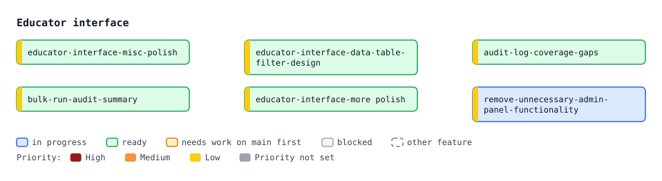

**Notes**
- Decided: deactivate, never delete. Admins grant only their own level and below, inside their own scope. Only `site_admin` grants `site_admin`.
- Access rules: anything outside the user's scope returns 404. An action the user has lost permission for returns 403 with a message. Controls the user can't use are hidden. No new dependencies.
- References: the mockups in `educator-interface-full-polish/Educator LMS Interface Design/` (layout only, not scope), and `brand-guidelines` and `fls-dev:panel-framework`.

## Tooling and operations

Priority: 🟡 Low

Developer tooling, deployment and downstream fixes.

- `from-address-system-check` — **ready** — A `mail` system check warns when the email backend really delivers but `DEFAULT_FROM_EMAIL` is blank.
- `housekeeping-sentry-cron-checkin` — **ready** — When a monitor slug is configured, `fls_run_housekeeping` checks in with Sentry Crons.
- `forced-site-name-for-host-based-site-lookup` — **ready** — `FORCE_SITE_NAME` reaches host-based site lookup in development, so every dev port works.
- `audit-log-describe-test-flake` — **ready** — Find and fix why the audit-log describe test fails in loaded full runs but passes alone.
- `dev-site-bootstrap-command` — **ready** — A development command that creates the forced-name dev Site and a verified dev superuser.

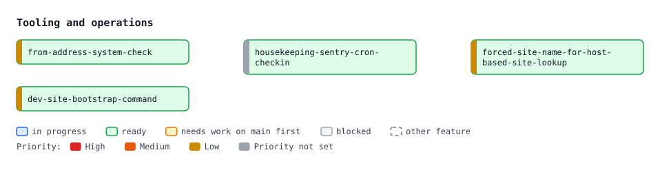

**Notes**
- `housekeeping-sentry-cron-checkin`, `forced-site-name-for-host-based-site-lookup` and `dev-site-bootstrap-command` are pull-ins from First-Class-LMS.

## Semantic icons extraction

Priority: ⚪ Priority not set

The icons app becomes an installable package another Django project can use and extend with its own icons. Parent: `extract-semantic-icons-app`.

- `extract-semantic-icons-app-2-host-icons` — **ready** — Host projects add semantic names, point names at their own SVGs, and register whole custom icon sets, all checked at startup.
- `extract-semantic-icons-app-3-package-and-install` — **blocked** by `extract-semantic-icons-app-2-host-icons`, `extract_panels_framework-5-package-and-install` — The public `django-semantic-icons` repo, tagged `v0.1.0`; FLS and First-Class install it by git tag.
- `extract-semantic-icons-app-4-claude-plugin` — **blocked** by `extract-semantic-icons-app-3-package-and-install`, `extract_panels_framework-6-claude-plugin` — A generic `semantic-icons` Claude Code plugin and host doc in the package repo; `fls-dev:icon-usage` keeps only FLS specifics.

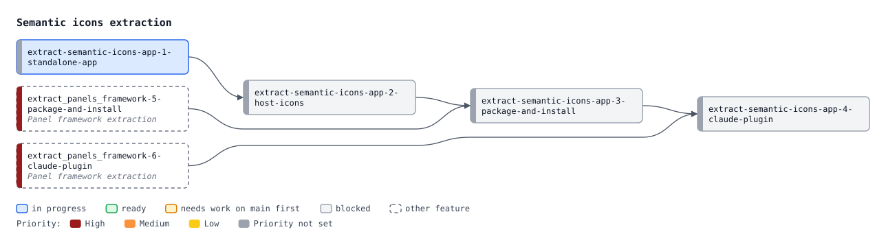

**Notes**
- Strictly sequential: each spec builds on the one before. `extract-semantic-icons-app-1-standalone-app` can start now; it touches only `freedom_ls/icons/`, `conftest.py` and the apps that reach into `loader._cache`.
- Decided: the package ships all 63 current semantic names, FLS-domain ones included. Host-added names layer on top; host settings win over app registrations, which win over built-ins.
- Decided: "custom icons" means remapping within the active set, pointing a name at the host's own SVG file, and registering a whole custom icon set.
- Assumed: distribution copies the panel framework: public MIT repo beside it in `django_apps/`, released by git tag, pinned with a PEP 508 git URL, `CHANGELOG.md` with upgrade flags.
- Assumed: icon data ships as a generated subset of the four Iconify sets; an optional setting points at a full `@iconify-json` directory for glyphs outside it.
- Assumed: settings move to `SEMANTIC_ICONS_*`; the old `FREEDOM_LS_ICON_*` names keep working with a deprecation warning for one tag. Import name and app label become `semantic_icons`; `<c-icon>` and its arguments do not change, so no template edits.
- Assumed: the panel framework package does not depend on this one; FLS meets the panel framework's icon host contract through it.
- Out of scope: changing how templates call `<c-icon>`, new icon sets beyond the four, an icon picker UI.
- References: `research_coupling_audit.md` in the parent; the extract_panels_framework research files for packaging.

## Panel framework

Priority: ⚪ Priority not set

Gaps in the panel framework's dialogs and responses.

- `panel-framework-close-and-toast-response` — **ready** — Panel actions get a built-in response that closes the dialog and shows a toast without swapping content.
- `panel-framework-dialogs-without-javascript` — **ready** — Single-record dialog triggers work with JavaScript off, opening the dialog server-side over its page.
- `panel-framework-tech-debt-polish` — **ready** — Tech debt and polish work on the panel framework; no idea written yet. Before starting: cut it with `/sdd:roadmap panel-framework-tech-debt-polish` (the directory is empty).

## SACAA record retention and declarations

Priority: ⚪ Priority not set

Keeping learner records for SACAA's five-year rule, and signed quiz declarations, for training organisations audited by SACAA. Parent: `sacaa-complianc-deletion-and-declaration`.

- `sacaa-complianc-deletion-and-declaration-1-force-delete` — **ready** — Admins can no longer delete users; superusers force delete a user or learner with a logged reason; users get a last-active time.
- `sacaa-complianc-deletion-and-declaration-2-quiz-declaration` — **ready** — A quiz can make learners tick a declaration and type their name before the first page; FLS stores it immutably.

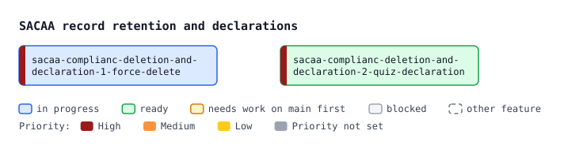

**Notes**
- Build order: the two specs share no code and run in parallel.
- Collisions: `sacaa-complianc-deletion-and-declaration-2-quiz-declaration` changes the form schema, `Form`, `FormProgress`, `content_save` and `form_start`, like `sacaa-compliance-2-shuffle` and `sacaa-compliance-3-question-pools`; it rebases onto whichever lands first.
- Decided: only superusers force delete, at any time, with a required reason written to the audit log; no retention-window gate and no automatic cleanup.
- Decided: force delete replaces the User admin's delete button and "delete selected" action as the one erasure path.
- Decided: each quiz sets whether its declaration is signed on every attempt or once per learner; the typed name must be non-empty and is stored as typed.
- Assumption: force deleting a user removes every record today's user deletion removes, plus their course progress, which today blocks deletion (`PROTECT`).
- Assumption: force deleting a learner removes that `Learner` and its registrations, cohort memberships and course progress in that organisation; the `User` stays.
- Assumption: of `sacaa-complianc-deletion-and-declaration-2-quiz-declaration` and `sacaa-compliance-4-attempt-review`, whichever lands second shows the declaration on the educator attempt view.
- Out of scope: locking progress, attempt and answer records in the admin; self-service account deletion; declarations on non-quiz forms.
- References: CAR 141.01.17 five-year retention in `sacaa-compliance/research_sacaa_requirements.md`.
