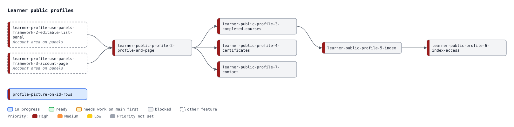
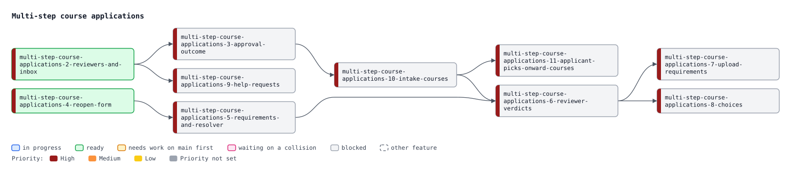
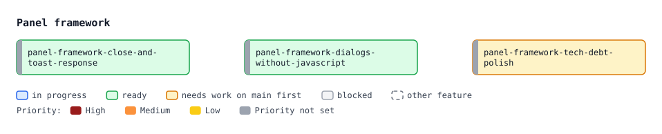
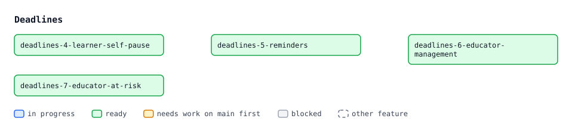
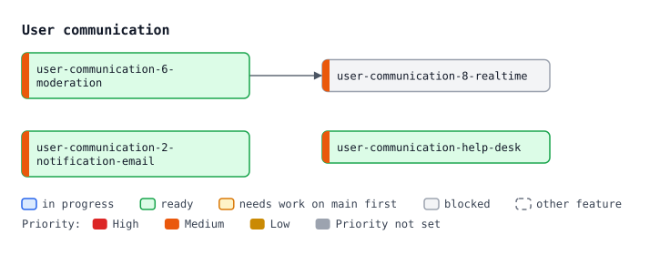
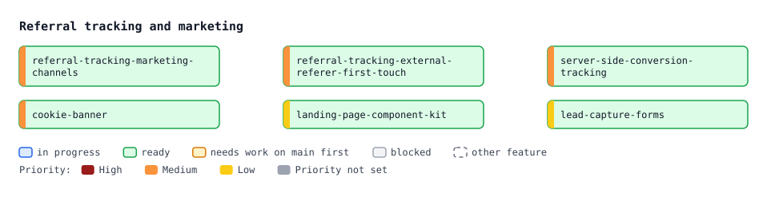
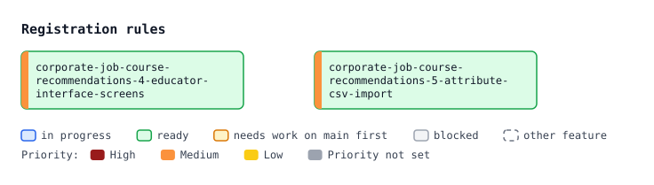
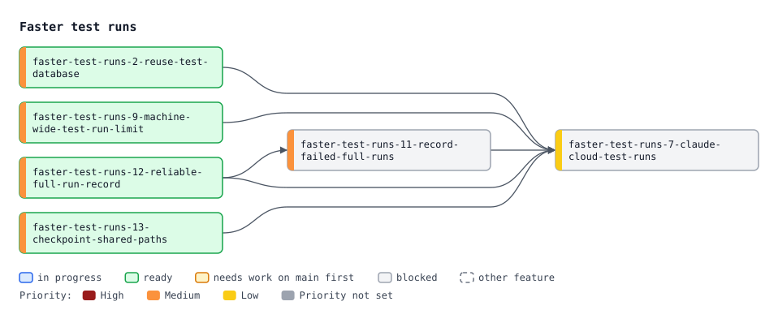

# Spec roadmap

What gets built next, grouped by feature. Run `/sdd:roadmap` to update it. The format is in
`claude_plugins/sdd/resources/roadmap_format.md`. The product roadmap is `docs/product/roadmap.md`.

## Up next

Generated by the sdd roadmap script from the feature sections below and `priority.md`. Do not edit by hand.

Priority: 🔴 High · 🟠 Medium · 🟡 Low · ⚪ Priority not set

### In progress

- 🔴 High · `sacaa-compliance-assessment-controls-2-attempt-limits` (SACAA compliance)
- 🔴 High · `sacaa-compliance-assessment-controls-3-test-time-limit` (SACAA compliance)
- 🔴 High · `sacaa-compliance-content-versions-and-access-3-question-versions` (SACAA compliance)
- 🔴 High · `sacaa-compliance-content-versions-and-access-4-question-access` (SACAA compliance)
- 🔴 High · `extract_panels_framework-5-package-and-install` (Panel framework extraction)
- 🟡 Low · `educator-interface-page-polish` (Educator interface)

### Ready to start

- 🔴 High · `sacaa-compliance-assessment-controls-4-inactivity-auto-exit` (SACAA compliance)
- 🔴 High · `sacaa-compliance-assessment-controls-7-course-restart` (SACAA compliance)
- 🔴 High · `learner-public-profile-2-profile-and-page` (Learner public profiles)
- 🔴 High · `multi-step-course-applications-2-reviewers-and-inbox` (Multi-step course applications)
- 🔴 High · `multi-step-course-applications-4-reopen-form` (Multi-step course applications)
- 🟠 Medium · `panel-framework-close-and-toast-response` (Panel framework)
- 🟠 Medium · `panel-framework-dialogs-without-javascript` (Panel framework)
- 🟠 Medium · `content-widget-sayit-reveal-4-audio-access-control` (Audio content widgets)
- 🟠 Medium · `learner-interface-features-4-flashcards` (Learner interface features, via `content-widget-sayit-reveal`)
- 🟠 Medium · `deadlines-4-learner-self-pause` (Deadlines)
- 🟠 Medium · `deadlines-5-reminders` (Deadlines)
- 🟠 Medium · `deadlines-6-educator-management` (Deadlines)
- 🟠 Medium · `deadlines-7-educator-at-risk` (Deadlines)
- 🟠 Medium · `form-engine-branch-logic-2-and-conditions` (Forms and applications)
- 🟠 Medium · `messaging-drafts` (User communication)
- 🟠 Medium · `messaging-inbox-polish` (User communication)
- 🟠 Medium · `user-communication-2-notification-email` (User communication)
- 🟠 Medium · `user-communication-6-moderation` (User communication)
- 🟠 Medium · `user-communication-help-desk` (User communication)
- 🟠 Medium · `referral-tracking-external-referer-first-touch` (Referral tracking and marketing)
- 🟠 Medium · `server-side-conversion-tracking` (Referral tracking and marketing)
- 🟠 Medium · `cookie-banner` (Referral tracking and marketing)
- 🟠 Medium · `audit-log-describe-test-flake` (Tooling and operations)
- 🟠 Medium · `extract-semantic-icons-app-2-host-icons` (Semantic icons extraction)
- 🟡 Low · `housekeeping-sentry-cron-checkin` (Tooling and operations)
- 🟡 Low · `corporate-job-course-recommendations-4-educator-interface-screens` (Registration rules)
- 🟡 Low · `corporate-job-course-recommendations-5-attribute-csv-import` (Registration rules)
- 🟡 Low · `faster-test-runs-12-reliable-full-run-record` (Faster test runs)
- 🟡 Low · `faster-test-runs-13-checkpoint-shared-paths` (Faster test runs)
- 🟡 Low · `faster-test-runs-2-reuse-test-database` (Faster test runs)
- 🟡 Low · `faster-test-runs-9-machine-wide-test-run-limit` (Faster test runs)
- 🟡 Low · `reference-material-content-4-library-courses` (Reference material)
- 🟡 Low · `admin-dashboard-signal-cards` (Educator interface)
- 🟡 Low · `audit-log-coverage-gaps` (Educator interface)
- 🟡 Low · `bulk-run-audit-summary` (Educator interface)
- 🟡 Low · `educator-interface-staff-invitations-and-cohort-staff` (Educator interface)
- 🟡 Low · `staff-person-profile-by-email` (Educator interface)
- 🟡 Low · `landing-page-component-kit` (Referral tracking and marketing)
- 🟡 Low · `lead-capture-forms` (Referral tracking and marketing)
- 🟡 Low · `dev-site-bootstrap-command` (Tooling and operations)
- 🟡 Low · `forced-site-name-for-host-based-site-lookup` (Tooling and operations)
- 🟡 Low · `from-address-system-check` (Tooling and operations)
- ⚪ Priority not set · `educator-revision-analytics` (Learner interface features)
- ⚪ Priority not set · `learner-interface-features-2-test-out` (Learner interface features)
- ⚪ Priority not set · `learner-interface-features-5-protected-video` (Learner interface features)
- ⚪ Priority not set · `learner-interface-features-6-revision-dashboard` (Learner interface features)
- ⚪ Priority not set · `demo-cohorts-seed-command` (Tooling and operations)

### Waiting on a collision

None.

### Needs work on main first

None.

## SACAA compliance

Priority: 🔴 High

Learner record retention, question versions and access, and assessment controls, for training organisations audited by SACAA. Parents: `sacaa-complianc-deletion-and-declaration`, `sacaa-compliance-content-versions-and-access`, `sacaa-compliance-assessment-controls`.

### In progress

- `sacaa-compliance-content-versions-and-access-3-question-versions` — **in progress** — Every question change saves an immutable version; attempts keep the version served; results, export and admin answers read it.
- `sacaa-compliance-content-versions-and-access-4-question-access` — **in progress** — A new role may view course questions and answers in the educator interface; each view is audited; admin question pages go.
- `sacaa-compliance-assessment-controls-2-attempt-limits` — **in progress** — Quizzes cap attempts and set escalating waits between failed attempts, enforced at the start gate. Collides with `sacaa-compliance-assessment-controls-3-test-time-limit`, `sacaa-compliance-assessment-controls-5-test-disturbance`.
- `sacaa-compliance-assessment-controls-3-test-time-limit` — **in progress** — Quizzes get a time limit with a countdown; expired attempts are submitted and marked, with a recorded reason. Collides with `sacaa-compliance-assessment-controls-5-test-disturbance`.

### Ready to start

- `sacaa-compliance-assessment-controls-4-inactivity-auto-exit` — **ready** — Topics, forms and course parts require interaction every N minutes, warn, then exit to the dashboard or log out.
- `sacaa-compliance-assessment-controls-7-course-restart` — **ready** — Staff restart a learner's course with a reason; the earlier run is kept read-only.

### Blocked

- `sacaa-compliance-content-versions-and-access-5-answered-version-review` — **blocked** by `sacaa-compliance-content-versions-and-access-3-question-versions`, `sacaa-compliance-content-versions-and-access-4-question-access` — Educators reviewing an attempt see the question version answered, when it changed, and whether it is still served.
- `sacaa-compliance-assessment-controls-1-score-moderation` — **blocked** by `sacaa-compliance-content-versions-and-access-4-question-access` — A moderator overrides a learner's mark on one quiz question with a reason; the system mark is kept. Collides with `sacaa-compliance-content-versions-and-access-3-question-versions`, `sacaa-compliance-content-versions-and-access-5-answered-version-review`.
- `sacaa-compliance-assessment-controls-5-test-disturbance` — **blocked** by `sacaa-compliance-assessment-controls-3-test-time-limit`, `sacaa-compliance-assessment-controls-4-inactivity-auto-exit` — Leaving a quiz (logout, session end, auto exit, leave and return) auto-fails or auto-marks the attempt.
- `sacaa-compliance-assessment-controls-6-minimum-learning-time` — **blocked** by `sacaa-compliance-assessment-controls-4-inactivity-auto-exit` — Active learning time is recorded; topics, course parts and quizzes require a minimum before learners move on.

**Notes**
- Build order: `sacaa-compliance-content-versions-and-access-3-question-versions` follows `sacaa-compliance-content-versions-and-access-2-retire-removed-content`; `sacaa-compliance-content-versions-and-access-5-answered-version-review` follows it and `sacaa-compliance-content-versions-and-access-4-question-access`.
- Build order: `sacaa-compliance-assessment-controls-2-attempt-limits`, `sacaa-compliance-assessment-controls-3-test-time-limit`, `sacaa-compliance-assessment-controls-4-inactivity-auto-exit` and `sacaa-compliance-assessment-controls-7-course-restart` can start now; `sacaa-compliance-assessment-controls-1-score-moderation` follows `sacaa-compliance-content-versions-and-access-4-question-access`; `sacaa-compliance-assessment-controls-5-test-disturbance` follows `sacaa-compliance-assessment-controls-3-test-time-limit` and `sacaa-compliance-assessment-controls-4-inactivity-auto-exit`; `sacaa-compliance-assessment-controls-6-minimum-learning-time` follows `sacaa-compliance-assessment-controls-4-inactivity-auto-exit`.
- Collisions share code: `sacaa-compliance-assessment-controls-2-attempt-limits`, `sacaa-compliance-assessment-controls-3-test-time-limit` and `sacaa-compliance-assessment-controls-5-test-disturbance` all edit `start_attempt`, `_form_start_gate` and the `Form` schema; `sacaa-compliance-assessment-controls-1-score-moderation` shares `compute_quiz_scores` and the attempt review panel with its partners.
- Decided, retention: only superusers force delete, at any time, with a required reason in the audit log. It replaces the User admin's delete button and "delete selected" action. No retention-window gate, no automatic cleanup.
- Decided, content: each source path is a git repo with a clean tree before `content_save`, and the commit hash is recorded. Retired content is served to no one and never deleted. Each `FormQuestion` change makes an immutable version; an attempt pins its versions at start.
- Decided, access: a new organisation-scoped role views questions and answers in the educator interface, every view audited, superusers' included. The Django admin loses its question and option pages and QUIZ answer views. `sacaa-compliance-content-versions-and-access-4-question-access` gates and logs the attempt review; `sacaa-compliance-content-versions-and-access-5-answered-version-review` reuses `can_view_course_questions`, `record_question_view` and the Paper panel gate, and adds only the answered-version display.
- Decided, assessment: every control is off by default and set in content front matter; a course part's setting applies to its children. A moderated mark sits beside the system mark. Staff restart a course by hand; attempts count per `CourseProgress`. An expired or disturbed attempt completes with a reason and counts; tab switching is not a disturbance.
- Assumptions: force deleting a user also removes their course progress; force deleting a learner keeps the `User`. A question version covers text, type, required, bounds and options. A time limit runs on wall-clock time; the auto-exit warning has an "I'm still here" button (WCAG 2.2.1).
- Out of scope: `content_snapshots`, regrading, versioning topics or courses, self-service account deletion, focus-loss detection, per-cohort overrides, identity verification.
- References: CAR 141.01.17 five-year retention in `sacaa-compliance/research_sacaa_requirements.md`; the `research_*.md` files in `sacaa-compliance-content-versions-and-access` and `sacaa-compliance-assessment-controls`.

## Panel framework extraction

Priority: 🔴 High

The panel framework moves into its own installable package, because another Django project needs it. Parent: `extract_panels_framework`.

### In progress

- `extract_panels_framework-5-package-and-install` — **in progress** — The public `django-panel-framework` repo, tagged `v0.1.0`. FLS installs it by git tag and drops the old table.

### Blocked

- `extract_panels_framework-6-claude-plugin` — **blocked** by `extract_panels_framework-5-package-and-install` — A generic `panel-framework` Claude Code plugin and developer doc in the package repo. `fls-dev` keeps only a pointer.

**Notes**
- Specs touching `educator_interface`, `comms`, `reports` or `learner_management` rebase onto `extract_panels_framework-5-package-and-install` once it changes the import prefix.
- Decided: a public repo at `preludetech/django-panel-framework`, owned by Prelude Technologies, released by git tag; no PyPI and no submodule.
- Decided: MIT licence, copyright Prelude Technologies. The repo takes no outside contributions for now and keeps bundled third-party licence notices (Heroicons, MIT).
- Decided: app label `panel_framework` starting from a clean `0001`, and no data is migrated. FLS pins it with a PEP 508 git URL in `[project].dependencies`.
- Decided: multi-site stays. A settings-declared site resolver defaults to `get_current_site`.
- Assumed: there is no shared core package. If one turns out to be needed, stop and say so. The package ships overridable primitives, and the host schedules the bulk-run sweep.
- Open: the uv editable-install spike (`extract_panels_framework-5-package-and-install`).
- The other project must not install the package before `extract_panels_framework-5-package-and-install`.
- References: `research_packaging_and_distribution.md` and `research_coupling_audit.md`, both in the parent.

## Learner public profiles

Priority: 🔴 High

Learners publish a profile to help them find work, and visitors browse an index of them. Parent: `learner-public-profile`.

### Ready to start

- `learner-public-profile-2-profile-and-page` — **ready** — Learners switch on a shareable public profile with blurb, work experience, place, open to work and links.

### Blocked

- `learner-public-profile-3-completed-courses` — **blocked** by `learner-public-profile-2-profile-and-page` — Courses a learner completed on the site appear on their public profile. The learner can hide each one. Collides with `learner-public-profile-4-certificates`.
- `learner-public-profile-4-certificates` — **blocked** by `learner-public-profile-2-profile-and-page` — Learners upload self-reported certificates. Organisation staff upload certificates on the educator-interface learner page.
- `learner-public-profile-5-index` — **blocked** by `learner-public-profile-3-completed-courses` — A public index of switched-on profiles, named per site, with search, filters and sorts.
- `learner-public-profile-6-index-access` — **blocked** by `learner-public-profile-5-index` — Placeholder: decide who may see the index in each concrete project. Before starting: settle the design with the product owner and rewrite this idea.
- `learner-public-profile-7-contact` — **blocked** by `learner-public-profile-2-profile-and-page` — Placeholder: decide how a profile viewer gets in touch with a learner. Before starting: settle the design with the product owner and rewrite this idea.

**Notes**
- Order: `learner-public-profile-2-profile-and-page` first. After it, `learner-public-profile-3-completed-courses` and `learner-public-profile-4-certificates` run in parallel, and `learner-public-profile-5-index` follows `learner-public-profile-3-completed-courses`.
- Collision shares code: both add sections to the profile page and the edit page.
- Decided: profiles are opt-in, off by default, with consent recorded. The learner's own link always works while the profile is on, and is a 404 when it is off. Only the index is ever restricted, and it is public for now.
- Decided: per-site settings hold the feature switch (off by default) and its display name, e.g. "Talent Database". Place is a country select with a city select filtered by country, and the country autofills.
- Decided: the picture is every user's avatar. Organisation-issued certificates are labelled as such and learner uploads as self-reported, with no moderation queue.
- Decided: learner editing from `learner-public-profile-2-profile-and-page` on is panels in the account area. Profile pages and the index are `noindex`. Skills and per-field visibility are not in this effort.
- Open questions:
  - the city data source and the autofill source (`learner-public-profile-2-profile-and-page`);
  - the certificate storage alias (`learner-public-profile-4-certificates`).
- Out of scope: educator views of profiles, Open Badges, generated completion certificates.
- References: `research_existing_profile_code.md` and `research_comparable_systems.md` in the parent.

## Multi-step course applications

Priority: 🔴 High

Applications become steps an applicant works through over weeks, decided by a deployment's rules and cleared by organisation reviewers. Parent: `multi-step-course-applications`.

### Ready to start

- `multi-step-course-applications-2-reviewers-and-inbox` — **ready** — Organisation reviewers get an applications inbox and review screen, approve or reject, and move applications between organisations.
- `multi-step-course-applications-4-reopen-form` — **ready** — Applicants reopen their submitted application form, answers prefilled, until it is approved.

### Blocked

- `multi-step-course-applications-3-approval-outcome` — **blocked** by `multi-step-course-applications-2-reviewers-and-inbox` — A deployment seam decides what approval does; FLS's default registers the applicant for the course.
- `multi-step-course-applications-5-requirements-and-resolver` — **blocked** by `multi-step-course-applications-4-reopen-form` — Applicants work through a requirements page; a deployment resolver, or the course's fixed list, decides the requirements.
- `multi-step-course-applications-6-reviewer-verdicts` — **blocked** by `multi-step-course-applications-5-requirements-and-resolver`, `multi-step-course-applications-10-intake-courses` — Reviewers accept or turn down requirements with a reason, preview the consequence; requirements hold back approval or registration.
- `multi-step-course-applications-7-upload-requirements` — **blocked** by `multi-step-course-applications-6-reviewer-verdicts` — Applicants upload documents for requirements, re-upload when asked, and see past uploads; reviewers see every version. Collides with `multi-step-course-applications-8-choices`.
- `multi-step-course-applications-8-choices` — **blocked** by `multi-step-course-applications-6-reviewer-verdicts` — The resolver offers either-or requirement groups; applicants switch options until one is accepted.
- `multi-step-course-applications-9-help-requests` — **blocked** by `multi-step-course-applications-2-reviewers-and-inbox` — Applicants ask for a callback from any application page; reviewers are notified and a webhook feeds the CRM.
- `multi-step-course-applications-10-intake-courses` — **blocked** by `multi-step-course-applications-3-approval-outcome` — Authors mark a course apply-only and list its onward courses; reviewers register approved applicants for them.
- `multi-step-course-applications-11-applicant-picks-onward-courses` — **blocked** by `multi-step-course-applications-10-intake-courses` — Applicants for an intake course pick the onward courses they want; reviewers see the picks.

**Notes**
- Order: `multi-step-course-applications-2-reviewers-and-inbox` and `multi-step-course-applications-4-reopen-form` run in parallel. `multi-step-course-applications-10-intake-courses` follows `multi-step-course-applications-3-approval-outcome`. `multi-step-course-applications-6-reviewer-verdicts` needs it and `multi-step-course-applications-5-requirements-and-resolver`; `multi-step-course-applications-7-upload-requirements` and `multi-step-course-applications-8-choices` follow it, and `multi-step-course-applications-9-help-requests` can start once `multi-step-course-applications-2-reviewers-and-inbox` lands.
- Collision shares code: both change the reconcile step and the requirements page.
- Decided: no workflow graph. The resolver is a pure function of the application's data, re-run after every event by one reconcile function; superseded requirements are kept.
- Decided: states are `TextChoices` and service functions, no FSM library. Reviewer and system actions go in `audit_log`, never the applicant's name. No `changes_requested` or `under_review` states.
- Decided: reviewers hold a new organisation role checked with `can()`; each inbox is per organisation; the Django admin stays read-only.
- Decided: what approval does is a deployment seam whose default registers the applicant. Anything beyond the application form, and approval itself, needs a claimed account.
- Decided: an intake course is applied for and never registered for. Its content lists onward courses, and a reviewer registers the applicant for each by hand from their answers. Applicants are registered, never recommended courses; nothing picks an organisation, enforces course order or prices a bundle.
- Assumed: a new application takes the course's only owning organisation, else the site default. Re-applying after reject or withdraw makes a new application. No `application.*` webhooks except `application.help_requested`.
- Open questions:
  - who sees an organisation move in the audit log (`multi-step-course-applications-2-reviewers-and-inbox`);
  - `add_learner` or `ensure_learner` (`multi-step-course-applications-3-approval-outcome`);
  - what a resolver failure does (`multi-step-course-applications-5-requirements-and-resolver`).
- Out of scope: outside systems reporting a step done, provider lists and distance ranking, more than one sign-off, and scanning uploaded files (not planned).
- References: `research_review_foundations.md`, `research_help_requests.md` and `intake_courses_case.md` in the parent.

## Panel framework

Priority: 🟠 Medium

Gaps in the panel framework's dialogs and responses.

### Ready to start

- `panel-framework-close-and-toast-response` — **ready** — Panel actions get a built-in response that closes the dialog and shows a toast without swapping content.
- `panel-framework-dialogs-without-javascript` — **ready** — Single-record dialog triggers work with JavaScript off, opening the dialog server-side over its page.

## Learner interface features

Priority: 🟠 Medium

Test out of sections, revise with spaced repetition and flashcards, and watch access-controlled video. Parent: `learner-interface-features`.

### Ready to start

- `learner-interface-features-2-test-out` — **ready** — Learners take a pretest and skip sections they already know; the skip is recorded as its own kind of completion.
- `learner-interface-features-4-flashcards` — **ready** — Authors add flashcards to sections; learners rate their confidence and the revision schedule brings them back.
- `learner-interface-features-5-protected-video` — **ready** — Course content embeds video that only learners with access to the course can play; shared links stop working.
- `learner-interface-features-6-revision-dashboard` — **ready** — Learners open a revision dashboard: per-course cards with due counts, weak and strong sections, and section sessions.
- `educator-revision-analytics` — **ready** — Educators see the revision questions learners miss most, per-option answer counts and each learner's weak sections.

**Notes**
- Order is set by dependencies only. `learner-interface-features-2-test-out` and `learner-interface-features-5-protected-video` can start any time.
- `learner-interface-features-2-test-out` adds a section's questions to the revision bank when it is tested out, as completing the section does.
- Decided: design questions (what a section is, the pretest's shape, the scheduler, the video host) are settled in each spec's own research, not in the cut. Flashcards are their own spec.
- Assumed: the `youtube` component stays as it is beside protected video.
- Open questions:
  - the pretest's shape, how a skip is recorded and reported, renewal registrations, and the "recertification not planned" lines here and in `docs/product/roadmap.md` (`learner-interface-features-2-test-out`);
  - video host and build or buy (`learner-interface-features-5-protected-video`).
- Out of scope: the other features in section 4 of `research_learner_features.md`.
- References: `research_learner_features.md` and `research_question_model.md` in the parent.

## Audio content widgets

Priority: 🟠 Medium

Course content that plays audio: clips, say-it-then-reveal practice and audio on revision flashcards. Parent: `content-widget-sayit-reveal`.

### Ready to start

- `content-widget-sayit-reveal-4-audio-access-control` — **ready** — Decide and enforce who may play a course's audio through its open redirect link.

### Blocked

- `content-widget-sayit-reveal-3-audio-on-revision-flashcards` — **blocked** by `learner-interface-features-4-flashcards` — Scheduled revision flashcards carry audio that plays when the learner reveals the card.

**Notes**
- Decided: say-it-then-reveal is a self-check; no microphone, no speech recognition, nothing recorded.
- Decided: audio is the author's recorded files, loaded as course media (the loader already stores audio); no text-to-speech.
- Decided: until scheduled flashcards land, courses practise with the static `c-flashcard` widget, which gains audio.
- Assumed: mp3 recommended; nothing plays on page load, only on a Reveal click; each clip has a visible text alternative.
- Assumed: the in-page widgets store nothing and have no self-rating; the letter list is `c-audio` inside existing layout widgets.
- Assumed: FLS demo content shows each widget with a few licensed clips; the phonetic-alphabet course belongs to the concrete project.
- Open: how a card names its clip (`content-widget-sayit-reveal-3-audio-on-revision-flashcards`).
- Out of scope: speech recognition, text-to-speech, recording the learner, speed control.
- References: `research_content_media.md` and `research_audio_widgets.md` in the parent.

## Deadlines

Priority: 🟠 Medium

Due dates and course time limits, with consequences, pause, reminders and at-risk views. Parent: `deadlines`.

### Ready to start

- `deadlines-4-learner-self-pause` — **ready** — Learners pause and resume their own course within the policy's limits, giving a reason.
- `deadlines-5-reminders` — **ready** — A housekeeping sweep sends learners reminders, educators rolled-up overdue notices, and fires a `deadline.missed` webhook.
- `deadlines-6-educator-management` — **ready** — Staff set and extend deadlines (also in bulk) and pause or resume courses in the educator interface, all audit-logged.
- `deadlines-7-educator-at-risk` — **ready** — Overdue and due-soon learners appear in Needs attention and on the dashboard, and the cohort report gets an at-risk rule.

**Notes**
- `deadlines-4-learner-self-pause`, `deadlines-5-reminders`, `deadlines-6-educator-management` and `deadlines-7-educator-at-risk` run in parallel.
- Collision: `deadlines-7-educator-at-risk` edits `reports/at_risk.py`.
- Decided: pause stops the clock and nothing opens while paused. Learners self-pause with no approval. Once a time limit ends access, only staff can restore it. Policy lives in the Django admin.
- Assumed: a deadline attaches to the placement (`ContentCollectionItem`). The start is `CourseProgress.created_at`. The most permissive deadline wins. Ending access leaves `is_active` alone.
- Assumed notifications: staff pauses and extensions notify the learner; self-pauses don't. Reminders stay in-app until `user-communication-2-notification-email` lands.
- Settled in code:
  - Records: `CoursePause` (one open per course progress record, with a reason, optional planned resume date and the resume fields) and `DeadlineExtension` (`days` on a collection item, the time limit or the whole course). Staff act on the course progress record through `pause_course`, `resume_course`, `announce_planned_resume` and `extend_deadline` in `freedom_ls/deadlines/actions.py`.
  - Shift rule: whole days, rounded up, added to the deadline's local date. It is computed when read, never stored, and an open pause counts up to now. It applies to an item only if the item was unmet when the shift began. Extensions stack by addition.
  - Pause limits (`learners_may_pause`, `max_pauses`, `max_pause_days`) are stored and resolved in the policy but enforced by nobody yet (`deadlines-4-learner-self-pause`).
- Open questions:
  - reminder offsets and the educator rollup (`deadlines-5-reminders`);
  - the due-soon window (`deadlines-7-educator-at-risk`).
- Out of scope: recertification, retakes, line-manager escalation, score penalties, SMS, calendar export.

## Forms and applications

Priority: 🟠 Medium

Form engine features and the course application flow.

### Ready to start

- `form-engine-branch-logic-2-and-conditions` — **ready** — Show a page, question or content block only when several conditions all hold.

## User communication

Priority: 🟠 Medium

Notifications and direct messaging between learners and educators. Parent: `user-communication`.

### Ready to start

- `user-communication-2-notification-email` — **ready** — Email delivery. Per-category immediate, daily, weekly or off preferences, quiet hours, unsubscribe, and a digest sweep in housekeeping.
- `user-communication-6-moderation` — **ready** — Users report messages or block users. Site admins work a report queue and hide messages. Nothing is hard deleted.
- `messaging-inbox-polish` — **ready** — Recipient search by email and cohort, one New message flow, staff and cohort chips, full educator conversation history.
- `messaging-drafts` — **ready** — Unsent messages are saved as drafts, marked in the conversation list and refilled into the message box. Collides with `messaging-inbox-polish`.
- `user-communication-help-desk` — **ready** — Learners ask for help on specific content from the course player, into a shared queue educators pick up.

### Blocked

- `user-communication-8-realtime` — **blocked** by `user-communication-6-moderation` — Optional Django Channels push for the unread badge and open threads. Off by default, with polling as the fallback.

**Notes**
- `user-communication-2-notification-email` and `user-communication-6-moderation` run in parallel. UI specs build to the design registered in `user-communication/design.md`.
- Email contract: a backend re-reads the notification when it sends and skips it if read. Updating a notification queues nothing. Messages raise no notification, so message email needs its own trigger.
- Decided: polling is the transport. Messaging permissions are layered and closed by default, through a swappable policy class. Moderation is report, hide and block.
- `user-communication-help-desk` needs its own queue model, because a `Conversation` is between exactly two users.
- Assumed: configuration is edited in the Django admin. Conversations are one-to-one with no read receipts. Background work passes `site_id` explicitly.
- Open questions:
  - where the report queue lives (`user-communication-6-moderation`);
  - what a digest holds and where a user's timezone comes from (`user-communication-2-notification-email`).
- Collision shares code: both change the composer and conversation list templates.
- Out of scope: announcements, forums, group conversations, SMS and push, reply-by-email.

## Referral tracking and marketing

Priority: 🟠 Medium

Where signups come from, and what visitors are told about tracking.

### Ready to start

- `referral-tracking-external-referer-first-touch` — **ready** — An opt-in first touch for visitors who arrive untagged from another site.
- `server-side-conversion-tracking` — **ready** — Send conversions from the server to the Meta, TikTok and Google APIs, deduplicated against the browser tags.
- `cookie-banner` — **ready** — A cookie banner explains tracking. Once dismissed, it stays dismissed.
- `landing-page-component-kit` — **ready** — Theme-role cotton components and layouts for building course and campaign landing pages.
- `lead-capture-forms` — **ready** — Site-aware enquiry forms storing leads with first-touch attribution, with staff notification emails and CSV export.

### Blocked

- `referral-tracking-labelled-referer-hosts` — **blocked** by `referral-tracking-external-referer-first-touch` — Staff label unknown referer hosts in the admin so the channel classifier counts them correctly.
- `admin-leads-list-and-export` — **blocked** by `lead-capture-forms` — Staff list everyone who showed interest, one row per email, filtered by date and channel, with CSV export.

**Notes**
- `referral-tracking-external-referer-first-touch` must agree with the existing attribution touch list.
- The `referral-tracking-*` specs, `landing-page-component-kit` and `admin-leads-list-and-export` are pull-ins from First-Class-LMS. `landing-page-component-kit` first needs a decision on whether FLS owns marketing pages.

## Tooling and operations

Priority: 🟠 Medium

Developer tooling, deployment and downstream fixes.

### Ready to start

- `from-address-system-check` — **ready** — A `mail` system check warns when the email backend really delivers but `DEFAULT_FROM_EMAIL` is blank.
- `housekeeping-sentry-cron-checkin` — **ready** — When a monitor slug is configured, `fls_run_housekeeping` checks in with Sentry Crons.
- `forced-site-name-for-host-based-site-lookup` — **ready** — `FORCE_SITE_NAME` reaches host-based site lookup in development, so every dev port works.
- `audit-log-describe-test-flake` — **ready** — Find and fix why the audit-log describe test fails in loaded full runs but passes alone.
- `dev-site-bootstrap-command` — **ready** — A development command that creates the forced-name dev Site and a verified dev superuser.
- `demo-cohorts-seed-command` — **ready** — A development command that fills a site with deterministic demo cohorts and learners for demos.

**Notes**
- `housekeeping-sentry-cron-checkin`, `forced-site-name-for-host-based-site-lookup`, `dev-site-bootstrap-command` and `demo-cohorts-seed-command` are pull-ins from First-Class-LMS.

## Semantic icons extraction

Priority: 🟠 Medium

The icons app becomes an installable package another Django project can use and extend with its own icons. Parent: `extract-semantic-icons-app`.

### Ready to start

- `extract-semantic-icons-app-2-host-icons` — **ready** — Host projects add semantic names, point names at their own SVGs, and register whole custom icon sets, all checked at startup.

### Blocked

- `extract-semantic-icons-app-3-package-and-install` — **blocked** by `extract-semantic-icons-app-2-host-icons`, `extract_panels_framework-5-package-and-install` — The public `django-semantic-icons` repo, tagged `v0.1.0`; FLS and First-Class install it by git tag.
- `extract-semantic-icons-app-4-claude-plugin` — **blocked** by `extract-semantic-icons-app-3-package-and-install`, `extract_panels_framework-6-claude-plugin` — A generic `semantic-icons` Claude Code plugin and host doc in the package repo; `fls-dev:icon-usage` keeps only FLS specifics.

**Notes**
- Strictly sequential: each spec builds on the one before.
- Decided: the package ships all 63 current semantic names, FLS-domain ones included. Host-added names layer on top; host settings win over app registrations, which win over built-ins.
- Decided: "custom icons" means remapping within the active set, pointing a name at the host's own SVG file, and registering a whole custom icon set.
- Assumed: distribution copies the panel framework: public repo owned by Prelude Technologies beside it in `django_apps/`, all rights reserved until a licence is chosen, no outside contributions, released by git tag, pinned with a PEP 508 git URL, `CHANGELOG.md` with upgrade flags.
- Assumed: icon data ships as a generated subset of the four Iconify sets, each with its own licence notice; an optional setting points at a full `@iconify-json` directory for glyphs outside it.
- Assumed: settings move to `SEMANTIC_ICONS_*`; the old `FREEDOM_LS_ICON_*` names keep working with a deprecation warning for one tag. Import name and app label become `semantic_icons`; `<c-icon>` and its arguments do not change, so no template edits.
- Assumed: the panel framework package does not depend on this one; FLS meets the panel framework's icon host contract through it.
- Out of scope: changing how templates call `<c-icon>`, new icon sets beyond the four, an icon picker UI.
- References: `research_coupling_audit.md` in the parent; the extract_panels_framework research files for packaging.

## Registration rules

Priority: 🟡 Low

Rules that register or recommend courses based on a learner's HR attributes. Parent: `corporate-job-course-recommendations`.

### Ready to start

- `corporate-job-course-recommendations-4-educator-interface-screens` — **ready** — Educator-interface screens for attribute lists, a learner's attributes, and registration rules with their preview.
- `corporate-job-course-recommendations-5-attribute-csv-import` — **ready** — Import learners' HR attributes by CSV through the bulk import flow, with a preview, and evaluate rules once per import.

**Notes**
- Both run in parallel. Both edit educator-interface learner views; whichever lands second rebases.
- Only `organisation_admin` and `site_admin` manage lists and rules. A preview lists the learners affected, not a count.
- CSV import updates `Learner` attributes only, never `User` details. Open: an unknown list value becomes an error row (the default) or is created on confirm.
- Out of scope: SCIM and SSO sync, custom attributes, rule-filled cohorts.

## Faster test runs

Priority: 🟡 Low

Cut the time and machine load of test runs so several worktrees can work at once. Parent: `faster-test-runs`.

### Ready to start

- `faster-test-runs-2-reuse-test-database` — **ready** — A pytest run reuses the test database and rebuilds it only when migrations change.
- `faster-test-runs-9-machine-wide-test-run-limit` — **ready** — Test runs from every worktree share one CPU and memory limit, and a waiting run says so.
- `faster-test-runs-12-reliable-full-run-record` — **ready** — Every full run writes its own record, or prints why it recorded nothing. Collides with `faster-test-runs-9-machine-wide-test-run-limit`.
- `faster-test-runs-13-checkpoint-shared-paths` — **ready** — A `finish_worktree` checkpoint tests main's change to a file the branch changed earlier as main's change.

### Blocked

- `faster-test-runs-7-claude-cloud-test-runs` — **blocked** by `faster-test-runs-2-reuse-test-database`, `faster-test-runs-9-machine-wide-test-run-limit`, `faster-test-runs-11-record-failed-full-runs`, `faster-test-runs-12-reliable-full-run-record`, `faster-test-runs-13-checkpoint-shared-paths` — Fallback: a test run or SDD batch is handed to a Claude Code cloud session.
- `faster-test-runs-11-record-failed-full-runs` — **blocked** by `faster-test-runs-12-reliable-full-run-record` — A failed full run records its failed tests, so the next checkpoint re-runs those, not the whole suite.

**Notes**
- Every spec can start now and run in parallel, except `faster-test-runs-7-claude-cloud-test-runs` and the two below.
- `faster-test-runs-11-record-failed-full-runs` extends the record `faster-test-runs-12-reliable-full-run-record` makes reliable; `faster-test-runs-13-checkpoint-shared-paths` changes the test selector.
- Suggested order by saving: `faster-test-runs-2-reuse-test-database` first, then the rest.
- `faster-test-runs-7-claude-cloud-test-runs` waits on the others because the owner wants it only if they are not enough.
- Collision shares code: both may change the test runner.
- Decision: generic `sdd` and `ds` plugins stay generic; project values reach them through per-project configuration.
- Decision: no spec reduces what is tested without naming the test that still covers it.
- Assumption: every spec reports its before and after timings against `faster-test-runs/research_test_timings.md`.
- Out of scope: paid runners, squashing migrations, changes to the First Class workflow.
- References: `faster-test-runs/research_test_timings.md`, `faster-test-runs/research_batch_test_load.md`, `faster-test-runs/research_finish_worktree_reruns.md`.

## Reference material

Priority: 🟡 Low

Reference parts, such as regulations, that learners consult at any time beside a course's learning path, and courses that are only libraries. Parent: `reference-material-content`.

### Ready to start

- `reference-material-content-4-library-courses` — **ready** — A course with only reference material opens its reference listing, shows no progress anywhere and can never be finished.

**Notes**
- Decided: reference parts are `CoursePart` rows attached by a new `CourseReferencePart(course, course_part, order)`; `Course.items` stays the learning path. Reference parts hold topics only, one level deep.
- Decided: a part listed under `reference:` makes `content_save` delete that course's old collection item placing it, with its overrides and due dates, and report what it removed.
- Decided: reading reference material records nothing (no progress, resume pointer or `started_at`) and follows lesson access, so it is closed while paused and after the time limit ends.
- Decided: a library-only course shows no progress or completion anywhere and cannot be finished.
- Assumed: a topic may sit in both a learning-path part and a reference part; only a whole part is barred from both lists of one course.
- Out of scope: nesting deeper than part, then topics (planned later), PDFs and files, search, forms in reference.
- References: `research_learner_player.md` and `research_educator_content.md` in the parent.

## Educator interface

Priority: 🟡 Low

Org admins manage learners, cohorts, registrations and staff. Parent: `educator-interface-full-polish`.

### In progress

- `educator-interface-page-polish` — **in progress** — Tidier learner course progress, learner email on Settings, dashboard links, locked Cancel during bulk runs, smaller phone buttons.

### Ready to start

- `educator-interface-staff-invitations-and-cohort-staff` — **ready** — Staff page shows pending invitations and resends them; cohorts get a Staff tab anyone seeing the cohort can read.
- `audit-log-coverage-gaps` — **ready** — The audit log also records Django admin edits, system admin role changes and report downloads, and marks where history starts.
- `bulk-run-audit-summary` — **ready** — Bulk actions write one run summary with folded per-object entries in the Audit log, and take an optional reason.
- `admin-dashboard-signal-cards` — **ready** — The admin index shows signup, registration, application and interest cards: last 7 days against the previous 7, newest entries.
- `staff-person-profile-by-email` — **ready** — Staff look up one person by email and see account, attribution, applications, interests, recommendations and registrations with progress.

### Blocked

- `educator-interface-data-table-columns-and-filters` — **blocked** by `extract_panels_framework-5-package-and-install` — Data tables get a show and hide Columns control saved per user, and faster filter controls.
- `educator-interface-contextual-help` — **blocked** by `extract_panels_framework-5-package-and-install` — A click, tap and keyboard help icon on panels, fields and buttons, with help text for educators.
- `educator-interface-message-from-anywhere` — **blocked** by `educator-interface-staff-invitations-and-cohort-staff` — Educators start a conversation from the learner page header, the staff quick view and the cohort Staff tab. Collides with `educator-interface-page-polish`.

**Notes**
- Decided: deactivate, never delete. Admins grant only their own level and below, inside their own scope. Only `site_admin` grants `site_admin`.
- `admin-dashboard-signal-cards` and `staff-person-profile-by-email` are pull-ins from First-Class-LMS; `staff-person-profile-by-email` must settle its app and access first.
- Access rules: anything outside the user's scope returns 404. An action the user has lost permission for returns 403 with a message. Controls the user can't use are hidden. No new dependencies.
- `educator-interface-page-polish` and `educator-interface-staff-invitations-and-cohort-staff` run in parallel now; `educator-interface-data-table-columns-and-filters` and `educator-interface-contextual-help` wait for the panel framework package and land in it.
- Collision shares code: both change the learner quick view and learner page.
- Designs needed before `/sdd:spec_from_idea`: every polish, columns, help, staff and message spec names its screens under Resources.
- References: the mockups in `educator-interface-full-polish/Educator LMS Interface Design/` (layout only, not scope), and `brand-guidelines` and `fls-dev:panel-framework`. Polish research: `educator-interface-page-polish/research_comparable_systems.md`.
