# Frontend QA report: anonymous course applications

Summary: 27 test records ran across three viewports.

- Desktop: 24 tests, 23 passed, 1 failed (3.3).
- Mobile: 2 tests, 2 passed.
- Tablet: 1 test, 1 passed.
- Distinct bugs: 1 (B1).

## Methodology

- Manual browser walkthrough via Playwright MCP against a dev server on port 8052.
- Viewports: desktop 1920x1080 (section 7 desktop at 1280), mobile 375x812, tablet 768x1024.
- A fresh browser context was used for every "fresh anonymous browser" step.
- Mailpit was read through its API.
- The dev DB was empty at start. It was seeded per §0.2 by the QA data helper (create_demo_data, content_save, qa_create_course_access_types, factories).
- The expired claim token was produced by signing with a timestamp 4 days old. No settings change and no server restart.
- Screenshots were collected into `screenshots/` beside this report, and every referenced image exists there.

## Diff scoping

Class: FULL, triggered by the changed templates (applicant_details.html, application_status.html, apply.html, claim.html, email/*, partials/applicant_details_field.html, plus 57 .py / .md files across accounts, course_applications, form_engine, qa_helpers, config). Nothing was skipped: desktop, mobile and tablet all ran.

## Smoke gate

Pass. Pages checked:

- http://127.0.0.1:8052/
- http://127.0.0.1:8052/courses/functionality-demo-application-gated-course/

## Results

| Test | Viewport | Status | Screenshot | Note |
|---|---|---|---|---|
| 1.1 | desktop | pass |  | Apply now lands on the details step; fields, consent links, Previous/Next, no password, honeypot hidden |
| 1.2 | desktop | pass |  | 422 errors for empty, bad email, unticked consent and honeypot; no applicant row for honeypot |
| 1.3 | desktop | pass | 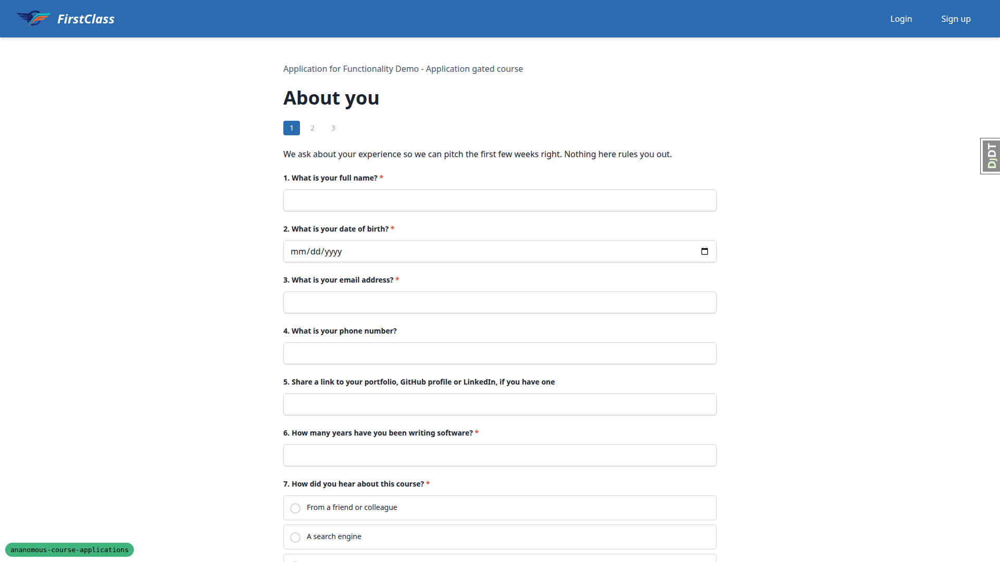 | Email trimmed and lowercased; page 1 reached; Previous/Next keep the same application |
| 1.4 | desktop | pass | 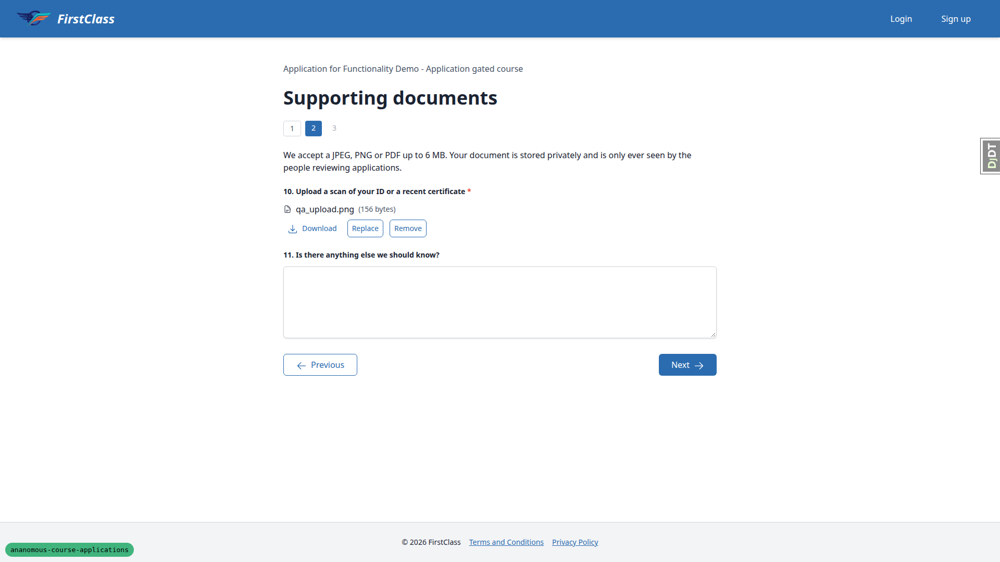 | Upload/replace/remove/download, check answers, submit, status page, one Mailpit message; see also 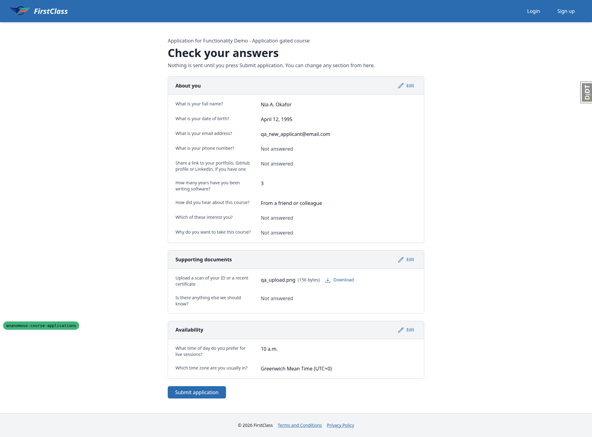 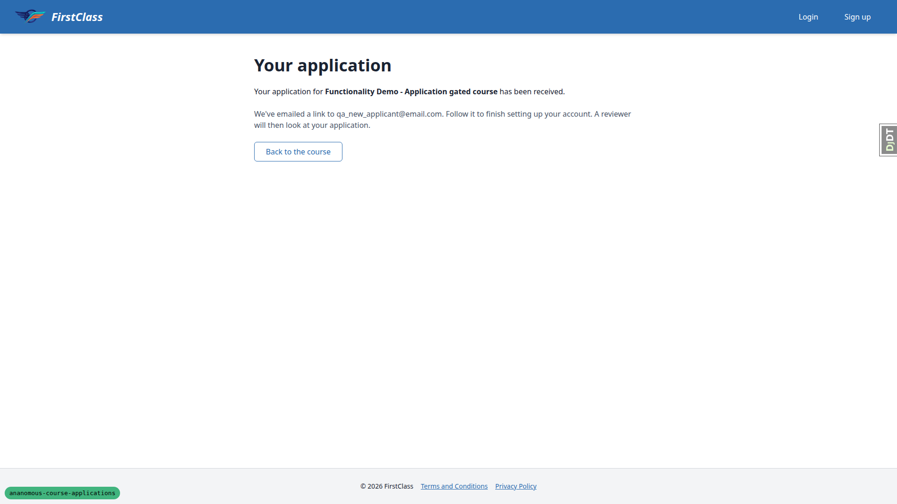 |
| 1.5 | desktop | pass | — | Fresh context and signed-in other user get 404 on status, page, answers and file |
| 3.1 | desktop | pass | 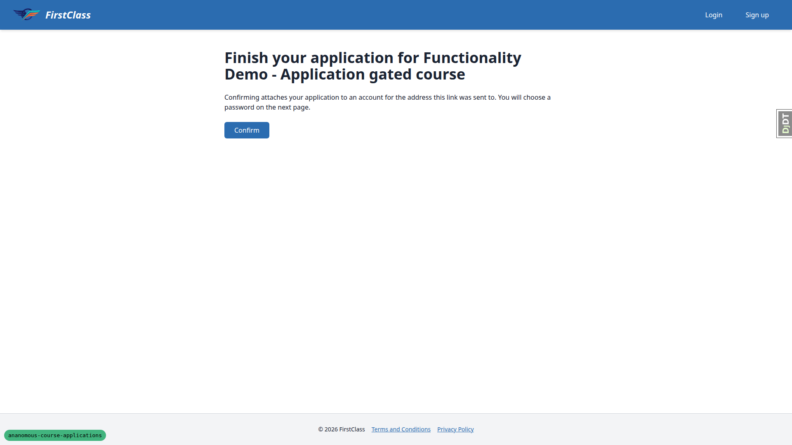 | Claim GET shows single Confirm; reload does not consume; no user created |
| 3.2 | desktop | pass | 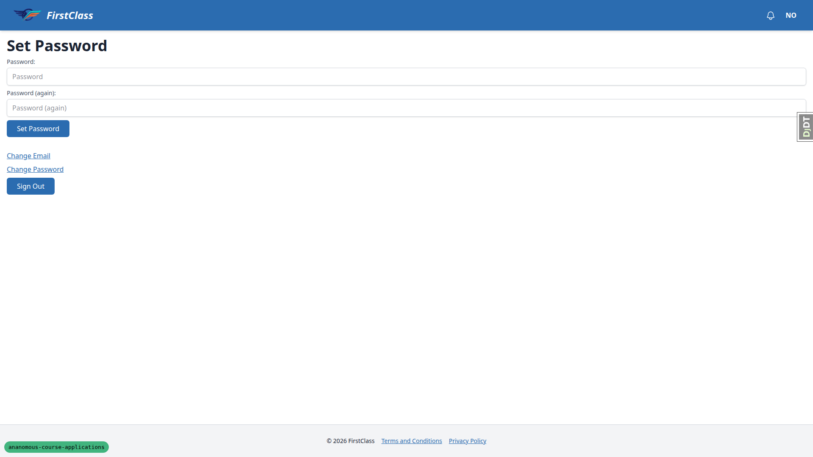 | Confirm, set password, status, dashboard, consents; reuse gives invalid page  |
| 2 | desktop | pass |  | Form-less course flow; one email; replay lands on the same status |
| 3.3 | desktop | fail | — | Flow works, but the claim confirm copy promises a password step that existing accounts never see (B1) |
| 3.4 | desktop | pass | — | Other-site email gets the invalid-link page; no user created |
| 3.5 | desktop | pass | — | Inactive user redirected to login, not signed in |
| 3.6 | desktop | pass | 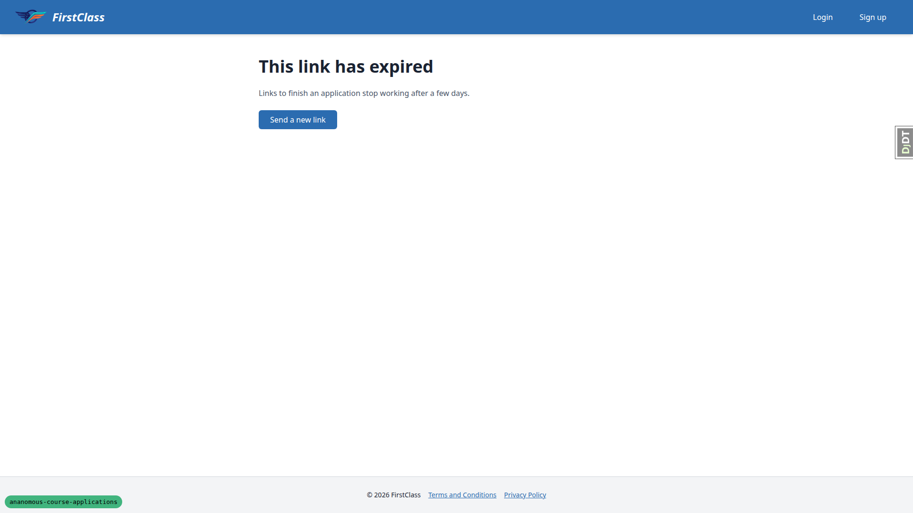 | Tampered gives invalid; expired gives resend, see 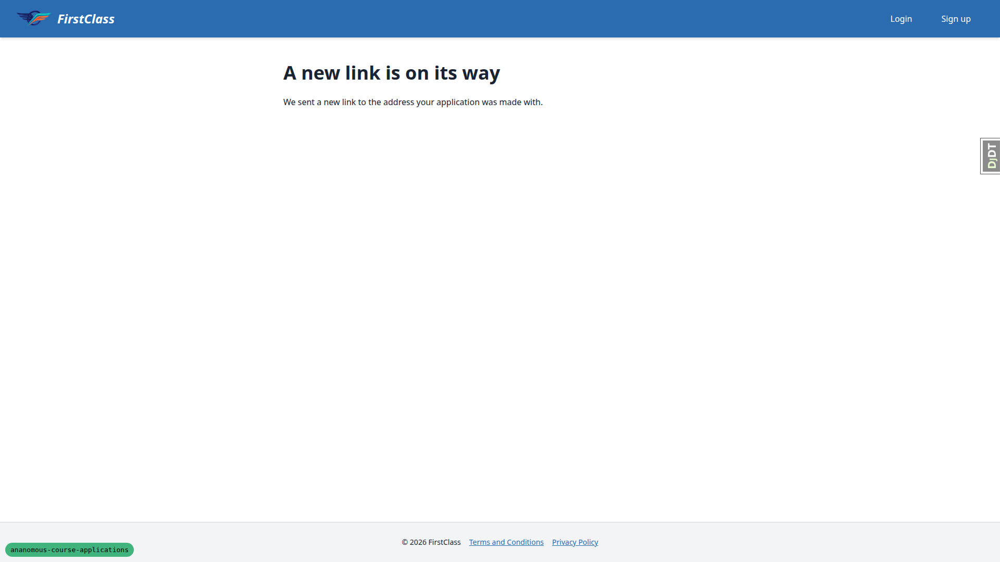 |
| 4 | desktop | pass | — | Signed-in user resumes page 1; CTA reads "View my application" on form-less course |
| 5 | desktop | pass | — | Policy variants respected and restored |
| 6.1 | desktop | pass | 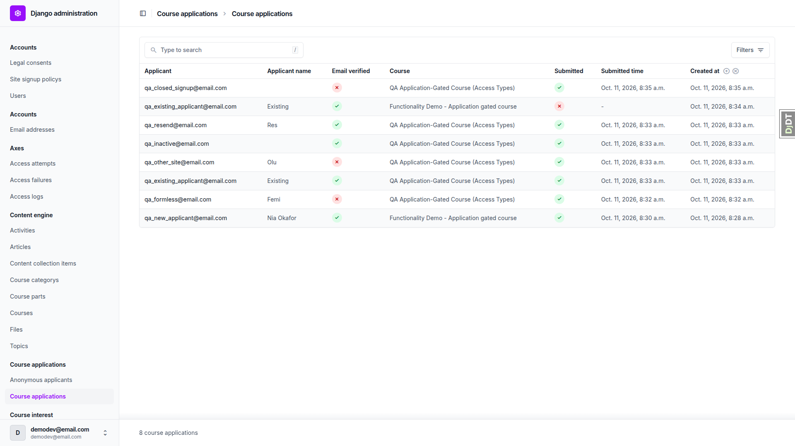 | Email verified column correct |
| 6.2 | desktop | pass | — | Unverified filter and search work |
| 6.3 | desktop | pass | 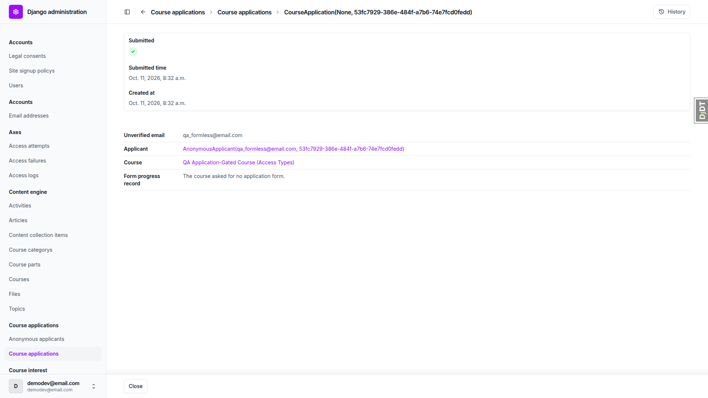 | Summary rows correct; raw __str__ cosmetics noted |
| 6.4 | desktop | pass | — | Form progress admin shows Unverified applicant |
| 6.5 | desktop | pass | — | Question answer files show Unverified; downloads return 200 |
| 6.6 | desktop | pass | — | Anonymous applicants admin is view-only |
| 6.7 | desktop | pass | 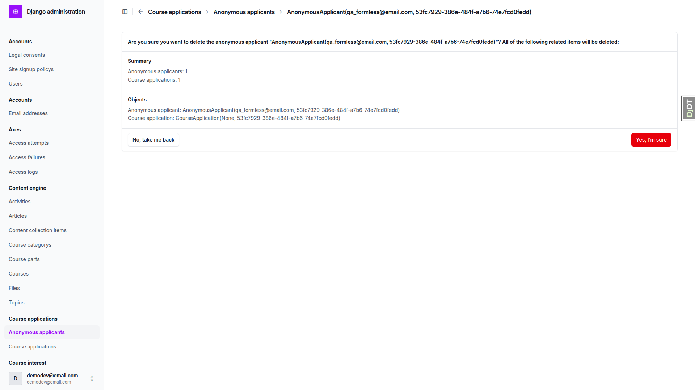 | Delete works; redirects to admin index |
| 6.8 | desktop | pass | — | Bulk delete removes applications, progress and files |
| 6.9 | desktop | pass | — | Legal consents inline correct; user delete cascades |
| 7 | desktop (1280) | pass | — | No horizontal overflow on all checked pages |
| 7 | mobile | pass | 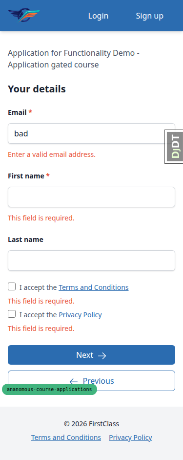 | No overflow; see also 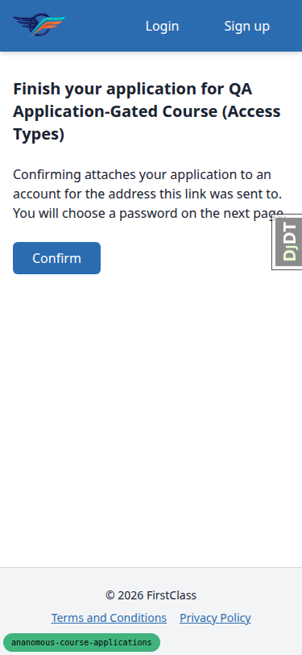 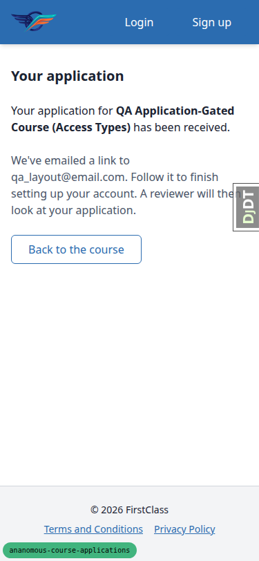; dev badge overlaps Previous |
| 1.1 | mobile | pass |  | Fields full-width; touch targets 40-42px |
| 7 | tablet | pass | 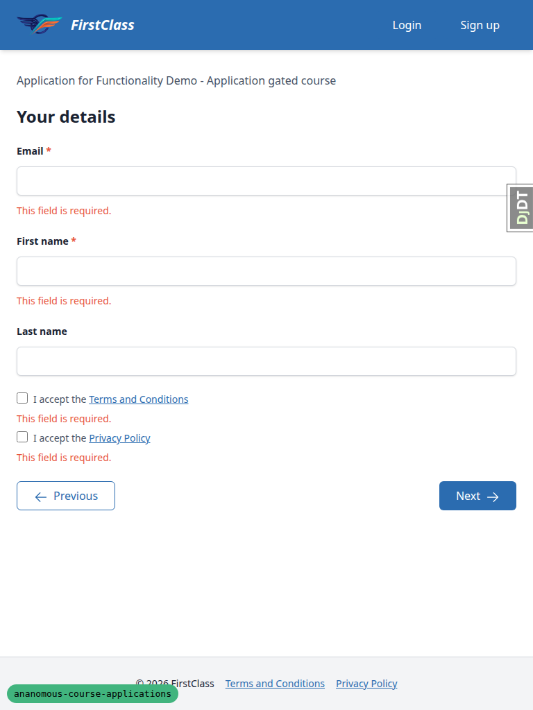 | No overflow; footer on one row |

## Design check

No design states tested.

## B1: Claim confirm page promises a password step that existing accounts never see

Manifestations: 3.3 (desktop), 7 (mobile).

- Expected: the claim confirm copy is accurate for whoever follows the link. An existing same-site account goes straight to the status page signed in, so it should not be told it will choose a password.
- Actual: `claim.html` always says "You will choose a password on the next page." For qa_existing_applicant@email.com, Confirm lands directly on the status page with no password page. The other-site and inactive cases go to the invalid-link or login page.

## Bug status

| Bug | Status |
|---|---|
| B1 | **RESOLVED** — Claim confirm page promises a password step that existing accounts never see. Decision: neutral wording for everyone, so the page never reveals whether an account exists for the address. The sentence now reads "You can then follow your application's progress while signed in." Guarded by `test_claim_get_does_not_promise_a_password_step`. |

## General notes

- The plan's course URLs `/courses/<slug>/` are the pre-existing login-required `course_home` view. Anonymous visitors must use `/courses/<slug>/detail/` (unchanged by this branch). The app's URLs are also prefixed `/applications/` (e.g. `/applications/apply/<slug>/your-details/`, `/applications/status/<uuid>/`, `/applications/claim/<token>/`) where the plan wrote `/apply/…`, `/status/…`, `/claim/…`. The plan should be updated.
- Browser-native `required` validation blocks an empty details submit before the server. The 422 path was exercised with `novalidate`.
- Honeypot copy reads "We couldn't process this application…" (the plan quoted the sign-up wording). The application wording fits the context.
- The "A new link is on its way" page is rendered as the POST response with no redirect, so a reload re-posts and sends another email.
- Admin cosmetics:
  - The course application title/breadcrumb read `CourseApplication(None, <course uuid>)`.
  - The Applicant link reads `AnonymousApplicant(<email>, <course uuid>)` (raw `__str__`).
  - After deleting an anonymous applicant the admin redirects to the admin index rather than the changelist.
  - The bulk-delete confirmation lists applicants and applications but not the form progress records and files that are also removed (they are removed).
- The details step creates an AnonymousApplicant row before submission (qa_consent appeared in the admin without submitting).
- Rate limits were not checked (off in dev settings). They are covered by the test suite.
- The dev-only branch badge overlaps the Previous button corner at 375px.

status: ok · reason: 1 bug — 0 fixed, 1 unresolved; report rendered, screenshots verified
