# Frontend QA report: anon-application-improvements

## Methodology

- A manual walk with Playwright MCP against a dev server on port 8057, on branch `anon-application-improvements`.
- Desktop (1920x1080) ran §1 to §7. Mobile (375x812) and tablet (768x1024) ran §7 (layout).
- Fresh browser contexts stood in for "fresh browsers".
- Mailpit was read through its HTTP API. Mail counts were taken per recipient, counting only messages created after this run started. The shared inbox was not cleared, because other worktrees use it.
- The QA data helper reset seed data at the start, reset qa_held_draft's draft to "Account Draft" for 4.4, and cleared `claim_email_sent_at` for the §7.1 not-sent state.
- Screenshots were collected into `screenshots/` beside this report, and every referenced image exists there. Some screenshots come from side browser contexts, saved with `page.screenshot` into the same folder.
- The debug toolbar was hidden for the mobile and tablet shots.

## Diff scoping

- Class: FULL.
- Template files that triggered it:
  - `freedom_ls/course_applications/templates/course_applications/application_status.html`
  - `freedom_ls/course_applications/templates/course_applications/check_your_answers.html`
  - `freedom_ls/course_applications/templates/course_applications/claim.html`
  - `freedom_ls/course_applications/templates/course_applications/email/application_claim_message.html`
  - `freedom_ls/course_applications/templates/course_applications/email/application_claim_message.txt`
  - `freedom_ls/course_applications/templates/course_applications/email/application_claim_subject.txt`
  - `freedom_ls/course_applications/templates/course_applications/form_page.html`
  - `freedom_ls/course_applications/templates/course_applications/partials/claim_link_notice.html`
  - `freedom_ls/course_applications/templates/course_applications/partials/dashboard_applications.html`
  - `freedom_ls/learner_interface/templates/learner_interface/dashboard.html`
- Skipped: nothing.

## Smoke gate

Outcome: pass. Logged in as demodev@email.com, these pages loaded:

- `/`
- `/courses/functionality-demo-application-gated-course/detail/`

## Results

| Test | Viewport | Status | Notes | Screenshot |
|---|---|---|---|---|
| 1.1 | desktop | pass | Details step sent exactly one email (subject "[FirstClass] Continue your application for ..."; body: confirm address and get back to application; button "Continue your application"; no review wording). Info-level callout with both actions on page 1, after reload, pages 2, 3 and Check your answers. Pages 2/3 in the page nav are not links until reached, so they were reached with Next. |  |
| 1.1 | desktop | pass | Check your answers carries the notice. |  |
| 1.2 | desktop | pass | Change link prefills email/first/last (consents unticked, must re-tick). Name-only change: no email. New address: exactly one email to qa_early_fixed, none to old address; notice names new address. Returned to page 3 (resume page), not page 1. First email's link in a fresh context: "This link is invalid or has already been used". | none |
| 1.3 | desktop | pass | Resend toast "We've emailed a link to qa_early_fixed@email.com."; one more email (2 to that address). Lands on the resume page (page 3), not page 1 as the plan says, which matches the spec ("redirects to the status page, which sends a draft on to its resume page"). Answers intact. Earlier link still opens the confirm page; its copy shows the order bug B1. | none |
| 1.4 | desktop | pass | Submit sent no email. Status page "Your application" names qa_early_fixed@email.com, has "Send the email again" and a one-field change form with "Change address and send the link". No "sent on submission" wording. |  |
| 2.1 | desktop | pass | Claiming browser: confirm page heading "Continue your application for ...", names qa_claim_draft@email.com, password line, no review mention; reload shows the same state. Copy order is wrong (see B1). |  |
| 2.1 | desktop | pass | Confirm, then Set Password, then landed on page 2 (Supporting documents), signed in (account menu "CD"), no claim notice. | 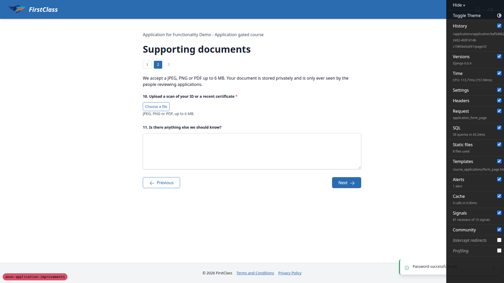 |
| 2.1 | desktop | pass | Dashboard "Welcome back, Claim", Your applications lists course Incomplete with Continue application. Origin browser reload goes to the login page. Claim link reused in fresh context is invalid. | 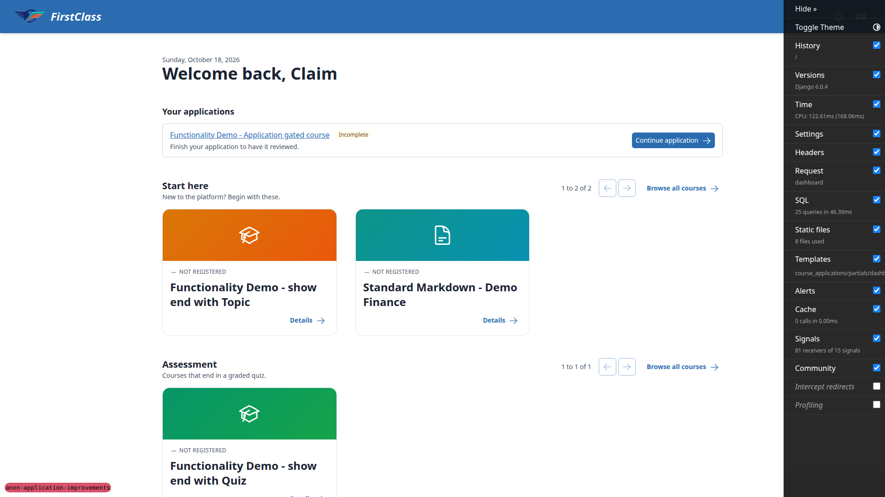 |
| 2.2 | desktop | pass | Admin Course applications filtered email verified: Verified lists qa_claim_draft@email.com with Submitted unticked. | 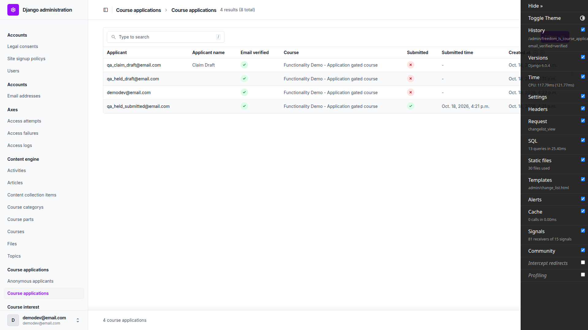 |
| 3.1 | desktop | pass | Change to qa_change_b: toast "We've emailed a link to qa_change_b@email.com.", page names new address, one email to b with subject "Finish your application for ...", nothing new to a. Old a link invalid; b link opens "Finish your application" confirm page. | 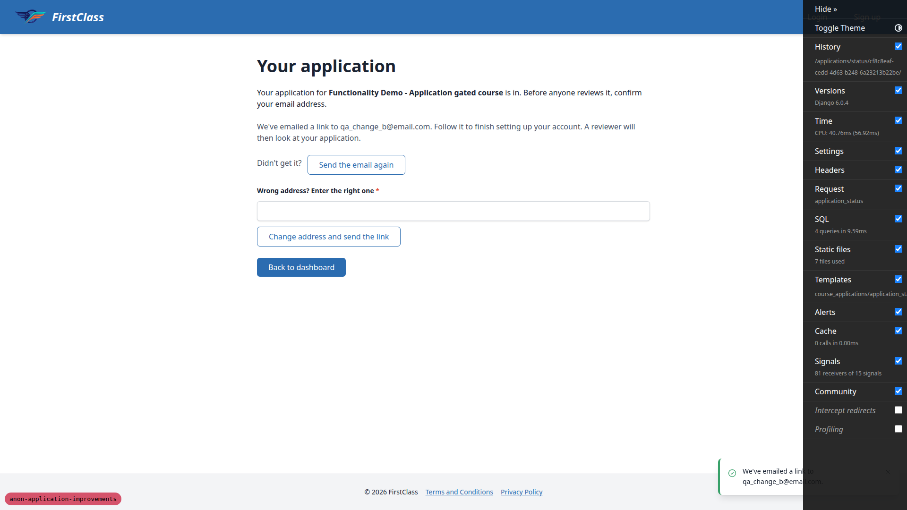 |
| 3.2 | desktop | pass | Case-only change: 302 back to status, no toast, no email. "not-an-address" and empty: blocked by native browser validation first; with validation bypassed, server returns 422 with "Enter a valid email address." / "This field is required." under the field, no toast, no email. URL stays at /change-email/ after the 422. |  |
| 3.3 | desktop | pass | Fresh context on status URL goes to login. qa_held_submitted status page: pending review, no change form, no resend. POST change-email (session cookie + CSRF) returns 404. GET change-email from owning anon session returns 405. | 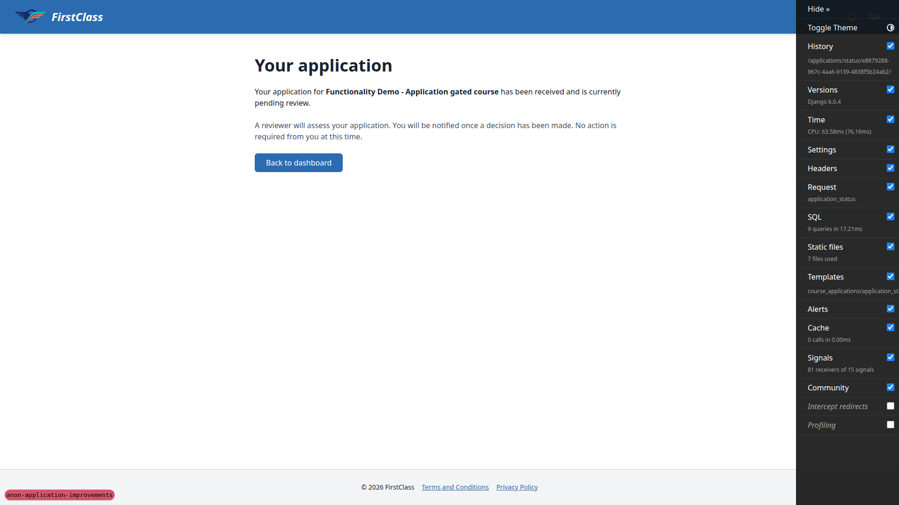 |
| 4.1 | desktop | pass | Confirm page has "You've already applied ... This unfinished application will be discarded." and the signed-in sentence. Confirm lands on the submitted application's status page (pending review), signed in. Admin: no AnonymousApplicant for the address, one CourseApplication. |  |
| 4.1 | desktop | fail | Copy: the confirm page also says "You'll then be taken back to your application. You'll then be signed in to your account." next to "This unfinished application will be discarded." Confirm actually lands on the submitted application's status page, not back on this application. See B1. |  |
| 2.1 | desktop | fail | Copy: the confirm page reads "You'll then be taken back to your application. You'll then choose a password for your new account." The real order is reversed (Confirm, Set Password, application) and "then" is repeated. Also seen on the 1.3 confirm page. See B1. |  |
| 4.2 | desktop | pass | Confirm page shows "This replaces the unfinished application for ... already on your account." Confirm lands on the incoming draft at page 2, signed in; page 1 name reads "Incoming Draft". Dashboard lists the course once as Incomplete. | none |
| 4.3 | desktop | pass | Toast "You had already applied for ..., so that application was kept." Dashboard shows one application, Pending review. Admin: 0 AnonymousApplicant, 1 CourseApplication for the address. | 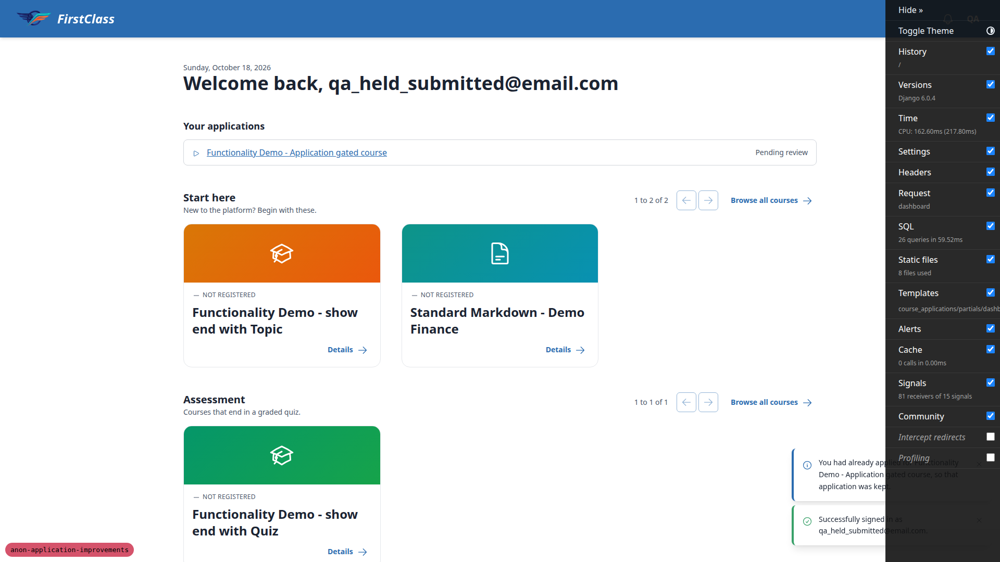 |
| 4.4 | desktop | pass | The data helper reset the account draft to "Account Draft". Login toast "Your unfinished application for ... was replaced by the one you just started." The course is listed once as Incomplete; page 1 reads "Session Draft". |  |
| 5.1 | desktop | pass | Second course's details step opened empty. Anonymous hero plus a Your applications panel with two Incomplete rows, second course first, each with Continue application. The page HTML holds no email, "Two" or "Drafts". Continue application for the first course goes to its page 1. The rows line up with the heading. | 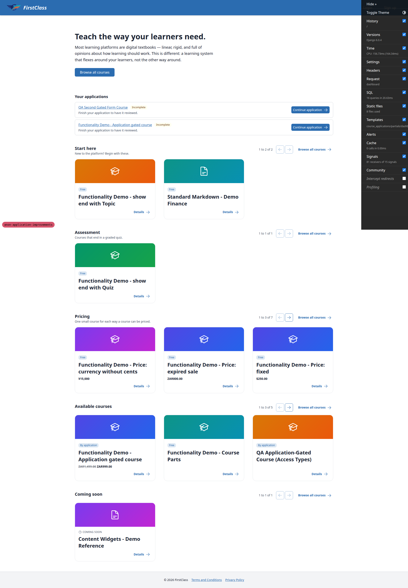 |
| 5.2 | desktop | pass | The applied form course shows "View my application", which goes to the draft's page 1. The form-less course shows "Apply now". A fresh context has no panel, and the form course shows "Apply now". The course page is /courses/<slug>/detail/ (the plan's /courses/<slug>/ requires login). | none |
| 5.3 | desktop | pass | After submitting the first course, the panel shows only the second course's draft. The first course's "View my application" goes to the status page. | none |
| 6 | desktop | pass | Form-less course: "Apply to ..." confirmation page, no notice, no email yet. Submit goes to the status page naming qa_formless@email.com, one "Finish your application for ..." email, change-of-address form present. | none |
| 7.1 | desktop | pass | Sent state: info callout, scrollWidth 1920 = viewport, no horizontal scroll. | 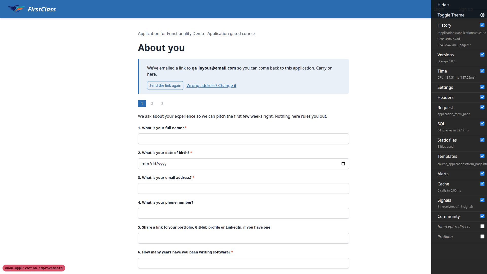 |
| 7.1 | desktop | pass | Not-sent state (data helper cleared claim_email_sent_at; mail not stopped because Mailpit is shared): "We couldn't email ... You can carry on and send the link again." with a warning callout. No horizontal scroll. | 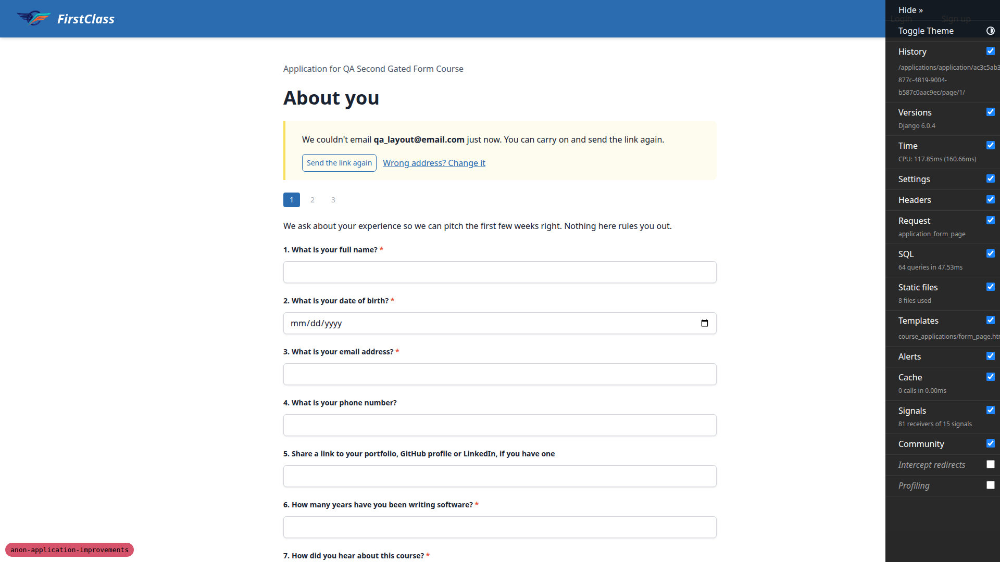 |
| 7.2 | desktop | pass | Status page with change form and "Enter a valid email address." error (422). No horizontal scroll. |  |
| 7.3 | desktop | pass | Claim confirm with the held-submitted collision sentence. No horizontal scroll. (Copy order issue is B1.) | 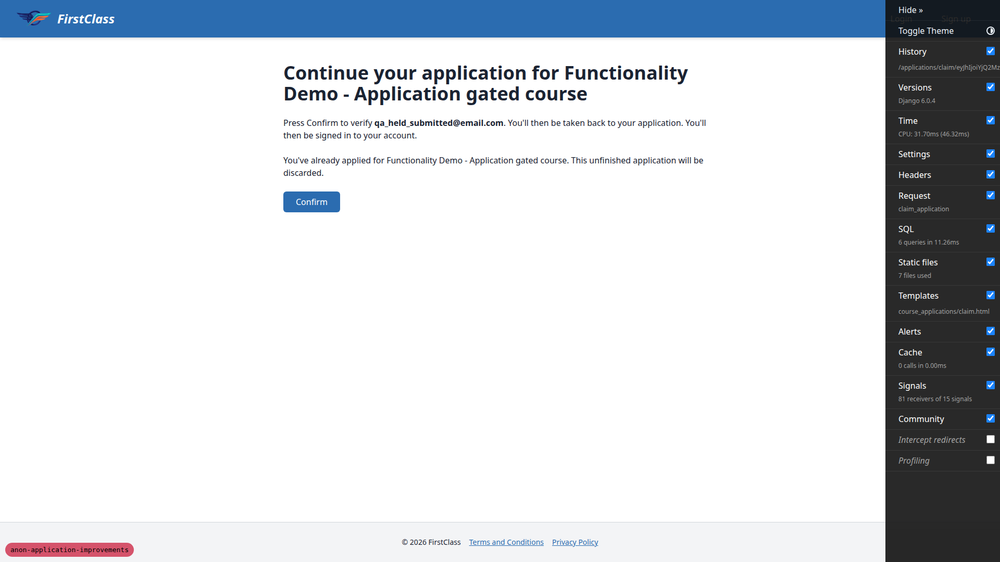 |
| 7.4 | desktop | pass | Anonymous dashboard: hero plus two draft rows; heading and rows both at x=352. No horizontal scroll. | 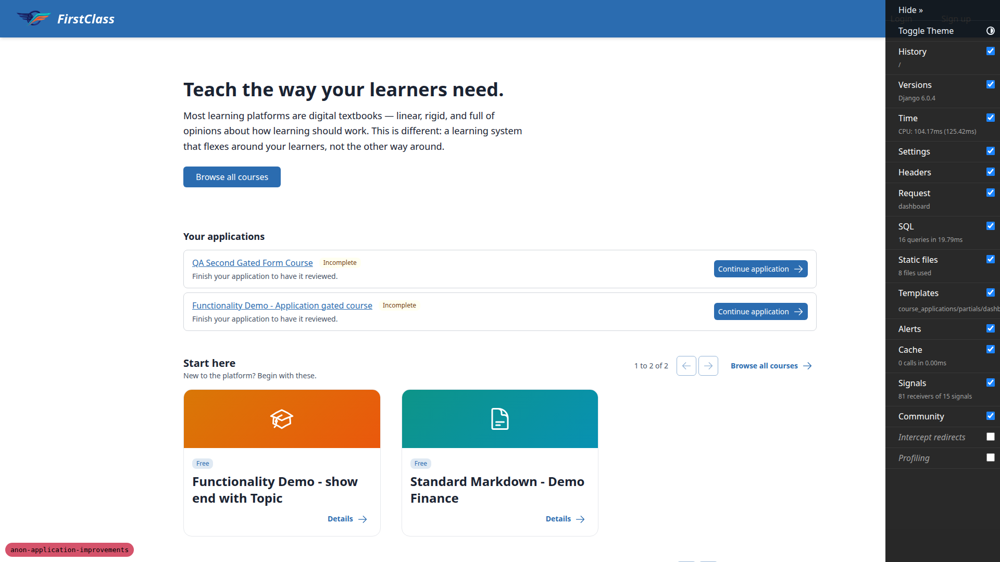 |
| 7.1 | mobile | pass | Not-sent warning callout at 375px: callout spans x 16-359, "Send the link again" and "Wrong address? Change it" wrap onto separate lines inside it. scrollWidth 375. "Send the link again" button is 34px high. | 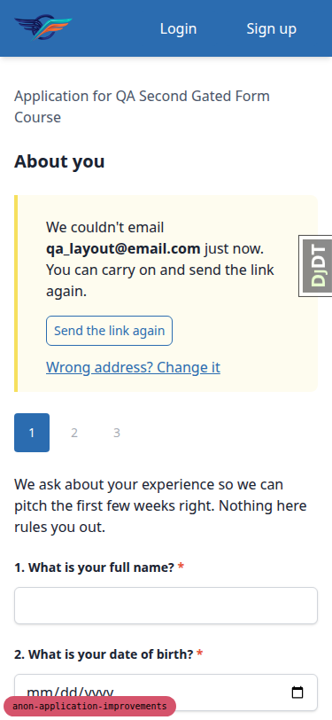 |
| 7.1 | mobile | pass | Sent info callout at 375px: same wrap, no overflow, no horizontal scroll. | 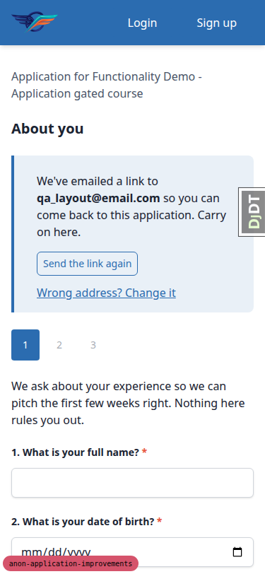 |
| 7.2 | mobile | pass | Status page with field error fits 375px; no element past the right edge; no horizontal scroll. | 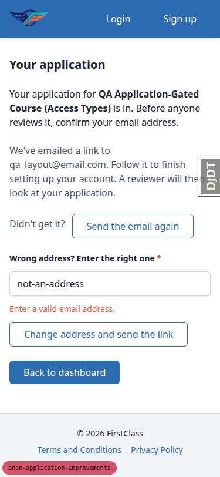 |
| 7.3 | mobile | pass | Claim confirm with collision sentence fits; no horizontal scroll. Header shows Login/Sign up (no hamburger for anonymous visitors). | 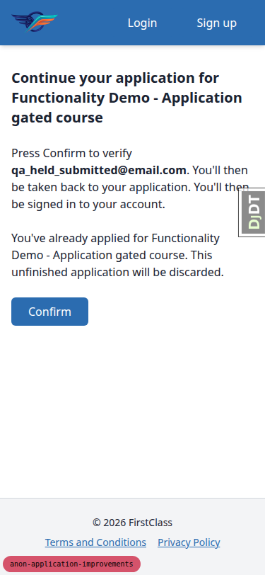 |
| 7.4 | mobile | pass | Two draft rows span x 16-359, aligned with the heading at x=16; Continue application buttons full width, 48px high. No horizontal scroll. | 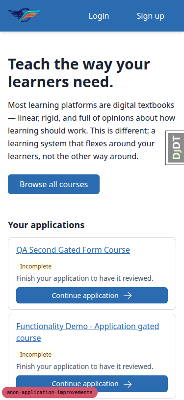 |
| 7.1 | tablet | pass | Not-sent warning callout at 768px: actions side by side inside callout (x 24-744). scrollWidth 768. Header shows Login/Sign up (desktop-style nav). |  |
| 7.1 | tablet | pass | Sent info callout at 768px; no horizontal scroll. | 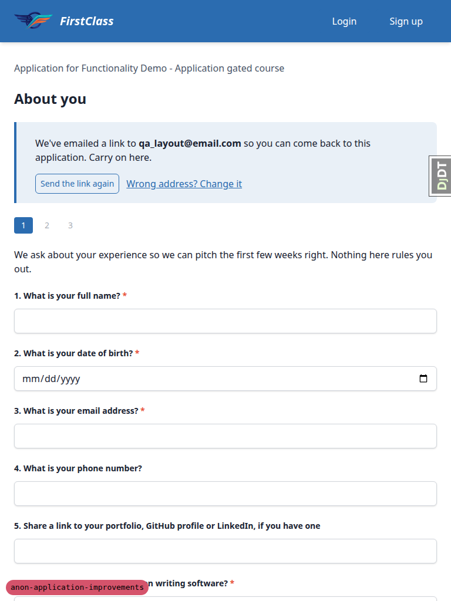 |
| 7.2 | tablet | pass | Status page with field error at 768px; no horizontal scroll. | 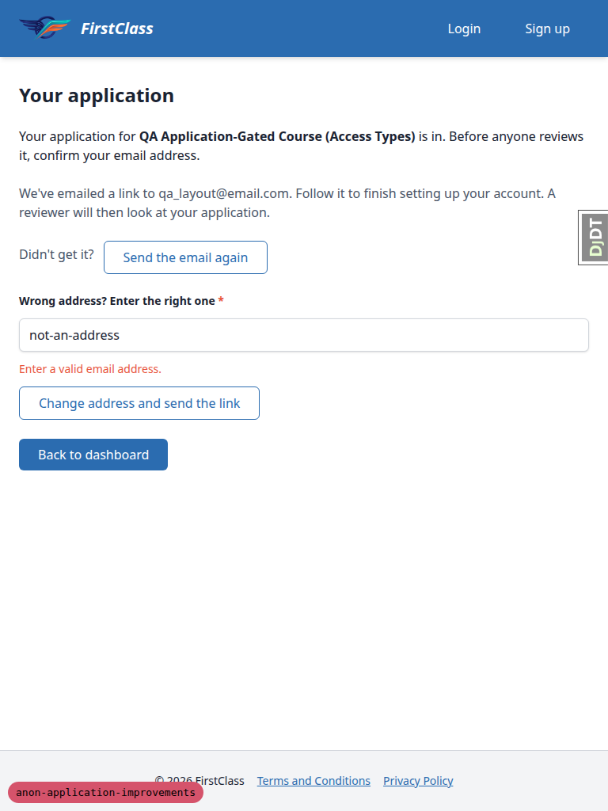 |
| 7.3 | tablet | pass | Claim confirm with collision sentence; no horizontal scroll. | 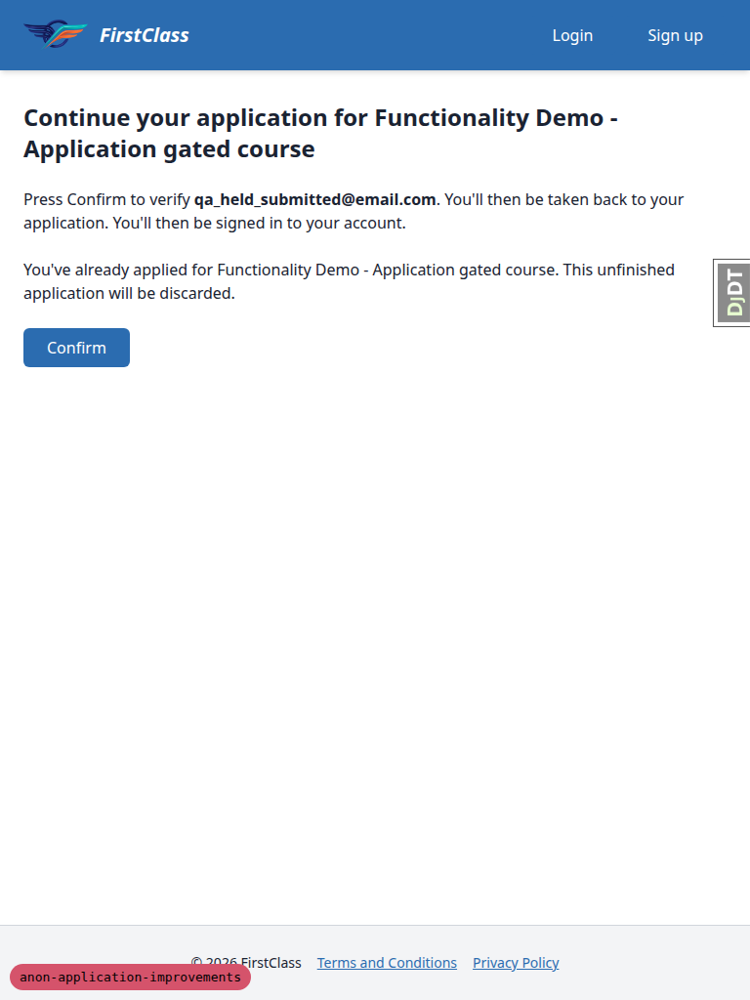 |
| 7.4 | tablet | pass | Two draft rows x 24-744, aligned with heading at x=24; course cards in two columns. No horizontal scroll. |  |

## Design check

No design states tested.

## B1: Claim confirm page describes the next steps in the wrong order

Manifestations:

- 2.1, desktop (new applicant; also seen on the 1.3 confirm page)
- 4.1, desktop (held submitted application wins the collision)

**Expected:** The confirm page says what happens after Confirm, in the order it happens. Spec: signed in, set-password when needed, then the status page, which sends a draft on to its resume page. When a held submitted application wins the collision, Confirm lands on that application's status page, so the page should not promise a return to this application.

**Actual:** `claim.html` prints "You'll then be taken back to your application." before "You'll then choose a password for your new account." (or "...be signed in to your account."). So a new applicant reads the steps backwards, with "then" twice. On the held-submitted collision page, "You'll then be taken back to your application" sits next to "This unfinished application will be discarded." and Confirm actually lands on the other, submitted application's status page.

## Bug status

| Bug | Status |
|---|---|
| B1 | **FIXED** (commit: 1d5fda1d) — Claim confirm page describes the next steps in the wrong order |

Re-verified in the browser after the fix:
- A draft with no account now reads "Press Confirm to verify qa_layout@email.com. You'll then choose a password for your new account and be taken back to your application."
- The held-submitted collision now reads "Press Confirm to verify qa_held_submitted@email.com. You'll then be signed in to your account." followed by "You've already applied for ... This unfinished application will be discarded.", with no promise of a return to the discarded draft.

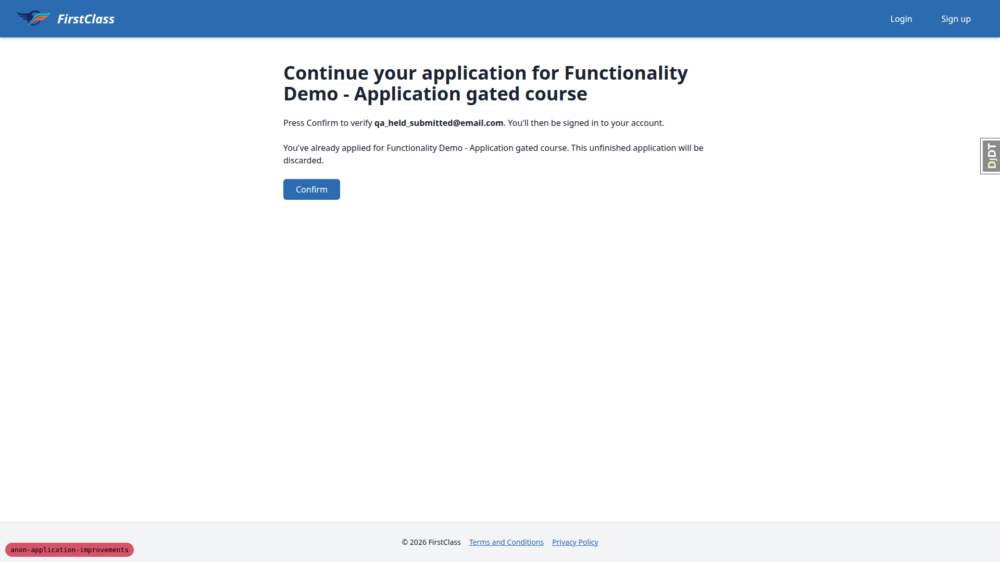

## General notes

- The plan's course URL `/courses/<slug>/` requires login; the anonymous course page is `/courses/<slug>/detail/`.
- After "Wrong address? Change it" and after "Send the link again", the applicant lands on the draft's resume page (furthest page reached), not page 1 as the plan says for 1.2 and 1.3. This matches the spec's "redirects to the status page, which sends a draft on to its resume page".
- "Wrong address? Change it" shows the details step with both consent boxes unticked, so they must be ticked again on every address change.
- Page-nav numbers for pages not yet reached are not links, so the plan's "click page 2 in the page navigation" in 1.1 is only possible after a page has been answered.
- The change-of-address field has `required` and type=email, so the browser blocks the invalid and empty submissions client-side. The server's 422 responses were checked by bypassing native validation.
- After a 422 on the change form the URL stays at /change-email/; reloading would hit the GET-only 405.
- The email greeting is a bare "Hi," even though a first name was given.
- Email subjects carry the site prefix "[FirstClass] ".
- On mobile, the notice's "Send the link again" button is 34px tall, under the 44px touch-target guideline.
- Rate limits were not checked (dev turns them off), as the plan says.
- The superuser demodev@email.com has its own unfinished draft to the first form course, left by earlier data.
- The §7.1 not-sent state was set up through the database, not by stopping mail delivery; the send-failure path is covered by the test suite.

status: ok · reason: 1 bug — 1 fixed, 0 unresolved; report rendered, screenshots verified
