# QA report: Lead monitoring API, foundation and users

- Run date: 2026-11-03
- Branch: apis-for-lead-monitoring-1-foundation-and-users
- Dev server port: 8175
- Viewports: desktop 1920x1080 / mobile 375x812 / tablet 768x1024

## Methodology

Browser tests were driven by hand through Playwright MCP. API tests were run with curl from a terminal. Screenshots were collected into `screenshots/` beside this report, and every referenced image exists there.

Before testing, the branch was rebased onto main (28 commits replayed, one trivial conflict in `test_organisation/mirroring_exemptions.txt` resolved by keeping both lines). The lost-change check passed, the full test tier ran 11530 passed, pre-commit was clean, and the branch was pushed.

Leftover API keys and API-key audit entries from the previous QA run were deleted from the dev DB first, so §1.1 and §4 could start from empty.

Accessibility snapshot files and console logs were deleted rather than collected, because the snapshots of key-issued pages held full key text. The user CSV export from 6.1 was kept out of the spec dir for the same reason (user data).

## Diff scoping

Class: FULL. Triggered by the template and static files in the diff, including `freedom_ls/api_admin/templates/admin/api_admin/key_issued.html`, `freedom_ls/api_admin/templates/admin/api_admin/revoke_confirm.html` and `freedom_ls/site_aware_models/static/site_aware_models/css/admin.css` (135 changed files in total). Nothing was skipped: desktop, mobile and tablet all ran.

## Smoke gate

Pass. Pages checked:

- http://127.0.0.1:8175/
- http://127.0.0.1:8175/admin/freedom_ls_api/apikey/

## Results

| Test | Viewport | Status | Notes | Screenshot |
|---|---|---|---|---|
| 6.3 | desktop | pass | `manage.py check` reports no issues. The W001 line was skipped because `config/settings_dev.py` hardcodes `DEBUG = True`. | none |
| 6.4 | desktop | pass | `grep -ri ninja freedom_ls config pyproject.toml` prints nothing. | none |
| 1.1 | desktop | pass | Empty "API keys" changelist with an Add API key button. The add form has Name, Scopes (4 checkboxes with model names) and Expires at, with no Site, key, prefix or hash field. |  |
| 1.2 | desktop | pass | No scope gives "Choose at least one API scope."; a past expiry gives "The expiry must be in the future." No key was issued. | 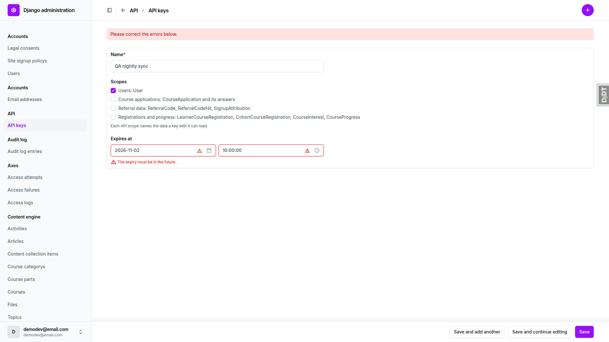 |
| 1.3 | desktop | pass | The "API key issued" page shows the name and the full `flsk_<prefix>.<secret>` key in a monospace box with "Copy it now. It is not shown again.", and no success flash. The add POST response is `Cache-Control: no-store, max-age=0, no-cache, must-revalidate, private`. |  |
| 1.4 | desktop | pass | The list shows one Active row and the secret is absent from the page HTML. On the change form only Name is editable, with no key hash and no Delete link, and "Revoke this key" is in the header actions. Browser back gives Chrome's "Confirm Form Resubmission", so the key is not served from cache. The prefix is 16 hex chars per the spec. |  |
| 1.5 | desktop | pass | The third key, "QA no users", was issued with Course applications only. The list shows 3 Active rows and no secret in the page HTML. | 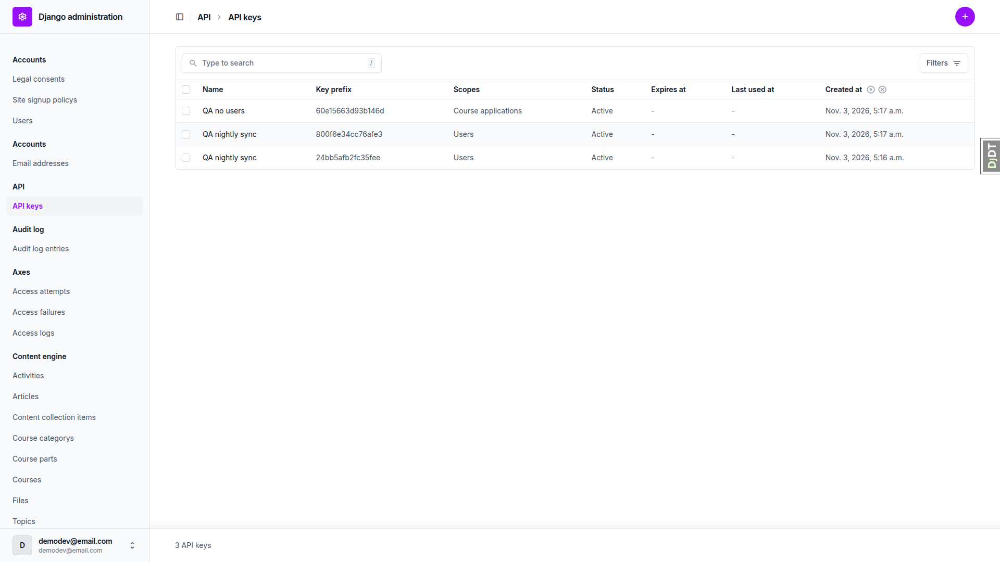 |
| 2.1 | desktop | pass | With no key: 401, `WWW-Authenticate: Bearer realm="api"`, `Cache-Control: private, no-store`, body code `not_authenticated`. | none |
| 2.2 | desktop | pass | The Basic scheme, nonsense, an unknown prefix and a wrong secret all give 401 with identical headers and one identical `authentication_failed` body. `?key=` in the query string is ignored. Matches the spec and docs/api.md (see General notes). | none |
| 2.3 | desktop | pass | 200 with 51 results. Every user has exactly the documented fields and timestamps end in Z. Lowercase `bearer` works, detail by id gives 200, and an unknown id gives 404 with code `not_found`. | none |
| 2.4 | desktop | pass | With `page_size=2`, `next` keeps `page_size` and adds `cursor`. 26 pages cover 51 unique ids. Bad `page_size` and `cursor` values give 400 naming the field, and `page_size=5000` returns all 51. | none |
| 2.5 | desktop | pass | `updated_since` 2000 returns 51 and 2999 returns none. A naive time and "yesterday" both give 400 naming `updated_since`. | none |
| 2.6 | desktop | pass | A key without the users scope gets 403 `permission_denied`. POST, PUT, PATCH and DELETE give a JSON 405. OPTIONS gives 200 with a `name`-only body, and HEAD gives 200 with GET's headers and an empty body. | none |
| 2.7 | desktop | pass | The schema without a key gives a 401 JSON response. With a key it gives 200 `application/vnd.oai.openapi+json`, a bearer `ApiKeyAuth` scheme, and the `cursor`, `page_size` and `updated_since` parameters on the users list. | none |
| 2.8 | desktop | pass | Last used at is filled after the first call and unchanged by a later call. Updated at stayed at issue time (checked in the DB to the second). | 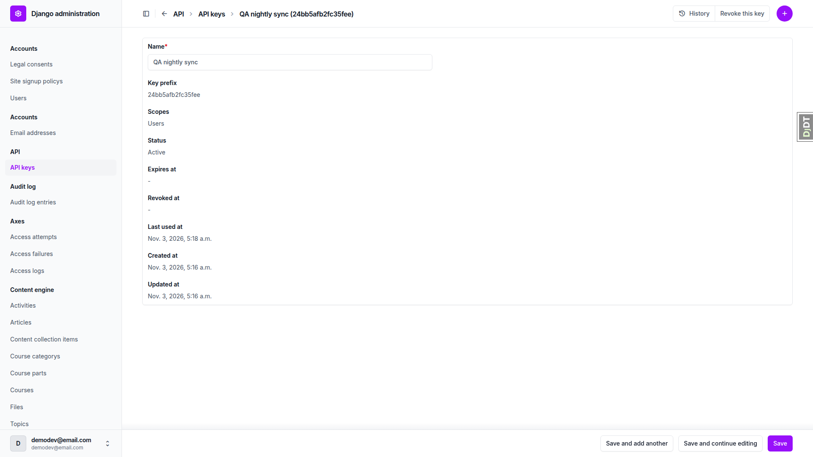 |
| 2.9 | desktop | pass | A logged-in browser at `/api/v1/users/` gets 401 `application/json` with a plain `not_authenticated` body and no browsable API or HTML. | 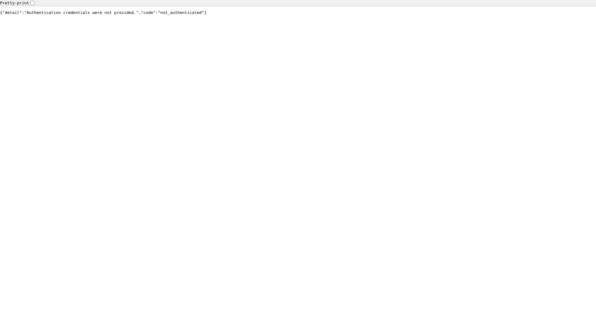 |
| 3.1 | desktop | pass | The confirmation lists both keys with "Scripts using these keys stop at once.", and a second tab still showed both Active. Revoking gives "Revoked 2 API keys..." and both show Revoked. The revoked key gets 401 and the other key still gets 200. The changelist has no Revoked at column; that shows on the change page. | 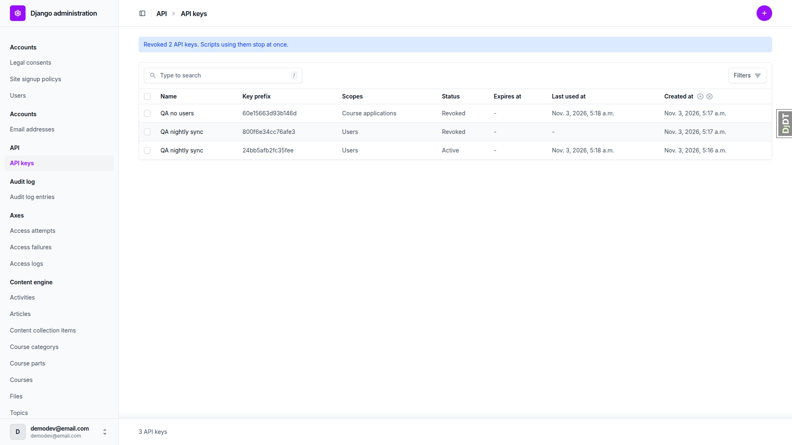 |
| 3.2 | desktop | pass | Select all plus revoke shows "To revoke (1)" and "Already revoked, skipped (2)". Cancel leaves the list unchanged with one Active key. | 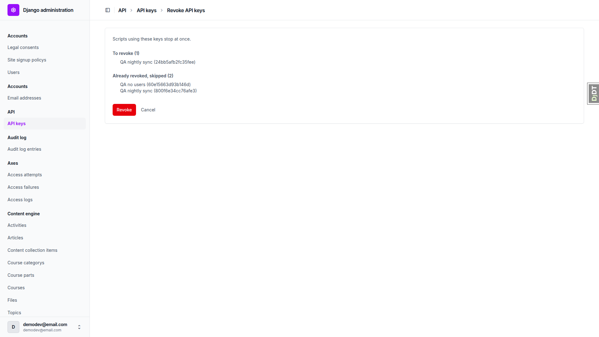 |
| 3.3 | desktop | pass | The "Revoke this key" header action opens the same confirmation, with Cancel pointing to the change page. After revoking, the change page shows Revoked, Revoked at set, no editable field and no Revoke button. The key gets 401, and a zero-UUID or invalid `ids` gives 404. | 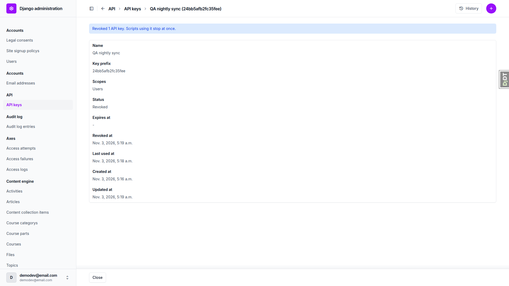 |
| 3.4 | desktop | pass | `.../delete/` on a revoked key gives 403. The status filter shows Active 0, Revoked 3, Expired 0. | 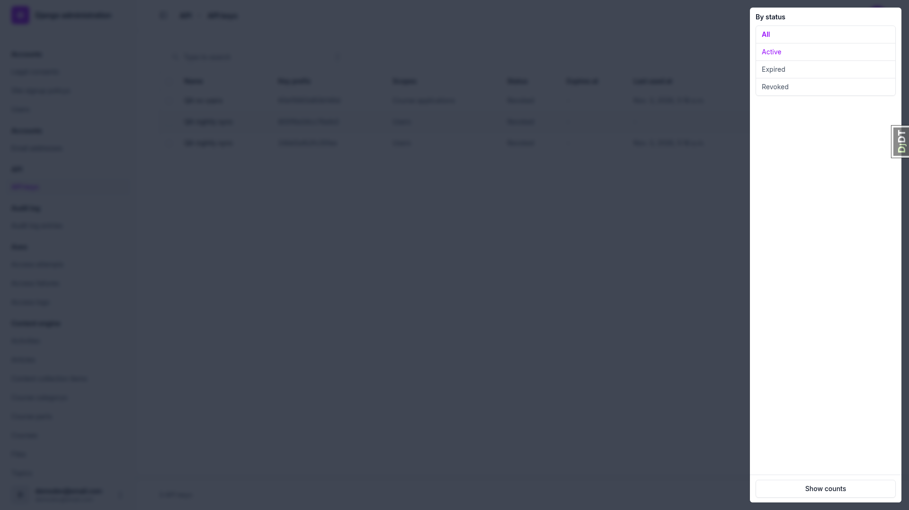 |
| 4 | desktop | pass | The audit log, newest first, has 3 `api_key.revoked` entries (none for the skipped re-revoke) then 3 `api_key.issued`, actor demodev@email.com. Issued details hold only `expires_at`, `key_prefix`, `name` and `scopes`, and no secret appears in any audit field. The Action column shows raw codes. |  |
| 5 | desktop | pass | Un-verifying then re-verifying an address on demodev_s1 returns exactly that user via `updated_since`, with the right `email_verified` value each time. A login moves `last_login` but not `updated_at`. Attempting this first on another site's address exposed B3. |  |
| 6.1 | desktop | pass | The Users export downloaded 51 rows with the expected header, and every `email_verified` value matches the API. The CSV was moved out of the spec dir (user data). | 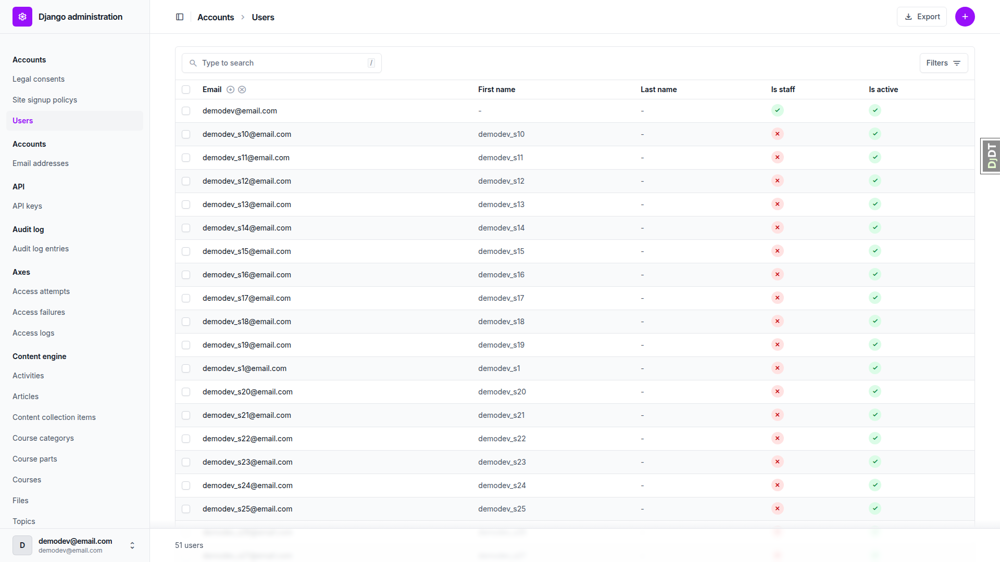 |
| 6.2 | desktop | pass | The learner dashboard, course detail and first topic render normally with no traceback. The console shows only pre-existing noise. | 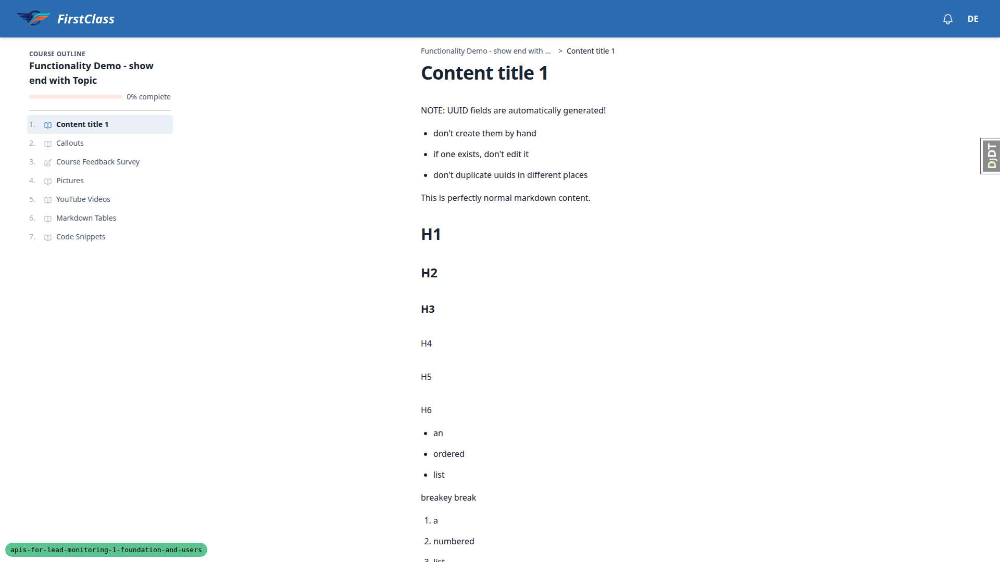 |
| 1.1 | mobile | **fail** | The form fits 375 with no horizontal scroll, but each Scopes checkbox label is clipped with an ellipsis, hiding the model names (B2). | 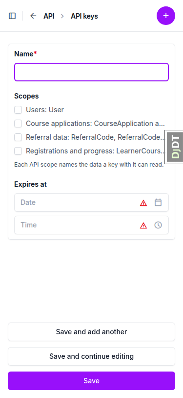 |
| 1.3 | mobile | **fail** | The key overflows its box (code width 293, scrollWidth 516), the middle is clipped, and it breaks only at a `-` (B1). | 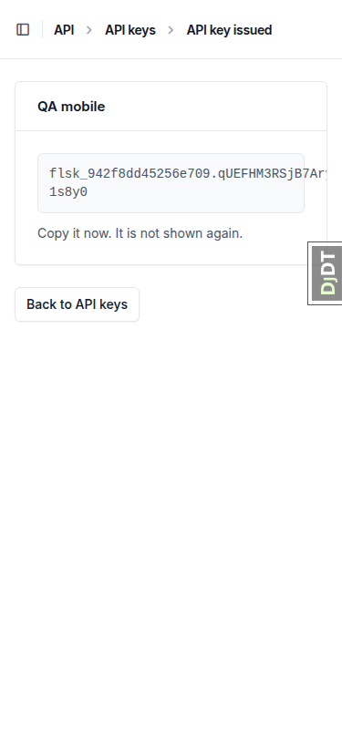 |
| 1.4 | mobile | pass | The changelist renders as cards with no clipped cell or horizontal scroll. On the change form "Revoke this key" sits in Unfold's "..." object-tools menu. | 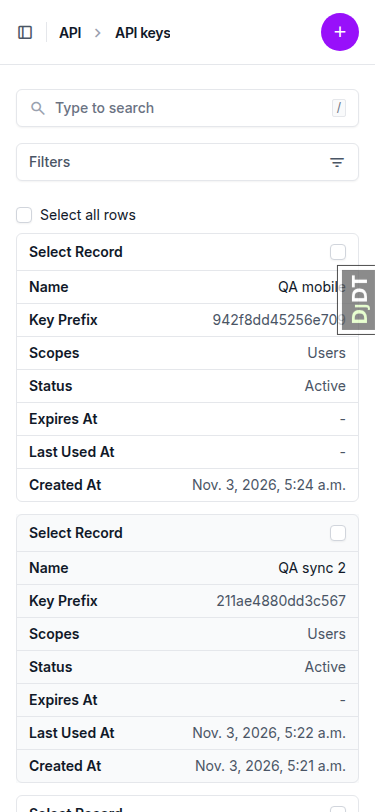 |
| 3.3 | mobile | pass | The revoke confirmation fits 375, and revoking leads to the change page showing Revoked. The Cancel link is 46x20. |  |
| 4 | mobile | pass | The audit log changelist cards fit 375 with no clipped cells. | 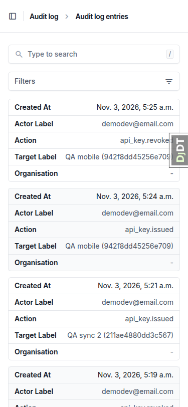 |
| 1.1 | tablet | **fail** | The form fits 768, but the longest scope label ("Registrations and progress: ...") is clipped with an ellipsis (B2). | 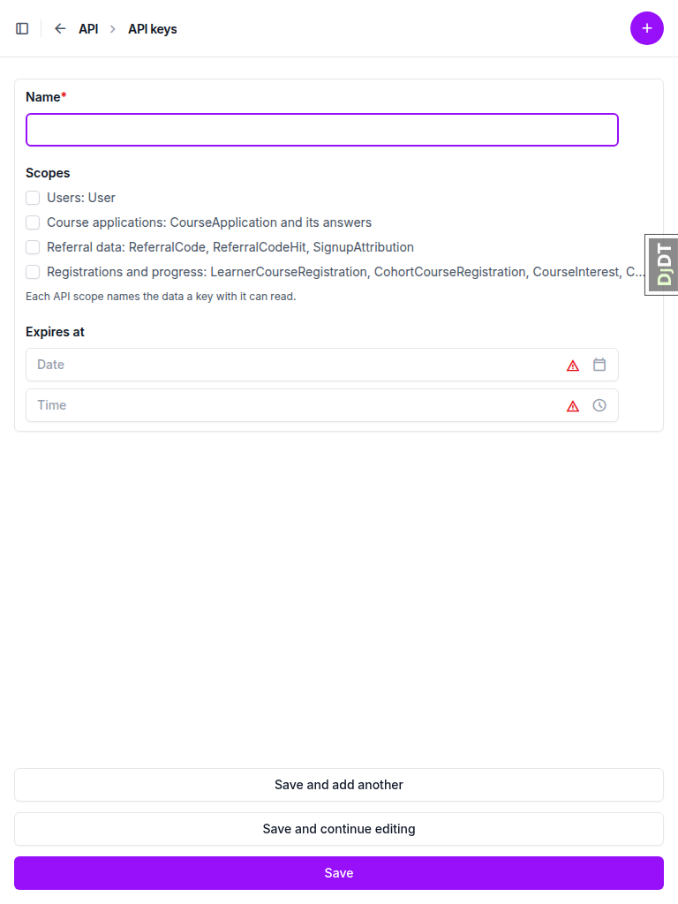 |
| 1.3 | tablet | pass | The key fits its box on one line (code width 686, scrollWidth 684). Nothing was clipped. | 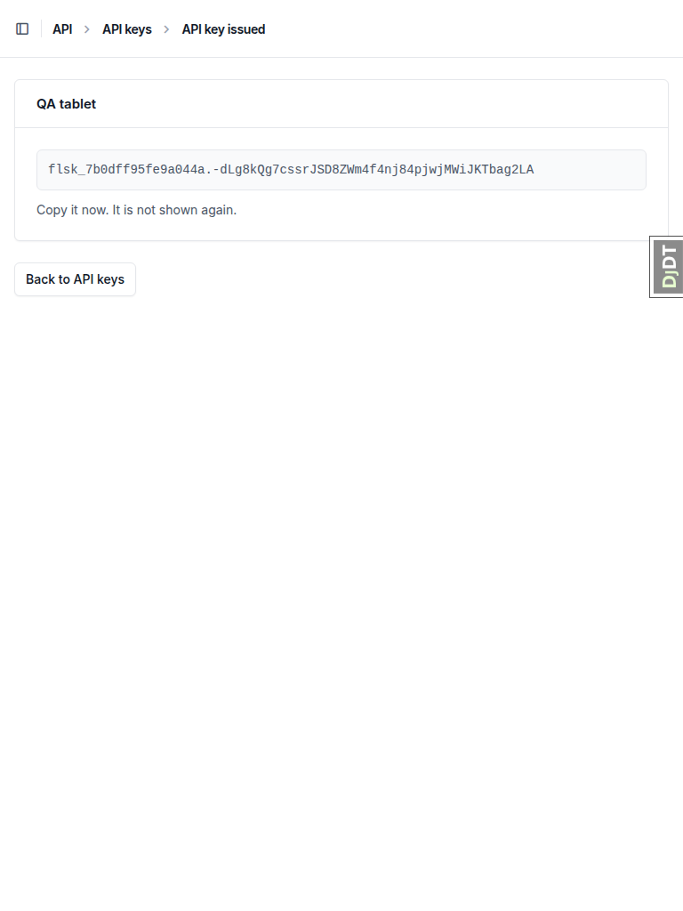 |
| 3.1 | tablet | pass | The changelist renders as cards with the sidebar collapsed. Select all plus revoke gives "To revoke (2)", "Already revoked, skipped (4)", then "Revoked 2 API keys...", with no horizontal scroll. | 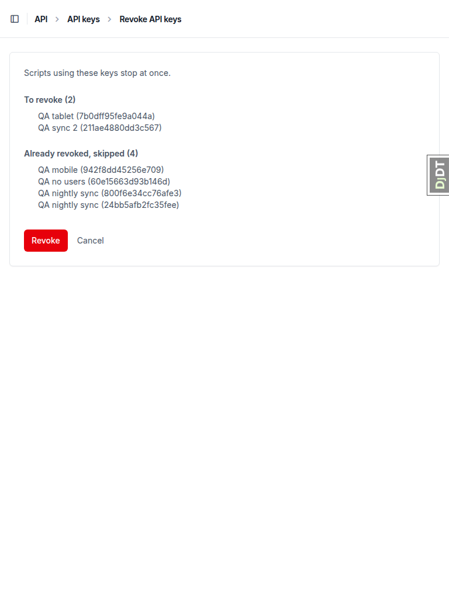 |

## Design check

No design states tested.

## B1: Issued API key overflows its box on a phone because break-all is not in Unfold's CSS

Manifestations:

- 1.3, mobile

Expected: The full key wraps inside its monospace box at 375px so the whole key is visible and readable.

Actual: The `<code>` has class `break-all`, but Unfold's prebuilt stylesheet ships no `break-all` utility, so `word-break` is `normal`. The key (scrollWidth 516 in a 293px box) runs past the box edge, its middle is clipped, and it wraps only at a `-` in the secret.

## B2: API scope checkbox labels are cut off with an ellipsis at phone and tablet widths

Manifestations:

- 1.1, mobile
- 1.1, tablet

Expected: Each scope label, including the model names it covers, wraps onto further lines inside the form (the earlier fix's stated aim: wrap instead of widening the page).

Actual: Unfold renders the label text in `span.truncate` (nowrap plus ellipsis). With fieldset `min-width: 0` the page no longer widens, but labels are clipped: at 375 three of four lose their model names, and at 768 "Registrations and progress" is cut.

## B3: allauth Email addresses admin lists and opens other sites' addresses

Manifestations:

- 5, desktop

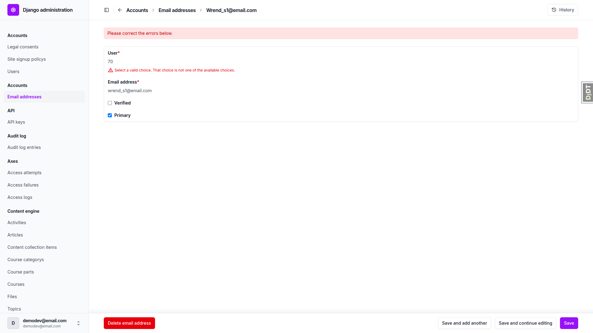

Expected: The DemoDev admin's Email addresses changelist shows only addresses of DemoDev users (51), like the site-aware Users changelist.

Actual: It lists all 67 addresses across sites. Opening wrend_s1@email.com (user 70, site 127.0.0.1:8003) shows the address, and saving fails with "User: Select a valid choice" because the user FK validates through the site-filtered manager. allauth's stock EmailAddress admin is not site-aware; this predates the branch.

## Bug status

- **FIXED** (commit: fd536456c) — B1: Issued API key overflows its box on a phone because break-all is not in Unfold's CSS. Re-verified at 375: `word-break: break-all`, the key and a dash-free stand-in both fit their box (291/291), page 375 wide.

  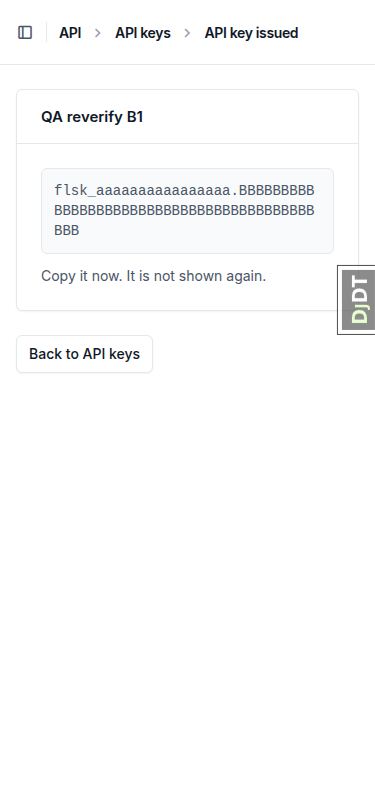
- **FIXED** (commit: 3dfcf9b09) — B2: API scope checkbox labels are cut off with an ellipsis at phone and tablet widths. Re-verified: all four labels wrap with nothing clipped at 375 and 768, and there's no horizontal overflow. Spot check: the user change form at 768 has no overflow.

  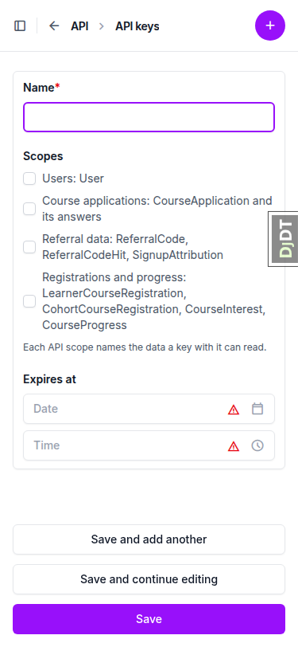
- **UNRESOLVED** — B3: allauth Email addresses admin lists and opens other sites' addresses (reason: security-adjacent cross-site data exposure in the admin; deciding how the allauth EmailAddress admin is scoped per site needs a human).

Full run after the fixes: the B2 fixer ran the full tier on the final HEAD (3dfcf9b09, which contains both fixes): 11532 passed. No separate run was repeated.

## General notes

Plan wording that differs from the spec, all judged pass:

- 2.2 "same body as 2.1": no key gives `not_authenticated`, while every bad key gives one identical `authentication_failed` body. This is per the spec and docs/api.md.
- 1.4 "12-character prefix": the spec says `token_hex(8)`, which is 16 characters.
- 3.1 "a Revoked at time" on the list: the spec's changelist has no `revoked_at` column. It shows on the change page.
- §4 "API key revoked" label: the audit admin shows raw action codes for every action, unchanged on this branch.

Other notes:

- §6.3 W001 line skipped: `settings_dev` hardcodes `DEBUG = True`.
- The Expires at inputs show red warning triangles even with no error. This is Django's "You are 2 hours ahead of server time" timezone note rendered by Unfold as an icon. It is not from this branch, but it reads like an error.
- The mobile Cancel link on the revoke confirmation is 46x20, small but well spaced.
- Console noise on learner pages (report-only CSP for a Google frame, favicon 404, YouTube embed warnings) predates this branch.
- The do_qa command names `.claude/fls-dev/scripts/` wrappers (`qa_cleanup.sh`, `qa_collect_screenshots.sh`, `compress_screenshots.sh`, `delete_sdd_work_files.sh`) that do not exist. The `claude_plugins/sdd/scripts/` copies were used. `qa_collect_screenshots.sh` needs a second `<source-dir>` argument that the command does not pass. The collect script also sweeps `.yml` snapshots and console logs, which can hold secrets.

status: ok · reason: 3 bugs — 2 fixed, 1 unresolved; report rendered, screenshots verified
