# Frontend QA report: registrations and interest APIs

Branch `apis-for-lead-monitoring-4-registrations-and-interest`, run 2026-11-06, dev server on port 8541, test plan `3. frontend_qa.md`. Viewports: desktop 1920x1080, mobile 375x812, tablet 768x1024, plus a 390px check for §8.4. Every section passed except §6, which was skipped because the backfill is not observable in this database. No bugs were found.

## Methodology

- The Playwright MCP was driven by hand for the UI. curl was used for the API.
- Screenshots were collected into `screenshots/` beside this report. Every image referenced here exists there (checked with Glob).
- A layout probe ran after each app-page screenshot.

## Diff scoping

- Class: **FULL**.
- Triggering files: `freedom_ls/*/api.py`, `models.py`, migrations and tests (`.py`); `docs/*.md`; `spec_dd/...` (`.md`, `.yml`, `.png`); `test_organisation/import_contracts.toml`.
- Skipped: nothing. Non-`.py` paths such as `.md` and `.toml` force FULL (Rule 4). No templates changed, so mobile and tablet focus on the educator and learner pages touched by the flows.

## Smoke gate

Status: **pass**. Pages checked:

- `/`
- `/admin/freedom_ls_learner_management/learnercourseregistration/`
- `/api/v1/learner-course-registrations/` (anonymous 401 JSON)

No failure URL or reason.

## Results by test plan section

| Test | Viewport | Status | Notes | Screenshot |
|---|---|---|---|---|
| 1.1 | desktop | pass | One-off key page screenshot withheld so key text is not committed. Key "QA registrations sync" issued with Registrations and progress only. Help text names LearnerCourseRegistration, CohortCourseRegistration, CourseInterest, CourseProgress. The one-off key page shows an `flsk_` key with "Copy it now". A first attempt's key was issued but not captured; harmless spare key. | none (withheld) |
| 1.2 | desktop | pass | Key "QA users only" issued with Users scope only; key shown once. | none |
| 2.1 | desktop | pass | All three endpoints: anonymous 401 `not_authenticated` with `WWW-Authenticate: Bearer realm="api"`. A Users-only key gets 403 naming `registrations_and_progress`, code `permission_denied`. POST 405 JSON `method_not_allowed`. OPTIONS 200 `Allow: GET, HEAD, OPTIONS`. HEAD 200 with no body. | none |
| 2.2 | desktop | pass | 6 rows, each with exactly the 13 documented keys in order. UUID, int and Z types correct. No learner_id, learner or password keys. removed@qa.test (deactivated learner) row has is_active true. a3@qa.test blank names are `""`. Detail 2529ff8d returns the row; a random UUID gives 404 `not_found`. Admin changelist matches (Sol Solo, Northside QA Course, 5:35 p.m. = 17:35:20Z). | 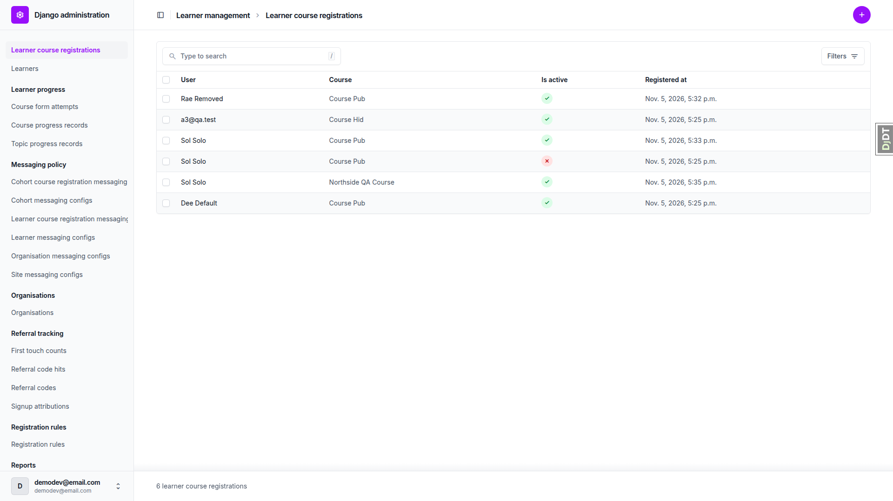 |
| 2.4 | desktop | pass | `page_size=2` paged LCR 6/6, CCR 8/8, interests 3/3 rows, each id once. `next` carries `page_size` and `cursor` and ends null. `updated_since` 2000Z returns all, 2999Z returns `[]`, naive gives 400 `{updated_since: [...]}` on all three endpoints. `is_active=false` and `course_id=` are ignored (list unchanged). | none |
| 2.5 | desktop | pass | `users/81/` is 403 (users scope) with KEY. With KEY_USERS it is solo@qa.test, matching the row's `user_email`. | none |
| 2.3 | desktop | pass | Bloom-site registration 4eb98f05-2526-42bc-b94b-60f5d265f919 (pk from sdd:qa-data-helper; the admin changelist is site-filtered in dev, contrary to the plan) is absent from the list and its detail is 404 `not_found`. | none |
| 3.1 | desktop | pass | §0.3 record: org admin org.admin@qa.test, learner solo@qa.test, course "Northside QA Course" (Northside-only, from the previous run). Org admin deactivated row 2529ff8d via the modal. API: is_active false, updated_at 2026-11-06T10:37:04.459157Z (was 2026-11-05T17:36:19.552514Z), registered_at unchanged. `updated_since=T0` (10:36:05Z) returns only that row. | 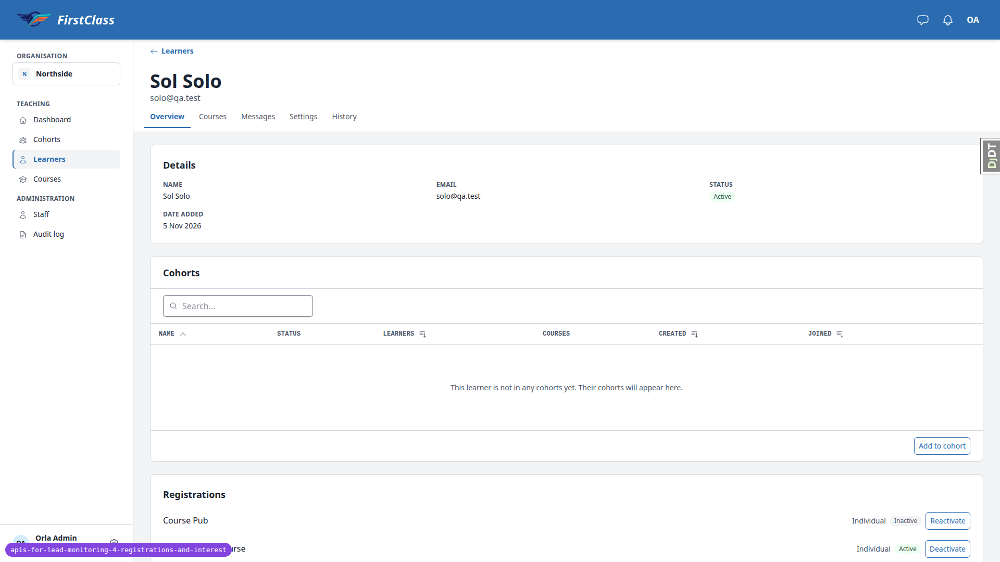 |
| 3.2 | desktop | pass | After reload the Northside QA Course row shows Inactive + Reactivate, no Deactivate. updated_at unchanged (10:37:04.459157Z). Registrations rows now align with their heading (previous run's B2 fix holds). |  |
| 3.4 | desktop | pass | Deactivated Cohort B / Course Pub (eb611993) via the modal (modal screenshot: 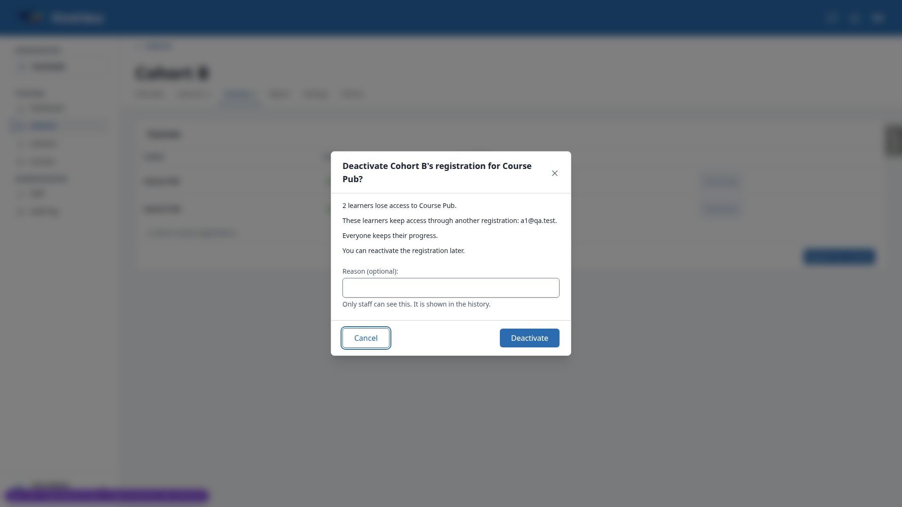). API: is_active false, updated_at 10:37:35.194Z (was 2026-11-05T17:25:06.166Z), registered_at unchanged, exactly the 8 documented keys, no organisation_id on any cohort row. Cohort Stale's deactivated registration listed with is_active false. Seeding had re-activated Cohort A / Course Pub (deactivated by the previous run) and moved its updated_at to the seed time, as designed. | 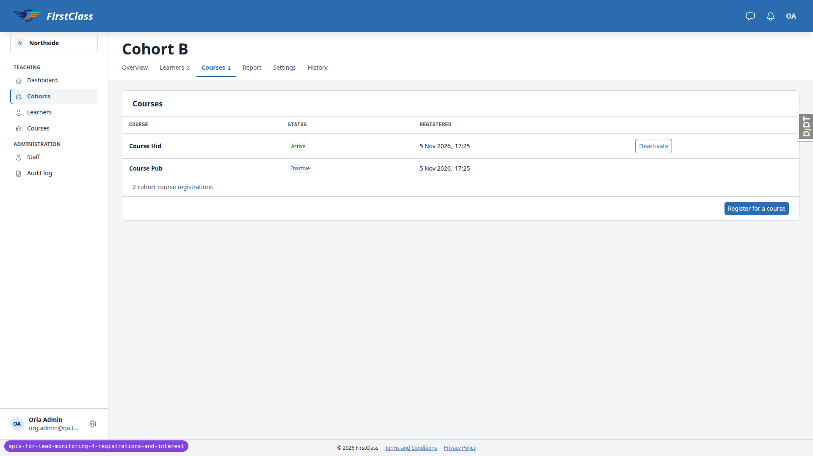 |
| 3.3 | desktop | pass | solo@qa.test clicked Enrol for free on `/courses/northside-qa-course/`. Row 2529ff8d kept its id, is_active true, updated_at moved to 10:38:37.602Z, self_registered stays false; no new row (count still 6). Learner lands on the first topic. | 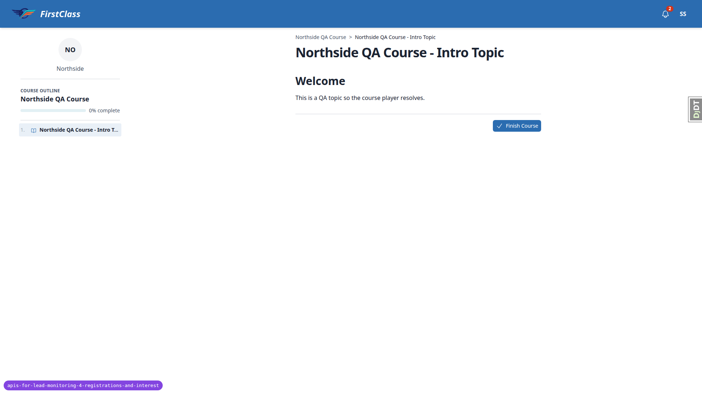 |
| 5.1 | desktop | pass | Mix Bravo is the only coming-soon course on the DemoDev dashboard; its CTA is on `/courses/qa-mix-bravo/detail/`, not on the dashboard card. solo already held interest from the previous run, so it was removed first. Clicking I'm interested flipped to Remove interest without reload (window marker survived). API: one new row 729a4116 with exactly the 9 documented keys, user_email solo@qa.test, created_at 10:39:12.396073Z and updated_at 10:39:12.396083Z (updated_at >= created_at; previous run's B1 fix holds on new rows). A repeat express POST returned 200 and added no row. |  |
| 5.2 | desktop | pass | Remove interest: row 729a4116 gone from the list, detail 404 (d2f51135 from the previous run also 404). Re-express: new id b1749de7, fresh created_at 10:39:35.733560Z. `page_size=1` pages through 3 rows once each. `updated_since=10:39:00Z` returns only Mix Bravo; 2999 gives `[]`; naive gives 400 (see 2.4). | none |
| 8.5 | desktop | pass | Dashboard and course pages render for solo. Enrol for free on Mix Alpha created row 8663c647, self_registered true, is_active true, organisation DemoDev; updated_at (10:39:55.439908Z) >= registered_at (10:39:55.439899Z). |  |
| 4 | desktop | pass | As superuser in the admin, renamed user solo first name (Sol to SolQA), organisation Northside, course Course Pub (title) and cohort Cohort B. The API showed the new user_first_name (learner and interest rows), organisation_name, course_title on learner and cohort rows, and cohort_name. updated_at of all 18 rows across the three endpoints unchanged (diffed before and after). Renames undone and confirmed via the API. | none |
| 6 | desktop | skip | Backfill not observable in this database: sdd:qa-data-helper confirmed no DemoDev LearnerCourseRegistration or CohortCourseRegistration has registered_at before 2026-11-05; every row was seeded after the migrations were applied. Relying on `test_migrations.py` in learner_management and course_interest. | none |
| 7 | desktop | pass | `schema/` with KEY_USERS: 200 `application/vnd.oai.openapi+json`. All six paths present; each list has cursor, page_size, updated_since. LearnerCourseRegistrationApi: user_id integer; course_id and organisation_id string/uuid; self_registered and is_active boolean. | none |
| 8.1 | desktop | pass | `users/?page_size=2` with KEY_USERS returns next/results with the usual user keys (id, email, first_name, last_name, is_active, is_staff, email_verified, created_at, last_login, updated_at). | none |
| 8.2 | desktop | pass | LCR changelist (7 rows) and CCR changelist (8 rows) open (200); change forms open. Editable fields: LCR learner/course/is_active; CCR cohort/course/is_active + deadline-override inline. No updated_at field. | 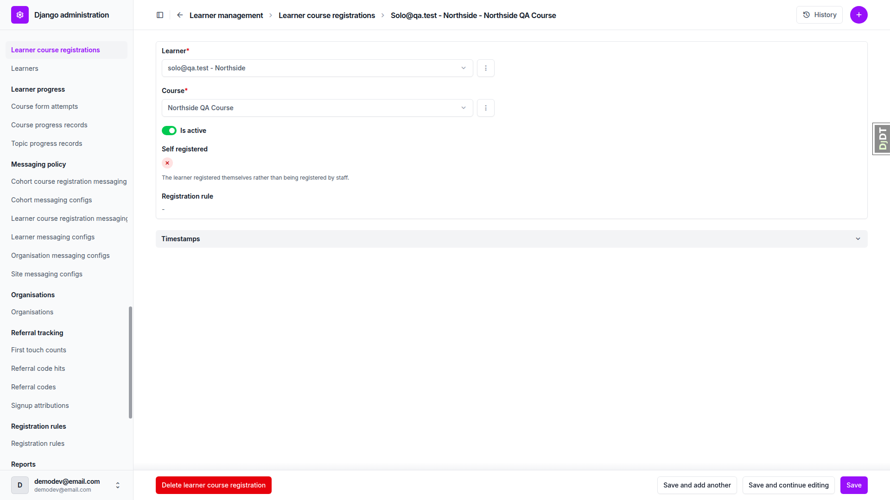 |
| 8.3 | desktop | pass | Course interest changelist (3 rows) and change form (user, course) open, 200. Change-form title reads `CourseInterest(81, <uuid>)` (model has no `__str__`); pre-existing, not changed by this branch. | none |
| 8.4 | desktop | pass | Northside dashboard, Cohort B and Sol Solo learner pages: 200, no traceback, document scrollWidth equals viewport and layout probe clean at 1920 and 390. |  |
| 8.4 | mobile | pass | 375x812: learner Registrations card stacks course name over type/status/action; Reactivate/Deactivate 86-87x44px. Deactivate modal opens as a bottom sheet inside the viewport, title and both buttons visible (modal screenshot: 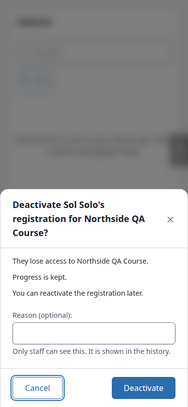); cancelled. | 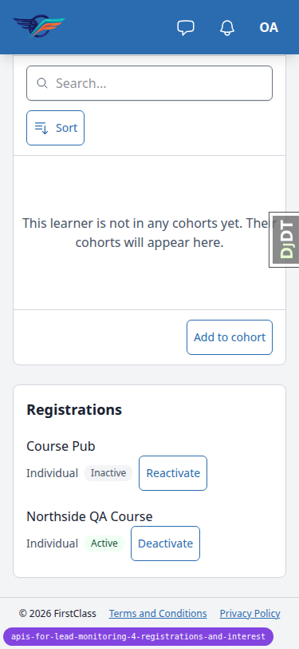 |
| 3.4 | mobile | pass | Cohort B courses tab at 375 switches to stacked cards; Course Pub shows Inactive, Deactivate on the active row reachable; scrollWidth 375. | 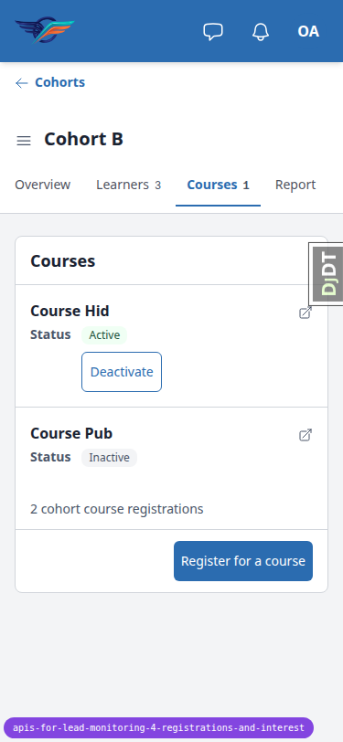 |
| 5.1 | mobile | pass | Mix Bravo detail at 375 shows Interested + Remove interest inside the Coming soon card; control 123x32px; scrollWidth 375. | 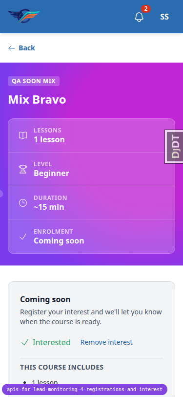 |
| 8.4 | tablet | pass | 768x1024: tablet gets the mobile nav (no sidebar); learner page Details/Cohorts/Registrations cards fit, Registrations rows share the heading's left edge; scrollWidth 768. | 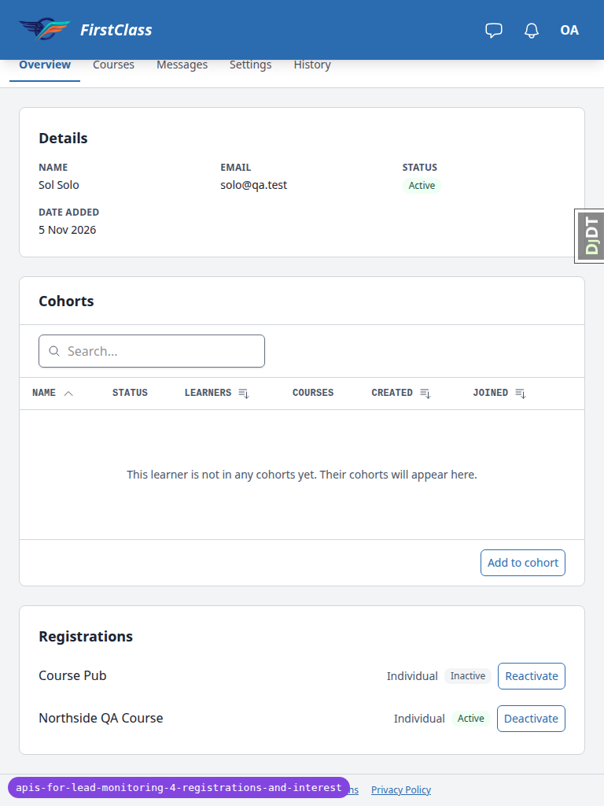 |
| 5.1 | tablet | pass | Mix Bravo detail at 768 renders with the interest state; no overflow. |  |

## Design check

No design states tested.

## Bugs

No bugs found.

## Layout probe

| Test | Viewport | URL | Screenshot | Result |
|---|---|---|---|---|
| 1.1 | desktop | `/admin/freedom_ls_api/apikey/add/` (issued page) | none (withheld) | clean |
| 2.2 | desktop | `/admin/freedom_ls_learner_management/learnercourseregistration/` |  | clean |
| 3.1 | desktop | `/educator/organisations/northside/learners/<solo>` |  | clean |
| 3.2 | desktop | `/educator/organisations/northside/learners/<solo>` |  | clean |
| 3.4 | desktop | `/educator/organisations/northside/cohorts/<cohort-b>/__tabs/courses` |  | clean |
| 3.3 | desktop | `/courses/northside-qa-course/1/` |  | clean |
| 5.1 | desktop | `/courses/qa-mix-bravo/detail/` |  | clean |
| 8.2 | desktop | `/admin/freedom_ls_learner_management/learnercourseregistration/<id>/change/` |  | clean |
| 8.4 | mobile | `/educator/organisations/northside/learners/<solo>` |  | clean |
| 3.4 | mobile | `/educator/organisations/northside/cohorts/<cohort-b>/__tabs/courses` |  | clean |
| 5.1 | mobile | `/courses/qa-mix-bravo/detail/` |  | clean |
| 8.4 | tablet | `/educator/organisations/northside/learners/<solo>` |  | clean |
| 5.1 | tablet | `/courses/qa-mix-bravo/detail/` |  | clean |

## Data changes

| What changed | Via |
|---|---|
| Ran `qa_create_learner_administration_scenario`, `qa_create_cohort_administration_scenario` and `qa_create_coming_soon_sections` (idempotent); this re-activated Cohort A / Course Pub, deactivated by the previous run. | test plan §0.3 seed list |
| Issued API keys "QA registrations sync" (twice; the first key text was not captured) and "QA users only". §4 renames applied and undone. | admin UI (the test plan's own steps) |
| Read-only lookup of the Bloom-site registration pk and of pre-migration rows; nothing changed. | sdd:qa-data-helper |

## Bug status

No bugs this run.

## General notes

- The one-off API key page screenshot was deliberately withheld so key text is not committed. Snapshot and console files were grepped for key text: none. A spare "QA registrations sync" key exists because the first issued key's text was not captured.
- §0.3 recorded values: org admin org.admin@qa.test; learner solo@qa.test; course "Northside QA Course" (Northside-only). Course Pub has no organisation, so self-registering on it would create a separate DemoDev-org row rather than reactivate the Northside row. The plan should name a course open only to the learner's organisation.
- The plan says the admin LCR changelist "shows every site in dev"; it is site-filtered, so the Bloom row's pk came from sdd:qa-data-helper.
- The express-interest CTA is on the coming-soon course's detail page, not on the dashboard card. Mix Bravo is the only coming-soon course on the dashboard.
- The previous run's B1 fix holds: new rows this run (interest 729a4116, b1749de7; registration 8663c647) have updated_at >= creation time. Rows seeded before that fix (2026-11-05) still carry updated_at a few microseconds before registered_at/created_at (e.g. the Bloom row 4eb98f05, and the seeded cohort registrations); that is old dev data, not a regression.
- The previous run's B2 fix holds: Registrations rows align with their heading at all three widths.
- A 400 for a bad `updated_since` is `{"updated_since": [...]}` (no `code` key), unlike 401/403/404/405 bodies; the plan only requires it to name `updated_since`.
- `schema/` with `Accept: application/json` returns 406 `not_acceptable`; plain curl returns 200 `application/vnd.oai.openapi+json`.
- The plan's helper uses `python -m json.tool`; `python3` was used.
- Course interest admin change-form title is `CourseInterest(81, <uuid>)` because the model has no `__str__`; pre-existing.
- The Django debug toolbar intercepted clicks on the admin Save button until hidden (dev tooling only).
- On the cohort courses tab an inactive cohort registration shows no Reactivate action (pre-existing behaviour, outside this branch).

status: ok · reason: report rendered, 0 bugs documented
