# Frontend QA report: registrations and interest APIs

Branch `apis-for-lead-monitoring-4-registrations-and-interest`, dev server on port 8444, run on 2026-11-05. The run covered the registrations and course-interest API endpoints (curl), the API key admin, the educator deactivate/reactivate flows, learner self-registration, express interest, and admin pages. Every test plan section passed except §6 (backfill, skipped because it could not be observed). Two bugs were found: B1 (`updated_at` is stamped a few microseconds before `registered_at`/`created_at` on new rows) and B2 (Registrations rows on the educator learner page are indented 24px past their heading, pre-existing on main).

## Methodology

- Playwright MCP by hand for the UI, plus curl for the API.
- Viewports: desktop 1920x1080, mobile 375x812, tablet 768x1024, plus a 390px check for §8.4.
- Screenshots were collected into `screenshots/` beside this report, and every referenced image exists there.
- The layout probe ran after each app-page screenshot.

## Diff scoping

- Class: **FULL** (non-.py files such as .md/.toml changed, so Rule 4 applies).
- Changed files: `docs/api.md`, `docs/app_structure.md`, `docs/product/*.md`, `freedom_ls/accounts/api.py`, `freedom_ls/course_interest/{api,models}.py` + migration 0002, `freedom_ls/learner_management/{api,models}.py` + migration 0010, `freedom_ls/site_aware_models/models.py`, tests, spec_dd `.md` files, `test_organisation/import_contracts.toml`.
- Skipped: nothing. No part of the plan was skipped on scoping grounds.

## Smoke gate

**Pass.** Pages loaded: `/`, `/educator/`, `/admin/freedom_ls_learner_management/learnercourseregistration/`. No failure URL or reason.

## Results by test plan section

| Test | Viewport | Status | Notes | Screenshot |
|---|---|---|---|---|
| 1.1 | desktop | pass | Key "QA registrations sync" issued with Registrations and progress scope; scope label reads "LearnerCourseRegistration, CohortCourseRegistration, CourseInterest, CourseProgress". One-off key page not screenshotted. | 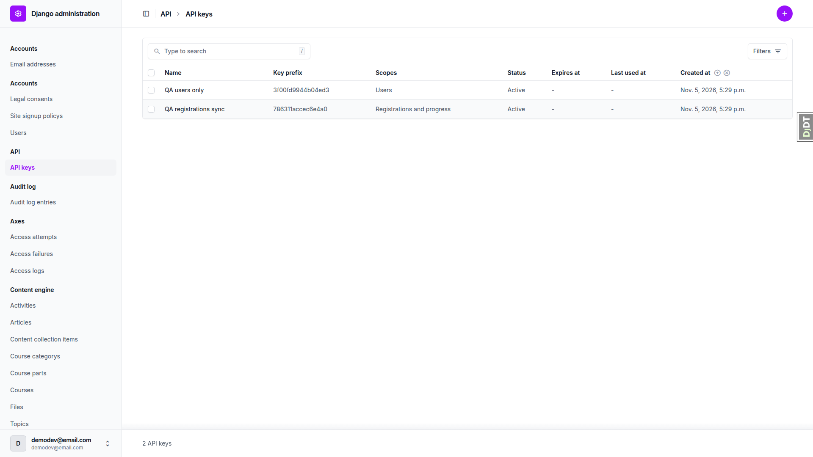 |
| 1.2 | desktop | pass | Key "QA users only" issued with Users scope. |  |
| 2.1 | desktop | pass | All three endpoints: anon 401 `not_authenticated` with `WWW-Authenticate: Bearer realm=api`; Users-only key 403 naming `registrations_and_progress`, code `permission_denied`. POST 405 JSON `method_not_allowed`; OPTIONS 200 `Allow: GET, HEAD, OPTIONS`; HEAD 200 with no body. | none |
| 2.2 | desktop | pass | 3 rows, exact 13 keys in order, UUID/int/Z types correct, blank names as `""`. Detail returns the row; random UUID gives 404 `not_found`. Admin changelist row matches organisation Northside and registered time. | 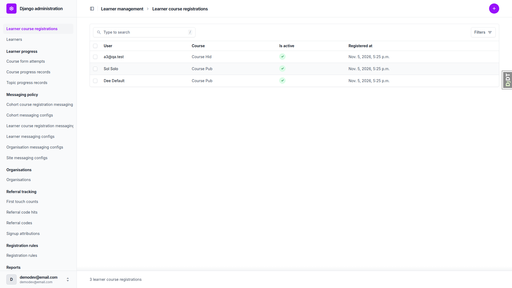 |
| 2.2-timestamps | desktop | **fail** | On new registrations `updated_at` is about 16-23 microseconds earlier than `registered_at` (solo: registered_at 17:25:07.585541Z, updated_at 17:25:07.585525Z). Plan §3.1.2 expects equal or later. See B1. | none |
| 2.2-deactivated-learner | desktop | pass | removed@qa.test (Learner.is_active False) registration de617e60 shows `is_active: true`. | none |
| 2.3 | desktop | pass | Bloom-site registration 4eb98f05 absent from list; its detail is 404 `not_found`. | none |
| 2.4 | desktop | pass | page_size=2 gives 2 rows plus `next` carrying cursor and page_size; following `next` gives the last row, `next` null, 3 unique ids. `updated_since` 2000 gives all, 2999 gives `[]`, naive gives 400 `{updated_since: [...]}`. `is_active=false` and `course_id=` ignored. | none |
| 2.5 | desktop | pass | `users/81/` is 403 with KEY; with KEY_USERS the email solo@qa.test matches the row `user_email`. | none |
| 3.1 | desktop | pass | Org admin deactivated Sol Solo's Course Pub registration via modal. API: `is_active` false, `updated_at` 17:32:54.897Z (was 17:25:07.585Z), `registered_at` unchanged. `updated_since=T0` returned only this row plus the removed@qa.test row the data helper created after T0; no untouched row. | 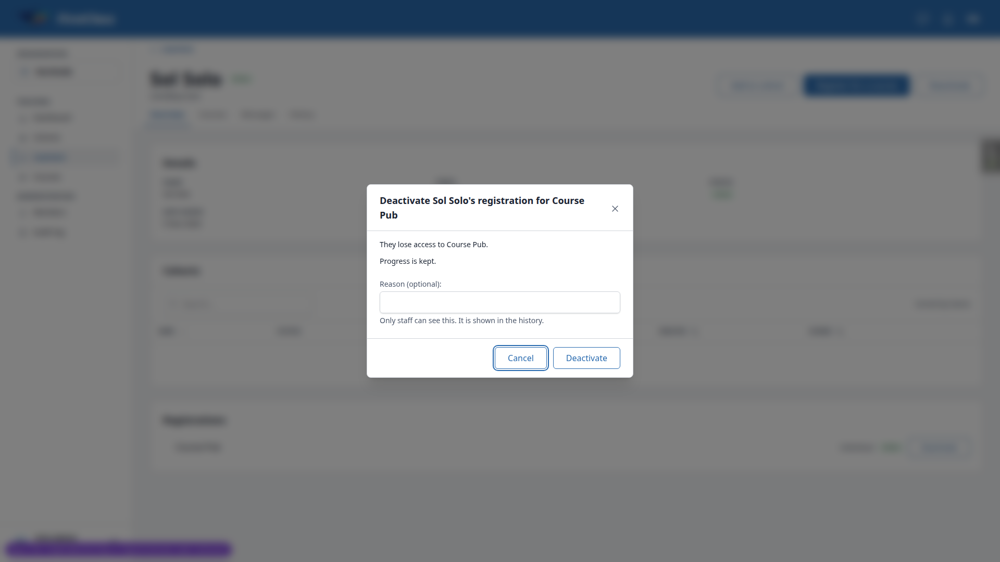 |
| 3.1 | mobile | pass | Learner page registrations list readable at 375; Deactivate/Reactivate buttons full-size. Deactivate modal opens as a bottom sheet within the viewport. | 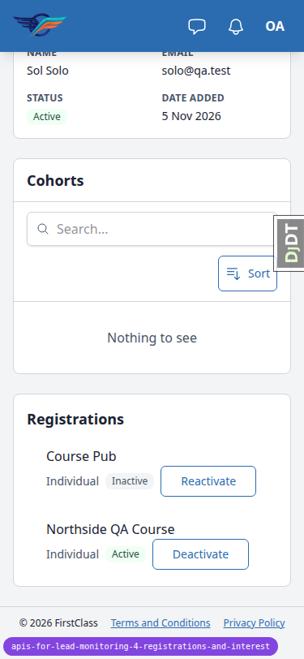 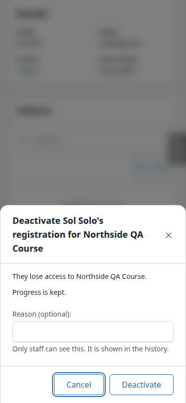 |
| 3.1 | tablet | pass | Tablet gets the mobile nav (hamburger, sidebar hidden); learner page header actions and cards fit at 768. | 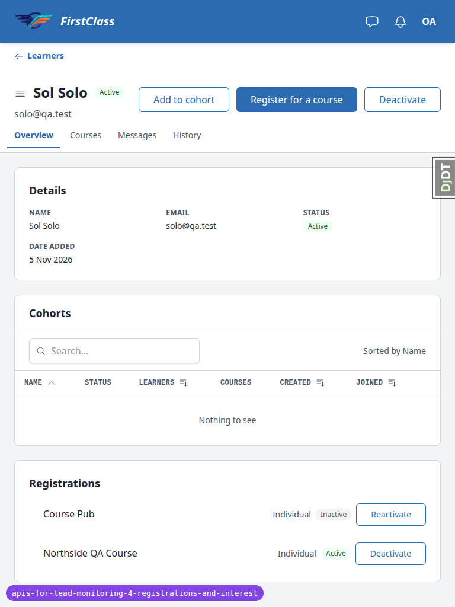 |
| 3.1-visual | tablet | **fail** | Registrations card rows start 24px right of the heading (heading x=49, rows x=73). Same at desktop and mobile. Pre-existing on main. See B2. |  |
| 3.2 | desktop | pass | After reload the row shows "Inactive" with Reactivate and no Deactivate action. `updated_at` unchanged (17:32:54.897271Z). | 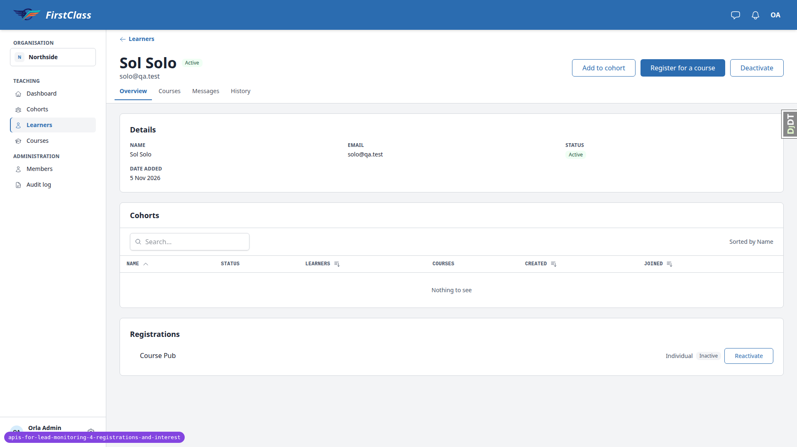 |
| 3.3 | desktop | pass | First attempt on "Course Pub" created a NEW row (47523e6e, organisation DemoDev, self_registered true) instead of reactivating 451ca05a; test-data mismatch, see General notes. Re-run on a Northside-only course: org admin deactivated 2529ff8d (updated_at 17:36:06.319Z), solo self-registered via "Enrol for free", same id, `is_active` true, updated_at 17:36:19.552Z, `self_registered` stays false. | 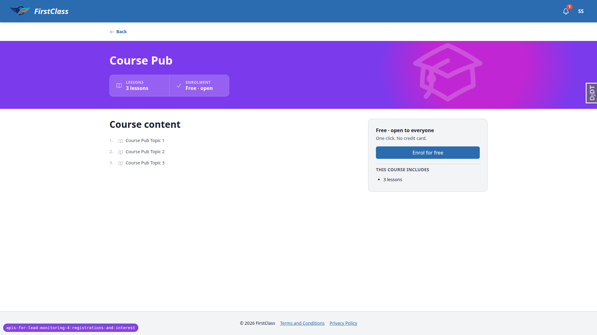 |
| 3.4 | desktop | pass | Deactivated Cohort A / Course Pub via modal. API row `is_active` false, updated_at 17:34:33.989Z (was 17:25:06.113Z), registered_at unchanged, exactly the 8 documented keys, no `organisation_id`. Cohort Stale's deactivated registration also listed `is_active` false. | 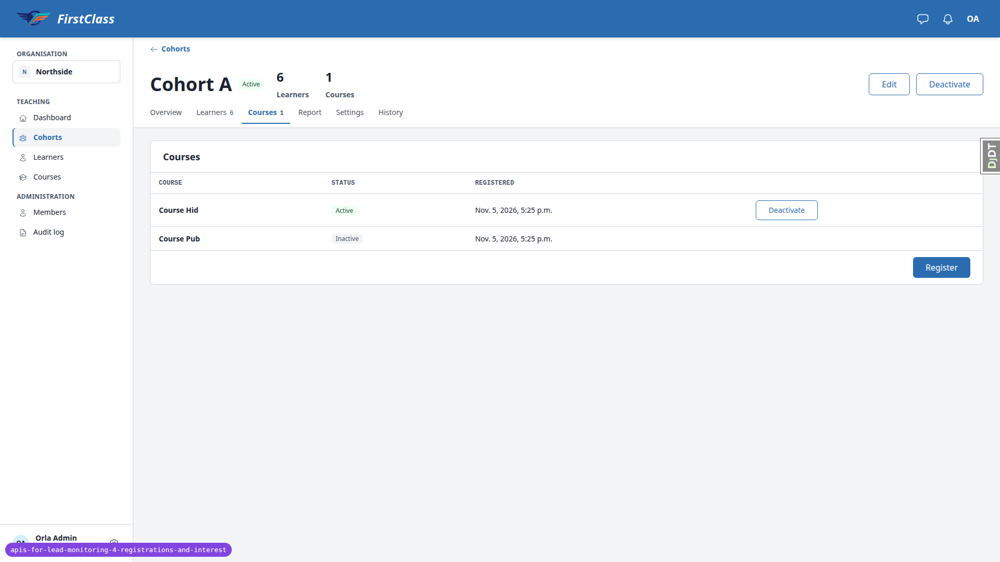 |
| 3.4 | mobile | pass | Cohort courses tab switches the table to stacked cards at 375; Deactivate and Register reachable; scrollWidth 375. | 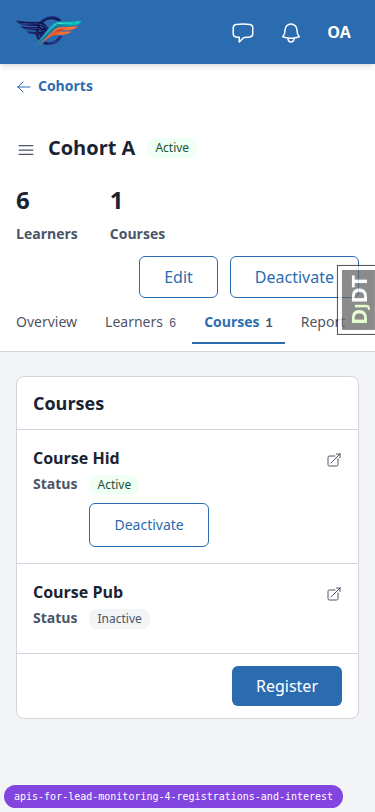 |
| 4 | desktop | pass | Renamed user first name, organisation, course, cohort in the admin. API rows showed the new `user_first_name`, `organisation_name`, `course_title` (learner and cohort rows) and `cohort_name`; every `updated_at` unchanged. Renames undone afterwards. | none |
| 5.1 | desktop | pass | "I'm interested" CTA on `/courses/qa-mix-bravo/detail/`. Click flips to "Remove interest" without reload (window marker survived). API: one new row with the 9 documented keys, `user_email` solo@qa.test, `created_at` and `updated_at` equal to the second. Repeat POST and reload added no second row. | 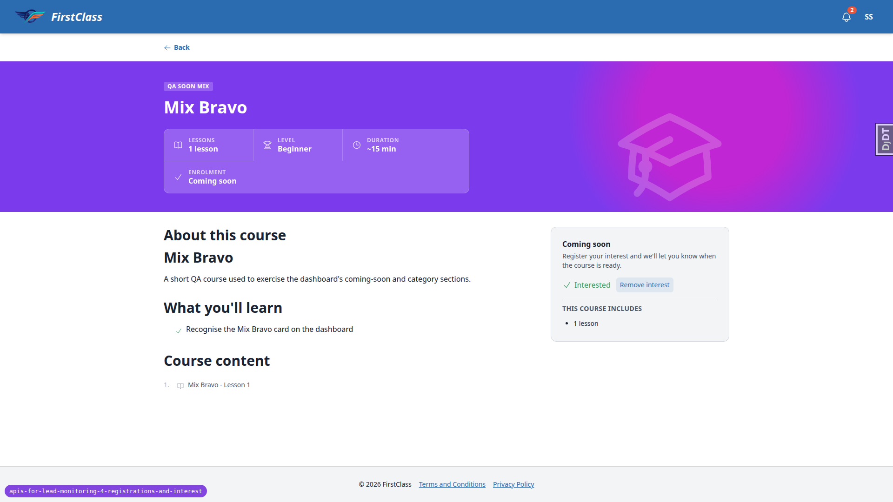 |
| 5.1 | mobile | pass | Coming-soon page with "Interested" state and "Remove interest" fits at 375. Control is 123x32px. | 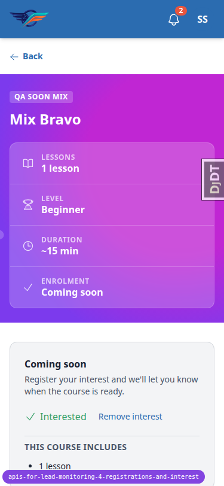 |
| 5.1 | tablet | pass | Course detail with interest state renders at 768, no overflow. | 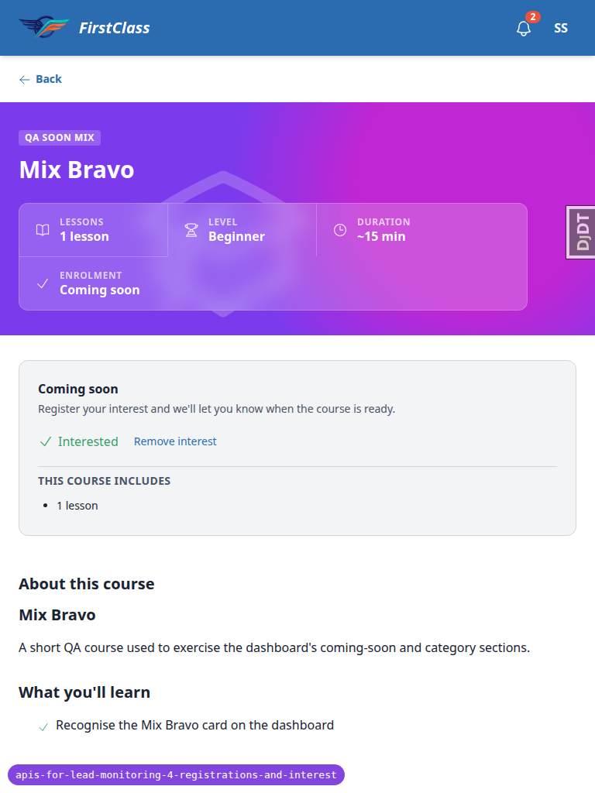 |
| 5.2 | desktop | pass | Remove interest: row gone, old id detail 404 `not_found`. Re-express gives new id d2f51135 (was 30fb9031) with fresh `created_at`. `updated_since` 2000/2999/naive gives all/`[]`/400; with a second interest, page_size=1 pages through both rows, `next` ending null. Cohort registrations at page_size=3 returned all 9 ids exactly once. | none |
| 6 | desktop | skip | Backfill not observable: the dev DB had no DemoDev site and was seeded after the migrations were applied, so every row postdates them. Relying on `test_migrations.py` in both apps. | none |
| 7 | desktop | pass | Schema 200 (`application/vnd.oai.openapi+json`) via KEY_USERS. All six paths present; lists carry `cursor`, `page_size`, `updated_since`. `LearnerCourseRegistrationApi`: `user_id` integer; `course_id` and `organisation_id` string/uuid; `self_registered` and `is_active` boolean. | none |
| 8.1 | desktop | pass | `users/?page_size=2` with KEY_USERS returns `next`/`results` with the usual user keys. | none |
| 8.2 | desktop | pass | LCR and CCR changelists and a change form of each open; editable fields LCR learner/course/is_active, CCR cohort/course/is_active (+ deadline override inline). No `updated_at` field. |  |
| 8.2-lcr | desktop | pass | LCR change form editable fields: learner, course, is_active only. |  |
| 8.3 | desktop | pass | Course interest changelist (2 rows) and change form (user, course) open. | none |
| 8.4 | desktop | pass | Northside org dashboard, Cohort A and Sol Solo learner pages: 200, no traceback, scrollWidth equals viewport at 1920 and 390. | 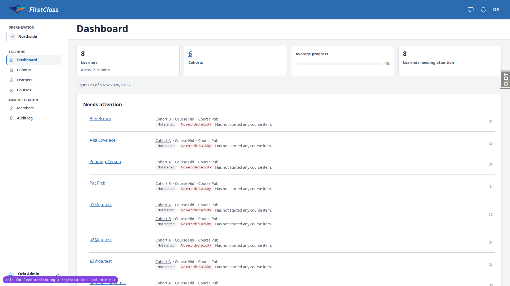 |
| 8.5 | desktop | pass | Learner dashboard and course detail render. Self-registering for a course with no individual DemoDev-organisation registration (Course Pub via the default org) produced new row 47523e6e with `self_registered` true. |  |

## Design check

No design states tested.

## B1: updated_at is stamped a few microseconds before registered_at/created_at on new rows

Manifestations: 2.2-timestamps (desktop), 5.1 (desktop). No screenshots; found through API responses.

- **Expected:** on a freshly created LearnerCourseRegistration, CohortCourseRegistration or CourseInterest, `updated_at` equals (or is not earlier than) `registered_at` / `created_at`, matching the backfill, where they are equal, and the plan's "U0 equal to registered_at or later".
- **Actual:** `updated_at` is 16-76 microseconds earlier than `registered_at`/`created_at` on every new row (e.g. registered_at 17:25:07.585541Z, updated_at 17:25:07.585525Z; interest created_at 17:36:49.969104Z, updated_at 17:36:49.969028Z). `auto_now` and `auto_now_add` each call `timezone.now()` separately in `pre_save`, and `updated_at`, inherited from `UpdatedAtModel`, is evaluated first.

## B2: Learner page Registrations rows are indented 24px past their heading

Manifestations: 3.1-visual (tablet), 3.1-visual (mobile), 3.1-visual (desktop).

- **Expected:** registration rows share the left edge of the "Registrations" heading, as the Details and Cohorts cards' content does.
- **Actual:** the `<ul class='flex flex-col gap-3'>` in `freedom_ls/educator_interface/templates/educator_interface/panels/learner_registrations.html` inherits the global list margin-left of 24px, so the rows start at x=73 under a heading at x=49 (768px). Other lists use `list-none ml-0`. Pre-existing on main.

## Layout probe

| Test | Viewport | URL | Screenshot | Result |
|---|---|---|---|---|
| 1.1 | desktop | `/admin/freedom_ls_api/apikey/` |  | clean |
| 3.1 | desktop | `/educator/organisations/northside/dashboard` |  | flag: "overflow: content ink spans x=256..2018 in a 1920px viewport". False positive: the only ink past 1920 is the text of sr-only "No progress to show" spans; document scrollWidth is 1920 and nothing visible overflows. |
| 3.1 | desktop | `/educator/organisations/northside/learners/<sol>` |  | clean |
| 3.4 | desktop | `/educator/organisations/northside/cohorts/<cohort-a>/__tabs/courses` |  | flags: "overlap: header and content ink intersect", "overlap: content and sidebar ink intersect". False positive: content region's left 255/top 72 comes from the 1px sr-only `#scope-announcer`; screenshot shows no overlap. |
| 3.1 | mobile | `/educator/organisations/northside/learners/<sol>` |  | clean |
| 3.4 | mobile | `/educator/organisations/northside/cohorts/<cohort-a>/__tabs/courses` |  | flags: "overflow: content ink spans x=-1..514 in a 375px viewport", "overlap: header and content ink intersect". False positive: the ink past 375 is the Settings/History tabs inside a deliberate `overflow-x-auto` tab strip, and x=-1 is the sr-only scope announcer; page scrollWidth is 375. |
| 5.1 | mobile | `/courses/qa-mix-bravo/detail/` |  | clean |
| 5.1 | tablet | `/courses/qa-mix-bravo/detail/` |  | clean |
| 3.1 | tablet | `/educator/organisations/northside/learners/<sol>` |  | clean |

## Data changes

| What changed | Via |
|---|---|
| Dev DB had only the example.com Site: ran `create_demo_data --yes` and `content_save ./demo_content DemoDev`, then `qa_create_learner_administration_scenario`, `qa_create_cohort_administration_scenario`, `qa_create_coming_soon_sections` | sdd:qa-data-helper |
| Created active staff-made LearnerCourseRegistration de617e60 for deactivated learner removed@qa.test on Course Pub (Learner.is_active left False) | sdd:qa-data-helper |
| Created Bloom course "Bloom QA Course", a Bloom Learner for away@qa.test and active LearnerCourseRegistration 4eb98f05 on it (other-site row for §2.3) | sdd:qa-data-helper |
| Created DemoDev course "Northside QA Course" (Northside-only, free, one topic) and an active staff-made registration 2529ff8d for solo@qa.test's Northside Learner, to re-run §3.3 | sdd:qa-data-helper |

## Bug status

| Bug | Status |
|---|---|
| B1 | **FIXED** (commit: 3923c0901) — updated_at is stamped a few microseconds before registered_at/created_at on new rows. Re-verified: a new interest and a new registration now have updated_at ≥ the creation time (microseconds later, not exactly equal). Rows created before the fix keep their old stamps. |
| B2 | **FIXED** (commit: 1548ae2db) — Learner page Registrations rows are indented 24px past their heading. Re-verified at 768px: heading and rows both at x=49. Screenshot: page-2026-11-05T17-52-45-056Z.png |

## General notes

- The dev DB had no DemoDev site at the start (only example.com), so the run seeded it from scratch. That is why §6 backfill was not observable: every row postdates the migration.
- §3.3 premise: "Course Pub" has no organisations, so self-registration resolves to the site default organisation (by design in `learner_interface/views.py`) and creates a separate DemoDev-org registration instead of reactivating the Northside one. The plan should name a course open only to the learner's organisation. The re-run on a Northside-only course passed.
- Plan wording: the express-interest CTA is on the coming-soon course's detail page, not on the dashboard card.
- The plan helper uses `python -m json.tool`, but `python` is not on PATH here; `python3` was used.
- The one-off API key page was deliberately not screenshotted so key text is not committed. Snapshot and console files were checked for key text: none.
- The Django debug toolbar intercepted clicks on the admin Save button until it was hidden (dev tooling only).
- The layout probe counts sr-only text and intentional `overflow-x-auto` tab strips as overflow/overlap (false positives recorded in the layout table). Worth teaching the probe to ignore clipped/sr-only ink.
- A 400 body for a bad `updated_since` is `{"updated_since": [...]}` (field-error shape, no `code` key), unlike the 401/403/404/405 bodies that carry `code`. The plan only requires it to name `updated_since`, so this is consistent with the plan; noted for API consistency.
- The "Remove interest" control is 32px tall (meets WCAG 2.2 AA).
- A data-helper agent briefly wrote a memory note into `.claude/agent-memory/`, which CLAUDE.md forbids; it was removed and git status there is clean.

status: ok · reason: 2 bugs — 2 fixed, 0 unresolved; report rendered, screenshots verified
