# QA report: content-widget-longer-audio

## Methodology

Frontend QA was run against the test plan `3. frontend_qa.md` in Chromium (desktop 1920, tablet 768, mobile 375). Before QA the branch was rebased onto main; the full test suite passed (17628 passed, 1 skipped) and the branch was force-pushed. Screenshots were collected into `spec_dd/2. in progress/content-widget-longer-audio/screenshots/` and every image referenced below exists beside this report. One screenshot was compressed (`page-2026-11-21T06-47-37-391Z.png`, 1110KB to 488KB).

## Diff scoping

Class: **FULL**. Changed files that triggered it: `freedom_ls/content_engine/templates/cotton/audio-clip.html`, `freedom_ls/content_engine/static/content_engine/js/alpine-components.js`, `tailwind.components.css`, `freedom_ls/content_engine/management/commands/content_save.py`, `freedom_ls/content_engine/models/files.py`, `freedom_ls/content_engine/templatetags/content_tags.py`, `demo_content/functionality_demo_content_widgets/2. media/content.md`, `freedom_ls/panel_framework/static/panel_framework/js/shell-components.js`, and tests/spec files. Nothing was skipped: everything ran (desktop, tablet, mobile).

## Smoke gate

Outcome: **pass**. Pages loaded: `/` and `/courses/content-widgets-demo-reference/2/`.

## Design check

no design states tested

## Tests

| Test | Viewport | Result | Screenshot | Notes |
|---|---|---|---|---|
| 1 | desktop | pass | 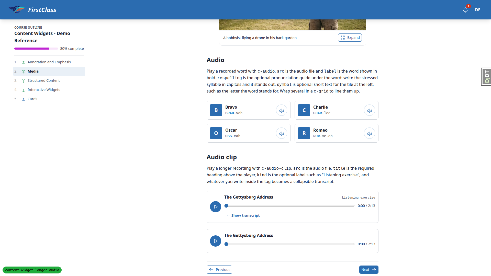 | Two clips render per spec: titles, kind label, transcript toggle. Cards match c-audio styling. Play buttons 44x44 and vertically centred. Total reads 2:13 (real 133.2s). Long title truncates with the full title in the `title` attribute. No audio request before Play. No duplicate ids. |
| 1-align | desktop | FAIL (bug B1) | 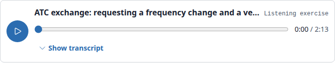 | Show transcript toggle is inset 8px from the text column. |
| 2 | desktop | pass | 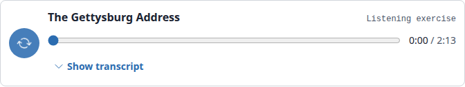, 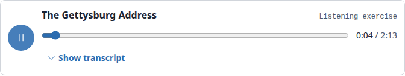, 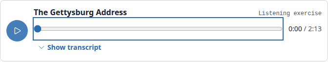 | Loading spinner under throttling, centred pause icon, elapsed counts up, pause/resume holds position, end of clip returns to 0:00 with Play. A no-Range (200) response was simulated: dragging near the end snapped back and kept playing, never froze. Reduced motion: spinner has no animation. Note: heroicons maps both loading and retry to arrow-path (pre-existing), so loading and error differ by colour and spin only. |
| 3 | desktop | pass | 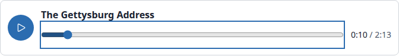 | Seek by drag before and during play, click near end while paused, right-edge click reads 2:13, keyboard Right/Left/Home/End work, 2px focus ring, 206 on seek. Safari half of 3.7: **skipped**, Safari not available (Chromium only). |
| 4 | desktop | pass | none | Only one source plays at a time across both clips and the Bravo word; a paused clip resumes where it was. |
| 5 | desktop | pass | 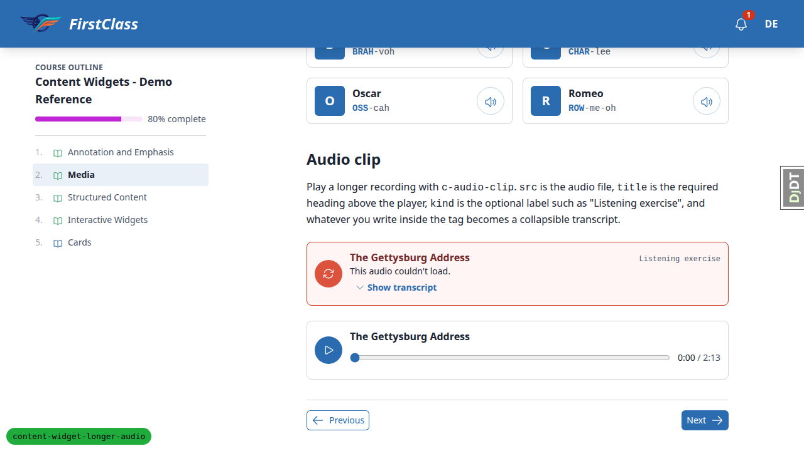 | Error state with blocked audio: red card, red retry button, status "This audio couldn't load.", no separate Try again button, transcript still toggles. Retry announced again while blocked; retry after unblocking played from 0:20. The first error screenshot was taken at 1280x720 because a fresh tab reset the viewport; layout re-checked at 1920. |
| 6 | desktop | pass (B1 seen) | 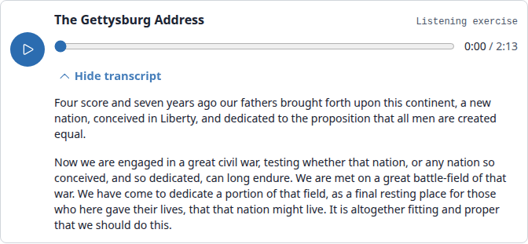, 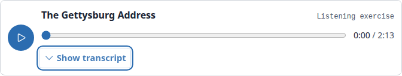 | Transcript opens with animation, label and chevron change, no ring after mouse click, keyboard Tab/Enter/Space work, reduced motion skips the animation. Closed panel is hidden from the accessibility tree. |
| 7 | desktop | pass | none | Accessible names, aria-pressed, slider aria-valuetext (updates once per spoken second), visible time aria-hidden, no duplicate ids. |
| 8 | desktop | pass | 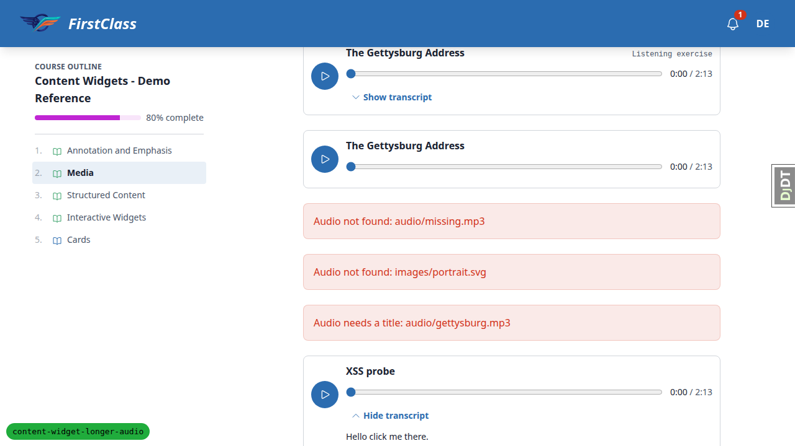 | Temporary content produced the three red error boxes (missing file, wrong file type, missing title). Transcript with `onclick` and a `<script>` line: neither appeared in the served source, no dialog, no script ran. Screenshot taken at 1280 width after a re-login reset the viewport. |
| 8.5 | desktop | pass | 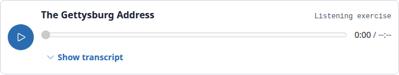 | With `duration_seconds` None: total `--:--`, seek bar disabled; after Play the total read 2:13 and the seek bar enabled. |
| 9 | desktop | pass |  | Full Media topic renders as before. Navigating Next while a clip played: nothing plays on the next page. |
| 1 | mobile | pass | 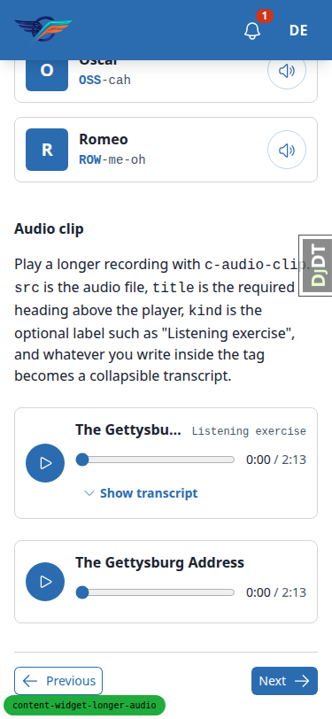 | No sideways scroll (scrollWidth 375). Time fully visible. Clip 1 title truncates to "The Gettysbu..." because the kind label keeps its width (per spec). |
| 3.6 | mobile | pass | 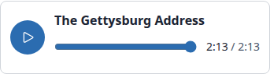 | Touch drag and right-edge tap work. Seek input hit area is 181x44px. |
| 5 | mobile | pass | 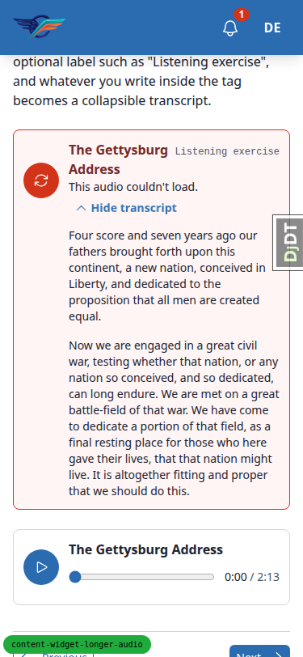 | Error state at 375: title wraps to two lines, no sideways scroll. |
| 1 | tablet | pass (B1 seen) | 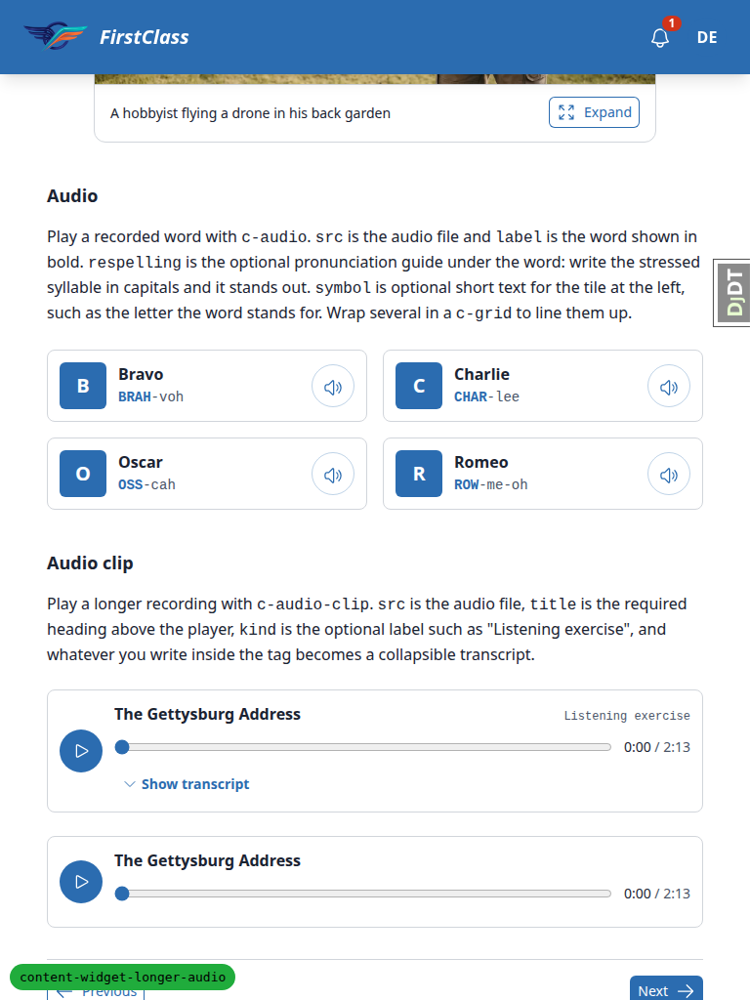, 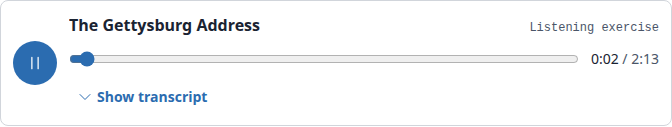 | Full content width, no sideways scroll, playing state correct. Transcript chevron sits 8px right of the column edge here too. |

## Bug B1: Show transcript toggle is inset 8px from the clip's text column

Manifestations:
- Test 1-align, desktop
- Test 1, tablet
- Test 6, desktop

Expected: the toggle's chevron starts on the same left edge as the title, seek bar and transcript text (brand visual checklist: buttons line up with the text above them).

Actual: the link-variant c-button keeps 8px left padding, so the chevron sits at x=885 while the title, seek bar and open transcript start at x=877.

## Layout probe

| Test | Viewport | URL | Screenshot | Result |
|---|---|---|---|---|
| 1 | desktop | /courses/content-widgets-demo-reference/2/ |  | clean |
| 5 | desktop | /courses/content-widgets-demo-reference/2/ | 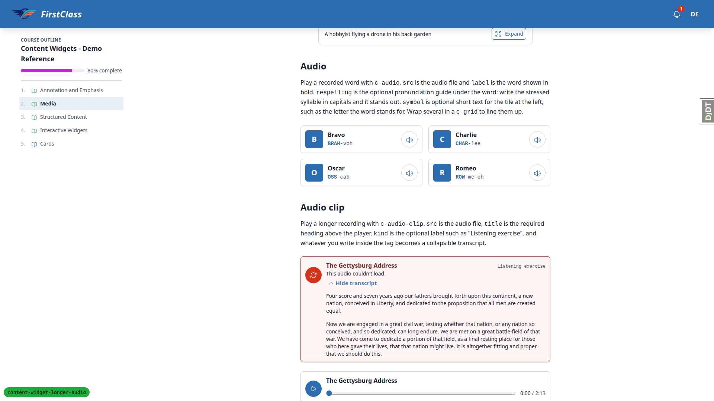 | clean |
| 1 | mobile | /courses/content-widgets-demo-reference/2/ |  | clean |
| 5 | mobile | /courses/content-widgets-demo-reference/2/ |  | clean |
| 1 | tablet | /courses/content-widgets-demo-reference/2/ |  | clean |

## Data changes

| What changed | Made by | Files written |
|---|---|---|
| Test 8 temporarily added clips to the Media topic content | manual edit of `demo_content/functionality_demo_content_widgets/2. media/content.md` | that file; reverted with `git checkout`, no files left changed |
| Test 8.5 / 8 set the clip File's `duration_seconds` to None in the dev DB | dev DB edit | dev DB only; restored by re-running `content_save` (duration back to 133.28) |

## Bug status

| Bug | Title | Status |
|---|---|---|
| B1 | Show transcript toggle is inset 8px from the clip's text column | **FIXED** (commit: 873b7729a) |

Re-verified at 1920x1080 after the fix: the chevron starts at x=877, the same edge as the title, seek bar and open transcript; a mouse click leaves no ring and Tab still shows it.

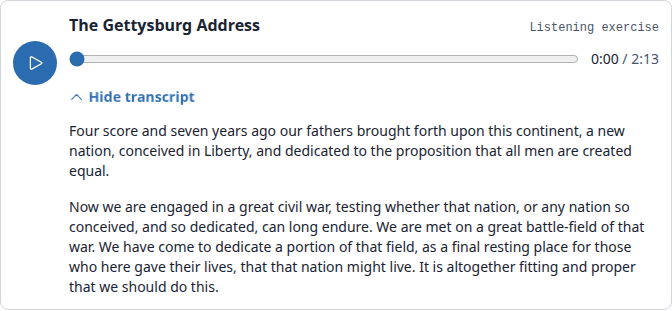
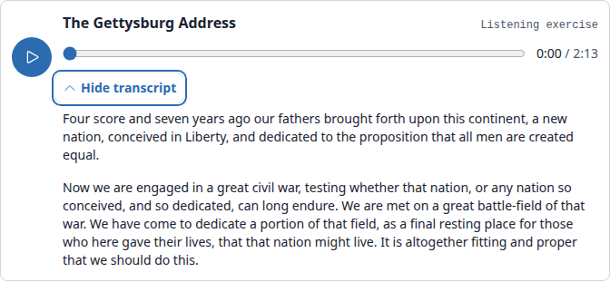

Targeted run after the fix (11686 passed, 1 failed): `test_play_button_sits_in_the_vertical_centre_of_the_clip` failed under xdist load. It passed alone, and the fix changes only a horizontal margin. The cause was test timing: the error-state box was measured while the seek row was still transitioning out. Fixed in commit 20fc7a9c5, which waits for the slider to be hidden before measuring. The audio clip flow file then passed 3/3 with `-n 4`.

## General notes

- Safari (second half of Test 3.7) was not available; skipped.
- Two screenshots (error state at desktop, Test 8) were taken at 1280 width after a fresh tab or re-login reset the viewport; layout was re-checked at 1920 for the error state.
- The dev server answers Range requests with 206, so the no-Range case was simulated with a route returning 200.
- Heroicons maps both loading and retry to arrow-path (pre-existing mapping); loading and error differ by colour and spin only.
- On mobile the clip 1 title truncates early because the kind label does not shrink; this follows the spec and is not a bug.

status: ok · reason: 1 bug — 1 fixed, 0 unresolved; report rendered, screenshots verified
