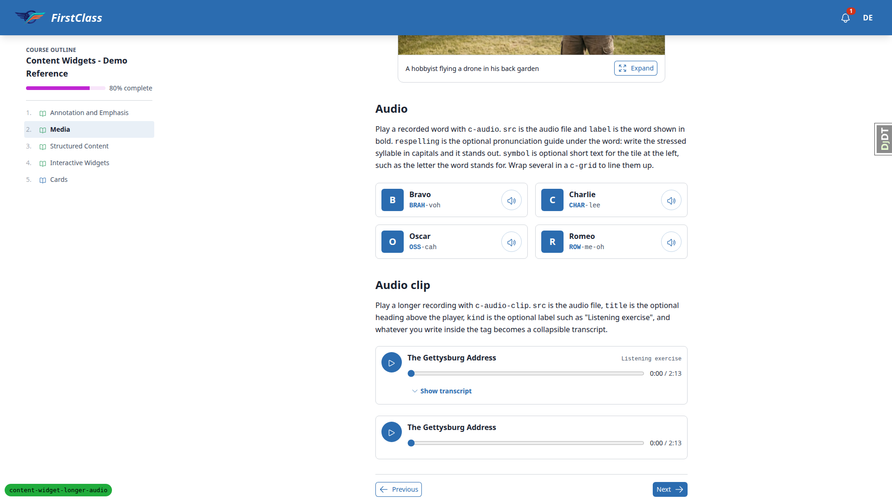
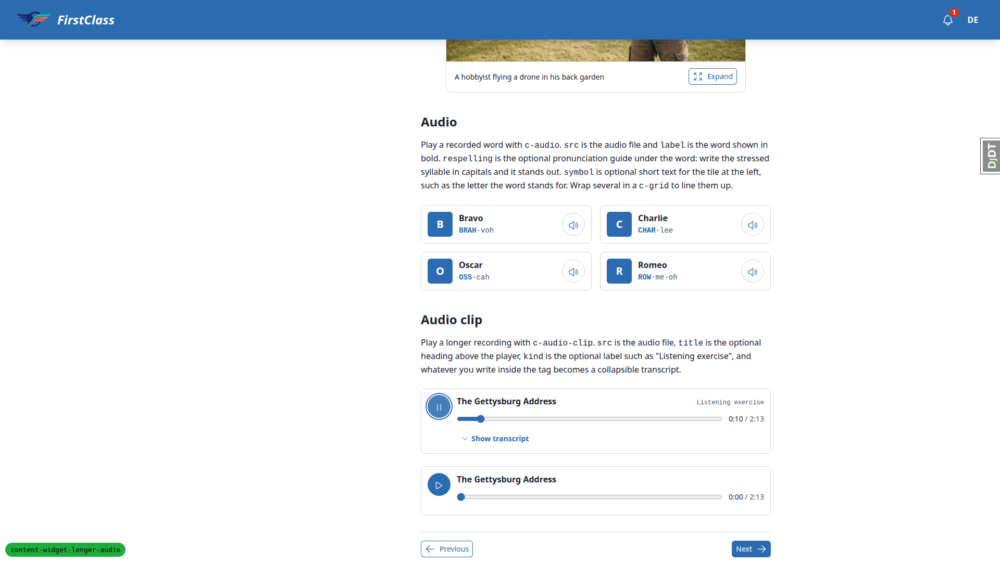
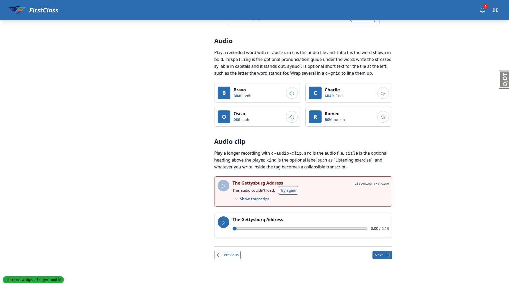

# Frontend QA report: longer audio clip widget (`c-audio-clip`)

Test plan: `3. frontend_qa.md`.

## Methodology

Screenshots were collected into `screenshots/` beside this report, and every image referenced below exists there. The run used the browser at three viewports: desktop 1920x1080, tablet 768x1024 and mobile 375x812. Network blocking and throttling, reduced-motion emulation and touch emulation were used where the plan called for them. Test 8 edited the demo Media topic temporarily; the edit was reverted with `git checkout` and `content_save` was re-run. The run did not abort, so no step was skipped.

## Diff scoping

Class: `FULL`. Changed files that triggered it: `templates/cotton/audio-clip.html`, `static/content_engine/js/alpine-components.js`, the demo content Media topic, `content_save.py`, `models/files.py` and the icons. Nothing was skipped: the desktop, tablet and mobile passes all ran.

## Smoke gate

Outcome: pass. Pages loaded: `/` and `/courses/content-widgets-demo-reference/2/`.

## Design check

No `design` records were written, so no design states were tested as separate rows. The mockups (`image.png`, `image-2.png`, `image-3.png`) were still compared in tests 1.2, 2.2 and 5.1, and those tests passed. They are recorded as test results, not design rows.

## Per-bug sections

### B1: A seek made before the audio is buffered is lost when the media host ignores Range

Manifestations:
- 3.7 (desktop)
- 5.3 (desktop)
- 8.5 (desktop)

Screenshots: none.

Expected: A seek before the first Play, a Try again after a failure, or an arrow-key seek into unbuffered audio starts or continues playback from the chosen position. This must hold when the media response is a plain 200 without Range support, as on the dev server.

Actual: The clip waits in loading for about 5 s and then plays from 0:00. This happens after a seek to 0:20 before Play, and after Try again following a failure at 0:20. ArrowRight +5 s while playing an unbuffered file stays at 0:00. The pending seek is applied on `loadedmetadata`, when the position is not yet seekable, so the browser drops it. Seeking within an already buffered file works (3.1 on clip 2, 2.4).

### B2: Transcript toggle's aria-controls names an id no element has

Manifestations:
- 7.0-controls (desktop)

Screenshots: none.

Expected: The Show transcript button's `aria-controls` equals the transcript panel's id.

Actual: `aria-controls="audio-clip-transcript-1"` while the panel's id is `audio-clip-transcript-2`. The clip's `x-id` lists only `audio-clip-title`, so each `$id('audio-clip-transcript')` call mints a new id.

### B3: Demo Audio clip intro calls the required title optional

Manifestations:
- 1.0-copy (desktop)

Expected: The intro sentence in the widgets demo Media topic's Audio clip section says title is required. A clip without one shows "Audio needs a title".

Actual: It says "title is the optional heading above the player". The sentence is in `demo_content/functionality_demo_content_widgets/2. media/content.md`.

### B4: Course outline column stretches to page height after reloading a scrolled topic page

Manifestations:
- 9.0-shell (desktop)

Expected: On a learner topic page at 1920x1080 the course outline (`dialog.side-panel-dialog`) stays viewport-height and sticky, also after a reload that restores a scrolled position.

Actual: After reloading a scrolled topic page the outline dialog is as tall as the page (1986 px on topic 3, 6716 px on Media, instead of 1004 px). It scrolls away and the left column is empty. A fresh navigation keeps 1004 px. It also happens on topic 3, which has no audio clips, so this branch did not cause it.

## Layout probe

| Test id | Viewport | URL | Screenshot | Result |
|---|---|---|---|---|
| 1.2 | desktop | `/courses/content-widgets-demo-reference/2/` | [page-2026-11-20T22-26-54-024Z.png](screenshots/page-2026-11-20T22-26-54-024Z.png) | clean |
| 1.2 | mobile | `/courses/content-widgets-demo-reference/2/` | [page-2026-11-20T22-37-11-028Z.png](screenshots/page-2026-11-20T22-37-11-028Z.png) | clean |
| 1.2 | tablet | `/courses/content-widgets-demo-reference/2/` | [page-2026-11-20T22-38-12-167Z.png](screenshots/page-2026-11-20T22-38-12-167Z.png) | clean |

## Test results

Passing tests are summarised here. Failing tests are covered by the bugs above.

| Test id | Viewport | Result | Screenshot |
|---|---|---|---|
| 1.2 | desktop | pass | [shot](screenshots/page-2026-11-20T22-26-54-024Z.png) |
| 1.3 | desktop | pass | none |
| 2.1 | desktop | pass | [shot](screenshots/page-2026-11-20T22-27-20-857Z.png) |
| 2.2 | desktop | pass | [shot](screenshots/page-2026-11-20T22-27-32-483Z.png) |
| 2.3, 2.4, 2.5 | desktop | pass | none |
| 3.1-3.6 | desktop | pass | none |
| 3.7 | desktop | fail (B1) | none |
| 4.1-4.4, 4.5 | desktop | pass | none |
| 5.1 | desktop | pass | [shot](screenshots/page-2026-11-20T22-31-39-380Z.png) |
| 5.2, 5.4 | desktop | pass | none |
| 5.3 | desktop | fail (B1) | none |
| 6.1 | desktop | pass | [shot](screenshots/page-2026-11-20T22-36-31-733Z.png) |
| 6.2, 6.3 | desktop | pass | none |
| 7.0-controls | desktop | fail (B2) | none |
| 7.1-7.5 | desktop | pass | none |
| 8.1-8.4 | desktop | pass | [shot](screenshots/page-2026-11-20T22-39-48-667Z.png) |
| 8.5 | desktop | fail (B1) | none |
| 9.0-shell | desktop | fail (B4) | [shot](screenshots/page-2026-11-20T22-27-32-483Z.png) |
| 9.1, 9.2 | desktop | pass | none |
| 1.0-copy | desktop | fail (B3) | [shot](screenshots/page-2026-11-20T22-26-54-024Z.png) |
| 1.2 | mobile | pass | [shot](screenshots/page-2026-11-20T22-37-11-028Z.png) |
| 3.6 | mobile | pass (tap check inconclusive) | none |
| 1.2 | tablet | pass | [shot](screenshots/page-2026-11-20T22-38-12-167Z.png) |

## Data changes

| What changed | Made by | Files written |
|---|---|---|
| Registered demodev@email.com on content-widgets-demo-reference (`qa_register_org_course`) and completed topics 1-4 (`qa_set_item_completion`) so the Media topic opens | `sdd:qa-data-helper` | none |
| Set `duration_seconds` to NULL on the gettysburg.mp3 File row (pk b7d03551-23f9-4232-af7f-052b0a34db3a) for test 8.5; `content_save` then restored it | `sdd:qa-data-helper` | none |

## Bug status

| Bug | Title | Status |
|---|---|---|
| B1 | A seek made before the audio is buffered is lost when the media host ignores Range | **FIXED** (commit: af96b636d) |
| B2 | Transcript toggle's aria-controls names an id no element has | **FIXED** (commit: 1d69117fd) |
| B3 | Demo Audio clip intro calls the required title optional | **FIXED** (commit: dd9c1f67f) |
| B4 | Course outline column stretches to page height after reloading a scrolled topic page | **FIXED** (commit: b8def9f3d) |

Re-verified on the running dev server: seek before Play, Try again and an arrow seek while playing keep the chosen position (0:20, 0:20, 0:05); the transcript toggle's aria-controls resolves to the panel with no duplicate ids; the intro now says title is required; after a reload at the bottom of topics 2 and 3 the outline is 1004 px and sticky, and the account and educator pages keep a 1004 px sidebar.

## General notes

- Test 3.6 at mobile: a single touchscreen tap did not move the thumb. A plain native `<input type=range>` added to the page did not move on a tap in this emulator either, so the tap check is inconclusive here and is not a widget fault. A touch drag worked (0:00 to 1:11) and the touch target is 44 px high.
- Test 3.7 asks for Safari; none was available, so that part was not run.
- Test 8 temporary edits were reverted and `content_save` was re-run. The only console error during test 8 was the 404 for the sanitised `` left in the test transcript.
- B1 may be a dev-server artefact (the dev server answers 200 with no Range support). Triage should decide whether the widget must handle this case. A server that supports Range was not tried.
- B4 is not caused by this branch (it also occurs on topic 3, which has no clips), so triage may decide it belongs outside this spec.
- The console log is at `screenshots/console-2026-11-20T22-24-14-507Z.log`.

status: ok · reason: 4 bugs — 4 fixed, 0 unresolved; report rendered, screenshots verified
