# Frontend QA report: longer audio clip widget (`c-audio-clip`)

Result: every executed test passed. No failing records, no bug records.

## Methodology

- The run executed `3. frontend_qa.md` against the "Content Widgets - Demo Reference" course, Media topic (`/courses/content-widgets-demo-reference/2/`), at desktop (1920x1080), mobile (375x812) and tablet (768x1024).
- Screenshots were collected into `spec_dd/2. in progress/content-widget-longer-audio/screenshots/`. Every image referenced below exists beside this report.
- Pre-step: the branch was rebased onto main. 39 commits were replayed with no conflicts. The lost-change check passed, the targeted tier ran 1602 passed, pre-commit was clean, and the upstream-change review recorded `direction: unchanged`. The force-push was refused by the permission system, so the remote branch is not updated. The todo already has an unticked force-push item for the user.
- The run did not abort. All steps ran.

## Diff scoping

Class: `FULL`. Nothing was skipped. The changed files that triggered it include the widget template (`freedom_ls/content_engine/templates/cotton/audio-clip.html`), Alpine components (`content_engine/static/content_engine/js/alpine-components.js`, `panel_framework/.../shell-components.js`), `tailwind.components.css`, the icon mappings and semantic names, the `File.duration_seconds` model field and migration `0014`, `content_tags.py`, `content_save.py`, the demo content (`2. media/content.md`, `gettysburg.mp3`) and the Playwright tests and fixtures. The rest are docs, skills and spec files. Desktop, mobile and tablet passes all ran.

## Smoke gate

Outcome: pass. Pages loaded: `/` and `/courses/content-widgets-demo-reference/2/`.

## Design check

No design states tested. The plan has no `-design` tests, so no `design` records were produced. The mockups (`image.png`, `image-1.png`, `image-2.png`, `image-3.png`) were compared by eye inside Tests 1, 2 and 5, and each matched.

## Test results

| Test | Viewport | Result | Notes | Screenshot |
|---|---|---|---|---|
| 1.1-1.2 | desktop | pass | Card matches the `c-audio` cards (border rgb(209,213,219), 8px radius, white). Play button 44x44, primary fill, centred. Title bold, one line, ellipsis and title attribute. Kind label is 12px mono, muted and does not shrink; the second clip has none. Total 2:13 matches the 133.3 s duration. Toggle on clip 1 only. | 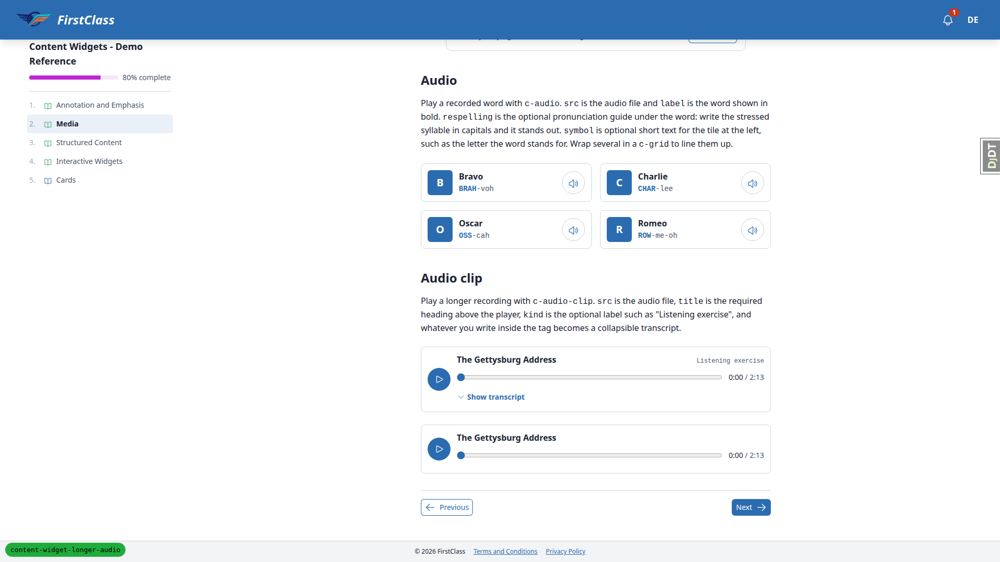 |
| 1.3 | desktop | pass | No `/content/audio/` or `.mp3` request and no `<audio>` element before Play; totals show. | |
| 2.1 | desktop | pass | Throttled Play shows a spinning loading icon. The button stays 44x44 and has no focus ring after a click. See the observations about the icon mapping. |  |
| 2.2 | desktop | pass | Pause icon centred. Elapsed counts one per second. Title stays on one line. Total stays 2:13. Primary fill on the played part. | 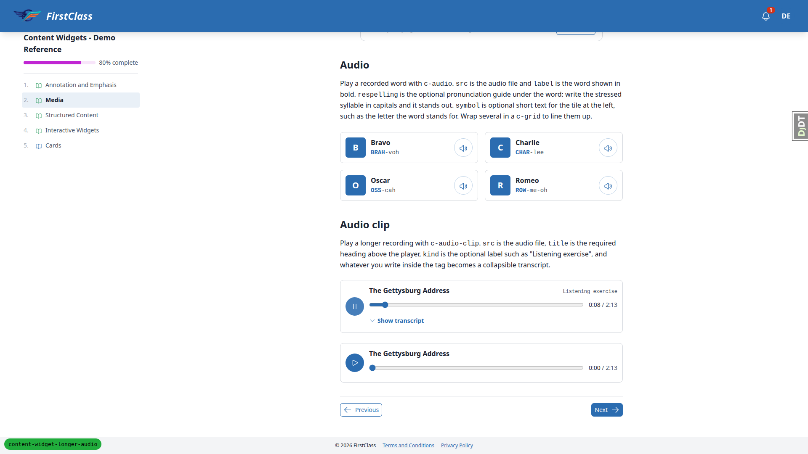 |
| 2.3 | desktop | pass | Pause holds the time (0:24). Resume continues from there. | |
| 2.4 | desktop | pass | Playing to the end returns to 0:00 with the play icon and `aria-pressed` false. The next press plays from the start. | |
| 2.5 | desktop | pass | On an uncached load a drag near the end was dropped and the bar followed the sound. One side observation, see General notes. | |
| 2.6 | desktop | pass | With reduced motion the loading animation is `none`. | |
| 3.1 | desktop | pass | Seek before Play: 0:39 mid-drag, 1:06 at release. Play starts at 67.8 s. | |
| 3.2 | desktop | pass | Drag while playing does not jump back. Playback continues from the release point. | |
| 3.3-3.4 | desktop | pass | Click at 90% jumps to 2:01 and stays paused. The right edge reads 2:13. | |
| 3.5 | desktop | pass | Focus ring on the seek bar. Right is +5 s, Left is -5 s, End is 2:13, Home is 0:00. | 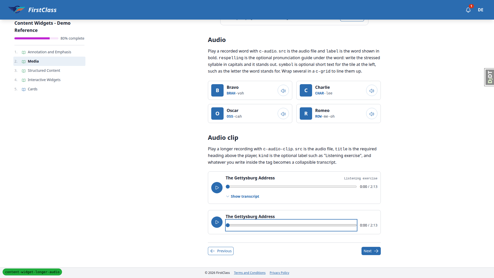 |
| 3.6 | mobile | pass | Touch drag and tap work. The seek touch target is 44px high. | |
| 3.7 | desktop | pass | Cached file: a drag to 97% while playing lands at 2:12 without restarting. | |
| 4.1-4.4 | desktop | pass | Never more than one un-paused audio element. Clip 1 resumes at 0:02. Bravo returns to its speaker icon. | |
| 4.5 | desktop | pass | Charlie plays and a second press stops it. | |
| 5.1-5.4 | desktop | pass | Error border and tint, red retry button 44x44 and centred, status "This audio couldn't load.", title wraps, transcript toggle works. A retry while blocked re-announces. An unblocked retry resumes at 0:19 and the state clears. Name is "Try again: The Gettysburg Address". | 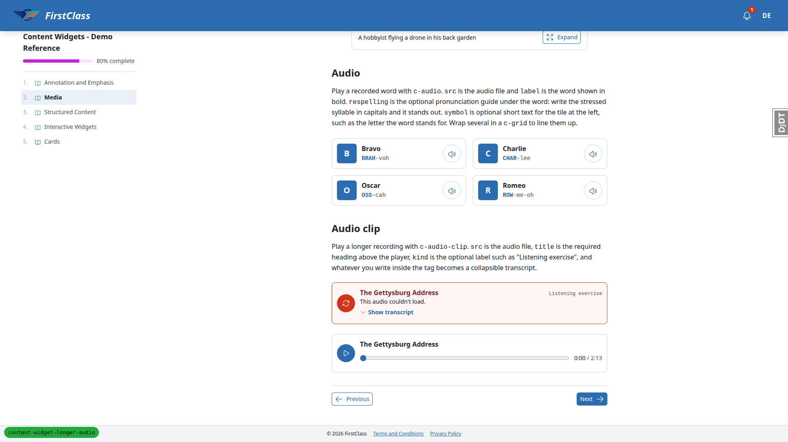 |
| 6.1-6.3 | desktop | pass | Animated open (301px mid, 412px settled). Label and chevron flip. No border or ring after a click. Three paragraphs. Reduced motion opens at once. Tab, Enter and Space work. | 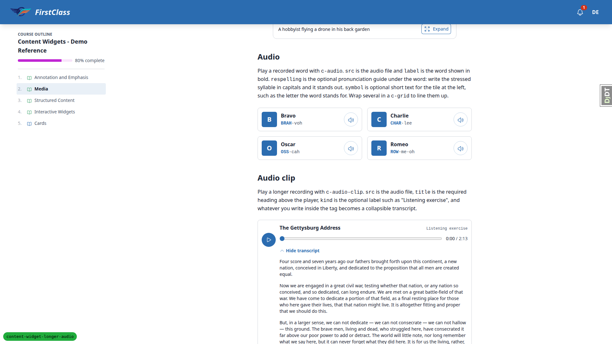 |
| 7.1-7.5 | desktop | pass | `role=group` labelled by the title. Names, `aria-pressed`, `aria-valuetext` and `aria-hidden` time are correct. No duplicate ids. | |
| 8.1-8.4 | desktop | pass | Red boxes for missing file, non-audio path and missing title. The XSS probe is neutralised and no dialog fired. | 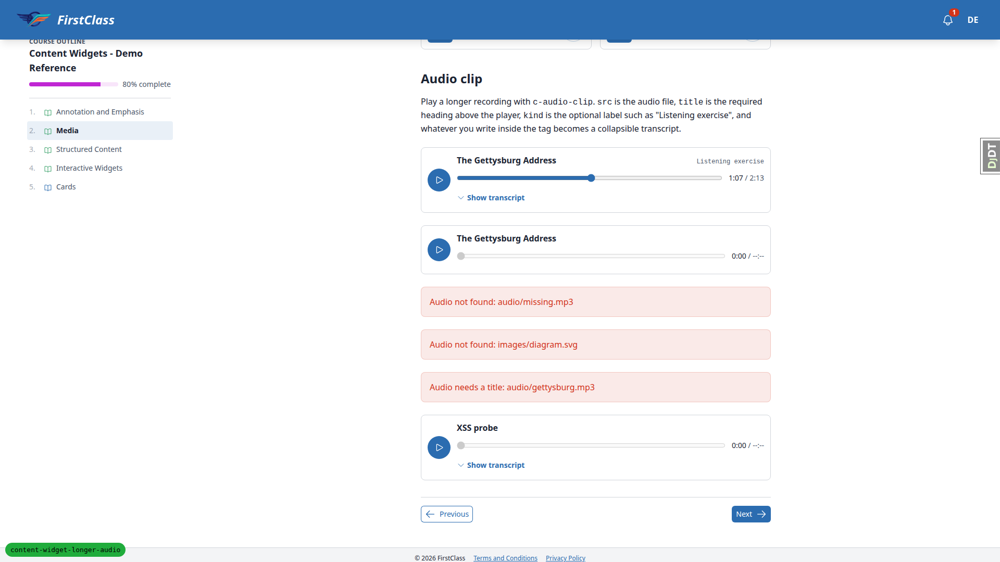 |
| 8.5 | desktop | pass | Null duration shows `--:--` and a disabled seek bar. After Play the total is 2:13 and the seek works. |  |
| 9.1 | desktop | pass | The Media topic renders as before, with no horizontal overflow. | 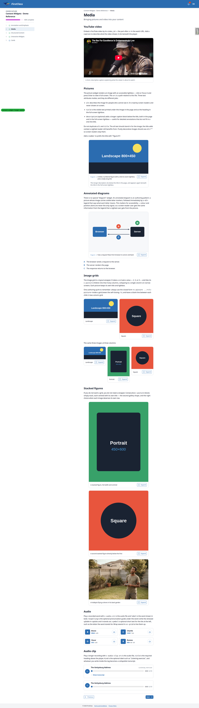 |
| 9.2 | desktop | pass | Navigating away stops the audio. | |
| 1.2 | mobile | pass | 375px: no horizontal scroll, time text inside the card, long title ellipsised with the kind kept. | 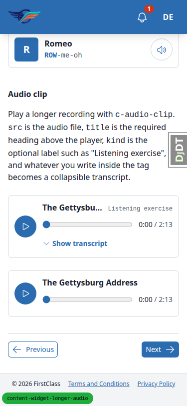 |
| 2.2 | mobile | pass | Playing at 375px: no overflow, one-line title. | 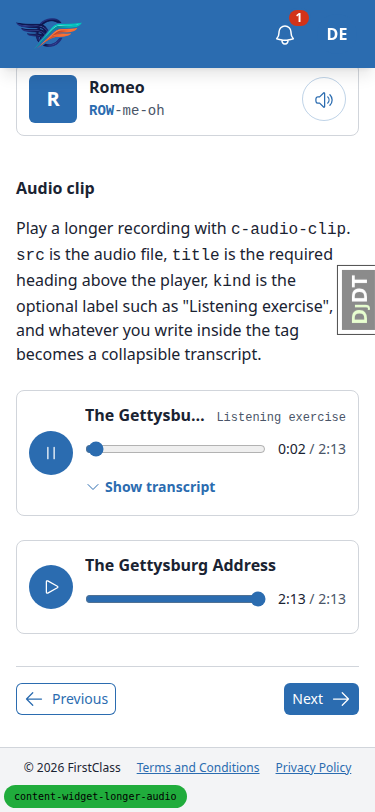 |
| 5.1/6.1 | mobile | pass | Error state with the transcript open fits, the title wraps over two lines, no overflow. | 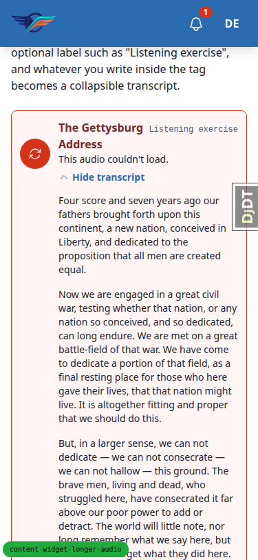 |
| 2.2 | tablet | pass | 768px: single column, no overflow. | 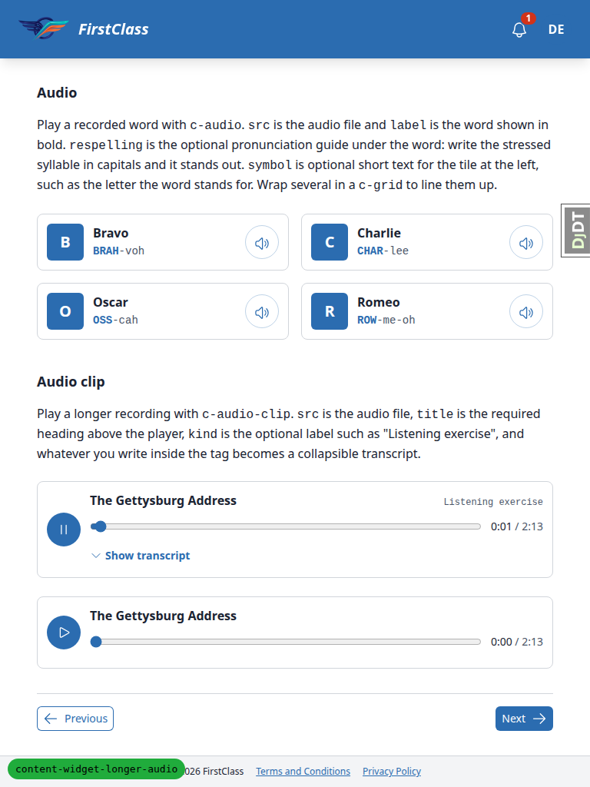 |
| 5.1 | tablet | pass | Error state fine, clip 2 unaffected. | 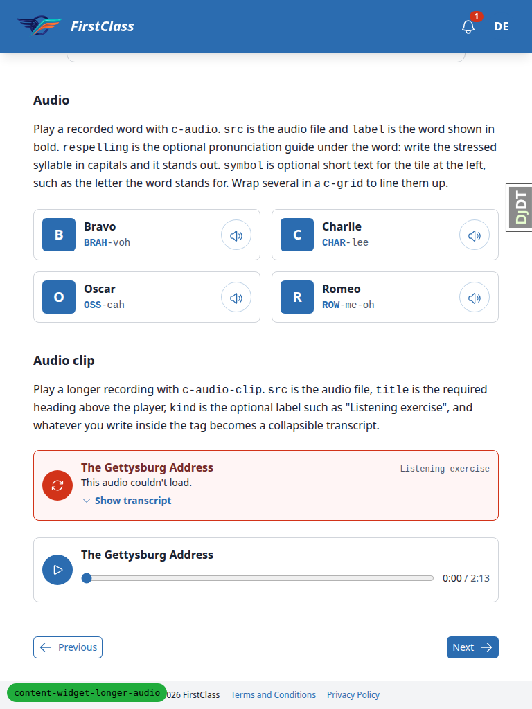 |

## Layout probe

All rows are clean.

| Test | Viewport | URL | Screenshot | Result |
|---|---|---|---|---|
| 1 | desktop | /courses/content-widgets-demo-reference/2/ |  | clean |
| 3.5 | desktop | /courses/content-widgets-demo-reference/2/ |  | clean |
| 5 | desktop | /courses/content-widgets-demo-reference/2/ |  | clean |
| 6 | desktop | /courses/content-widgets-demo-reference/2/ |  | clean |
| 8 | desktop | /courses/content-widgets-demo-reference/2/ |  | clean |
| 1 | mobile | /courses/content-widgets-demo-reference/2/ |  | clean |
| smoke | mobile | /courses/content-widgets-demo-reference/2/ | 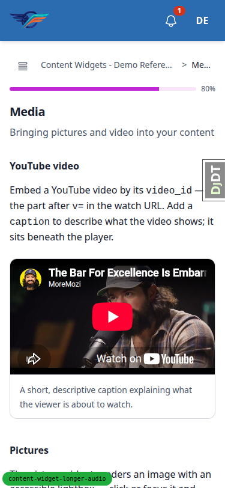 | clean |
| 2 | mobile | /courses/content-widgets-demo-reference/2/ |  | clean |
| 5 | mobile | /courses/content-widgets-demo-reference/2/ |  | clean |
| 2 | tablet | /courses/content-widgets-demo-reference/2/ |  | clean |
| 5 | tablet | /courses/content-widgets-demo-reference/2/ |  | clean |

## Data changes

| What changed | Made by | Files written |
|---|---|---|
| Test 8 only: temporarily appended four authoring-error clips (missing src, `images/diagram.svg`, no title, XSS probe transcript) to `demo_content/.../2. media/content.md` and ran `content_save`. Also set the gettysburg `File` `duration_seconds` to null (pk `b7d03551-23f9-4232-af7f-052b0a34db3a`). Both were reverted afterwards and the content is back to two clips (confirmed in Test 9.1). | `sdd:qa-data-helper` | none left behind |

## Bug status

No bug records were produced and no test failed, so there are no bugs to track. Nothing is `UNRESOLVED`.

## General notes

- Nothing in the plan was skipped. Safari is out of scope per Test 3.7.
- The heroicons pack maps both `loading` and `retry` to `arrow-path`, so the loading and error states show the same circling arrows. This predates this branch. The spec asks for the `loading` icon, so the widget is correct. The icon pack is the cause.
- Test 2.5 observation, outside the plan's scenario. A throttle was left on by mistake. A seek past the buffered part then kept the bar frozen at 2:11 with Pause showing for over 20 s while the slow download continued, because `pendingSeek` blocks `timeupdate` until the file is fully loaded. This is only reachable on a host that ignores Range over a slow link. The dev server does this, but production storage honours Range.
- On tablet, the dev-only branch badge (fixed bottom-left) sits over the start of the footer text. This is dev tooling and not part of the page.
- The console showed no JavaScript errors. The only errors were the requests blocked on purpose in Test 5.

status: ok · reason: report rendered, 0 bugs documented
