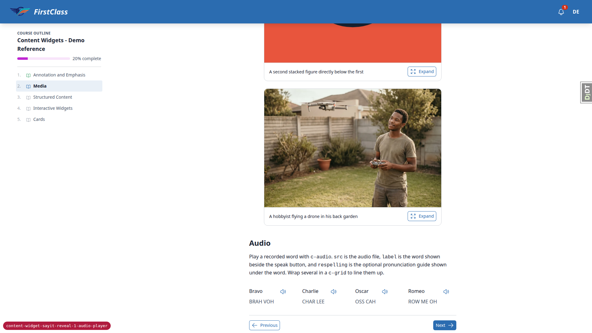
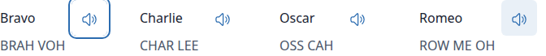
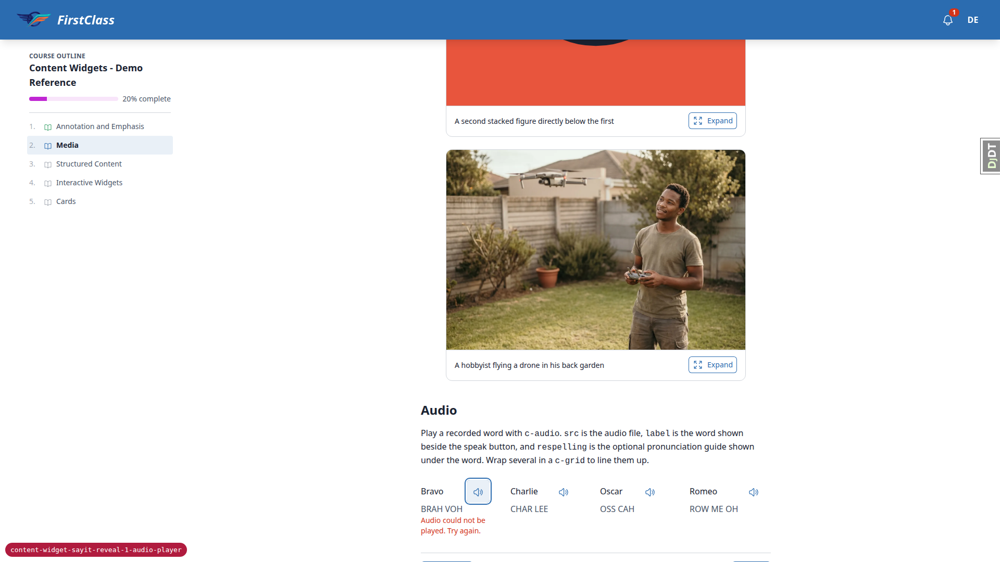
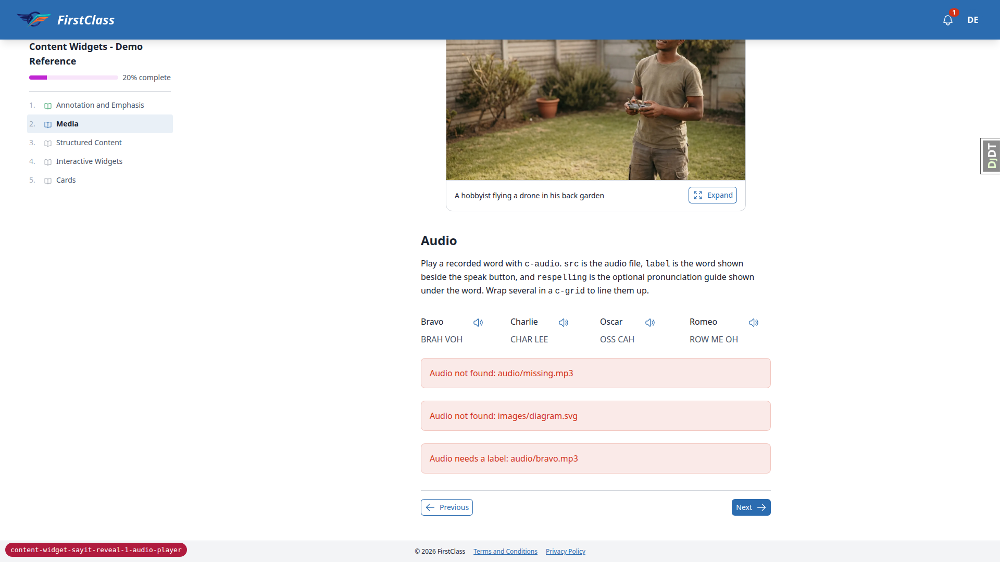
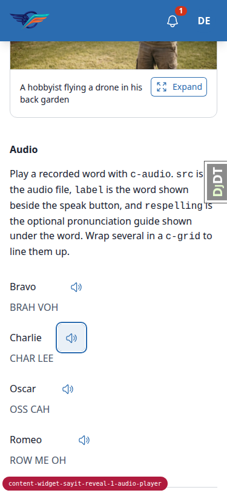
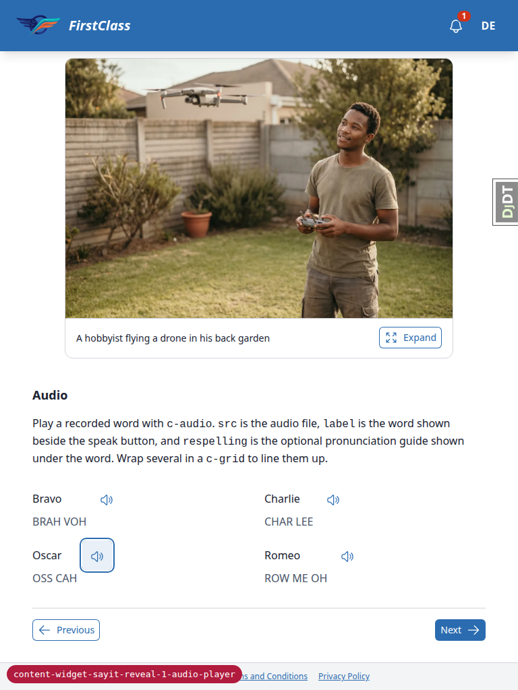
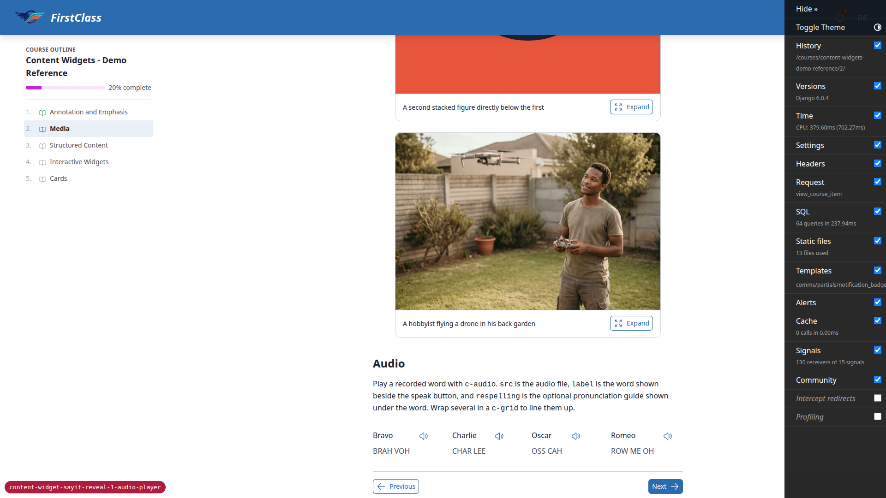

# Frontend QA report: audio player widget (`c-audio`)

## Methodology

Manual run with Playwright MCP against a dev server on its own port, logged in as the QA admin. The learner view of the Media topic at `/courses/content-widgets-demo-reference/2/` was tested at desktop 1920x1080, tablet 768x1024 and mobile 375x812. Screenshots were collected into `screenshots/` beside this report, and every referenced image exists there. Screenshot compression ran and found nothing over the size limit.

## Diff scoping

- Class: FULL.
- Triggering changed files (front-end templates and static): `freedom_ls/content_engine/templates/cotton/audio.html` and `freedom_ls/content_engine/static/content_engine/js/alpine-components.js`. Other changed files include `content_engine/views.py` and `urls.py` (the audio redirect), the icon mappings, the CSP settings, the demo content (`2. media/content.md` and four mp3 files with `LICENCES.txt`), and tests.
- Nothing was skipped.

## Smoke gate

Pass. Pages checked: `/` and `/courses/content-widgets-demo-reference/2/`. No failure URL or reason.

## Design check

No design states tested.

## Results

| Test | Viewport | Status | Notes | Screenshot |
|---|---|---|---|---|
| 1.1 | desktop | pass | Four items in a 4-column grid (Bravo, Charlie, Oscar, Romeo). Word and 44x44 speaker button on one line, respelling on a second line in muted text, no per-item border or background. The debug toolbar was open in the first shot, so it was retaken with the toolbar hidden. |  |
| 1.2 | desktop | pass | On reload with request recording, no request went to `/content/audio/` or any `.mp3` before a press. The only `/media/` requests were the picture-section images. | none |
| 2.1-2.6 | desktop | pass | Bravo showed a spinner at press, then a stop icon with aria-pressed=true at 400 ms, and the word x position did not change. Pressing Charlie returned Bravo to idle at once, and pressing Charlie again stopped it. Oscar returned to idle on its own at the end. Five rapid presses on Romeo settled to idle with no error line. Each press requests `/content/audio/<uuid>/`, which answers 302 to the media file with `Cache-Control: max-age=0, no-cache, no-store, must-revalidate, private`. | none |
| 3.1-3.3 | desktop | pass | Tab focus shows the button focus ring. Enter plays (aria-pressed true) and Space stops (false), with focus staying on the button. The accessible name is "Play pronunciation of Bravo" in every state, and aria-describedby names the respelling element (BRAH VOH). |  |
| 4.1-4.4 | desktop | pass | With `/content/audio/` and `/media/` aborted, the button returned to the speaker icon, aria-pressed was false and the button stayed enabled. "Audio could not be played. Try again." showed in error colour. There was one blocked request and no automatic retry over 3 s. After unblocking, the next press played and hid the error line. See general note 2 about blocking `*/media/*` alone. |  |
| 5.1-5.3 | desktop | pass | Using a temporary demo edit (reverted with git checkout and content_save afterwards), the red boxes read "Audio not found: audio/missing.mp3", "Audio not found: images/diagram.svg" and "Audio needs a label: audio/bravo.mp3". |  |
| 6.1-6.3 | desktop | pass | The `data-src` `/content/audio/<bravo uuid>/` answers 302 both signed in and in a fresh anonymous context. Followed, it serves audio/mpeg (22821 bytes). Changing the last UUID character gives 404. | none |
| 7.1 | desktop | pass | Sections above Audio render as before, and the first picture's Expand button opens its lightbox dialog. |  |
| 1.1, 2.1 | mobile | pass | At 375 px the grid is one column and scrollWidth equals clientWidth. Word and 44x44 button are on one line for every item, and pressing Charlie plays (aria-pressed true). |  |
| 1.1, 2.2 | tablet | pass | At 768 px there are two columns and no horizontal overflow, with word and button on one line. Pressing Bravo then Oscar leaves only Oscar pressed. |  |
| 8.1-8.2 | desktop | skip | Needs real iPhone/Android hardware and VoiceOver or NVDA, which the automated run does not have. | none |

## Bugs

No bugs found.

## Layout probe

| Test | Viewport | URL | Screenshot | Result |
|---|---|---|---|---|
| 1.1 | desktop | `/courses/content-widgets-demo-reference/2/` |  | clean |
| 1.1 | mobile | `/courses/content-widgets-demo-reference/2/` |  | clean |
| 1.1 | tablet | `/courses/content-widgets-demo-reference/2/` |  | clean |

## Data changes

| Via | What |
|---|---|
| DB drop, DB create, Migrate | Rebuilt the empty per-branch dev database after content_save found no DemoDev site. |
| sdd:qa-data-helper | Ran `create_demo_data --yes` (DemoDev site, demodev@email.com admin, learners) and `content_save ./demo_content DemoDev`. Registered the admin on Content Widgets - Demo Reference and completed item 1 so Media unlocks. |

## Bug status

No bugs.

## General notes

1. Test 8 (real iPhone/Android, VoiceOver/NVDA) was not run: it needs hardware and a screen reader. It is filed for the human tester.
2. Test 4: blocking `*/media/*` only fails a word that has not played before in the tab. After one play, Chromium serves the mp3 from its HTTP cache. Blocking the `/content/audio/` redirect (no-store) reproduces the failure reliably. The QA plan's step 4.1 could say so.
3. Layout: each widget is a two-column grid (word and respelling in one column, button in the next), so the button sits after the wider of word and respelling. In the one-column phone list the buttons do not line up vertically (Bravo, Oscar and Romeo buttons sit at different x). This matches the spec documents (word and button on one line, respelling below, reading order word-respelling-button) and is recorded as an observation, not a bug.
4. Demo recordings: durations are Bravo 2.8 s and Charlie/Oscar/Romeo about 0.5 s. Playback state transitions behaved correctly for all four, but the audio content was not listened to (headless browser).
5. The YouTube embed logs a permissions-policy console error ('compute-pressure') and two warnings on the Media page. These come from the existing YouTube widget, not the audio widget. No console errors came from `c-audio`.

status: ok · reason: report rendered, 0 bugs documented
