# Frontend QA report: say it, then reveal (`c-audio-reveal`)

## Methodology

- Server: this branch's dev server on port 8352; the branch badge confirmed the branch. Logged in as the QA admin.
- Viewports: desktop 1920x1080 (per the QA command; the plan names 1280px), mobile 375, 320 (Test 7) and tablet 768.
- Screenshots were collected into `screenshots/` beside this report. Every referenced image exists there. Compression ran and nothing was over the size limit.
- Tests 1-6 and 8 ran in the educator course content preview, because the course is `coming_soon` for learners.
- The run did not abort at the smoke gate, so every step ran.

## Diff scoping

Class: **FULL**. Changed files that triggered it: `audio-reveal.html`, `alpine-components.js`, `cotton/*.html`, `markdown_rendering/*.py`, `config/settings_base.py`, the demo content for "4. interactive-widgets", plus docs, plugins and tests. Nothing was skipped; desktop, tablet and mobile passes all ran.

## Smoke gate

Pass. Pages loaded: `/` and the educator Interactive Widgets course content preview (`/educator/organisations/demodev/courses/8bc127c1-edf1-4997-b7fc-35fdf8604f30`).

## Results

| Test | Viewport | Result | Screenshot | Notes |
|---|---|---|---|---|
| 1 | desktop | pass | 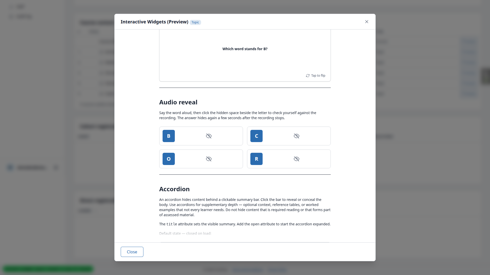 | Intro paragraph; 4 cards B/C/O/R in 2 columns, tile only, muted eye-closed icon, pointer cursor, 74px card. No `/content/audio/` or `.mp3` request on load. Answer region invisible, inert and aria-hidden; `aria-expanded=false`; `aria-controls` matches the answer id. Tab reaches only the 4 reveal buttons. |
| 2 | desktop | pass | 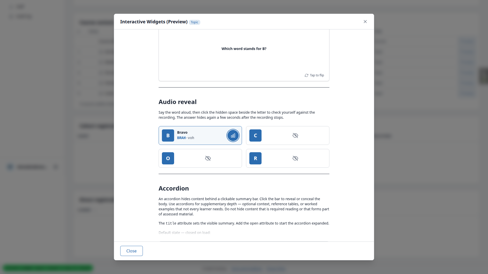  | Reveal shows bold Bravo, BRAH-voh with BRAH bold primary, round play button; card height stays 74px. Plays at once, filled primary play button with playing icon, primary border, `aria-expanded=true`. Play while playing stops; again restarts. Hides about 5s after the clip ends (idle 3.4s, hidden 8.3s), never mid-clip. Replay within 5s restarts the countdown. Re-reveal plays again. |
| 3 | desktop | pass | none | Revealing C while B plays stops B (stays revealed, hides ~5s later) and C plays. B's play while C plays stops C. Flashcard `c-audio` stops when O is revealed. Clips return to the speaker icon at the end; answers hide ~5s later. |
| 4.1-4.4 | desktop | pass |  | Visible 2px primary focus ring. Enter reveals and plays; focus moves to "Play pronunciation of Bravo". After auto-hide focus returns to the reveal button. Space reveals and plays. Live status holds "Bravo" while revealed, empty when hidden. |
| 4.5 | desktop | skip | none | Needs VoiceOver/NVDA, which the automated browser does not have. DOM supports it: sr-only `role=status` holds the label only while revealed; tile letter is not aria-hidden. |
| 5 | desktop | pass | 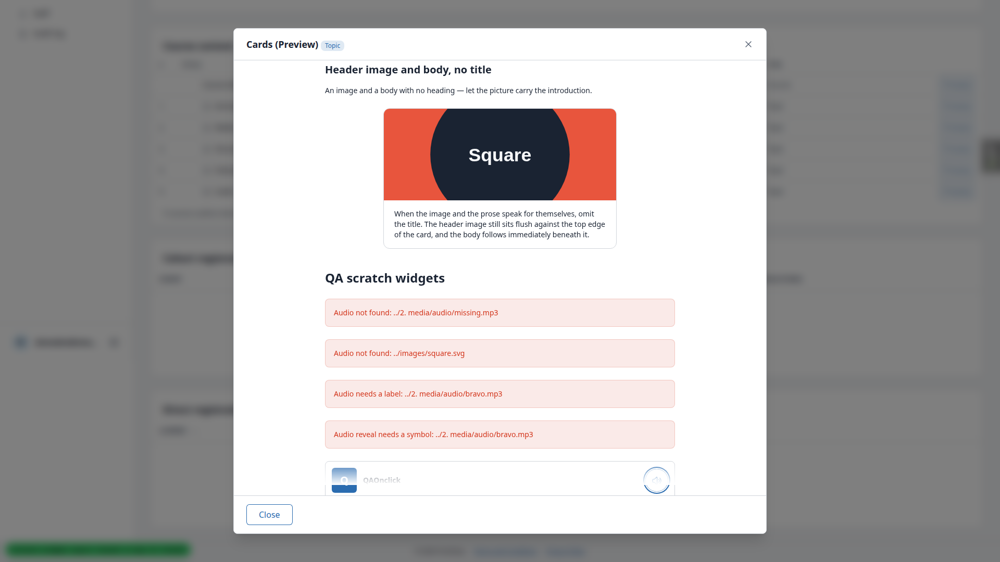 | Media blocked: reveal R still shows the answer and "Audio could not be played. Try again." in the error colour (rgb 210,51,25). Unblock and play: plays, error clears. Scratch topic: missing.mp3 and an image src give "Audio not found"; no label gives "Audio needs a label"; no symbol gives "Audio reveal needs a symbol"; each in a red box. `onclick=alert(1)` stripped, no alert. Only console error was the deliberately blocked request. |
| 6 | desktop | pass | 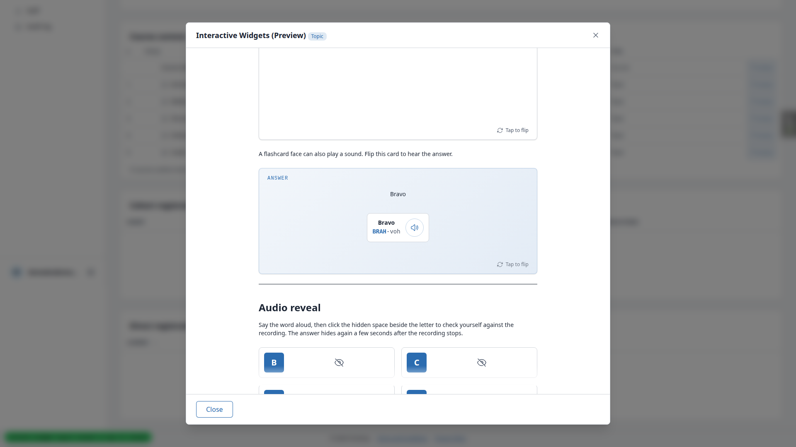 | Tab order before flip: previous card's Flip, this card's Flip, "Reveal answer for B"; back-face play never focused (inert). Front prose click flips. Answer face has prose "Bravo" and a `c-audio` card on an opaque white surface with respelling. Play on the answer face does not flip back; answer-face prose click flips back. Respelling contrast 7.53:1 (#4a5568 on #fff), stressed syllable 5.42:1. The app has no dark theme (emulated dark and `data-theme=dark` change nothing), so the dark half of 6.6 is N/A. All 3 flashcards flip; table and pre scroll as before. |
| 8 | desktop | pass |  | Reveal B plays and hides ~5s after the clip ends. Switching topic mid-clip pauses the shared audio element (paused true, 1 pause call); no page errors. Returning: all four reveals hidden. |
| 9.1 | desktop | pass | none | Media topic: four `c-audio` cards with tiles; play, switch, stop, error line and retry all work. |
| 9.2-9.3 | desktop | pass | 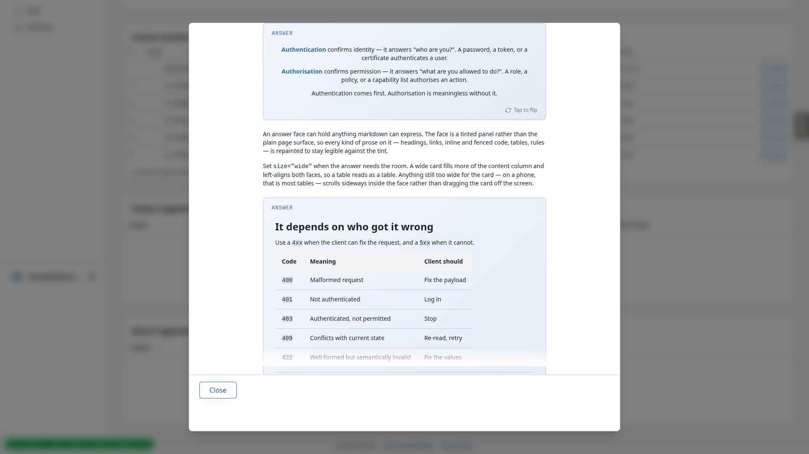 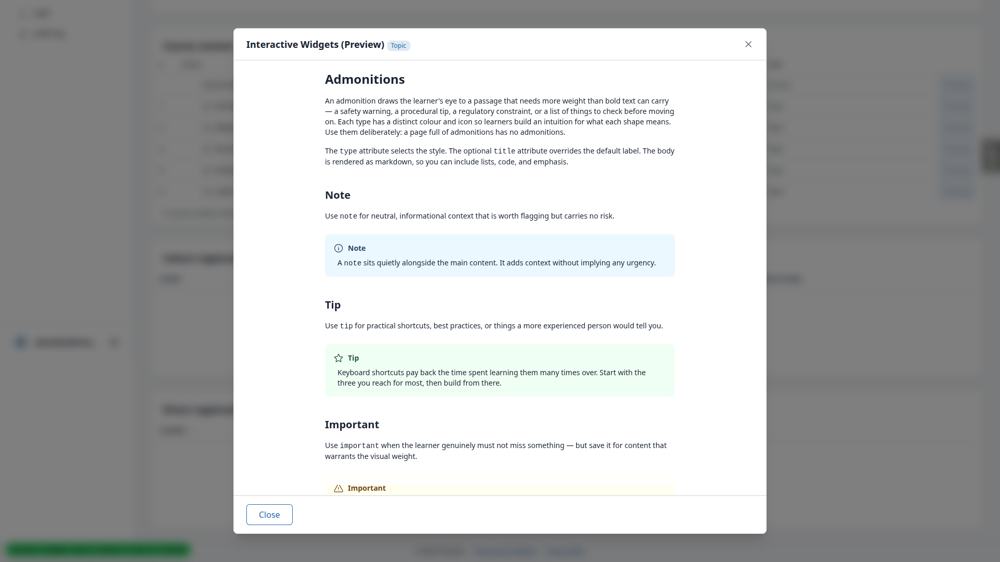 | All 5 topics previewed with flashcards flipped and accordions opened: no raw `**`, `\|---\|`, `- ` lines or `markdown="1"` text; no `<script>`, `on*` attributes or `javascript:` URLs. Structured Content: 2 c-tables with caption and overflow-x wrapper. Admonitions show icon/title/body; checklist has 4 disabled checkboxes. 3 pull-quote blockquotes. Console: only unrelated htmx "web-share" and YouTube "No available adapters" warnings. |
| 9.4 | desktop | pass | 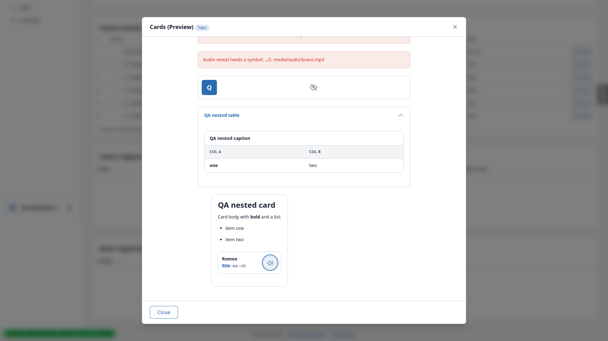 | `c-table` inside `c-accordion` keeps caption and bordered overflow-x wrapper with styled header and bold cell. `c-audio` inside `c-card` inside `c-grid`: card markdown body renders and audio plays. |
| 1 | mobile 375 | pass | 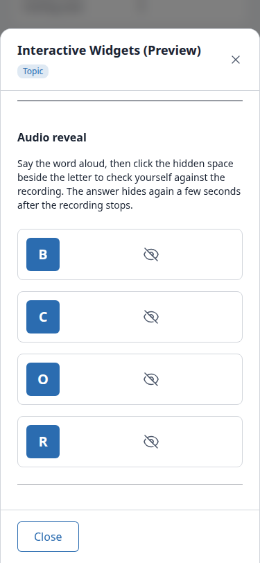 | One column; cards 325px wide, 74px tall; reveal control 44px tall inside each card; no horizontal overflow. |
| 2 | mobile 375 | pass | 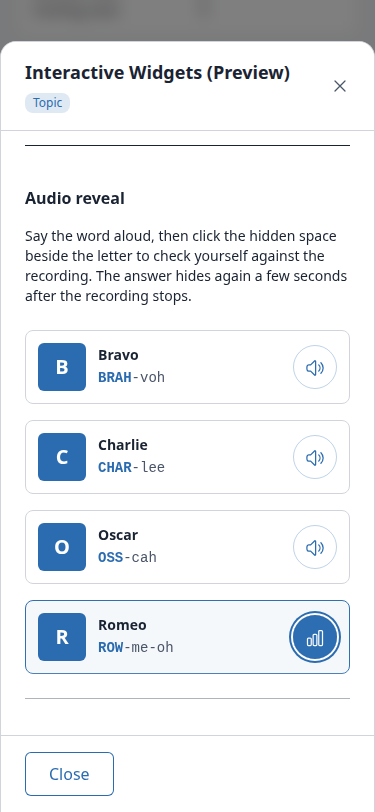 | All four revealed; word, respelling and play button fit; card height 74px; R playing shows filled primary button and border; no overflow. |
| 7 | mobile 320 | pass | 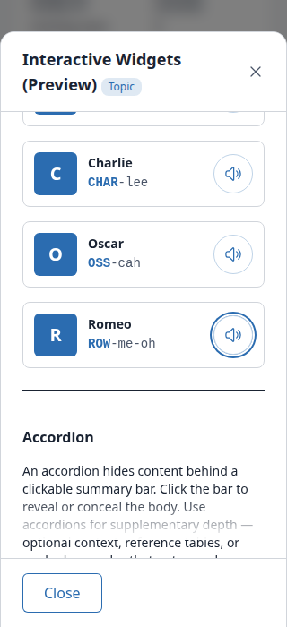 | All four revealed and audio flashcard flipped. No document or modal horizontal scroll; no card overflow; each reveal control 44px tall inside its card. |
| 10 | mobile | skip | none | Needs physical iOS Safari and Android Chrome; not possible from the automated browser. |
| 1-2 | tablet 768 | pass | 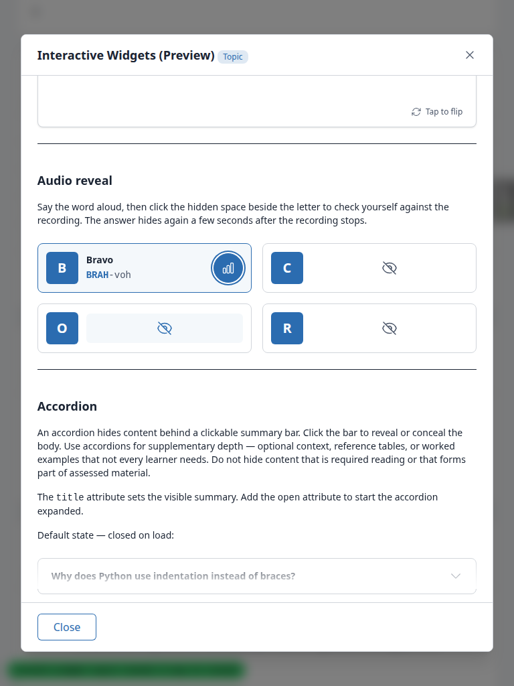 | Two columns (cards 320px wide, 74px tall), no overflow. B revealed and playing: filled primary button, primary border, height unchanged. O shows the hover tint (pointer resting there), as designed. |
| 9.2 | tablet 768 | pass | 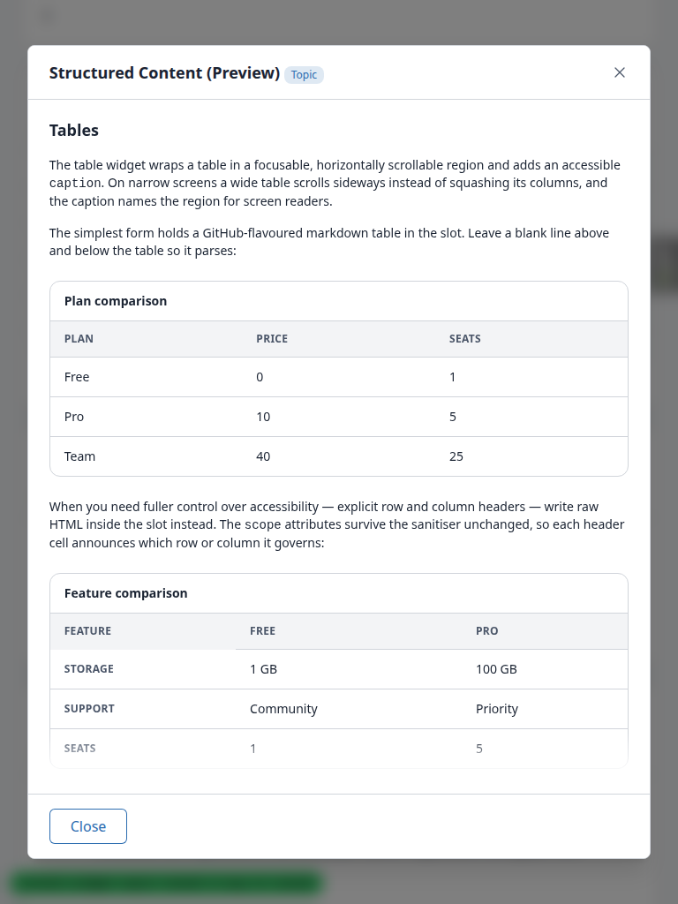 | Structured Content: both c-tables keep caption, bordered rounded wrapper and styled header; fit their wrapper; no overflow. |

## Design check

No design states tested (the plan names no design screenshots).

## Layout probe

| Test | Viewport | URL | Screenshot | Result |
|---|---|---|---|---|
| 1 | desktop | `/educator/organisations/demodev/courses/<course>` (Interactive Widgets preview) |  | clean |
| 1 | mobile 375 | `/educator/.../courses/<course>` (Interactive Widgets preview) |  | clean |
| 7 | mobile 320 | `/educator/.../courses/<course>` (Interactive Widgets preview, 320px) |  | clean |
| 1-2 | tablet 768 | `/educator/.../courses/<course>` (Interactive Widgets preview) |  | clean |
| 9.2 | tablet 768 | `/educator/.../courses/<course>` (Structured Content preview) |  | clean |

## Data changes

| What changed | Call or command | Files written |
|---|---|---|
| QA scratch widgets appended to the Cards topic in the dev DB for Tests 5.3/5.4/9.4, then restored by re-running `content_save ./demo_content DemoDev` | dev DB edit, then `content_save ./demo_content DemoDev` | none |

## Bug status

No bugs were found. No test failed, so there are no bug records and no per-bug sections.

## General notes

- Not tested: Test 4.5 (screen reader; needs VoiceOver/NVDA) and Test 10 (physical iOS Safari / Android Chrome devices). Both need a human. The dark-theme half of Test 6.6 is N/A because the app has no dark theme.
- Desktop was run at 1920x1080 rather than the plan's 1280px.
- Observation (not a failure): the reveal button's accessible name is "Reveal answer for <symbol>" (for example "Reveal answer for B"). This was changed deliberately in commit c5a791f9a ("reveal button is named after its symbol"). `spec.md`, `plan.md` and the QA plan still say "Reveal answer", so those spec documents could be updated to match.
- Observation: the demo clips for C, O and R are about 0.5s long (B is 2.8s). That makes the "while C plays" checks in Test 3 very short for a human tester.

status: ok · reason: report rendered, 0 bugs documented
