# QA report: say it, then reveal (`c-audio-reveal`) and widgets nested in slot widgets

## Methodology

Test plan: `3. frontend_qa.md`. Screenshots were collected into `screenshots/` beside this report, and every image linked below exists there. The run went through the educator course content preview, because the "Content Widgets - Demo Reference" course is `coming_soon` for the learner. The smoke gate passed, so no step was skipped because of an abort.

## Diff scoping

Class: FULL. Changed files that triggered it: `templates/cotton/*`, `alpine-components.js`, `markdown_utils.py`, and the `demo_content` interactive-widgets topic. Nothing was skipped: desktop, tablet and mobile passes all ran. Tests 4.5 and 10 were skipped for needing a human or a physical device (see General notes).

## Smoke gate

Outcome: pass. Pages loaded: `/` and the educator course preview for the Interactive Widgets topic, `/educator/organisations/demodev/courses/8bc127c1-edf1-4997-b7fc-35fdf8604f30`.

## Design check

No design states tested.

## Bug B1: Reveal/Hide toggle changes width with its label, shifting the button and widening the card

Manifestations:
- Test 2.1, desktop

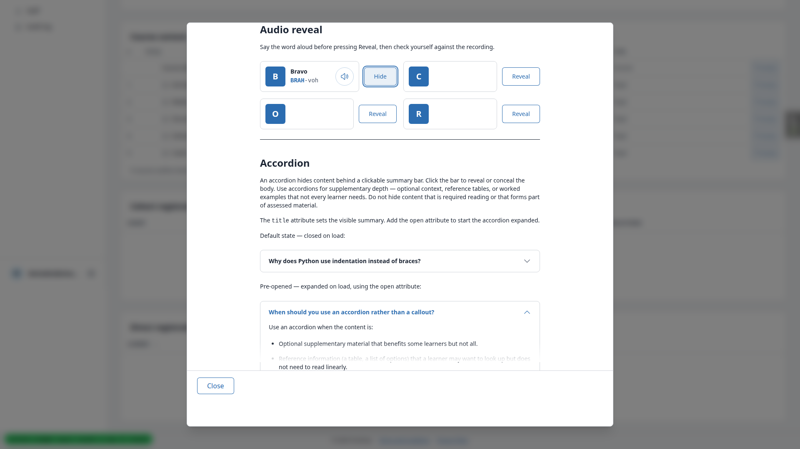
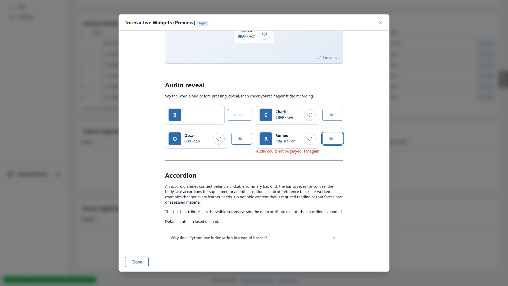

Expected: from the `sm:` breakpoint up, revealing or hiding leaves the toggle's box and the card's width unchanged. Nothing on the page moves: the card does not grow and the button stays where it was.

Actual: at 1920px the toggle is 91px wide reading "Reveal" and 79px reading "Hide". On reveal it moves 13px right and the `flex-1` card grows from 225px to 238px. Revealed rows no longer line up with hidden ones. The other Test 2.1 behaviour passed: the answer and play button show, the clip plays at once, and `aria-expanded` is true.

## Layout probe

| Test id | Viewport | URL | Screenshot | Result |
|---|---|---|---|---|
| 1.1 | desktop | /educator/organisations/demodev/courses/8bc127c1-edf1-4997-b7fc-35fdf8604f30 | 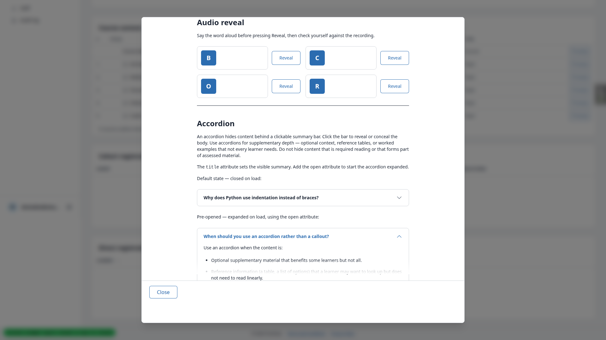 | clean |
| 7.1 | mobile (320px) | /educator/organisations/demodev/courses/8bc127c1-edf1-4997-b7fc-35fdf8604f30 | 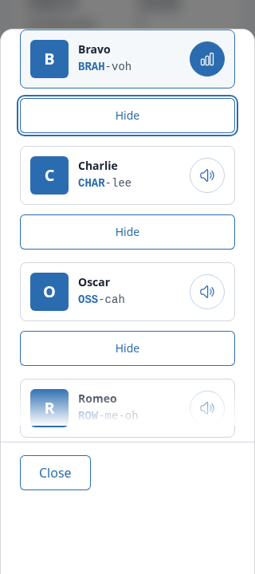 | clean |
| 1.1 | mobile (375px) | /educator/organisations/demodev/courses/8bc127c1-edf1-4997-b7fc-35fdf8604f30 | 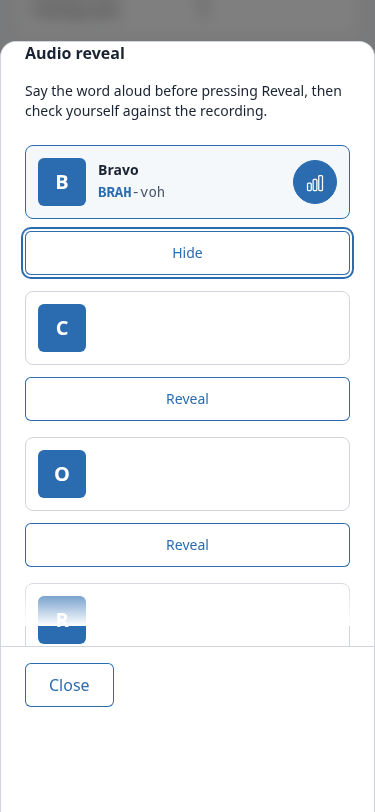 | clean |
| 1.1 | tablet (768px) | /educator/organisations/demodev/courses/8bc127c1-edf1-4997-b7fc-35fdf8604f30 | 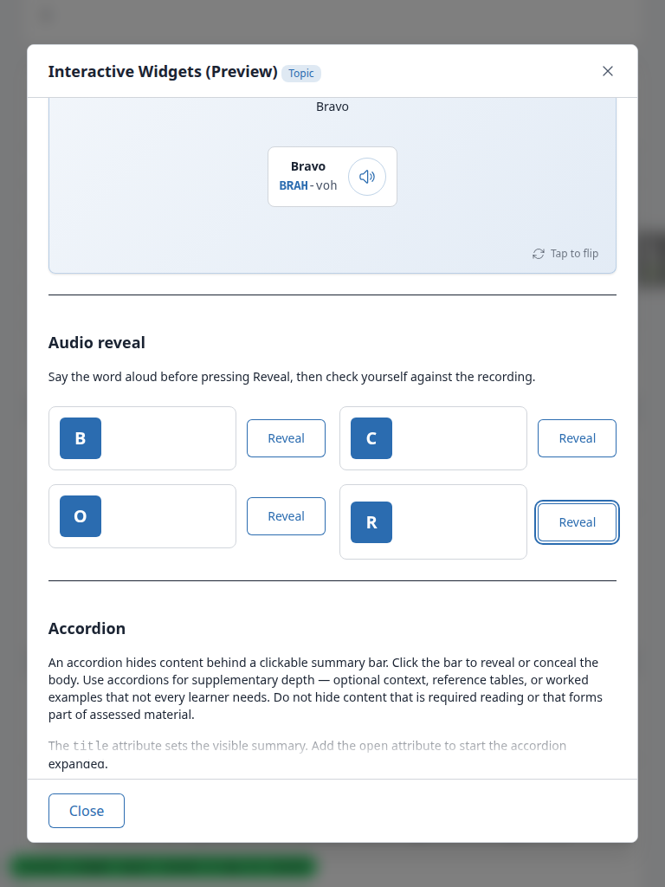 | clean |

## Data changes

| What changed | Call or command | Files written |
|---|---|---|
| The dev database was empty after the rebase rebuild, so demo data was recreated and the demo content loaded. | `create_demo_data --yes`, then `content_save ./demo_content DemoDev` | none |

## Bug status

| Bug | Title | Status |
|---|---|---|
| B1 | Reveal/Hide toggle changes width with its label, shifting the button and widening the card | **FIXED** (commit: e9ffd65a9) — both labels share one grid cell with the inactive one invisible; re-verified at 1920px (toggle stays 91×44, card stays 225px through Reveal and Hide; accessible name exactly "Reveal"/"Hide") and 375px (full-width toggle unchanged). 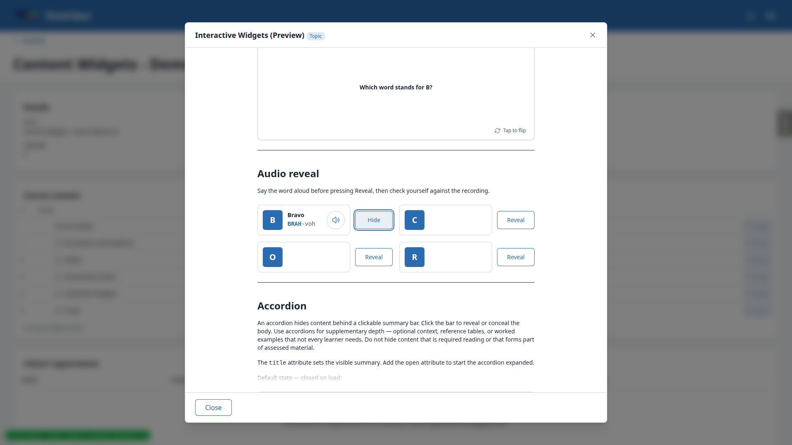 |

## General notes

Test results (all desktop unless stated):
- Passed: setup, 1.1 to 1.4, 2.2 to 2.5, 3.1 to 3.4, 4.1 to 4.4, 5.1 to 5.4, 6.1 to 6.7, 7.1 (320px), 8, 9.1 to 9.4, and 1.1 at 375px and 768px. Only 2.1 failed (B1).
- Screenshots for passing tests include `page-2026-11-21T08-11-57-095Z.png` (Test 6, flashcard), `page-2026-11-21T08-12-16-444Z.png` (Tests 4 and 5), `page-2026-11-21T08-14-35-520Z.png` (Test 9.1, Media), `page-2026-11-21T08-14-45-876Z.png` (Test 9.2 to 9.3) and `page-2026-11-21T08-14-56-367Z.png` (pull quotes).

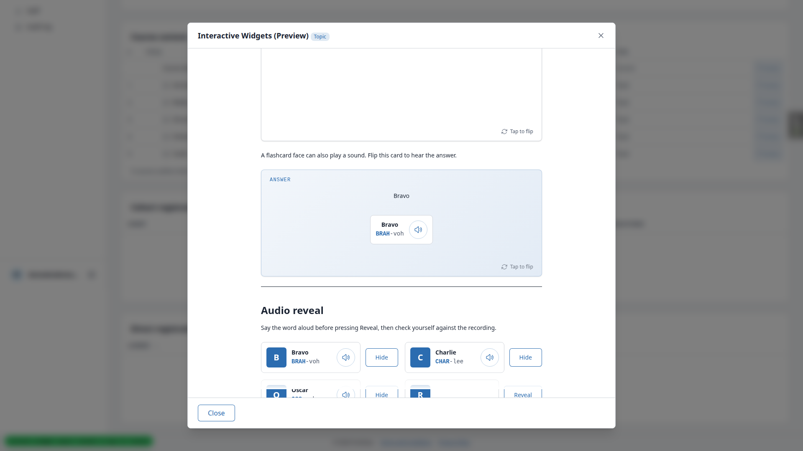
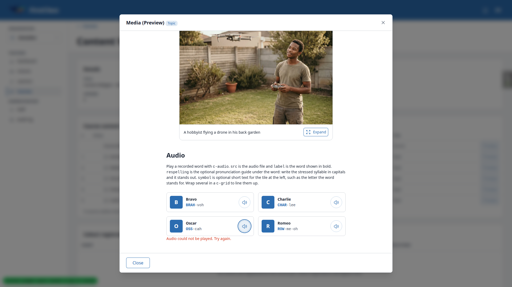
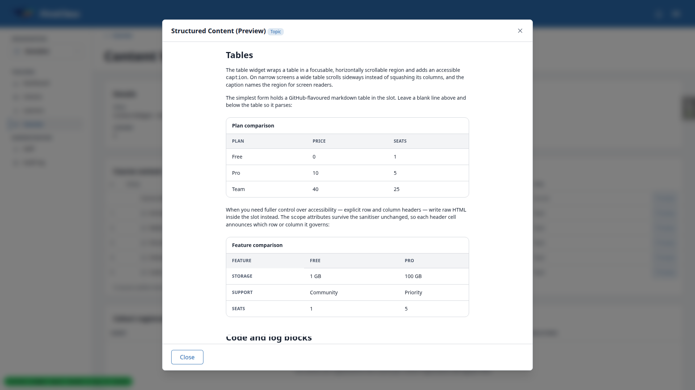
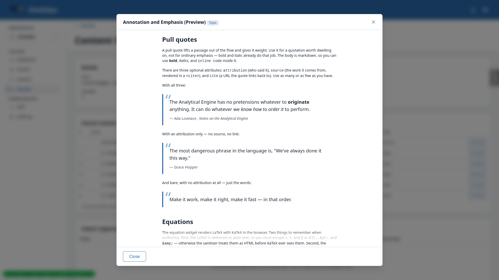

Not tested:
- Test 4.5, screen-reader listening (VoiceOver/NVDA), needs a human. The sr-only `role=status` element holds "Bravo" while revealed and is emptied on Hide, which drives the single announcement.
- Test 10, first-tap playback on iOS Safari and Android Chrome, needs physical devices.
- Test 6.6, dark theme half: the active theme has no dark mode. Light contrast measured 7.53:1 (respelling rgb(74,85,104) on white).
- Tests 5.3 to 5.4 and 9.4 were run by rendering through `render_markdown` with the Interactive Widgets topic as the content instance, not with a scratch topic.

Observations without a required action:
- At 768px, R's card is 87px tall against 74px for its neighbours, because "ROW-me-oh" wraps in the 131px answer column and the hidden answer reserves that height. This is the intended no-shift behaviour.
- Closing the preview dialog alone leaves the clip playing until the new preview replaces the body (same shared element as `c-audio`). Switching topics does stop it.
- The B flashcard's answer face repeats "Bravo" as plain text above the audio card, as the demo content was written.
- The console showed no errors besides the deliberate audio aborts and a third-party htmx/YouTube warning.

status: ok · reason: 1 bug — 1 fixed, 0 unresolved; report rendered, screenshots verified
