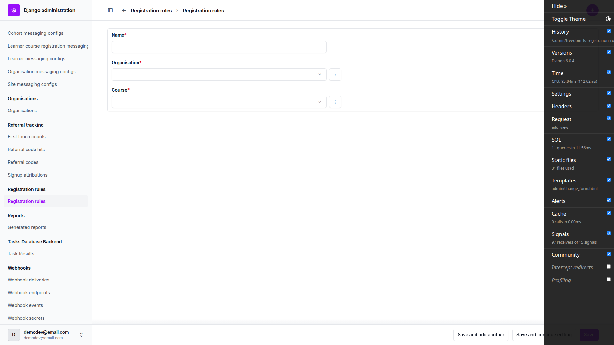
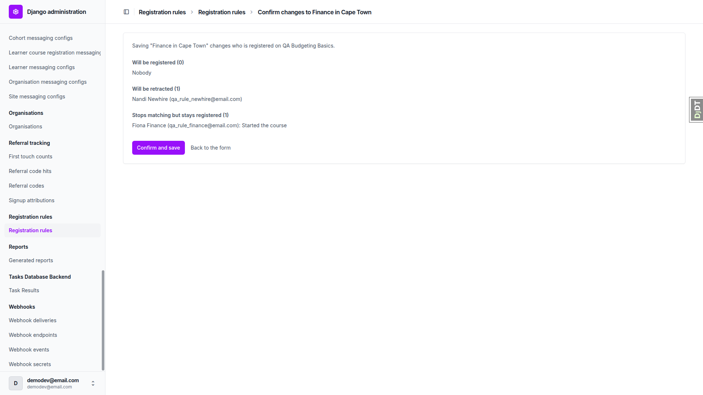
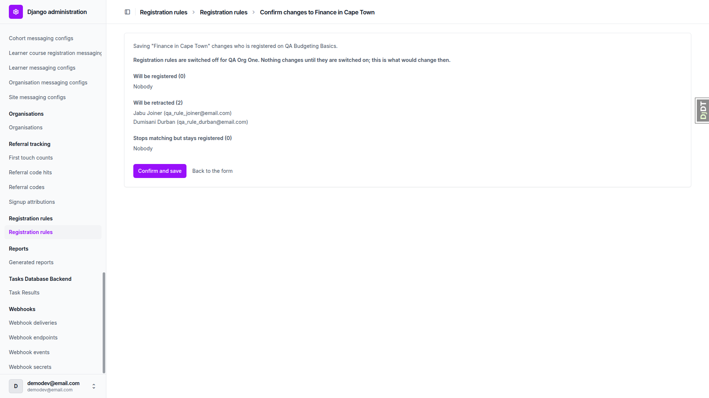
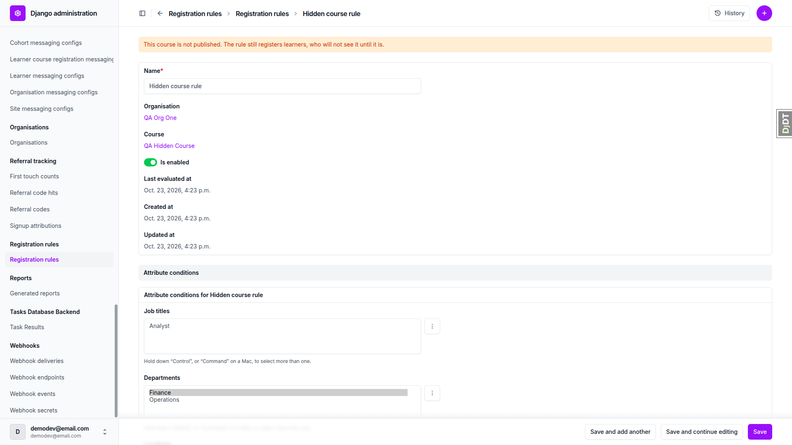
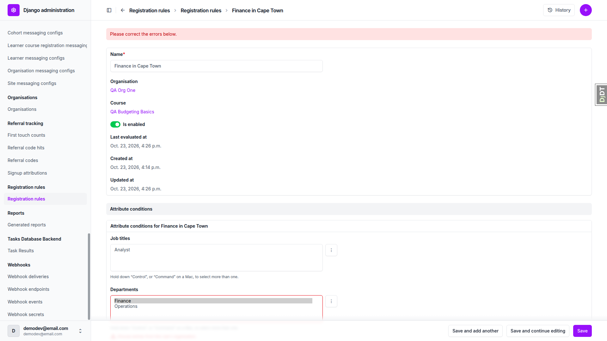
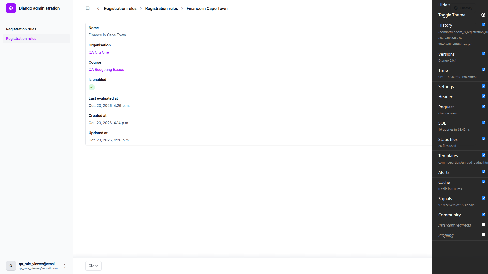
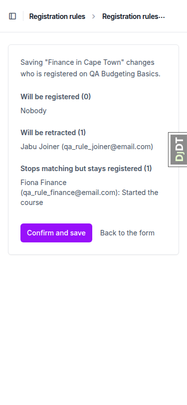
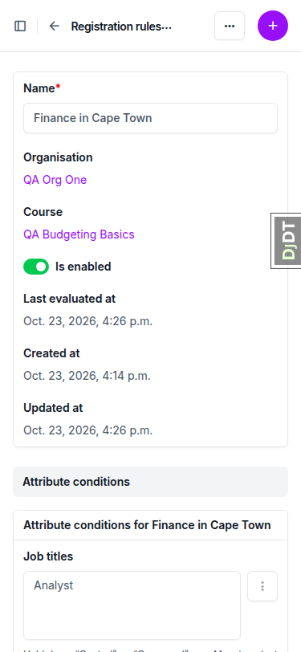
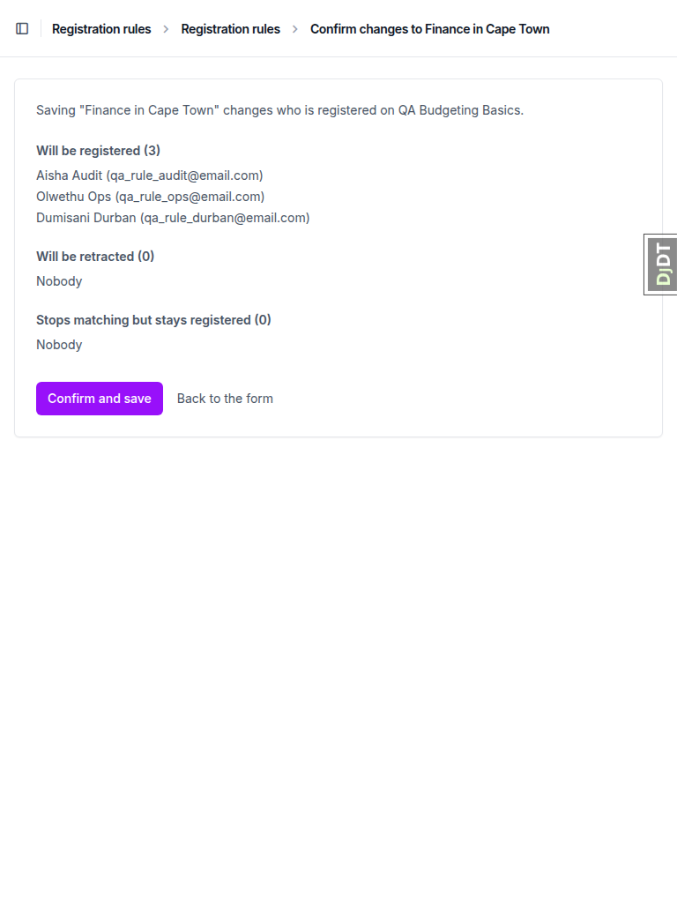
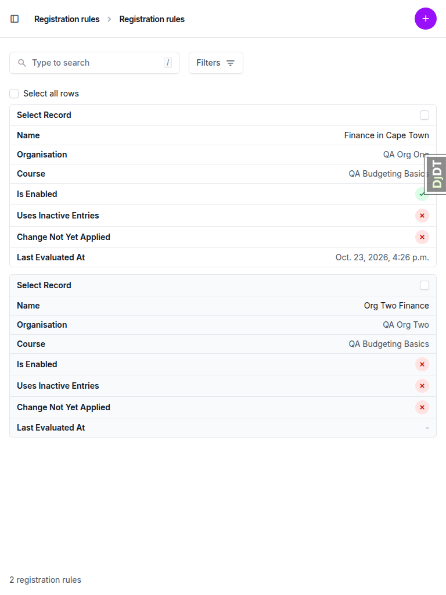

# Frontend QA report: registration rules

All tests in the plan passed on desktop, mobile and tablet. No bugs were found. The plan disagrees with the spec in a few places; the code follows the spec (see General notes).

## Methodology

I walked the test plan (`3. frontend_qa.md`) by hand through the Playwright MCP at three viewports: desktop 1920x1080, mobile 375x812 and tablet 768x1024. Screenshots were collected into `screenshots/` beside this report. Every image linked below exists there, and only `.png` files are linked.

## Diff scoping

Class: **FULL**. The changed template files that triggered it:

- `freedom_ls/registration_rules/templates/admin/registration_rules/preview.html`
- `freedom_ls/registration_rules/templates/admin/registration_rules/preview_list.html`

Everything ran. Nothing was skipped.

## Smoke gate

Outcome: pass. Pages checked:

- `/`
- `/admin/freedom_ls_registration_rules/registrationrule/`

## Results

| Test | Viewport | Status | Note | Screenshot |
|---|---|---|---|---|
| 1.1 | desktop | pass | Admin index has one Registration rules entry. Add page has Name, Organisation, Course only; save lands on the change page with a success message. |  |
| 1.2 | desktop | pass | Read-only links, conditions panel and department, location and job title pickers scoped correctly. Two plan-side deviations (see notes). |  |
| 1.3 | desktop | pass | Inverted dates are rejected with a field error; no preview; rule stays disabled. | none |
| 2.1 | desktop | pass | Preview titled "Confirm changes to Finance in Cape Town"; 2 to be registered; nothing saved yet. |  |
| 2.2 | desktop | pass | Back to the form keeps the entered values; nothing saved. | none |
| 2.3 | desktop | pass | Confirm saves; rule enabled; three active registrations; rule link shown on the rule-made one. | none |
| 2.4 | desktop | pass | Finance learner sees the course as registered, with a bell notification; Ops learner does not. |  |
| 3.1 | desktop | pass | Adding Durban registers the Durban learner. | none |
| 3.2 | desktop | pass | Durban-only: 1 retracted, 1 stays registered because the course was started; no rows deleted. |  |
| 3.3 | desktop | pass | Cape Town back: same row reactivated, Registered at unchanged, no new notification. |  |
| 4.1 | desktop | pass | "Everyone in Cape Town" rule registers 2 learners. | none |
| 4.2 | desktop | pass | Disabling Finance rule: 1 retracted, 2 stay registered via the other rule (spec-correct hand-over). |  |
| 4.3 | desktop | pass | Registrations point at the correct rules after hand-over. | none |
| 4.4 | desktop | pass | Disabling the second rule retracts 3; the started learner stays (1). | none |
| 4.5 | desktop | pass | Re-enabling registers 2; owner of the started learner's registration unchanged. | none |
| 5.1 | desktop | pass | Learner admin department change saves with no preview; registration reactivated. | none |
| 5.2 | desktop | pass | Changing back deactivates the registration. | none |
| 5.3 | desktop | pass | New learner with HR attributes gets an active registration. | none |
| 5.4 | desktop | pass | Learner inactive/active toggles the registration, same row. | none |
| 5.5 | desktop | pass | Blank learner has no registration. | none |
| 6 | desktop | pass | Staff-deactivated rule-made registration detaches from the rule and stays inactive after rename. | none |
| 7.1 | desktop | pass | Switch-off: no registrations change; unapplied-change warning shown afterwards. |  |
| 7.2 | desktop | pass | Switch-on applies the pending change. | none |
| 7.3 | desktop | pass | Other organisation's rule scoped correctly; no registration while switched off. | none |
| 8.1 | desktop | pass | Inactive entries: hidden, then flagged with a warning; clears when deselected. |  |
| 8.2 | desktop | pass | Unpublished course warning shown; rule still registers learners. |  |
| 9.1 | desktop | pass | Enabled rule: no Delete link; GET /delete/ returns 403. | none |
| 9.2 | desktop | pass | Bulk delete refused, protected enabled rule listed; nothing deleted. |  |
| 9.3 | desktop | pass | Disabled rules delete; registration shows "(deleted)" and stays inactive. |  |
| 10.1 | desktop | pass | Re-posted preview form: no error, no duplicate rows. | none |
| 10.2 | desktop | pass | Injected foreign-organisation option rejected with a field error. |  |
| 10.3 | desktop | pass | View-only staff user: read-only page; forced POST returns 403. |  |
| 11 | desktop | pass | 1920px: no horizontal scroll; buttons visible. |  |
| 11 | mobile | pass | 375px: no horizontal scroll; long rows wrap; buttons reachable. "Back to the form" is a 20px-tall link (minor). |  |
| 11-change-page | mobile | pass | Fields stack in one column; multi-selects fit the width. |  |
| 11 | tablet | pass | 768px: no horizontal scroll; lists readable; both buttons visible. |  |
| 1.2-changelist | tablet | pass | Changelist renders as stacked cards with all seven columns labelled. |  |

## Design check

No design states tested.

## Bugs

No bugs found.

## Bug status

No bugs.

## General notes

Plan expectations that disagree with the spec (code follows the spec; the plan should be corrected):

- 1.2 expects "Last evaluated at" to be empty after create. Every rule save enqueues `evaluate_rule`, which sets it even for a disabled rule (spec trigger table).
- 4.2, 4.3 and 4.4 expect the started finance learner to stay with "Finance in Cape Town" as "Started the course". Spec evaluation step 4 hands over to another matching enabled rule before the started check (decision 10). She is shown as "Still matched by Everyone in Cape Town" and handed over, and 4.4 then lists her as "Started the course" (1, not 0).
- 7.1 step 2 expects the switch-off warning straight after switching off. The spec shows it only when the rule's last change is unapplied, which it is after 7.1 step 4.
- 7.1 step 4 expects "everyone except the started finance learner" to be retracted. Only Joiner and Durban were, because those were the only rows the rule still owned after the section 4 hand-overs and the section 6 staff detach.
- 10.1 browser Back to the preview gives Chrome's ERR_CACHE_MISS (form resubmission) because the preview is a POST response. The second click was simulated by re-posting the preview form.

Observations, no action required:

- The changelist puts "Last evaluated at" last, while the spec lists it before the two boolean columns (cosmetic; all columns present).
- The preview heading and sentence name the rule by its stored name, not the new name being saved.
- After 4.5, an active registration owned by a disabled rule stayed with it until a later evaluation (likely the 7.2 organisation switch-on) handed it to the enabled matching rule.
- Date fields show Django's red "You are 2 hours ahead of server time" icon because the browser timezone differs from the server's (environmental).
- On mobile, "Back to the form" is a 20px-tall text link, below a 44px touch target.
- The data helper applied two missing `freedom_ls_comms` migrations to this worktree's database before seeding, and added a reusable seed command, `qa_create_registration_rules_scenario`.
- The collect step also moved 4 Playwright console logs and 4 snapshot `.yml` files into `screenshots/`; only the PNGs are referenced.
- `page-2026-10-23T16-08-10-931Z.png` is the per-run capture check (rules changelist).
- Compression: no PNG over 1024KB, nothing changed.

status: ok
reason: report rendered, 0 bugs documented
