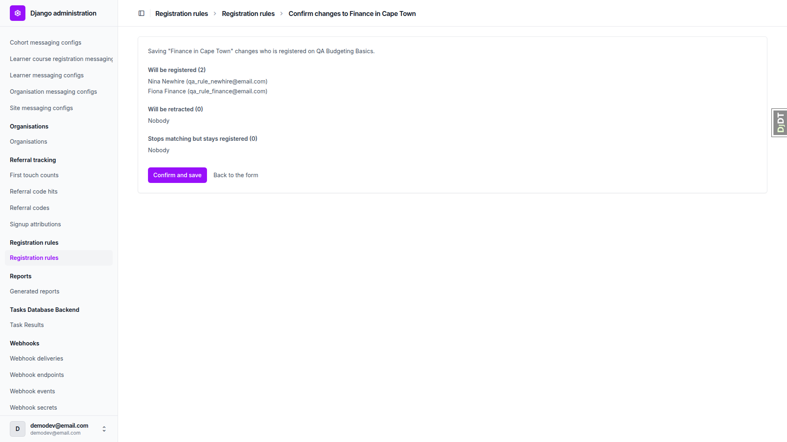
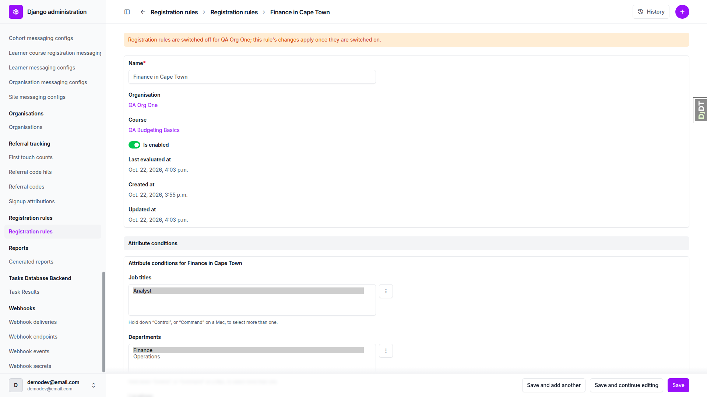
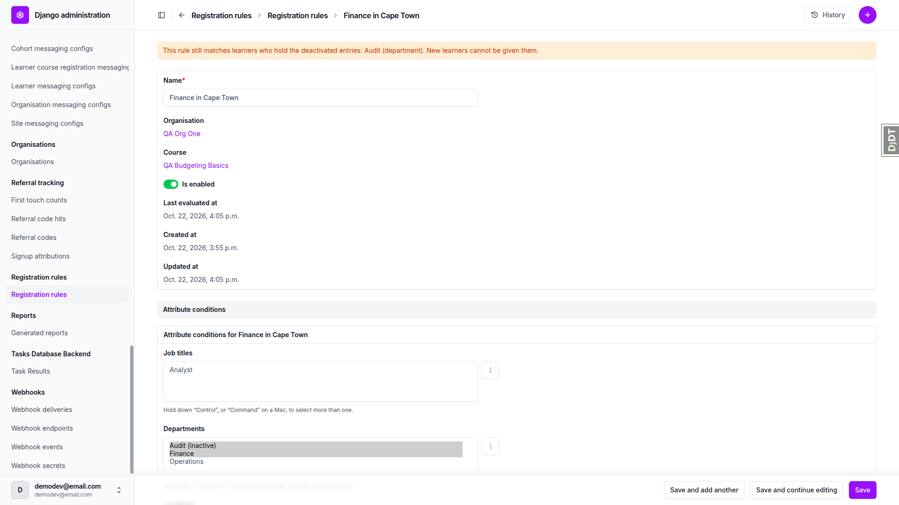
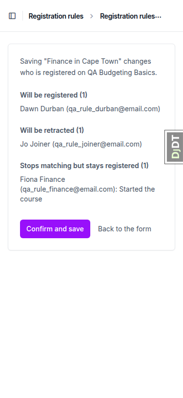
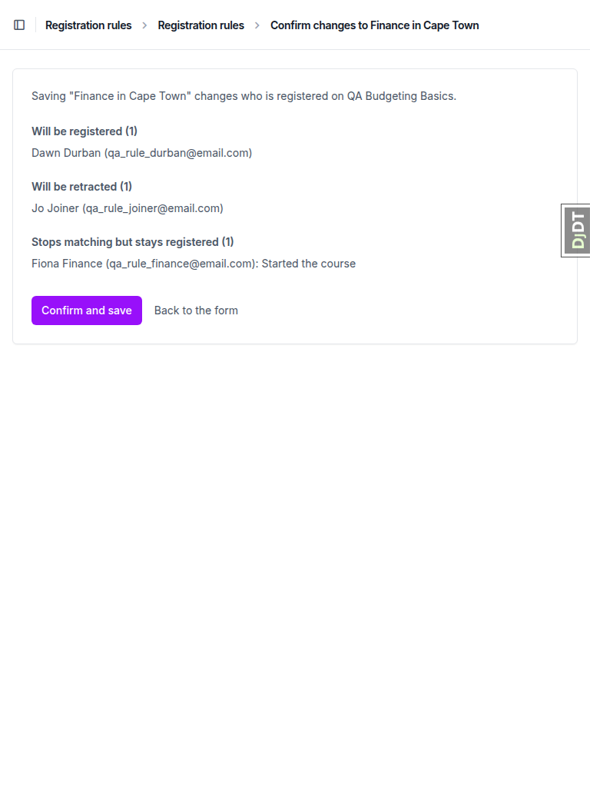

# Frontend QA report: registration rules

Date: 2026-10-22. Branch: corporate-job-course-recommendations-2-registration-rules. Dev server port: 8954.

All tests passed (every test record has status pass) and no bugs were found. The run covered the registration rule admin (add, change, preview and confirm), hand-over between rules, learner attribute changes, the switch-off state, inactive entries and unpublished courses, deletion protection, permission and tampering checks, and desktop, tablet and mobile layouts.

## Methodology

The run was driven by hand through Playwright MCP against a dev server started for this run. The qa-data-helper agent reset the seed data to the test plan's section 0 before section 1, because a previous run had changed it. Screenshots were collected into `screenshots/` beside this report, and every image referenced here exists there. Compression ran and found nothing over 1 MB.

## Diff scoping

Class: FULL. The changed templates `freedom_ls/registration_rules/templates/admin/registration_rules/preview.html` and `preview_list.html` triggered it. Other changed files: `freedom_ls/registration_rules/*.py`, `freedom_ls/hr_attributes/admin.py`, `freedom_ls/hr_attributes/models.py`, `freedom_ls/learner_progress/*.py`, `freedom_ls/webhooks/events.py` and `config/settings_base.py`. Desktop, mobile and tablet all ran; nothing was skipped.

## Smoke gate

Pass. Both pages loaded: `http://127.0.0.1:8954/` and `http://127.0.0.1:8954/admin/freedom_ls_registration_rules/registrationrule/`.

## Results

| Test | Viewport | Status | Note | Screenshot |
|---|---|---|---|---|
| 1.1 | desktop | pass | Admin index has one "Registration rules" entry. Add page has only Name, Organisation, Course. Save lands on the change page. | [screenshot](screenshots/page-2026-10-22T15-53-15-388Z.png) |
| 1.2 | desktop | pass | Change page and changelist correct; pickers scoped to the organisation. "Last evaluated at" already set (plan is stale, see General notes). | [screenshot](screenshots/page-2026-10-22T15-55-41-907Z.png) |
| 1.3 | desktop | pass | Inverted dates with Is enabled ticked return a field error, no preview; rule stays disabled. | [screenshot](screenshots/page-2026-10-22T16-00-00-001Z.png) |
| 2.1 | desktop | pass | Preview inside the admin shell. Will be registered (2): Nina Newhire, Fiona Finance. Nothing saved yet. | [screenshot](screenshots/page-2026-10-22T15-56-42-135Z.png) |
| 2.2 | desktop | pass | "Back to the form" restores the selections without saving; reload shows the rule disabled. | [screenshot](screenshots/page-2026-10-22T16-00-00-002Z.png) |
| 2.3 | desktop | pass | Confirm and save registers 3 active learners; registration shows the rule link. | [screenshot](screenshots/page-2026-10-22T16-00-00-004Z.png) |
| 2.4 | desktop | pass | Finance learner sees the course as registered, with a bell notification; ops learner does not. | [screenshot](screenshots/page-2026-10-22T16-00-00-007Z.png) |
| 3.1 | desktop | pass | Adding Durban previews and registers Dawn Durban. | none |
| 3.2 | desktop | pass | Removing Cape Town retracts Nina Newhire; Fiona Finance stays (started the course); no rows deleted. | [screenshot](screenshots/page-2026-10-22T16-00-00-009Z.png) |
| 3.3 | desktop | pass | Adding Cape Town back reactivates the same row; one notification only. | [screenshot](screenshots/page-2026-10-22T16-00-00-010Z.png) |
| 4 | desktop | pass | Hand-over to another enabled matching rule works per the spec; plan expectations stale (see General notes). | [screenshot](screenshots/page-2026-10-22T16-00-00-011Z.png) |
| 5.1-5.2 | desktop | pass | Department change in the Learner admin reactivates and deactivates the registration with no preview. | [screenshot](screenshots/page-2026-10-22T16-00-00-012Z.png) |
| 5.3-5.5 | desktop | pass | New learner with HR attributes registered; is-active toggling deactivates and reactivates the same row; blank learner never registered. | none |
| 6 | desktop | pass | Staff deactivation blanks the rule link; later rule saves leave it alone. Name-only edit previews no lists. | [screenshot](screenshots/page-2026-10-22T16-00-00-013Z.png) |
| 7.1 | desktop | pass | Switch-off: changes are stored but not applied; warning shown on the change page once a change is unapplied. | [screenshot](screenshots/page-2026-10-22T16-00-00-016Z.png) |
| 7.2 | desktop | pass | Switching on applies the pending change and updates last evaluated. | [screenshot](screenshots/page-2026-10-22T16-00-00-017Z.png) |
| 7.3 | desktop | pass | Org Two rule is scoped to its own organisation's entries; switch-off notice shown; nothing registered cross-organisation. | none |
| 8.1 | desktop | pass | Inactive entries: not offered in the picker, kept when already selected, with warning and changelist flag; cleared on deselect. | [screenshot](screenshots/page-2026-10-22T16-00-00-018Z.png) |
| 8.2 | desktop | pass | Unpublished course warning shown; rule still registers 4 learners; disabling retracts all 4. | [screenshot](screenshots/page-2026-10-22T16-00-00-019Z.png) |
| 9 | desktop | pass | Enabled rule has no Delete link and /delete/ returns 403; bulk delete refused; disabled rules delete; registration shows "(deleted)". | [screenshot](screenshots/page-2026-10-22T16-00-00-022Z.png) |
| 10.1 | desktop | pass | Back after confirm lands on Chrome's resubmission page; reload and confirm saved normally; double click safe; no duplicates. | none |
| 10.2 | desktop | pass | Injected cross-organisation option rejected with a field error. | [screenshot](screenshots/page-2026-10-22T16-00-00-023Z.png) |
| 10.3 | desktop | pass | View-only staff user sees a read-only page; forced POSTs return 403. | [screenshot](screenshots/page-2026-10-22T16-00-00-024Z.png) |
| 11 | desktop | pass | 1920px: no horizontal scroll on preview or change page. | [screenshot](screenshots/page-2026-10-22T16-10-00-002Z.png) |
| 11 | mobile | pass | 375px: no horizontal scroll; lines wrap; both buttons visible; sidebar behind dock toggle. | [screenshot](screenshots/page-2026-10-22T16-10-00-005Z.png) |
| 11 | tablet | pass | 768px: collapsed sidebar, full breadcrumbs, no horizontal scroll, both buttons visible. | [screenshot](screenshots/page-2026-10-22T16-10-00-008Z.png) |

### Key screenshots

Preview page, desktop:

Switch-off warning:

Inactive-entry warning:

Mobile preview:

Tablet preview:

## Design check

No design states tested.

## Bugs

No bugs found.

## Bug status

No bugs found this run.

## General notes

Test-plan expectations that disagree with the spec. The code follows the spec in each case, so these are not bugs, but the plan should be corrected.

- Section 1.2 expects "Last evaluated at" to be empty on a freshly created disabled rule. Any rule save enqueues `evaluate_rule`, which stamps the field when the run finishes (spec: `last_evaluated_at` is "set when an `evaluate_rule` run finishes"; see the triggers table).
- Section 4 step 2 expects the started finance learner to be listed as "Started the course" and to stay with "Finance in Cape Town". The spec's Retract step checks hand-over to another enabled matching rule before the started check, so she is handed to "Everyone in Cape Town" ("Still matched by Everyone in Cape Town"). Section 4 step 4 then lists her under "Stops matching but stays registered (1)" rather than (0).
- Section 7.1 step 2 expects the switch-off warning on the change page right after switching off. The spec shows that warning only when the rule's last change has not been applied, which is what happens: it appears after the Analyst edit.

Because of the hand-over, later steps ran against slightly different ownership than the plan assumed. For example, the retract list in section 7.1 was Jo Joiner and Dawn Durban rather than "everyone except the finance learner". Behaviour matched the spec at each step.

Section 10.1: the browser back button after confirming lands on Chrome's "Confirm form resubmission" page, because the preview is a POST response. Reloading resubmitted, and confirming again saved normally with no duplicates. A scripted double click was also safe.

Minor observations, no action taken:

- The preview header says "changes who is registered" even when every list is "Nobody" (for example a name-only edit).
- The "Back to the form" text link is about 20 px tall on mobile, below the 44 px touch-target guideline.
- The Django debug toolbar overlays the Save button until hidden (dev-only).

Dev data left behind: rules "Finance in Cape Town" (enabled) and "Org Two Finance" (disabled), the joiner learner, and a view-only staff user qa_rule_viewer@email.com, all created during the run.

status: ok · reason: 0 bugs — 0 fixed, 0 unresolved; report rendered, screenshots verified
