# Frontend QA report: registration rules

## Methodology

The test plan (`3. frontend_qa.md`) was walked by hand with Playwright MCP against a dev server on port 8142. I logged in as the dev superuser. Where the plan says so, I also logged in as learners and as a staff user who may only view registration rules. Screenshots are collected in `screenshots/` beside this report, and every image referenced below exists there.

A pre-step rebase onto main ran first. It had two conflicts, both resolved:
- `docs/app_structure.md` and `import_contracts.toml`.
- `webhooks/events.py`. Main's `site=` argument and the branch's `fire_webhook_event_for_site` were combined. Two main tests were re-pointed at `fire_webhook_event_for_site`. The full test tier passed after that fix.

The rebuild recreated the dev DB. It was re-seeded through the qa-data-helper: `create_demo_data` plus a new `qa_create_registration_rules_scenario` command. That command and its test are left uncommitted.

## Diff scoping

Class: FULL. It was triggered by the two templates under `freedom_ls/registration_rules/templates/admin/registration_rules/` (`preview.html` and `preview_list.html`). Desktop, mobile and tablet all ran. Nothing was skipped.

## Smoke gate

Pass. Pages checked:
- http://127.0.0.1:8142/
- http://127.0.0.1:8142/admin/freedom_ls_registration_rules/registrationrule/

## Results

| Test | Viewport | Result | Note | Screenshot |
|---|---|---|---|---|
| 1.1 | desktop | pass | Admin index has one "Registration rules" entry. Add page has Name, Organisation and Course only. Save lands on the change page. The debug toolbar covered Save and was hidden first (dev-only). | 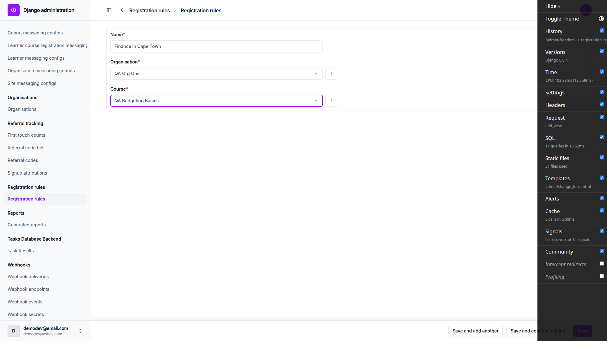 |
| 1.2 | desktop | pass | Read-only Org and Course, conditions inline, department/location/job title choices scoped to the organisation. Changelist has all 7 columns. "Last evaluated at" is already set (see General notes). | 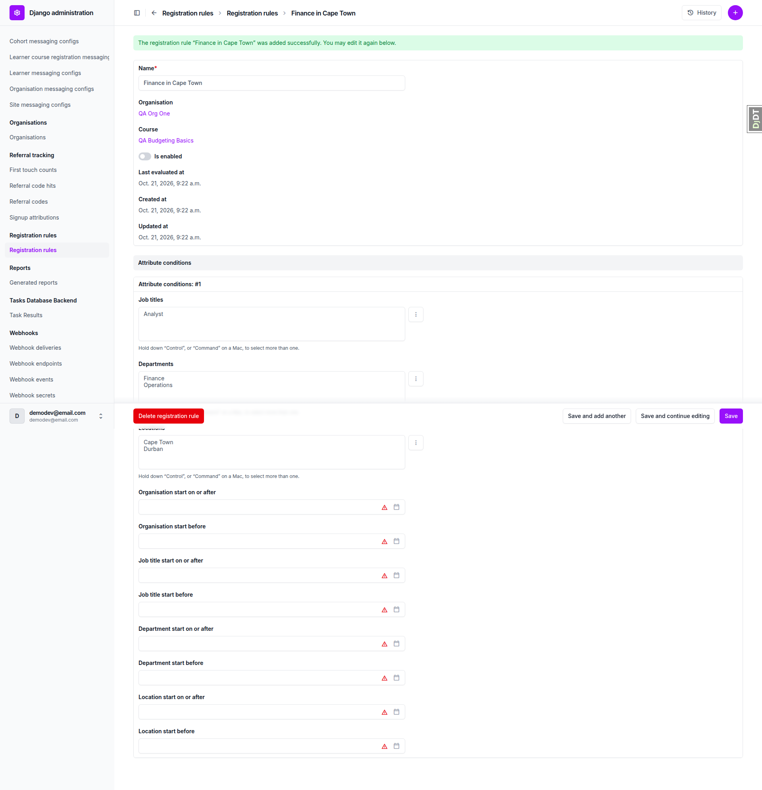 |
| 1.3 | desktop | pass | Inverted organisation start dates refused with a field error. No preview. Nothing saved. | 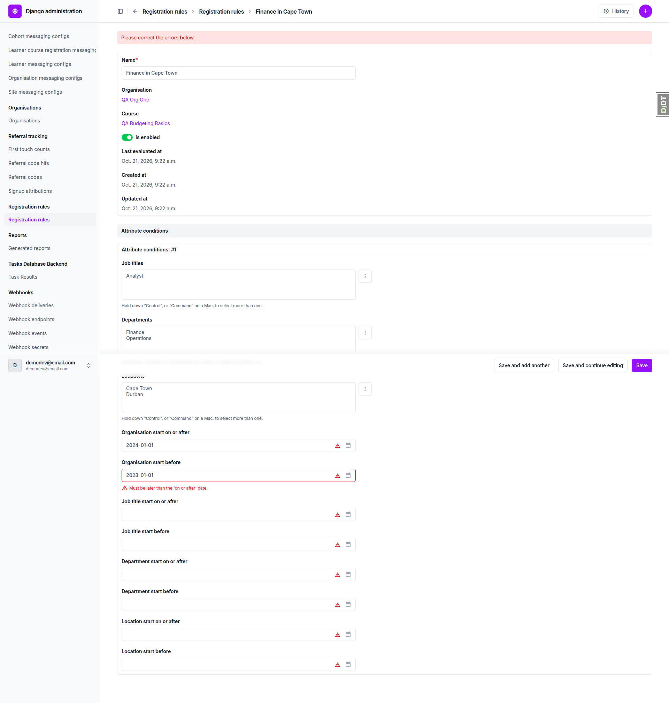 |
| 2.1 | desktop | pass | Confirmation page in the admin shell. Will be registered (2): Nina Newhire, Fiona Finance. Other lists say Nobody. A second tab shows nothing saved yet. |  |
| 2.2 | desktop | pass | Back to the form keeps the entered values. Reload shows nothing saved. | none |
| 2.3 | desktop | pass | Confirm lands on the changelist with "changed successfully". 3 active registrations. Fiona's registration links to the rule. | 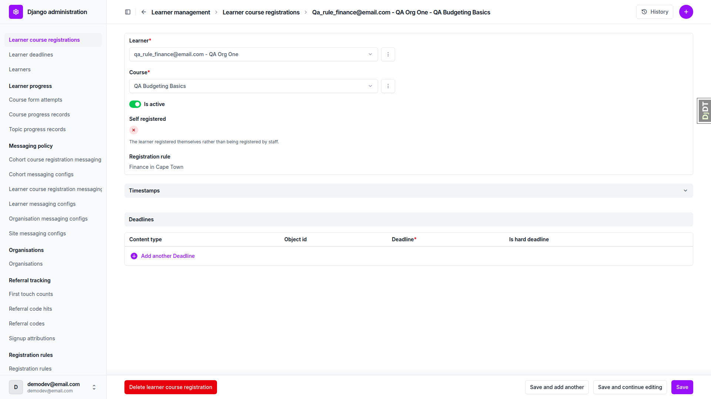 |
| 2.4 | desktop | pass | Fiona sees the course as Registered and gets an unread notification. Oscar Ops sees it only under Available courses. | 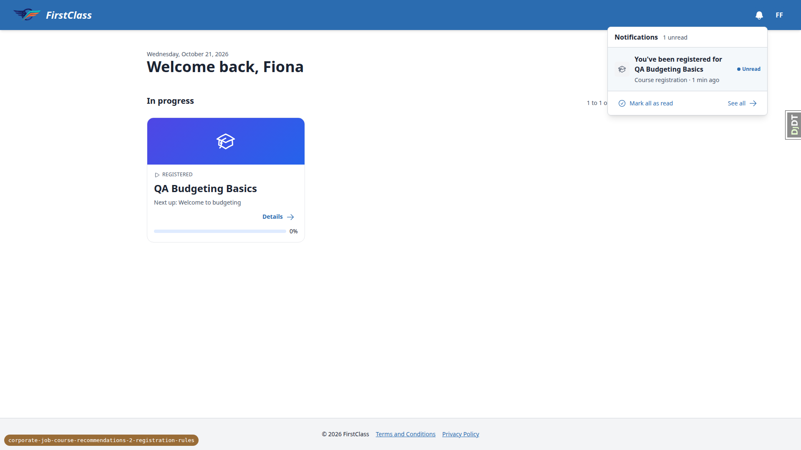 |
| 3.1 | desktop | pass | Adding Durban previews Dawn Durban. Her registration is active after confirm. | none |
| 3.2 | desktop | pass | Removing Cape Town previews Retracted (1) Nina. Fiona stops matching but stays registered (Started the course). No rows deleted. | 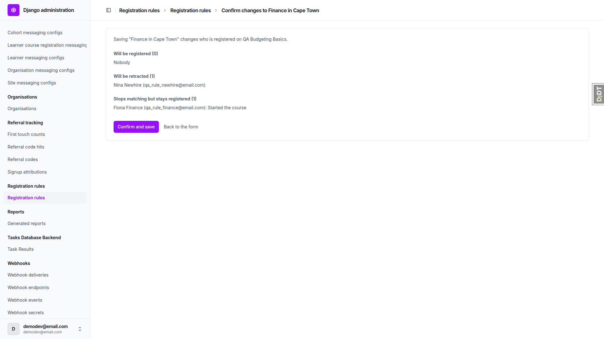 |
| 3.3 | desktop | pass | Adding Cape Town back reactivates Nina's same row with the same Registered at. Only one notification. |  |
| 4 | desktop | pass | Hand-over between overlapping rules works. Expectations in §4 and §4.4 differ from the plan (see General notes). | 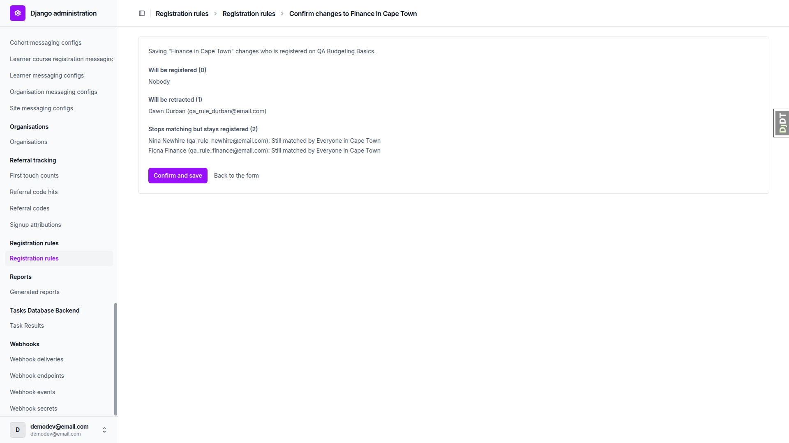 |
| 5.1-5.5 | desktop | pass | HR attribute changes, a new user with attributes, and the Is active toggle all register and retract as expected. Bea Blank has no registration. | none |
| 6 | desktop | pass | Unticking Is active detaches the rule from a registration. Renaming the rule previews Nobody. Nina stays inactive. | 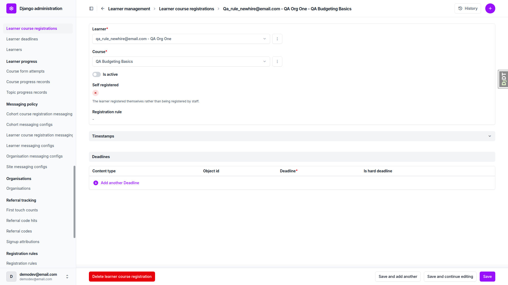 |
| 7.1 | desktop | pass | Switch-off warning shown only once a change is not yet applied (see General notes). Changes while switched off are held, not applied. | 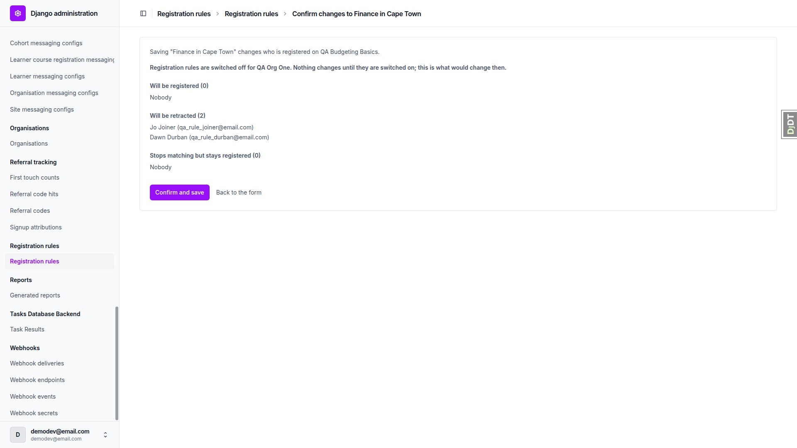 |
| 7.2 | desktop | pass | Switching on catches up registrations. "Change not yet applied" clears and "Last evaluated at" updates. | 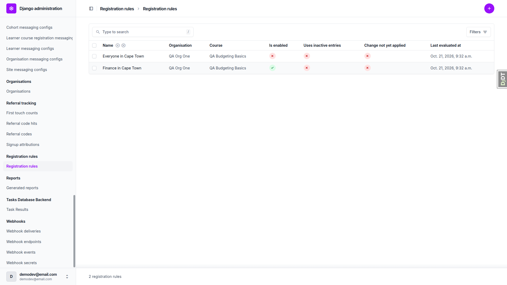 |
| 7.3 | desktop | pass | Another organisation's Finance entry is offered only to its own organisation's rule. Switched off, Otto Other is not registered. | none |
| 8.1 | desktop | pass | Inactive entries are not offered. A selected entry deactivated later shows "(inactive)" and a warning. Deselecting retracts Audrey. | 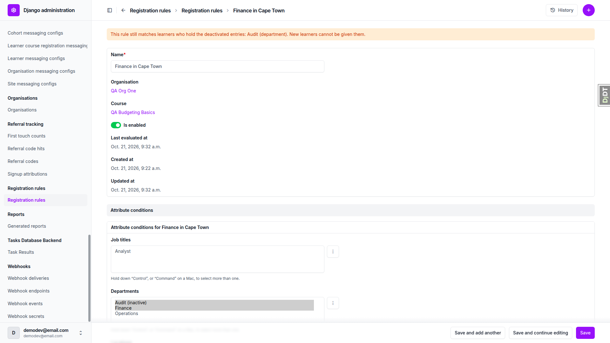 |
| 8.2 | desktop | pass | Unpublished-course warning shown. The rule still registers learners and retracts them when disabled. |  |
| 9 | desktop | pass | Enabled rule has no Delete link, and /delete/ returns 403. Bulk delete is refused with protected objects. Disabled rules delete. The registration reads "(deleted)". | 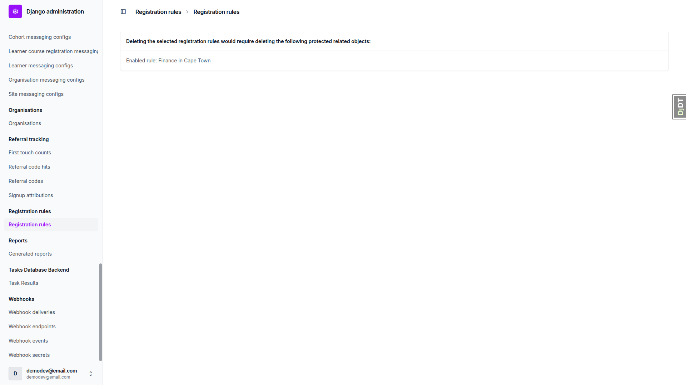 |
| 10.1 | desktop | pass | Browser back gives Chromium's resubmission page, so the double confirm was simulated by re-POSTing the form. 200, no traceback, registration count unchanged (11 and 11). | none |
| 10.2 | desktop | pass | An injected cross-organisation option is refused with "Choose entries from this rule's organisation." | 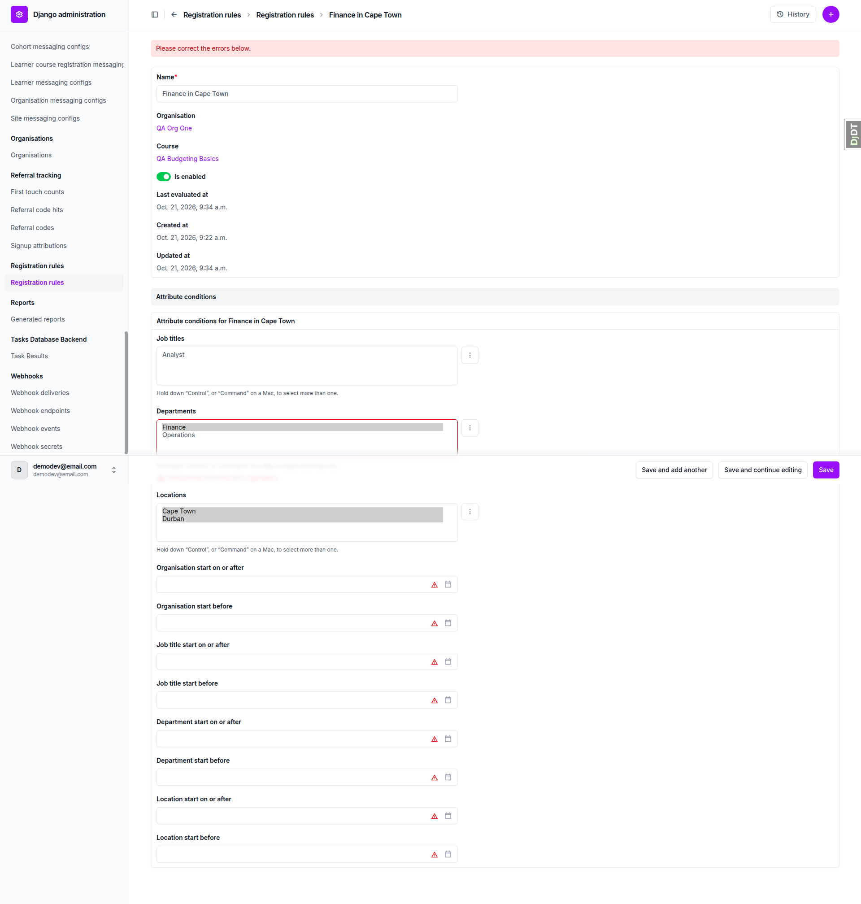 |
| 10.3 | desktop | pass | A view-only staff user sees a read-only page with no inputs. A forced POST returns 403. | 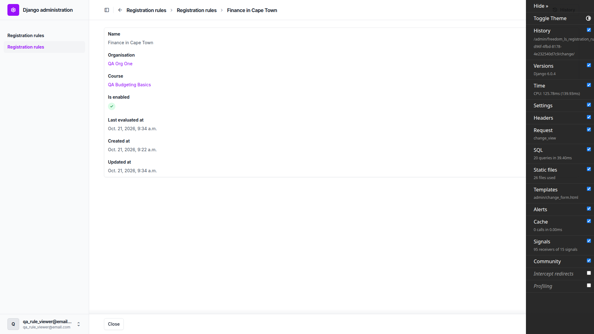 |
| 11 | desktop | pass | 1920px: no horizontal scroll, buttons visible, three list headings full-width, no console errors. | 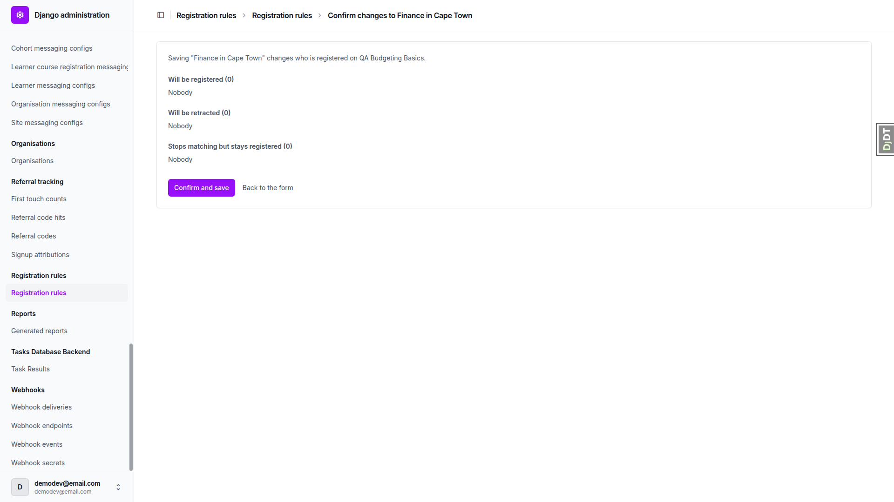 |
| 11 | mobile | pass | 375px: no horizontal scroll, lists wrap in the card, Confirm and save is 38px tall. "Back to the form" is a 20px-tall text link. Change page stacks (see also [change page at mobile](screenshots/page-layout-change-mobile.png)). |  |
| 11 | tablet | pass | 768px: no horizontal scroll, lists readable, both buttons visible. Sidebar collapsed as at mobile (see also [change page at tablet](screenshots/page-layout-change-tablet.png)). | 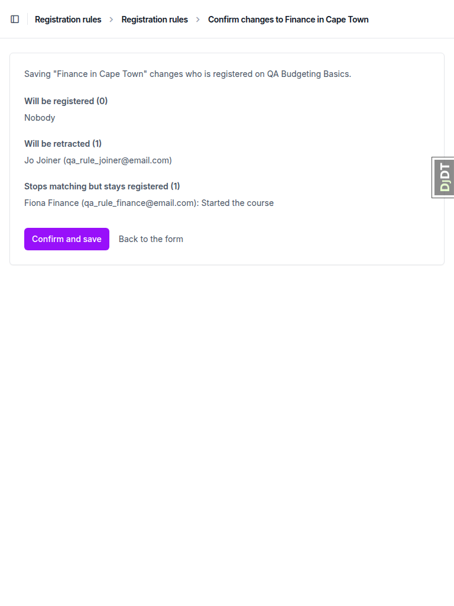 |

## Design check

no design states tested

## Bugs

No bugs found.

## Bug status

No bugs.

## General notes

No test failed. Four places where the test plan's expectation differs from the spec. In each, the code follows the spec:

1. **§1.2.** The plan expects "Last evaluated at" to be empty on a new disabled rule. Test plan expectation differs from the spec; the code follows the spec. Every rule save enqueues `evaluate_rule`, so the field is set.
2. **§4 (knock-on in §4.4 and §9.3).** The plan expects the finance learner (Fiona) to stay with "Finance in Cape Town" as "Started the course". Test plan expectation differs from the spec; the code follows the spec. The hand-over runs before the started check, so Fiona is handed to "Everyone in Cape Town". This changes the §4.4 expectation: disabling "Everyone" leaves Fiona as "Started the course", where the plan expected 0. It also changes §9.3: Fiona's Budgeting registration had been handed back to Finance in Cape Town by the §7.2 catch-up, so it no longer pointed at Everyone.
3. **§7.1.** The plan expects the switch-off warning right after switching off. Test plan expectation differs from the spec; the code follows the spec. The warning appears only once the rule has a change not yet applied.
4. **§10.1.** The plan uses the browser back button on the POST result. Test plan expectation differs from the spec; the code follows the spec. Chromium shows a form-resubmission page (ERR_CACHE_MISS), so the double submit was simulated by re-POSTing the confirmation form.

Other observations, none of them a bug:
- The Django debug toolbar covers the admin Save button at 1920px until it is hidden. This is dev-only.
- "Back to the form" on the preview is a 20px-tall text link at mobile width. It is small for touch but reachable.
- The preview's opening sentence names the rule by its saved name, not the name being typed. For example, it reads 'Saving "Finance in Cape Town (renamed)"' while renaming it back.
- The rule change page offers "Save and add another".

Recommendation: update the test plan's expectations in §1.2, §4 (including §4.4 and §9.3), §7.1 and §10.1 to match the spec.

status: ok · reason: report rendered, 0 bugs documented
