# QA report: Recommend outcome for registration rules

Test plan: `3. frontend_qa.md` (same directory).

## Methodology

- Tool: Playwright MCP, driven by hand at depth 0 against a dev server on port 8756 serving this branch (branch badge confirmed).
- Viewports: desktop 1920x1080, mobile 375x812, tablet 768x1024.
- Screenshots are collected into `screenshots/` beside this report; every referenced image exists there.
- Learner dashboards were driven in separate browser contexts, logged in as each learner.
- The Django debug toolbar was hidden with an injected style because it intercepted clicks (dev-only, not a defect).
- The rebase helper's front-end check was folded into this run (same pages, all three viewports). Console errors were checked: none apart from the favicon 404 and the expected 403s.

## Diff scoping

- Class: **FULL**, triggered by the `registration_rules` admin templates.
- Changed files: `registration_rules/templates/admin/registration_rules/preview.html`, `preview_list.html`, `preview_reasons.html`, `registration_rules/admin.py`, `course_recommendations/admin.py`, `learner_interface/views.py`, plus models/signals/evaluation/migrations/tests in `course_recommendations`, `registration_rules` and `learner_management`.
- Skipped: nothing.

## Smoke gate

- Status: **pass**
- Pages checked: `http://127.0.0.1:8756/`, `http://127.0.0.1:8756/admin/freedom_ls_registration_rules/registrationrule/add/`
- Failure URL / reason: none.

## Results

| Test | Viewport | Status | Screenshot | Note |
|---|---|---|---|---|
| 1.1 | desktop | pass | 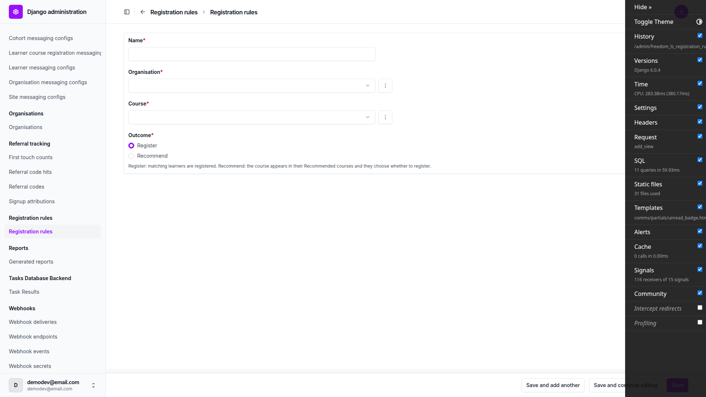 | Add page shows Outcome radios with help text; saving a Recommend rule lands on its change page. |
| 1.2 | desktop | pass | 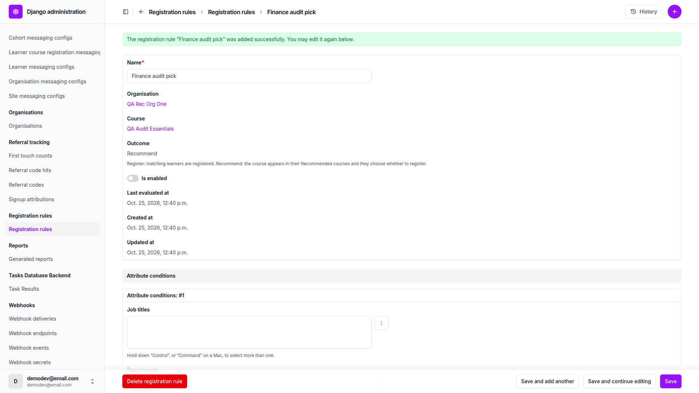 | Outcome read-only on change page; changelist Outcome column and filter ([filter](screenshots/page-2026-10-25T12-41-31-630Z.png)). |
| 2.1 | desktop | fail | 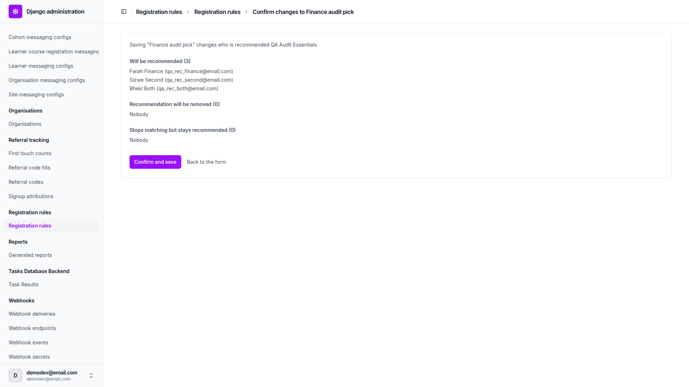 | Lists correct; lead sentence missing "on" (B1). |
| 2.2 | desktop | fail | 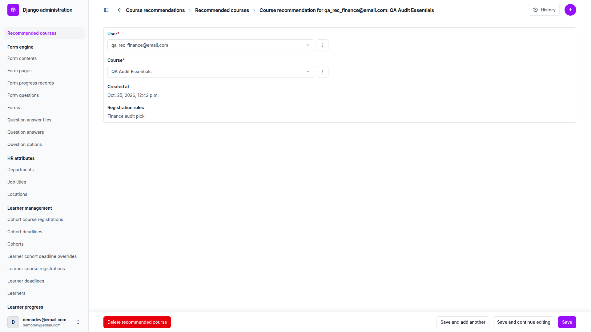 | Behaviour correct; rule link renders as plain grey text (B2). |
| 2.3 | desktop | pass | 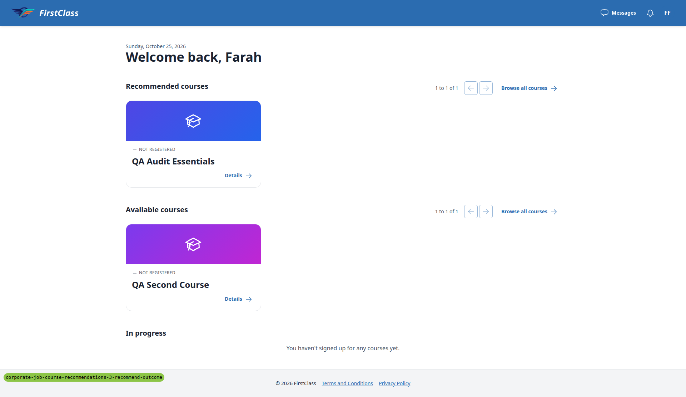 | Recommended section shows only for the finance learner; others as expected. |
| 3.1 | desktop | pass | none | Enrolling from the recommended card moves it to In progress and removes the row. |
| 3.2 | desktop | pass | none | Staff-added registration removes the learner's recommendation row. |
| 3.3 | desktop | pass | none | Cohort membership and cohort course registration remove rows, staff-made row included. |
| 3.4 | desktop | pass | none | Unchanged re-save previews all three lists as Nobody; confirm returns to changelist. |
| 4.1 | desktop | pass | none | Unticking a registration recreates the rule-made recommendation. |
| 4.2 | desktop | pass | none | Deleting cohort membership recreates the row. |
| 4.3 | desktop | pass | none | Unticking cohort course registration creates a rule row; staff row not resurrected. |
| 4.4 | desktop | pass | none | Deactivating a Learner removes the row; reactivating restores it. |
| 4.5 | desktop | pass | none | Untick/re-tick of a self-made registration creates no row. |
| 5 | desktop | pass | 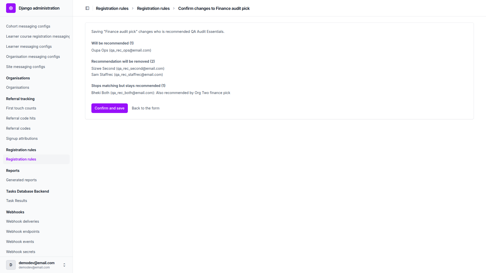 | Two-rule and rule-switch scenarios behave as planned, including the two-org learner. |
| 6 | desktop | pass | none | Staff add, duplicate-add error and staff-row survival all correct. |
| 7 | desktop | fail | 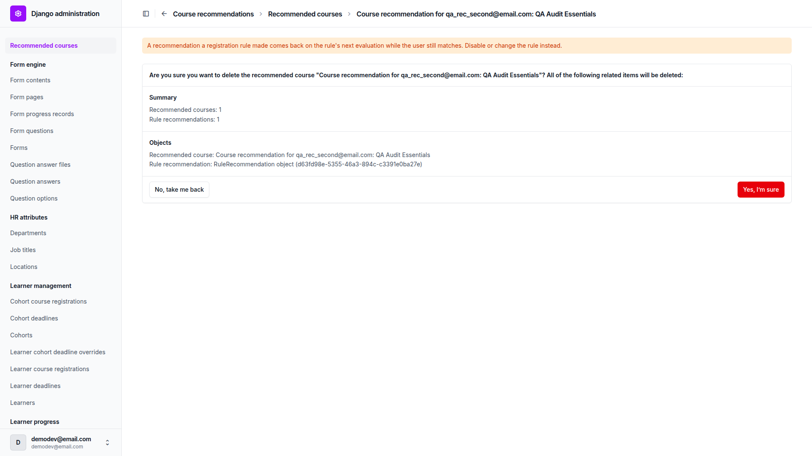 | Warnings correct; delete page lists "RuleRecommendation object (uuid)" (B3). |
| 8 | desktop | pass | 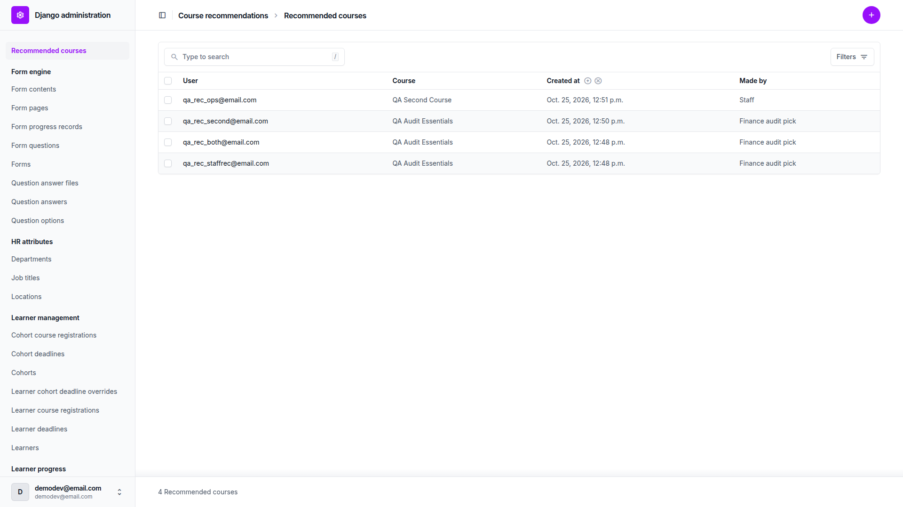 | "Made by" filter narrows rows correctly. |
| 9.1 | desktop | pass | none | Draft course: preview and note correct; learner sees no card. |
| 9.2 | desktop | pass | none | Switch off keeps rows; switching on catches up. |
| 10 | desktop | pass | none | Delete guarded while enabled/switch off; deletion leaves other rule's row untouched. |
| 11.1 | desktop | pass | none | Double-confirmed POST creates no duplicates. |
| 11.2 | desktop | pass | none | View-only user sees read-only page; forced POST returns 403. |
| 11.3 | desktop | pass | 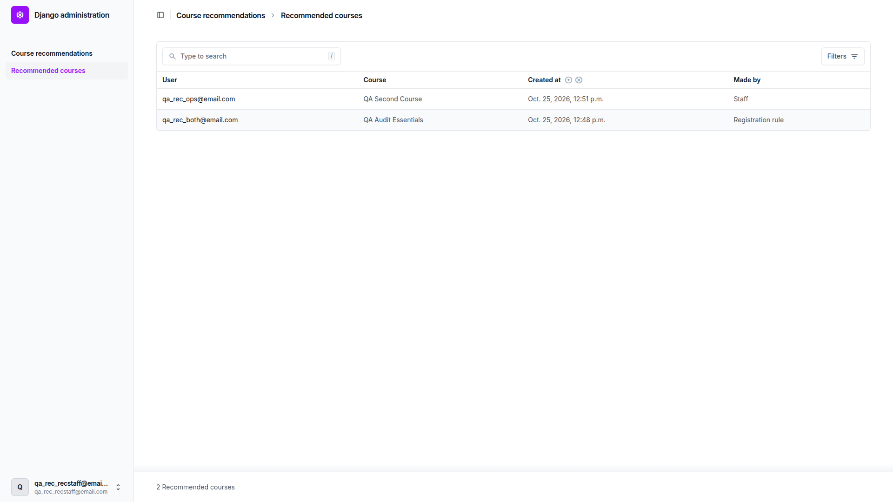 | Rule names hidden from staff without rule permissions; filter still works. |
| 11.4 | desktop | pass | none | Register branch preview and results unchanged, no recommend headings. |
| 12-add | mobile | pass | 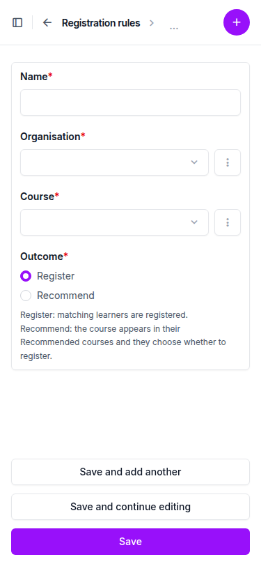 | No horizontal scroll; radios wrap, full-width Save buttons. |
| 12-preview | mobile | pass | 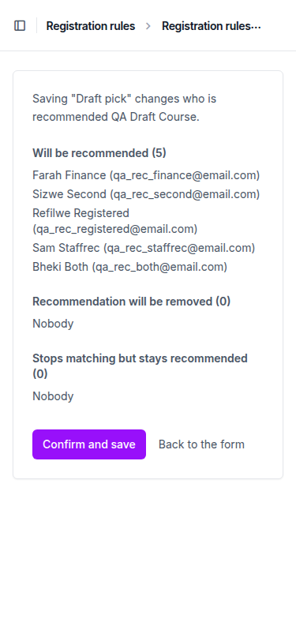 | No horizontal scroll; same missing "on" as 2.1 (B1). |
| 12-changelist | mobile | pass | 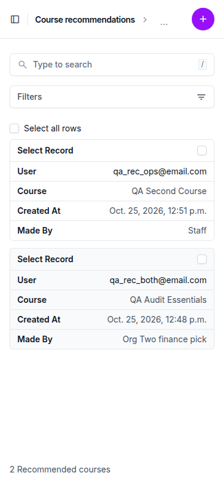 | Collapses to cards including Made By; no horizontal scroll. |
| 2.3-dashboard | mobile | pass |  | Recommended card full width; pager label wraps (see General notes). |
| 12-add | tablet | pass | none | No horizontal scroll; buttons full width. |
| 12-preview | tablet | pass | 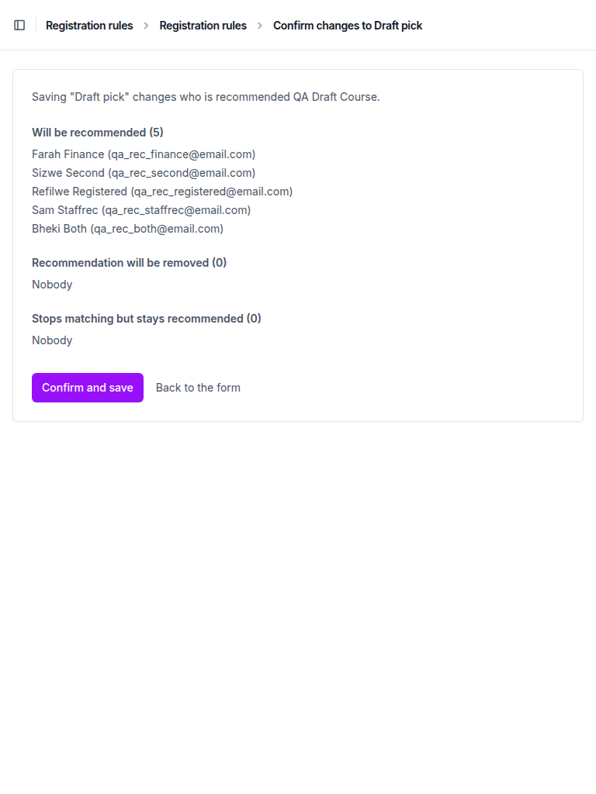 | Lists readable; Confirm and save visible. |
| 12-changelist | tablet | pass |  | Card layout with Made By; search and Filters side by side. |
| 2.3-dashboard | tablet | pass | 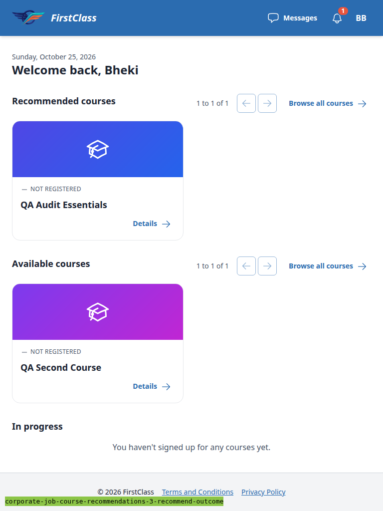 | Desktop-style header; Recommended section and pager on one line. |

## Design check

No design states tested.

## B1: Recommend preview's lead sentence is missing "on"

Manifestations:
- 2.1 (desktop)
- 12-preview (mobile)

Screenshots:

- Expected: `Saving "Finance audit pick" changes who is recommended on QA Audit Essentials.` (parallels the register branch's "registered on" and the test plan's "recommended on the course").
- Actual: `Saving "Finance audit pick" changes who is recommended QA Audit Essentials.` Source: `freedom_ls/registration_rules/templates/admin/registration_rules/preview.html` line 13.

## B2: Registration-rule links in admin read-only fields are not styled as links

Manifestations:
- 2.2 (desktop)

Screenshots:

- Expected: the rule name in a recommendation's "Registration rules" field (and a registration's "Registration rule" field) looks like a link, like other admin read-only links which use class `text-primary-600 dark:text-primary-500` (`site_aware_models/admin.py:112`, `learner_management/admin.py:663`, `learner_progress/admin.py:447`).
- Actual: rendered as a bare `<a>` with no class: grey text, no underline, indistinguishable from plain text. Source: `registration_rules/admin.py:578` and `:669`.

## B3: Delete confirmation lists "RuleRecommendation object (uuid)"

Manifestations:
- 7 (desktop)

Screenshots:

- Expected: a readable label for the related rule-recommendation row on the recommended-course delete confirmation (single and bulk), as RuleRegistration has (its `__str__` returns `rule_name`).
- Actual: `Rule recommendation: RuleRecommendation object (d63fd98e-5355-46a3-894c-c3391e0ba27e)`. `RuleRecommendation` (`registration_rules/models.py:99`) defines no `__str__`.

## Bug status

| Bug | Status |
|---|---|
| B1 | **FIXED** (commit: 526c8a974) — Recommend preview's lead sentence is missing 'on' |
| B2 | **FIXED** (commit: 75a6333dd) — Registration-rule links in admin read-only fields are not styled as links |
| B3 | **UNRESOLVED** — Delete confirmation lists 'RuleRecommendation object (uuid)' (reason: choosing the label is a data-exposure decision; the rule name would reach delete confirmations, which §11.3 hides from staff without rule permissions) |

## General notes

- §10 step 2's preview listed two learners under "Recommendation will be removed" and the two-org learner under "Stops matching but stays recommended", not "everyone", because the Org Two finance pick was re-enabled before the switch-off (the plan's step 3 precondition was done first). Behaviour is correct for that order.
- §11.1: browser Back to a POST result gives ERR_CACHE_MISS, so the double confirm was reproduced by resubmitting the captured preview form data.
- The duplicate-add error uses Django's stock "Recommended course with this User and Course already exists." This matches the plan's intent.
- The learner self-registration's string reads "qa_rec_finance@email.com - DemoDev - QA Audit Essentials": the self-registration is attached to the default-organisation learner, not QA Rec Org One (pre-existing, out of scope).
- On the learner dashboard at 375 px the pager label "1 to 1 of 1" wraps onto two lines in every section (shared dashboard component, not this branch).
- The registration changelist has no rule column; the rule shows on the registration's change page only (unchanged by this branch).
- The B3 fix is not a mechanical one: an obvious `__str__` returning the rule name would surface rule names on delete confirmations, and §11.3 deliberately hides rule names from staff without rule permissions.

status: ok · reason: 3 bugs — 2 fixed, 1 unresolved; report rendered, screenshots verified
