# Frontend QA report: Recommend outcome for registration rules

## Methodology

The run was walked by hand with Playwright MCP against a dev server on port 8003 for the branch. Data was seeded with `qa_create_recommend_outcome_scenario`. Two limited staff users (`qa_rec_ruleviewer@email.com` and `qa_rec_recstaff@email.com`) were created through the qa-data-helper agent for §11.2 and §11.3. Screenshots were collected into `screenshots/` beside this report, and every referenced image exists.

The branch was rebased onto main before the run: 30 commits, with 4 conflicts in `docs/app_structure.md`, `test_organisation/import_contracts.toml` and a learner_management test import. The full suite passed (9586 passed). The front-end check for that rebase was folded into this run.

## Diff scoping

Class: FULL. It was triggered by the three registration_rules preview templates:

- `freedom_ls/registration_rules/templates/admin/registration_rules/preview.html`
- `freedom_ls/registration_rules/templates/admin/registration_rules/preview_list.html`
- `freedom_ls/registration_rules/templates/admin/registration_rules/preview_reasons.html`

Nothing was skipped. Desktop, mobile and tablet all ran.

## Smoke gate

Status: pass. Pages checked:

- http://127.0.0.1:8003/
- http://127.0.0.1:8003/admin/freedom_ls_registration_rules/registrationrule/add/

No failure URL or reason.

## Results

### §1 The outcome is chosen once

| Test | Viewport | Status | Screenshot | Notes |
|---|---|---|---|---|
| 1.1 | desktop | pass | 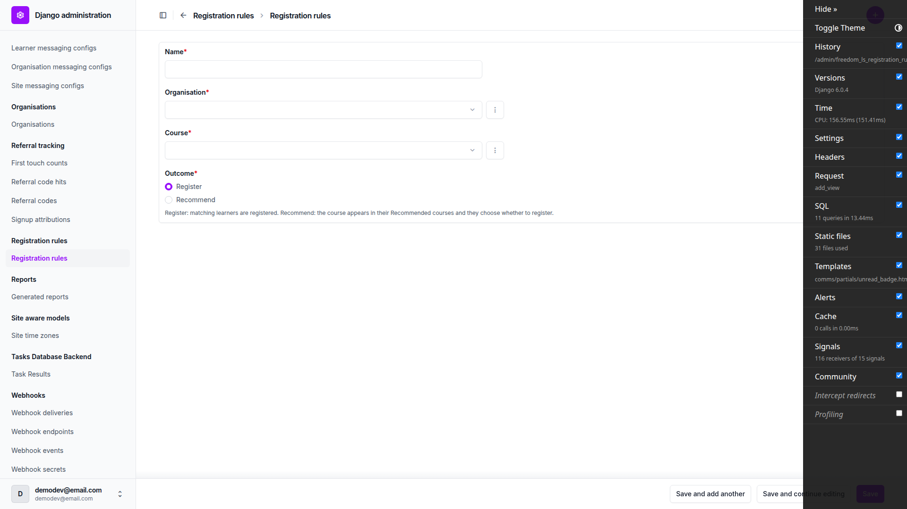 | Add page has Name, Organisation, Course and Outcome radios (Register checked) with the exact help text; saving a Recommend rule lands on its change page with the success message. |
| 1.2 | desktop | pass | 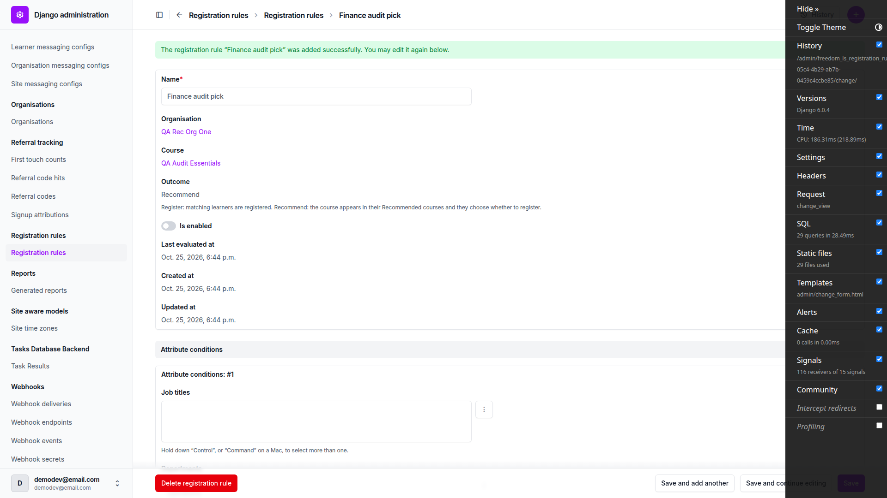 | Change page shows Outcome read-only "Recommend"; changelist has Outcome column and "By outcome" filter; recommendation changelist still only the staff row. |

### §2 Enabling: preview, then recommendations

| Test | Viewport | Status | Screenshot | Notes |
|---|---|---|---|---|
| 2.1 | desktop | pass |  | Preview titled "Confirm changes to Finance audit pick"; Will be recommended (3): finance, second, both; removed (0) and stays recommended (0) say Nobody; no registered/retracted headings; recommendation list still 1 row before confirm. |
| 2.2 | desktop | pass | — | Confirm lands on changelist with success message, Is enabled true, Change not yet applied false, Last evaluated set; 4 recommendation rows (Finance audit pick x3, Staff); registration list unchanged; finance rec links to the rule; staff rec shows "-". |
| 2.3 | desktop | pass |  | Finance learner: course only under Recommended courses; registered learner: In progress, no Recommended section; ops learner: only under Available. |
| 2.3 | mobile | pass | 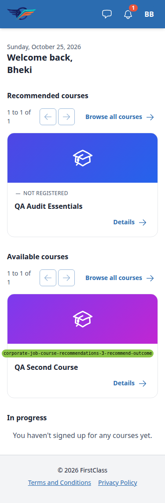 | Two-org learner's dashboard at 375px shows QA Audit Essentials under Recommended courses as a full-width card; nav and footer fine. |
| 2.3 | tablet | pass | 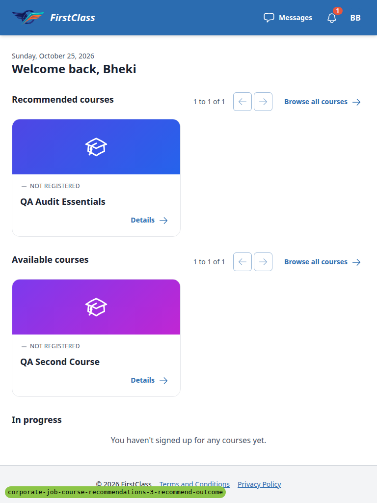 | Two-org learner's dashboard at 768px shows the course under Recommended courses. |

### §3 Registering clears the recommendation

| Test | Viewport | Status | Screenshot | Notes |
|---|---|---|---|---|
| 3.1 | desktop | pass | 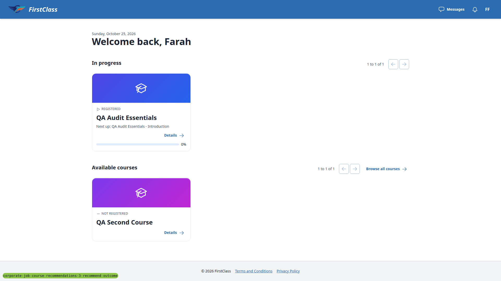 | Recommended card Details, "Enrol for free", course player; dashboard shows course In progress and no Recommended section; finance learner's row gone (3 remain). |
| 3.2 | desktop | pass | — | Staff-added active registration for the second finance learner removed their recommendation. |
| 3.3 | desktop | pass | — | Membership alone kept the two-org learner's row; adding the cohort course registration removed it; adding the staff-recommended learner as member removed their staff-made row; no rows left. |
| 3.4 | desktop | pass |  | Unchanged re-save previews all three lists as Nobody; confirm saves. |

### §4 Withdrawing a registration recommends again

| Test | Viewport | Status | Screenshot | Notes |
|---|---|---|---|---|
| 4.1 | desktop | pass | — | Deactivating the second finance learner's registration re-created their recommendation made by Finance audit pick; dashboard shows it under Recommended courses. |
| 4.2 | desktop | pass | — | Deleting the two-org learner's cohort membership re-recommended them via Finance audit pick. |
| 4.3 | desktop | pass | — | Deactivating the cohort course registration recommended the staff-recommended learner, made by Finance audit pick (staff row not resurrected). |
| 4.4 | desktop | pass | — | Inactive Learner lost the rule-made row; re-activating brought it back. |
| 4.5 | desktop | pass | — | Toggling the finance learner's self-made registration off then on leaves no recommendation; dashboard shows the course In progress only. |

### §5 Two rules, one recommendation

| Test | Viewport | Status | Screenshot | Notes |
|---|---|---|---|---|
| 5.1 | desktop | pass | — | Org Two finance pick preview: Will be recommended (0), others Nobody; confirmed. |
| 5.2 | desktop | pass | 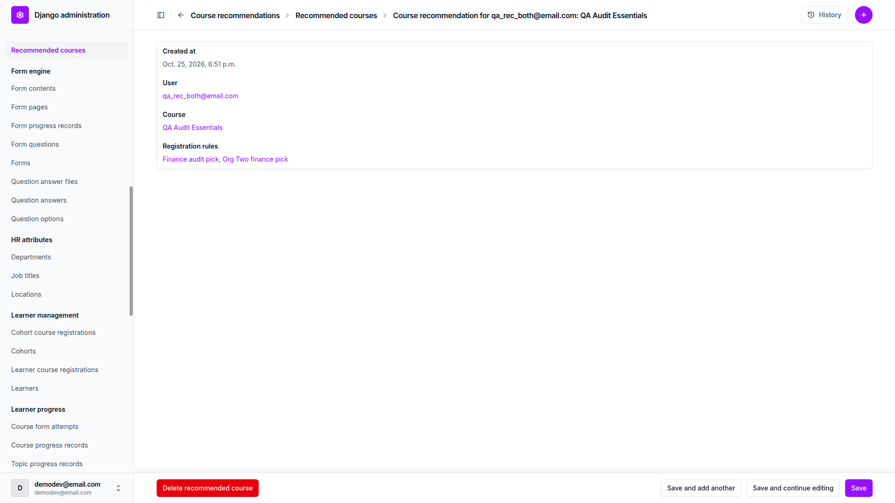 | Two-org learner's recommendation lists both rules as links; Made by names both; dashboard shows the course once under Recommended courses. |
| 5.3 | desktop | pass | 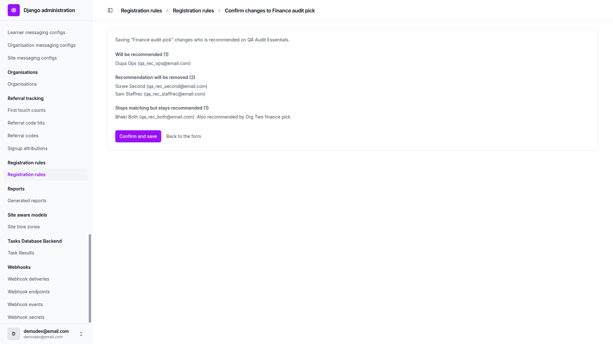 | Switch to Operations: recommended (1) ops; removed (2) second + staffrec; stays recommended (1) two-org learner "Also recommended by Org Two finance pick". |
| 5.4 | desktop | pass | — | Rows: ops (Finance audit pick), two-org (Org Two finance pick only); two-org dashboard still recommends the course. |
| 5.5 | desktop | pass | — | Disabling Org Two finance pick previews removal of the two-org learner; row gone and dashboard has no recommended section. |
| 5.6 | desktop | pass | — | Back to Finance: ops removed, second/staffrec/two-org recommended again. |

### §6 Staff-made recommendations are never taken over

| Test | Viewport | Status | Screenshot | Notes |
|---|---|---|---|---|
| 6.1 | desktop | pass | — | Staff add of ops learner / QA Second Course succeeds with Made by Staff. |
| 6.2 | desktop | pass | 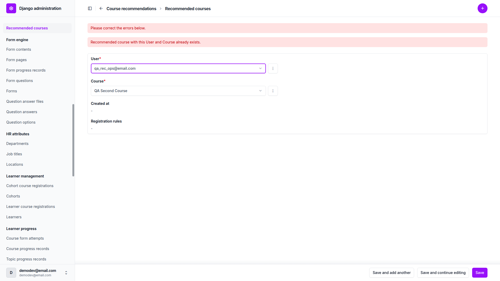 | Duplicate add returns the form with "Recommended course with this User and Course already exists."; still one row. |
| 6.3 | desktop | pass | — | Second course pick (Operations) preview Will be recommended (0); ops row stays Made by Staff. |
| 6.4 | desktop | pass | — | Disabling Second course pick leaves the staff-made ops row. |

### §7 Staff deletes of a rule-made row

| Test | Viewport | Status | Screenshot | Notes |
|---|---|---|---|---|
| 7.1 | desktop | pass | 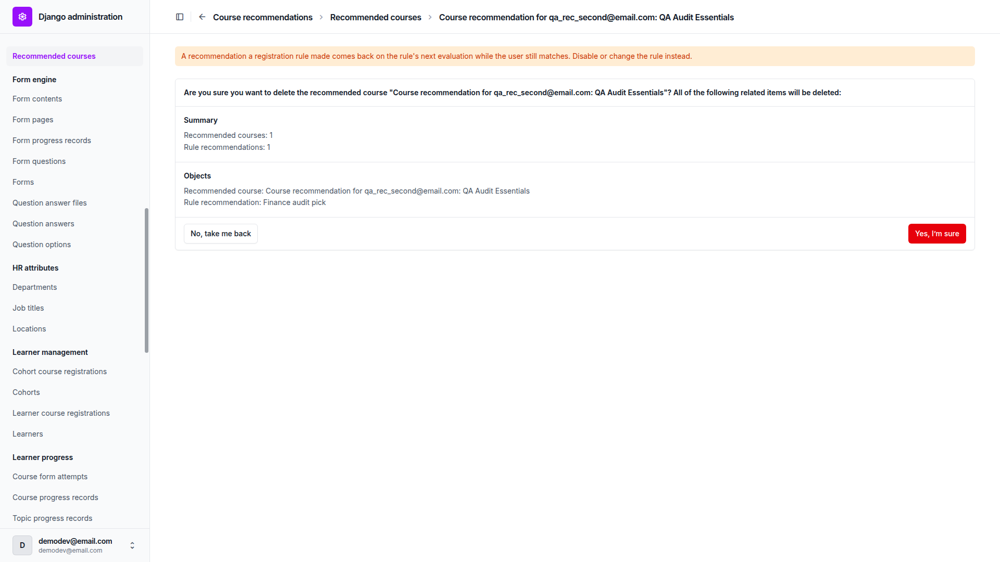 | Delete confirmation for a rule-made row shows the "comes back on the rule's next evaluation" warning and lists "Rule recommendation: Finance audit pick"; delete lands on changelist with only the success message. |
| 7.2 | desktop | pass | — | Unchanged re-save previews Will be recommended (1) second finance learner; row back. |
| 7.3 | desktop | pass | 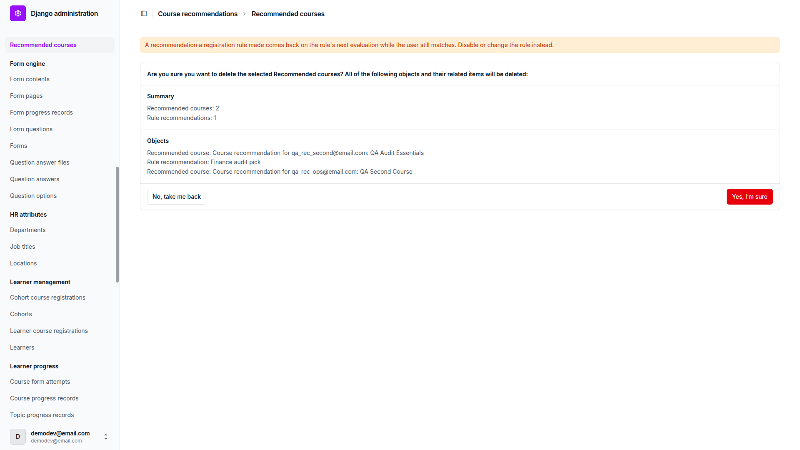 | Bulk delete with one rule-made + one staff-made row shows the warning; cancel keeps 4 rows. |
| 7.4 | desktop | pass | — | Bulk delete of only the staff row shows no warning; deleted; rule re-run does not bring it back. |

### §8 The recommendation admin's filter

| Test | Viewport | Status | Screenshot | Notes |
|---|---|---|---|---|
| 8 | desktop | pass | 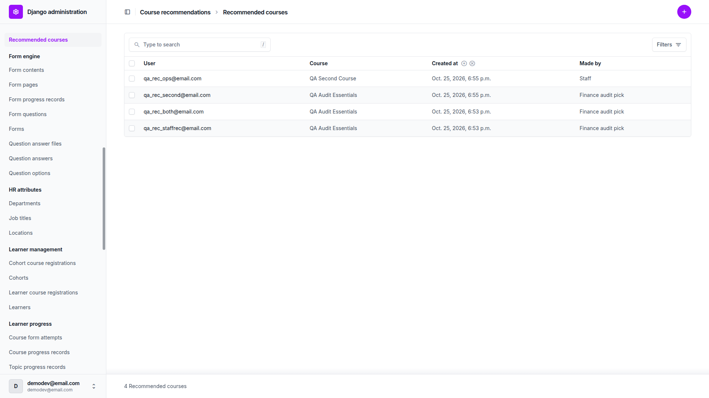 | Made by filter: Registration rule shows only rule rows; Staff empty, then shows the re-added ops row; no filter shows all. |

### §9 Warnings and the switch

| Test | Viewport | Status | Screenshot | Notes |
|---|---|---|---|---|
| 9.1 | desktop | pass | 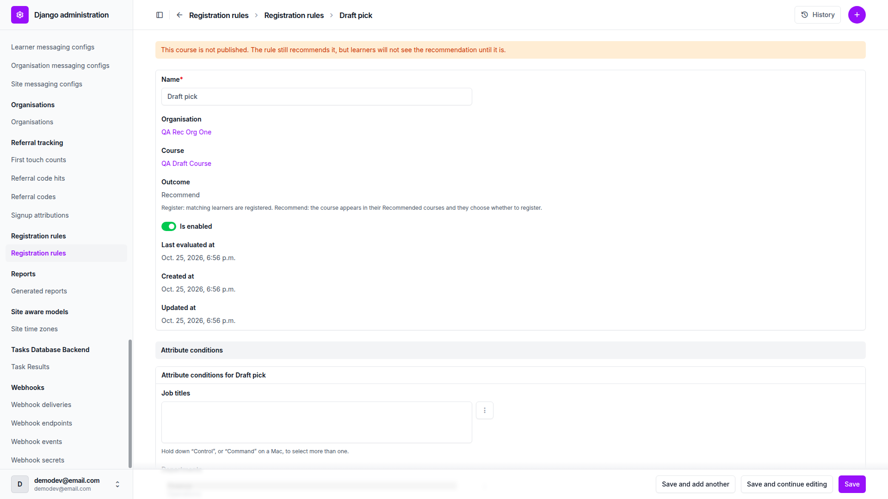 | Draft pick recommended the 5 Finance learners of Org One (incl. the registered learner, since QA Draft Course has no registrations); change page shows the not-published warning; finance dashboard shows no QA Draft Course; disabling removed all 5. |
| 9.2 | desktop | pass | — | With the switch off, moving the second finance learner to Operations kept their row; switching on removed it; back to Finance restored it. |

### §10 Deleting a rule

| Test | Viewport | Status | Screenshot | Notes |
|---|---|---|---|---|
| 10.1 | desktop | pass | — | Enabled rule has no Delete link; its delete URL returns 403. |
| 10.2 | desktop | pass | 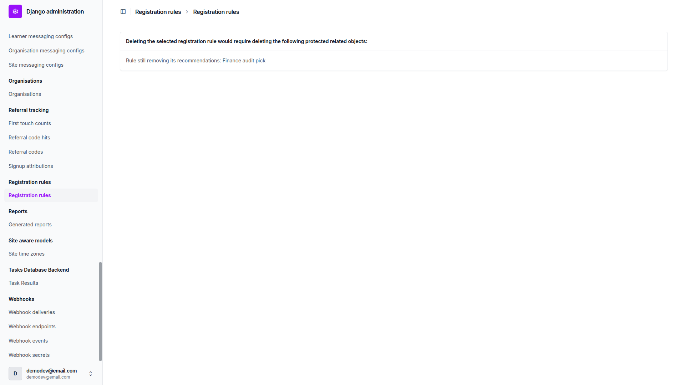 | Switch off: disabling previews the switch-off notice and lists all 3 under Recommendation will be removed; delete URL 403; bulk delete names "Rule still removing its recommendations: Finance audit pick". |
| 10.3 | desktop | pass | — | Rows untouched while the switch is off; after re-enabling Org Two finance pick the two-org learner's row names both rules. |
| 10.4 | desktop | pass | — | Switch back on: Finance audit pick's own rows gone; two-org learner's row remains, made by Org Two finance pick only. |
| 10.5 | desktop | pass | 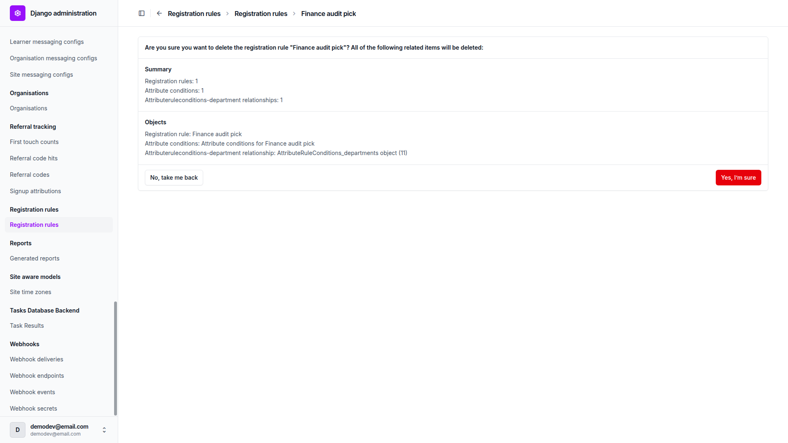 | Delete page allowed (200), lists no Recommended course or Rule recommendation; delete succeeds; two-org learner's recommendation shows Registration rules "Org Two finance pick" only. |

### §11 Adversarial

| Test | Viewport | Status | Screenshot | Notes |
|---|---|---|---|---|
| 11.1 | desktop | pass | — | Double confirm replayed by submitting the captured preview form twice: both ended in a normal redirect with "changed successfully"; no duplicate recommendation rows. |
| 11.2 | desktop | pass | 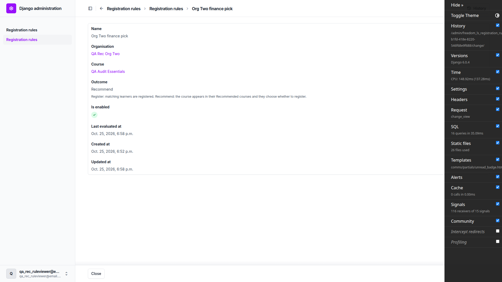 | View-only staff user sees "View registration rule" with Outcome "Recommend", no inputs or save buttons; forced POST returns 403 (superuser gets 200), no preview. |
| 11.3 | desktop | pass |  | Made by reads "Registration rule" (no name) and "Staff"; rule-made change page shows "Registration rule" with no link; made_by filter narrows correctly. |
| 11.4 | desktop | pass | 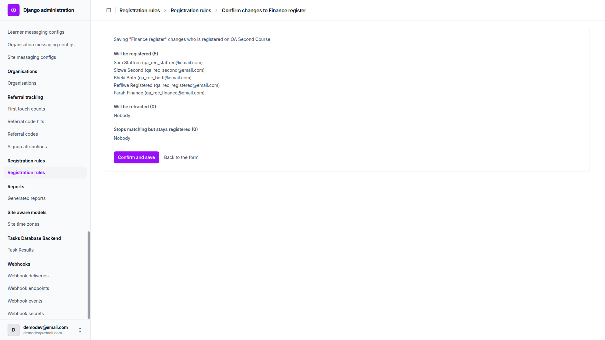 | Register rule preview uses "changes who is registered", Will be registered (5) / Will be retracted / Stops matching but stays registered, no recommend headings; 5 active registrations show Registration rule "Finance register"; disabling previews 5 retractions. |

### §12 Layout

| Test | Viewport | Status | Screenshot | Notes |
|---|---|---|---|---|
| 12 | desktop (1920px) | pass | 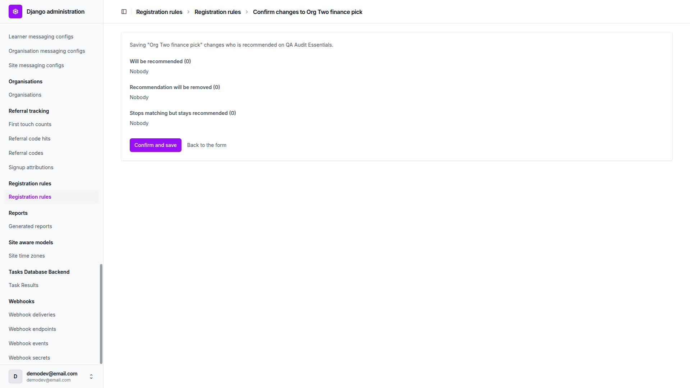 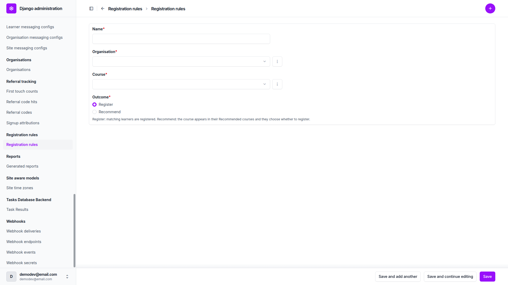 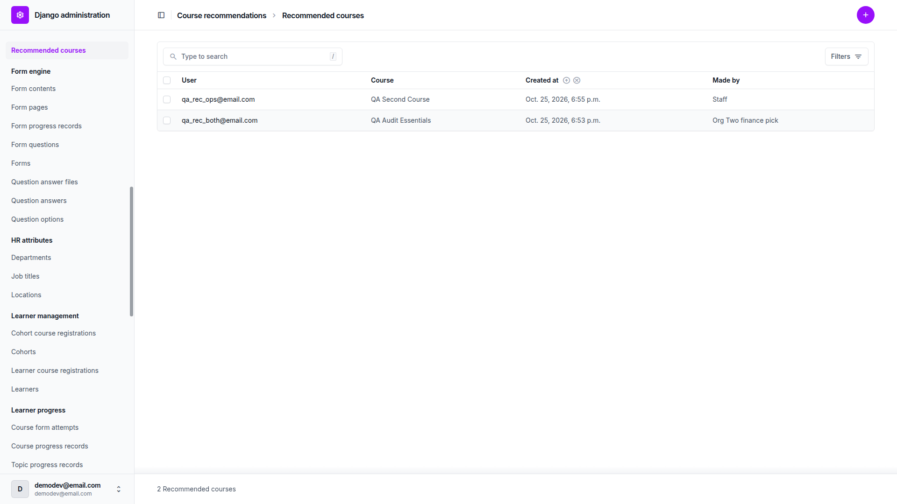 | Add page, recommendation changelist and recommend preview have no horizontal scroll (scrollWidth == clientWidth); Confirm and save visible (144x38). |
| 12 | mobile (375px) | pass | 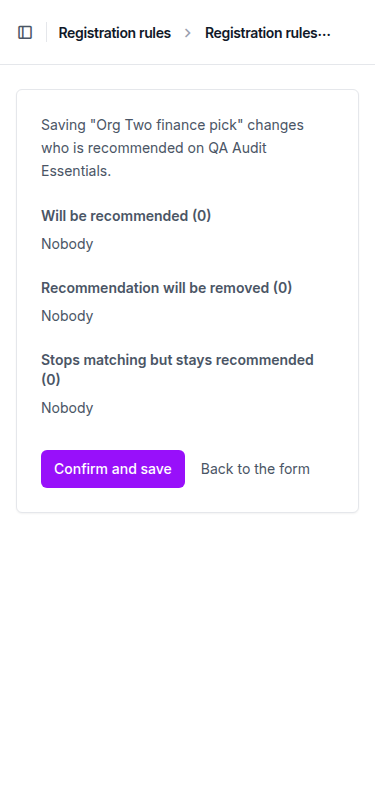   | Add page radios and help text stack cleanly; changelist rows become cards with a Made By line; preview headings wrap, Confirm and save (144x38) reachable; no horizontal scroll, only truncated breadcrumbs extend past the edge inside a clipped container. |
| 12 | tablet (768px) | pass | 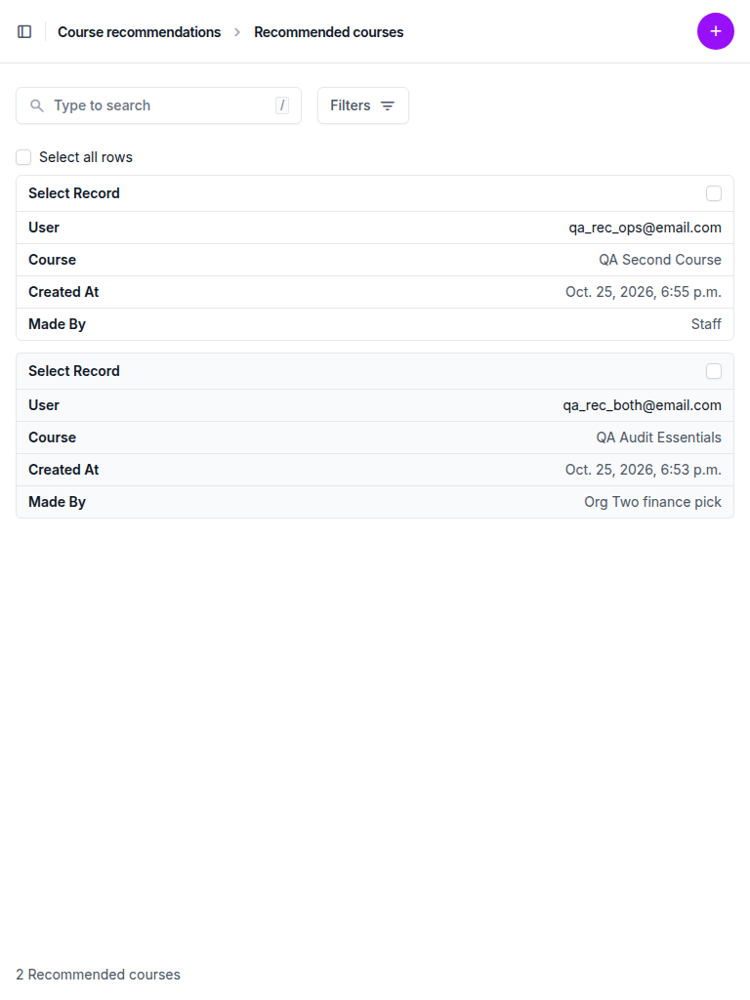 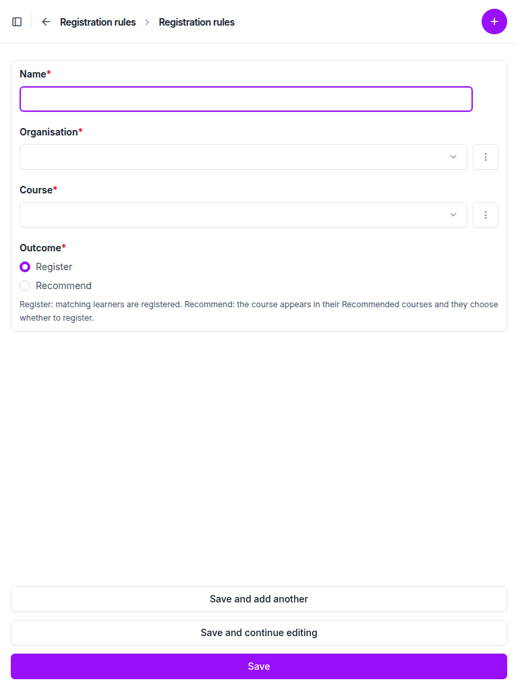 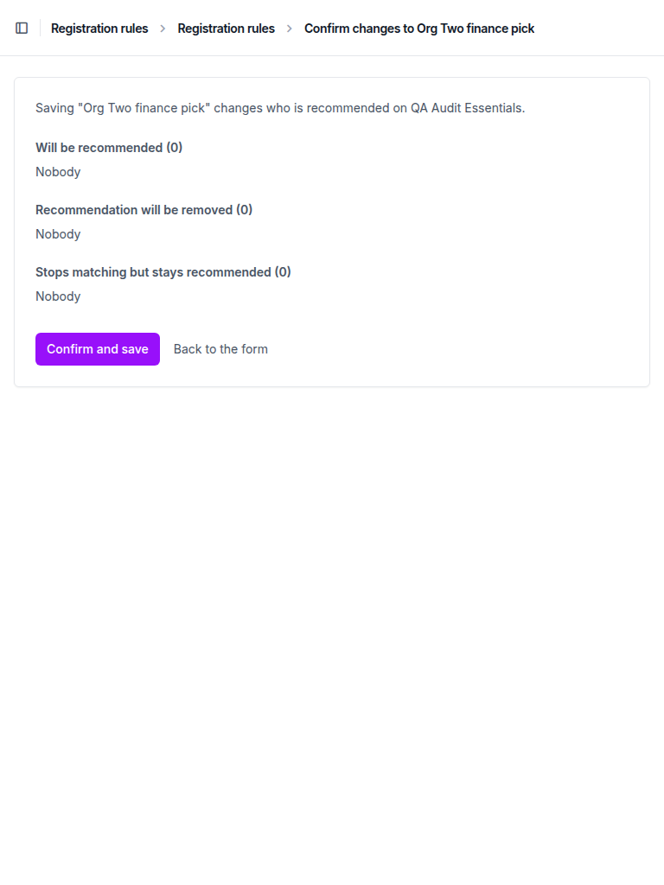 | Add page, recommendation changelist (stacked cards with Made By) and recommend preview have no horizontal scroll; Confirm and save reachable. |

### Rebase check

| Test | Viewport | Status | Screenshot | Notes |
|---|---|---|---|---|
| rebase-frontend-check | desktop | pass | — | Pre-step rebase front-end check folded into this run (same pages, three viewports, one server). Console errors: only the deliberate 403s on the rule delete URL and a favicon.ico 404 on the admin login page. |

## Design check

No design states tested.

## Bugs

No bugs were found, so there are no per-bug sections.

## Bug status

No bugs recorded this run.

## General notes

- The self-registration's label names organisation "DemoDev" rather than QA Rec Org One (§4.5).
- The rule delete confirmation lists "AttributeRuleConditions_departments object (11)", Django's default M2M through-row label (§10.5).
- The dashboard's existing "1 to 1 of 1" pager label wraps on 375px (§2.3, mobile).
- §11.1 replayed the double confirm by resubmitting the captured preview form twice, since browser Back to a POST-rendered page hits Chrome's resubmission cache miss.
- The registration changelist has no rule column; the rule shows on the registration's change page (§11.4).
- The only console errors were deliberate 403s and a favicon.ico 404 on the admin login.

status: ok · reason: report rendered, 0 bugs documented
