# Frontend QA report: deadlines-1-dates-and-overdue

## Methodology

- Tool: Playwright MCP against the dev server at http://127.0.0.1:8931/.
- Browser time zone Africa/Johannesburg (a New York context was used for test 7.1); browser locale en-US.
- Viewports: desktop 1920x1080, mobile 375x812, tablet 768x1024.
- Screenshots are collected in `screenshots/` beside this report. Every embedded image exists there.
- Server date was 25 Oct 2026.

## Diff scoping

Class: FULL. It was triggered by template and static paths, for example `learner_interface/templates/learner_interface/course_detail.html`, `partials/course_card.html`, `partials/course_minimal_toc.html`, `base/static/base/js/alpine-components.js` and `interface-swap-fallback.js` (153 changed files in total). Nothing was skipped, so every test in the plan ran.

## Smoke gate

Status: pass. Pages checked:

- http://127.0.0.1:8931/
- http://127.0.0.1:8931/courses/functionality-demo-course-parts/detail/

## Results

| Test | Viewport | Status | Note |
|---|---|---|---|
| 1.1 | desktop | pass | Cohort learner outline shows dates and Overdue badges. Every dated row is Overdue because 25 Oct 2026 is past all the dates. |
| 1.2 | desktop | pass | Player sidebar matches the course detail badges and dates. The date wraps under the title in the narrow sidebar. |
| 1.3 | desktop | pass | Completing Welcome cleared its badge and date in the sidebar and the outline. Other rows were unchanged. |
| 1.4 | desktop | pass | Fresh learner: Welcome Overdue, What to Expect Nov 1 2026, Key Ideas Nov 8 05:00 PM, Finish by Jan 23 2027. |
| 1.5 | desktop | pass | Unregistered and anonymous visitors see no `<time>` elements, no Overdue and no time limit cell. |
| 2.1 | desktop | pass | Finish by cell is correct for the fresh learner (Reg+90). The cohort learner's limit has passed, so it reads Time limit ended May 30 2026. |
| 2.2 | desktop | pass | Late learner shows TIME LIMIT ENDED and OVERDUE with Oct 15 2026 11:59 PM. The plain course has no time-limit cell. |
| 3.1 | desktop | pass | Late learner dashboard card: Overdue badge and Time limit ended line, above the progress bar. |
| 3.2 | desktop | pass | Fresh learner parts card shows a "1 overdue" badge and no Next due line. |
| 3.3 | desktop | pass | The cohort learner's limit has passed, so the card shows Time limit ended May 30, 2026. Next due was exercised in 5.1. |
| 4.1 | desktop | pass | Picker lists only the parts course items. Welcome saved as Days after registration / 3, with Content default, Effective and Set by shown. |
| 4.2 | desktop | pass | Verified with cohort member qa_deadline_cohort2: Welcome Due Oct 27 2026, no badge. Fresh and late learners are unaffected. |
| 4.3 | desktop | pass | All four invalid combinations were refused with clear messages and nothing was saved. |
| 4.4 | desktop | pass | Cohort time limit override of 200 days gives Sep 17 2026 for the cohort learner. The late learner is unchanged. |
| 5.1 | desktop | pass | Effective deadlines list is correct. A No deadline override drops Welcome from the list and the learner outline. |
| 5.2 | desktop | pass | Run on qa_deadline_cohort2. Learner override Fixed 2026-10-26 09:00 replaces the cohort override everywhere. |
| 5.3 | desktop | pass | Deleting the learner override returns Welcome to the cohort layer (Oct 27 2026). |
| 6 | desktop | pass | "Default has changed" note appears. Override-held dates did not move, and the late learner with no override moved to Jul 27. |
| 7.1 | desktop | pass | The time-zone label and New York conversion are correct, and the same instants are shown. No label when the setting is off. |
| 7.2 | desktop | pass | With Pacific/Auckland the cohort learner's What to Expect reads Mar 8, 2026, 12:59 PM. Reset to Africa/Johannesburg afterwards. |
| 7.3 | desktop | pass | An invalid time zone name is refused, as is a duplicate site row. |
| 8 | desktop | pass | The learner override followed Key Ideas to its new path after the re-sync. The stale row is also listed. |
| 9 | desktop | pass | With the default removed, What to Expect is undated. Next due skips to Key Ideas for the fresh learner. |
| 10 | desktop | pass | No horizontal overflow on the course detail, player or dashboard. No console errors. |
| 10 | mobile | pass | The stats strip stacks and outline rows wrap the badge and date beneath the title. No overflow. |
| 1.2 | mobile | pass | The outline opens as a bottom sheet. Every dated row shows its badge and date, and nothing is clipped. |
| 3.1 | mobile | pass | The dashboard card wraps the time-limit line beside the badge, above Details and the progress bar. |
| 10 | tablet | pass | The stats strip stays three across and the outline keeps the badge and date on one line. No overflow. |
| 1.2 | tablet | pass | The outline is hidden behind the "Open course outline" button, as on mobile. |
| 3.1 | tablet | pass | Two cards per row, with the deadline line wrapping inside the card. |

### Key screenshots

**1.1 and 10 (desktop): cohort and late learner course detail**

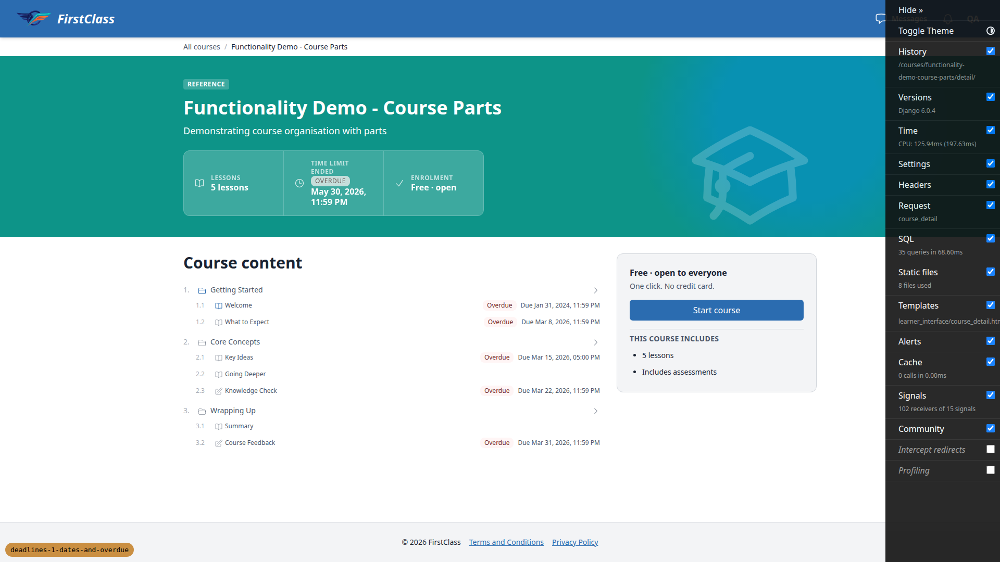

**1.2 (desktop): player sidebar**

**1.4 and 2.1 (desktop): fresh learner outline and Finish by cell**

**3.1 (desktop): late learner dashboard**

**4.1 (desktop): cohort override inline and picker**

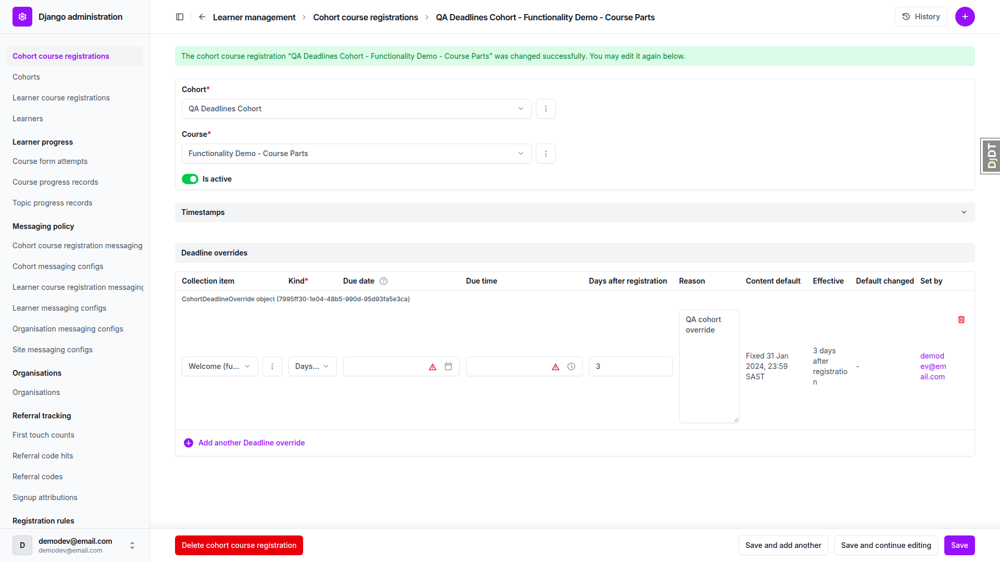

**4.3 (desktop): refused combinations**

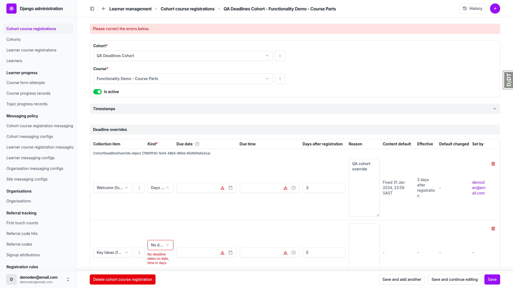

**5.1 (desktop): Effective deadlines in the CourseProgress admin**

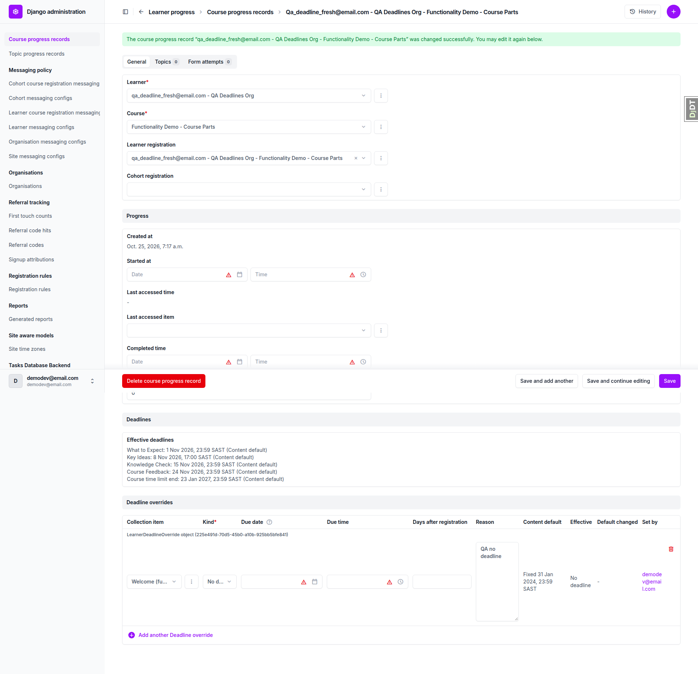

**5.1 (desktop): fresh learner dashboard after the No deadline override**

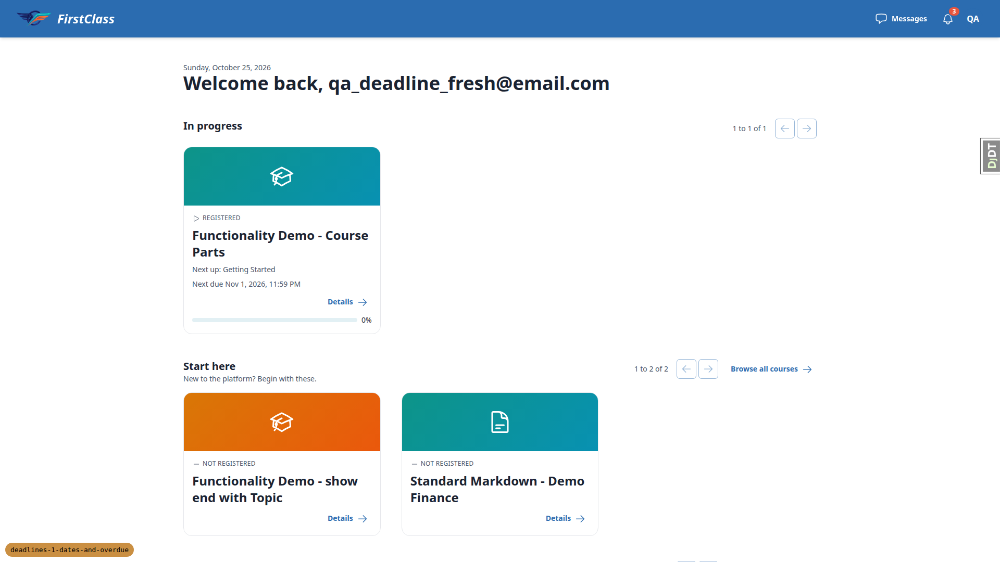

**7.3 (desktop): site time zone validation**

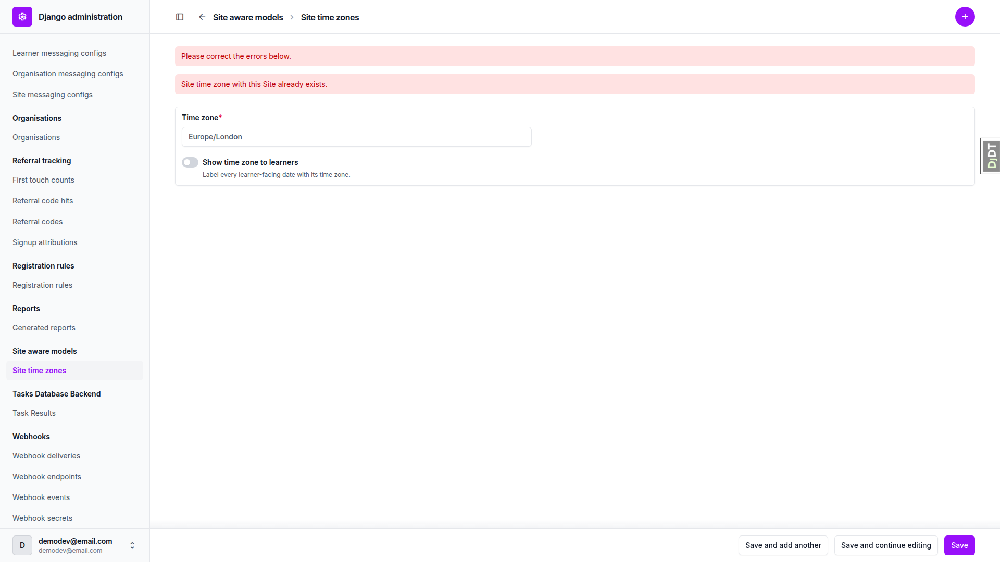

**6 (desktop): "Default has changed" note**

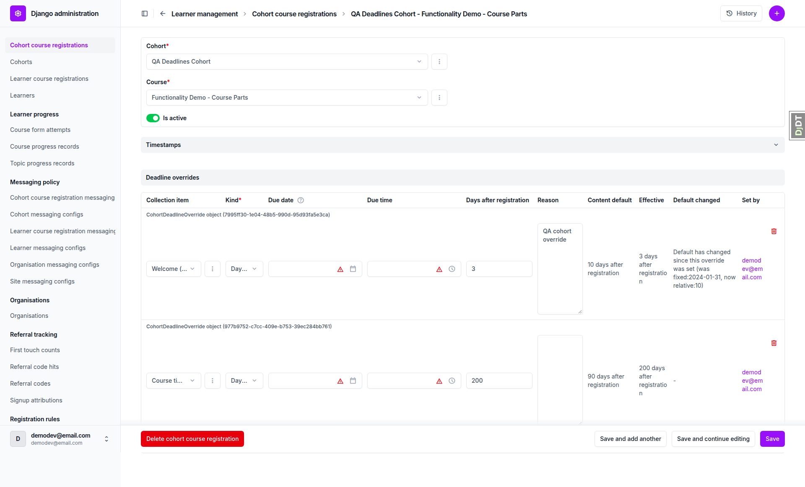

**8 (desktop): carry-over course after re-sync**

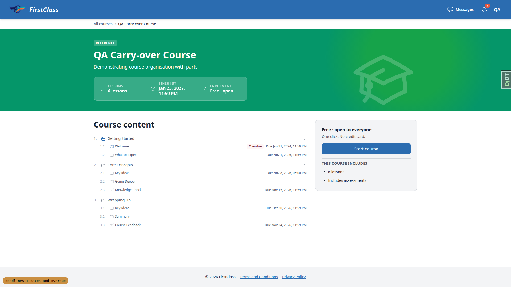

**10 (mobile): course detail**

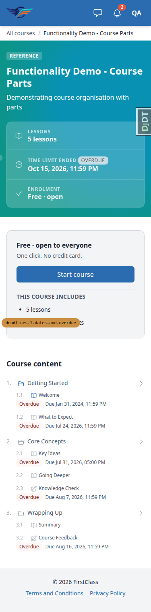

**1.2 (mobile): player, outline closed**

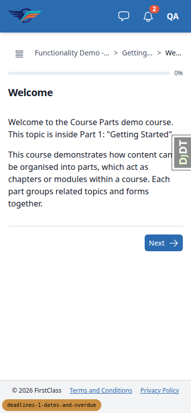

**1.2 (mobile): player, outline open**

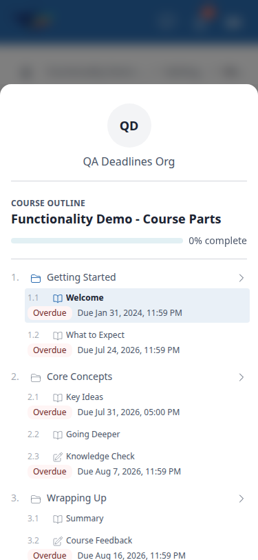

**3.1 (mobile): dashboard**

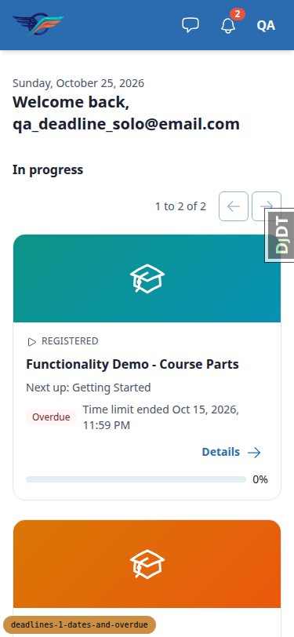

**10 (tablet): course detail**

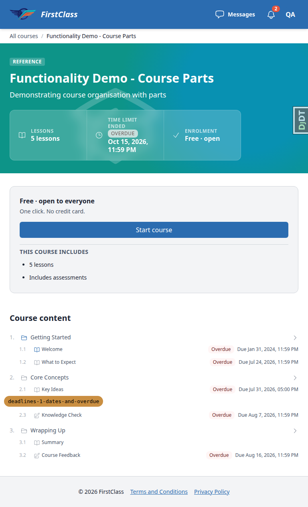

**1.2 (tablet): player**

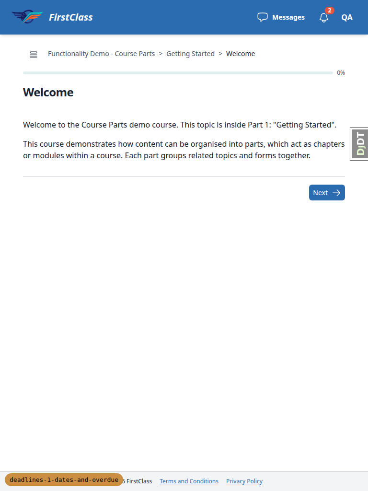

**3.1 (tablet): dashboard**

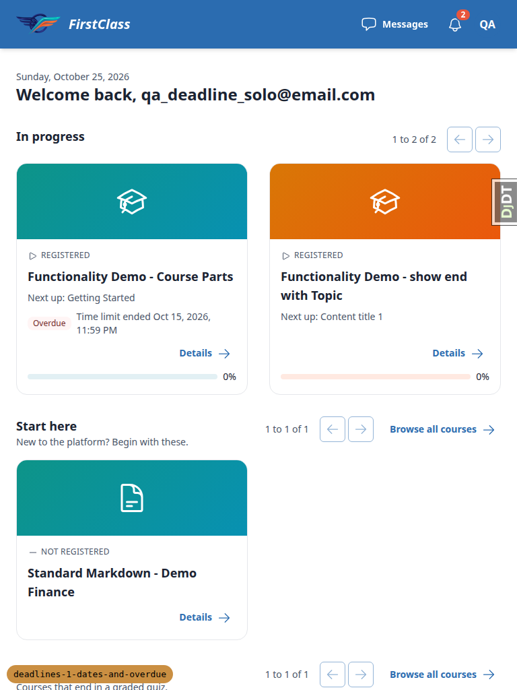

## Design check

No design states tested.

## Defects

No defects were found, and no bug records were produced.

## Bug status

No bugs recorded.

## General notes

1. The plan's expectations were written for an earlier "today". The cohort learner (Reg 1 Mar 2026) has every date and the 90-day limit in the past on 25 Oct 2026. Items therefore show Overdue and the card shows "Time limit ended", instead of the plan's "no badge", "Finish by" and "Next due" expectations. The behaviour is correct for the date, and the Next due line was verified with other learners. The plan would be more robust if it seeded the cohort learner relative to today.
2. Plan inconsistency: 4.2 step 1 expects the fresh learner (individual registration) to see the cohort override, which contradicts its own step 3. It was verified with cohort member qa_deadline_cohort2 instead. 5.2 used qa_deadline_cohort2 instead of resetting the cohort learner's completion.
3. Plan naming drift: the plain course is "Functionality Demo - show end with Topic" (slug functionality-demo-show-end-with-topic). Its items are "What to Expect", "Key Ideas" and "Course Feedback". Course detail lives at /courses/<slug>/detail/ (bare /courses/<slug>/ redirects to the player). The stats strip has no Duration cell for this course.
4. Dates render in the browser locale (en-US: "Mar 8, 2026, 11:59 PM", hours zero-padded as "05:00 PM"), not the plan's "8 Mar 2026, 23:59".
5. Admin inline rows head with "CohortDeadlineOverride object (<uuid>)" / "LearnerDeadlineOverride object (<uuid>)". The override models have no readable `__str__`.
6. The "Default has changed" note shows the internal encoding ("was fixed:2024-01-31, now relative:10"), as the plan specifies.
7. Admin date/time widgets show Django's "You are 2 hours ahead of server time" warning (server TIME_ZONE UTC). This is pre-existing Django behaviour.
8. Registered learners still see "Free · open to everyone / Start course" in the course detail enrolment card. This is unrelated to this branch.
9. After the §8 re-sync the stale Core Concepts Key Ideas row remains (known sync behaviour), so the admin Effective deadlines lists Key Ideas twice.
10. On the hero stats strip the OVERDUE badge renders in a neutral light tone rather than the error tone used in the outline, presumably for contrast on the teal hero.
11. qa_deadline_cohort2@email.com, a cohort member from an earlier run, was used for 4.2, 5.2 and 5.3.
12. §11 clean-up was delegated to the data helper (overrides, completions, carry-over course, zone settings).

status: ok · reason: report rendered, 0 bugs documented
