# Frontend QA report: deadlines-1-dates-and-overdue

## Methodology

- Browser walk-through with the Playwright MCP, following `3. frontend_qa.md`.
- Viewports: desktop 1920×1080, mobile 375×812 and tablet 768×1024.
- Browser time zone: `Africa/Johannesburg`. Test 7.1 also used a second context in `America/New_York`.
- Screenshots were collected into `screenshots/` beside this report. Every image linked below exists there.
- Run date: 2026-10-25. Dev server on port 8862. Branch: `deadlines-1-dates-and-overdue`.

## Diff scoping

Class: **FULL**. It was triggered by template and static changes. Changed files named in the scoping record:

- `freedom_ls/base/static/base/js/alpine-components.js`
- `freedom_ls/base/static/base/js/interface-swap-fallback.js`
- `freedom_ls/learner_interface/templates/learner_interface/course_detail.html`
- `freedom_ls/learner_interface/templates/learner_interface/partials/course_card.html`
- `freedom_ls/learner_interface/templates/learner_interface/partials/course_minimal_toc.html`
- plus 161 other files

Everything ran and nothing was skipped.

## Smoke gate

Pass. Pages checked:

- `http://127.0.0.1:8862/`
- `http://127.0.0.1:8862/courses/functionality-demo-course-parts/1/`

## Results

All tests passed.

### §1 Deadlines in the player outline, never on course detail

| Test | Viewport | Status | Note |
|---|---|---|---|
| 1.1 | desktop | pass | Course detail has no `<time>`, no Deadline/Missed/Due wording for cohort, fresh, late, visitor and anonymous viewers. The Course content list is identical for all. |
| 1.2 | desktop | pass | Fresh learner: Welcome has the Missed deadline chip with Jan 31 2024. The four other dated rows show the right dates with no chip. Parts rows, Going Deeper and Summary have no line. The deadline line starts at the type icon (116px). `<time datetime>` ends `+00:00` with no zone label. Top-level dated rows could not be checked (see notes). |
| 1.3 | desktop | pass | Completing Welcome removed its chip and date. Other rows unchanged. |
| 1.4 | desktop | pass | Cohort learner: every dated row shows the Missed deadline chip with the expected date. |

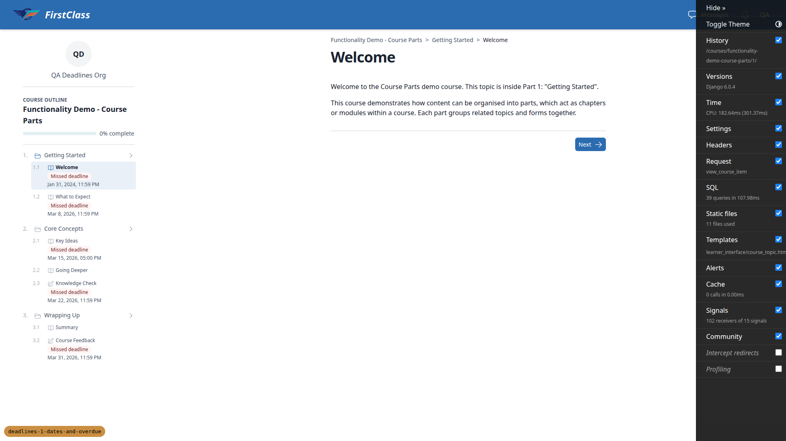

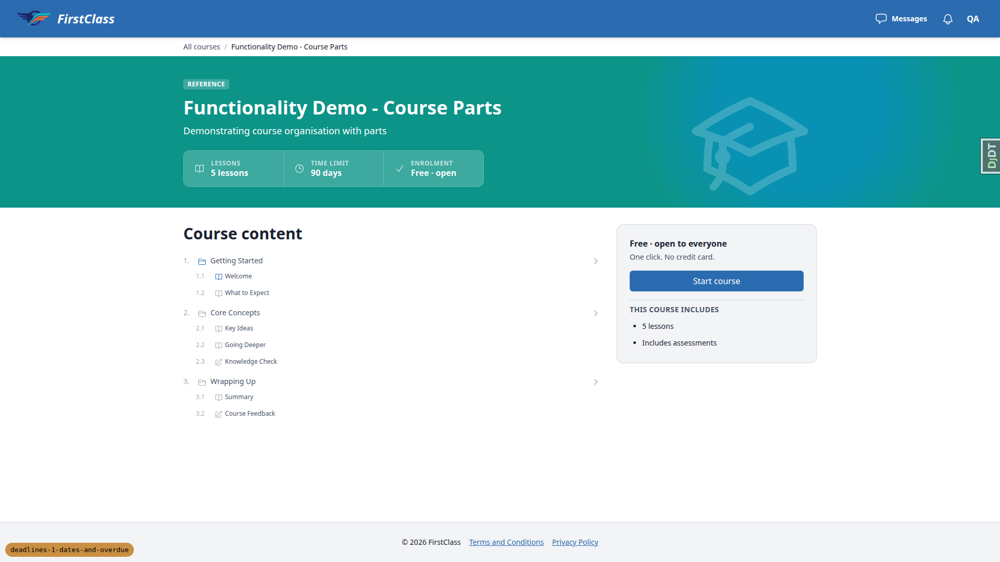

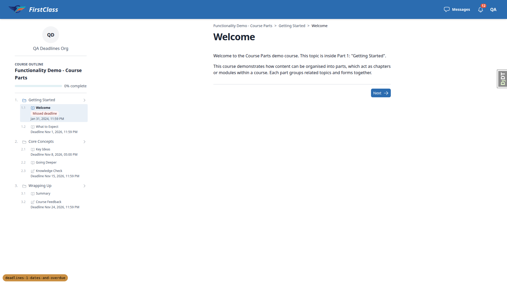

### §2 Course detail time limit

| Test | Viewport | Status | Note |
|---|---|---|---|
| 2 | desktop | pass | Stats strip reads "Time limit · 90 days" with the clock icon for all five viewers. The plain course has no Time limit cell. |

### §3 Dashboard card line

| Test | Viewport | Status | Note |
|---|---|---|---|
| 3.1 | desktop | pass | Cohort and late learner parts cards show the Missed deadline chip and "Welcome Jan 31, 2024, 11:59 PM", with eyebrow Registered. The late learner's plain course card has no deadline line. |
| 3.2 | desktop | pass | Fresh learner: "Next deadline: What to Expect Nov 1, 2026, 11:59 PM", muted. After completing it, the line advances to Key Ideas Nov 8, 05:00 PM. The line sits above the progress bar. |
| 3.3 | desktop | pass | Late learner with five dated items complete: "Missed deadline Course Oct 15, 2026, 11:59 PM". No "time limit" wording. |

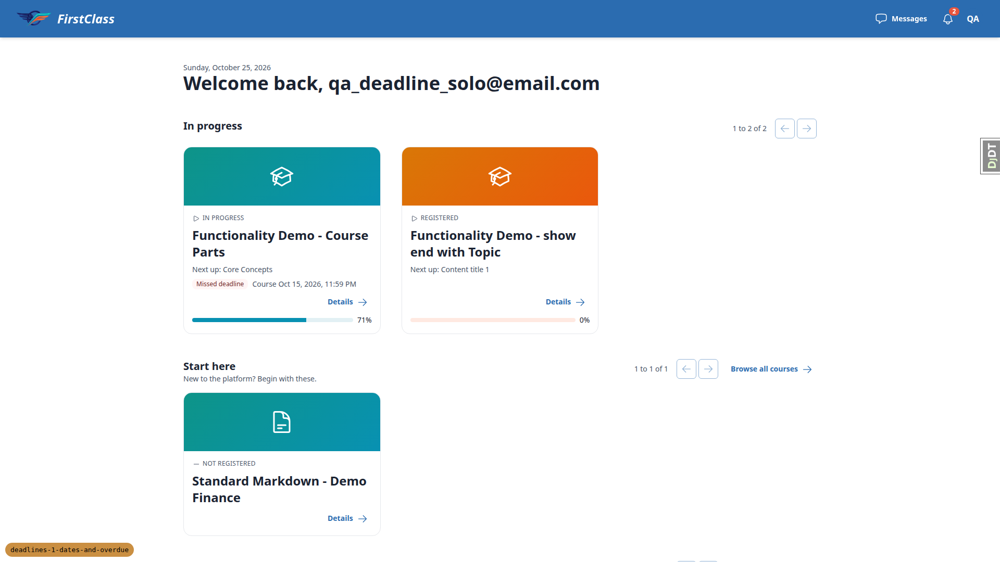

### §4 Cohort deadline override

| Test | Viewport | Status | Note |
|---|---|---|---|
| 4.1 | desktop | pass | The picker lists only this course's items as "Title (path)", with the empty choice "Course time limit". The saved row shows the Content default, the Effective value "3 days after registration" and the setter demodev@email.com, with no default-changed note. Cosmetic: the unfold inline row header reads "CohortDeadlineOverride object (uuid)". |
| 4.2 | desktop | pass | Cohort learner sees Welcome as missed on Mar 4, 2026, 11:59 PM in the player and on the dashboard. The fresh learner is unaffected. |
| 4.3 | desktop | pass | All four inconsistent rows were refused with the expected messages and nothing was saved. |
| 4.4 | desktop | pass | Cohort time-limit override of 200 days saved. Course detail still reads "Time limit · 90 days". Cohort card reads "Missed deadline Course Sep 17, 2026, 11:59 PM". The late learner is unchanged. |

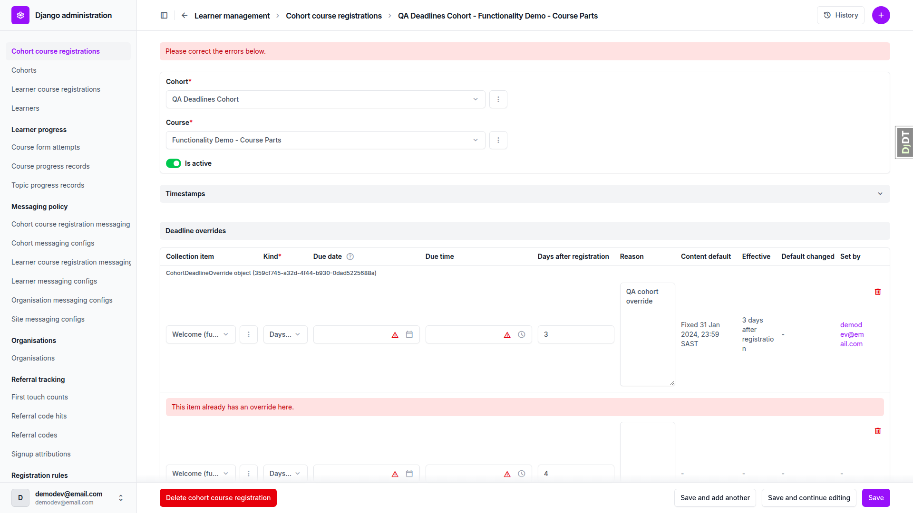

### §5 Learner deadline override

| Test | Viewport | Status | Note |
|---|---|---|---|
| 5.1 | desktop | pass | Effective deadlines field lists items in SAST with the source and the time limit end. After a "No deadline" override on Welcome, Welcome is gone from the field and its row is Effective "No deadline". The fresh learner card shows "Next deadline: Key Ideas Nov 8". The player check is weak because Welcome was already complete. |
| 5.2 | desktop | pass | Learner Fixed override for 26 Oct 2026 09:00. Row Effective "Fixed 26 Oct 2026, 09:00 SAST", source "Learner override". Player shows "Deadline Oct 26, 2026, 09:00 AM" with no chip. The card shows the earliest missed deadline, What to Expect Mar 8, 2026. |
| 5.3 | desktop | pass | After deleting the learner override, Welcome shows Missed deadline Mar 4, 2026 (cohort layer). |

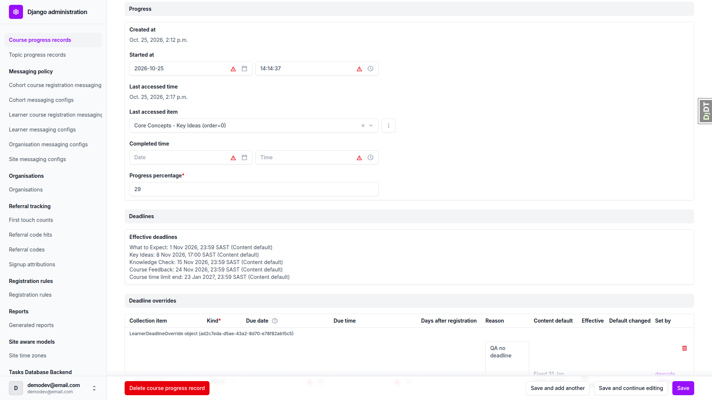

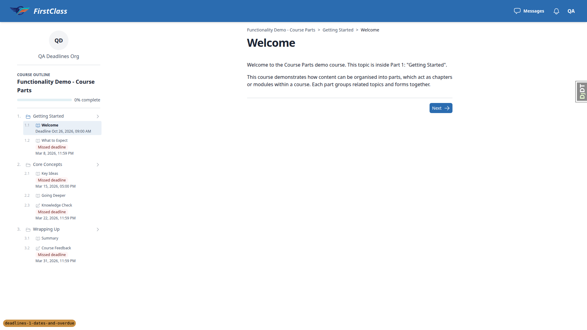

### §6 The content default changes under an override

| Test | Viewport | Status | Note |
|---|---|---|---|
| 6 | desktop | pass | With Welcome's default changed to relative 10, the override row shows Content default "10 days after registration" and the note "Default has changed since this override was set (was fixed:2024-01-31, now relative:10)". The cohort learner still sees Mar 4, 2026. |

### §7 Site time zone

| Test | Viewport | Status | Note |
|---|---|---|---|
| 7.1 | desktop | pass | Label on: Johannesburg shows "Mar 8, 2026, 11:59 PM GMT+2" in the outline and card. New York shows "Mar 4, 2026, 04:59 PM EST" and "Mar 8, 2026, 05:59 PM EDT". Label off: no label. The plan's expected "04:59 PM EST" for Mar 8 is a plan error (see notes). |
| 7.2 | desktop | pass | Auckland: What to Expect reads "Mar 8, 2026, 12:59 PM" with datetime `2026-03-08T10:59:59+00:00`. The admin names NZDT. Zone set back to Africa/Johannesburg. |
| 7.3 | desktop | pass | "Mars/Olympus" refused with "Not an IANA time zone name, e.g. Africa/Johannesburg." and the row unchanged. A second row for the site is refused with "Site time zone with this Site already exists." |

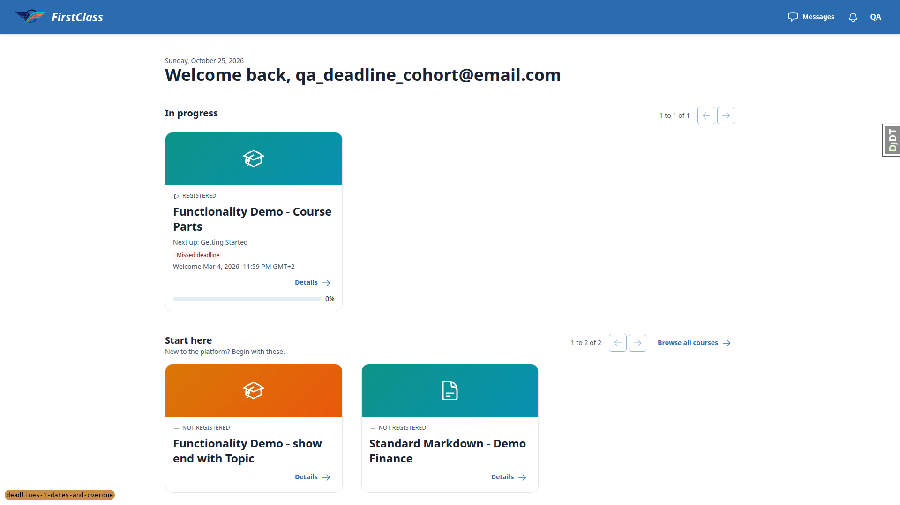

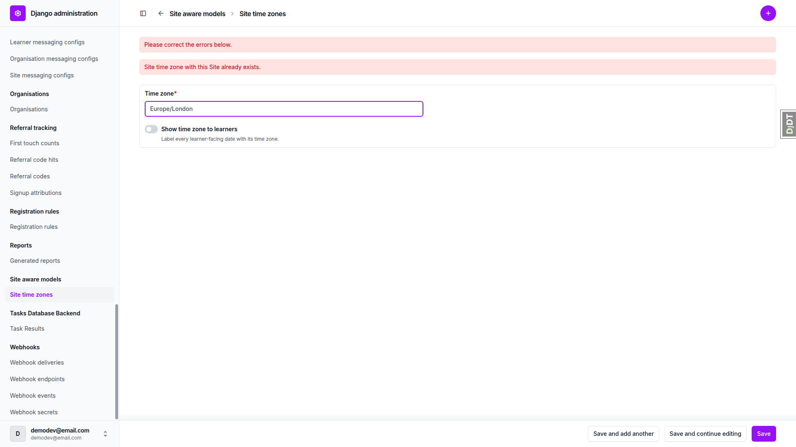

### §8 Carry-over on re-sync

| Test | Viewport | Status | Note |
|---|---|---|---|
| 8 | desktop | pass | The learner override of +5 days on Key Ideas showed "Deadline Oct 30, 2026". After moving key-ideas into Wrapping Up and re-running `content_save`, it still shows "Deadline Oct 30, 2026, 11:59 PM". The stale Core Concepts row is still listed, as the plan expects. The admin override row names Key Ideas with its new path. |

### §9 A removed content default clears the column

| Test | Viewport | Status | Note |
|---|---|---|---|
| 9 | desktop | pass | With What to Expect's due days removed, the outline shows no date on it. The card's "Next deadline:" skips it and shows Welcome Nov 4, because the §6 edit was applied together with §9. |

### §10 Layout at the three viewports

| Test | Viewport | Status | Note |
|---|---|---|---|
| 10 | desktop | pass | No horizontal overflow or console errors. Outline deadline lines start at the icon (116px) and the date wraps under the chip. Titles stay on one line. Card line sits above the progress bar. The strip is identical for the late learner and anonymous visitor. |
| 10-detail | desktop | pass | Course detail (late learner) matches the anonymous visitor. |
| 10-dashboard | desktop | pass | Cohort dashboard shows the Missed deadline chip and Welcome Mar 4, 2026. Fresh learner screenshot also taken. |
| 10 | mobile | pass | Outline sheet opened. No overflow or console errors. Chip and date fit on one line under the icon (76px). The stats strip stacks into cells. |
| 10-detail | mobile | pass | Late learner and anonymous strip and content list identical. |
| 10-dashboard | mobile | pass | Cohort dashboard shows the Missed deadline chip and Welcome Mar 4, 2026. |
| 10 | tablet | pass | The outline sheet is used, as on mobile. No overflow or console errors. Chip and date on one line under the icon. |
| 10-detail | tablet | pass | Late learner and anonymous strip and content list identical. |
| 10-dashboard | tablet | pass | Cohort dashboard shows the Missed deadline chip and Welcome Mar 4, 2026. |

Desktop:

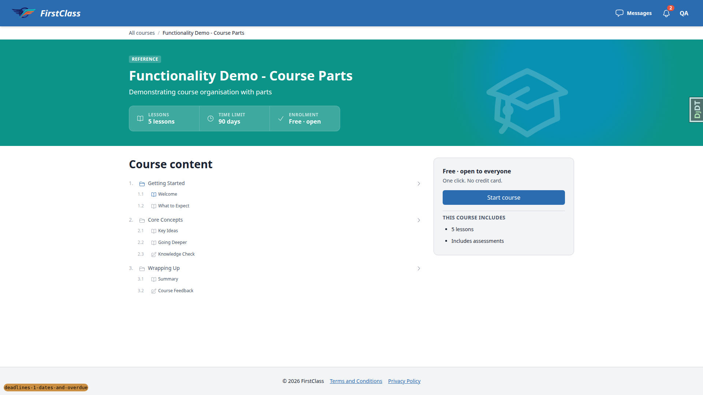

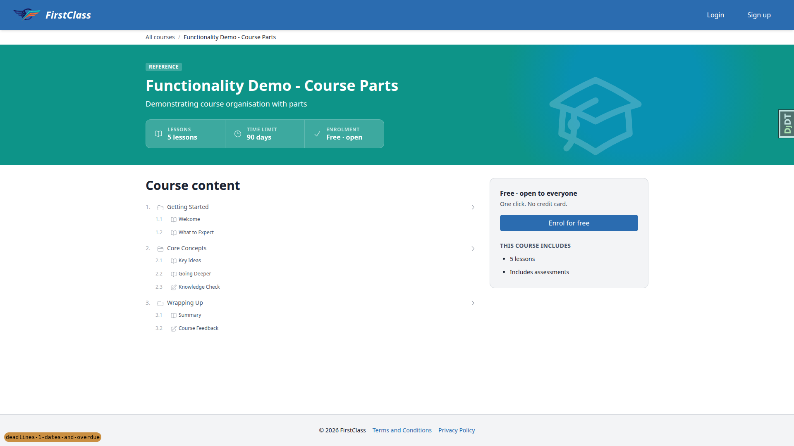

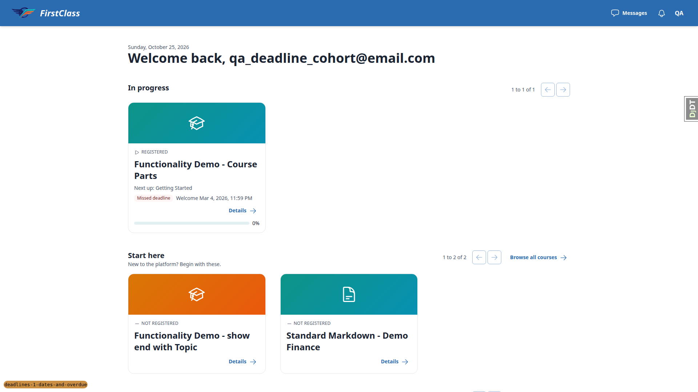

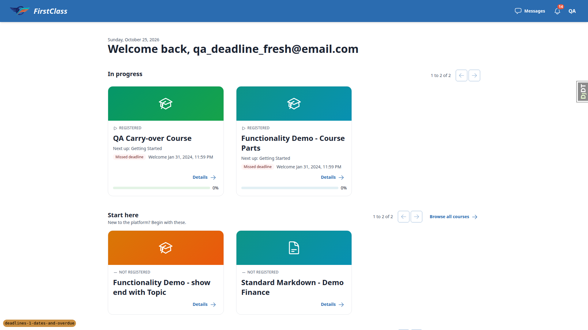

Mobile:

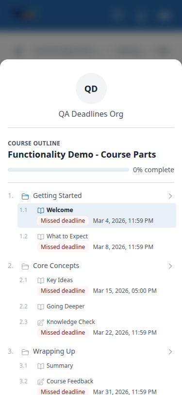

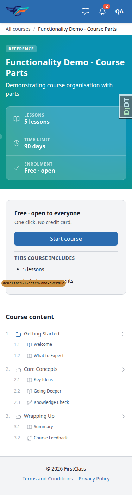

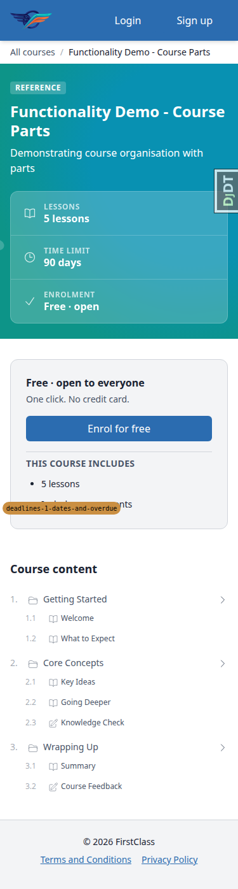

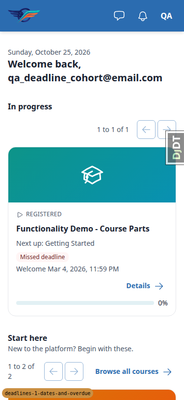

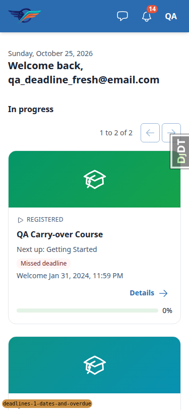

Tablet:

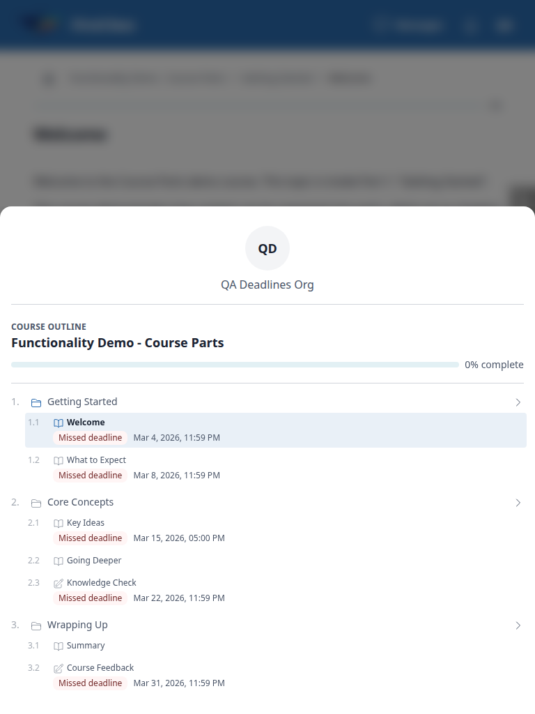

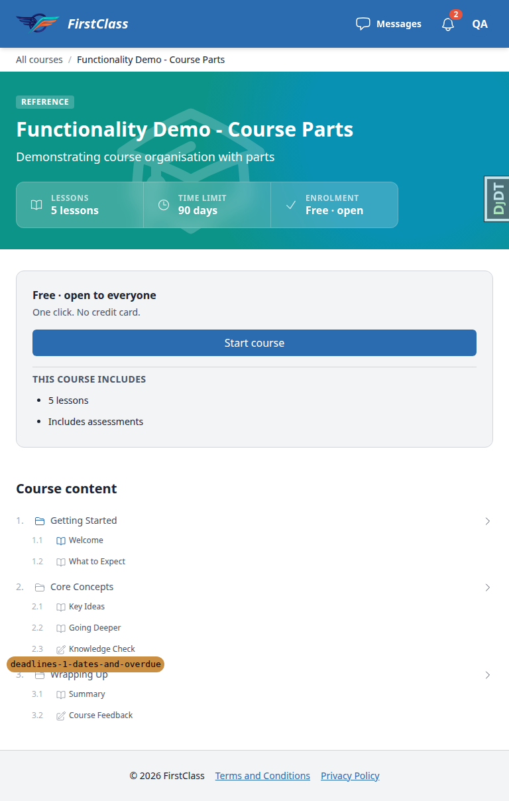

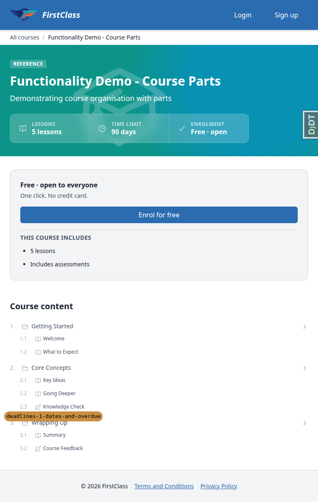

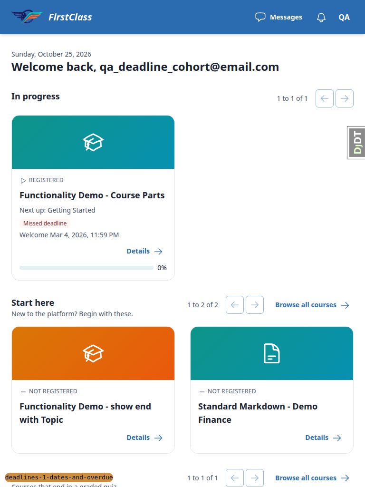

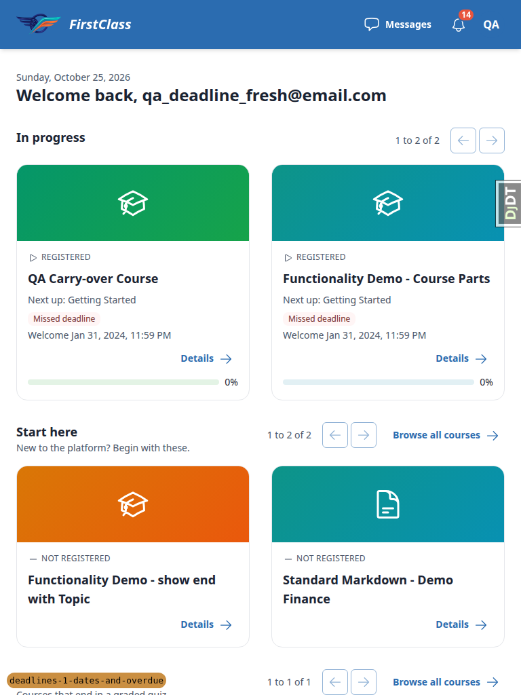

### §11 Clean-up

| Test | Viewport | Status | Note |
|---|---|---|---|
| 11 | desktop | pass | Cohort and learner overrides and completions removed. `show_time_zone_to_learners` is off and the zone is Africa/Johannesburg. `git status --short demo_content/` prints nothing. The carry-over course and its scratch copy were deleted. |

## Design check

No design states tested.

## Bugs

None were found, so there are no per-bug sections.

## Bug status

No bugs were found.

## General notes

- The test plan has two errors, not app bugs. (a) 7.1 expects New York "Mar 8, 2026, 04:59 PM EST", but US DST began on 8 Mar 2026, so 21:59 UTC correctly renders as 05:59 PM EDT. (b) 7.2 expects a datetime ending `T10:59:59.999999+00:00`, but commit fc7a38ad4 made the attribute whole-second on purpose (`T10:59:59+00:00`). The plan should be updated.
- Not testable with the current content: the 1.2 step 4 alignment of top-level rows, because no course has a dated top-level item.
- The 5.1 step 5 player check is weak. Welcome was already complete from 1.3, so the effect of the No-deadline override was confirmed through the admin Effective deadlines field instead.
- The §6 and §9 content edits were applied together in one `content_save`, since they touch different items. So in §9 the card's next deadline read "Welcome Nov 4" (Welcome is relative +10 from the §6 edit) rather than Key Ideas. What to Expect correctly had no date.
- In §8 the moved directory was named `03. key-ideas`, because `01.` clashed with `01. summary` in Wrapping Up.
- Cosmetic, admin only: unfold inline rows for deadline overrides show a header like "CohortDeadlineOverride object (uuid)" because the models have no `__str__`. The plan does not cover this.
- Admin pages log a favicon.ico 404 to the console. Learner pages had no console errors at any viewport.
- A data-helper reset script for the cohort learner's completions was blocked by the permission system as an irreversible delete, and was not retried. Learner state was reset with the plan's `qa_create_deadlines_seed` command instead, and the cohort Welcome override was re-added through the admin. The seed resets the superuser password hash, which logs out admin sessions.
- Two screenshots in the folder, `review-fix-finish-page.png` and `review-fix-finish-page-outline.png`, were left by another process before this run. They are not part of this QA run.
- Custom-named screenshots (`page-10-*`, `page-5-2-*`, `page-7-*`, `page-8-*`, `page-6-*`, `page-tz-*`, `page-cohort-course-limit.png`) were taken through `browser_run_code` and landed in `qa-screenshots/` correctly.

status: ok · reason: report rendered, 0 bugs documented
