# Frontend QA report: deadlines-1-dates-and-overdue

## Methodology

- Tool: Playwright MCP.
- Run date: 2026-10-25, against a dev server on port 8502, branch `deadlines-1-dates-and-overdue`.
- Browser: zone Africa/Johannesburg, locale en-US (the New York browser was used where the plan asks for it).
- Viewports: 1920x1080 (desktop), 375x812 (mobile), 768x1024 (tablet).
- Seed data: `qa_create_deadlines_seed`.
- Screenshots were collected into `screenshots/` beside this report. Every image referenced below was checked with a file listing and exists there.

## Diff scoping

Class: FULL.

Files that triggered it:
- `freedom_ls/learner_interface/templates/learner_interface/course_detail.html`
- `freedom_ls/learner_interface/templates/learner_interface/partials/course_card.html`
- `freedom_ls/learner_interface/templates/learner_interface/partials/course_minimal_toc.html`
- `freedom_ls/base/static/base/js/alpine-components.js`
- `freedom_ls/base/static/base/js/interface-swap-fallback.js`

Nothing was skipped. Desktop, mobile and tablet all ran.

## Smoke gate

Pass. Pages checked: `/` and `/courses/functionality-demo-course-parts/detail/`.

## Results

All 22 test records passed. No test failed.

### 1. Deadlines in the player outline, never on course detail

| Test | Viewport | Status | Notes | Screenshot |
|---|---|---|---|---|
| 1.1 | desktop | pass | Course detail outline has no `<time>` and no Deadline text for cohort, fresh, late, visitor and anonymous. Rows are identical apart from Not started vs Locked. | 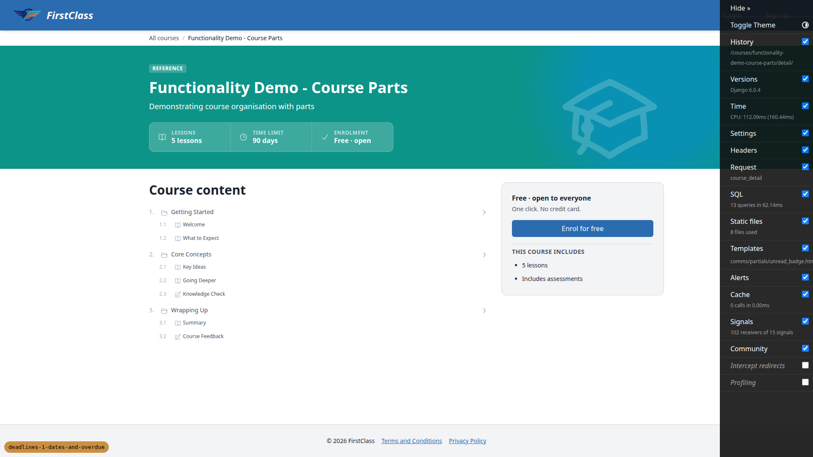 |
| 1.2 | desktop | pass | Fresh learner: Welcome shows the Missed deadline chip and "Jan 31, 2024, 11:59 PM" with no second "Deadline". Other dated rows show the right dates and no chip. Deadline line starts under the type icon (x=116). Titles not truncated. `<time datetime>` ends +00:00 with no zone label. Chip and date wrap to two lines in the 270px sidebar. | 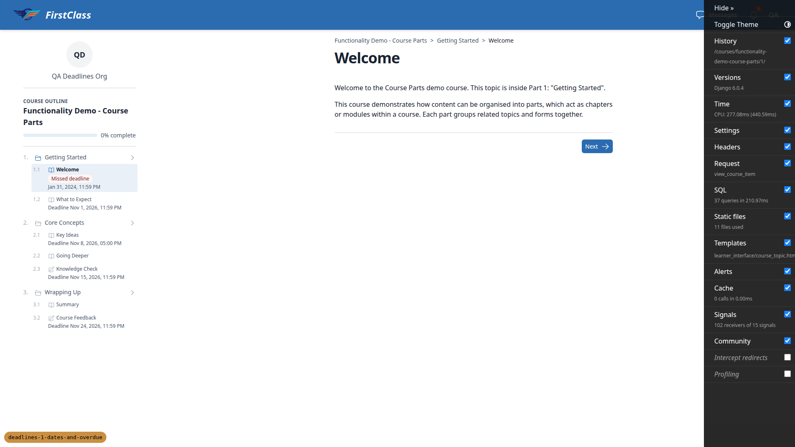 |
| 1.3 | desktop | pass | After completing Welcome: row shows Completed, no chip, no date. Other rows unchanged. | 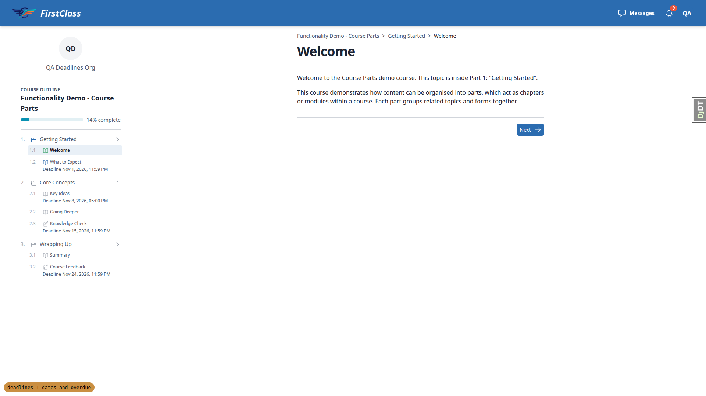 |
| 1.4 | desktop | pass | Cohort learner: Missed deadline chip on all five dated rows with the expected dates. | 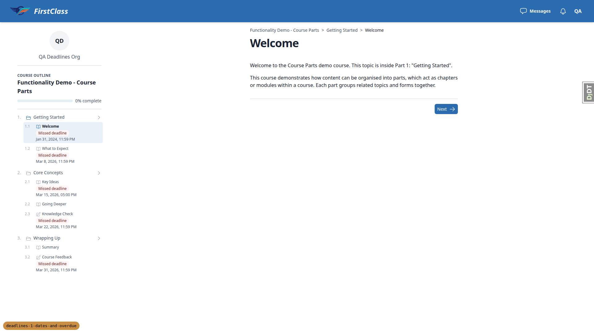 |

### 2. Course detail time limit

| Test | Viewport | Status | Notes | Screenshot |
|---|---|---|---|---|
| 2 | desktop | pass | Stats strip reads "Time limit 90 days" with the deadline icon, identical for all five users. No banned wording. Plain course has no Time limit cell. |  |

### 3. Dashboard card line

| Test | Viewport | Status | Notes | Screenshot |
|---|---|---|---|---|
| 3.1 | desktop | pass | Cohort and late learners: Missed deadline chip and "Welcome Jan 31, 2024, 11:59 PM", no Next deadline line, eyebrow "Registered", line above the progress bar. Plain course card has no deadline line. |  |
| 3.2 | desktop | pass | Fresh learner: "Next deadline: What to Expect Nov 1, 2026, 11:59 PM", no chip. After completing What to Expect it advances to Key Ideas Nov 8, 2026, 05:00 PM. | 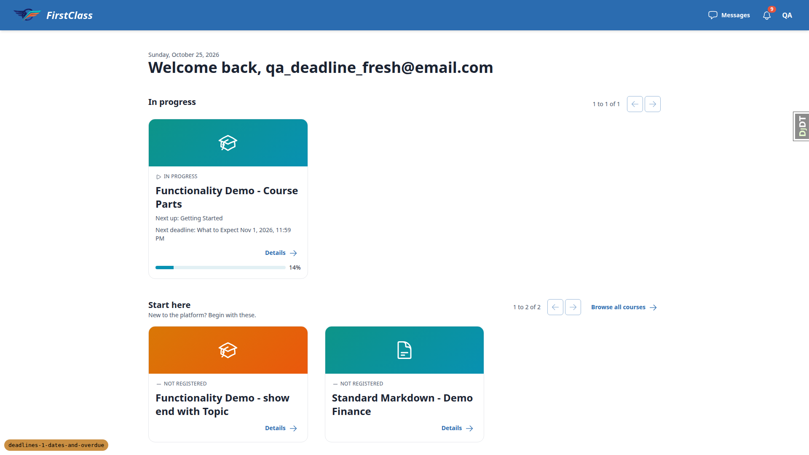 |
| 3.3 | desktop | pass | Late learner with all dated items complete: Missed deadline chip and "Course Oct 15, 2026, 11:59 PM". No "time limit" wording. |  |

### 4. Cohort deadline override

| Test | Viewport | Status | Notes | Screenshot |
|---|---|---|---|---|
| 4.1 | desktop | pass | Picker lists only the parts course's 7 items as "Title (path)", empty choice "Course time limit". Saved override shows Content default, Effective "3 days after registration", set by demodev@email.com. | 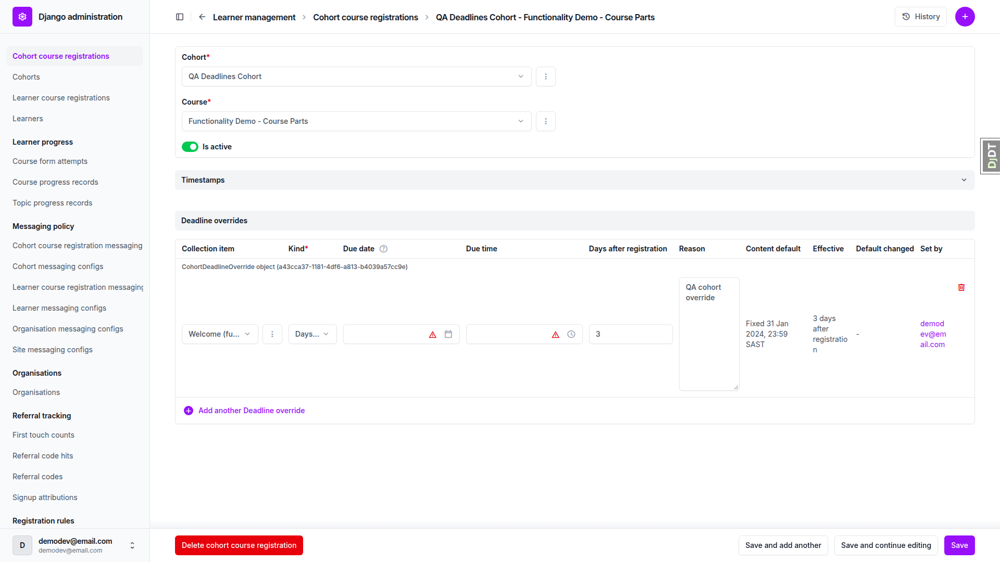 |
| 4.2 | desktop | pass | Cohort learner sees Welcome as Missed deadline Mar 4, 2026, 11:59 PM in the player and on the dashboard. Fresh learner unaffected. Course detail outline has no `<time>`. | none |
| 4.3 | desktop | pass | All four inconsistent rows refused with the expected messages. Nothing saved. | 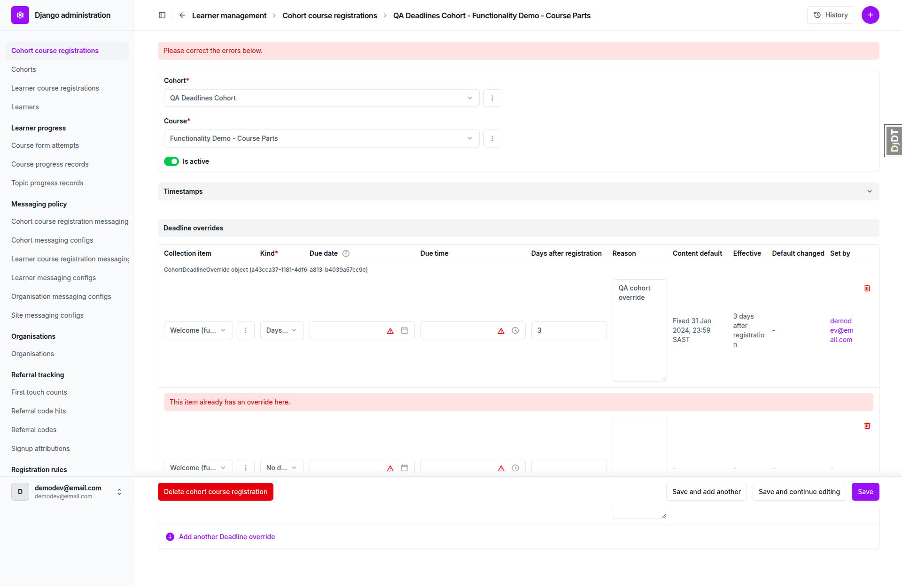 |
| 4.4 | desktop | pass | Time-limit override +200 days saved. Course detail still reads 90 days. Cohort card shows "Missed deadline Course Sep 17, 2026, 11:59 PM". Late learner unchanged. | 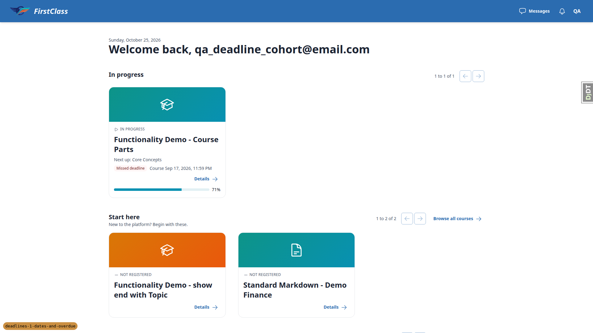 |

### 5. Learner deadline override

| Test | Viewport | Status | Notes | Screenshot |
|---|---|---|---|---|
| 5.1 | desktop | pass | Effective deadlines field lists 5 items and the time limit end. After a No deadline override Welcome is gone from the list and the learner sees no date or chip. Card shows Next deadline: Key Ideas. | 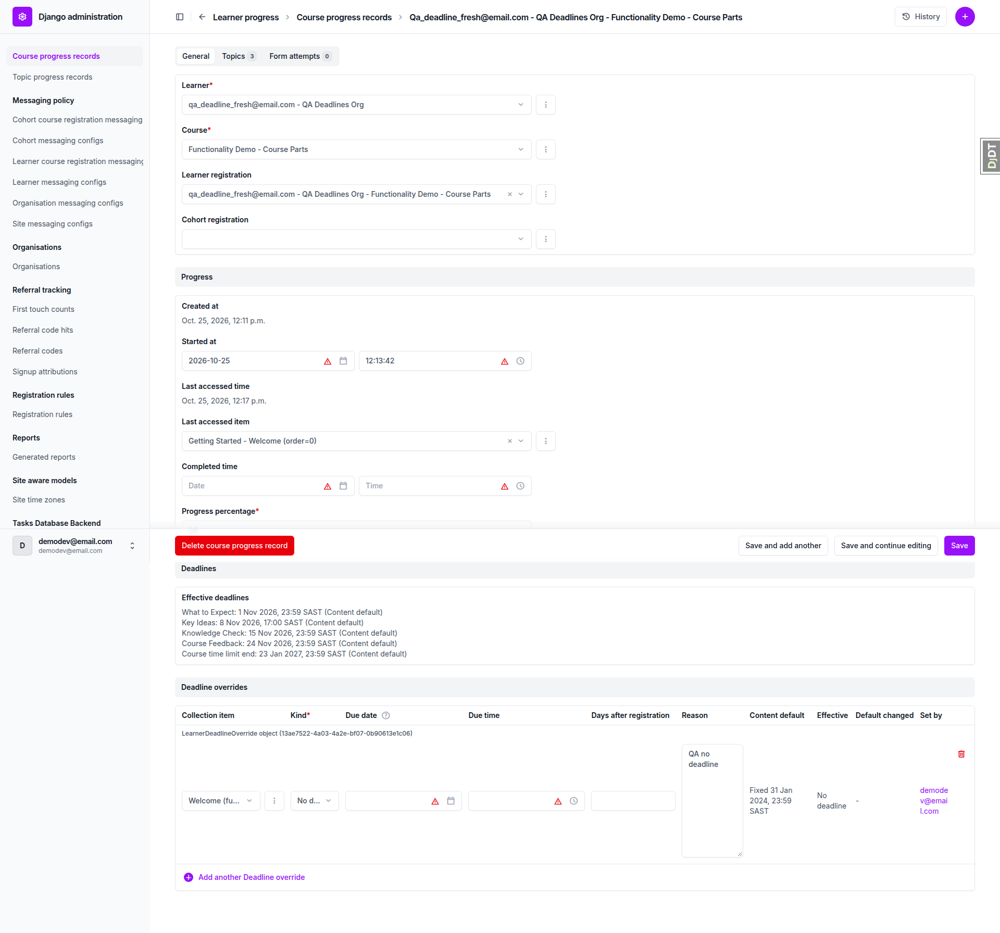 |
| 5.2 | desktop | pass | Learner override beats the cohort override: player shows "Deadline Oct 26, 2026, 09:00 AM", no chip. Card shows Missed deadline What to Expect Mar 8, 2026. |  |
| 5.3 | desktop | pass | After deleting the learner override, Welcome returns to the cohort date Mar 4, 2026 with the chip. | none |

### 6. Content default changes under an override

| Test | Viewport | Status | Notes | Screenshot |
|---|---|---|---|---|
| 6 | desktop | pass | Cohort override row shows "Default has changed since this override was set (was fixed:2024-01-31, now relative:10)" and Content default "10 days after registration". Time-limit override row shows no note. Learner dates unchanged. | 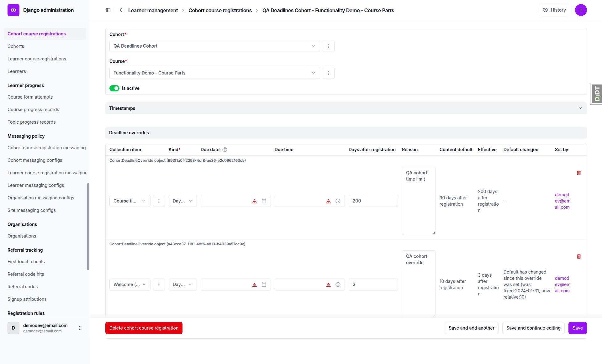 |

### 7. Site time zone

| Test | Viewport | Status | Notes | Screenshot |
|---|---|---|---|---|
| 7.1 | desktop | pass | With the label on, sidebar and card dates carry GMT+2. New York browser shows EST/EDT. With the label off, no label. The plan's Mar 8 example is wrong (see general notes); the app is correct. | 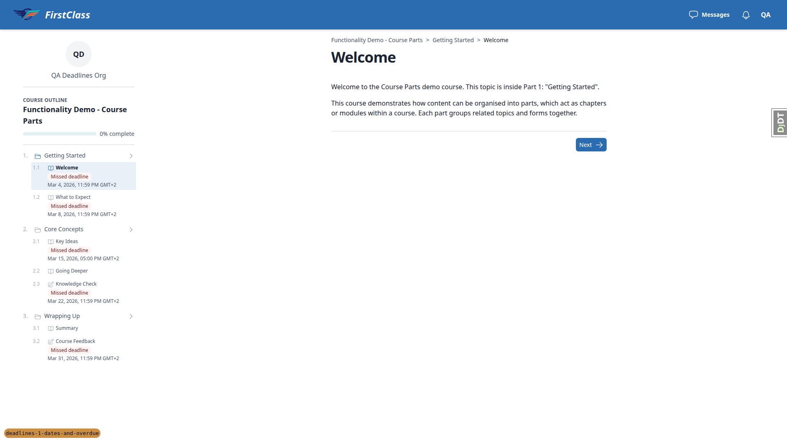 |
| 7.2 | desktop | pass | With Pacific/Auckland, What to Expect reads "Mar 8, 2026, 12:59 PM" and the datetime attribute is 2026-03-08T10:59:59.999999+00:00. Admin shows NZDT. Reset to Africa/Johannesburg. |  |
| 7.3 | desktop | pass | "Mars/Olympus" gives the expected field error and the row is unchanged. A second row for the site gives a uniqueness error. | 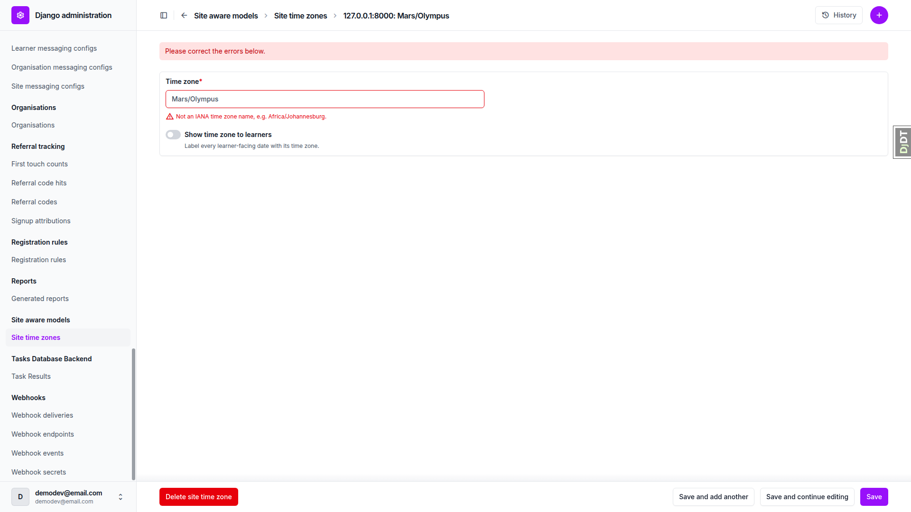 |

### 8. Carry-over on re-sync

| Test | Viewport | Status | Notes | Screenshot |
|---|---|---|---|---|
| 8 | desktop | pass | Key Ideas keeps "Deadline Oct 30, 2026, 11:59 PM" under Wrapping Up after the move and re-sync. The stale row under Core Concepts remains, as the plan expects. Admin override row names the new path. |  |

### 9. Removed content default

| Test | Viewport | Status | Notes | Screenshot |
|---|---|---|---|---|
| 9 | desktop | pass | After removing the 7-day default, the column is cleared and the cohort learner's What to Expect row shows no date. The card skip could not be observed for the fresh learner (see general notes). |  |

### 10. Layout at the three viewports

| Test | Viewport | Status | Notes | Screenshot |
|---|---|---|---|---|
| 10 | desktop | pass | No horizontal overflow on player, course detail and dashboard. Deadline lines start under the type icon. Chip and date wrap in the sidebar without pushing the title. Late and anonymous course detail identical. No console errors. |  |
| 10 | mobile | pass | No overflow (scrollWidth 375). Outline sheet shows chip and date on one line, aligned with the icon. Stats strip stacks to three full-width cells. Dashboard line wraps above the progress bar. No console errors. |  |
| 10 | tablet | pass | Player uses the mobile outline sheet. No overflow (scrollWidth 768). Stats strip like the others. Card deadline line wraps cleanly. No console errors. | 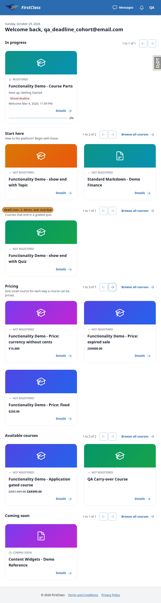 |

### 11. Clean-up

| Test | Viewport | Status | Notes | Screenshot |
|---|---|---|---|---|
| 11 | desktop | pass | Seed re-run removed the overrides and completions. Site time zone is Africa/Johannesburg with the label off. `git status --short demo_content/` is empty. | none |

### Key screenshots

Course detail, no deadlines (1.1, 2):

Player outline for the fresh learner (1.2):

Dashboard card with a missed deadline (3.1):

Admin effective deadlines (5.1):

Mobile layout (10):

Tablet layout (10):

## Design check

No design states tested.

## Bugs

There were no failing tests, so there are no per-bug sections.

## Bug status

No bugs found.

## General notes

- The plan's section 7.1 step 3 example says "Mar 8, 2026, 04:59 PM EST" for New York. US daylight saving starts on 8 March 2026, so the app correctly prints "05:59 PM EDT". The plan example should be corrected. The Mar 4 rows show 04:59 PM EST as the plan expects.
- Data setup: the section 3.3 and 4.4 completions and the section 6, 8 and 9 content edits were done through the QA data helper. The section 4.4 completions were reverted by the helper afterwards. The section 11 clean-up re-ran `qa_create_deadlines_seed`. The carry-over course and its temporary directory were deleted, and `demo_content/` is clean.
- By section 9 the fresh learner had already completed What to Expect (in 3.2), so the dashboard skip to Key Ideas could not be seen for that learner. The cleared column was confirmed on the cohort learner's outline instead. Likewise, in 5.1 Welcome already showed no date because it was completed in 1.3; the admin Effective deadlines list confirms the override.
- The admin Effective deadlines field labels sources "Content default", "Cohort override" and "Learner override", not the raw `content`, `cohort_registration` and `learner` the plan names. Treated as equivalent wording.
- Unrelated to this diff: in the course outline (detail page and player) an expanded part shows a right-pointing chevron, because the collapse icon is a right chevron. It looks pre-existing and was not investigated.
- At 1920 wide the player sidebar (about 270px) wraps the Missed deadline chip and the date onto two lines. On mobile and tablet the outline sheet is wider and they sit on one line. Both match the plan's allowance for the date wrapping under the chip.

status: ok
reason: report rendered, 0 bugs documented
