# Frontend QA report: deadlines, course time limit and missed deadlines

## Methodology

- Tool: Playwright MCP, a manual walk of the plan (`3. frontend_qa.md`) at three viewports: 1920x1080 (desktop), 375x812 (mobile) and 768x1024 (tablet).
- Browser time zone: Africa/Johannesburg. An America/New_York browser context was also used for test 7.1.
- Data: `qa_create_deadlines_seed` plus the qa-data-helper agent (used for completing items, changing content defaults and loading the carry-over course).
- Screenshots were collected into `screenshots/` beside this report. Every image referenced below exists in that directory.

## Diff scoping

- Class: FULL.
- Triggering files: `freedom_ls/learner_interface/templates/learner_interface/course_detail.html`, `freedom_ls/learner_interface/templates/learner_interface/partials/course_card.html`, `freedom_ls/learner_interface/templates/learner_interface/partials/course_minimal_toc.html`, `freedom_ls/base/static/base/js/alpine-components.js`, `freedom_ls/base/static/base/js/interface-swap-fallback.js`, plus 167 other files (mostly .py and docs).
- Skipped: nothing. Desktop, mobile and tablet all ran.

## Smoke gate

Pass. Pages checked: `/` and `/courses/functionality-demo-course-parts/detail/`.

## Results

| Test | Viewport | Status | Screenshot | Notes |
|---|---|---|---|---|
| 1.1 | desktop | pass |  | Course detail content list has no `<time>`, Deadline line or chip for cohort, fresh, late, visitor and anonymous. Rows are identical apart from progress status (Not started or Locked). |
| 2 | desktop | pass |  | Stats strip shows "Time limit · 90 days" with the deadline icon for all users; no date, badge or "Finish by". The parts course has no Duration cell; the plain course has no Time limit cell. The dev toolbar overlaid the first screenshot. |
| 1.2 | desktop | pass | 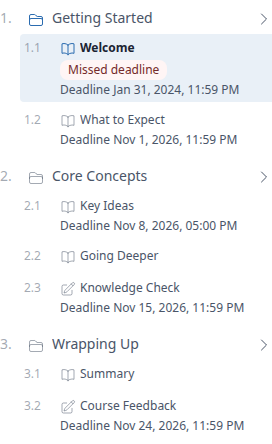 | Fresh learner outline: Welcome has a Missed deadline chip and Jan 31, 2024, 11:59 PM. The others show Nov 1, Nov 8 05:00 PM, Nov 15 and Nov 24 with no chip. Deadline line aligns with the item icon (116px); titles stay on one line. `<time datetime>` ends +00:00; no zone label. |
| 1.3 | desktop | pass | — | Welcome completed via Next: row shows "Completed", no chip and no date. Other rows unchanged. |
| 1.4 | desktop | pass | — | Cohort learner: every dated row shows Missed deadline (Welcome Jan 31 2024, What to Expect Mar 8 2026, Key Ideas Mar 15 2026 05:00 PM, Knowledge Check Mar 22, Course Feedback Mar 31). |
| 3.1 | desktop | pass | 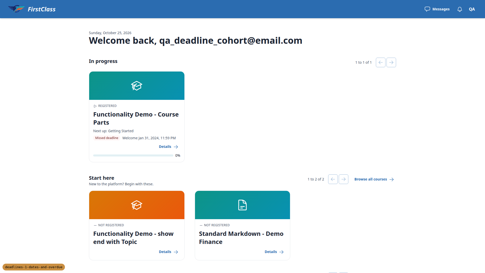 | Cohort and late learner cards: Missed deadline chip (error tone) and "Welcome Jan 31, 2024, 11:59 PM", below Next up and above the progress bar. The late learner's plain course card has no deadline line. |
| 3.2 | desktop | pass | 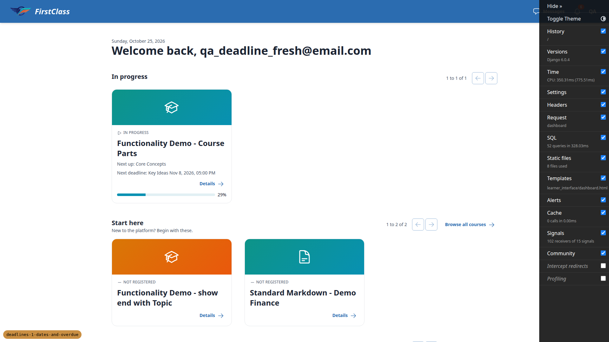 | Fresh learner: "Next deadline: What to Expect Nov 1, 2026, 11:59 PM", no chip. After completing it, the card advanced to Key Ideas Nov 8, 2026, 05:00 PM. |
| 4.1 | desktop | pass | 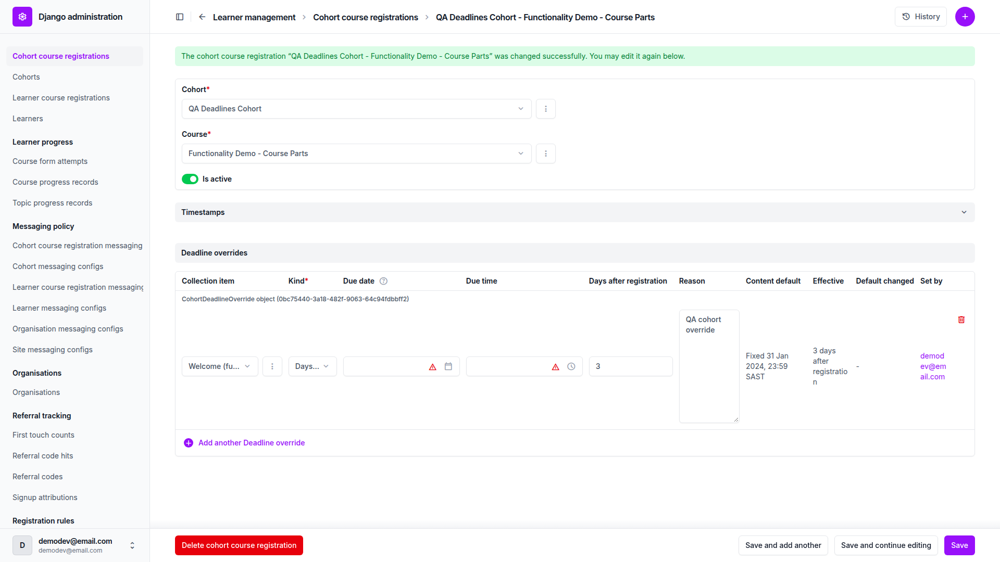 | Item picker lists only the parts course's 5 topics and 2 forms, with "Course time limit" as the empty choice. Saved Welcome / Days after registration / 3. Row shows content default, effective "3 days after registration", set-by and default-changed columns. Cosmetic: narrow read-only columns break words ("registratio/n") and the row header reads "CohortDeadlineOverride object (uuid)". |
| 4.2 | desktop | pass | — | Cohort learner sees Welcome "Missed deadline, Mar 4, 2026, 11:59 PM" in the player and on the dashboard. Fresh learner (Welcome completed) sees no line. Course detail outline still shows no deadline text. |
| 3.3 | desktop | pass | 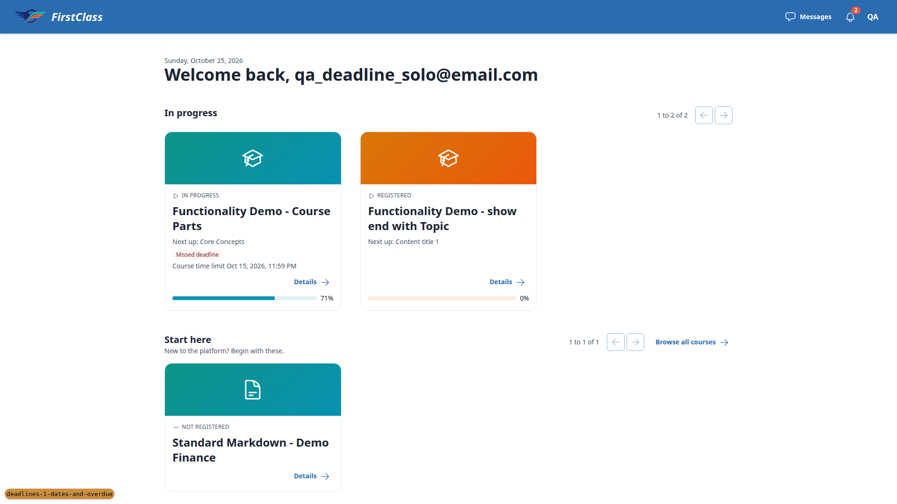 | With the 5 dated items completed for the late learner, the card reads "Missed deadline, Course time limit Oct 15, 2026, 11:59 PM" (registration + 90 days); eyebrow "In progress", 71%. |
| 4.3 | desktop | pass | 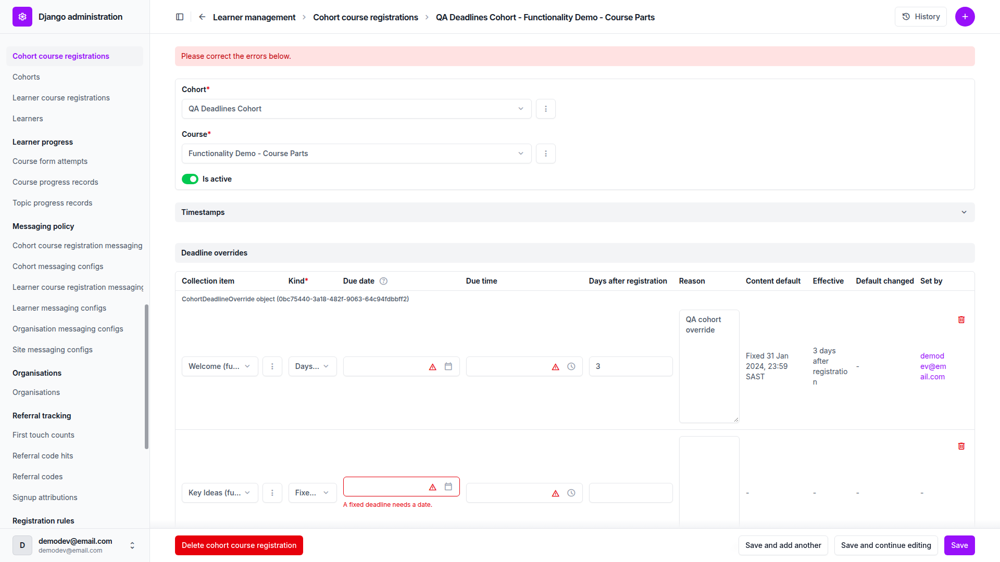 | All four inconsistent rows were refused with the expected messages ("A fixed deadline needs a date.", "The course time limit is counted in days after registration.", "This item already has an override here.", "No deadline takes no date, time or days."), plus "Please correct the errors below." Nothing saved. |
| 5.1 | desktop | pass | 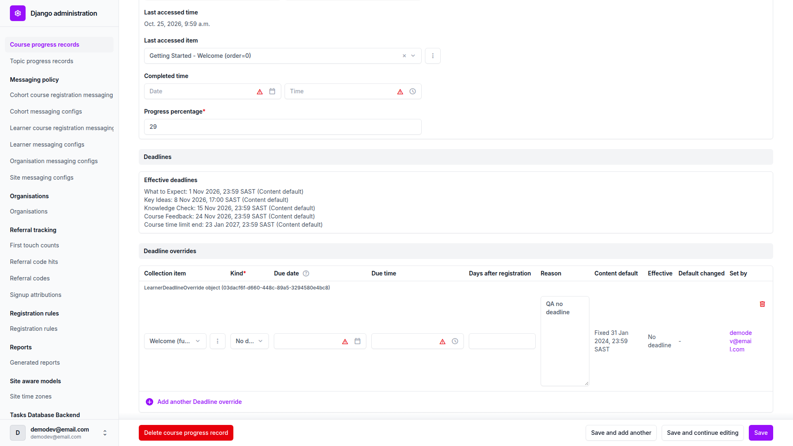 | Read-only "Effective deadlines" lists dated items in SAST with their source, plus "Course time limit end: 23 Jan 2027, 23:59 SAST". After adding a No deadline override, Welcome drops out of the list and the row shows effective "No deadline". The learner sees no date on Welcome and "Next deadline: Key Ideas Nov 8, 2026, 05:00 PM". Source labels read "Content default" rather than the plan's "content". |
| 7.3 | desktop | pass | 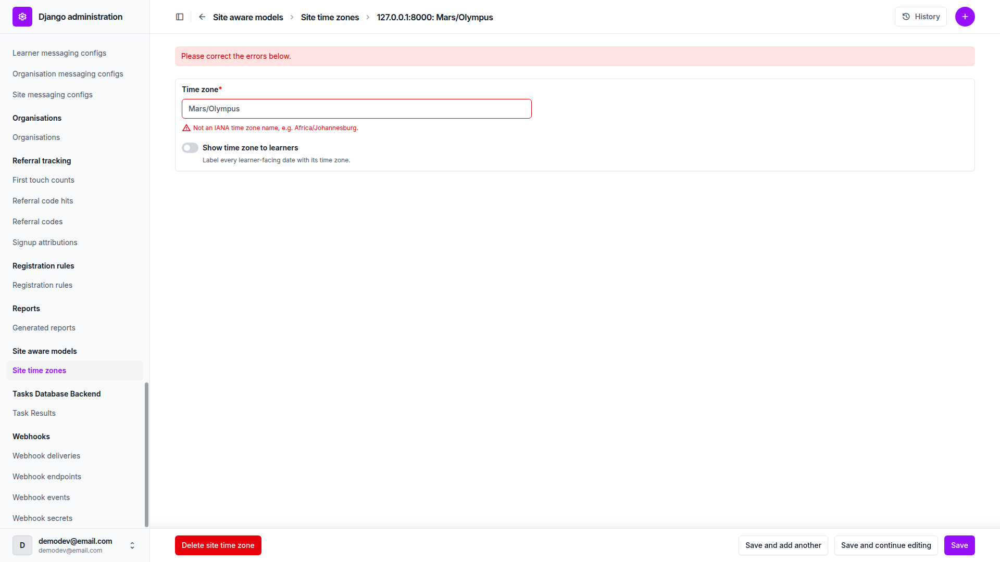 | `Mars/Olympus` refused with "Not an IANA time zone name, e.g. Africa/Johannesburg."; the row stays Africa/Johannesburg on reload. A second row is refused with "Site time zone with this Site already exists." Cosmetic: the refused save shows the unsaved value in the breadcrumb (standard Django admin). |
| 4.4 | desktop | pass | — | Cohort override Course time limit / Days after registration / 200 saved. Cohort detail still reads "Time limit 90 days". The cohort card reads "Missed deadline, Course time limit Sep 17, 2026, 11:59 PM". The late learner is unchanged (Oct 15, 2026). Completions reverted afterwards. |
| 10 (course detail) | mobile | pass | 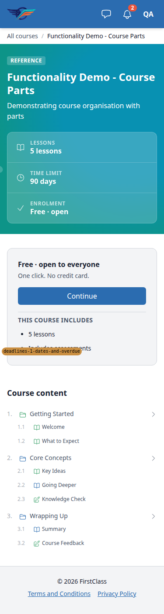 | No horizontal overflow. Stats strip stacks to one column; the Time limit cell is the same size as the others (342x69). Anonymous visitor ([screenshot](screenshots/page-2026-10-25T10-10-30-000Z.png)) is identical apart from progress status; no deadline content in either. |
| 10 (course detail) | tablet | pass | 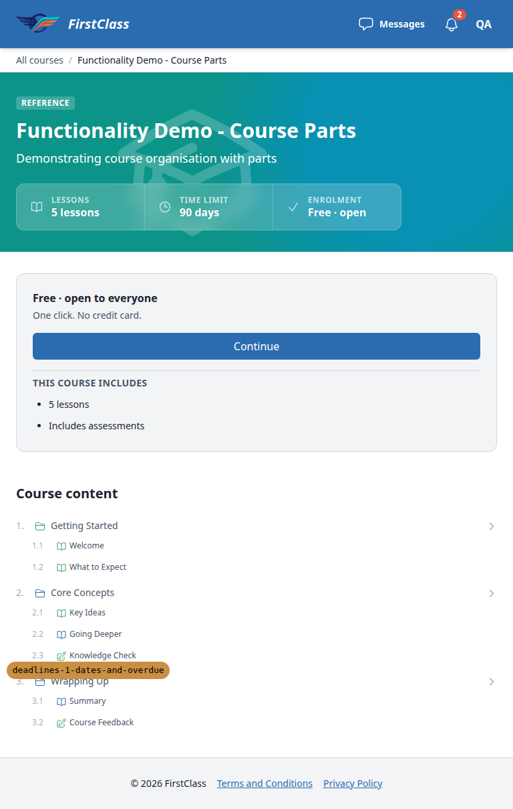 | No overflow. Strip is one row of three equal 192px cells with Time limit in the middle. Anonymous view ([screenshot](screenshots/page-2026-10-25T10-11-30-000Z.png)) matches apart from progress status. |
| 10 (dashboard, fresh) | mobile | pass | 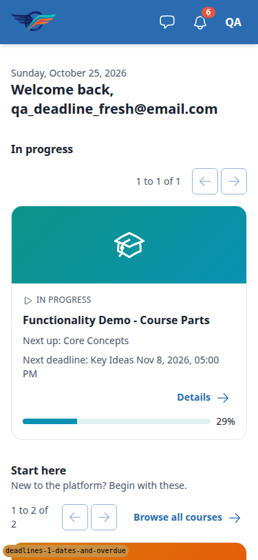 | No overflow. "Next deadline: Key Ideas Nov 8, 2026, 05:00 PM" wraps cleanly inside the card, below Next up and above Details and the progress bar. |
| 10 (dashboard, fresh) | tablet | pass | 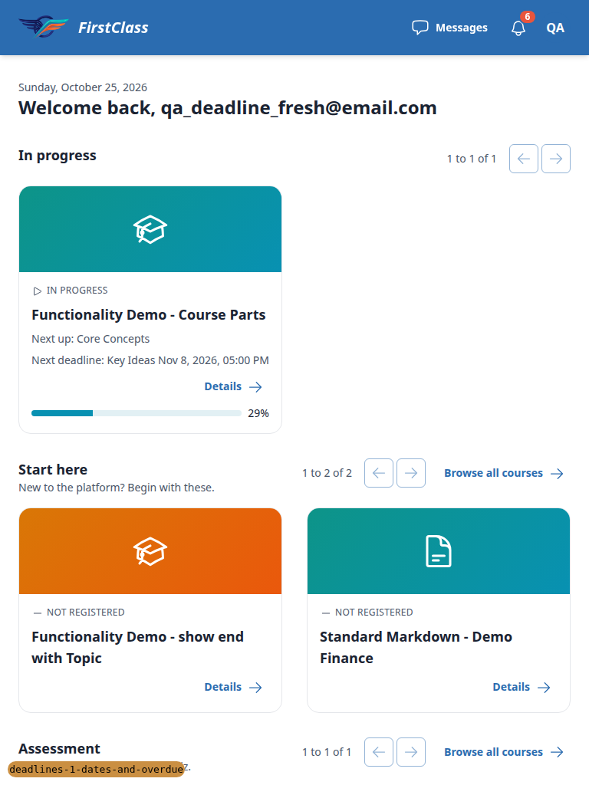 | No overflow; deadline line above the progress bar, wraps inside the card. |
| 5.2 | desktop | pass | 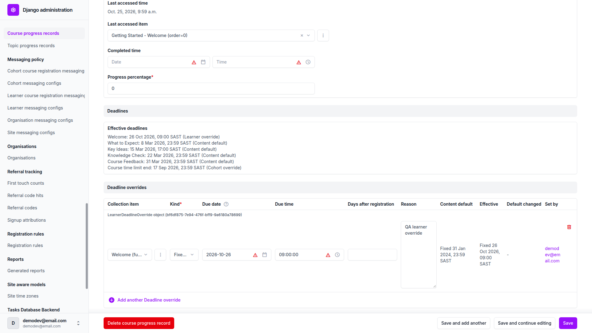 | Learner override on Welcome (Fixed date 2026-10-26 09:00) shows effective "Fixed 26 Oct 2026, 09:00 SAST" and "(Learner override)" in Effective deadlines, replacing "(Cohort override)". Player shows "Deadline Oct 26, 2026, 09:00 AM" with no chip; the dashboard shows the next missed item (What to Expect, Mar 8, 2026). |
| 5.3 | desktop | pass | — | After deleting the learner override, Effective deadlines return to "Welcome: 4 Mar 2026, 23:59 SAST (Cohort override)" and the player shows Missed deadline Mar 4, 2026. |
| 10 (player outline, cohort) | desktop | pass | 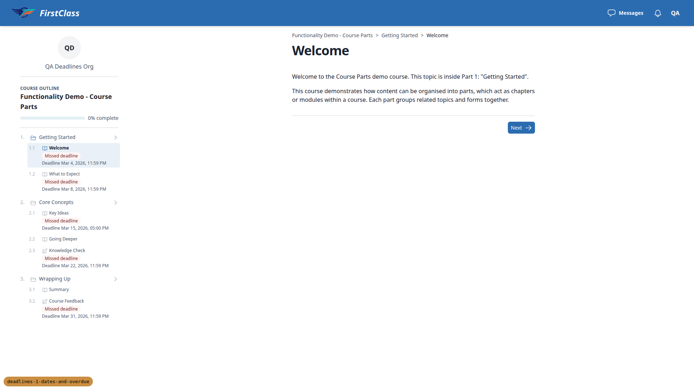 | No overflow. On every dated row the chip's left edge matches the item icon (116px). The sidebar is about 270px so the date wraps under the chip; titles are not clipped. |
| 10 (player outline, cohort) | mobile | pass | 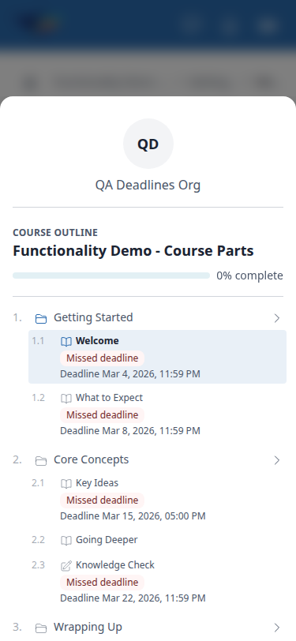 | Outline opens as a bottom sheet. No overflow; chip aligned with the icon (76px), date wraps under the chip, titles single-line. |
| 10 (player outline, cohort) | tablet | pass | 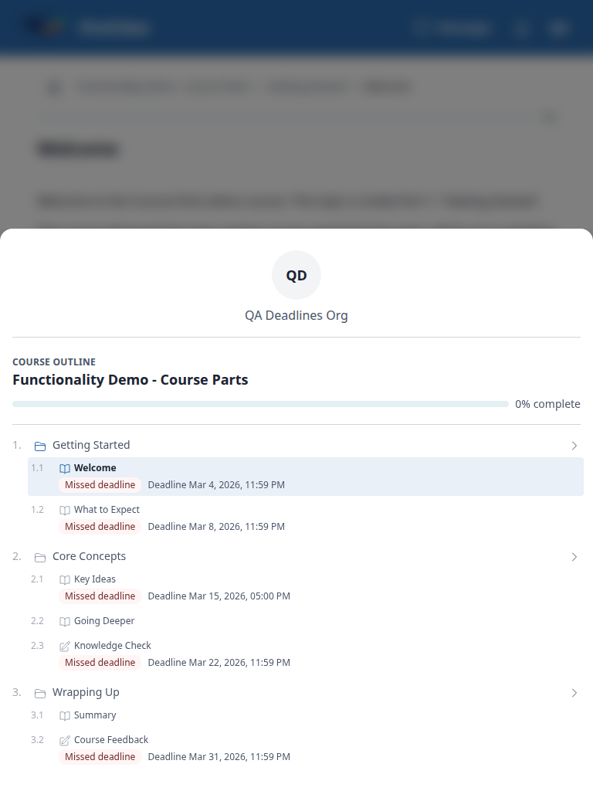 | Outline in a full-width sheet; chip and date fit on one line under the title, aligned with the icon; no overflow. |
| 10 (dashboard, cohort) | mobile | pass | 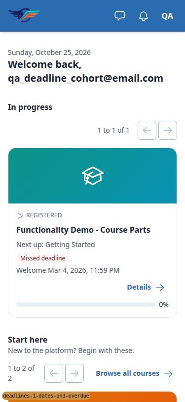 | No overflow. Chip on its own line with "Welcome Mar 4, 2026, 11:59 PM" wrapping beneath it, above Details and the progress bar. |
| 10 (dashboard, cohort) | tablet | pass | 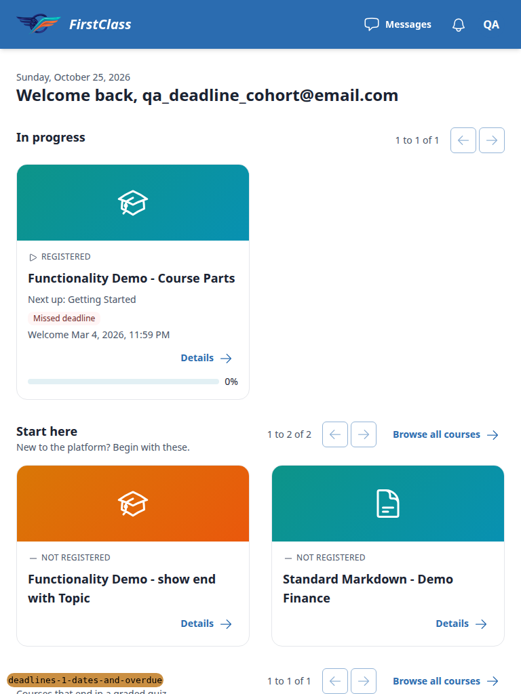 | No overflow; deadline line above the progress bar. |
| 7.1 | desktop | pass | 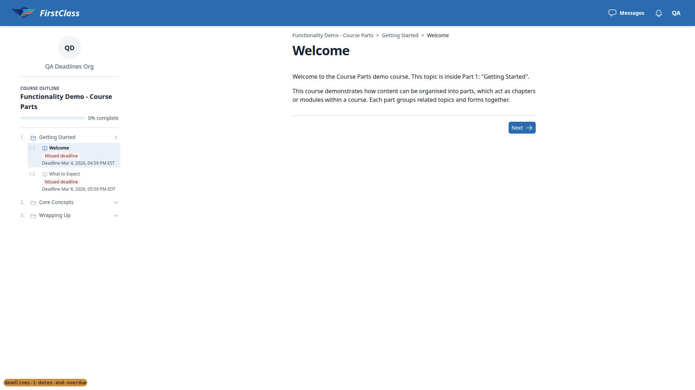 | Switch on: Johannesburg shows "Mar 4, 2026, 11:59 PM GMT+2" in the sidebar and on the dashboard ([screenshot](screenshots/page-2026-10-25T10-20-00-000Z.png)). New York shows "04:59 PM EST", "Mar 8, 2026, 05:59 PM EDT" and "Mar 15, 2026, 11:00 AM EDT". Switch off: New York shows "Mar 8, 2026, 05:59 PM" with no label. The plan's example "04:59 PM EST" for Mar 8 is wrong (US DST starts 8 Mar 2026); the app is correct. |
| 7.2 | desktop | pass | — | With `Pacific/Auckland`, What to Expect reads "Mar 8, 2026, 12:59 PM" (datetime 2026-03-08T10:59:59.999999+00:00) and Key Ideas "Mar 15, 2026, 06:00 AM". The fresh learner's Effective deadlines name NZDT. Reset to Africa/Johannesburg afterwards. |
| 10.3 (console) | desktop | pass | — | Across all learner pages and viewports the only console error was a favicon.ico 404 on the admin; no JS errors on learner pages. |
| 6 | desktop | pass | 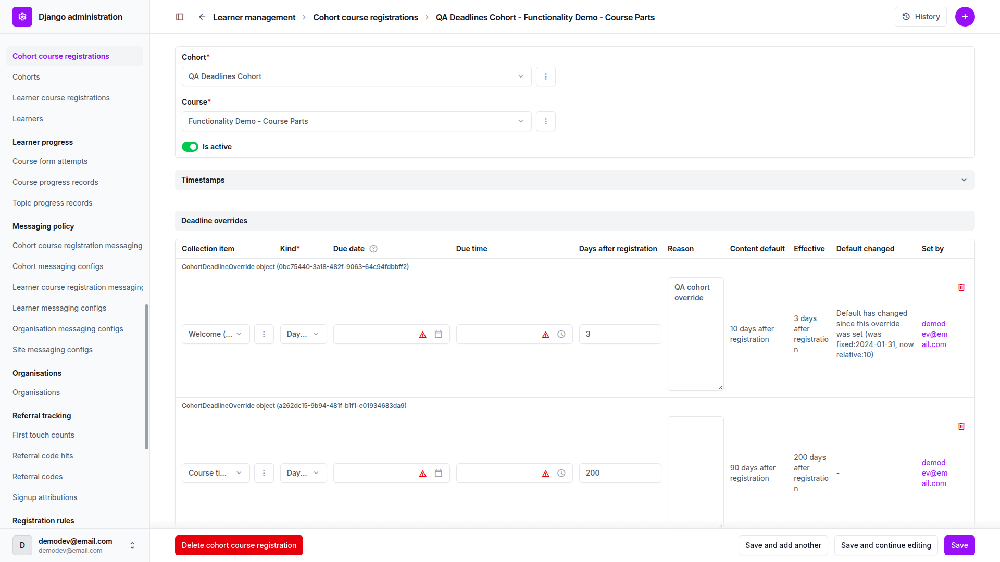 | After Welcome's content default changed to 10 days after registration, the override row shows "10 days after registration" and "Default has changed since this override was set (was fixed:2024-01-31, now relative:10)". The cohort learner still sees the override date Mar 4, 2026. Cosmetic: the narrow Effective column breaks "registratio/n". |
| 9 | desktop | pass | — | After removing What to Expect's default and running content_save, it shows no date for the cohort learner (it had Mar 8 before), including in the carry-over copy. The fresh learner had already completed it in 3.2, so the "Next deadline skips to Key Ideas" check could not discriminate. |
| 8.1-8.2 | desktop | pass | — | Carry-over course "QA Carry-over Course" loaded from a temp copy with fresh uuids (the helper dropped the copy's `categories` entry). Learner override Key Ideas / 5 days added; the fresh learner sees "Key Ideas Deadline Oct 30, 2026, 11:59 PM" (today + 5). |
| 8.3-8.5 | desktop | pass | 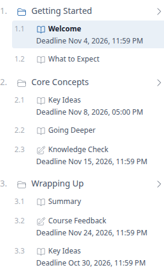 | After moving key-ideas to "03. Wrapping Up" and re-running content_save, Key Ideas appears as 3.3 with "Deadline Oct 30, 2026, 11:59 PM" (override carried over). The stale 2.1 Key Ideas keeps the content default Nov 8 (expected sync behaviour). The admin override row names the new path. Carry-over Welcome shows Nov 4 because the copy was taken while the section 6 edit was in place. |

## Design check

No design states tested.

## Bugs

None. No bug sections are included because no bugs were found.

## Bug status

No bugs found this run.

## General notes

- Pre-step rebase onto main (20 new commits, shared test infrastructure): one conflict in the generated `test_organisation/import_contracts.toml`, resolved by regenerating it. Two stale `from freedom_ls.accounts.factories import SiteFactory` imports in `freedom_ls/deadlines/tests/` were fixed to `freedom_ls.tests.factories` (commit b50f9226). The full suite otherwise passed (9382 passed). The upstream-change review found the direction unchanged. The rebase's separate front-end check was not run because this full QA pass covers it.
- Plan corrections needed:
  - Section 7.1: the New York example "Mar 8, 2026, 04:59 PM EST" is wrong. US DST starts 8 Mar 2026, so 21:59 UTC is 05:59 PM EDT, which the app shows.
  - Section 9, step 2: it cannot discriminate for the fresh learner because section 3.2 already completed What to Expect. It was verified with the cohort learner instead.
  - Section 5.1: source labels read "Content default", "Cohort override" and "Learner override", not the plan's "content", "cohort_registration" and "learner".
- Cosmetic admin observations (no action filed):
  - The deadline-override inlines' read-only columns are narrow, so "registration" breaks mid-word and the Set by email splits.
  - Each inline row header reads "CohortDeadlineOverride object (uuid)" or "LearnerDeadlineOverride object (uuid)".
  - The Due date and Due time widgets show Django's "Note: You are 2 hours ahead of server time." warning, although those fields are read in the site zone.
  - The refused Mars/Olympus save shows the unsaved value in the breadcrumb (standard Django).
  - The admin favicon.ico returns 404.
  - The Django debug toolbar covered part of the first two desktop screenshots; it was hidden afterwards.

status: ok · reason: report rendered, 0 bugs documented
