# Frontend QA report: deadlines-1-dates-and-overdue

Run date: 2026-10-24. Branch: `deadlines-1-dates-and-overdue`.

Summary: 26 test results recorded, 22 pass and 4 fail (1.2, 4.3, 7.3 and §10 desktop). 4 bugs documented (B1 to B4). The smoke gate passed. The test plan is `3. frontend_qa.md`.

## Methodology

- Playwright MCP, driven by hand.
- Viewports: 1920x1080 (desktop), 375x812 (mobile) and 768x1024 (tablet).
- Browser time zone: Africa/Johannesburg. A separate America/New_York browser context was used for §7.1.
- Locale emulated as en-GB, to match the plan's date wording.
- Screenshots were collected into this spec directory's `screenshots/` folder. Every image referenced below exists beside this report.

## Diff scoping

- Class: **FULL**.
- Changed files that triggered it:
  - `freedom_ls/base/static/base/js/alpine-components.js`
  - `freedom_ls/base/static/base/js/interface-swap-fallback.js`
  - `freedom_ls/learner_interface/templates/learner_interface/course_detail.html`
  - `freedom_ls/learner_interface/templates/learner_interface/partials/course_card.html`
  - `freedom_ls/learner_interface/templates/learner_interface/partials/course_minimal_toc.html`
- Skipped: nothing. Desktop, mobile and tablet all ran.

## Smoke gate

Outcome: **pass**. Pages checked: `/` and `/courses/functionality-demo-course-parts/detail/`. No failure URL or reason.

## Results

| Test | Viewport | Status | Notes | Screenshot |
|---|---|---|---|---|
| 1.1 | desktop | pass | Cohort learner (registered 1 Mar 2026) sees the expected dated rows, with `<time datetime>` in UTC. Every March date has passed by 24 Oct 2026, so all show Overdue, which is correct; the plan's dates have aged. |  |
| 1.2 | desktop | fail | Player sidebar shows the same badges and dates as the outline. On every dated row the item title is squeezed to 0px width (see B1). | 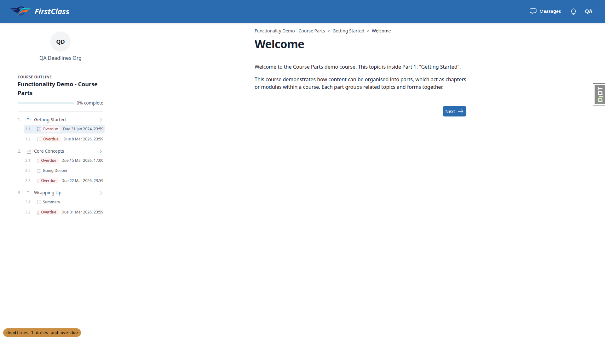 |
| 1.3 | desktop | pass | Completing Welcome clears its date and badge in the player sidebar and on the outline. Other rows are unchanged. | |
| 1.4 | desktop | pass | Fresh learner: Welcome is Overdue ("Due 31 Jan 2024, 23:59") and the other items show today-relative dates with no badges. | 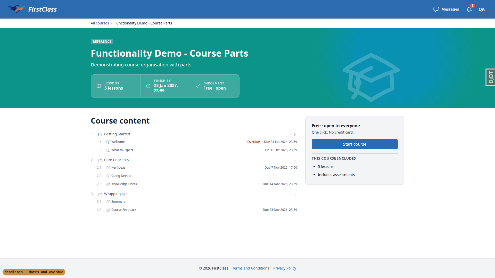 |
| 1.5 | desktop | pass | A visitor (logged in, unregistered) and an anonymous user see no `<time>`, no Overdue badge and no Finish-by cell. | 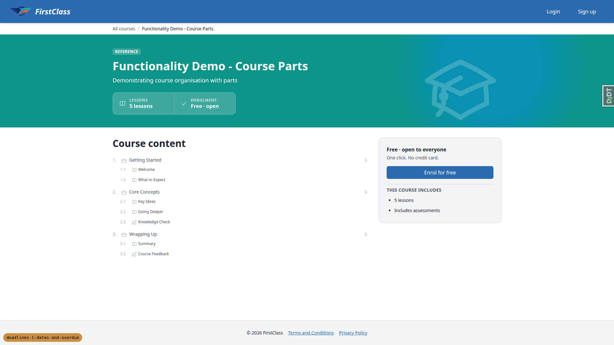 |
| 2.1 | desktop | pass | Fresh learner sees "Finish by 22 Jan 2027, 23:59" (today+90). The cohort learner correctly sees "Time limit ended / Overdue / 30 May 2026, 23:59". |  |
| 2.2 | desktop | pass | Late learner sees "Time limit ended", an Overdue badge and 14 Oct 2026, 23:59. The plain course has no time-limit cell. | |
| 3.1 | desktop | pass | Late learner card shows the Overdue badge and "Time limit ended 14 Oct 2026, 23:59" between "Next up" and the progress bar. The plain course card has no deadline line. |  |
| 3.2 | desktop | pass | Fresh learner card shows a "1 overdue" badge and no Next due line. |  |
| 3.3 | desktop | pass | Cohort learner card shows "Overdue, Time limit ended 30 May 2026, 23:59" instead of the plan's "Next due". All the plan's dates have aged, and time-limit-ended takes precedence. | |
| 4.1 | desktop | pass | The picker lists only the parts course's 7 topics and forms. The cohort override saved, with the Content default, Effective, Default changed and Set by columns correct. The inline row header reads "CohortDeadlineOverride object (uuid)" because there is no `__str__`. | 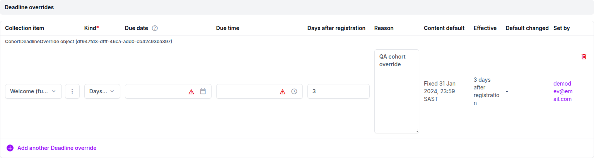 |
| 4.3 | desktop | fail | The four inconsistent rows were refused and nothing was saved; three messages match exactly. The duplicate Welcome row shows a raw constraint-name message (B3) and a spurious "Default has changed" note (B4). | 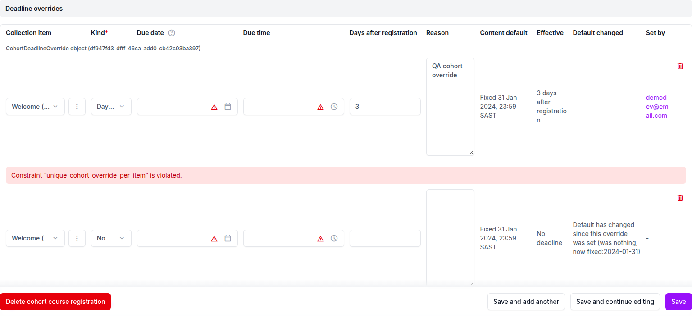 |
| 4.2 | desktop | pass | Tested with a second cohort member registered today, because the plan's fresh learner is not in the cohort. Welcome reads "Due 27 Oct 2026, 23:59" and the dashboard shows the same as Next due. Individual learners still see the 2024 Overdue date. | |
| 4.4 | desktop | pass | The 200-day time-limit override applies. A cohort member registered today sees "Finish by 12 May 2027, 23:59". The 1 Mar learner sees "Time limit ended 17 Sept 2026". The late learner is unchanged. | |
| 5.1 | desktop | pass | The course progress admin lists Effective deadlines with their sources. A "No deadline" learner override removes Welcome's date and badge for the learner. | 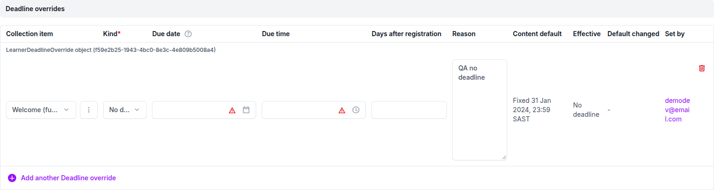 |
| 5.2 | desktop | pass | A learner fixed override (25 Oct 2026, 09:00 SAST) replaces the cohort override in the admin, the outline and the player sidebar. The dashboard shows "Time limit ended" because the learner's limit has passed and takes precedence. | 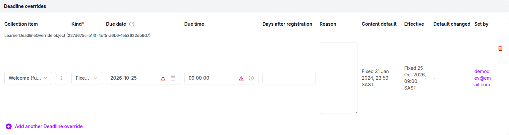 |
| 5.3 | desktop | pass | After the learner override is deleted, Welcome returns to the cohort layer ("Due 4 Mar 2026, 23:59"). | |
| 6 | desktop | pass | After the content default changed to 10 days, the override row shows the "Default has changed" note. Cohort learners' dates are unchanged, and the late learner moved to Reg+10. | 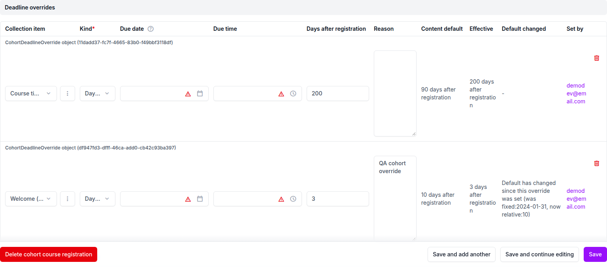 |
| 9 | desktop | pass | With What to Expect's default removed, it shows no date for cohort and fresh learners. The dashboard Next due skips to Key Ideas. | |
| 7.1 | desktop | pass | With the time zone switch on, the Johannesburg browser shows "GMT+2" labels. New York shows the same instants as "GMT-4" before 1 Nov and "GMT-5" after. With the switch off there is no label. | 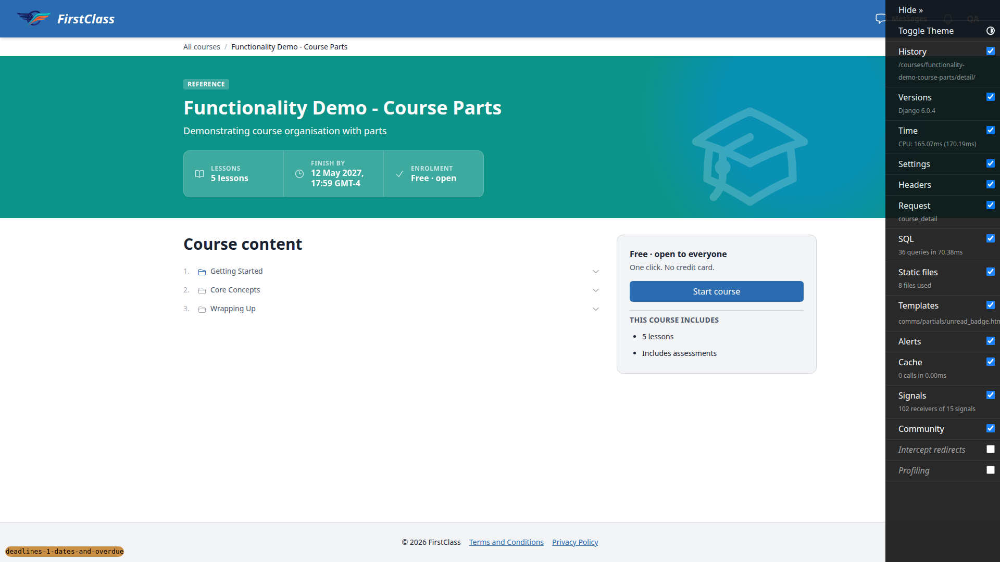 |
| 7.2 | desktop | pass | Switching the site zone to Pacific/Auckland shifts displayed times (What to Expect shows 12:59) and the Effective deadlines name NZDT. Restored to Africa/Johannesburg afterwards. | |
| 7.3 | desktop | fail | An invalid zone (Mars/Olympus) is refused and the row is unchanged. Adding a second Site time zone row returns an HTTP 500 IntegrityError (B2). | 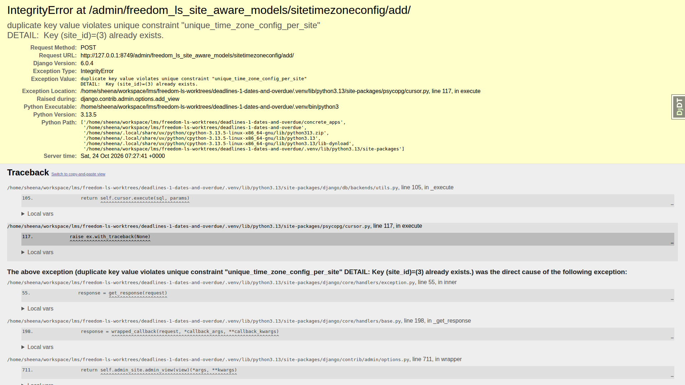 |
| 10 | desktop | fail | The detail page, player and dashboard have no horizontal overflow or console errors. It fails only on the player sidebar, where dated titles shrink to 0px (B1). |  |
| 10 | mobile | pass | The stats strip stacks, and the badge and date stay on one line. Long titles truncate with an ellipsis but stay on screen, and the player drawer is full width. No overflow. | 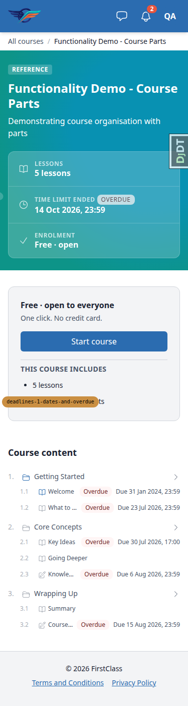 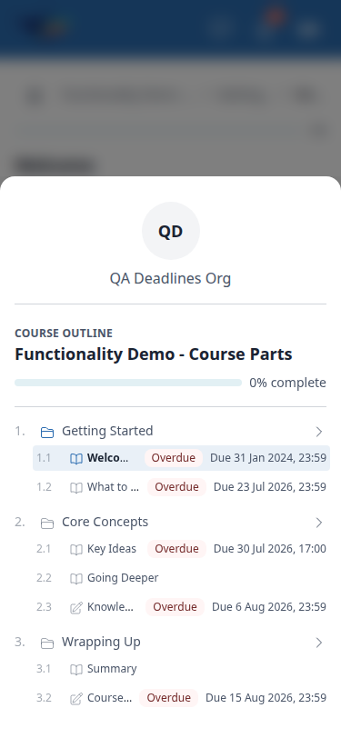  |
| 10 | tablet | pass | The three-cell stats strip fits on one row. Outline titles show in full, the player uses the drawer outline, and the dashboard card is fine. No overflow or console errors. | 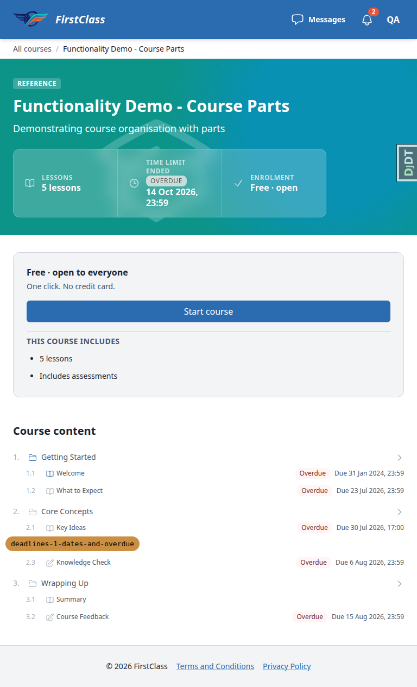 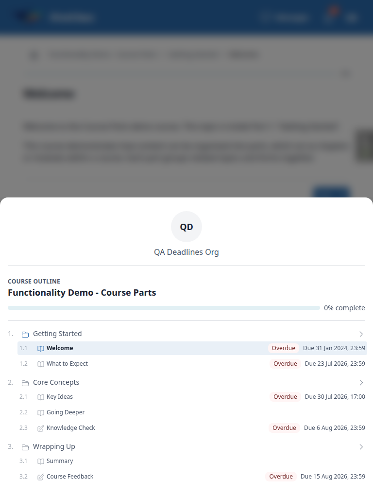 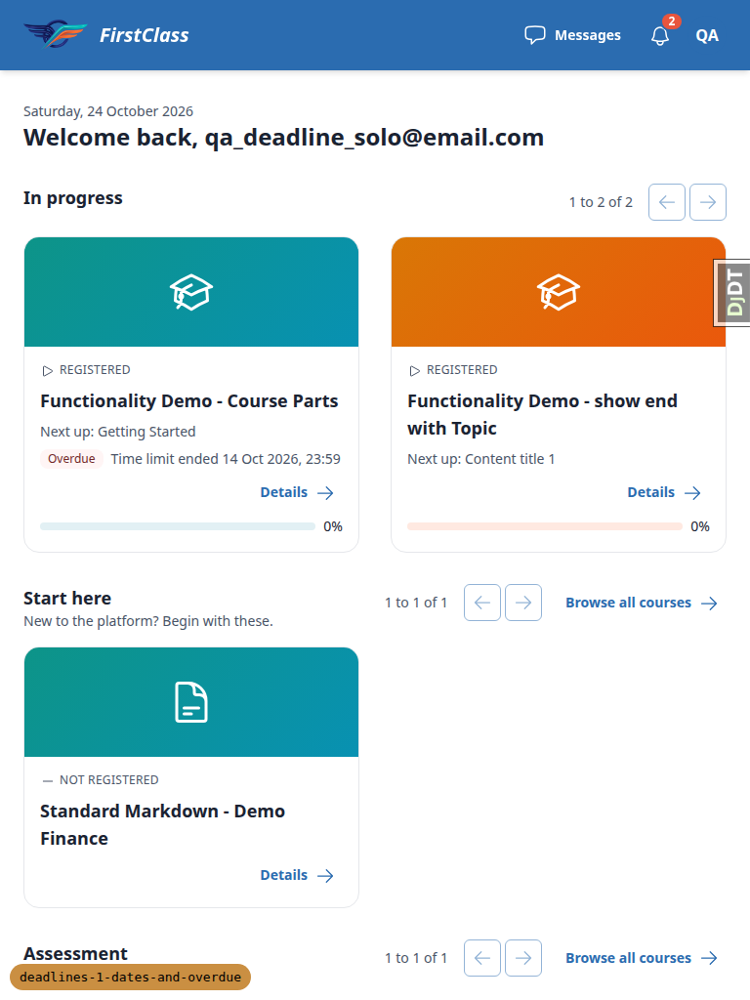 |
| 8 | desktop | pass | A learner override survives moving a collection item on re-sync: Key Ideas still shows "Due 29 Oct 2026, 23:59" under its new section. The stale row stays listed with its content default, as the plan expects. | 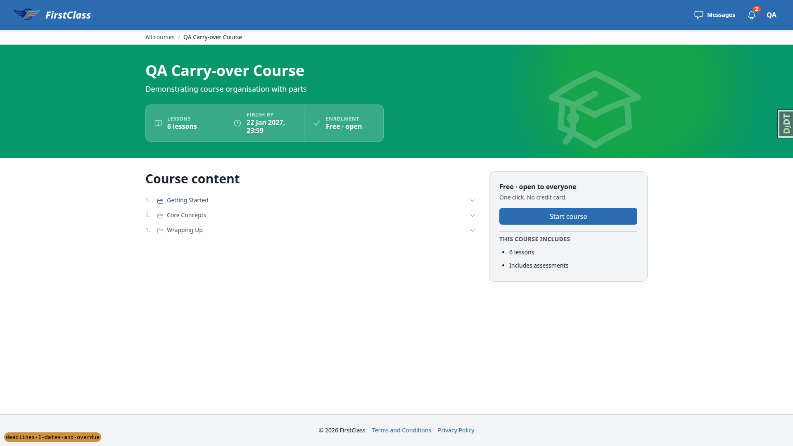 |

## Design check

No design states tested.

## B1: Player sidebar squeezes dated item titles to zero width

Manifestations: 1.2 (desktop), 10 (desktop).

**Expected:** In the course player's left sidebar outline at 1920x1080, a row with an Overdue badge and a "Due ..." date keeps its title visible (truncated or wrapped), per the test plan's "wrap without pushing the title off screen".

**Actual:** On every row that carries a due date (Welcome, What to Expect, Key Ideas, Knowledge Check, Course Feedback) the title element measures 0px wide and is invisible, and the item icon is clipped. Undated rows show titles. The sidebar is about 256px wide. The mobile and tablet drawers are full width and are fine. The likely location is `freedom_ls/learner_interface/templates/learner_interface/partials/course_minimal_toc.html`, where the due-date partial sits in a shrink-0 container.

## B2: Adding a second site time zone row returns HTTP 500

Manifestations: 7.3 (desktop).

**Expected:** In Admin > Site aware models > Site time zones > Add, when the current site already has a SiteTimeZoneConfig row, the form refuses the save with a uniqueness error and nothing is saved.

**Actual:** Saving raises IntegrityError `duplicate key value violates unique constraint "unique_time_zone_config_per_site"` and the page is a 500. The admin form only has `time_zone` and `show_time_zone_to_learners`. The site is filled on save, so the form never validates the constraint.

## B3: Duplicate deadline override shows the raw constraint name

Manifestations: 4.3 (desktop).

**Expected:** Adding a second cohort override for the same collection item shows a readable uniqueness error on the inline.

**Actual:** The inline row error reads "Constraint "unique_cohort_override_per_item" is violated." (the developer-facing constraint name). The learner override inline uses the same pattern of constraint.

## B4: Refused unsaved override row claims the default has changed

Manifestations: 4.3 (desktop).

**Expected:** A new override row that failed validation (never saved) shows no "Default has changed" note.

**Actual:** The refused new row's Default changed column reads "Default has changed since this override was set (was nothing, now fixed:2024-01-31)".

## Bug status

| Bug | Status |
|---|---|
| B1 | **FIXED** (commit: 10b2038a) — Player sidebar squeezes dated item titles to zero width |
| B2 | **FIXED** (commit: bfbac976) — Adding a second site time zone row returns HTTP 500 |
| B3 | **FIXED** (commit: 993014eb) — Duplicate deadline override shows the raw constraint name |
| B4 | **UNRESOLVED** — Refused unsaved override row claims the default has changed (reason: fix budget exhausted this run) |
| — | **UNRESOLVED** — full run after the fixes left tests failing (reason: `freedom_ls/deadlines/tests/test_resolver.py::test_course_deadlines_cost_the_same_on_a_small_and_a_large_course`, 6 queries against a budget of 5. The extra queries are the uncached `django_site` and `django_content_type` lookups, so the result depends on test order: it passed in the pre-QA full run and fails when run alone. None of the three fixes touch the resolver.) |

Re-verification after each fix, against the live auto-reloaded server:

- B1: every dated row in the desktop player sidebar now has a visible title, with the badge and date wrapping beneath it. The course detail outline still renders on one line. 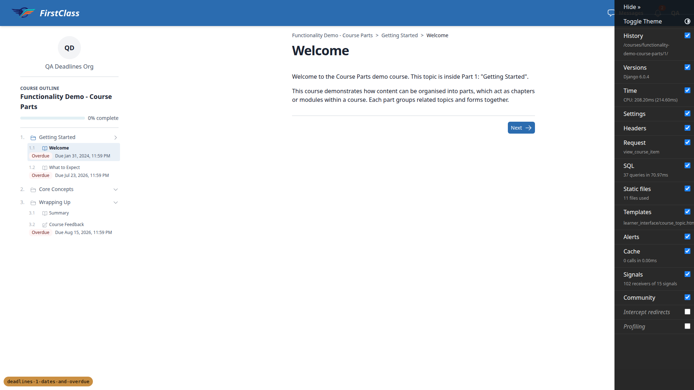 
- B2: a second site time zone is refused with "Site time zone with this Site already exists." and the site still has one row. Editing the existing row still saves. 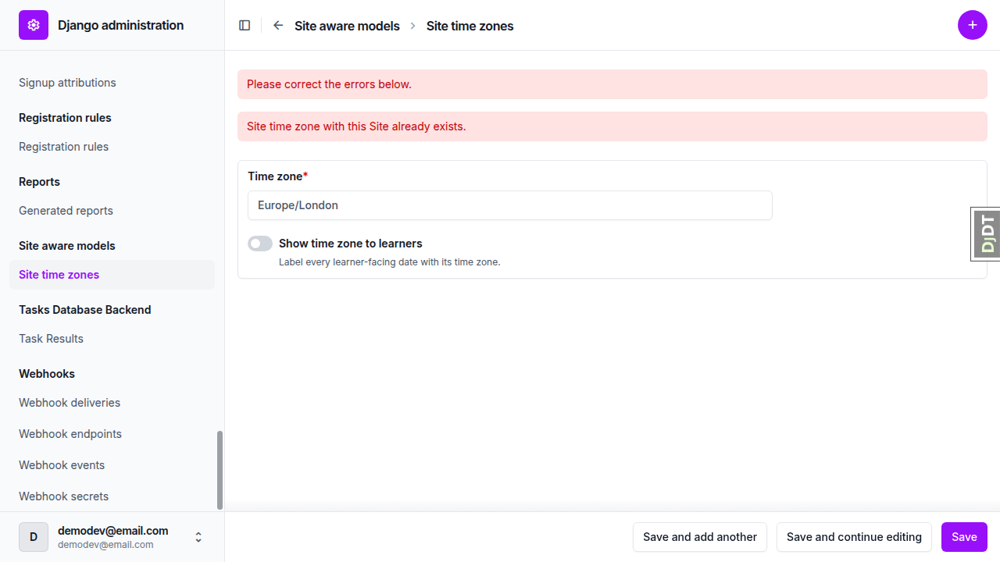
- B3: a duplicate override row now reads "This item already has an override here." Saving the existing rows still works. 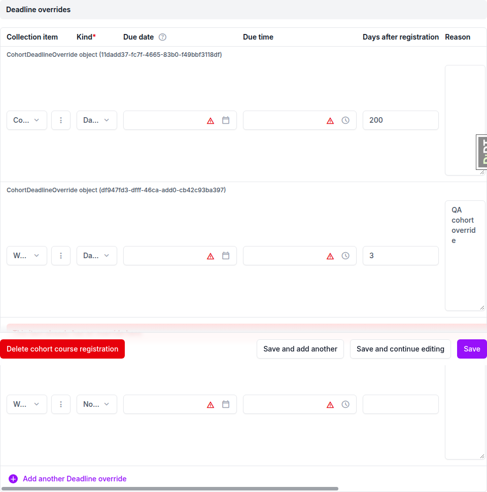

## General notes

- Test plan dates have aged. The plan was written for a date before March 2026 and run on 24 Oct 2026. The cohort learner (registered 1 Mar 2026) has every relative date, the 90-day limit and the 200-day override limit in the past. So 1.1, 2.1, 3.3, 4.4 and 5.2 show Overdue or "Time limit ended" where the plan expects no badge, Finish by, or Next due. Behaviour was checked against today's date and the precedence rules instead. "Finish by" and "Next due" were exercised with learners registered today. The plan should pin learner registration dates relative to the run date.
- Test plan corrections:
  - The course detail URL is `/courses/<slug>/detail/`; `/courses/<slug>/` opens the player.
  - The plain course is "Functionality Demo - show end with Topic" (slug `functionality-demo-show-end-with-topic`).
  - The item titles are "What to Expect", "Key Ideas" and "Course Feedback".
  - §4.2 names the fresh learner, but that learner is not in the cohort, so a second cohort member (`qa_deadline_cohort2`, registered today) was added.
- Dates follow the browser locale (`Intl.DateTimeFormat(undefined)`). Playwright's default en-US gives "Jan 31, 2024, 11:59 PM"; the run emulated en-GB to match the plan's wording. en-GB writes September as "Sept". Zone labels read "GMT+2", "GMT-4" and "GMT-5" in en-GB rather than SAST or EST.
- Rebase before QA: the branch was rebased onto origin/main twice, because main moved mid-rebase. Conflicts were in `learner_interface/views.py` (kept main's `get_access_for_request` and the branch's comment), the `test_course_detail.py` imports, and `test_organisation/import_contracts.toml` (main's list plus `freedom_ls.deadlines`). The full test tier gave 9412 passed, and pre-commit was clean. The upstream-change review was unchanged. The rebase helper's front-end check was folded into this QA run's §10 three-viewport pass.
- Admin cosmetics (not filed as bugs):
  - Inline override rows are headed "CohortDeadlineOverride object (uuid)" or "LearnerDeadlineOverride object (uuid)" because there is no `__str__`.
  - Empty Due date and Due time inputs show red warning triangles on valid rows.
  - The "Set by" email wraps per character in a narrow column.
  - Django's "Note: You are 2 hours ahead of server time." appears under the due time widget. This may confuse admins, since due times are read in the site zone.
- The hero-strip Overdue badge in the "Time limit ended" cell renders as a grey uppercase chip on the teal hero, not the red error tone used on the outline and card.
- The data helper added an uncommitted management command, `freedom_ls/qa_helpers/management/commands/qa_create_deadlines_scenario.py`. It fails mypy with 26 errors and makes the app-map hook flag a qa_helpers to deadlines edge. It was not committed. After the fixes it was moved out of the repo, to the session scratchpad, so it stops breaking the pre-commit and app-map checks.
- Overriding a relative item with kind "Days after registration" and no time uses end of day, dropping the content default's 17:00 (the Key Ideas carry-over showed 23:59). This is consistent with the override having its own `due_time` field.

status: ok
reason: 4 bugs — 3 fixed, 1 unresolved; full run after fixes 1 failed / 9417 passed (order-dependent query count); report rendered, screenshots verified
