# Frontend QA report: deadlines-2-consequence-policy

## Methodology

- Playwright MCP run on 2026-11-01 against a dev server on port 8455, for branch deadlines-2-consequence-policy.
- The branch was rebased onto main first: 12 commits replayed, no conflicts, full suite 11175 passed.
- Browser time zone: Africa/Johannesburg.
- Viewports: desktop 1920x1080, mobile 375x812, tablet 768x1024.
- Screenshots were collected into `screenshots/` beside this report. Every referenced image exists (checked against the directory listing).
- Admin forms were submitted with requestSubmit, because the Django debug toolbar overlays the save buttons.

## Diff scoping

- Class: FULL.
- Triggering files: `learner_interface/templates/learner_interface/course_detail.html`, `course_form_complete.html`, `course_item_closed.html`, `partials/course_minimal_toc.html`, `learner_interface/utils.py`, `learner_interface/views.py`, `learner_progress/attempts.py`, `docs/product/learner-experience.md`, plus tests and spec_dd files.
- Skipped: nothing.

## Smoke gate

- Outcome: pass.
- Pages checked: `/`, `/courses/functionality-demo-course-parts/detail/`.

## Results

| Test | Viewport | Status | Note | Screenshot |
|---|---|---|---|---|
| 1.1 | desktop | pass | Six config admins under Deadlines. Switch selects offer Inherit/On/Off, After access ended offers Inherit/Outline and results/Nothing, help texts name DD HH:MM:SS and what Inherit passes to. Saved all-Inherit row lists Inherit and '-' grace; reopens as Inherit and empty grace. 0 00:00:00 reopens as 00:00:00 (list 0:00:00). Row deleted. | 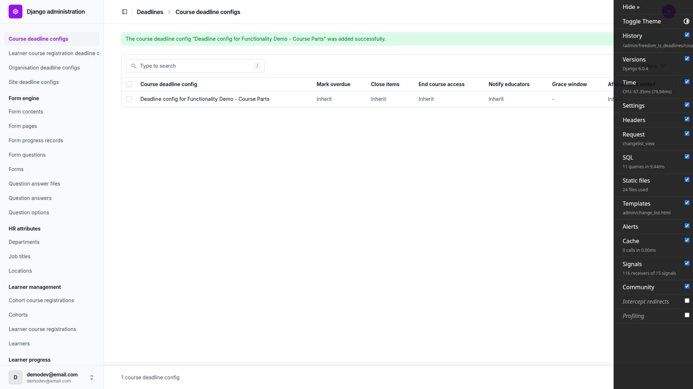 |
| 1.2 | desktop | pass | Duplicate course, site and cohort configs each give a form error ('... with this X already exists'), no 500; one row remains. Site form shows no owner field. Grace -1 00:00:00 gives field error 'The grace window cannot be negative.' Site row deleted. | 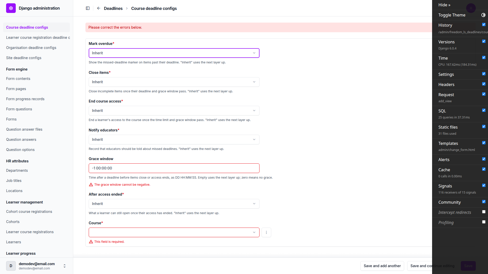 |
| 1.3 | desktop | pass | Late learner: mark_overdue On (settings), close_items On (registration), end_course_access Off (registration), notify_educators Off (settings), grace 3 days (registration), after_access_ended Outline and results (settings), no Access ends line. Cohort learner: end_course_access On (cohort), after_access_ended (cohort), Access ends 30 May 2026, 23:59 SAST. Fresh: all settings. Org close_items=off: late learner keeps registration, cohort learner Off (organisation); org row deleted. Plan's sample text says True/False and '3 days'; panel prints On/Off and '3 days, 0:00:00', same meaning. | 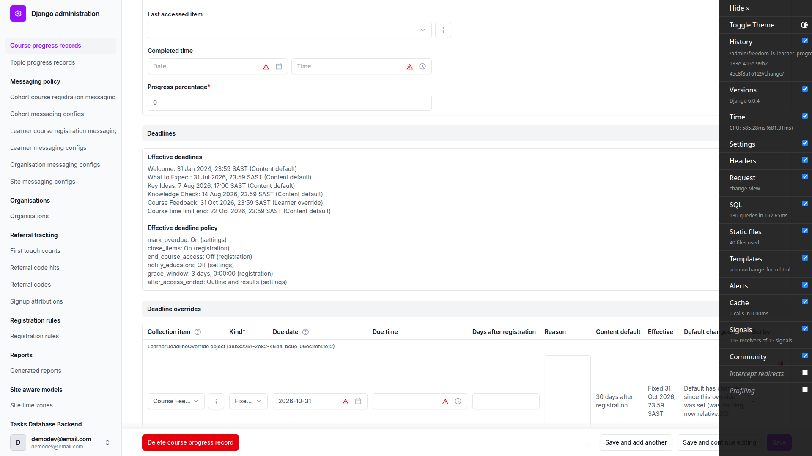 |
| 2.1 | desktop | pass | Fresh learner: Welcome shows Missed deadline chip + Jan 31, 2024, 11:59 PM in outline and header (page-2026-11-01T19-44-14-468Z.png). Course mark_overdue=off: 'Deadline Jan 31, 2024, 11:59 PM.' with no chip in outline and header; dashboard 'Deadline Welcome Jan 31, 2024, 11:59 PM.'. Back to on: chip returns. Row deleted. |  |
| 2.1 | mobile | pass | 375x812 compact row reads 'Deadline Welcome Jan 31, 2024, 11:59 PM.' with no chip. |  |
| 3.2 | desktop | pass | Welcome and Knowledge Check carry 'Closed <date>' chips, sr text 'Closed'. What to Expect and Key Ideas are sequentially withheld (Locked, Missed deadline chip, no Closed chip), as spec decision 11 requires; the plan assumes they close. Welcome: 'Closed on Feb 3, 2024, 11:59 PM. Ask your educator if you need more time.', no complete/submit, and no Next because the next row is locked. Direct URL /1/ is 200. | 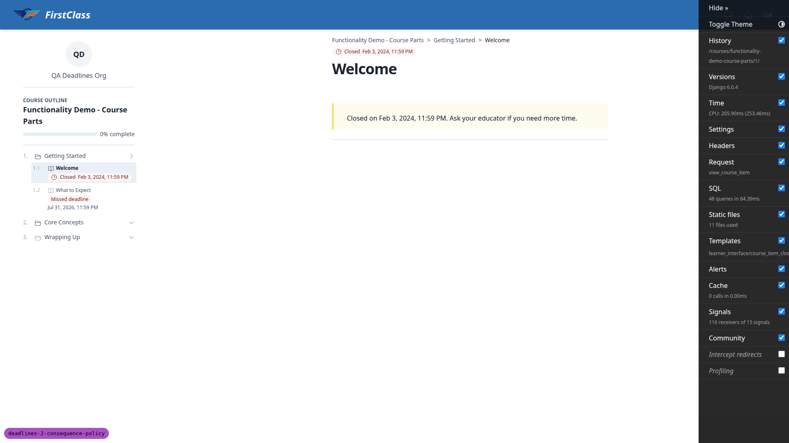 |
| 3.3 | desktop | pass | No closed form without an attempt is reachable (Course Feedback, item 7, is sequentially withheld; /7/ and /7/start_form redirect to detail). On the closed Knowledge Check (item 5): /5/start_form, /5/fill_form/1 and /5/complete (only an open attempt) all redirect to /5/, the closed notice, per spec. Plan indexes are stale (Knowledge Check 5, Course Feedback 7). | none |
| 2.2 | desktop | pass | The late learner's card leads with the earliest missed item (Closed Welcome, 'Closed Feb 3, 2024'), per _card_deadline_line, so the time-limit branch was run with qa_deadline_timelimit (every item due 2026-12-31, time limit ended Oct 22). Card: 'Missed deadline Course Oct 22, 2026, 11:59 PM'; with course mark_overdue=off: 'Deadline Course Oct 22, 2026, 11:59 PM.'; back on after deleting the row. The course opens past the time limit with end_course_access off (4.4.2). | 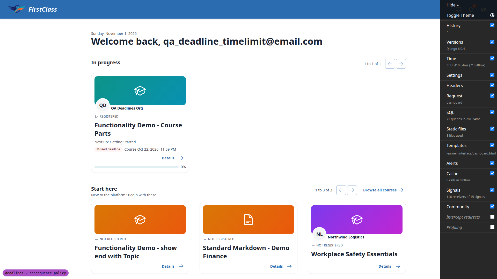 |
| 3.1 | desktop | pass | Course Feedback reads 'Missed deadline Oct 31, 2026, 11:59 PM Closes Nov 3, 2026, 11:59 PM.' but sequential unlock withholds it (Locked). The grace window was exercised with a temporary Welcome learner override at 2026-10-31 (Course progress admin inline): outline and header read 'Missed deadline Oct 31, 2026, 11:59 PM / Closes Nov 3, 2026, 11:59 PM.', no Closed chip, row linked (seen from /5/), topic body renders. Override removed. The form-start-in-grace half is not reachable (every form is withheld or closed). | 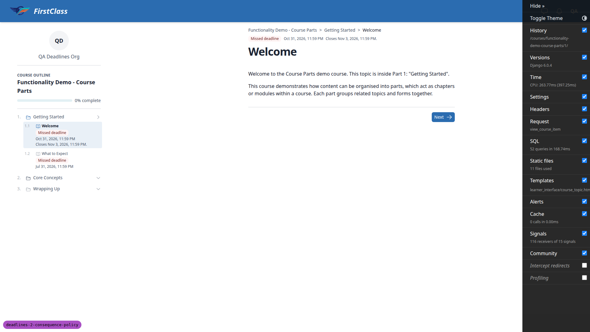 |
| 3.2-admin | desktop | pass | Closed visits to /1/ and /5/ (19:46-19:47) set nothing: started_at is 19:48:41, the open Welcome visit in 3.1, and a later closed /5/ visit left last_accessed_item on Welcome. | none |
| 3.4 | desktop | pass | Knowledge Check is item 5. Closed notice plus 'Submit your answers' (page-2026-11-01T19-47-13-224Z.png). Submit lands on /5/complete: 'Quiz not passed', 'You needed 80% to pass. This quiz has closed, so it can't be retaken.', 0% 0/3, no Retry, no Continue. Outline row stays 'Closed'; reopening shows the notice with 'See your results' -> /5/complete and no Submit. A second POST to submit-and-exit lands on /5/complete (200, no 500); admin shows one completed, failed attempt. B1 and B2 fixes from the last run hold. | 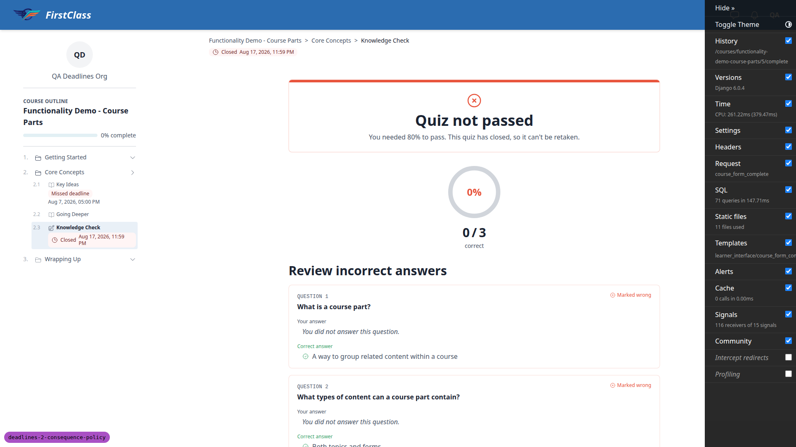 |
| 3.4-previous | desktop | fail | On the closed Knowledge Check (item 5), the closed notice and its results page both offer 'Previous' -> /4/ (Going Deeper), which the outline shows as Locked. Following it bounces to the course detail page with no explanation. This mirrors the Next/Continue case commit 47ee67918 fixed (_unlocked_next_url), but Previous was not covered. | 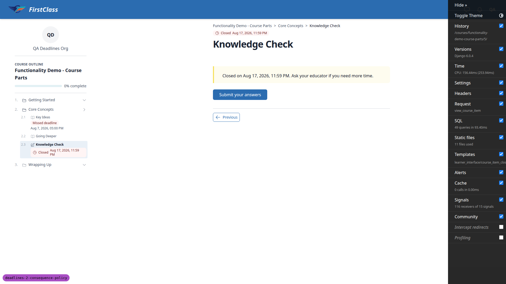 |
| 3.5 | desktop | pass | Items after the closed, incomplete Welcome (What to Expect, Key Ideas, Going Deeper, Summary, Course Feedback) are unlinked with sr 'Locked' and no Closed chip. The Getting Started and Core Concepts parts read 'Closed' with no link of their own in the player and detail outlines; their closed children stay reachable. The course detail outline matches the player (B3 fix holds). | 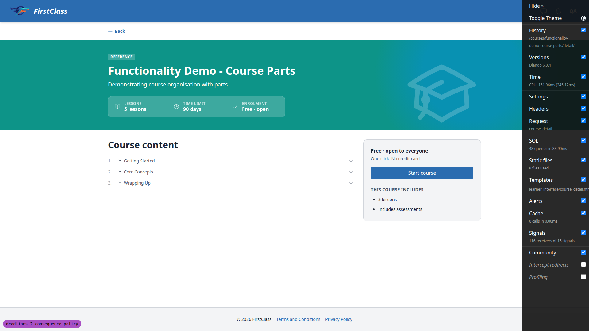 |
| 3.6 | desktop | pass | Fresh learner: Welcome shows Missed deadline and opens; no Closes/Closed in the outline, header or dashboard card ('Missed deadline Welcome Jan 31, 2024, 11:59 PM'). |  |
| 3.7 | desktop | pass | Cohort learner: completed Welcome shows no deadline line and no chip in the player outline and header, and opens while access is ended. | none |
| 4.1 | desktop | pass | Cohort learner dashboard: course stays In progress, eyebrow 'ACCESS ENDED MAY 30, 2026, 11:59 PM' with a clock icon, 0% bar, no Next up, no deadline line, no Continue; title and Details link to /detail/. Detail (page-2026-11-01T19-51-27-770Z.png): 'Your access to this course ended on May 30, 2026, 11:59 PM. Your progress is saved. Ask your educator to restore it.', no Continue/Start/Review/Enrol button; outline links only the completed Welcome. course_home lands on detail, no loop. Admin: cohort registration active, no LearnerCourseRegistration for the cohort learner, no completed_time. | 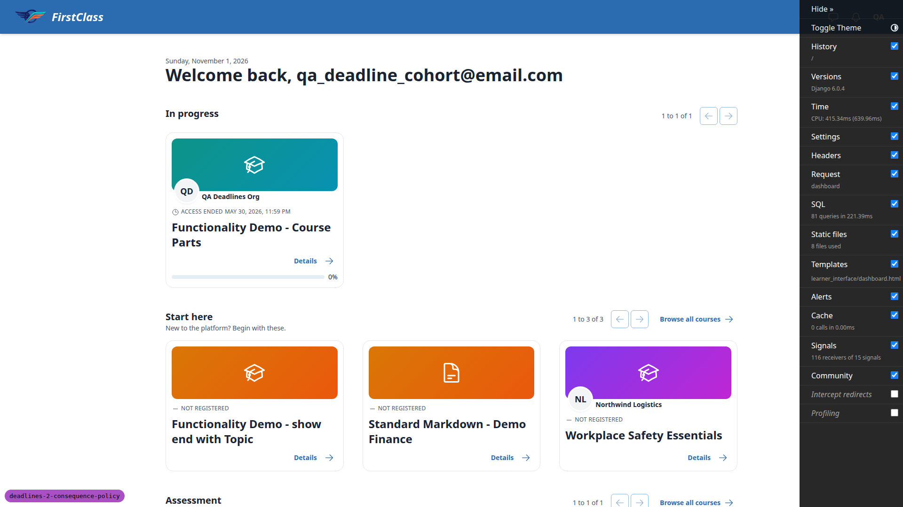 |
| 4.2 | desktop | pass | Welcome opens with only Welcome linked in the player outline, no header deadline line. Items 2-7, /5/complete (no completed attempt), /5/start_form, /finish/ and /access/ all redirect to /detail/. completed_time stays empty. Opening the completed Welcome set started_at on the record (also seen last run). | none |
| 4.3 | desktop | pass | Late learner, plain course (after_access_ended=nothing): 'Your access to this course ended on Oct 22, 2026, 11:59 PM. Your progress is saved. Ask your educator to restore it.', no button, no 'Course content' section. course_home, /1/, /2/, /3/ redirect to detail. Dashboard eyebrow 'ACCESS ENDED OCT 22, 2026, 11:59 PM'. | none |
| 4.4 | desktop | pass | Restored learner: card 'Access ends Dec 1, 2026, 11:59 PM.' (today + 30) and course_home opens /1/. Fresh learner: no 'Access ends', course opens. Time limit past with end_course_access off (qa_deadline_timelimit): opens, card 'Missed deadline Course Oct 22, 2026, 11:59 PM'. |  |
| 4.5 | desktop | pass | 4.5.1: /access/ redirects to detail, no LearnerCourseRegistration for the cohort learner. 4.5.2: late learner's plain registration deactivated in admin: dashboard lists the plain course only as NOT REGISTERED, detail shows 'Enrol for free', not the ended message; reactivated, ended message back. 4.5.4: completed_time set in admin: card moves to Learning history as COMPLETED, no 'Access ended', item 2 opens; cleared, item 2 redirects to detail again. 4.5.3 run separately. | 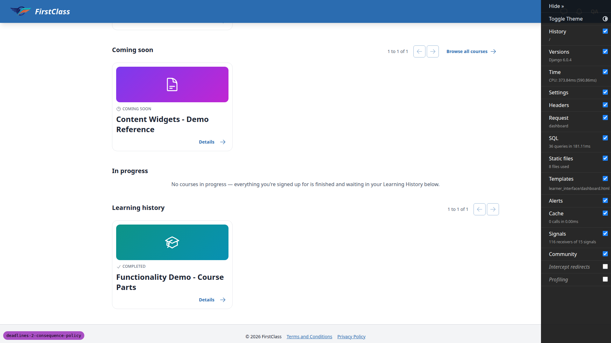 |
| 4.2.6 | desktop | pass | With the helper's completed, failed (2/3) Knowledge Check attempt, the ended cohort learner's /5/complete renders 'Quiz not passed', 'You needed 80% to pass. Your access to this course has ended.', 67%, 2/3, with no Try again/Retry/footer links; /5/start_form redirects to detail, no new attempt. | none |
| 4.3.3 | desktop | pass | With the helper's open attempt on the plain course's Course Feedback Survey (item 3), a console POST to /3/submit-and-exit with the CSRF token redirects, and /3/complete renders 'Form complete!' with the scores. The chrome draws an outline panel with title and progress but no rows, as the spec's empty index under 'nothing' intends. | 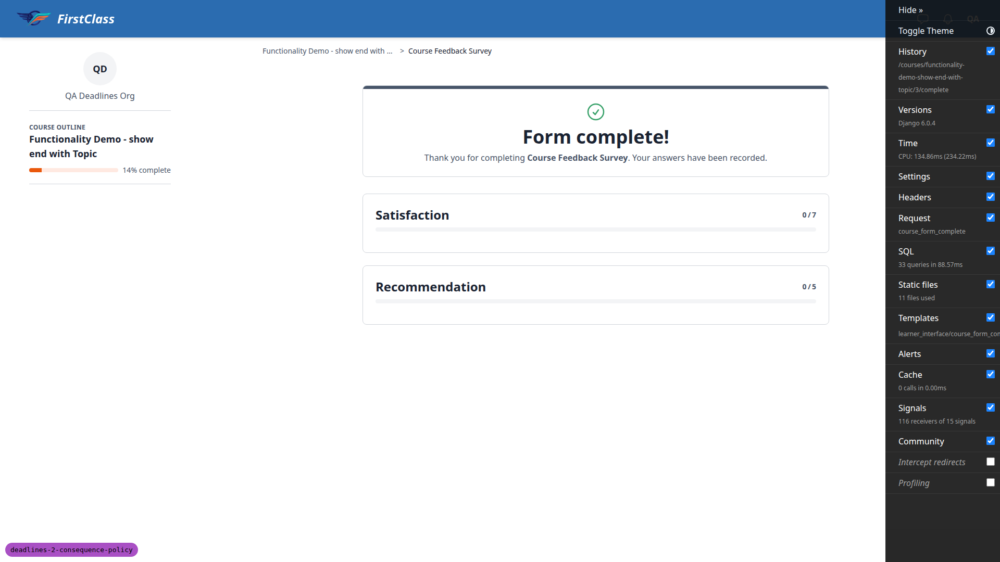 |
| 5.1 | desktop | pass | Collection item help: 'A fixed date or a number of days on the course time limit restores ended access.' Course time limit fixed 2026-11-15 saves with no error (page-2026-11-01T19-56-00-000Z.png); panel 'Access ends: 15 Nov 2026, 23:59 SAST'. Learner card 'Access ends Nov 15, 2026, 11:59 PM.', title links to /2/, detail shows Continue, item 2 opens. A due time is rejected: 'The course time limit ends at the end of its day.' (page-2026-11-01T19-57-00-000Z.png), nothing saved. Date 2026-10-31: card 'Access ended Oct 31, 2026, 11:59 PM'. Override deleted. | 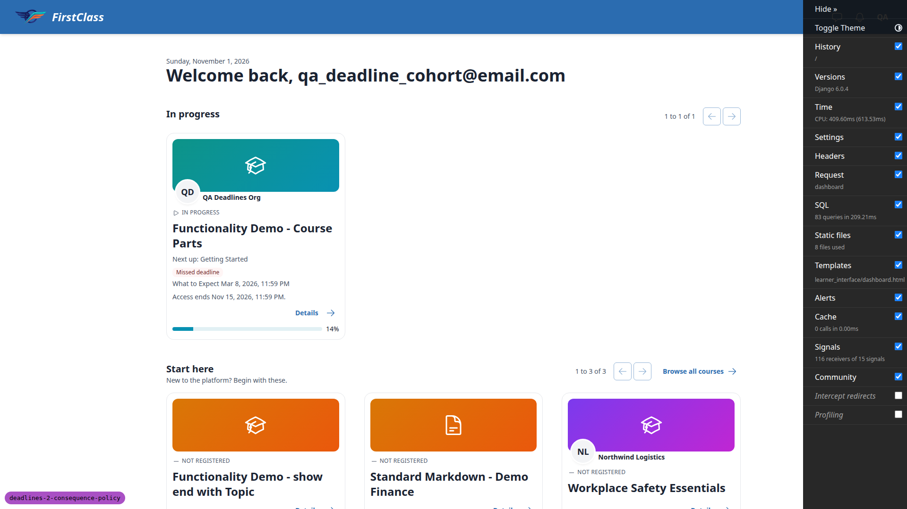 |
| 5.2 | desktop | pass | Cohort registration time-limit override (fixed 2026-11-15) reopens the course: card 'Access ends Nov 15, 2026, 11:59 PM.', item 2 opens. After deleting it, item 2 redirects to detail. | none |
| 4.5.3 | desktop | pass | With the parts course hidden (qa-data-helper), the ended cohort learner still gets its detail page (200, ended message); an anonymous visitor gets 404. Set back to published. | none |
| 6.1 | desktop | pass | Fresh learner: /courses/ (no deadline lines), dashboard, a topic page (/1/) and a quiz course's detail page render 200 with no console errors and no horizontal overflow; no 'Due', 'Overdue' or 'Expired' text. Form start/fill pages are not reachable for the fresh learner (sequentially withheld). | none |
| 6.1 | mobile | pass | Same pages at 375x812: 200, no console errors, no horizontal overflow. | none |
| 6.3 | desktop | pass | manage.py check: no issues. A settings override with DEADLINE_POLICY_DEFAULTS missing grace_window reports freedom_ls_deadlines.E001; DEADLINE_POLICY='nowhere.Nothing' reports E002. The override modules lived in the scratchpad only. | none |
| 6.2 | desktop | pass | Anonymous visitor on the parts-course detail page (re-run once the course was published again) sees 'Enrol for free'. | none |
| 4.1 | mobile | pass | 375x812: the cohort learner's compact row shows the 'Access ended May 30, 2026, 11:59 PM' eyebrow with a clock icon, progress, Details. Late learner's rows (page-2026-11-01T19-58-46-449Z.png): parts course 'Closed Feb 3, 2024, 11:59 PM' chip, plain course 'Access ended Oct 22, 2026, 11:59 PM'. Ended detail page (page-2026-11-01T19-59-10-123Z.png) and the plain course's ended detail fit. No horizontal overflow on any. | 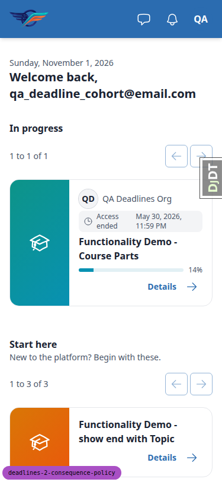 |
| 3.4 | mobile | pass | Closed Knowledge Check notice at 375x812: Closed chip with clock icon, notice readable, 'See your results' 168x40, Previous 102x34. Results page fits with Previous 102x34 and Return to course 154x32. No horizontal overflow. Previous still points at the locked /4/ (see 3.4-previous). | 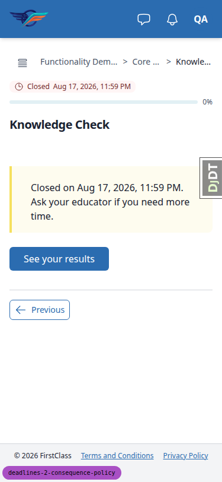 |
| 4.1 | tablet | pass | 768x1024: the cohort learner's dashboard card with the Access ended eyebrow (page-2026-11-01T19-59-23-139Z.png) and the ended detail page (sign-up panel above Course content, ended message, no button) fit with no overflow. | 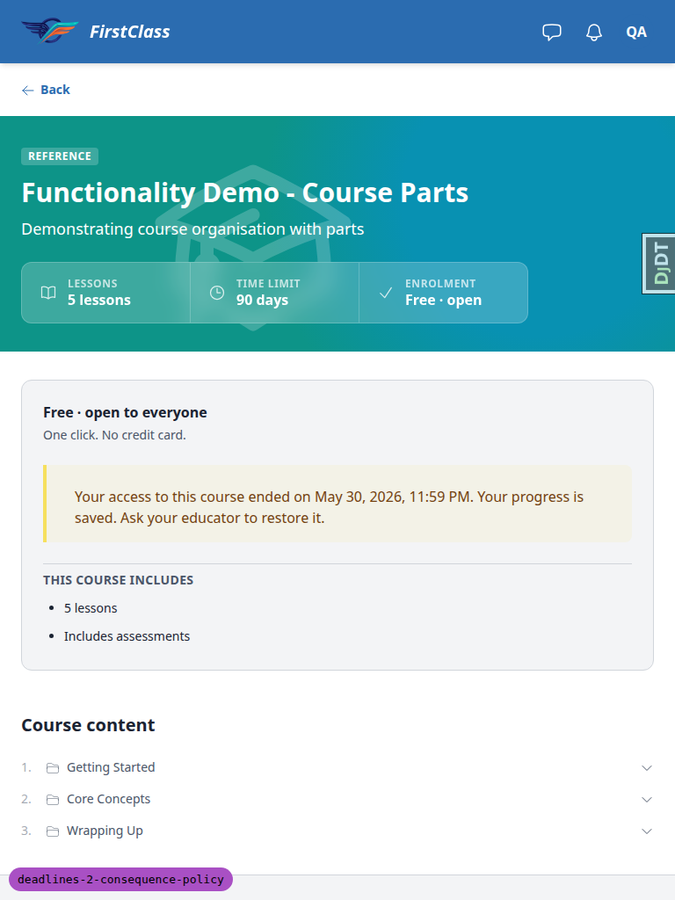 |
| 3.4 | tablet | pass | 768x1024: the player outline collapses to the drawer toggle; the closed notice, 'See your results' and Previous render at a sensible width; no overflow. | 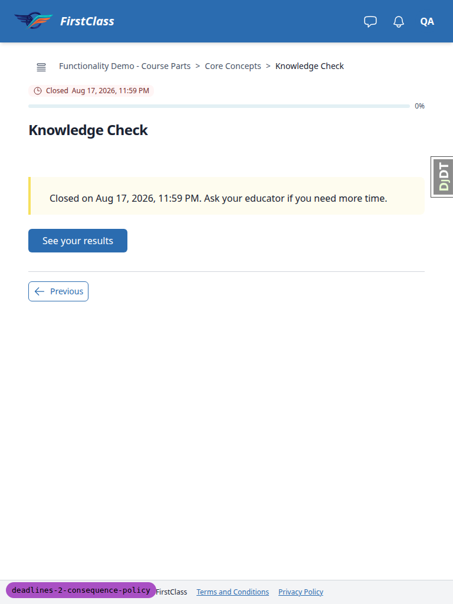 |

## Design check

No design states tested.

## B1: Closed item's Previous links to an item sequential unlock keeps locked

Seen in:

- 3.4-previous, desktop
- 3.4, mobile
- 3.4, tablet

Screenshots:

Expected: On a closed item's notice (and its results page), Previous is withheld when the row before the current one is BLOCKED, as commit 47ee67918 already does for Next/Continue via _unlocked_next_url.

Actual: Late learner, parts course: the closed Knowledge Check (item 5) notice and /5/complete show 'Previous' -> /courses/functionality-demo-course-parts/4/ (Going Deeper), which the outline shows as Locked; following it bounces to the course detail page with no explanation.

## Data changes

| What | Via |
|---|---|
| Reloaded demo content and re-seeded the qa_deadline_* learners, cohort and deadline config rows | §0 seed list (content_save demo_content DemoDev; qa_create_deadlines_seed) |
| Rebuilt qa_deadline_timelimit@email.com (user pk 78, left from an earlier run): parts-course registration and record back-dated 100 days, fixed learner overrides moving every item deadline to 2026-12-31, no config rows, so the course time limit (2026-10-22) is the only missed deadline | sdd:qa-data-helper |
| Added a completed, failed (2/3) Knowledge Check attempt for qa_deadline_cohort on the parts course (record recalculated 0% -> 14%), and an open, unanswered attempt on the plain course's Course Feedback Survey (item 3) for qa_deadline_solo | sdd:qa-data-helper |
| Set the parts course's visibility to hidden for 4.5.3, then back to published | sdd:qa-data-helper |

## Bug status

- B1: **FIXED** (commit: 7a1507923) — Closed item's Previous links to an item sequential unlock keeps locked. Re-verified: the closed Knowledge Check notice now offers only 'See your results' and its results page only 'Return to course'; an ordinary open item (What to Expect for qa_deadline_timelimit) still shows Previous -> /1/.

## General notes

Test-plan corrections still stale in `3. frontend_qa.md` (the plan was not edited):

- Knowledge Check is item 5 and Course Feedback is item 7.
- Sequential unlock withholds What to Expect, Key Ideas and Course Feedback (spec decision 11), so the 3.1, 3.2 and 3.3 assumptions don't hold.
- In 3.3, form_start/fill redirect to the closed notice per the spec, not to course detail.
- The late learner's card leads with the earliest missed item (Closed Welcome), so 2.2 and 4.4 used a dedicated learner (qa_deadline_timelimit).
- 1.3 expects True/False and '3 days', but the panel prints On/Off and '3 days, 0:00:00'.
- 3.2's footer expectation of Previous and Next predates the commit that withholds Next to a locked row.
- 0.3/§0 still names `fls-dev:qa-data-helper`, which main renamed to `sdd:qa-data-helper`.

Observations:

- Opening the completed Welcome as the ended cohort learner sets started_at (seen in earlier runs too).
- The ended learner's detail sidebar still shows 'Free · open to everyone / One click. No credit card.' above the ended message.
- The ended cohort learner's player outline shows 'Missed deadline' dates on locked rows.
- The qa-data-helper agent wrote recipe notes into `.claude/agent-memory/sdd-qa-data-helper/` inside the repo.
- This run followed the relocated `sdd:do_qa` command, because the rebase onto main moved QA from fls-dev to sdd.

The `screenshots/` directory also holds Playwright `.yml` snapshots and console `.log` files. They are not embedded.

Full run after the B1 fix: 11179 passed, 0 failed.

status: ok · reason: 1 bug — 1 fixed, 0 unresolved; report rendered, screenshots verified
