# Frontend QA report: deadline consequence policy

Date: 2026-10-29
Branch: deadlines-2-consequence-policy

## Methodology

Playwright MCP, driven by hand at three viewports: 1920x1080 (desktop), 375x812 (mobile) and 768x1024 (tablet). The browser time zone was Africa/Johannesburg. Screenshots were collected into `screenshots/` beside this report, and every image referenced here exists there.

Rebase note: before QA the branch was rebased onto origin/main (13 commits replayed). There were 3 conflicts, all in `test_organisation/import_contracts.toml` (main added `freedom_ls.audit_log`; the branch removed organisations/base from the deadlines-tests forbidden list). They were resolved by keeping both. The lost-change check found only context drift in the REVIEW paths, and all of main's lines were present. `makemigrations --check` was clean. The rebase's front-end check was folded into this QA pass, because it visits the same pages at the same three viewports. The post-rebase full test tier passed (10409 passed), pre-commit was clean, and the rebased branch was pushed.

## Diff scoping

Class: FULL. Nothing was skipped.

Changed template files that triggered it:

- `freedom_ls/learner_interface/templates/learner_interface/_course_base.html`
- `freedom_ls/learner_interface/templates/learner_interface/course_detail.html`
- `freedom_ls/learner_interface/templates/learner_interface/course_item_closed.html`
- `freedom_ls/learner_interface/templates/learner_interface/partials/course_card.html`
- `freedom_ls/learner_interface/templates/learner_interface/partials/course_deadline_line.html`
- `freedom_ls/learner_interface/templates/learner_interface/partials/course_minimal_toc.html`
- `freedom_ls/learner_interface/templates/learner_interface/partials/course_row.html`
- `freedom_ls/learner_interface/templates/learner_interface/partials/course_status_eyebrow.html`
- `freedom_ls/learner_interface/templates/learner_interface/partials/deadline_labels.html`

Everything ran: desktop, mobile and tablet.

## Smoke gate

Outcome: pass. Pages loaded:

- http://127.0.0.1:8956/
- http://127.0.0.1:8956/courses/functionality-demo-course-parts/detail/

## Design check

No design states tested.

## Results

| Test | Viewport | Status | Notes | Screenshot |
|---|---|---|---|---|
| 1.1 | desktop | PASS | Six Deadlines admins listed; selects, help text, Inherit save/reopen and grace 0 behave as expected. | 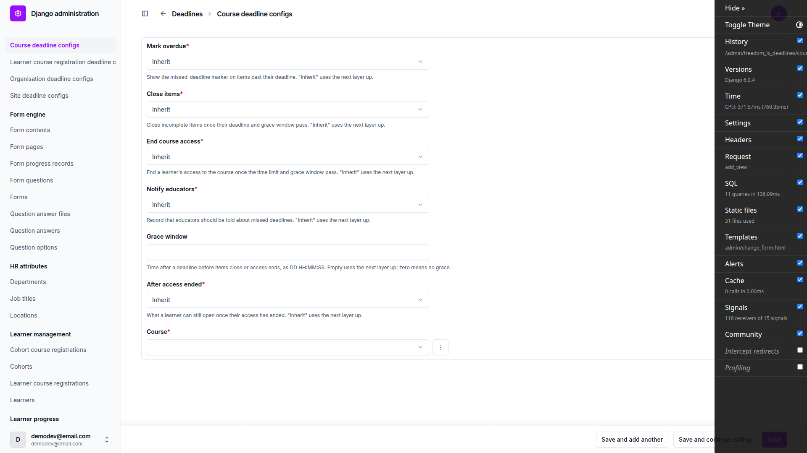 |
| 1.2 | desktop | FAIL | Duplicate course, site and cohort configs refused with field errors. Grace window -1 00:00:00 gives a non-field raw constraint-name error (B1). | 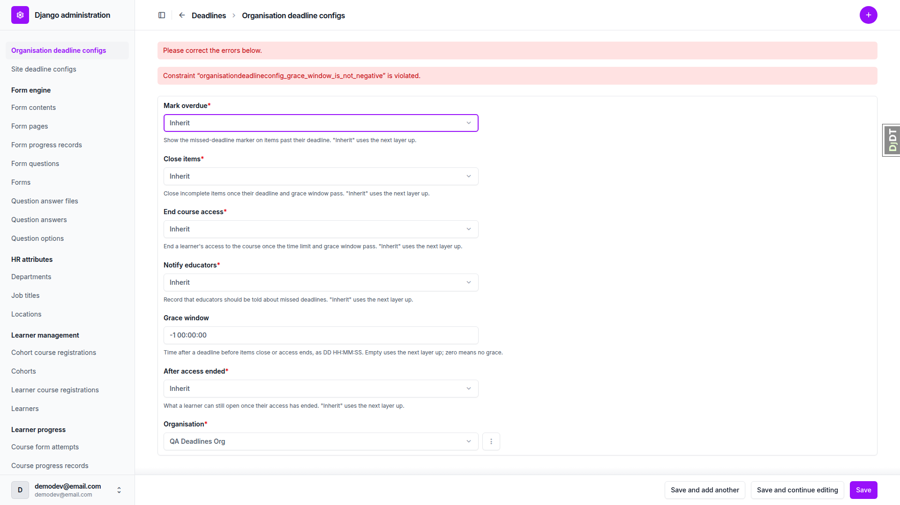 |
| 1.3 | desktop | PASS | Policy panel resolves the right values and sources for late, cohort and fresh learners; prints On/Off, not True/False. | 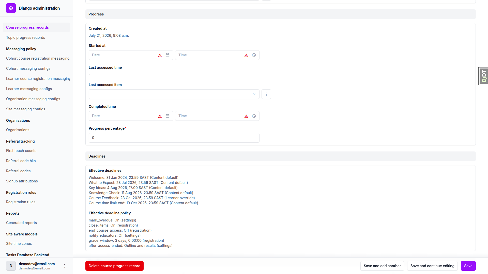 |
| 2.1 | desktop | PASS | mark_overdue off removes the chip in outline, header and dashboard; on restores it. | 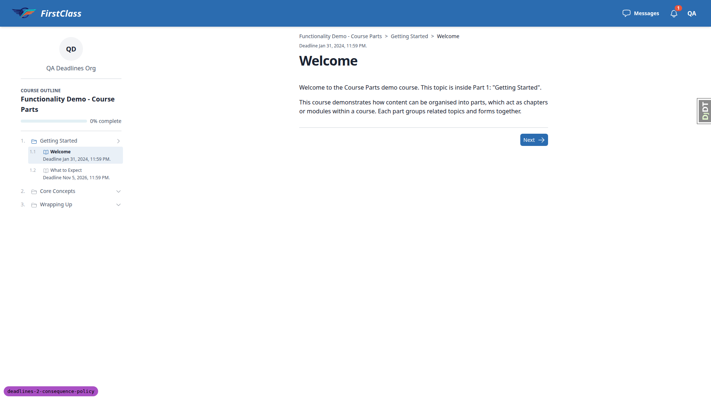 |
| 2.2 | desktop | PASS | Plan expectation wrong for the seed: card shows the earliest missed deadline (Closed Feb 3, 2024). Extra learner created for 2.2b. | none |
| 3.1 | desktop | PASS | Re-tested on qa_deadline_grace: grace shows "Missed deadline ... Closes ...", no Closed chip, form start renders. | 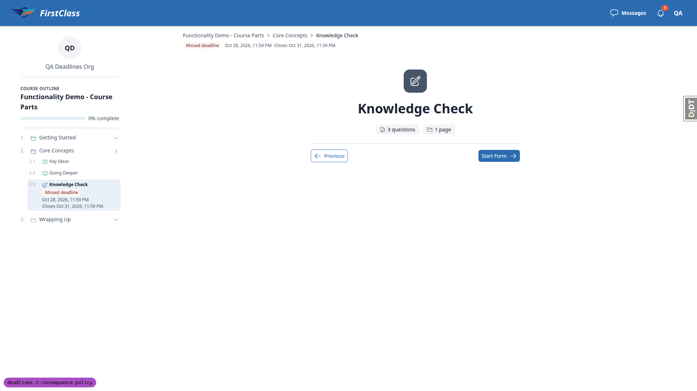 |
| 3.2 | desktop | PASS | Closed notice with plain Next link, no completion form; started_at unchanged; sequential-unlock items redirect to detail. |  |
| 3.3 | desktop | PASS | Closed row and closed notice without form controls; form routes redirect; no FormProgress created. | 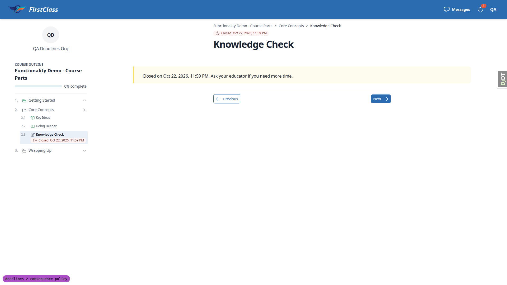 |
| 3.4 | desktop | PASS | Closed quiz with open attempt can submit once; re-submits reach the results page, one completed attempt. Row stays Closed after a failed submit. | 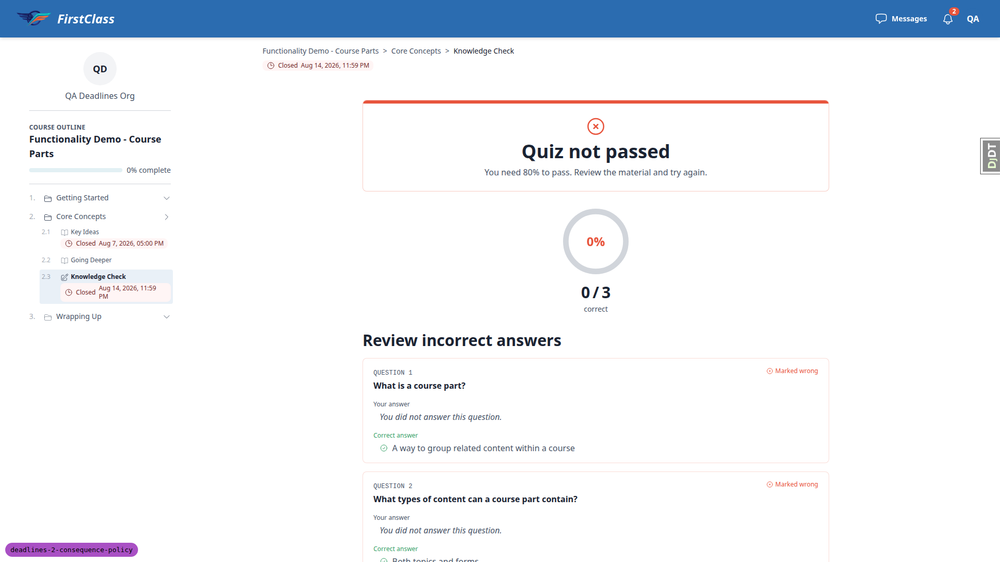 |
| 3.5 | desktop | FAIL | Locked rows are unlinked but still show a Closed chip (B2). | 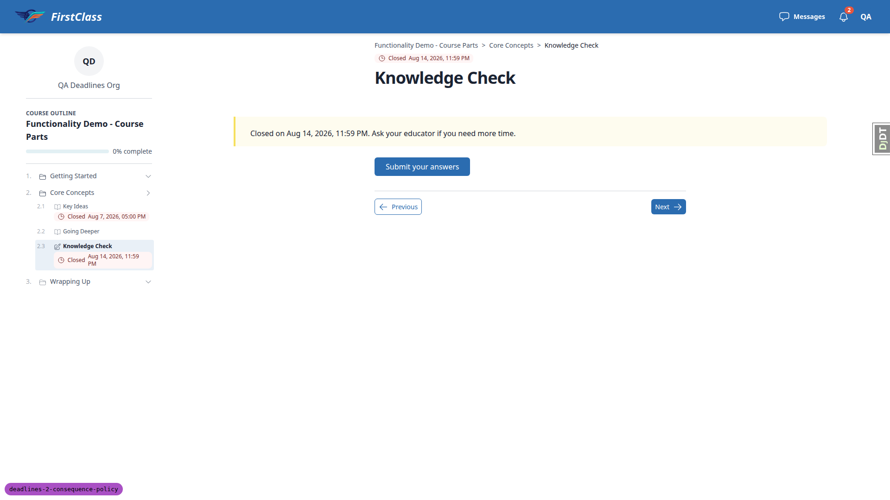 |
| 3.6 | desktop | PASS | Fresh learner: no Closes/Closed anywhere. | 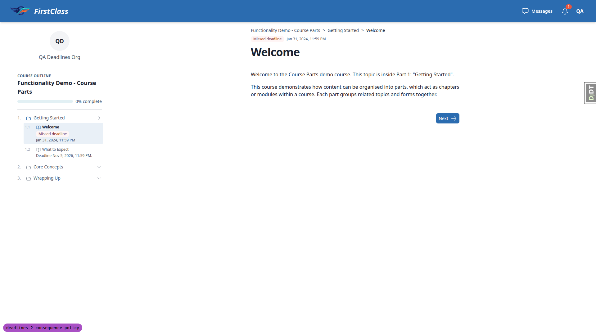 |
| 2.2b | desktop | FAIL | With mark_overdue off the card drops the past time-limit date (B3). | none |
| 3.7 | desktop | PASS | Cohort learner: completed Welcome has no deadline line or chip. | 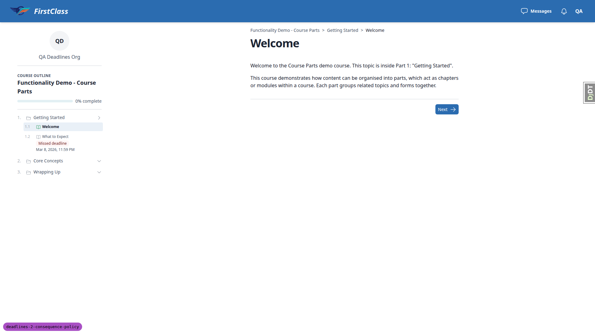 |
| 4.1 | desktop | FAIL | Functional checks pass; ended message on detail has about 1.3:1 contrast (B4). | 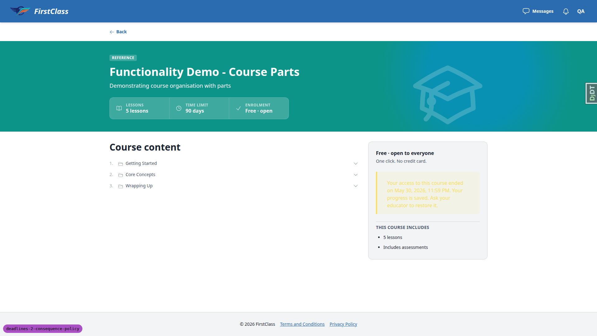 |
| 4.2 | desktop | PASS | Only Welcome reachable; other items and finish routes redirect to detail; Retry quiz bounces to detail. |  |
| 4.3 | desktop | PASS | Plain course ended message, no button or content section; survey submit-and-exit reaches results. | 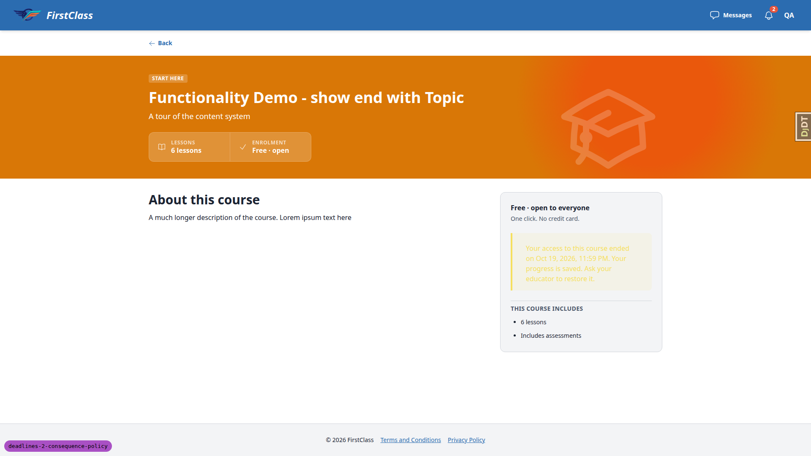 |
| 4.4 | desktop | PASS | Restored and fresh learners open the course; late learner not ended when end_course_access is off. | none |
| 4.5 | desktop | PASS | /access/ redirects without registration; deactivated registration shows normal enrol state; hidden course behaviour correct. | none |
| 6.3 | desktop | PASS | `manage.py check` clean; E001 and E002 raised for bad settings. | none |
| 4.5.4 | desktop | PASS | Completed course shows Completed and Review course, not Access ended. | none |
| 5.1 | desktop | PASS | Fixed-date time-limit override restores access; due time refused; past date ends access again. | 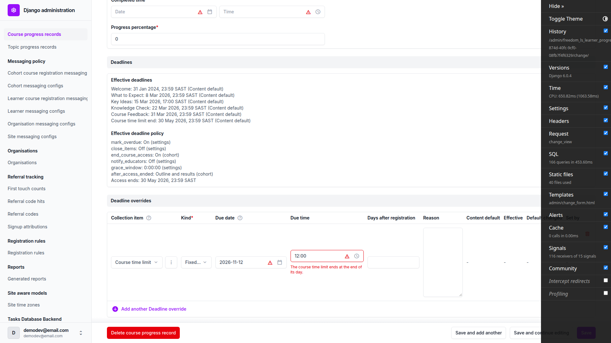 |
| 5.2 | desktop | PASS | Registration-level fixed-date override restores access and reverts on delete. | none |
| 6.1 | desktop | PASS | Fresh learner pages and form pages render; no console errors. | none |
| 6.2 | desktop | PASS | Anonymous sees Enrol for free, no ended message. | none |
| 2.1 | mobile | PASS | Compact row shows Next deadline with no chip when mark_overdue is off. | 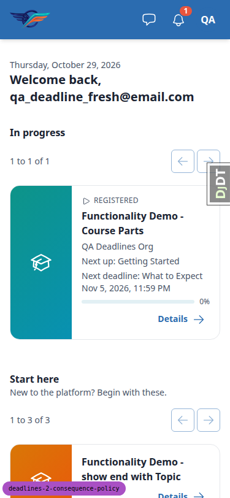 |
| 4.1 | mobile | FAIL | Dashboard eyebrow fine, no overflow; ended message on detail is low contrast (B4). | 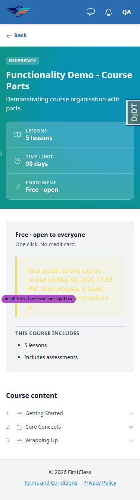 |
| 3.2 | mobile | FAIL | Closed topic notice fine; Locked row in the outline drawer also shows a Closed chip (B2). | 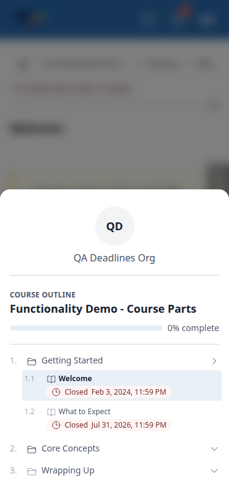 |
| 3.4 | tablet | FAIL | Closed notice extends past the reading column (B5). | 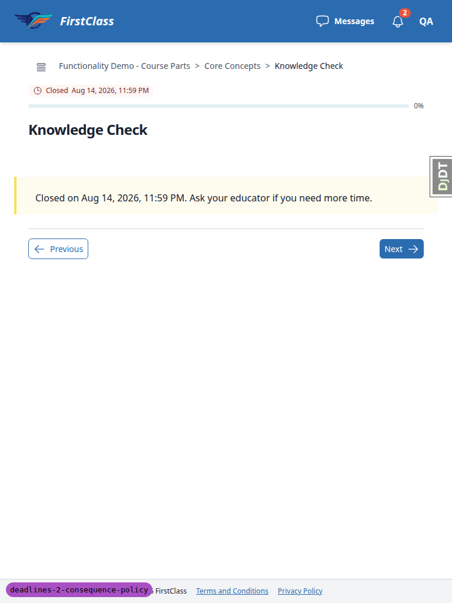 |
| 4.1 | tablet | FAIL | Dashboard cards adapt; ended message has the same low contrast (B4). | 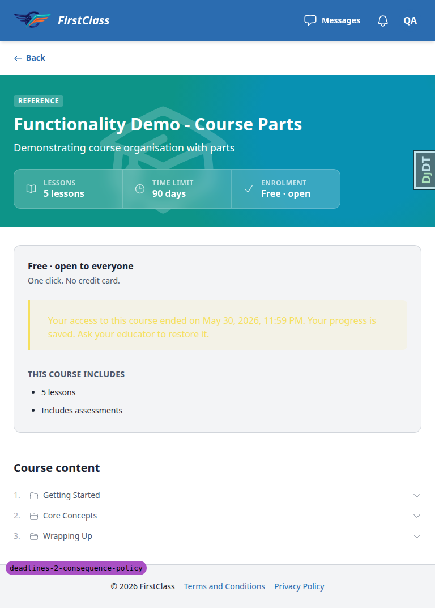 |

## Bug B1: Negative grace window shows the raw constraint name instead of a field error

Manifestations: 1.2 (desktop).

Expected: Entering -1 00:00:00 as grace window on any deadline config add form is refused with a field error on Grace window saying it cannot be negative.

Actual: A non-field error "Constraint “organisationdeadlineconfig_grace_window_is_not_negative” is violated." appears at the top of the form. No 500.

## Bug B2: Rows withheld by sequential unlock still show a Closed chip

Manifestations: 3.5 (desktop), 3.2 (mobile).

Expected: Per spec rule 11 and plan 3.5.1, an item that sequential unlock withholds stays BLOCKED: unlinked, screen reader text "Locked", and no "Closed" chip.

Actual: The late learner's What to Expect and Key Ideas are unlinked with screen reader text "Locked", but render "Closed Jul 31, 2026, 11:59 PM" and "Closed Aug 7, 2026" chips with the clock icon. A screen reader hears both Locked and Closed.

## Bug B3: With mark_overdue off the dashboard card drops a past deadline's date

Manifestations: 2.2b (desktop). No screenshot.

Expected: The spec says mark_overdue off removes the chip on the card (item and time limit) while dates are still shown; plan 2.2.2 says the card line drops the chip and keeps the date.

Actual: The past time-limit date disappears and the card shows the next upcoming item instead ("Next deadline: Welcome Dec 28"). The plan's own 2.1.4 accepts the same behaviour for a past item date, so the spec and the plan disagree.

## Bug B4: Access-ended message on course detail is yellow text on pale yellow (about 1.3:1 contrast)

Manifestations: 4.1 (desktop), 4.1 (mobile), 4.1 (tablet).

Expected: The ended message "Your access to this course ended on ... Ask your educator to restore it." is legible (WCAG AA 4.5:1).

Actual: It is rendered by the shared `<c-callout level="warning">` (`freedom_ls/base/templates/cotton/callout.html`), whose body uses text-warning (#F6E05E) over bg-warning/10 on the grey signup panel. Contrast is about 1.3:1.

## Bug B5: Closed notice in the player is not aligned to the reading column

Manifestations: 3.4 (tablet), 3.2 (desktop; observed on the 3.4 desktop shot and the 3.2 closed-item page).

Expected: The closed notice sits in the reading column under the title, as `course_item_closed.html` asks with class="mx-auto max-w-reading".

Actual: `<c-callout>` does not render a class attribute, so the notice spans wider than the content column and starts left of the title (desktop x about 505-1784 against a column of 808-1480).

## Bug status

| Bug | Status |
|---|---|
| B1 | **FIXED** (commit: a05f2afd6) — Negative grace window shows the raw constraint name instead of a field error. Re-verified: "The grace window cannot be negative." on the Grace window field. 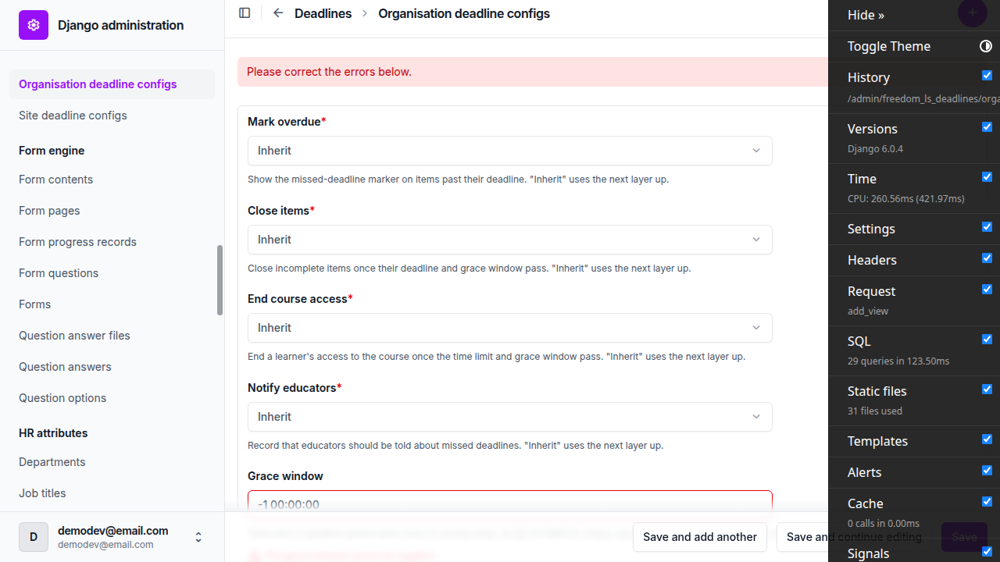 |
| B2 | **FIXED** (commit: b160b6563) — Rows withheld by sequential unlock still show a Closed chip. Re-verified: locked rows now read "Missed deadline … Closes …" with no Closed chip; offered closed rows keep theirs; dashboard card and player header unchanged. 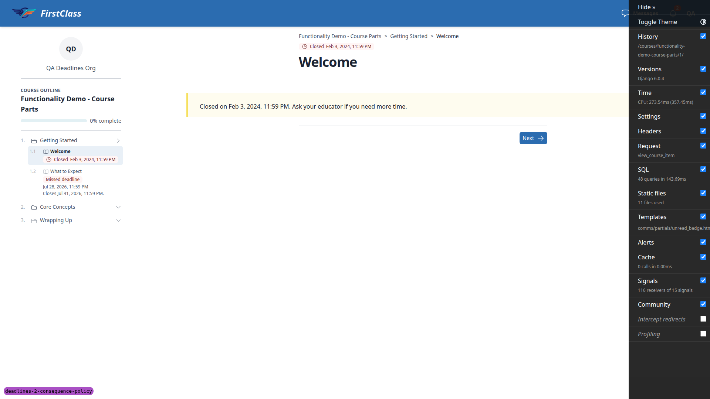 |
| B3 | **UNRESOLVED** — With mark_overdue off the dashboard card drops a past deadline's date (reason: spec says the card keeps the date, the plan's 2.1.4 accepts dropping it; which one is right is a product decision) |
| B4 | **FIXED** (commit: 2c780cb11) — Access-ended message on course detail is yellow text on pale yellow (about 1.3:1 contrast). Re-verified: text is now #744210 (text-on-warning-light), about 7.5:1; the player's closed notice is unaffected. 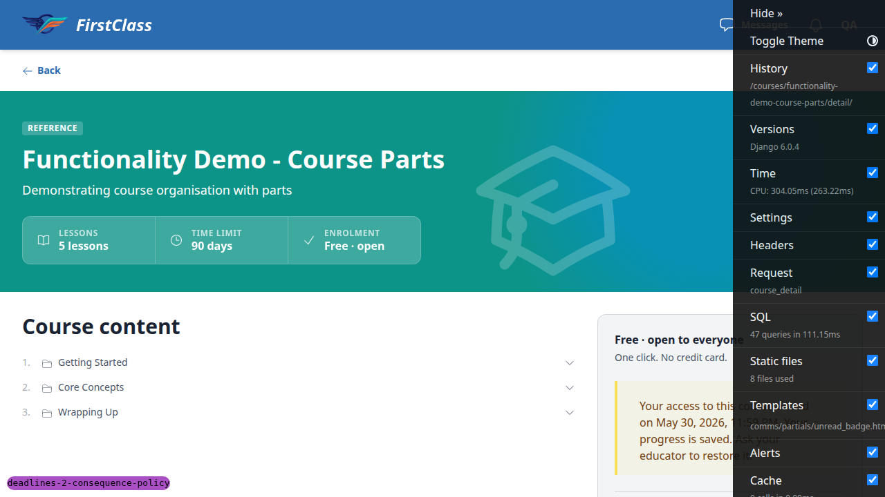 |
| B5 | **UNRESOLVED** — Closed notice in the player is not aligned to the reading column (reason: fix budget exhausted this run) |

## General notes

Test plan corrections:

1. Item indices in the plan are wrong. The real order is 1 Welcome, 2 What to Expect, 3 Key Ideas, 4 Going Deeper, 5 Knowledge Check, 6 Summary, 7 Course Feedback. The plain course survey is index 3.
2. The plan assumes the late learner's closed items and Course Feedback are reachable, but sequential unlock withholds everything after the closed-incomplete Welcome (spec rule 11). Tests 3.1, 3.2.2 and 3.3 were re-run on a new learner, qa_deadline_grace@email.com.
3. Test 2.2: the card shows the earliest missed deadline, so for the late learner it is "Closed Feb 3, 2024", never the time limit. A new learner, qa_deadline_timelimit@email.com, was used.
4. The quiz results button is "Retry quiz", not "Try again".
5. The policy panel prints On/Off and display labels, not True/False.
6. A FAILED quiz past its close instant reads Closed (per spec), not Needs retry.
7. The detail CTA after restore reads "Start course" because the seeded record's progress_percentage is 0.

Extra QA data created through fls-dev:qa-data-helper:

- qa_deadline_timelimit@email.com: items overridden 60 days ahead, time limit ended 10 days ago.
- qa_deadline_grace@email.com: items 1-4 complete, close_items on, grace 3 days, Knowledge Check due yesterday. It now has an open attempt from the 6.1 fill-page check.
- An open survey attempt for the late learner on the plain course (since submitted in 4.3.3).
- A completed Knowledge Check attempt for the cohort learner.
- The parts course visibility was set to hidden and then restored to published.

Observations with no action:

- Admin pages log a 404 for /favicon.ico.
- The ended learner's results page still offers "Retry quiz", which only bounces back to course detail.
- The ended learner's signup panel still shows the "Free · open to everyone / One click. No credit card." pitch above the ended message.
- Visiting item 2 while the course was marked completed created a TopicProgress row for What to Expect (existing review behaviour).
- The debug toolbar overlaps admin Save buttons in a fresh browser context until hidden.

status: ok · reason: 5 bugs — 3 fixed, 2 unresolved; report rendered, screenshots verified
