# Frontend QA Report: deadlines-2-consequence-policy

The frontend QA pass for the plan `3. frontend_qa.md` ran 34 test records across desktop, mobile and tablet viewports. 33 records passed and 1 failed (4.3.3). Two bugs are documented: B1 (the dashboard card's "Closed" deadline line drops the item name) and B2 (the results page under `after_access_ended=nothing` still draws an empty course outline panel). Both are currently UNRESOLVED.

## Methodology

- Playwright MCP drove a local dev server on port 8013, on branch `deadlines-2-consequence-policy`.
- The DB was re-seeded at the start with `content_save demo_content DemoDev` and `qa_create_deadlines_seed`.
- The admin was driven in a second browser context.
- Data was built through the qa-data-helper agent: the time-limit learner (`qa_deadline_timelimit`), extra attempts (for example the failed Knowledge Check attempt for the cohort learner) and the hidden toggle on the parts course.
- Screenshots were collected into `screenshots/` beside this report, and every image referenced below exists there. A few `.yml` snapshot files and `.log` console files also landed in `screenshots/`.

## Diff scoping

- Class: **FULL**.
- Changed files named by the scoping record:
  - `claude_plugins/sdd/resources/qa_layout_probe.js`
  - `freedom_ls/learner_interface/templates/learner_interface/course_detail.html`
  - `freedom_ls/learner_interface/templates/learner_interface/course_finish.html`
  - `freedom_ls/learner_interface/templates/learner_interface/course_form.html`
  - `freedom_ls/learner_interface/templates/learner_interface/course_form_complete.html`
  - `freedom_ls/learner_interface/templates/learner_interface/course_item_closed.html`
  - `freedom_ls/learner_interface/templates/learner_interface/partials/course_minimal_toc.html`
- Desktop, mobile and tablet all ran. Nothing skipped.

## Smoke gate

- Outcome: **pass**.
- Pages checked:
  - `http://127.0.0.1:8013/`
  - `http://127.0.0.1:8013/courses/functionality-demo-course-parts/detail/`

## Results

| Test | Viewport | Status | Screenshot | Notes |
|---|---|---|---|---|
| 1.1 | desktop | pass | 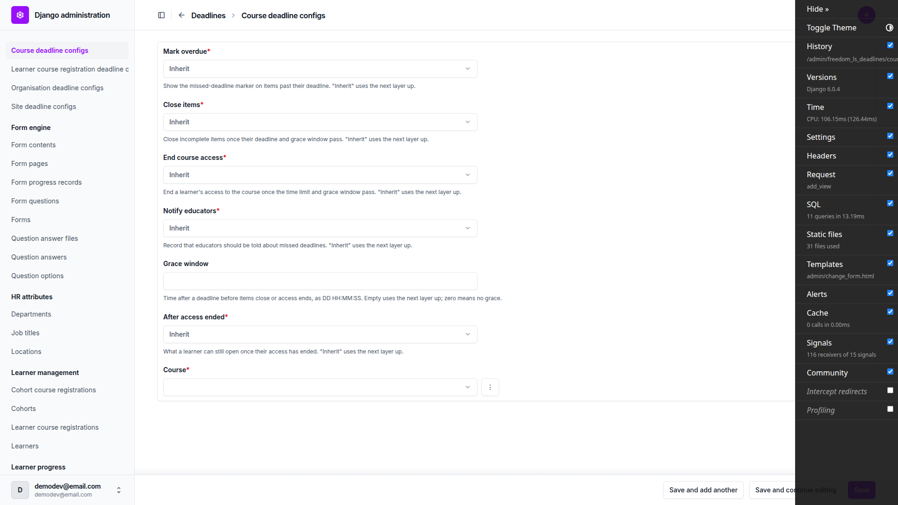 | Six Deadlines admins listed. Selects offer Inherit/On/Off and Inherit/Outline and results/Nothing. Grace window empty with DD HH:MM:SS help. All-Inherit row saves and reopens as Inherit with empty grace; grace 0 00:00:00 reopens as 00:00:00. Debug toolbar intercepts the admin Save button until hidden (dev tooling only). |
| 1.2 | desktop | pass | 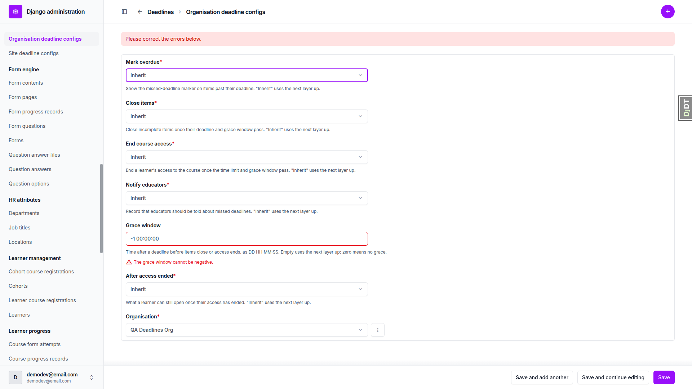 | Duplicate course, site and cohort configs each give a form error ("... with this Course/Site/Cohort already exists."), no 500. Site form shows no owner field. Grace -1 00:00:00 gives "The grace window cannot be negative." |
| 1.3 | desktop | pass | 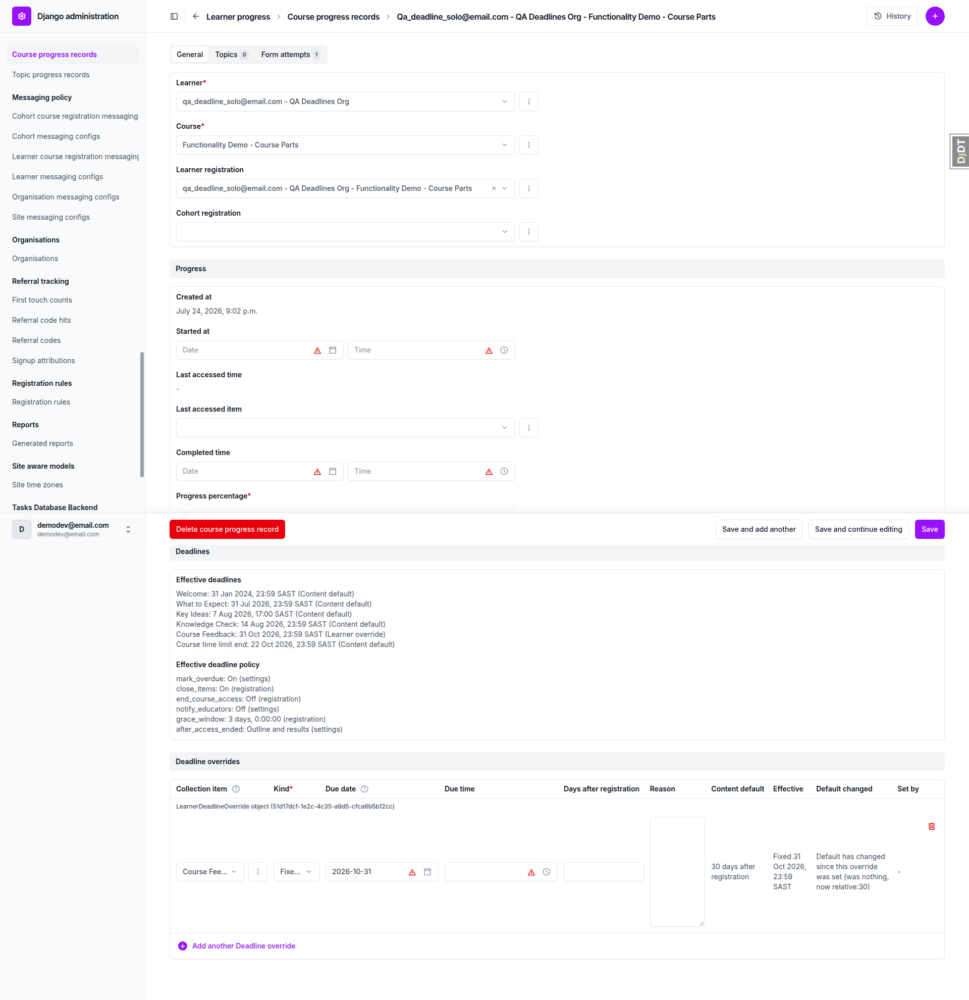 | Solo: mark_overdue On (settings), close_items On (registration), end_course_access Off (registration), grace 3 days (registration), after_access_ended Outline and results (settings). Cohort: end_course_access On (cohort), "Access ends: 30 May 2026, 23:59 SAST". Org close_items=off: solo still On, cohort Off. Panel prints On/Off and 23:59 rather than the plan's True/False and 11:59 PM, same values. |
| 2.1 | desktop | pass | 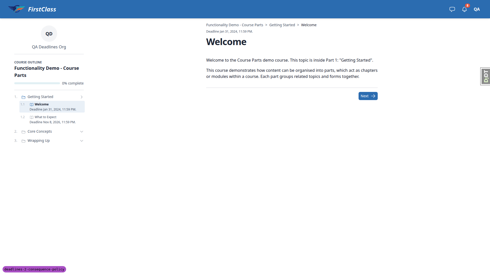 | Fresh learner: Welcome shows "Missed deadline" chip + "Jan 31, 2024, 11:59 PM". With mark_overdue=off, outline and header read "Deadline Jan 31, 2024, 11:59 PM." with no chip; other items unchanged. Dashboard card likewise. Back to on, chip returns. Row deleted. |
| 2.1 | mobile | pass | 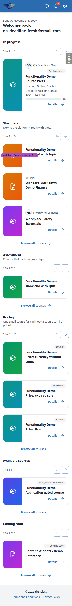 | 375x812: dashboard item reads "Deadline Welcome Jan 31, 2024, 11:59 PM." with no chip. Renders as a stacked card, not a compact row. |
| 3.2 | desktop | pass | 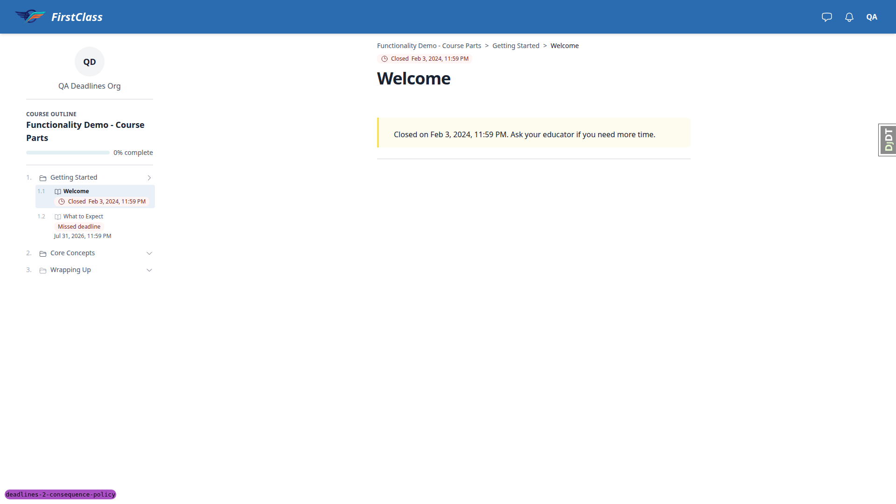 | Welcome (item 1) is closed and incomplete, so sequential unlock keeps What to Expect and Key Ideas Locked, unlike the plan's Closed+linked (spec rule 11). Closed chip "Closed Feb 3, 2024, 11:59 PM", notice "Closed on Feb 3, 2024, 11:59 PM. Ask your educator if you need more time.", no Next/Submit. CourseProgress started_at, last_accessed_item, last_accessed_time still None. Locked items 2,3,4,6,7 redirect to course detail; index 8 gives 404. |
| 3.4 | desktop | pass | 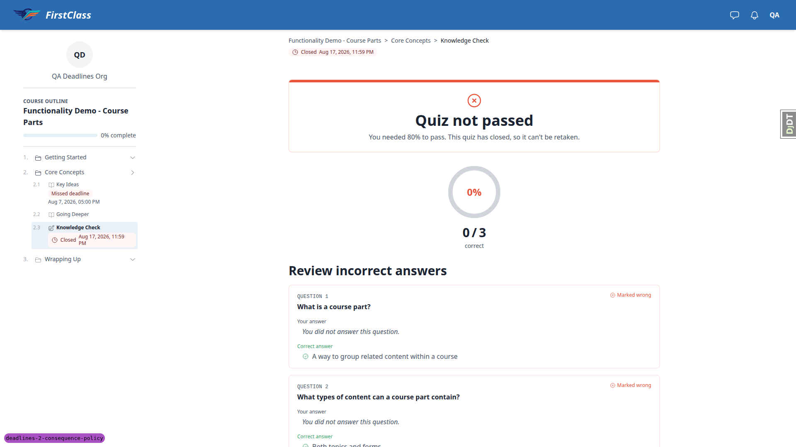 | Knowledge Check is player index 5. Closed notice + "Submit your answers" (POST submit-and-exit). fill_form/1 and start_form redirect to the closed notice (/5/), per spec; plan's "course detail" is stale. Submit gives results 0/3, "Quiz not passed ... This quiz has closed, so it can't be retaken.", no Retry. Second POST redirects to results 200; still one completed FormProgress. |
| 3.5 | desktop | pass |  | Items after closed incomplete Welcome are unlinked with sr "Locked", no Closed chip. "Getting Started" and "Core Concepts" read Closed; "Wrapping Up" Locked. Knowledge Check (closed, open attempt) individually reachable. |
| 3.6 | desktop | pass | 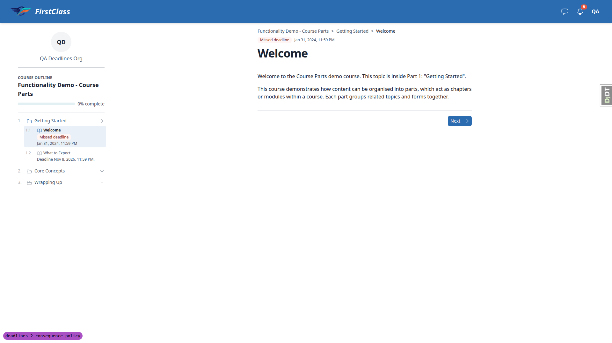 | Fresh learner: Welcome Missed deadline and opens normally; no "Closes"/"Closed" in outline, header or dashboard. |
| 3.7 | desktop | pass | 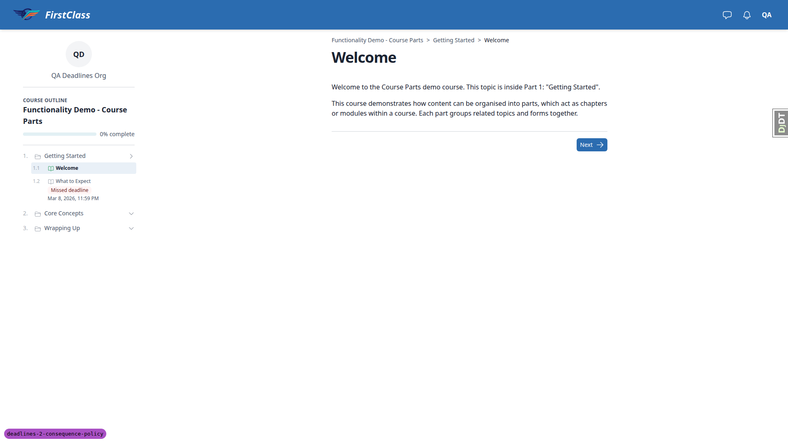 | Cohort learner: completed Welcome shows no deadline line or chip (outline "1.1 Completed Welcome"), header has no deadline line, opens under outline_and_results. |
| 4.1 | desktop | pass |  | Card in In progress: eyebrow "ACCESS ENDED MAY 30, 2026, 11:59 PM", progress bar, no Next up/Continue. Detail: "Your access to this course ended on May 30, 2026, 11:59 PM. Your progress is saved. Ask your educator to restore it." and no CTA. course_home goes to detail. Side panel still reads "Free · open to everyone / One click. No credit card." above the ended message. |
| 4.1 | mobile | pass | 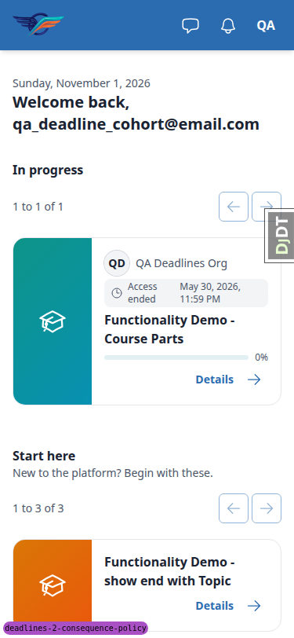 | 375x812: "Access ended May 30, 2026, 11:59 PM" eyebrow, progress, no Continue. |
| 4.2 | desktop | pass |  | Welcome (1) opens; others unlinked Locked; Next (link to /2/) redirects to detail. Items 2,3,4,5,7, 5/complete, finish/, 5/start_form all redirect to detail. Player outline still prints "Missed deadline" chips on locked rows of an ended course. |
| 2.2 | desktop | pass | 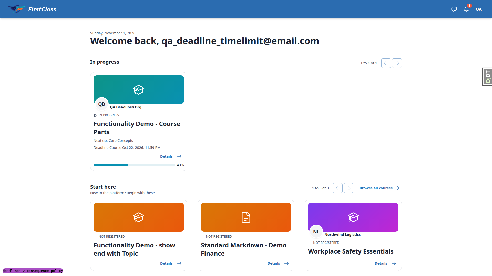 | Seeded late learner cannot show the time-limit branch (earliest missed is closed Welcome). Re-run on qa_deadline_timelimit: "Missed deadline Course Oct 22, 2026, 11:59 PM"; with mark_overdue=off "Deadline Course Oct 22, 2026, 11:59 PM." with no chip. Row deleted. |
| 3.1 | desktop | pass | 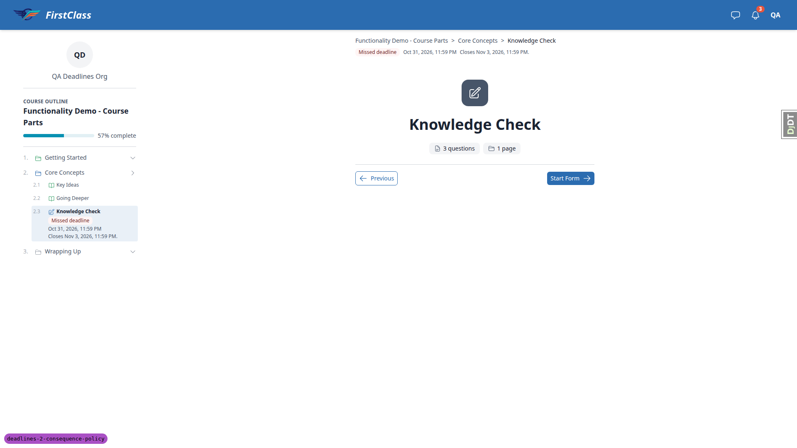 | On qa_deadline_timelimit with close_items=on, grace 3 days: row "Missed deadline Oct 31, 2026, 11:59 PM Closes Nov 3, 2026, 11:59 PM.", no Closed chip, linked. Form start page renders "Start Form"; header repeats Missed deadline + Closes. |
| 3.3 | desktop | pass | 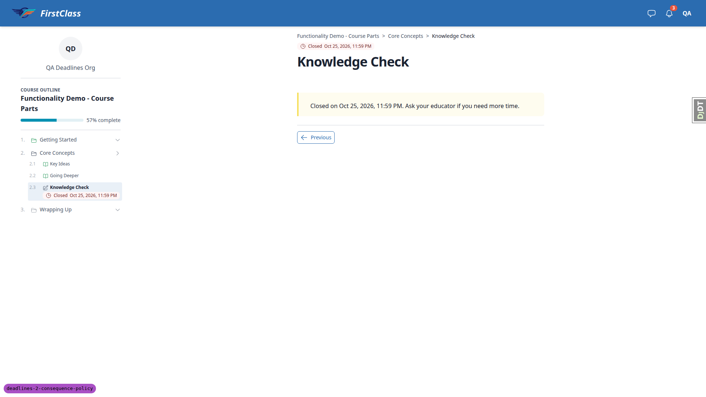 | Override 10 days ago: row "Closed Oct 25, 2026, 11:59 PM"; notice with no "Submit your answers" and no "Start Form", just Previous. start_form and fill_form/1 redirect to /5/. No FormProgress created (0). Override restored to 2026-12-31. |
| 4.3 | desktop | pass | 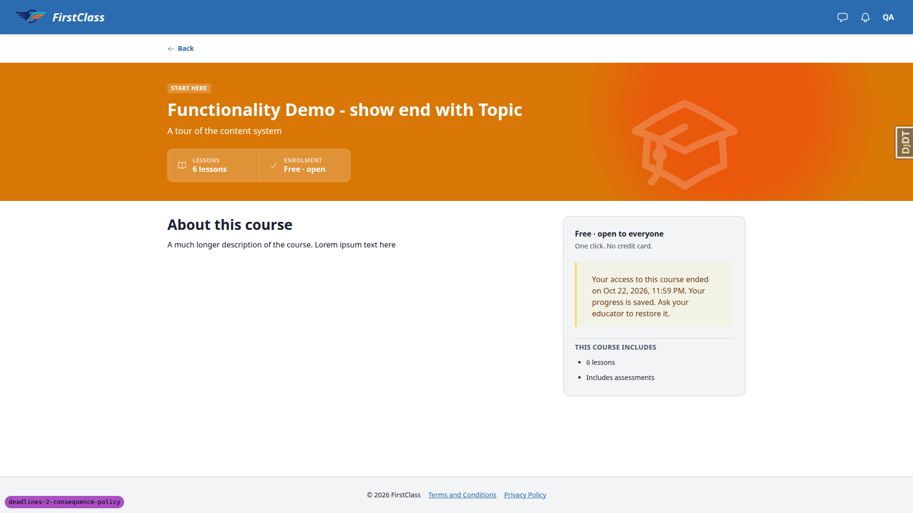 | Late learner, after_access_ended=nothing: "Your access to this course ended on Oct 22, 2026, 11:59 PM. ...", no CTA, no Course content section. course_home, items 1 and 3, and 3/complete redirect to detail. Dashboard eyebrow "ACCESS ENDED OCT 22, 2026, 11:59 PM". |
| 4.4 | desktop | pass | 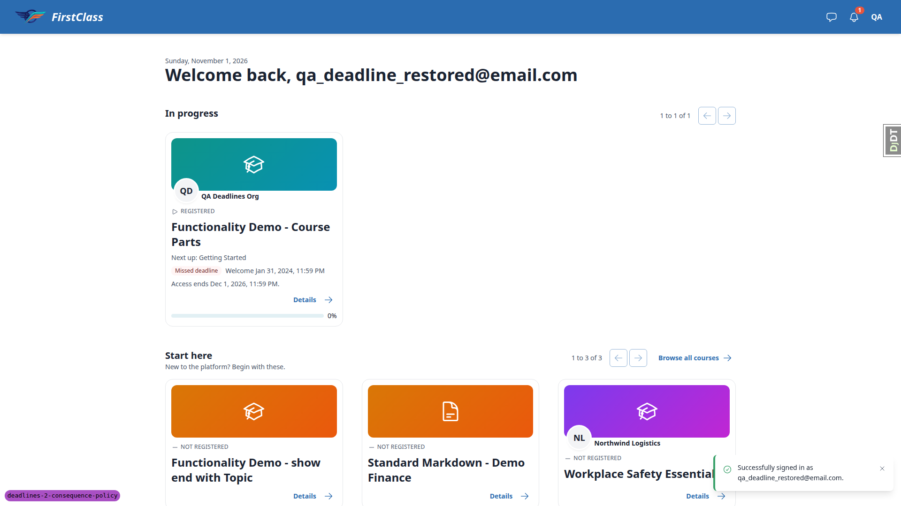 | Restored learner: "Access ends Dec 1, 2026, 11:59 PM." (today+30), course opens to item 1. Fresh learner: no Access ends. Time-limit learner opens, card shows "Missed deadline Course Oct 22, 2026, 11:59 PM". |
| 6.1 | desktop | pass | 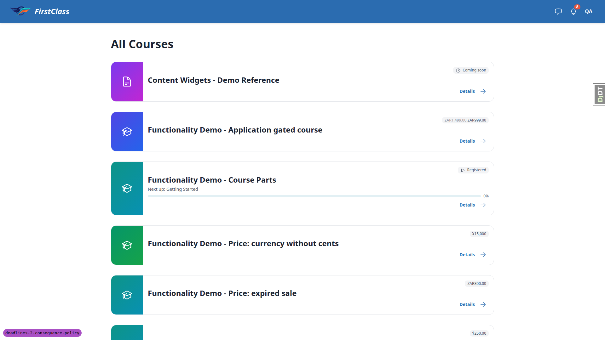 | Fresh learner: /courses/ 200 with no deadline words; dashboard, topic page and plain course detail 200, no console errors at 1920x1080. Form start exercised on the time-limit learner without errors. |
| 6.1 | mobile | pass | 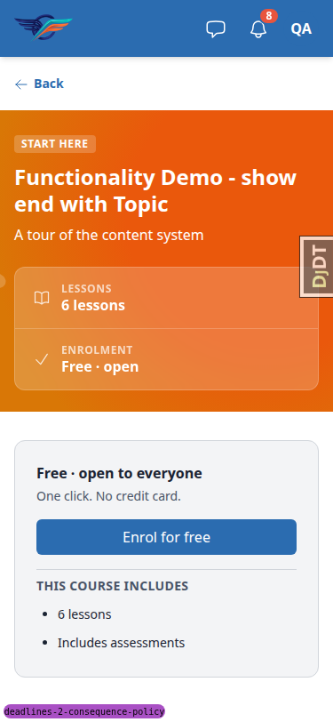 | Same pages at 375x812: 200, no console errors. |
| 6.2 | desktop | pass | 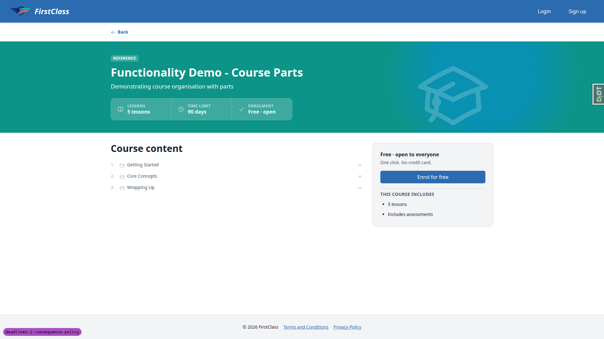 | Anonymous: parts course detail 200 with "Enrol for free". |
| 6.3 | desktop | pass | null (no screenshot) | manage.py check: no issues. Missing grace_window override gives freedom_ls_deadlines.E001; DEADLINE_POLICY='nowhere.Nothing' gives E002. Overrides lived in the session scratchpad, not the repo. |
| 4.5 | desktop | pass | null (no screenshot) | 4.5.1: cohort learner /access/ redirects to detail; no LearnerCourseRegistration for them. 4.5.2-4.5.4 below. |
| 4.2.6 | desktop | pass | 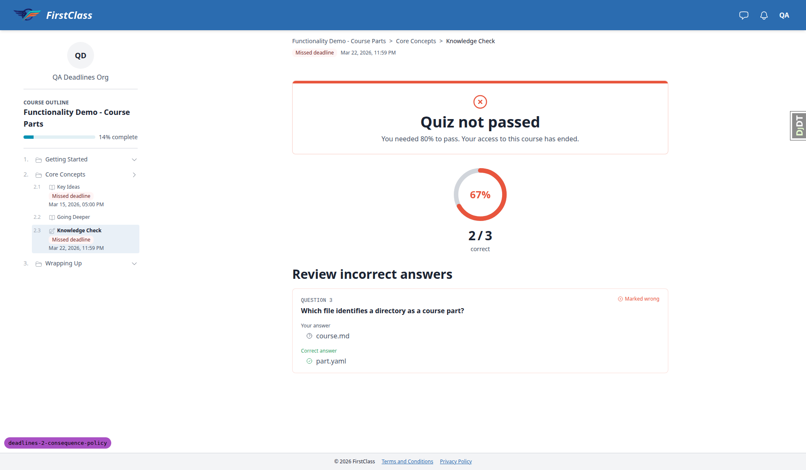 | Completed, failed Knowledge Check attempt (2/3). /5/complete 200: "Quiz not passed. You needed 80% to pass. Your access to this course has ended." 67%, 2/3. No Try again/Retry/Next/Previous, matching spec rule 13; plan's "Try again" is stale. start_form and /5/ redirect to detail. |
| 4.3.3 | desktop | **fail** | 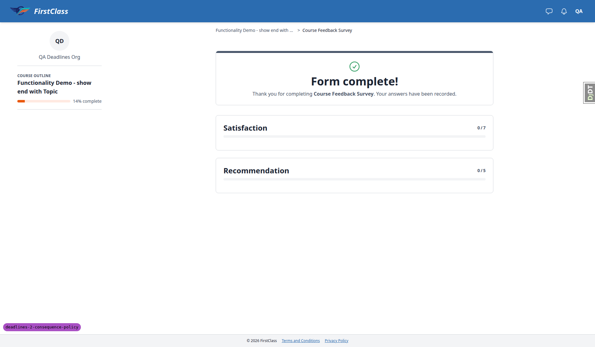 | Late learner, after_access_ended=nothing, open sitting on Course Feedback Survey (index 3). POST submit-and-exit gives 302 to /3/complete, 200 "Form complete!". But the sidebar still draws "COURSE OUTLINE", course title and "14% complete" bar above an empty list. Spec rule 13: under "nothing" the results page carries no outline. See B2. |
| 4.5 | desktop | pass | 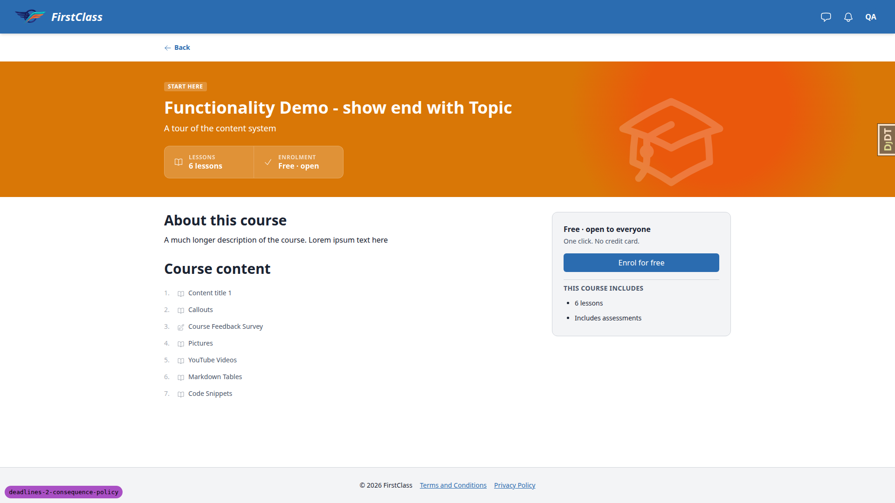 | 4.5.2: registration deactivated in admin, dashboard shows NOT REGISTERED, detail shows "Enrol for free", no ended message; reactivated, message back. 4.5.4: completed_time set, card "COMPLETED" (no Access ended), course_home opens the player, detail offers "Review course"; cleared afterwards. |
| 5.1 | desktop | pass | 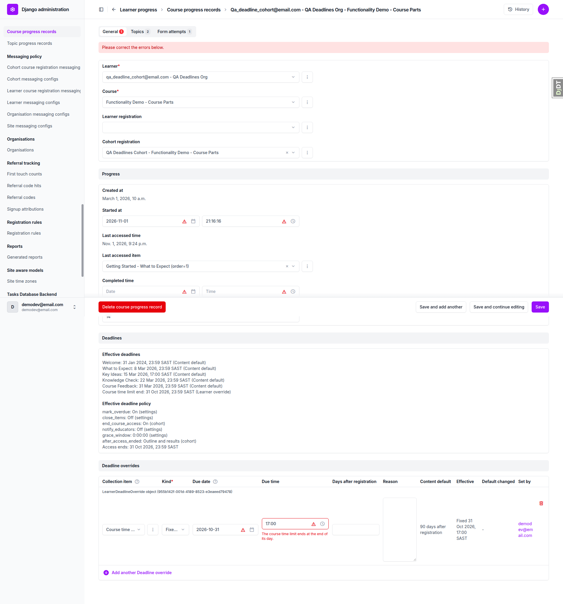 | Help: "A fixed date or a number of days on the course time limit restores ended access." Fixed 2026-11-15 saved; panel "Access ends: 15 Nov 2026, 23:59 SAST"; card "Access ends Nov 15, 2026, 11:59 PM.", detail "Continue", item 2 opens, progress 14%. Due time 17:00 refused: "The course time limit ends at the end of its day." Date yesterday gives "ACCESS ENDED OCT 31, 2026". Row deleted gives "Access ended May 30". Admin nit: on the error re-render the Effective column shows the refused time ("Fixed 31 Oct 2026, 17:00 SAST"). |
| 5.2 | desktop | pass | 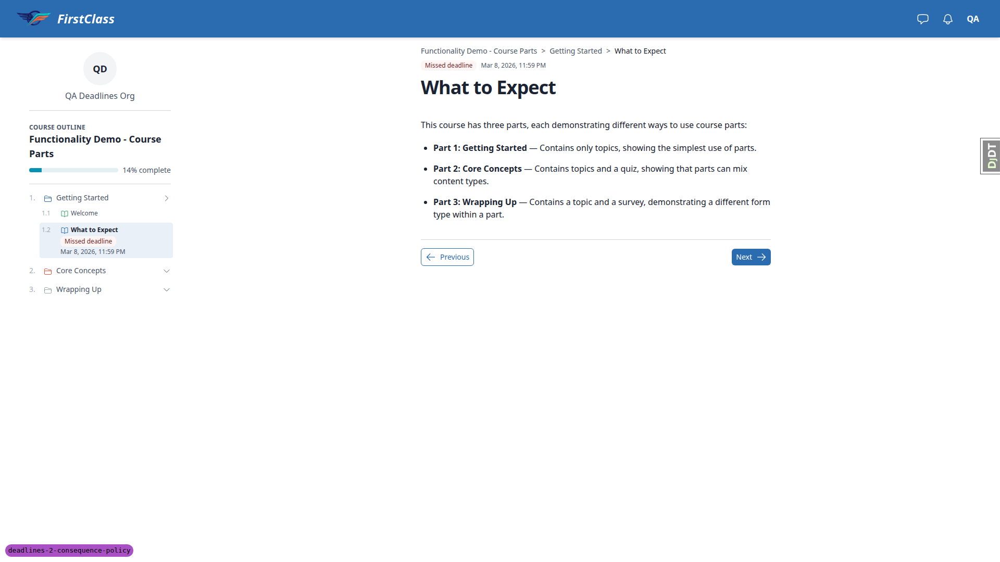 | Cohort registration inline: fixed 2026-11-15 override saved; card "Access ends Nov 15, 2026, 11:59 PM.", course_home opens item 2. Override deleted, ended again. |
| 4.5.3 | desktop | pass | 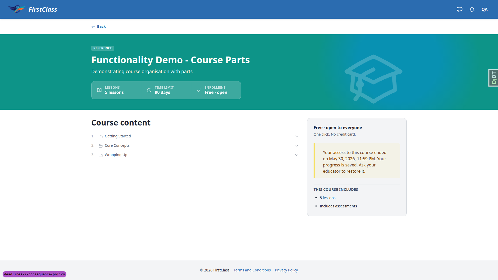 | Parts course hidden: cohort learner reaches detail (200, ended message); anonymous visitor gets 404. Set back to published. |
| 3.2 | mobile | pass | 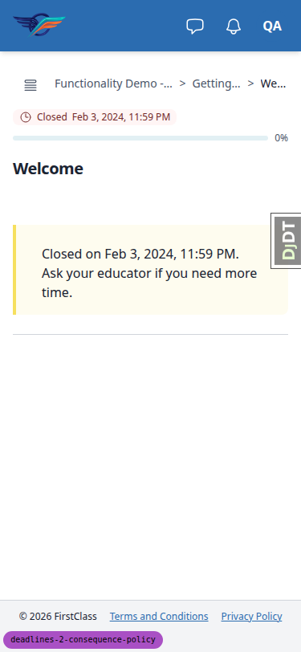 | 375x812: closed topic notice wraps cleanly, header chip "Closed Feb 3, 2024, 11:59 PM" with icon, no horizontal overflow (scrollWidth 375). |
| 3.4 | mobile | pass | 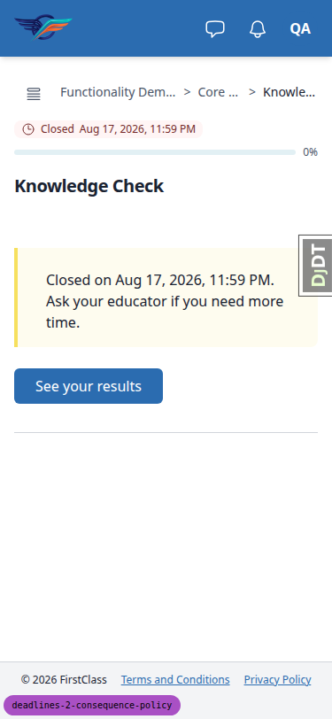 | 375x812: closed form notice + "See your results" button 168x40, no overflow. "Open course outline" drawer opens full width and lists Closed/Locked rows with chips. |
| 4.3 | mobile | pass | 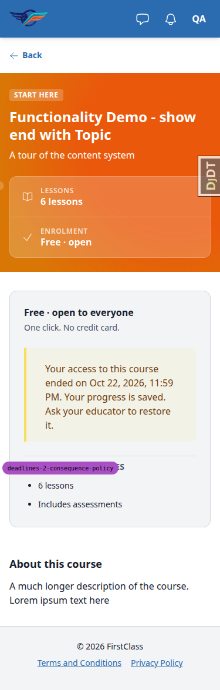 | 375x812: ended detail page (nothing) and closed quiz results page render without horizontal overflow. |
| 3.4 | tablet | pass | 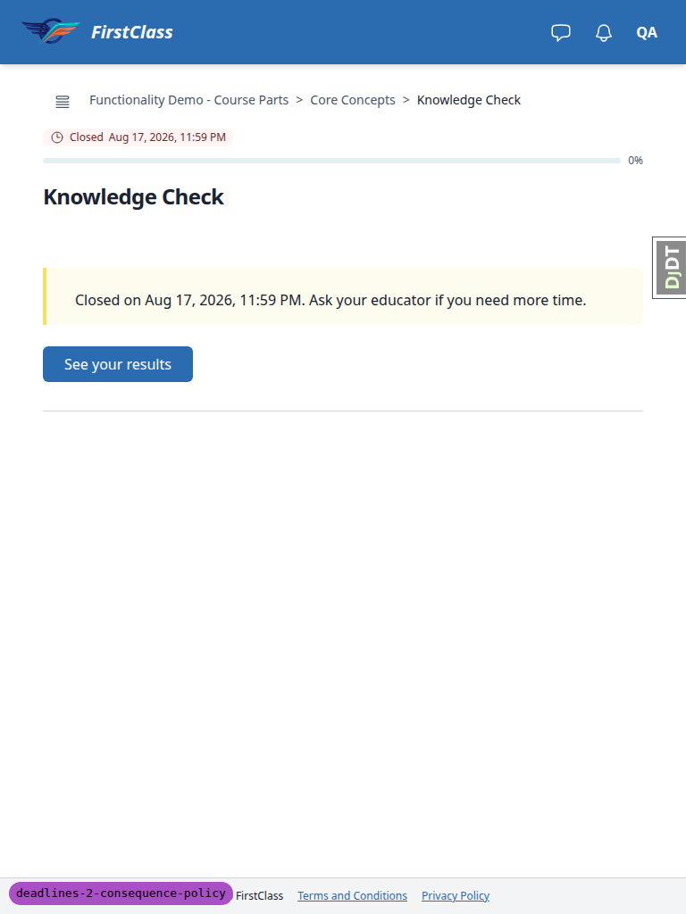 | 768x1024: player uses the drawer outline ("Open course outline"); closed notice and "See your results" in the reading column; no overflow on dashboard, player, ended detail or results. |
| 4.1 | tablet | pass | 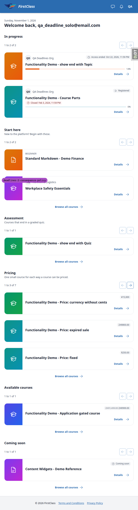 | 768x1024 dashboard and ended detail page: no overflow, ended eyebrow and message render. |

## Design check

no design states tested

## B1: Dashboard card's 'Closed' deadline line drops the item name

Manifestations: test 2.2 (desktop).

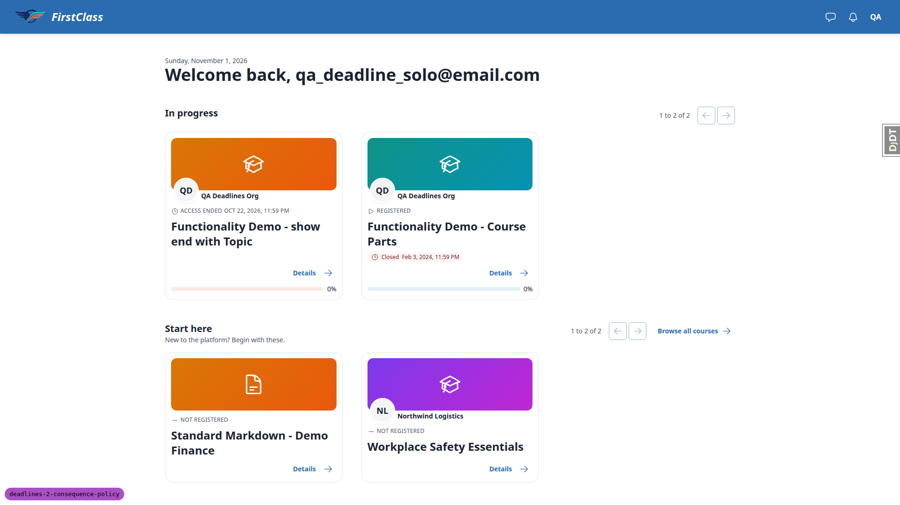

- **Expected:** The card's deadline line names which item it is about, as the other states do ("Deadline Welcome Jan 31, 2024, 11:59 PM.", "Missed deadline Course Oct 22, 2026").
- **Actual:** For a closed item the card shows only the chip "Closed Feb 3, 2024, 11:59 PM", with no item title, so the learner cannot tell what closed. `partials/deadline_labels.html` renders the title only in the overdue and due branches. The spec's copy table gives the closed state as "Closed <close date>" for the TOC, header and card alike.

## B2: Results page under after_access_ended=nothing still draws an empty course outline panel

Manifestations: test 4.3.3 (desktop).

- **Expected:** Spec rule 13: under "nothing" the results page an ended learner reaches carries no outline.
- **Actual:** `course_form_complete` passes the chrome an empty `course_index`, so the sidebar still shows the "COURSE OUTLINE" heading, the course title and a "14% complete" bar above an empty list (and the drawer toggle opens the same empty panel at narrow widths).

## Bug status

| Bug | Status |
|---|---|
| B1 | **UNRESOLVED** — Dashboard card's 'Closed' deadline line drops the item name |
| B2 | **UNRESOLVED** — Results page under after_access_ended=nothing still draws an empty course outline panel |

## General notes

Plan corrections (the build follows the spec; the plan text is stale):

- (a) 3.2.1 expects What to Expect and Key Ideas Closed+linked for the late learner, but Welcome (item 1) is closed and incomplete, so spec rule 11 keeps everything after it Locked. 3.2 was run on Welcome.
- (b) 3.3.2/3.3.3/3.4.2 expect start_form/fill_form on a closed form to redirect to course detail; the spec redirects a refused CLOSED item to view_course_item (the closed notice), which is what happens.
- (c) Knowledge Check is player index 5, not 4; Course Feedback is 7, not 5.
- (d) 4.2.6 expects a "Try again" button on an ended learner's results; spec rule 13 offers no retry, and none is shown.
- (e) 2.2 and 3.1 cannot be shown with the seeded late learner (earliest missed is closed Welcome; Course Feedback is locked). Both were run on qa_deadline_timelimit, built by qa-data-helper, with Going Deeper completed in-browser.

Observations with no action filed:

- The ended learner's course detail panel still reads "Free · open to everyone / One click. No credit card." above the ended message.
- An ended learner's player outline still prints "Missed deadline" chips on locked rows.
- On Welcome an ended learner is offered "Next", which only bounces to course detail.
- On a refused inline save the admin's Effective column shows the refused due time.
- The 375px dashboard renders stacked cards rather than compact rows.
- The seeded cohort record showed 0% though Welcome is complete until a recalculation ran (seed artefact).
- Test tooling: scripted admin deletes at first matched the admin header's "Log out" submit button, which left one CourseDeadlineConfig (mark_overdue=on, equal to the default) in place for part of §2-§3 and logged the admin out; caught and cleaned up, with 2.2 re-run.
- The site was near local midnight (23:00 SAST), and dates were checked against the run date of Nov 1.
- qa_deadline_grace@email.com exists in the DB from another run.

4.3.3 was the only failing test record.

status: ok · reason: report rendered, 2 bugs documented
