# Frontend QA report: deadlines-2-consequence-policy

Run date 2026-11-01 on branch `deadlines-2-consequence-policy`, against the dev server on port 8135, with the browser time zone set to Africa/Johannesburg. The smoke gate passed. Desktop, mobile and tablet viewports all ran. Of 34 test records, 31 passed and 3 failed. The failures add up to 3 bugs (B1, B2, B3), described below.

## Methodology

- Driven with Playwright MCP at three viewports: desktop 1920x1080, mobile 375x812 and tablet 768x1024.
- Screenshots were collected into `screenshots/` beside this report. Every image referenced here exists in that directory.
- Admin actions ran in a separate browser context from the learner sessions.
- The data was reseeded at the start with `content_save` and `qa_create_deadlines_seed`.
- The qa-data-helper agent created the following:
  - the parts course, temporarily hidden and then republished;
  - a completed Knowledge Check attempt (2/3) for the cohort learner;
  - an open Course Feedback Survey attempt for the late learner on the plain course;
  - a registration 100 days old for `qa_deadline_none` on the plain course.

## Diff scoping

Class: FULL, triggered by the changed templates. Nothing was skipped.

Changed files:

- `docs/product/learner-experience.md`
- `freedom_ls/learner_interface/templates/learner_interface/course_form_complete.html`
- `freedom_ls/learner_interface/templates/learner_interface/course_item_closed.html`
- `freedom_ls/learner_interface/tests/views/test_form_runner.py`
- `freedom_ls/learner_interface/views.py`
- `spec_dd/2. in progress/deadlines-2-consequence-policy/1. spec.md`
- `spec_dd/2. in progress/deadlines-2-consequence-policy/3. frontend_qa.md`
- `spec_dd/2. in progress/deadlines-2-consequence-policy/qa_report.md`
- `spec_dd/2. in progress/deadlines-2-consequence-policy/todo.md`

## Smoke gate

Status: pass. Pages checked:

- `/`
- `/courses/functionality-demo-course-parts/1/` (late learner, closed notice)

No failure URL or reason.

## Results

| Test | Viewport | Status | Note | Screenshot |
|---|---|---|---|---|
| 1.1 | desktop | pass | Six Deadlines admins listed. Switch selects offer Inherit/On/Off. After access ended offers Inherit/Outline and results/Nothing. Grace help names DD HH:MM:SS, and every help text says what Inherit does. An all-Inherit row saves with Inherit in every column and '-' grace, and reopens as Inherit and empty. `0 00:00:00` reopens as 00:00:00, not empty. Row deleted. | 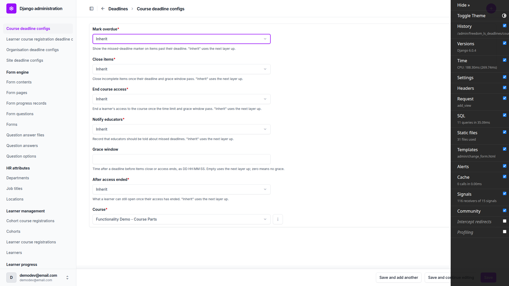 |
| 1.2 | desktop | pass | Duplicate course config: 'Course deadline config with this Course already exists.', list still one row. Site form has no owner field; a second site config gives 'Site deadline config with this Site already exists.'. Duplicate cohort config gives a form error. `-1 00:00:00` gives 'The grace window cannot be negative.' All 200, no 500. Rows deleted. | 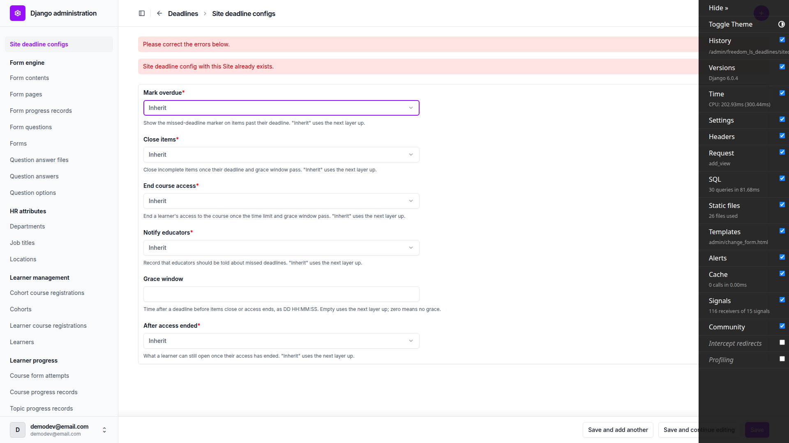 |
| 1.3 | desktop | pass | Late learner: close_items On (registration), end_course_access Off (registration), grace 3 days (registration), others settings, no Access ends line. Cohort learner: end_course_access On (cohort), after_access_ended (cohort), Access ends 30 May 2026, 23:59 SAST. Fresh learner: all settings. Org close_items=off: late learner still registration, cohort learner Off (organisation). Org row deleted. Panel prints On/Off rather than True/False (cosmetic; also noted last run). | 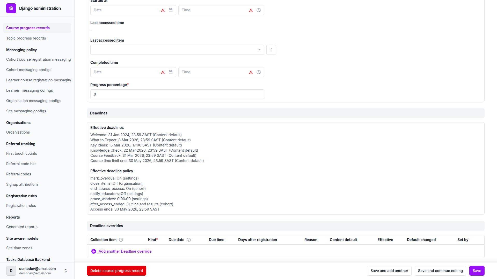 |
| 2.1 | desktop | pass | Fresh learner: Welcome shows Missed deadline chip and Jan 31, 2024, 11:59 PM in outline and header (page-2026-11-01T12-10-55-011Z.png). With course mark_overdue=off: 'Deadline Jan 31, 2024, 11:59 PM.' with no chip in outline and header; dashboard card 'Deadline Welcome Jan 31, 2024, 11:59 PM.'. Set back On: chip returns. Row deleted. | 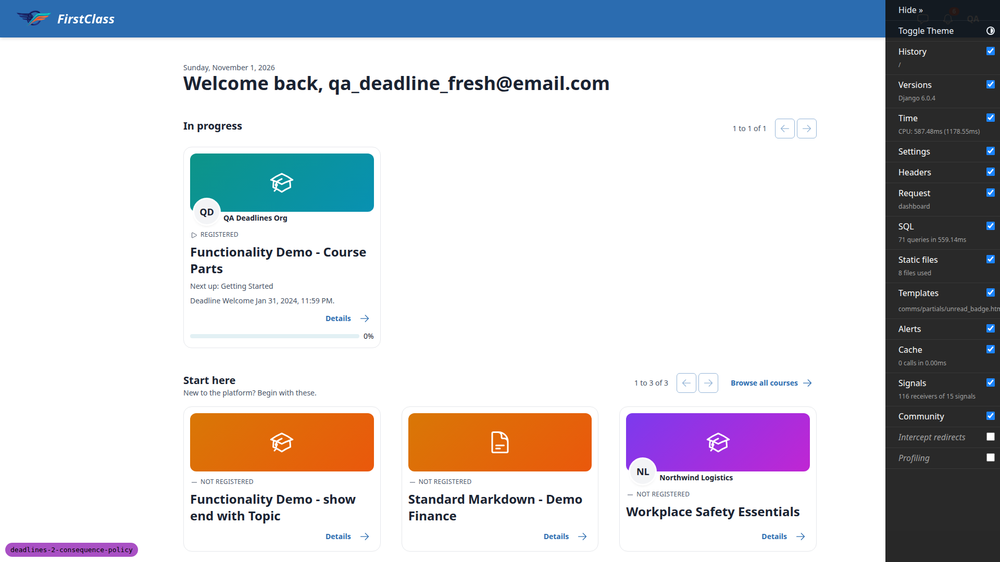 |
| 2.1 | mobile | pass | 375x812 compact card reads 'Deadline Welcome Jan 31, 2024, 11:59 PM.' with no chip; no horizontal overflow (scrollWidth 375). | 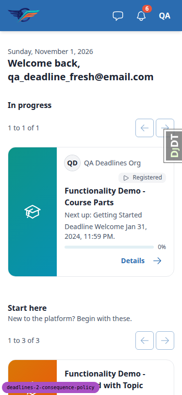 |
| 3.1 | desktop | pass | Course Feedback reads 'Missed deadline Oct 31, 2026, 11:59 PM Closes Nov 3, 2026, 11:59 PM.' but sequential unlock withholds it (Locked), as in the last run. The grace window was exercised by adding a Welcome learner override at yesterday through the CourseProgress admin inline: outline and header read 'Missed deadline Oct 31, 2026, 11:59 PM / Closes Nov 3, 2026, 11:59 PM.', no Closed chip, row linked, topic body renders. Override removed. The form-start-in-grace half is not reachable (every form is withheld or closed). | 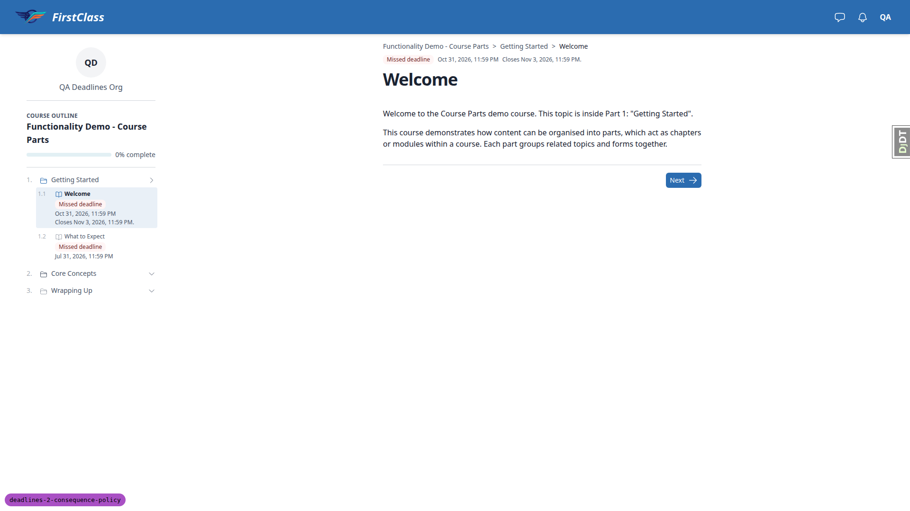 |
| 3.2 | desktop | pass | Welcome and Knowledge Check carry 'Closed <date>' chips with a clock icon; sr text 'Closed'. What to Expect and Key Ideas are sequentially withheld ('Locked', Missed deadline chip, no Closed chip) per spec decision. Welcome shows 'Closed on Feb 3, 2024, 11:59 PM. Ask your educator if you need more time.' with Next only, no complete/submit. Direct URL /1/ is 200. Admin: started_at '-' and last_accessed_item empty after visiting closed items 1 and 5. | 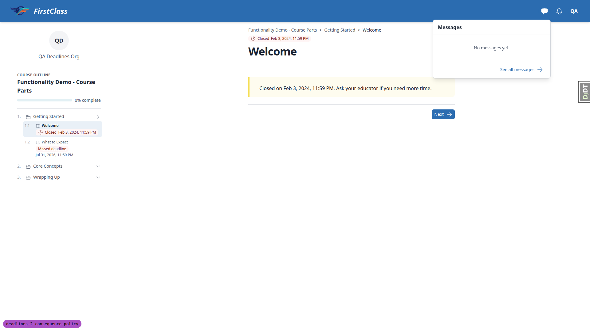 |
| 3.3 | desktop | pass | No closed form without an attempt is reachable (Course Feedback is sequentially withheld). On the closed Knowledge Check (item 5), /5/start_form and /5/fill_form/1 redirect to /5/ (the closed notice), which is what the spec specifies. No new attempt created. | none |
| 3.4 | desktop | pass | Knowledge Check is item 5 (not 4). Closed notice plus 'Submit your answers'. Submitting goes to /5/complete: 'Quiz not passed', 0% 0/3, review list, Previous + Continue, no 'Retry quiz' (page-2026-11-01T12-13-16-954Z.png). Outline row still 'Closed'; reopening shows the notice with a 'See your results' link to /5/complete and no Submit button. A second POST to submit-and-exit returns 200 at /5/complete, no 500; admin shows one completed FormProgress. | 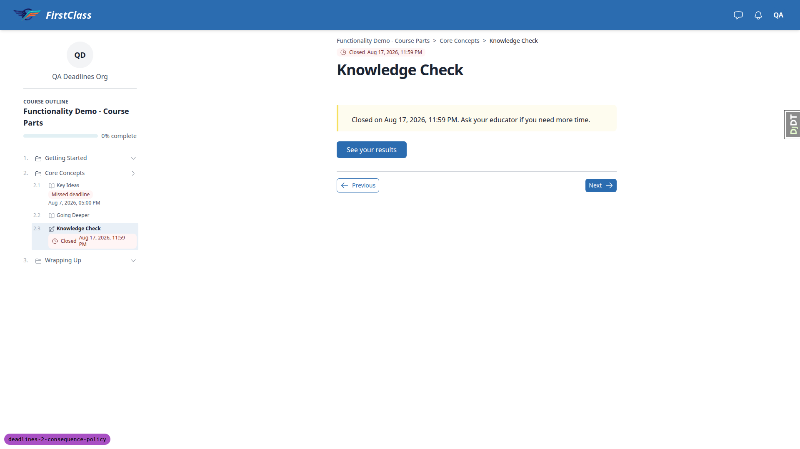 |
| 3.4-results-before-submit | desktop | fail | Guessed URL /5/complete while the closed Knowledge Check had only an OPEN attempt renders 'Quiz complete — Knowledge Check has no pass mark, so there is no pass or fail — here is how you scored.' with no score. The quiz has an 80% pass mark and nothing was submitted. course_form_complete renders with form_progress=None instead of sending the learner to the item. See B1. | 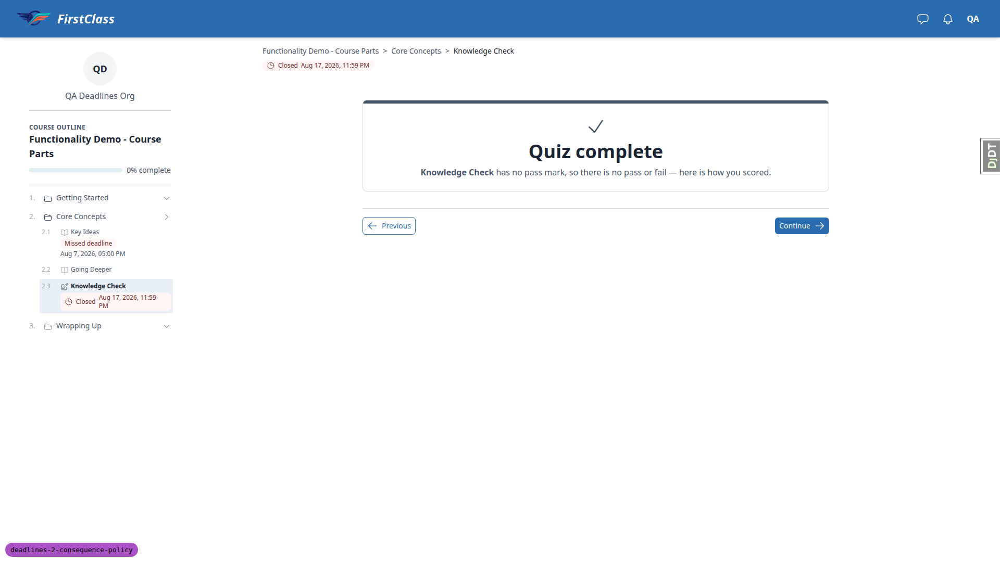 |
| 3.4-results-copy | desktop | fail | On the closed form's failed results page the copy says 'You need 80% to pass. Review the material and try again.' while no retry is offered (Retry quiz correctly hidden because the item is closed). See B2. | 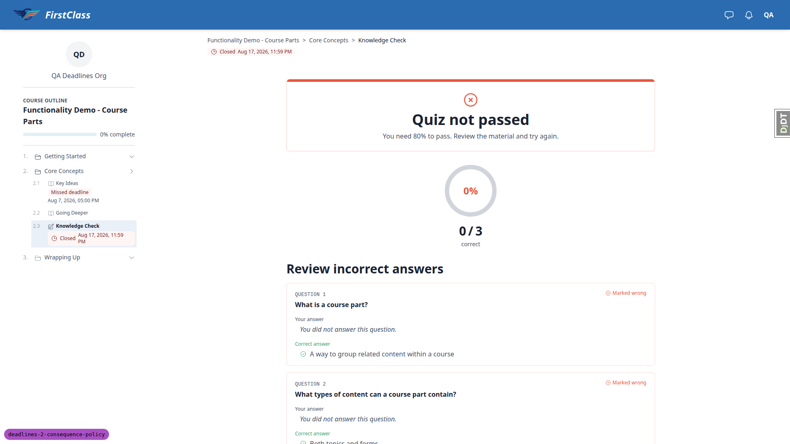 |
| 3.5 | desktop | pass | Items after the closed, incomplete Welcome (What to Expect, Key Ideas, Going Deeper, Summary, Course Feedback) are unlinked with sr 'Locked' and no Closed chip. Core Concepts part reads 'Closed' in the player; Knowledge Check child stays reachable (closed notice). |  |
| 3.5-detail-outline | desktop | fail | Course detail 'Course content' outline ignores closing for the late learner: closed Welcome reads 'Not started', closed Knowledge Check reads 'In progress' (open attempt) then 'Needs retry' after the failed submit, and the Core Concepts part reads 'Needs retry', while the player outline reads 'Closed' for all of them. See B3. |  |
| 3.6 | desktop | pass | Fresh learner: Welcome 'Missed deadline' and opens; no Closes/Closed in outline, header or dashboard card. |  |
| 3.7 | desktop | pass | Cohort learner: completed Welcome shows no deadline line and no chip in the player outline and header, and opens while access is ended. | none |
| 4.1 | desktop | pass | Cohort learner dashboard: course stays In progress, eyebrow 'Access ended May 30, 2026, 11:59 PM', 0% progress, no Next up, no deadline line, no Continue; title and Details link to /detail/ (page-2026-11-01T12-15-42-112Z.png). Detail: 'Your access to this course ended on May 30, 2026, 11:59 PM. Your progress is saved. Ask your educator to restore it.' and no button; outline links only the completed Welcome. /courses/<slug>/ lands on detail, no loop. Admin: cohort registration active, no LearnerCourseRegistration for the cohort learner. | 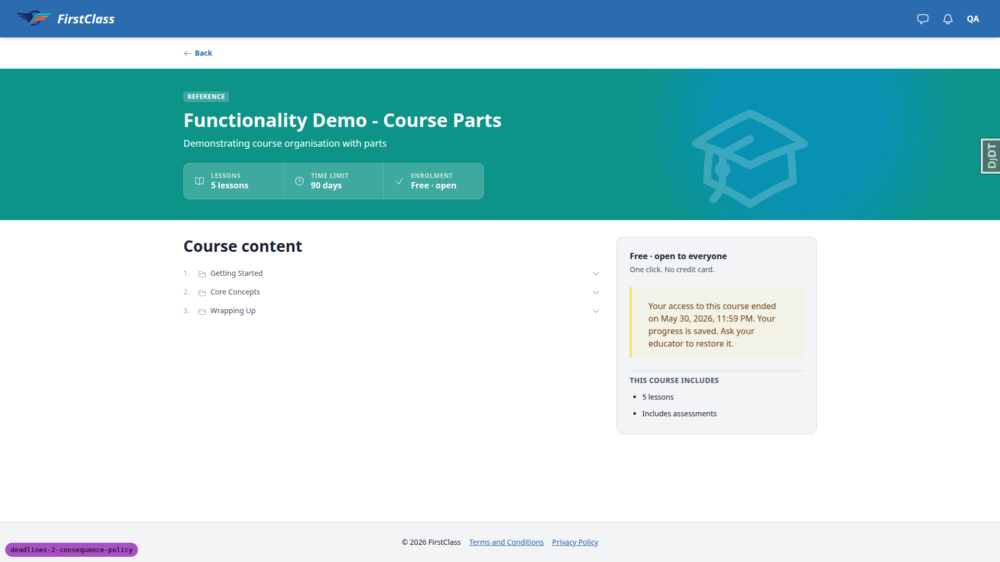 |
| 4.2 | desktop | pass | Welcome opens with only Welcome linked in the player outline, no header deadline line. Items 2-7, /5/complete (no completed attempt), /5/start_form and /finish/ all redirect to /detail/. completed_time stays empty. Knowledge Check is item 5, Course Feedback item 7. | none |
| 4.3 | desktop | pass | Late learner, plain course (after_access_ended=nothing): ended message, no button, no 'Course content' section. /1/, /2/, /3/ and course_home redirect to detail. Dashboard eyebrow 'Access ended Oct 22, 2026, 11:59 PM'. | 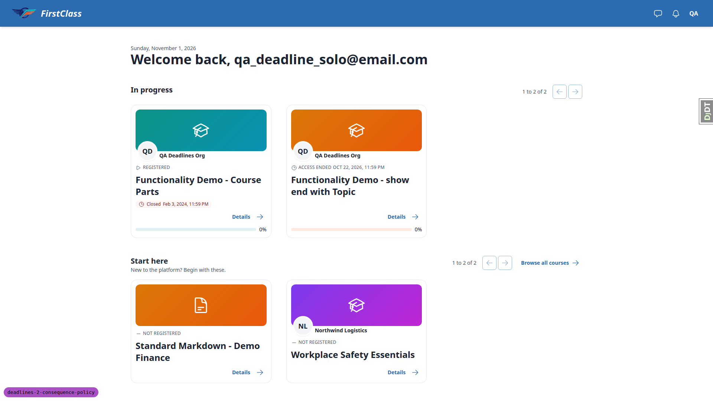 |
| 4.4 | desktop | pass | Restored learner: card 'Access ends Dec 1, 2026, 11:59 PM.' and course_home opens /1/. Fresh learner: no Access ends line. Late learner's parts course opens (time limit passed, end_course_access off); its card shows the earliest item line 'Closed Feb 3, 2024' rather than the plan's 'Missed deadline Course <date>' (same as last run). | none |
| 4.5 | desktop | pass | 4.5.1: /access/ redirects to detail, no new registration. 4.5.2: late learner plain registration deactivated in admin: dashboard drops the course, detail shows 'Enrol for free' not the ended message; reactivated. 4.5.4: completed_time set in admin: card moves to Learning history as COMPLETED, no 'Access ended', item 2 opens; cleared. 4.5.3 run separately after qa-data-helper hides the course. | none |
| 5.1 | desktop | pass | Collection item help tooltip: 'A fixed date or a number of days on the course time limit restores ended access.' Course time limit fixed 2026-11-15 saves; panel 'Access ends: 15 Nov 2026, 23:59 SAST'. Learner card 'Access ends Nov 15, 2026, 11:59 PM.', title links to /2/, item 2 opens. Adding due time 10:00 is rejected: 'The course time limit ends at the end of its day.' (page-2026-11-01T12-21-00-000Z.png). Date set to yesterday: 'Access ended Oct 31, 2026, 11:59 PM'. Override deleted. Detail CTA reads 'Start course' not 'Continue' (progress_percentage 0, seed artefact, as last run). | 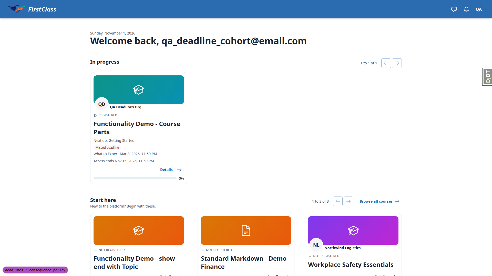 |
| 5.2 | desktop | pass | Cohort registration time-limit override (fixed 2026-11-15) reopens the course: card 'Access ends Nov 15, 2026, 11:59 PM.', item 2 opens. After deleting it, item 2 redirects to detail. | none |
| 6.3 | desktop | pass | `manage.py check`: no issues. Settings override missing grace_window: freedom_ls_deadlines.E001. DEADLINE_POLICY='nowhere.Nothing': freedom_ls_deadlines.E002. Override modules lived in the scratchpad only. | none |
| 4.5.3 | desktop | pass | qa-data-helper set the parts course hidden: the ended cohort learner still gets detail (200, ended message); an anonymous visitor gets 404. Set back to published. | none |
| 4.2.6 | desktop | pass | qa-data-helper gave the cohort learner a completed Knowledge Check attempt (2/3). /5/complete renders 'Quiz not passed', 67%, 2/3, no footer and no retry; /5/start_form redirects to detail, no new attempt. The same 'Review the material and try again.' copy shows although the ended learner cannot retry (see B2). | none |
| 4.3.3 | desktop | pass | qa-data-helper gave the late learner an open attempt on the plain course's Course Feedback Survey (item 3). Console POST to /3/submit-and-exit with the CSRF token redirects to /3/complete, which renders 'Form complete!'. | none |
| 2.2 | desktop | pass | Late learner's card leads with the earliest item line (Closed Welcome), so the time-limit branch was tested with qa_deadline_none on the plain course (registered 100 days ago via qa-data-helper; the plain course has no time_limit_days, so a 90-day time-limit override was added in the admin). Card: 'Missed deadline Course Oct 22, 2026, 11:59 PM'; with course mark_overdue=off: 'Deadline Course Oct 22, 2026, 11:59 PM.'. Config row and override deleted. | 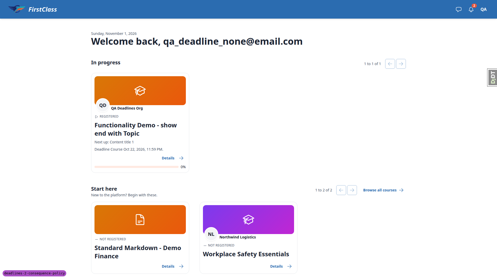 |
| 6.1 | desktop | pass | Fresh learner: /courses/ (no deadline lines), dashboard, a topic page and a form-course detail page render 200 with no console errors and no horizontal overflow. Form start/fill not reachable for the fresh learner (sequentially withheld). | none |
| 6.1 | mobile | pass | Same pages at 375x812: 200, no console errors, scrollWidth 375. | none |
| 6.2 | desktop | pass | Anonymous visitor on the parts-course detail page sees 'Enrol for free'. | none |
| 4.1 | mobile | pass | Late learner dashboard at 375x812: compact rows show 'Closed Feb 3, 2024, 11:59 PM' chip with icon and an 'Access ended Oct 22, 2026, 11:59 PM' eyebrow with icon. No overflow. Ended plain-course detail page also fits (page-2026-11-01T12-32-30-000Z.png). | 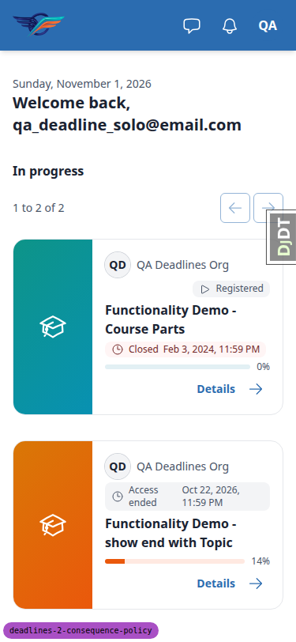 |
| 3.4 | mobile | pass | Closed Knowledge Check notice at 375x812: chip with icon, notice readable, 'See your results' 168x40, Previous 102x34, Next 75x32. Results page (page-2026-11-01T12-32-20-000Z.png) fits, no Retry. No horizontal overflow on either. | 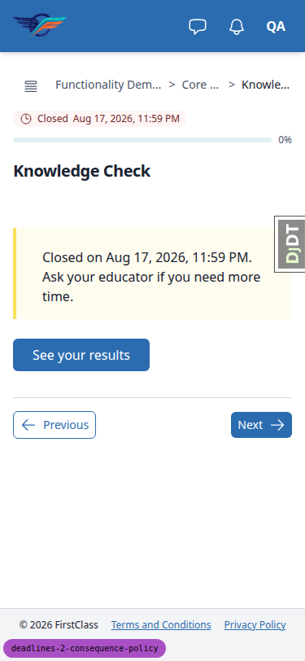 |
| 3.4 | tablet | pass | 768x1024: outline collapses to the drawer toggle; closed notice, 'See your results', Previous/Next render at a sensible width; no overflow, no page errors. | 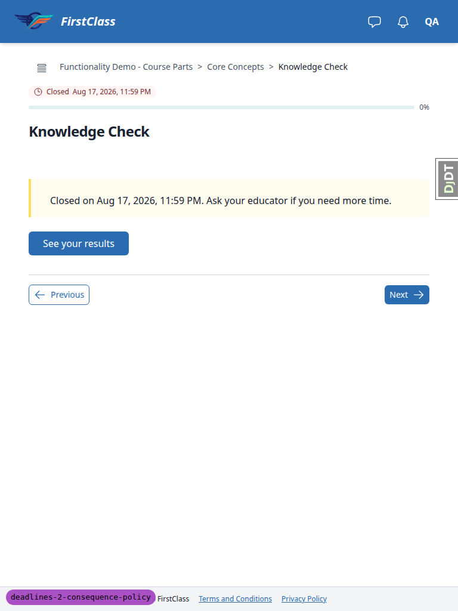 |
| 4.1 | tablet | pass | 768x1024 dashboard (Closed chip, Access ended eyebrow) and ended plain-course detail (page-2026-11-01T12-34-20-000Z.png) fit with no overflow. | 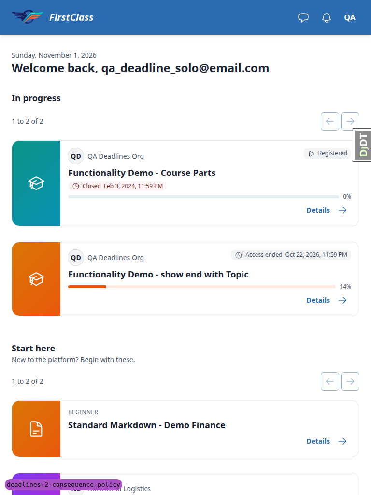 |

## Design check

No design states tested.

## B1: Form results URL with no completed attempt renders 'Quiz complete' and claims the quiz has no pass mark

Manifestations:

- 3.4-results-before-submit (desktop)

**Expected:** With no completed attempt at the placement, `/<index>/complete` should not claim a result. It should send the learner to the item (here the closed notice with 'Submit your answers').

**Actual:** As the late learner, `/courses/functionality-demo-course-parts/5/complete` with only an open attempt renders 'Quiz complete — Knowledge Check has no pass mark, so there is no pass or fail — here is how you scored.' with no score. The quiz has an 80% pass mark. `course_form_complete` renders with `form_progress=None`. The ended-learner path already redirects; the open-access path does not.

## B2: Failed results page says 'Review the material and try again.' when no retry is offered

Manifestations:

- 3.4-results-copy (desktop)
- 4.2.6 (desktop)

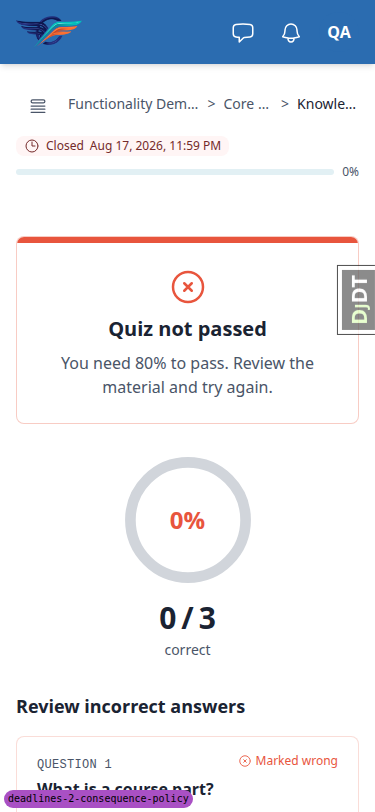

**Expected:** On a closed form (and for an ended learner) the failed results copy should not invite a retry the page refuses.

**Actual:** The page hides 'Retry quiz' (closed item) or the whole footer (ended learner), but the verdict copy still reads 'You need 80% to pass. Review the material and try again.'

## B3: Course detail 'Course content' outline ignores closing: a closed failed quiz reads 'Needs retry'

Manifestations:

- 3.5-detail-outline (desktop)

**Expected:** The detail outline should agree with the player outline, which reads 'Closed' for closed items and parts.

**Actual:** For the late learner the detail outline shows closed Welcome as 'Not started', closed Knowledge Check as 'In progress' (open attempt) then 'Needs retry' (failed), and the Core Concepts part as 'Needs retry'. The player outline reads 'Closed' for all of them. The spec does not say whether the detail outline should reflect closing.

## Bug status

- B1: **FIXED** (commit: d7d855938) — Form results URL with no completed attempt renders 'Quiz complete' and claims the quiz has no pass mark. Re-verified: with no completed attempt the URL now 302s to the item; results with a completed attempt still render (late learner: Quiz not passed, no Retry; ended cohort learner: results render).
- B2: **UNRESOLVED** — Failed results page says 'Review the material and try again.' when no retry is offered (reason: product/UX decision — what the failed-verdict copy should say on a closed form and for an ended learner)
- B3: **UNRESOLVED** — Course detail 'Course content' outline ignores closing: a closed failed quiz reads 'Needs retry' (reason: product decision — the spec does not say whether the course detail outline shows closing)

## General notes

Test-plan corrections still stale in `3. frontend_qa.md`:

- The Knowledge Check is item 5 and Course Feedback is item 7.
- Sequential unlock withholds What to Expect, Key Ideas and Course Feedback, so the 3.1, 3.2 and 3.3 assumptions don't hold.
- In 3.3, form_start and fill redirect to the closed notice per the spec, not to course detail.
- The plain course has no `time_limit_days`, so the late learner's time-limit line in 2.2 and 4.4 can't show. The late learner's card leads with the Closed Welcome item.
- Plan 1.3 expects True/False, but the panel prints On/Off.

Observations:

- Opening the completed Welcome as the ended cohort learner set `started_at` on the CourseProgress. This was also seen last run.
- The cohort learner's `progress_percentage` is 0 though Welcome is complete, so the restored learner's detail CTA reads 'Start course'.
- On an invalid inline save, the override's 'Effective' column shows the unsaved due time (for example 'Fixed 15 Nov 2026, 10:00 SAST') while the row is rejected.
- The ended learner's detail sidebar still shows 'Free · open to everyone / One click. No credit card.' above the ended message.
- The screenshots directory also holds Playwright's `.yml` snapshot and console `.log` files.

Full run after the B1 fix: 10767 passed, 1 failed (`panel_framework/tests/playwright/test_quick_view_flow.py::test_quick_view_drawer`). That test passes when re-run alone, so it is flaky under parallel load and not caused by the fix. An earlier full run collided with a concurrent run on the test databases and was discarded.

Environment: the Django debug toolbar overlays admin save buttons, so admin forms were submitted with `requestSubmit`.

status: ok · reason: 3 bugs — 1 fixed, 2 unresolved (product decisions); report rendered, screenshots verified
