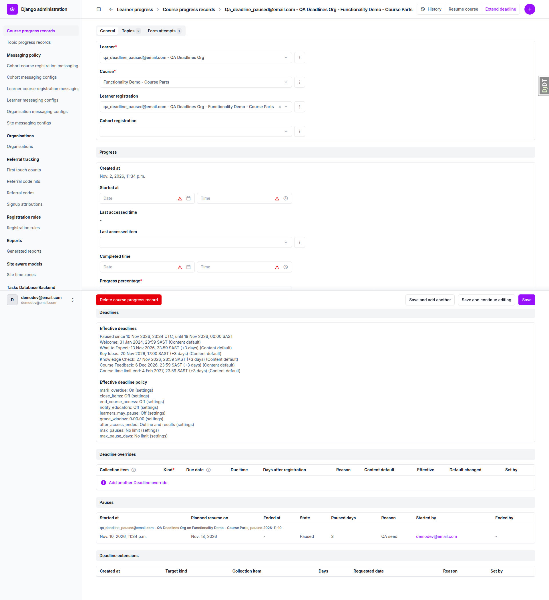
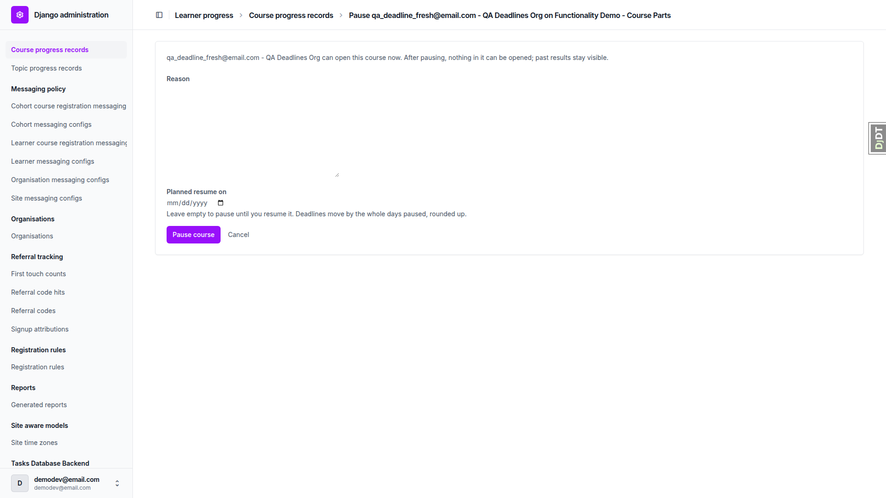
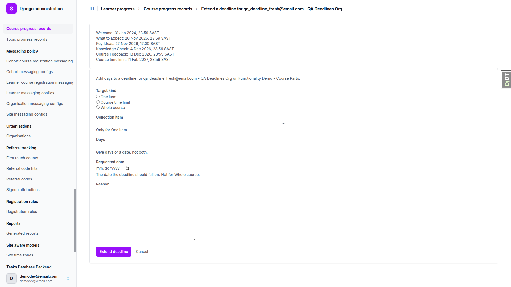
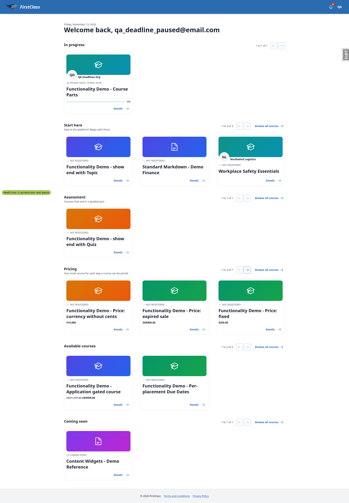
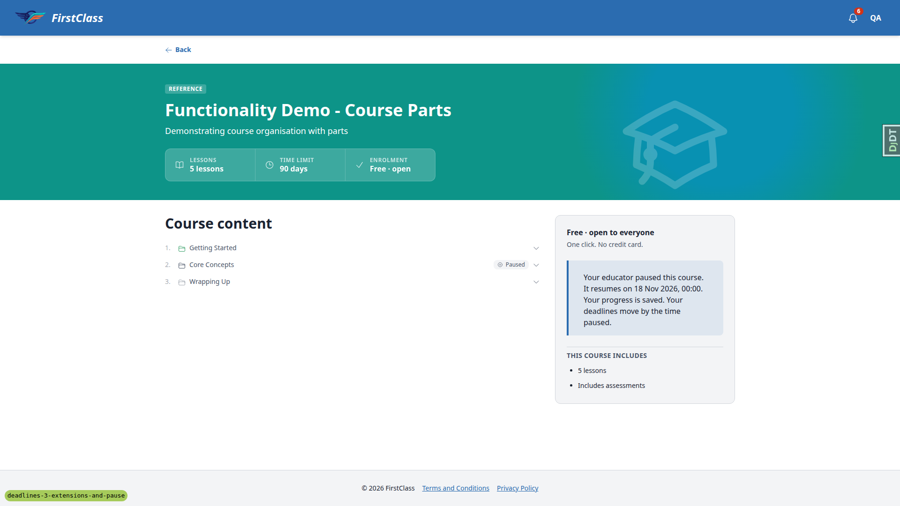

# QA report: deadlines 3, extensions and pause

27 tests were run: 22 passed and 5 failed (tests 1, 2, 6, 13 and 14). The failures trace to 4 distinct bugs (B1 to B4). All 4 are currently UNRESOLVED. Layout probes found no overflow flags.

## Methodology

- Playwright MCP against a dev server on port 8945, running this branch (`deadlines-3-extensions-and-pause`).
- Desktop 1920x1080 for all tests. Mobile 375x812 and tablet 768x1024 for learner tests 13 to 17, as the plan asks.
- Screenshots are collected into `screenshots/` beside this report. Every image referenced here exists in that folder.
- The QA plan is `3. frontend_qa.md` in this folder.

## Diff scoping

Class: FULL (templates changed), so nothing was skipped. Changed files include `freedom_ls/learner_interface/templates/learner_interface/course_detail.html`, `freedom_ls/deadlines/templates/admin/deadlines/pause_course.html`, and templates and `.py` files under deadlines, learner_interface, course_access, audit_log, base, icons and qa_helpers.

## Smoke gate

Status: pass. Pages checked: `/` and `/admin/freedom_ls_learner_progress/courseprogress/<paused record>/change/`. No failure URL or reason.

## Design check

No design states tested.

## Bugs

### B1: Admin "Paused since" line writes the pause start in UTC

Manifestations: test 1 (desktop), test 3 (desktop).

- Expected: Effective deadlines opens "Paused since <date>" in the site zone like every other line (e.g. "Paused since 11 Nov 2026, 01:34 SAST").
- Actual: "Paused since 10 Nov 2026, 23:34 UTC, until 18 Nov 2026, 00:00 SAST". `_paused_line` in `freedom_ls/deadlines/admin.py` passes `pause.started_at` (a UTC instant from the database) to `site_zone_text` without converting it to the site zone.

### B2: Pause, resume and extend admin forms render bare unstyled inputs

Manifestations: test 2 (desktop), test 6 (desktop).

- Expected: Reason, planned resume date, days, requested date and the item picker look like the rest of the Unfold admin (bordered inputs), as the sibling reports "Generate" form does with Unfold widgets.
- Actual: The forms use plain Django widgets inside an Unfold card. The Reason textarea and the Days number field have no border and are invisible on the page. Only the resize handle and the date placeholder show.

### B3: Planned-resume date shown with a midnight time

Manifestations: test 1 (desktop), test 13 (desktop), test 14 (desktop), test 18 (desktop).

- Expected: "Paused until 18 Nov" on the card and row, "It resumes on 18 Nov 2026." in the course detail callout, "until 18 Nov 2026" in the admin. The notification already reads "It resumes on 14 Nov 2026."
- Actual: "PAUSED UNTIL 18 NOV, 00:00", "Paused until 18 Nov, 00:00", "It resumes on 18 Nov 2026, 00:00." and admin "until 18 Nov 2026, 00:00 SAST". The planned resume day is rendered as its midnight instant, and the site-zone formatter adds the time because midnight counts as a set time.

### B4: Admin effective deadlines read "(+1 days)"

Manifestations: test 2 (desktop), test 18 (desktop). No screenshot.

- Expected: "(+1 day)" for a one-day shift, as the resume notification and success message already pluralise ("moved by 1 day").
- Actual: `_deadline_line` in `freedom_ls/deadlines/admin.py` always appends " (+N days)".

## Test results

| Test | Viewport | Status | Notes | Screenshot |
|---|---|---|---|---|
| 1 | desktop | fail | Buttons, pauses row and (+3 days) correct; "Paused since" in UTC (B1); midnight resume time (B3). | [img](screenshots/page-2026-11-12T23-35-17-620Z.png) |
| 2 | desktop | fail | Pause flow, validation, success message and audit log correct; Reason and date inputs unstyled (B2); "(+1 days)" (B4). | [img](screenshots/page-2026-11-12T23-35-54-237Z.png) |
| 2-success | desktop | pass | Record page after pausing: success message, Resume course and Extend deadline buttons. | [img](screenshots/page-2026-11-12T23-36-58-189Z.png) |
| 3 | desktop | pass | Pause with reason only works; "Paused since" has no "until" (UTC zone is B1). | none |
| 4 | desktop | pass | Resume shifts by 3 days, pause row Ended, repeat submit shows "No change", one audit entry. | none |
| 5 | desktop | pass | Second tab shows "This course is already paused."; one pause row; stale intro on re-rendered form (see notes). | none |
| 6 | desktop | fail | Extend behaviour correct (+7, then +12 days, two rows); Days, date and Reason inputs unstyled (B2). | [img](screenshots/page-2026-11-12T23-39-12-365Z.png) |
| 7 | desktop | pass | Time limit by date and whole-course +2 days both correct. | none |
| 8 | desktop | pass | All seven bad inputs show errors and add no row. | none |
| 9 | desktop | pass | Staff extension reopens access; learner dashboard reads "Access ends 13 Dec". | none |
| 10 | desktop | pass | Read-only Course pauses and Deadline extensions admin lists, filters and inlines. | none |
| 11 | desktop | pass | Site deadline config pause-limit fields save, inherit and validate. | none |
| 12 | desktop | pass | View-only staff see no action buttons; pause, resume and extend URLs return 403. | none |
| 13 | desktop | fail | Paused card and row correct; "PAUSED UNTIL 18 NOV, 00:00" (B3). | [img](screenshots/page-t13-dashboard-desktop.png) |
| 14 | desktop | fail | Callout and outline correct; "It resumes on 18 Nov 2026, 00:00." (B3). | [img](screenshots/page-t14-detail-desktop.png) |
| 15 | desktop | pass | Welcome opens without completion controls; locked URLs redirect to course detail. | [img](screenshots/page-t15-welcome-desktop.png) |
| 13-15 | mobile | pass | Dashboard, courses, detail and Welcome at 375px: no overflow, callout and chip readable. | [img](screenshots/page-t13-15-detail-mobile.png) |
| 13-15 | tablet | pass | Same four pages at 768px render cleanly. | [img](screenshots/page-t13-15-detail-tablet.png) |
| 15-quiz | desktop | pass | Knowledge Check (item 5) URLs redirect to detail while paused. | none |
| 16 | desktop | pass | After resume, Knowledge Check shows "Continue Form" on the existing attempt. | [img](screenshots/page-t16-attempt-continues-desktop.png) |
| 17 | desktop | pass | Paused results page shows score, no Retry, no retry invitation. | [img](screenshots/page-t17-results-paused-desktop.png) |
| 18 | desktop | pass | Planned resume reached: card back to In progress, course opens, pause can be restarted, deadlines moved; midnight time seen beforehand (B3). | none |
| 19 | desktop | pass | Resumed learner: unfinished items carry the 3-day shift, completed Welcome unshifted. | [img](screenshots/page-t19-player-desktop.png) |
| 20 | desktop | pass | Extended learner: Key Ideas due 1 Dec 17:00, others +2 days. | [img](screenshots/page-t20-player-desktop.png) |
| 21 | desktop | pass | Four learner notifications with correct text; staff reason never shown. | [img](screenshots/page-t21-notifications-desktop.png) |
| 22 | desktop | pass | Solo, cohort and anonymous views unchanged; no "Paused" text. | none |
| 23 | desktop | pass | Webhook events pickable and Send Test renders; audit log filter group works. | none |

## Layout probe

The configured region selectors matched nothing on the admin and learner pages, so only the overflow check applied. No flags were raised.

| Test | Viewport | URL | Screenshot | Result |
|---|---|---|---|---|
| 1 | desktop | /admin/freedom_ls_learner_progress/courseprogress/<paused>/change/ | [img](screenshots/page-2026-11-12T23-35-17-620Z.png) | clean |
| 2 | desktop | /admin/.../courseprogress/<fresh>/pause/ | [img](screenshots/page-2026-11-12T23-35-54-237Z.png) | clean |
| 13-15 | mobile | dashboard | [img](screenshots/page-t13-15-dashboard-mobile.png) | clean |
| 13-15 | mobile | courses | [img](screenshots/page-t13-15-courses-mobile.png) | clean |
| 13-15 | mobile | detail | [img](screenshots/page-t13-15-detail-mobile.png) | clean |
| 13-15 | mobile | welcome | [img](screenshots/page-t13-15-welcome-mobile.png) | clean |
| 13-15 | tablet | dashboard | [img](screenshots/page-t13-15-dashboard-tablet.png) | clean |
| 13-15 | tablet | courses | [img](screenshots/page-t13-15-courses-tablet.png) | clean |
| 13-15 | tablet | detail | [img](screenshots/page-t13-15-detail-tablet.png) | clean |
| 13-15 | tablet | welcome | [img](screenshots/page-t13-15-welcome-tablet.png) | clean |
| 13 | desktop | / | [img](screenshots/page-t13-dashboard-desktop.png) | clean |
| 14 | desktop | /courses/functionality-demo-course-parts/detail/ | [img](screenshots/page-t14-detail-desktop.png) | clean |

## Data changes

| Via | What |
|---|---|
| QA plan section 0.2 seed list (migrate, create_demo_data --yes, content_save, qa_create_deadlines_seed) | initial QA data setup |
| QA plan section 0.2 seed (qa_create_deadlines_seed) | reset qa_deadline_* accounts before test 3 |
| QA plan section 0.2 seed (qa_create_deadlines_seed) | reset qa_deadline_* accounts before test 6 |
| sdd:qa-data-helper | created staff user qa_view_only_staff@email.com (pk 86) with only view_courseprogress |
| QA plan section 0.2 seed (qa_create_deadlines_seed) | reset qa_deadline_* accounts before test 17 |
| sdd:qa-data-helper | moved qa_deadline_fresh's open pause 3 days back and set planned_resume_on to today (Africa/Johannesburg date; TIME_ZONE is UTC so timezone.localdate() gave yesterday) |
| QA plan section 0.2 seed (qa_create_deadlines_seed) | reset qa_deadline_* accounts before test 21 |
| admin UI as staff (test 23 step 1) | added webhook endpoint 'QA test endpoint' (https://example.invalid/hook) subscribed to course.paused, course.resumed, deadline.extended |

## Bug status

- **FIXED** (commit: 56bc9b73a) — Admin "Paused since" line writes the pause start in UTC. Re-verified: "Paused since 11 Nov 2026, 01:49 SAST".
- **FIXED** (commit: e847ac0b6) — Pause, resume and extend admin forms render bare unstyled inputs. Re-verified: every field has a 1px Unfold border ([screenshot](screenshots/page-fix-b2-extend-desktop.png)).
- **FIXED** (commit: 5ba2f8d75) — Planned-resume date shown with a midnight time. The access decision now carries the planned resume day (`planned_resume_on`) rather than its midnight instant, and the card, row, callout and admin pause line format it as a date. Covered by view and admin tests; not re-checked in a browser.
- **FIXED** (commit: 5ba2f8d75) — Admin effective deadlines read "(+1 days)". `_deadline_line` uses the shared `days_text` helper. Covered by an admin test; not re-checked in a browser.
- **UNRESOLVED** — full run after the fixes left tests failing (reason: `freedom_ls/audit_log/tests/test_actions.py::test_course_progress_actions_describe_their_details`, all 7 cases, `TypeError: 'Mock' object is not iterable` under `-n 4`; all 7 pass alone, and the same 7 failed once during implementation. Another test on the same worker appears to leave a Mock in the audit action registry, so this is an order-dependent isolation defect, not the QA fixes. Run: 7 failed, 13019 passed.)

## General notes

- The QA plan's item list for the parts course omits Going Deeper and Summary; Knowledge Check is item 5, not 4. Items gated by sequence read "Locked" rather than "Paused" on the paused learner's outline.
- The seed completes "What to Expect" for qa_deadline_paused at seed time (inside the pause), so that item shows a shift. It also leaves CourseProgress.started_at empty, so course detail shows "Start course" for learners with completed items.
- Re-running the seed logs the superuser out of the admin.
- The resume shift rounds up a pause a minute past whole days to the next day (test 4 read 3 days, not 2).
- The pause form re-rendered after "This course is already paused." keeps the stale intro "<learner> can open this course now."
- The extend form with 3651 days shows a misleading extra "Give either days or a date." beside the range error.
- The extend item picker labels carry content file paths and are not in course order (reused override picker).
- The Course pauses "started by" filter lists every user on the site.
- The educator audit log "Course paused" detail reads "Until 2026-11-16" in ISO form.
- The qa-data-helper appended a note to the tracked file `.claude/agent-memory/sdd-qa-data-helper/MEMORY.md`; it is left unstaged and not part of the QA commit.

status: ok · reason: 4 bugs — 2 fixed, 2 unresolved; full run after the fixes left 7 order-dependent audit_log tests failing; report rendered, screenshots verified
