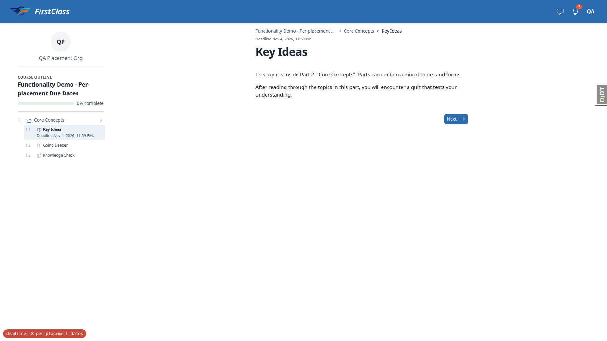
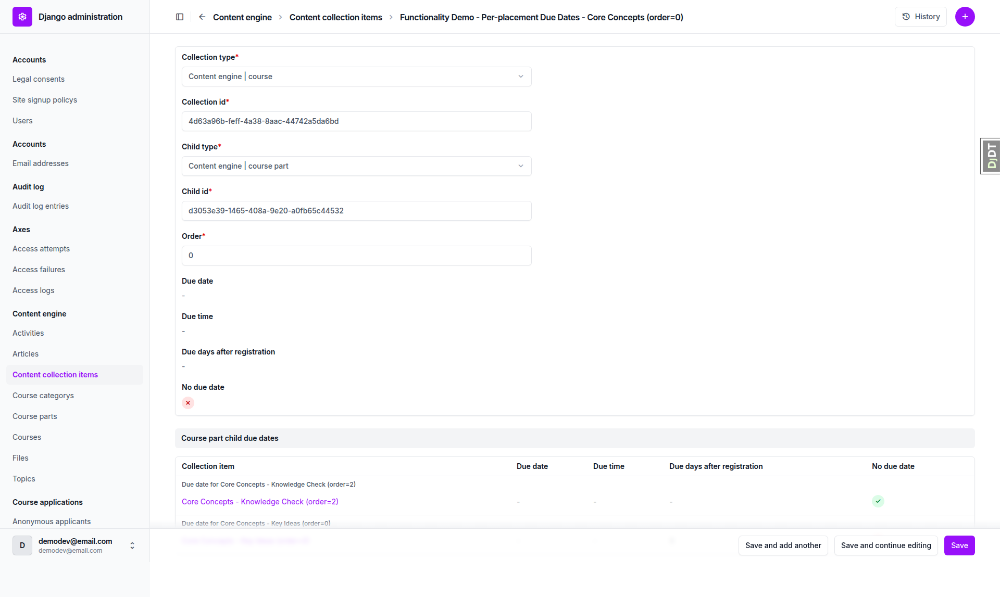
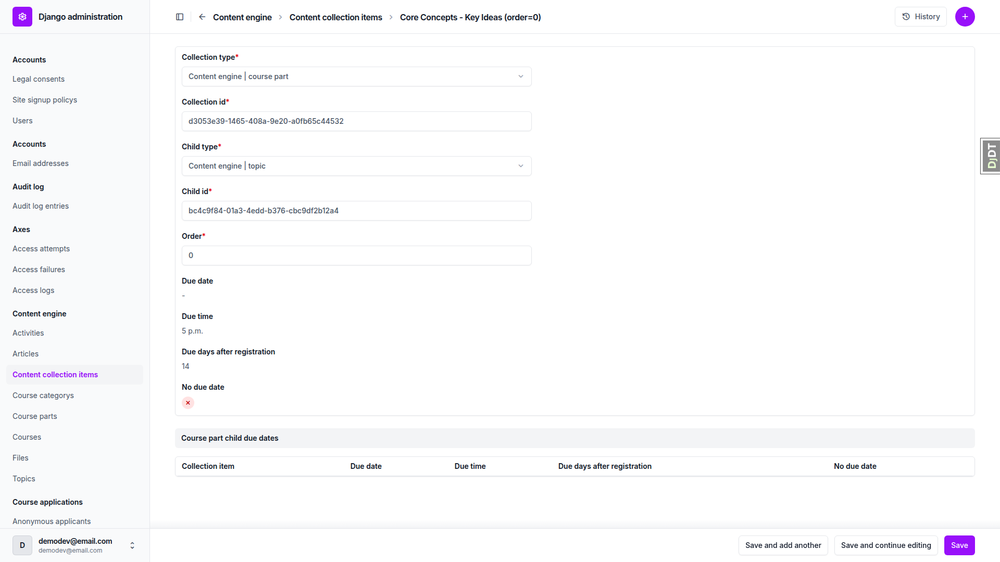
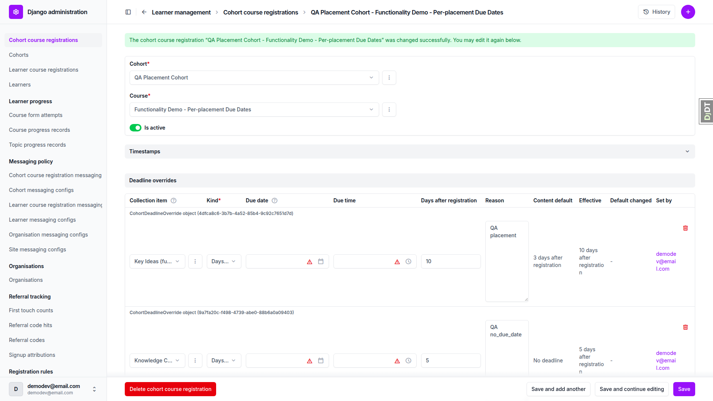
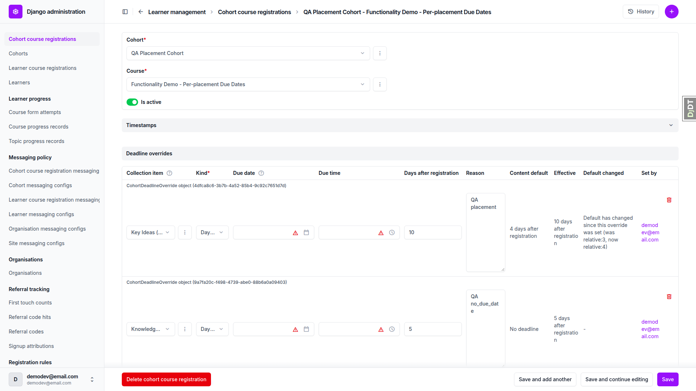
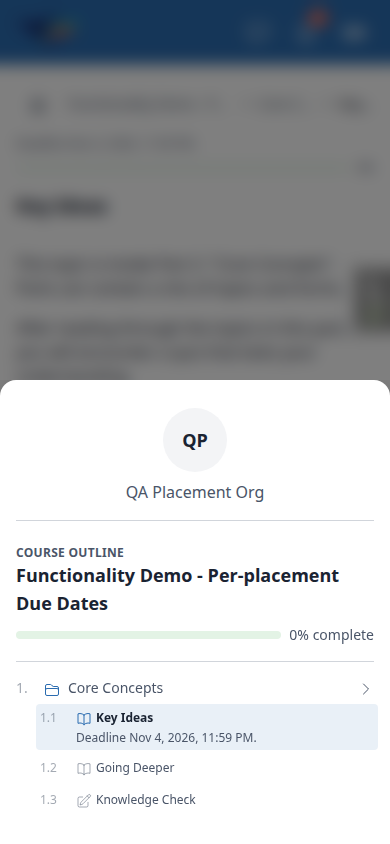
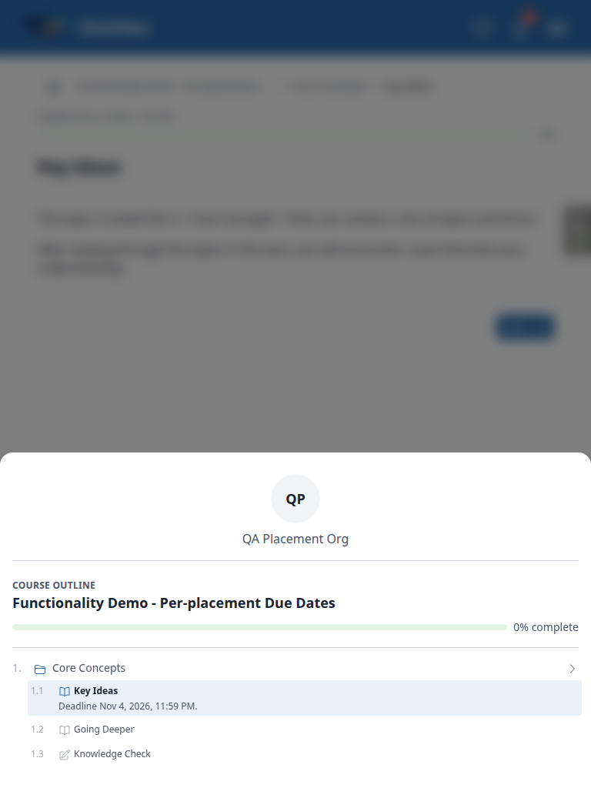

# Frontend QA Report: deadlines-8-per-placement-dates

All tests passed and no bugs were found. Every check in the test plan ran across the terminal (validator), desktop, mobile and tablet. The run found several corrections needed in the test plan itself (admin URL prefixes, the §1.3 progress expectation, and the literal §4 validator commands). None of them is a code defect. See General notes.

## Methodology

- Tool: Playwright MCP.
- Run date: 2026-11-02.
- Browser timezone: Africa/Johannesburg, locale en-US.
- Registration date (Reg) = Nov 1 2026. The seed data already existed from the previous run.
- Screenshots were collected into `screenshots/` beside this report. All 12 referenced images exist (checked with Glob).
- Server port: the run used port 8757, not the port-finder's 8036. The dev Site domain is 127.0.0.1:8757, and any other port returns a 500 ("Site matching query does not exist") on `/accounts/login/`.

## Diff scoping

- Class: FULL.
- Why: Rule 4. Non-.py files (`.md`, `course.md`) changed, and no templates or static files changed.
- Not run: nothing. Desktop, mobile and tablet all ran.

## Smoke gate

- Outcome: pass.
- Pages checked:
  - http://127.0.0.1:8757/
  - http://127.0.0.1:8757/courses/functionality-demo-per-placement-due-dates/detail/ (and the player at /1/)
- Note: ran on port 8757, because the dev Site domain is 127.0.0.1:8757 (see Methodology).

## Results

| Test | Viewport | Status | Note | Screenshot |
|---|---|---|---|---|
| 4.1 | terminal | pass | Both validators exit 1 with "children -> 0 -> overrides: Extra inputs are not permitted". Run from a scratch content repo. | none |
| 4.2 | terminal | pass | Both exit 1: "01. welcome/content.md: no_due_date takes no due keys". | none |
| 4.3 | terminal | pass | Both exit 1, naming the copied course.md, field children[0].children[0], given "99. missing/content.md", and listing the part's real children. | none |
| 4.4 | terminal | pass | Both exit 1: a due date on a COURSE_PART placement is rejected. Only TOPIC or FORM placements take due keys. | none |
| 4.5 | terminal | pass | Both exit 0. | none |
| 1.1 | desktop | pass | Placement course: Key Ideas "Deadline Nov 4, 2026, 11:59 PM." with no 05:00 PM leak. Going Deeper and Knowledge Check have no deadline line. The Core Concepts part row has no line or chip. |  |
| 1.2 | desktop | pass | Parts course: Key Ideas Nov 15 05:00 PM, Going Deeper none, Knowledge Check Nov 22 11:59 PM, Welcome "Missed deadline" Jan 31 2024 11:59 PM, What to Expect Nov 8 11:59 PM. |  |
| 1.3 | desktop | pass | Deadlines are unaffected by completion. Going Deeper shows Locked in the parts course because progress is per registration (unchanged from main). See General notes. |  |
| 2.1 | desktop | pass | Course inline shows the Due date, Due time, Due days after registration and read-only No due date columns, with no Overrides column. Placement course has one part row, parts course has three. |  |
| 2.2 | desktop | pass | Placement Core Concepts: read-only child due dates inline with exactly 2 rows (Key Ideas days 3, Knowledge Check No due date true). No add or delete controls and no editable inputs. Parts-course placement shows the inline with headers and no rows. |  |
| 2.2 (step 5) | desktop | pass | Topic placement Core Concepts > Key Ideas: No due date false, days 14, due time "5 p.m.". Child-due-dates inline has no rows. |  |
| 3.1 | desktop | pass | Key Ideas override (relative 10): content default "3 days after registration", effective "10 days after registration". Knowledge Check override (relative 5): default "No deadline", effective "5 days after registration". |  |
| 3.2 | desktop | pass | Cohort learner: Key Ideas "Deadline Nov 11, 2026, 11:59 PM" (Reg+10), Knowledge Check "Deadline Nov 6, 2026, 11:59 PM" (Reg+5). The only forbidden-wording hit is the seed org name, not a leak. |  |
| 3.3 | desktop | pass | After the default changed 3 to 4 and content_save, Key Ideas shows "Default has changed since this override was set (was relative:3, now relative:4)". Knowledge Check shows no note. After git checkout and content_save, the note is gone. |  |
| 3.2 (step 3 re-check) | desktop | pass | After resetting the fresh learner's progress: Key Ideas "Deadline Nov 4, 2026, 11:59 PM", Knowledge Check no line, despite the cohort overrides. | none |
| 5 | desktop | pass | With the nested children list removed and content_save run, a fresh learner sees Key Ideas Nov 15 05:00 PM and Knowledge Check Nov 22 11:59 PM, and the admin inline is empty. After git checkout and content_save, the placement course is restored and demo_content/ is clean. |  |
| 6 | mobile (390x844) | pass | Outline opened from the "Open course outline" bottom sheet. The Key Ideas deadline sits on its own line beneath the title, aligned with the topic icon. The title is on one line and there is no horizontal scroll. |  |
| 6 | tablet (768x1024) | pass | The player uses the mobile outline. Key Ideas "Deadline Nov 4, 2026, 11:59 PM." sits under the title, aligned, with no horizontal scroll. |  |

### Screenshot titles

#### 1.1 Placement course: Key Ideas deadline and part row

#### 1.2 Parts course: per-topic deadlines

#### 1.3 Completion does not change deadlines

#### 2.1 Course part inline columns, no Overrides

#### 2.2 Read-only course part child due dates inline

#### 2.2 (step 5) Topic placement due fields

#### 3.1 Registration overrides: content default and effective

#### 3.2 Learner sees override deadlines

#### 3.3 Default-changed note on an override

#### 5 Removing the nested children list falls back to defaults

#### 6 Mobile outline deadline layout (390x844)

#### 6 Tablet outline deadline layout (768x1024)

## Design check

No design states tested.

## Bugs

No bugs found.

## Bug status

No bugs found this run.

## General notes

- Port: the dev Site domain is 127.0.0.1:8757, so the port finder's choice (8036) returns a 500 on `/accounts/login/` ("Site matching query does not exist"). The run used 8757 after confirming it was free and that the branch badge named this branch.
- Test plan corrections (plan text, not code):
  - Admin URLs carry the `freedom_ls_` app-label prefix (`/admin/freedom_ls_content_engine/...`, `/admin/freedom_ls_learner_management/...`). The plan's `/admin/content_engine/` returns 404.
  - §1.3 expects shared progress across the two courses, but progress is scoped per registration (`docs/product/learner-tracking.md`), so Going Deeper shows Locked in the parts course. This is unchanged behaviour from main. Reaching Going Deeper also requires completing Key Ideas, and a completed item drops its deadline line. So step 3's "Key Ideas still shows its deadline" holds only in the parts course (Nov 15 05:00 PM, unchanged).
  - §4's literal commands do not work. The bundled validator reads `.fls-content.yaml` from the cwd, and a lone course copy fails content_validate on its undeclared "reference-demo" category. The run used a scratch content repo holding the copy, `course_categories.yaml` and a `.fls-content.yaml`, under the session scratchpad rather than /tmp.
- Seed data already existed from the previous run (registrations dated 2026-11-01). qa-data-helper cleared leftover TopicProgress before the run, reset the fresh learner's progress after §1.3, and deleted the two §3 overrides at clean-up.
- While adding the first override, a mis-targeted locator clicked "Save and add another" once. It re-saved the cohort registration unchanged and opened a blank add form. Nothing was created.
- The topic placement admin shows due time as "5 p.m." (Django's time display), not "17:00" as the plan writes. Same value, no action.
- Mobile and tablet checks covered the learner player outline only (§6). The admin pages were checked at desktop width only.

status: ok · reason: report rendered, 0 bugs documented, 18 test records
