# Frontend QA report: per-placement due dates for shared content

Run date 2026-11-01, branch `deadlines-8-per-placement-dates`, dev server on port 8757. Every test in the plan (`3. frontend_qa.md`) passed. No bugs were found. The report records several corrections to the test plan itself (listed under General notes), none of which are product defects.

## Methodology

- Playwright MCP, driven by hand. Viewports: desktop 1920x1080; mobile 390x844 for the plan's section 6 and 375x812 for the admin; tablet 768x1024.
- Browser time zone `Africa/Johannesburg`, locale `en-US`.
- Section 4 (author errors from `content_validate` and the bundled validator) was run in the terminal, so those tests have no screenshots.
- Screenshots are collected in `screenshots/` beside this report. Every image referenced below exists there.

## Diff scoping

Class: **FULL**.

Why: the diff contains no template or static change, but non-`.py` files changed (markdown docs, the demo `course.md`, spec files), so the safe default of FULL applied.

Changed files, grouped:

- Content-authoring plugin (`claude_plugins/fls-content/`): three skill resource docs (`course-files.md`, `form-files.md`, `topic-files.md`), the bundled validator (`validate/schema.py`, `validate/validate.py`) and its tests.
- Demo content: `demo_content/functionality_demo_course_parts_placement/course.md`.
- `freedom_ls/content_base`: `schema.py` and its test.
- `freedom_ls/content_engine`: `admin.py`, `factories.py`, `content_save` command, migrations `0010` and `0011`, `models/__init__.py`, `models/courses.py`, `schema.py`, `validate.py`, and tests (demo content, content_save, models, admin, schema, validate).
- `freedom_ls/deadlines`: `admin.py`, `queries.py`, `resolver.py` and tests.
- `freedom_ls/learner_interface`: `tests/views/test_course_player.py`.
- Spec files under `spec_dd/2. in progress/deadlines-8-per-placement-dates/` (spec, plan, plan notes, research files, todo, this QA plan).

Nothing was skipped.

## Smoke gate

Pass. Pages checked:

- `http://127.0.0.1:8757/`
- `http://127.0.0.1:8757/courses/functionality-demo-per-placement-due-dates/detail/`

## Results

| Test | Viewport | Status | Note |
|---|---|---|---|
| 4.1 | terminal | pass | Both validators reject `overrides` as an extra input. |
| 4.2 | terminal | pass | Both fail with "no_due_date takes no due keys". |
| 4.3 | terminal | pass | Both name the bad nested path and list the part's actual children. |
| 4.4 | terminal | pass | Both refuse a due date on a COURSE_PART placement. |
| 4.5 | terminal | pass | Valid file: both exit 0. |
| 1.1 | desktop | pass | Key Ideas "Deadline Nov 4, 2026, 11:59 PM"; Going Deeper and Knowledge Check have no line. |
| 1.2 | desktop | pass | Parts course unchanged. |
| 1.3 | desktop | pass | Core assertion holds; plan step 1.3.2 is wrong (progress is per course). |
| 2.1 | desktop | pass | `no_due_date` read-only column present; no Overrides column. |
| 2.2 | desktop | pass | Read-only child due dates inline with two rows. |
| 3.1 | desktop | pass | Content default shows placement value. |
| 3.3 | desktop | pass | "Default has changed" note appears and clears. |
| 3.2 | desktop | pass | Cohort override beats `no_due_date`. |
| 6 | mobile | pass | Deadline line on its own line, no horizontal scroll. |
| 6 | tablet | pass | Drawer outline, same layout, no horizontal scroll. |
| 2.2 | mobile | pass | Inline stacks into labelled cards, no horizontal scroll. |
| 5 | desktop | pass | Removing the nested list restores file values; restore confirmed. |
| 3.2-step3 | desktop | pass | Fresh learner still sees 1.1's values with overrides in place. |

### Section 4: what an author sees (terminal)

- 4.1: `content_validate` and the bundled validator both fail with `children -> 0 -> overrides: Extra inputs are not permitted`.
- 4.2: both fail with `children -> 0 -> children -> 0 ... 01. welcome/content.md: no_due_date takes no due keys`.
- 4.3: both fail with `Invalid due date placement in .../course.md, Field: children[0].children[0], the part has no child at this path, Given value 99. missing/content.md`, and list the part's children (`01. welcome/content.md`, `02. what-to-expect/content.md`). The nested entry carried only `no_due_date: true`; with 4.2's extra due key still present, the `no_due_date` error fires first (same in both).
- 4.4: both fail with `Field: children[0], a due date on a COURSE_PART placement. Only a TOPIC or FORM placement takes due keys or no_due_date.`
- 4.5: both exit 0. The scratch copy had to be laid out as a content repo, and the bundled validator was run with `uv --directory` pointing at a scratch directory holding an empty `.fls-content.yaml` (see General notes).

### 1.1 The placement course shows the placement values (desktop)

Fresh learner, Reg = Nov 1 2026. Key Ideas: "Deadline Nov 4, 2026, 11:59 PM" (Reg + 3, no 17:00 leak). Going Deeper and Knowledge Check: no deadline line. Core Concepts part row: no line, no chip. The only learner-visible "Placement" text is the seed organisation name "QA Placement Org" in the sidebar, not feature wording. The screenshot was taken with the debug toolbar open; it was hidden for later shots.

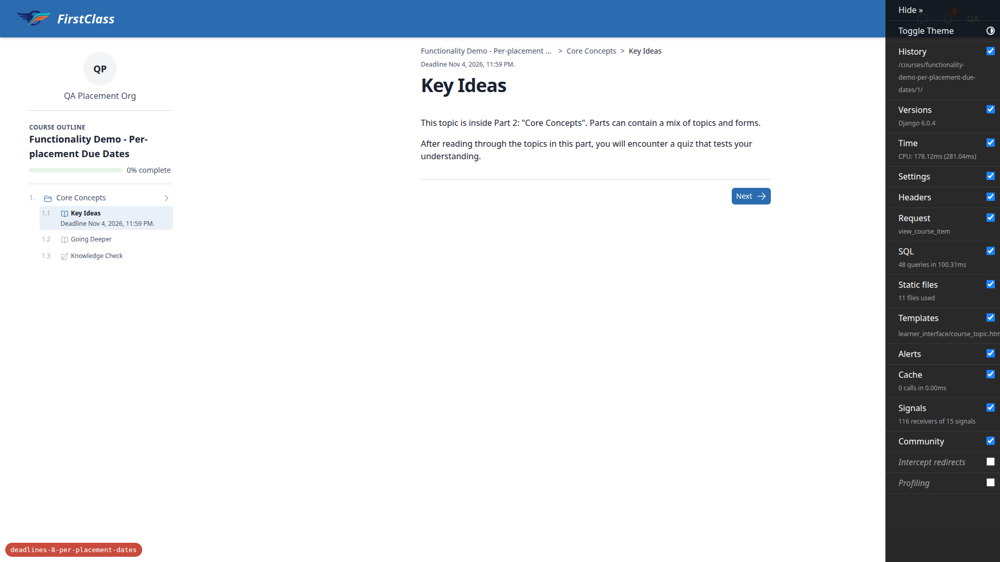

### 1.2 The parts course is unchanged (desktop)

Key Ideas "Deadline Nov 15, 2026, 05:00 PM" (Reg + 14); Going Deeper none; Knowledge Check "Deadline Nov 22, 2026, 11:59 PM" (Reg + 21). Welcome shows the Missed deadline chip and "Jan 31, 2024, 11:59 PM"; What to Expect shows "Deadline Nov 8, 2026, 11:59 PM" (Reg + 7).

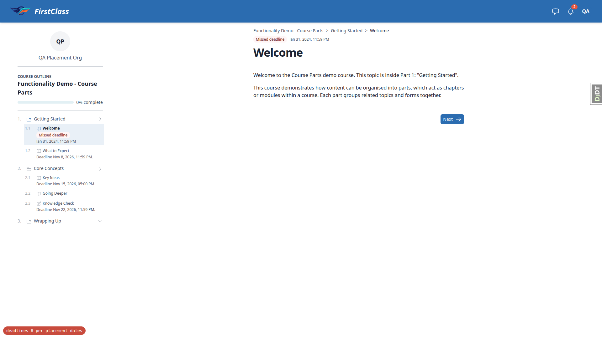

### 1.3 Progress and deadlines (desktop)

Going Deeper is locked behind Key Ideas in the placement course, so Key Ideas was completed first, then Going Deeper. The placement outline afterwards showed Key Ideas Completed, Going Deeper Completed, Knowledge Check Not started with no deadline line. In the parts course, Key Ideas and Going Deeper show Locked, not completed. Plan step 1.3.2 ("shows as completed there too") is a test-plan error: `TopicProgress` is keyed on course progress (`learner_interface/utils.py`, `_fetch_player_progress_maps`), so progress is per course on main as well, and the spec says nothing about sharing it. The core assertion holds: the parts course still shows Key Ideas Nov 15 05:00 PM, Knowledge Check Nov 22 and What to Expect Nov 8; the placement course's Knowledge Check still has no line. A completed item hides its own deadline line (existing behaviour), so Key Ideas' own line in the placement course could not be re-checked after completion.

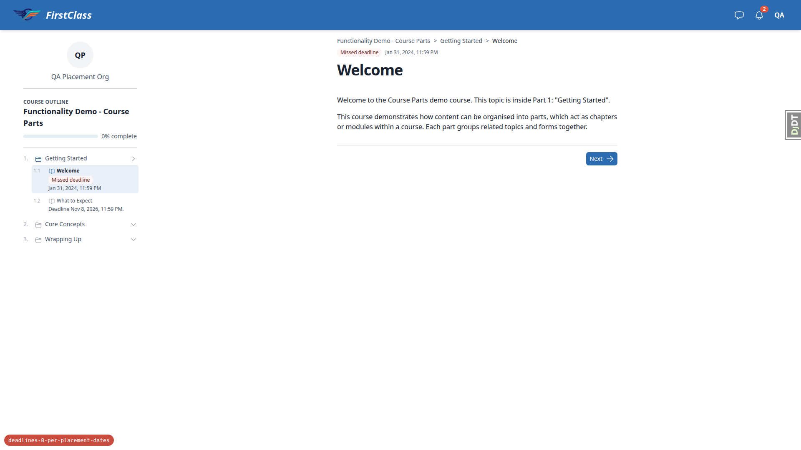

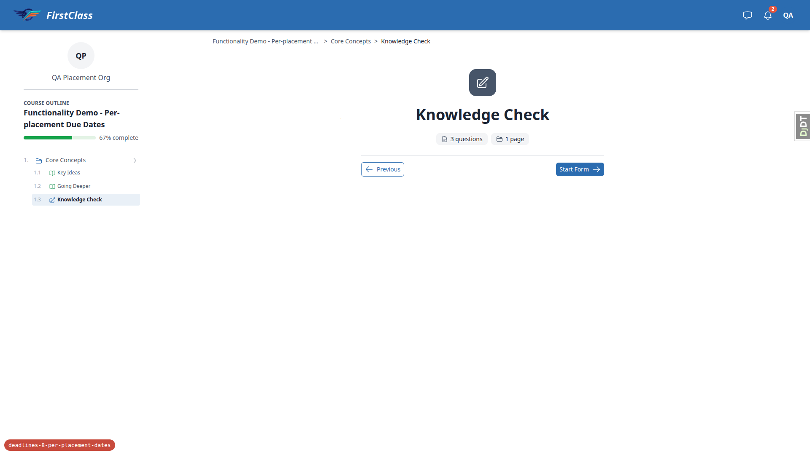

### 2.1 Course change page (desktop)

The placement course's Content collection items inline has one Core Concepts course-part row with read-only Due date, Due time and Due days after registration ("-") and a read-only No due date shown false. There is no Overrides column or JSON field. The parts course shows the same columns on its three part rows (Getting Started, Core Concepts, Wrapping Up).

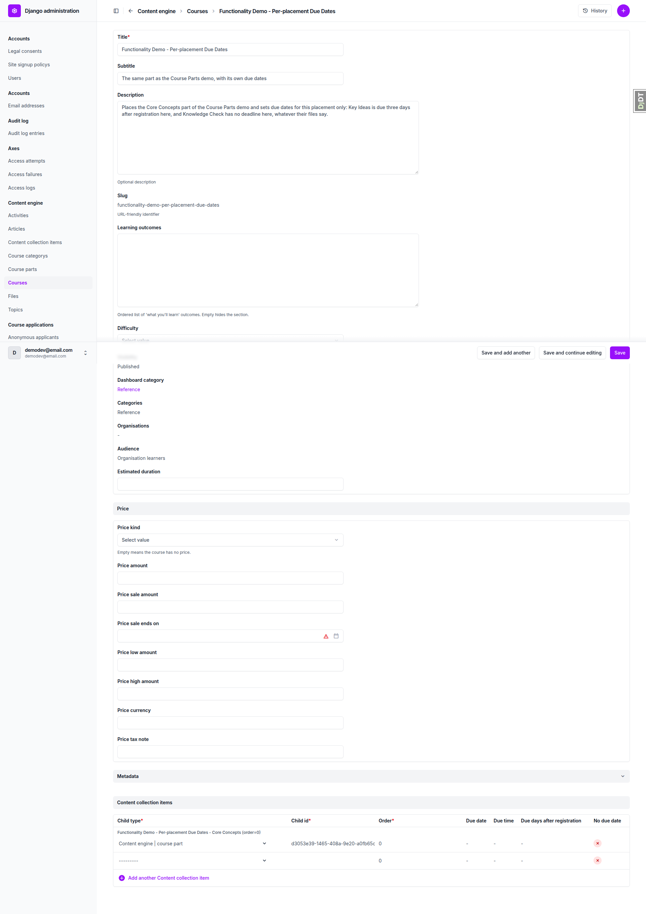

### 2.2 Part placement child due dates (desktop)

The placement course's Core Concepts placement has a read-only "Course part child due dates" inline with exactly two rows: Key Ideas (days 3, due date "-", due time "-", No due date false) and Knowledge Check (all three "-", No due date true). There is no "Add another", no delete checkbox and no editable input. The parts course's Core Concepts placement has the inline present and empty. The topic placement Core Concepts to Key Ideas shows read-only Due days 14, Due time "5 p.m.", No due date false, and an inline with no rows.

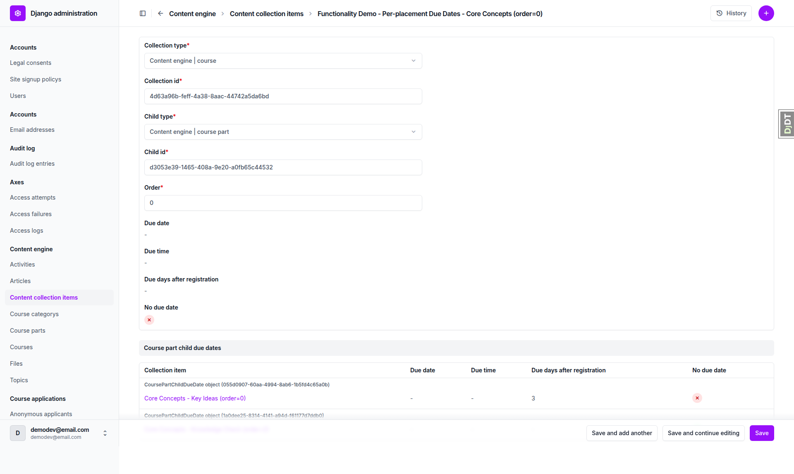

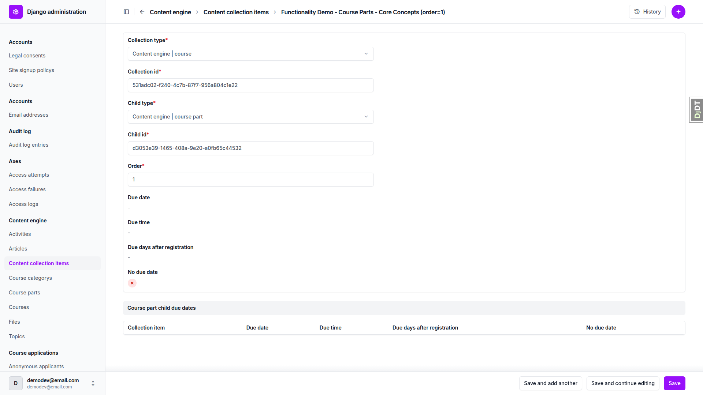

### 3.1 Content default shows the placement value (desktop)

On the cohort course registration for QA Placement Cohort and the placement course: the Key Ideas override (days 10, reason "QA placement") shows Content default "3 days after registration" (the placement value, not the file's 14 days at 17:00), Effective "10 days after registration", Default changed "-". The Knowledge Check override (days 5, "QA no_due_date") shows Content default "No deadline" and Effective "5 days after registration". No validation errors.

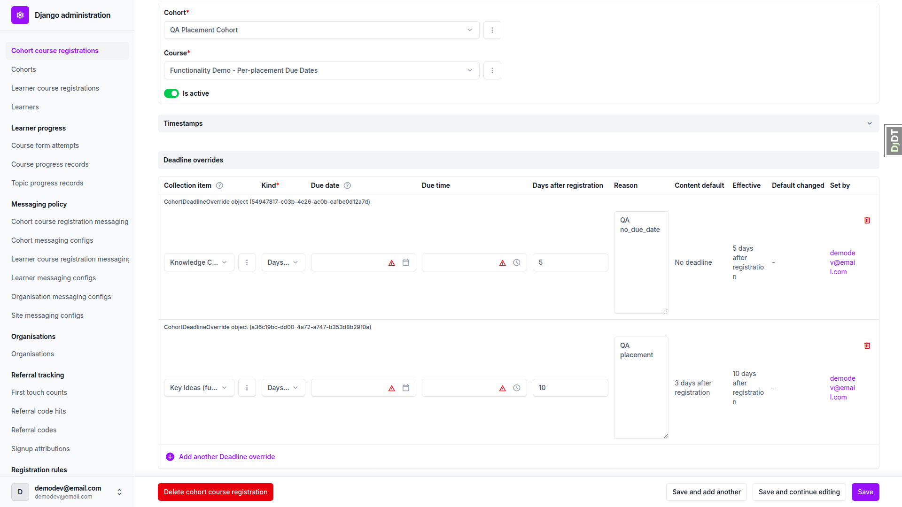

### 3.3 A changed placement value is reported (desktop)

After setting the Key Ideas placement to 4 days and re-running `content_save`: the Key Ideas row reads "Default has changed since this override was set (was relative:3, now relative:4)" with Content default "4 days after registration"; the Knowledge Check row has no note. After `git checkout` and `content_save`, the note was gone and Content default was back to "3 days after registration".

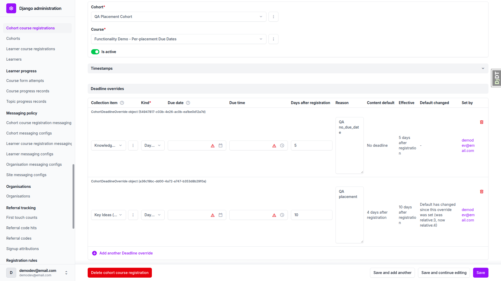

### 3.2 An override beats `no_due_date` (desktop)

Cohort learner, placement course: Key Ideas "Deadline Nov 11, 2026, 11:59 PM" (Reg + 10); Knowledge Check "Deadline Nov 6, 2026, 11:59 PM" (Reg + 5). The cohort override beats `no_due_date`. Step 3 (fresh learner unchanged) was checked after the progress reset in section 5 step 5 and is recorded as 3.2-step3: the fresh learner (no cohort) with both overrides in place still sees Key Ideas Nov 4 11:59 PM and no Knowledge Check line, matching 1.1. That check has no screenshot.

### 6 Layout at phone width

Mobile (390x844, cohort learner, because the fresh learner's progress was being reset; the outline markup is the same): the outline opens as a bottom drawer via "Open course outline". The Key Ideas deadline line sits on its own line under the title, its left edge level with the type icon, titles stay on one line, and scrollWidth 390 equals clientWidth (no horizontal scroll). No console errors. The topic header deadline line also fits.

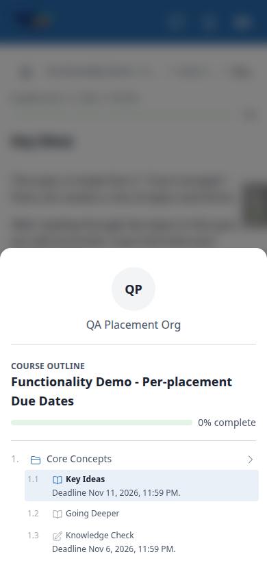

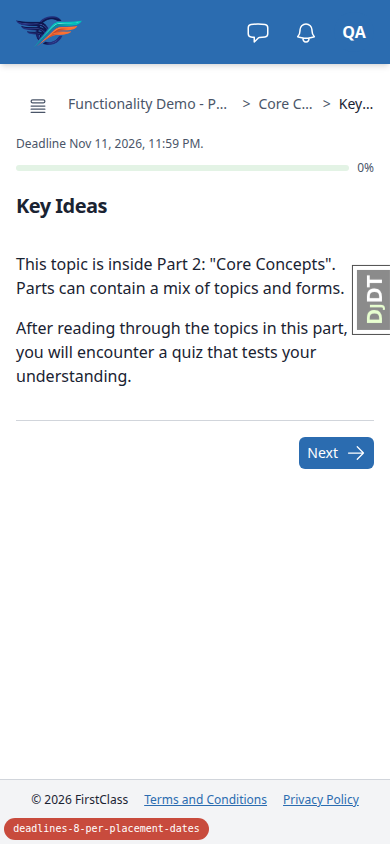

Tablet (768x1024): tablet gets the drawer outline (Open course outline button). Same deadline-line layout, no horizontal scroll (scrollWidth 768).

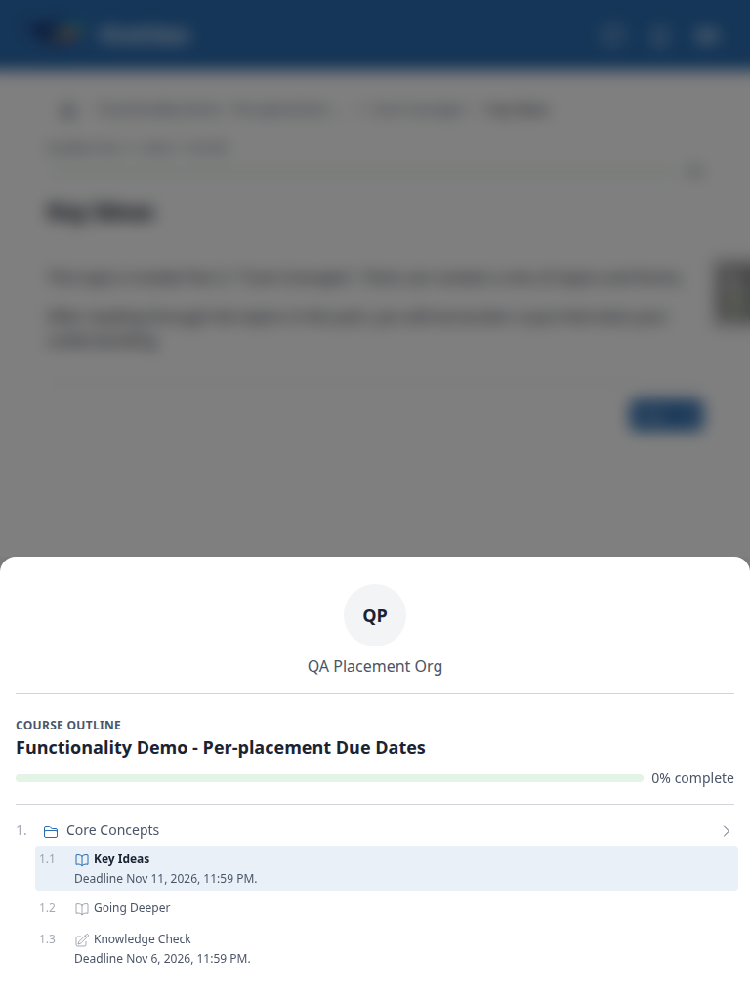

### 2.2 Admin at phone width (mobile)

At 375x812 the read-only child due dates inline stacks into labelled cards (Collection Item, Due Date, Due Time, Due Days After Registration, No Due Date), with no horizontal scroll (scrollWidth 375). The debug-toolbar handle overlaps the right edge (dev-only).

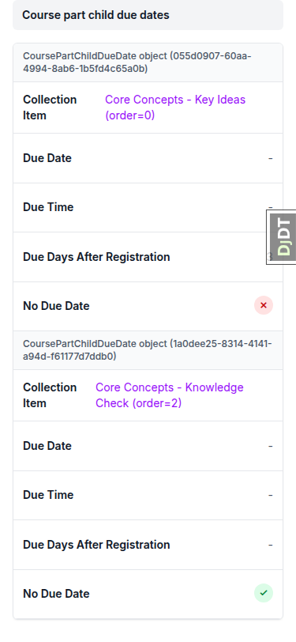

### 5 Removing the nested list restores the file values (desktop)

With the nested children list removed from the placement `course.md` and `content_save` re-run, the fresh learner sees Key Ideas "Deadline Nov 15, 2026, 05:00 PM" (Reg + 14) and Knowledge Check "Deadline Nov 22, 2026, 11:59 PM" (Reg + 21). In the admin, the placement course's Core Concepts row (same pk) has an empty child due dates inline. After `git checkout` and `content_save`, Key Ideas is back to "Deadline Nov 4, 2026, 11:59 PM" and Knowledge Check has no line (1.1 holds). The fresh learner's progress from 1.3 was reset via qa-data-helper first, because a completed item hides its deadline line.

## Design check

no design states tested

## Bugs

No bugs found.

## Bug status

No bugs this run.

## General notes

- **Pre-step rebase.** The branch was rebased onto origin/main (13 commits replayed, no conflicts, lost-change check passed, `makemigrations --check` clean). Targeted test selection escalated to the full tier: 11243 passed. pre-commit was clean. Force-pushed with lease. The rebase's front-end check (shared upstream changes in `base/static` `alpine-components.js` and `panel_framework` cotton partials) was folded into this QA pass: every page the plan names was visited, and console errors were checked (none) at desktop, mobile and tablet on the player.
- **Dev data drift fixed (via qa-data-helper).** Site pk 2 "DemoDev" had domain `demodev.localhost`, so every page except the dashboard returned 500 with "Site matching query does not exist" at `127.0.0.1:8757`. Its domain was set to `127.0.0.1:8757`. This is not a code bug. A later QA run on a different port will need the same fix; the seed step in the plan could say so.
- **Test plan corrections for the next run.**
  - (a) Admin URLs use the app label `freedom_ls_content_engine` / `freedom_ls_learner_management`, not `content_engine` / `learner_management`.
  - (b) The content collection item changelist has no "child type" filter.
  - (c) Section 4: the scratch copy must be a content repo (`course_categories.yaml` at its root, the course in a subdirectory), and the bundled validator reads `.fls-content.yaml` from the cwd, so run it with `uv run --directory <dir holding a .fls-content.yaml>`.
  - (d) 4.3 must drop 4.2's due key or the `no_due_date` error fires first.
  - (e) 1.3: progress is per course (`TopicProgress` keyed on course progress), so completing Going Deeper in one course does not complete it in the other, and Going Deeper is locked until Key Ideas is done. Completing an item also hides its own deadline line, so section 5 needs the fresh learner's progress reset first.
- **Row label in the child due dates inline (observation, not filed as a bug).** Each row of the "Course part child due dates" inline is headed by Django's default label "CoursePartChildDueDate object (055d0907-...)" because `CoursePartChildDueDate` (`content_engine/models/courses.py:598`) defines no `__str__`. Other content_engine models in the same admin show readable labels (for example "Core Concepts - Key Ideas (order=0)"). It was not filed as a bug: the existing deadline-override inline on the cohort course registration page shows the same default "CohortDeadlineOverride object (<uuid>)" heading, so this matches an established admin pattern rather than a regression.
- **Other observations, no action taken.** Part rows in the player outline show a right-pointing chevron when expanded and a down chevron when collapsed (the reverse of the usual convention); this predates the branch. Read-only inline rows (child due dates, deadline overrides) are headed by Django's default "Model object (<uuid>)" label. The deadline override item dropdown labels the placement course's items by the parts course's file paths (for example `functionality_demo_course_parts/02. Core Concepts/...`), which is accurate because the part is shared, but may confuse an admin.
- **Section 7 cleanup.** The two `CohortDeadlineOverride` rows were deleted via qa-data-helper; the fresh learner's section 1.3 completions were reset; `demo_content/` has no uncommitted change; seed users, cohort and registrations were left in place.
- **Screenshot compression.** Status ok: no PNG over 1024KB.

status: ok · reason: report rendered, 0 bugs documented
