# Frontend QA report: the bulk-action selection bar, above the table

Test plan: `3. frontend_qa.md`. All tests passed; no bugs were found.

## Methodology

- Tool: Playwright MCP.
- Viewports: 1920x1080 (desktop), 768x1024 (tablet), 375x812 (mobile).
- Screenshots were collected into `screenshots/` beside this report. Every image referenced here exists in that directory (checked with Glob). Design screenshots are under `design_screenshots/`.
- Compression ran. No PNG was over 1024KB, so nothing changed.

## Diff scoping

The `scoping` record classes the diff as FULL. Templates, static JS and CSS all changed: the panel_framework templates, `alpine-components.js`, the cotton templates, `tailwind.components.css` and the panel_framework Python. Desktop, tablet and mobile all ran. Nothing was skipped.

## Smoke gate

Pass. Both pages loaded: `/` and `/educator/organisations/demodev/learners/`.

## Results by test

Plan groups: Test 1 (bar replaces the toolbar), Test 2 (More menu), Test 3 (select all, deselect all, clear), Test 4 (an action and its result), Test 5 (background run), Test 6 (tablet and phone), Test 7 (JavaScript off), Test 8 (what else the change touches).

| Test | Viewport | Status | Screenshot | Notes |
|---|---|---|---|---|
| 1.1 | desktop | pass | 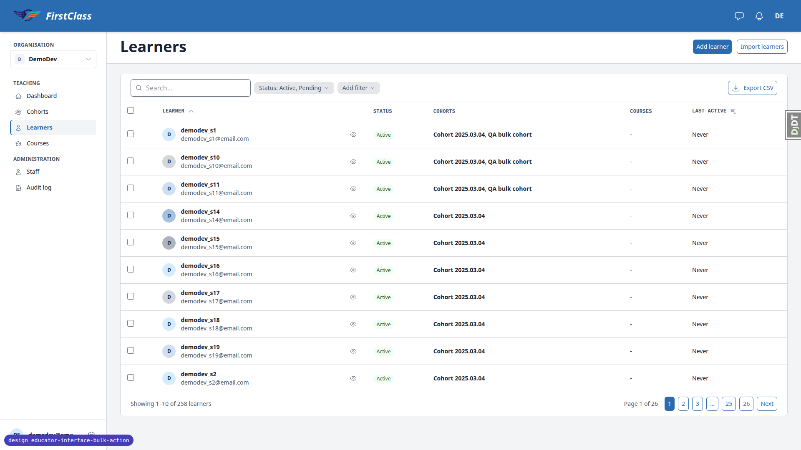 | Toolbar (search, Status chip, Add filter, Export CSV) above the table, no bar. Footer "Showing 1–10 of 258 learners" on the left, pager on the right. Table pages at 10 here, not 25. |
| 1.3 | desktop | pass | 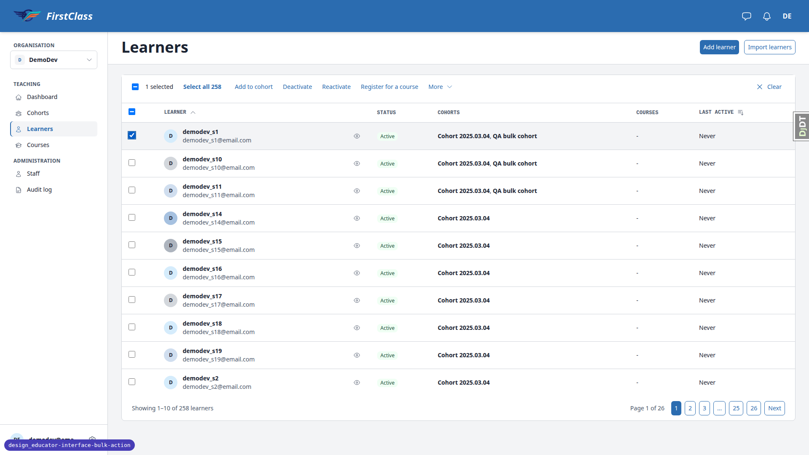 | Ticking a row hides the toolbar and the bar takes its row, reading "1 selected". Thead top stays at 245px. Order: checkbox (indeterminate), count, Select all 258, Add to cohort, Deactivate, Reactivate, Register for a course, More with chevron. Clear sits alone at the right. Bar buttons are transparent with 0px border. |
| 1.6 | desktop | pass | — | Clicking the Learner sort header re-sorts, clears the selection and brings the toolbar back. |
| 1.7 | desktop | pass | — | With 2 ticked, the header and bar checkboxes are both indeterminate. Header checkbox ticks all 10 on the page and both show checked. Unticking one returns both to indeterminate. |
| 1.8 | desktop | pass | — | Clear removes the bar and the toolbar returns. Thead top is unchanged at 245. Focus lands on the "Select all on this page" header checkbox. Space ticks the page, Space again clears. |
| 2.1 | desktop | pass | 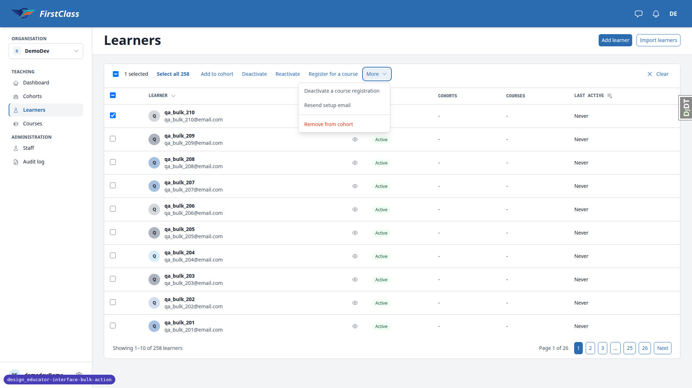 | Menu opens below More: Deactivate a course registration, Resend setup email, separator, Remove from cohort in error red rgb(210,51,25). No icons, no helper lines. |
| 2.2 | desktop | pass | — | ArrowDown moves through the three items and skips the separator. A fourth press wraps to the first. Escape closes and returns focus to More. Enter on More opens with focus on the first item. |
| 2.3 | desktop | pass | 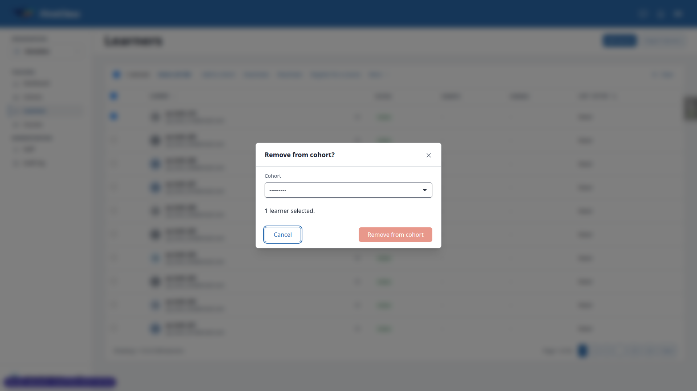 | Remove from cohort opens a "Remove from cohort?" modal with a cohort picker and "1 learner selected." Cancel closes it. |
| 2.5 | desktop | pass | 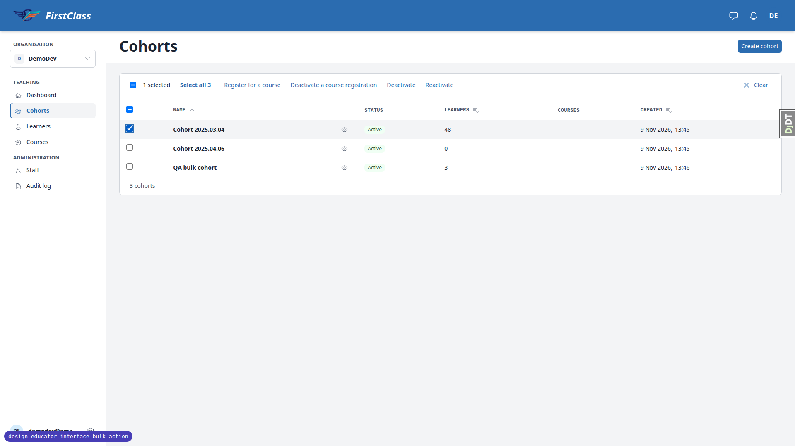 | Cohorts bar shows Register for a course, Deactivate a course registration, Deactivate and Reactivate as text buttons. No More. |
| 3.1 | desktop | pass | 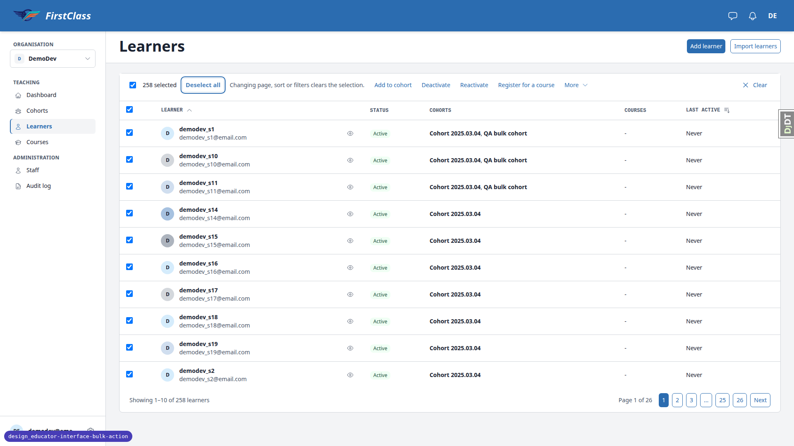 | Select all 258 gives "258 selected", a "Deselect all" link and the muted note "Changing page, sort or filters clears the selection." Both page checkboxes are checked. |
| 3.2 | desktop | pass | — | Unticking one gives "257 selected" and a "Select all 258" link. Both checkboxes are indeterminate and the note stays. Select all again re-ticks the row and returns to 258. |
| 3.3 | desktop | pass | — | Deselect all removes the bar, brings the toolbar back, leaves no rows ticked and puts focus on the header checkbox. |
| 3.4 | desktop | pass | — | After Select all and Clear, ticking one row shows "1 selected" and "Select all 258". Nothing carries over. |
| 3.5 | desktop | pass | — | Search "demodev_s1" returns 9 learners on one page. Select all 9 ticks every row and shows "9 selected" and "Deselect all", with no "Changing page" note (page mode). |
| 3.6 | desktop | pass | — | With Select all 258 active, clicking pager 2 clears the selection and the toolbar returns. The page scrolls 2px on the htmx swap; that is not a layout shift. |
| 4.1 | desktop | pass | 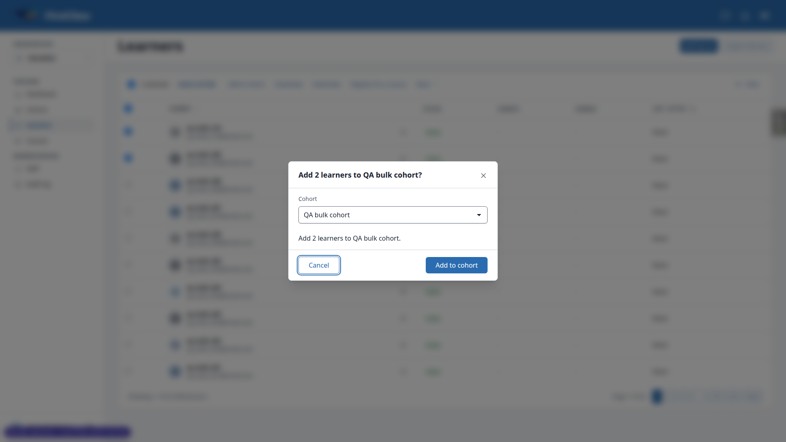 | Ticked qa_bulk_210 and qa_bulk_209 (no cohort). Add to cohort opens the modal with a cohort picker. Choosing QA bulk cohort re-renders the title "Add 2 learners to QA bulk cohort?". |
| 4.2 | desktop | pass | 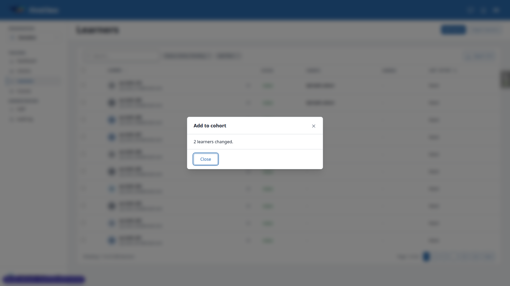 | Result modal reads "2 learners changed." |
| 4.3 | desktop | pass | 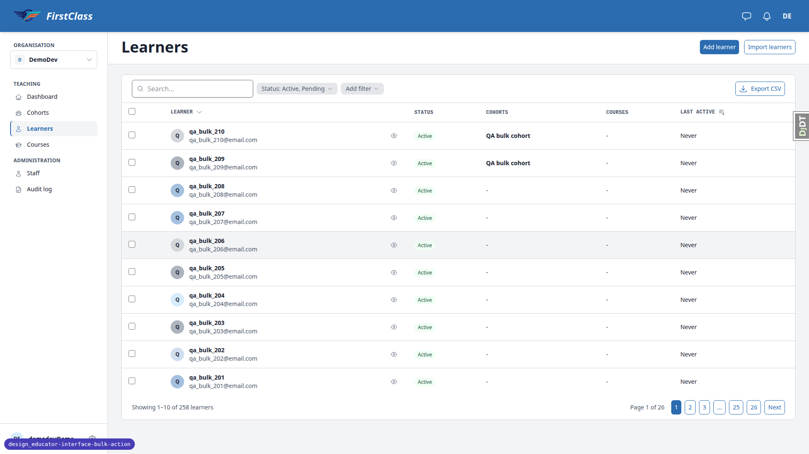 | After Close the table is refreshed, no row is ticked, no bar shows and the toolbar is back. Footer "Showing 1–10 of 258 learners" and the pager are present. Thead top is 245, as while the bar showed. |
| 4.4 | desktop | pass |  | Both learners' Cohorts column now reads "QA bulk cohort". |
| 5.1 | desktop | pass | — | 258 learners is over the 250 threshold. Select all 258, then More > Resend setup email. The confirmation says it runs in the background. |
| 5.2 | desktop | pass | — | Sampled every 250ms while running: the bar reads "Resend setup email is running…" with a spinner. No action buttons or More. Bar checkbox, Deselect all, Clear, header checkbox and every row checkbox are disabled. The run finished in about 1s, before a screenshot could catch it. |
| 5.3 | desktop | pass | 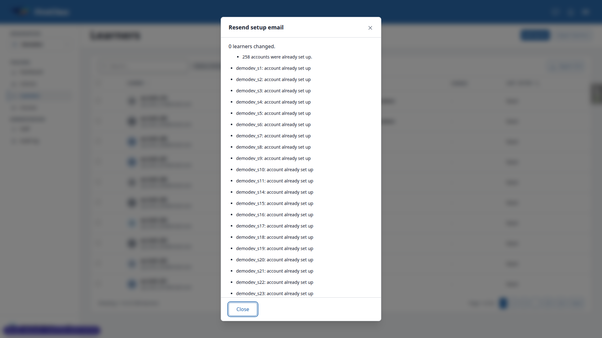 | Result modal appeared: "0 learners changed. 258 accounts were already set up." After Close the bar is gone and all checkboxes are enabled. |
| 8.1 | desktop | pass | 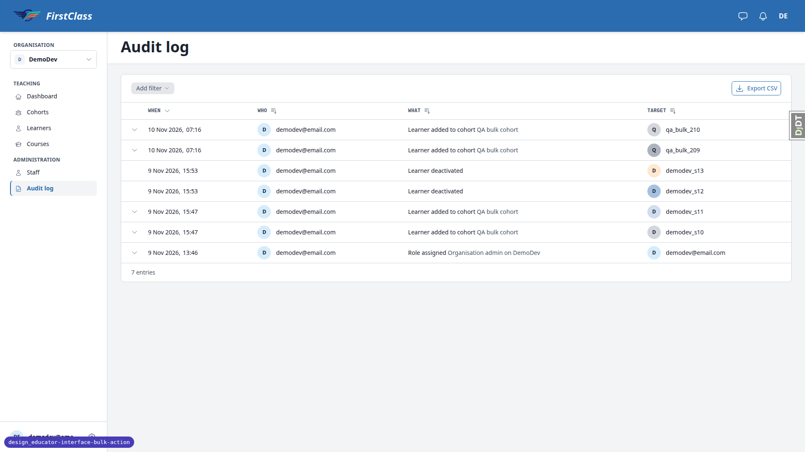 | Audit log has no checkbox column and no bar. Footer reads "7 entries" with no reserved space under it. Toolbar (Add filter, Export CSV) is unchanged. |
| 8.2 | desktop | pass | 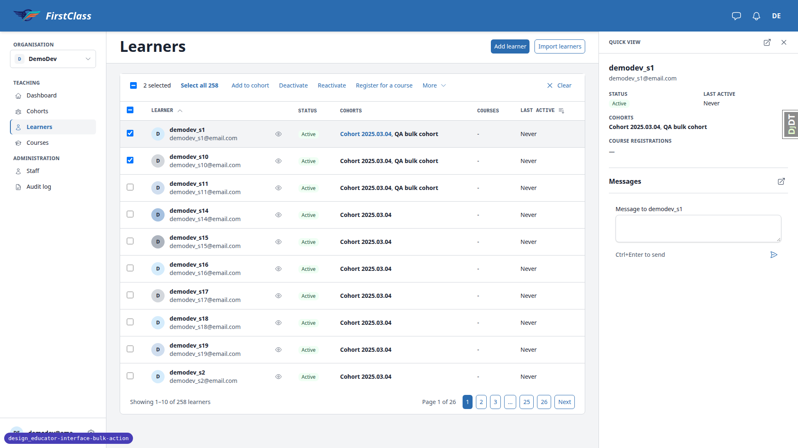 | Learner rows have no row menu, only a Quick view link. With 2 rows selected, quick view opens (demodev_s1). After Escape the selection is unchanged ("2 selected"). |
| 8.3 | desktop | pass | — | Sorting with rows selected clears the selection (see 1.6). At lg the search field and filter chips are hidden while the bar shows, so search was typed after Clear and filters the table (qa_bulk_20 gives 10 rows). Search and filter with a live selection are checked at tablet. |
| 8.4 | desktop | pass | — | Tab order from the heading: Add learner, Import learners, Search, Status chip, Add filter, Export CSV, table region, header checkbox, sort headers, row checkbox. After Space ticks a row, Shift+Tab runs header checkbox, table region, Clear, More actions, Register for a course, Reactivate, Deactivate, Add to cohort, Select all 258, Select page, Import learners. Bar controls sit between the toolbar's place and the table in visual order. |
| 8.5 | desktop | pass | — | Exactly one `role=status` (sr-only) inside `#learners-table`, reading "1 selected". The visible count is a plain span outside any live region. |
| 8.6 | desktop | pass | 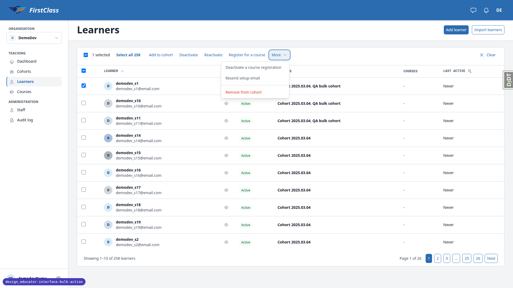 | The app has no dark theme: no prefers-color-scheme rules, and emulating dark changes nothing. Bar, menu separator and destructive item use theme tokens only (bg-surface, border-border, error tone). No hard-coded white or red in the changed templates. |
| 7.1 | desktop | pass |  | JS off: the bar sits under the toolbar and holds only the action submit buttons (Add to cohort, Deactivate, Reactivate, Register for a course, Deactivate a course registration, Resend setup email, Remove from cohort). No checkbox, count, Select all or Clear. A first shot caught the bar mid fade-in at reduced opacity; after the animation it is full strength. |
| 7.2 | desktop | pass | 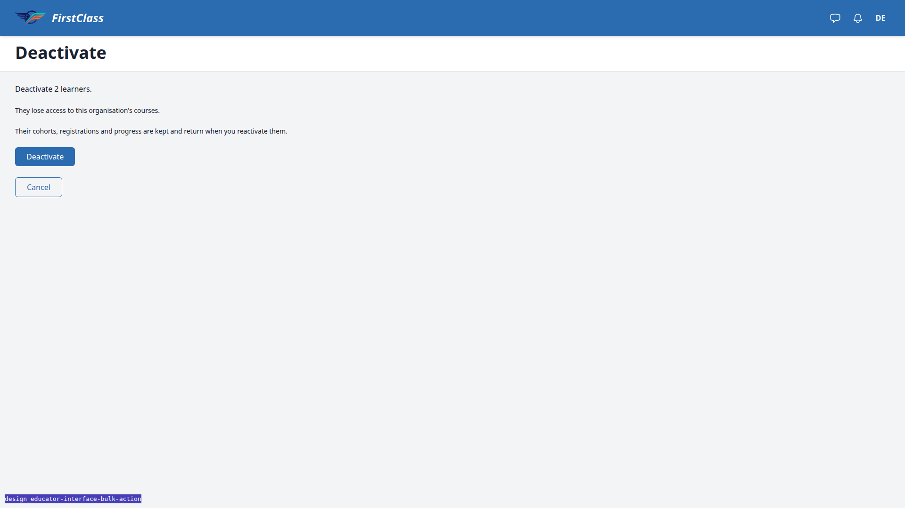 | Ticked demodev_s15 and demodev_s16, Deactivate gives a full-page confirmation "Deactivate 2 learners." Confirming returns to the list with a toast "2 learners changed." and the count drops to 256. The plan says "naming the two changed learners", but the message gives a count. The spec only requires reaching the confirmation page, and the wording matches the JS result modal. |
| 7.3 | mobile | pass | 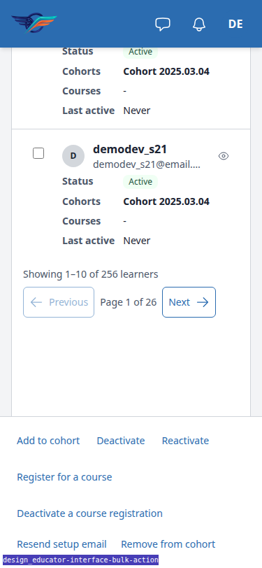 | JS off at 375: the fixed bar holds the seven action buttons wrapped over four lines and covers the bottom of the page. Accepted per plan, recorded without a bug. No sideways scroll (scrollWidth 375). |
| 6.1 | tablet | pass | 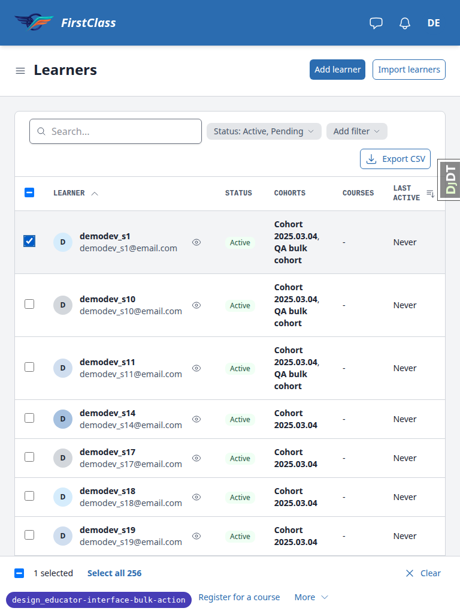 | At 768 the table stays a table. Ticking a row keeps the toolbar visible and shows the bar fixed to the viewport bottom. Row one: checkbox, "1 selected", Select all 256, Clear at right. Row two: Add to cohort, Deactivate, Reactivate, Register for a course, More. The dev branch badge covers the left end of row two in this shot (dev tooling only). |
| 2.4 | tablet | pass | 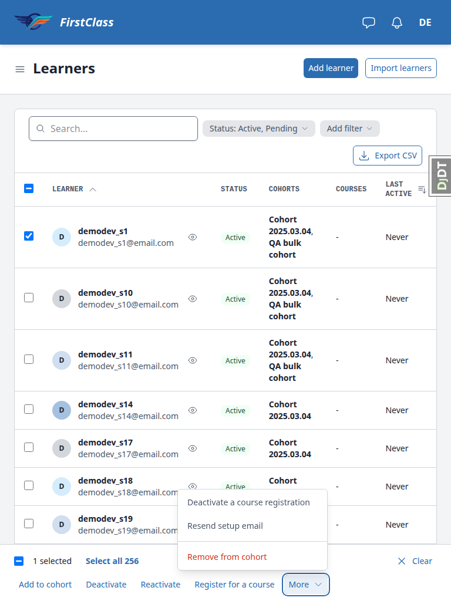 | More at 768 opens above the trigger (menu 834–971 in a 1024 viewport). All three items and the rule are inside the viewport. Remove from cohort is red. |
| 6.2 | tablet | pass | 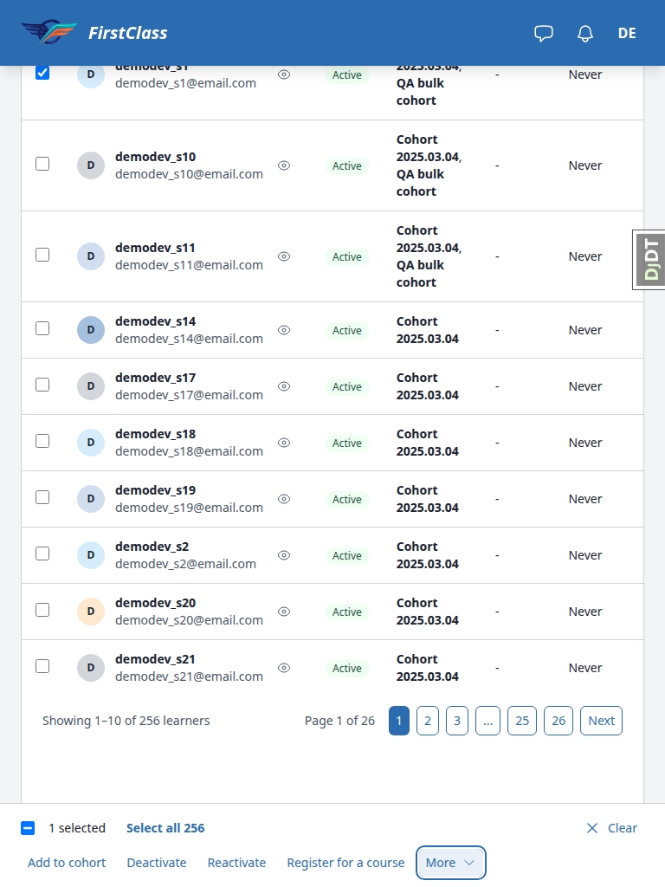 | Scrolled to the end: last row checkbox bottom 776, Next 815–849, bar top 927. Both are above the bar and clickable (trial clicks not intercepted). |
| 6.3 | tablet | pass | 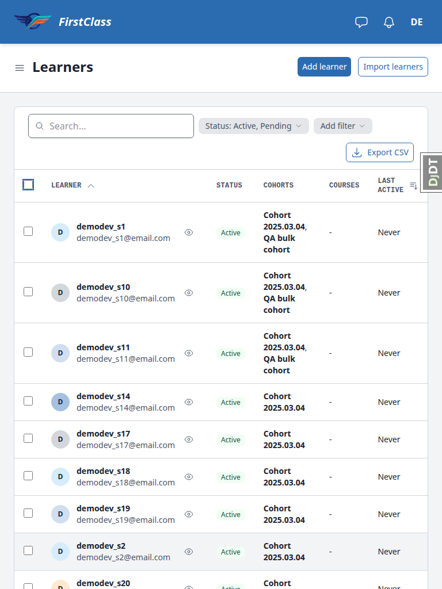 | After Clear: bar gone, region padding-bottom 0, document height and the 66px gap under the region match a fresh load. No empty band. Focus on "Select all on this page". |
| 8.3 | tablet | pass | 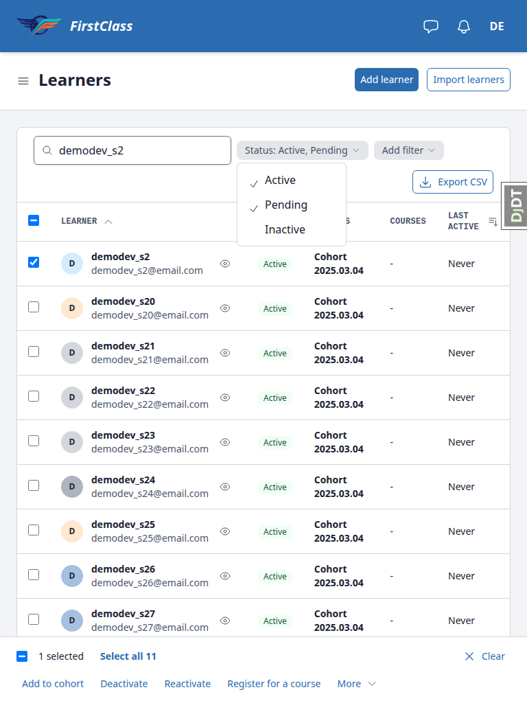 | At 768 the toolbar stays visible with a selection. Typing a search with a row ticked clears the selection and bar. Adding the Inactive status filter with a row ticked clears it too. |
| 6.4 | mobile | pass | 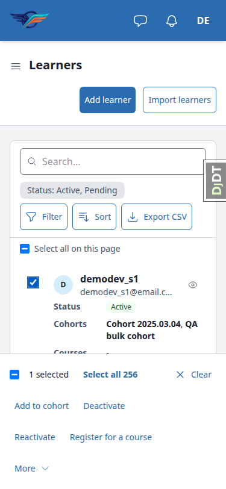 | Ticking the first card shows the bar fixed at the bottom (587–812). Row one: checkbox, "1 selected", Select all 256, Clear at the end. The left group wraps to three more rows. Every control is within 16–359px and scrollWidth 375 equals innerWidth. Buttons are 44px tall. |
| 6.5 | mobile | pass | 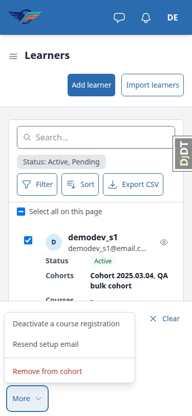 | More at 375 opens above the trigger, menu 9–263px wide and 610–747px tall in a 375x812 viewport. Remove from cohort is last, red, under a rule. Escape closes it. Also covers 2.4 at 375. |
| 6.6 | mobile | pass | 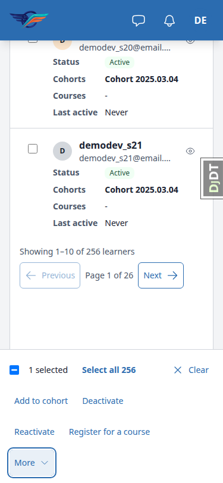 | Scrolled to the end: last card checkbox 242–258, Next 441–485, bar top 587. Both reachable above the bar (trial clicks not intercepted). |
| 6.7 | mobile | pass | — | Clear moves focus to the visible "Select all on this page" checkbox above the cards. |
| 6.8 | mobile | pass | 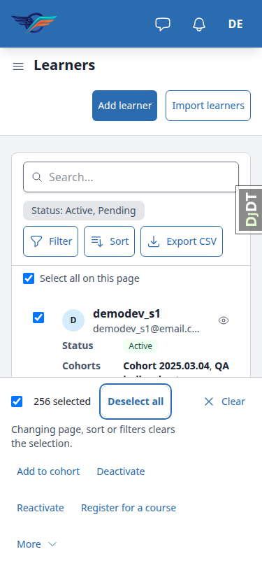 | Tick a card, Select all 256 (bar shows "256 selected", Deselect all, note wraps below), then Deselect all. Focus lands on the visible "Select all on this page" checkbox. |
| 6.9 | mobile | pass |  | With a card ticked, every bar control lies inside 0–375. Document scrollWidth 375 is no more than innerWidth 375, in page mode and in all-matching mode. |

## Design check

| Test | Viewport | This run | Design | Result |
|---|---|---|---|---|
| 1-design | desktop |  | 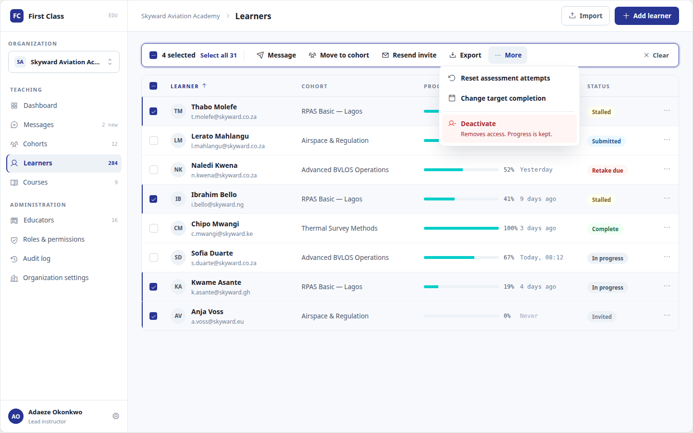 | pass, no misses |
| 4-design | desktop |  | 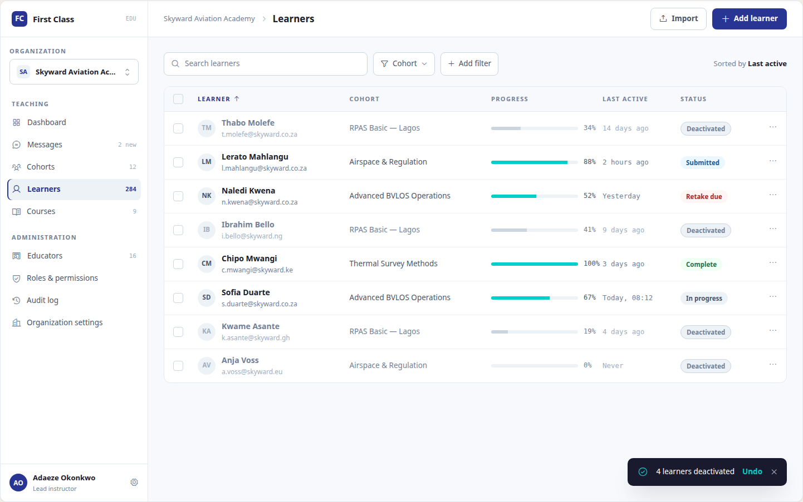 | pass, no misses |

## Bugs

No bugs were found this run, so there are no per-bug sections.

## Layout probe

| Test | Viewport | URL | Screenshot | Result |
|---|---|---|---|---|
| 1.1 | desktop | `/educator/organisations/demodev/learners/` |  | clean |
| 1.3 | desktop | `/educator/organisations/demodev/learners/` |  | clean |
| 2.1 | desktop | `/educator/organisations/demodev/learners?learners-sort=-user__first_name` |  | clean |
| 2.5 | desktop | `/educator/organisations/demodev/cohorts/` |  | clean |
| 4.3 | desktop | `/educator/organisations/demodev/learners?learners-sort=-user__first_name` |  | clean |
| 7.1 | desktop | `/educator/organisations/demodev/learners/` (JS off) |  | clean |
| 6.1 | tablet | `/educator/organisations/demodev/learners/` |  | clean |
| 6.4 | mobile | `/educator/organisations/demodev/learners/` |  | clean |

## Data changes

No data changes were made by the data helper or reset commands. The tests themselves changed data:

- qa_bulk_210 and qa_bulk_209 were added to QA bulk cohort (Test 4).
- demodev_s15 and demodev_s16 were deactivated (Test 7).

## Bug status

No bugs filed this run.

## General notes

- No console errors or warnings appeared in the JS-on browser context across the whole run. Errors from the CSP-build Alpine would have shown there.
- The environment pages the learners table at 10 rows, not the 25 the plan assumes. Counts in the results scale accordingly.
- The dev branch badge (fixed bottom-left, dev only) overlaps the left end of the fixed bar on tablet. It is dev tooling, not a product defect, and it was hidden for later shots.
- Test 5's run finished in about 1s, so there is no screenshot of the running bar. The running state was verified by sampling the DOM every 250ms.
- With JS off, the deactivate flash gives a count ("2 learners changed.") rather than learner names.
- The app has no dark theme, so Test 8.6 had nothing visual to compare. The changed templates use theme tokens only.
- The 7.3 layout (JS off at 375, seven wrapped buttons covering the page bottom) is accepted by the plan and was not filed as a bug.

status: ok · reason: report rendered, 0 bugs documented
