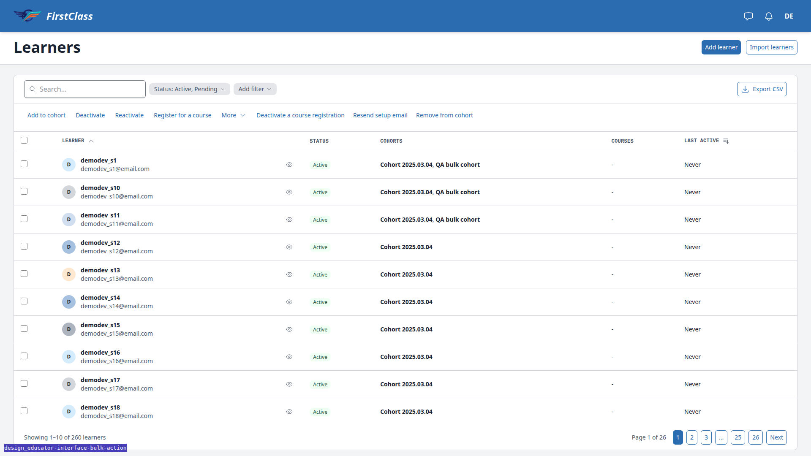
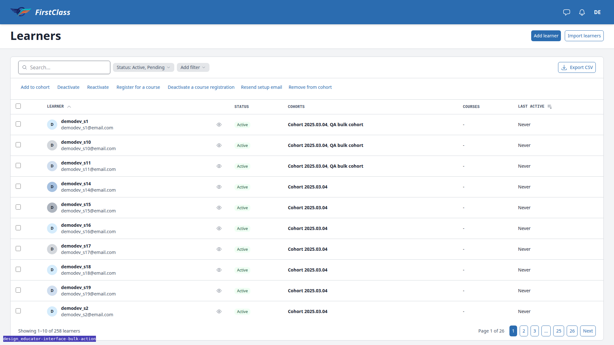

# Frontend QA report: the bulk-action selection bar, above the table

Test plan: `3. frontend_qa.md` (Tests 1 to 8: the bar replaces the toolbar on desktop; the More menu; select all, deselect all and clear; an action from the bar and the result; a background run; tablet and phone; JavaScript off; what else the change touches).

## Methodology

Playwright MCP by hand at 1920x1080 (desktop), 768x1024 (tablet) and 375x812 (mobile), plus a JavaScript-off browser context for Test 7. Screenshots were collected into `screenshots/` beside this report, and every referenced image exists there.

## Diff scoping

Class: **FULL**. Changed files that triggered it:

- `freedom_ls/base/templates/cotton/button.html`
- `freedom_ls/base/templates/cotton/dropdown-menu-separator.html`
- `freedom_ls/base/templates/cotton/dropdown-menu.html`
- `freedom_ls/panel_framework/bulk_actions.py`
- `freedom_ls/panel_framework/panels.py`
- `freedom_ls/panel_framework/static/panel_framework/js/alpine-components.js`
- `freedom_ls/panel_framework/templates/cotton/data-table.html`
- `freedom_ls/panel_framework/templates/panel_framework/panels/_data_table_region_base.html`
- `freedom_ls/panel_framework/templates/panel_framework/partials/table_footer.html`
- `freedom_ls/panel_framework/templates/panel_framework/partials/table_selection_bar.html`
- `freedom_ls/panel_framework/templates/panel_framework/partials/table_toolbar.html`
- `tailwind.components.css`
- tests and spec_dd files

Skipped: nothing. Everything ran.

## Smoke gate

Outcome: **pass**. Pages checked: `/`, `/educator/organisations/demodev/learners/`. No failure URL or reason.

## Design check

| Test | Viewport | This run | Design | Result |
|---|---|---|---|---|
| 1.2-design | desktop | [screenshot](screenshots/page-2026-11-09T15-45-27-131Z.png) | [design](design_screenshots/educator-learners__02b-bulk-selection.png) | pass |
| 4.5-design | desktop | [screenshot](screenshots/page-2026-11-09T15-47-43-088Z.png) | [design](design_screenshots/educator-learners__02d-bulk-result.png) | pass |

## B1: Inert 'More' trigger shows in the selection bar with JavaScript off

Manifestations:

- Test 7.1, desktop

**Expected:** With JavaScript off the bar holds only action submit buttons: the promoted actions and the More actions as plain buttons (the `<noscript>` fallback). No control that needs JavaScript.

**Actual:** The `<c-dropdown-menu>` trigger button "More" with its chevron renders beside the noscript buttons. Clicking it does nothing because the menu opens through Alpine. The dropdown panel itself stays hidden (inline `display:none`). The same structure exists on main (pre-existing).

## Layout probe

| Test | Viewport | URL | Screenshot | Result |
|---|---|---|---|---|
| 1.1 | desktop | /educator/organisations/demodev/learners/ | [shot](screenshots/page-2026-11-09T15-44-39-328Z.png) | clean |
| 1.3 | desktop | /educator/organisations/demodev/learners/ | [shot](screenshots/page-2026-11-09T15-44-51-106Z.png) | clean |
| 2.5 | desktop | /educator/organisations/demodev/cohorts/ | [shot](screenshots/page-2026-11-09T15-45-49-706Z.png) | clean |
| 4.3 | desktop | /educator/organisations/demodev/learners/ | [shot](screenshots/page-2026-11-09T15-47-43-088Z.png) | clean |
| 8.1 | desktop | /educator/organisations/demodev/audit-log/ | [shot](screenshots/page-2026-11-09T15-48-14-692Z.png) | clean |
| 6.1 | tablet | /educator/organisations/demodev/learners/ | [shot](screenshots/page-2026-11-09T15-50-15-656Z.png) | clean |
| 6.4 | mobile | /educator/organisations/demodev/learners/ | [shot](screenshots/page-2026-11-09T15-52-31-692Z.png) | clean |

## Data changes

| What changed | Agent / command |
|---|---|
| Seeded the empty dev DB: create_demo_data (DemoDev site, QA user, organisation demodev with 50 learners), site_admin and organisation_admin roles for the QA user, cohort "QA bulk cohort" with demodev_s1. | sdd:qa-data-helper |
| Added 210 active learners qa_bulk_001..qa_bulk_210 to organisation demodev (260 total) so a bulk run crosses BULK_BACKGROUND_THRESHOLD (250) for Test 5. | sdd:qa-data-helper |
| Added demodev_s10 and demodev_s11 to "QA bulk cohort" through the bar's Add to cohort action. | Test 4 (the feature under test) |
| Deactivated demodev_s12 and demodev_s13 through the JavaScript-off bulk Deactivate. | Test 7 (the feature under test) |

## Bug status

| Bug | Title | Status |
|---|---|---|
| B1 | Inert 'More' trigger shows in the selection bar with JavaScript off | **FIXED** (commit: 001ac0d46) |
| — | **UNRESOLVED** — full run after the fixes left tests failing | reason: `freedom_ls/learner_interface/tests/views/test_dashboard.py::test_in_progress_query_count_does_not_grow_with_cards_carrying_deadlines` (71 queries, limit 70). It fails the same way on `main` (14b45c4d8) and passed in this branch's full run an hour earlier; nothing on this branch touches `learner_interface`, so it looks date-dependent and pre-existing. |

Re-verified in the browser after the fix: with JavaScript off the bar holds only the seven action buttons (); with JavaScript on, More still sits after "Register for a course" and opens Deactivate a course registration, Resend setup email, Remove from cohort ().

## Results by test

| Test | Viewport | Result | Notes |
|---|---|---|---|
| 1.1 | desktop | pass | Toolbar above the table, no bar, footer "Showing 1-10 of 50 learners" left and pager right. Table top 245px. Learners table pages at 10 here, not 25 as the plan assumed. |
| 1.3 | desktop | pass | Ticking a row hides the search field; bar reads "1 selected" in the toolbar's row; table top still 245px. Order: checkbox (indeterminate), "1 selected", "Select all 50" (btn-link), Add to cohort, Deactivate, Reactivate, Register for a course (btn-ghost), More with chevron (btn-ghost), Clear with x alone at the right edge. No outline or fill on actions, More or Clear. |
| 1.6 | desktop | pass | Clicking the Learner sort header re-sorts (?learners-sort=-user__first_name), clears the selection and brings the toolbar back. |
| 1.7 | desktop | pass | Two rows: "2 selected", bar and header checkboxes both indeterminate. Header checkbox: "10 selected" (page size 10), both checked. Untick one: "9 selected", both indeterminate. |
| 1.8 | desktop | pass | Clear hides the bar, toolbar returns, table top 245px, focus on the header "Select all on this page" checkbox. Space ticks all 10 and the bar returns; Space again clears and the bar goes. |
| 2.1 | desktop | pass | Menu opens below More (menu top 231, trigger bottom 222): Deactivate a course registration, Resend setup email, separator, Remove from cohort in error red rgb(210,51,25). No icons, no helper lines. |
| 2.2 | desktop | pass | ArrowDown moves More -> Deactivate a course registration -> Resend setup email -> Remove from cohort -> wraps; the rule is skipped. Escape closes the menu and focus returns to More. |
| 2.3 | desktop | pass | Remove from cohort opens "Remove from cohort?" in the app modal with a cohort select (Cohort 2025.03.04, Cohort 2025.04.06, QA bulk cohort), "1 learner selected.", Cancel and Remove from cohort. Cancelled. ([shot](screenshots/page-2026-11-09T15-45-44-127Z.png)) |
| 2.5 | desktop | pass | Cohorts with one ticked: four text buttons (Register for a course, Deactivate a course registration, Deactivate, Reactivate), no More, Clear at right. |
| 3.1 | desktop | pass | Tick one, "Select all 50": "50 selected", link "Deselect all", note "Changing page, sort or filters clears the selection." visible (after the fade settles), both page checkboxes checked, mode all_matching. |
| 3.2 | desktop | pass | Untick one: "49 selected", link "Select all 50", both page checkboxes indeterminate, note still showing. "Select all 50" re-ticks the row: "50 selected". |
| 3.3 | desktop | pass | "Deselect all" hides the bar, toolbar back, no row ticked, mode keys, focus on the header "Select all on this page" checkbox. |
| 3.4 | desktop | pass | Tick, Select all, Clear, tick one: "1 selected", link "Select all 50", mode keys. A first read straight after the clicks caught the bar mid-fade; re-checked with waits and at click speed, the bar shows. |
| 3.5 | desktop | pass | Search "demodev_s5" -> 2 learners on one page. "Select all 2" ticks both: "2 selected", link "Deselect all", no "Changing page" note, mode stays keys. |
| 3.6 | desktop | pass | With Select all active, clicking page 2 loads ?learners-page=2 with the selection cleared, mode keys and the toolbar back. |
| 4.1 | desktop | pass | Ticked demodev_s10 and demodev_s11, "Add to cohort" opens "Add to cohort?" with the cohort picker and "2 learners selected."; chose QA bulk cohort and confirmed. Table top 245px while the bar showed. |
| 4.2 | desktop | pass | Result in the modal: "2 learners changed." with Close. |
| 4.3 | desktop | pass | After Close: table refreshed, no row or header checkbox checked, no bar, toolbar back, footer "Showing 1-10 of 50 learners" with pager. Table top 245px. |
| 4.4 | desktop | pass | The refreshed table lists demodev_s10 and demodev_s11 in "Cohort 2025.03.04, QA bulk cohort", read from the database on the refresh. |
| 5.1 | desktop | pass | 260 learners (threshold 250). Tick, "Select all 260", More > Resend setup email: confirmation "Resend the setup email to 260 learners? ... It runs in the background." Confirmed. |
| 5.2 | desktop | pass | While running (sampled ~2s): bar reads "Resend setup email is running..." with the spinner, action fieldset (buttons and More) hidden, bar checkbox, Select all and Clear disabled, every row checkbox disabled. |
| 5.3 | desktop | pass | Result modal "0 learners changed. 260 accounts were already set up." After Close: no bar, toolbar back, no selection checkbox checked or disabled, table top 245px. A sample taken as the run ended caught the spinner mid-fade; Alpine's running was false and the wrapper display:none once settled. ([shot](screenshots/page-2026-11-09T15-49-46-100Z.png)) |
| 6.1 | tablet | pass | 768: toolbar stays visible; bar position:fixed at the bottom (927-1024) with checkbox, "1 selected", "Select all 260", the four actions, More, Clear at the right. No sideways scroll (scrollWidth 768). The dev-only branch badge (#debug-branch-badge, fixed bottom-left) draws over the bar's first actions; dev tooling only, hidden for later shots. |
| 6.2 | tablet | pass | Scrolled to the end: the last row's checkbox is the topmost element at its centre, and the pager (Page 1 of 26 ... Next) sits fully above the bar; [data-selection-bar-space] is 97px = the bar's height. ([shot](screenshots/page-2026-11-09T15-50-27-114Z.png)) |
| 2.4 | tablet | pass | 768: More opens its menu above the trigger (834-971 in a 1024 viewport), whole menu including Remove from cohort inside the viewport. ([shot](screenshots/page-qa-2-4-tablet-more.png)) |
| 6.3 | tablet | pass | Clear: bar gone, [data-selection-bar-space] height 0, region ends at the footer (no empty band). Focus on the header "Select all on this page" checkbox. ([shot](screenshots/page-2026-11-09T15-50-39-563Z.png)) |
| 8.3 | tablet | pass | 768 (toolbar visible beside the bar): unticking the Pending status filter with a row ticked reloads ?learners-status=active with the selection cleared and the bar gone; typing "demodev_s1" in search with a row ticked does the same. |
| 6.4 | mobile | pass | 375: card ticked, bar fixed at the bottom (587-812). Left group wraps onto four rows (checkbox/count/Select all 260; Add to cohort, Deactivate; Reactivate, Register for a course; More); Clear stays at the end of the first row. Every control inside the viewport; scrollWidth 375. The bar is 225px tall at this width. |
| 2.4 | mobile | pass | 375: More's menu at 9-263 x 610-747 in a 375x812 viewport, whole menu inside, opening above the trigger. ([shot](screenshots/page-qa-6-5-phone-more.png)) |
| 6.5 | mobile | pass | More's menu stays inside the viewport at 375; Escape closes it. ([shot](screenshots/page-qa-6-5-phone-more.png)) |
| 6.6 | mobile | pass | Scrolled to the end: last card's checkbox (top 242) and the pager's Next (top 441) are the topmost elements at their centres, above the bar (top 587). ([shot](screenshots/page-qa-6-6-phone-end.png)) |
| 6.7 | mobile | pass | Clear: focus on the visible "Select all on this page" checkbox above the cards (not the hidden thead one, not in the bar). |
| 6.8 | mobile | pass | Tick a card, "Select all 260", "Deselect all": bar hidden, focus on the same visible "Select all on this page" checkbox. |
| 6.9 | mobile | pass | With a card ticked every bar control's box is within 0..375 x 0..812; scrollWidth 375 <= innerWidth 375. |
| 7.1 | desktop | **fail** | JavaScript off at 1920: the bar is visible between the toolbar and the table with no checkbox, count, Select all or Clear, and the promoted actions plus the noscript fallback buttons (Deactivate a course registration, Resend setup email, Remove from cohort). But the dropdown's "More" trigger button (btn btn-ghost, chevron) also renders and is inert without Alpine. Same structure on main (pre-existing). See B1. ([shot](screenshots/page-qa-7-1-nojs.png)) |
| 7.2 | desktop | pass | JavaScript off: ticked demodev_s12 and demodev_s13, "Deactivate" posts to /learners/__actions/deactivate with a full-page confirmation "Deactivate 2 learners. They lose access..."; confirming returns to the list with the flash "2 learners changed." ([result](screenshots/page-qa-7-2-nojs-result.png), [confirm](screenshots/page-qa-7-2-nojs-confirm.png)) |
| 7.3 | mobile | pass | JavaScript off at 375: the bar is fixed at the bottom (top 595); scrolled to the end, the last card's checkbox (top 467) is not covered. Recorded as accepted behaviour either way. ([shot](screenshots/page-qa-7-3-nojs-phone.png)) |
| 8.1 | desktop | pass | Audit log (no bulk actions): footer "3 entries" (one page, so no pager), no selection bar, no [data-selection-bar-space], toolbar (Add filter, Export CSV) unchanged. |
| 8.2 | desktop | pass | The learners table has no row menu; its row action is the quick view. With two rows ticked, "Quick view: demodev_s12" opens the quick-view sheet and the selection stays "2 selected"; closing it keeps both rows ticked and the bar showing. |
| 8.3 | desktop | pass | Sorting with rows selected clears the selection and brings the toolbar back (see 1.6). From lg up search and filters are hidden while the bar shows, so search/filter clearing is checked at tablet. |
| 8.4 | desktop | pass | Space ticks a focused row. Shift+Tab from the row goes thead (Last active, Learner, Select all on this page), the table's scroll region, then the bar right to left: Clear, More actions, Register for a course, Reactivate, Deactivate, Add to cohort, Select all, Select page. The bar sits in Tab order between the toolbar's place and the table, in visual order. |
| 8.5 | desktop | pass | With one row ticked the table region holds exactly one [role=status] (accessibility tree: status "1 selected"), outside the bar. The bar's count is a plain span with no role or aria-live. |
| 8.6 | desktop | pass | The project has no dark theme (no prefers-color-scheme rules in the theme CSS), so prefers-color-scheme: dark leaves the page light. The bar (bg-surface), menu rule (border-border) and red item (text-error) all use theme tokens; nothing hard-coded. ([shot](screenshots/page-2026-11-09T15-48-56-948Z.png)) |

## General notes

- The learners table pages at 10, not 25 as the plan assumed.
- The bar is 225px tall at 375 (about a quarter of the screen), by design.
- The dev-only branch badge (fixed bottom-left) overlaps the bar at 768 and was hidden for later screenshots.
- The project has no dark theme, so 8.6 only confirmed token use.
- Transient readings mid-fade were re-checked (3.4, 5.3).
- No console errors were logged.
- The learners table has no row menu, so 8.2 used the quick view.

status: ok · reason: 1 bug — 1 fixed, 0 unresolved; full run after the fix left 1 pre-existing failure (also fails on main); report rendered, screenshots verified
