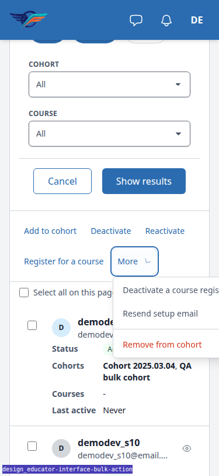

# Frontend QA report: educator interface bulk action

## Methodology

- Playwright MCP run against a fresh dev server on port 8243 (branch badge confirmed), logged in as the QA admin.
- Viewports: 1920x1080 (desktop), 375x812 (mobile), 768x1024 (tablet), plus a JavaScript-disabled browser context for Test 7.
- Screenshots were collected into `screenshots/` beside this report. Every referenced image exists there.
- Compression ran and found no PNG over 1024KB.
- Test plan: `3. frontend_qa.md` in this directory.

## Diff scoping

Class: FULL. Triggered by template, static, CSS and JS changes (panel_framework templates and `alpine-components.js`, the `dropdown-menu.html` and `button.html` cotton components, `tailwind.components.css`, plus `views.py`, `bulk_actions.py` and `educator_interface/actions.py`). Everything ran; nothing was skipped.

## Smoke gate

Status: pass. Pages checked: `/`, `/educator/organisations/demodev/learners/`, `/educator/organisations/demodev/cohorts/`. No failure URL or reason.

## Results by test

| Test | Viewport | Status | Notes | Screenshot |
|---|---|---|---|---|
| 1.1 | desktop | pass | Toolbar (search, Status chip, Add filter, Export CSV) on one row, no bar, footer "Showing 1–10 of 256 learners" with pager at right. Table pages at 10 here, not 25; counts adapted. | [shot](screenshots/page-2026-11-10T12-43-42-229Z.png) |
| 1.3-1.5 | desktop | pass | Ticking a row hides the toolbar; bar reads "1 selected"; thead top stays at 245px. Order: indeterminate checkbox, count, Select all 256 (btn-link), Add to cohort, Deactivate, Reactivate, Register for a course (btn-ghost), More + chevron, Clear alone at right edge. No outline or fill on actions. | [shot](screenshots/page-2026-11-10T12-43-56-056Z.png) |
| 1.6-1.8 | desktop | pass | Sort clears selection and returns toolbar. Two rows: "2 selected", header and bar checkbox both indeterminate. Header checkbox selects 10 (page size), both checked; untick one: both indeterminate. Clear: toolbar back, thead top unchanged, focus on header checkbox; Space ticks the page and brings the bar back, Space again clears. | none |
| 2.1-2.3 | desktop | pass | More opens a menu below the trigger: Deactivate a course registration, Resend setup email, role=separator rule, Remove from cohort in red (rgb 210,51,25). No icons or helper lines. Chevron rotated 180deg while open. ArrowDown cycles the three items skipping the rule; Escape closes and returns focus to More. Remove from cohort opens the modal with a cohort picker; Cancel closes it. | [shot](screenshots/page-2026-11-10T12-44-15-372Z.png) |
| 2.3-dialog | desktop | pass | Remove from cohort confirmation in #app-modal with Cohort select, "1 learner selected.", Cancel left, Remove from cohort right. | [shot](screenshots/page-2026-11-10T12-44-32-148Z.png) |
| 2.5 | desktop | pass | Cohorts page: four text buttons (Register for a course, Deactivate a course registration, Deactivate, Reactivate); no More. | [shot](screenshots/page-2026-11-10T12-47-50-215Z.png) |
| 3.1-3.4,3.6 | desktop | pass | Select all 256 gives "256 selected", "Deselect all", muted note "Changing page, sort or filters clears the selection.", both page checkboxes checked. Untick one: 255 selected, "Select all 256", both indeterminate, note still shown; Select all re-ticks the row. Deselect all: bar gone, toolbar back, focus on header checkbox. Select all, Clear, tick one: "1 selected", "Select all 256", no note. Select all then page 2 clears selection. | [shot](screenshots/page-2026-11-10T12-46-37-323Z.png) |
| 3.5 | desktop | pass | Search "demodev_s5" (2 matches, one page): tick one, "Select all 2" ticks both, "2 selected", "Deselect all", no "Changing page..." note. | none |
| 4.1-4.4 | desktop | pass | Ticked demodev_s14 and demodev_s17, Add to cohort, chose QA bulk cohort, confirmed. Result modal "2 learners changed." in one text size (16px). After Close: no bar, toolbar back, no checkbox ticked, thead top unchanged (245), footer with count and pager; both learners list QA bulk cohort. | [shot](screenshots/page-2026-11-10T12-48-20-162Z.png) |
| 5.1-5.3 | desktop | pass | 256 learners > threshold 250. Select all, More > Resend setup email, confirm ("It runs in the background"). During the run the bar read "Resend setup email is running…" with a spinner, no action buttons or More, Deselect all and Clear disabled, every row and header checkbox disabled. Result: "0 learners changed." and "256 learners already set up.", no names, one text size. After Close: bar gone, toolbar back, nothing disabled. | [shot](screenshots/page-running-state.png) |
| 5.3-result | desktop | pass | Background run result modal, counts only. | [shot](screenshots/page-2026-11-10T12-48-55-084Z.png) |
| 8.1 | desktop | pass | Audit log (no bulk actions): no checkbox column, no bar, toolbar unchanged, footer "11 entries" directly under the table, no reserved space. | [shot](screenshots/page-2026-11-10T12-49-20-192Z.png) |
| 8.2 | desktop | pass | Learners rows have no row menu; Quick view used. With two rows selected, opening demodev_s11's quick view works and the selection stays at "2 selected" during and after. | [shot](screenshots/page-quickview-with-selection.png) |
| 8.3 | desktop | pass | Sorting (Last active) with rows selected clears selection and brings the toolbar back. Search and filter chips are hidden while rows are selected (by design); after Clear, typing a search reloads with no selection and the toolbar shown. | none |
| 8.4 | desktop | pass | With a row ticked, Shift+Tab from the table goes header checkbox, table scroll region, Clear, More actions, Register for a course, Reactivate, Deactivate, Add to cohort, Select all 256, Select page: the bar sits between the toolbar's place and the table, in visual order. | none |
| 8.5 | desktop | pass | Exactly one role=status in the table region, outside the bar, reading "1 selected"; the bar's visible count has no role or aria-live. | none |
| 8.6 | desktop | skip | The theme defines no dark mode (no prefers-color-scheme rules), so emulating dark leaves the light theme. Token use checked instead: separator border is the border token (rgb 209,213,219), destructive item is the error token (rgb 210,51,25), bar is bg-surface. | [shot](screenshots/page-2026-11-10T12-50-14-926Z.png) |
| 7.1-7.2 | desktop (JS off) | pass | Bar shows under the toolbar with only Add to cohort, Deactivate, Reactivate, Register for a course and More (no checkbox, count, Select all or Clear). More is a `
` panel with border and shadow, items Deactivate a course registration, Resend setup email, a rule, Remove from cohort in error red; chevron rotated 180deg while open. | [shot](screenshots/page-nojs-more-open.png) |
| 7.3 | desktop (JS off) | pass | Ticked demodev_s18 and demodev_s19, pressed Deactivate: confirmation at `/__actions/deactivate` renders the list with an open `<dialog>`: header "Deactivate 2 learners?" with close, body, footer Cancel left and Deactivate right. Confirming returned to the list with flash "2 learners changed." | [shot](screenshots/page-nojs-confirm.png) |
| 7.4 | mobile (JS off) | FAIL | Closed, the bar's buttons wrap tidily with scrollWidth 375. Opening More, the `
` panel opens left-aligned (left 194px) and runs to 448px: "Deactivate a course registration" is cut off and document scrollWidth grows to 449 > 375. See Bug B1. | [shot](screenshots/page-nojs-mobile-more.png) |
| 6.5,6.9 | mobile | pass | Ticking the first card: toolbar hidden, bar above the cards. Left group wraps (checkbox + "1 selected", Select all 254, Add to cohort/Deactivate, Reactivate, Register for a course, More) while Clear stays at the end of the first row. Every control within 0-375, 44px touch targets, scrollWidth 375. Wrapped bar is 305px tall. | [shot](screenshots/page-2026-11-10T12-51-42-238Z.png) |
| 2.4,6.6 | mobile | pass | More menu opens below the trigger at x 9-263, all three items and the rule inside the viewport; scrollWidth 375. Scrolled to the end, More opens at y 369-506, inside the viewport. | [shot](screenshots/page-mobile-more-open.png) |
| 6.6-scroll | mobile | pass | Scrolled to bottom: bar stuck at top 68 = site header bottom; pager Next at y 666-710 clickable. | [shot](screenshots/page-mobile-scrolled.png) |
| 6.7-6.8 | mobile | pass | Clear moves focus to the visible "Select all on this page" checkbox; Select all 254 then Deselect all moves focus to the same checkbox. | none |
| 6.1 | tablet | pass | Before selection the toolbar is one row: Search (234px), Status chip, Add filter, Export CSV. | [shot](screenshots/page-tablet-toolbar.png) |
| 6.2 | tablet | pass | Ticking a row: toolbar hidden, bar in its place with the same contents; Clear at the right of the first row. Bar contents need two rows at 768 (97px vs toolbar 67px), so table top moves down 30px; the no-move rule holds from lg. | [shot](screenshots/page-2026-11-10T12-52-37-307Z.png) |
| 6.3-6.4 | tablet | pass | Scrolled to end: bar stuck at top 76 = header bottom; pager Next clickable. More: chevron rotate 180deg while open, none once closed; menu at x 328-582, y 169-306, inside 768x1024. Clear: bar gone, toolbar back, focus on header checkbox, space under the table is the same 66px footer as before (no empty band). | [shot](screenshots/page-tablet-more.png) |

## Design check

| Test | Viewport | This run | Design | Result |
|---|---|---|---|---|
| 4.2-design | desktop | [shot](screenshots/page-2026-11-10T12-48-31-945Z.png) | [educator-learners__02d-bulk-result.png](design_screenshots/educator-learners__02d-bulk-result.png) | pass |
| 1.2-design | mobile | [shot](screenshots/page-mobile-more-open.png) | [educator-learners__02b-bulk-selection.png](design_screenshots/educator-learners__02b-bulk-selection.png) | pass |
| 1.2-design | tablet | [shot](screenshots/page-tablet-more.png) | [educator-learners__02b-bulk-selection.png](design_screenshots/educator-learners__02b-bulk-selection.png) | pass |
| 1.2-design | desktop | [shot](screenshots/page-2026-11-10T12-44-15-372Z.png) | [educator-learners__02b-bulk-selection.png](design_screenshots/educator-learners__02b-bulk-selection.png) | pass |

## Bug B1: No-JS More menu overflows the viewport at 375px

Manifestations: Test 7.4, mobile (JavaScript off).

- Expected: With JavaScript off at 375px, the bar's More `
` panel opens inside the viewport (every item fully visible) and the document never scrolls sideways (scrollWidth <= innerWidth), per requirement 10 and Test 7.4.
- Actual: The panel opens left-aligned under the More trigger (left 194px) and is about 254px wide, so it runs to 448px. "Deactivate a course registration" is cut off at the right edge and `document.documentElement.scrollWidth` becomes 449 > 375.

## Layout probe

| Test | Viewport | URL | Screenshot | Result |
|---|---|---|---|---|
| 1.1 | desktop | /educator/organisations/demodev/learners/ | [shot](screenshots/page-2026-11-10T12-43-42-229Z.png) | clean |
| 1.3 | desktop | /educator/organisations/demodev/learners/ | [shot](screenshots/page-2026-11-10T12-43-56-056Z.png) | clean |
| 2.5 | desktop | /educator/organisations/demodev/cohorts/ | [shot](screenshots/page-2026-11-10T12-47-50-215Z.png) | clean |
| 4.3 | desktop | /educator/organisations/demodev/learners/ | [shot](screenshots/page-2026-11-10T12-48-31-945Z.png) | clean |
| 8.1 | desktop | /educator/organisations/demodev/audit-log/ | [shot](screenshots/page-2026-11-10T12-49-20-192Z.png) | clean |
| 7.4 | mobile | /educator/organisations/demodev/learners/ (JS off, More open) | [shot](screenshots/page-nojs-mobile-more.png) | document scrollWidth 449 > viewport 375 with the no-JS More panel open; panel right edge 448px |
| 6.5 | mobile | /educator/organisations/demodev/learners/ | [shot](screenshots/page-2026-11-10T12-51-42-238Z.png) | clean |
| 6.2 | tablet | /educator/organisations/demodev/learners/ | [shot](screenshots/page-2026-11-10T12-52-37-307Z.png) | clean |

## Data changes

| Via | What |
|---|---|
| The QA run itself (bulk actions under test) | Added demodev_s14 and demodev_s17 to QA bulk cohort (Test 4); deactivated demodev_s18 and demodev_s19 (Test 7.3); Resend setup email run over 256 learners changed nothing (all already set up). |

## Bug status

- **UNRESOLVED** — No-JS More menu overflows the viewport at 375px (reason: the fix attempt, commit d2e8e9991, kept the panel inside 375px but crushed it to about 42px wide from `md` up, because its `max-w-[calc(100%-2rem)]` resolves against the narrow `
` there; re-verification failed and the commit was reverted in ab80c5092)

## General notes

- The learners table pages at 10 rows in this environment, not 25 as the plan's setup assumed; tests were adapted (a full page is 10 selected).
- Learners rows have no row menu; Test 8.2 used the Quick view link instead.
- The search field and filter chips are hidden while rows are selected (by design), so "filtering with rows selected" can only be reached by sort or page change; sort and page change both clear the selection.
- Dark mode (8.6) not run: the theme defines no dark mode.
- At 375px the wrapped selection bar is about 305px tall and, being sticky, covers roughly 40% of an 812px viewport while scrolling; this matches the spec (left group wraps, sticky at every width) but is worth a look.
- At 768px the bar's contents need two rows, so the table top moves down 30px when the bar replaces the toolbar; the no-move rule is drawn at lg and holds there.
- With JavaScript off at 375, the filter panel renders expanded above the bar (pre-existing no-JS behaviour, not part of this change). With JS off the educator sidebar is not shown at desktop (pre-existing).
- Some screenshots have descriptive names (page-nojs-*.png, page-tablet-*.png, page-mobile-*.png, page-running-state.png, page-quickview-with-selection.png) because they were taken from a Playwright code snippet in a second browser context or mid-flow.
- Two stale console-*.log files from earlier sessions were moved into screenshots/ along with the screenshots.

status: ok · reason: 1 bug — 0 fixed, 1 unresolved (fix attempt reverted after re-verification failed); report rendered, screenshots verified
