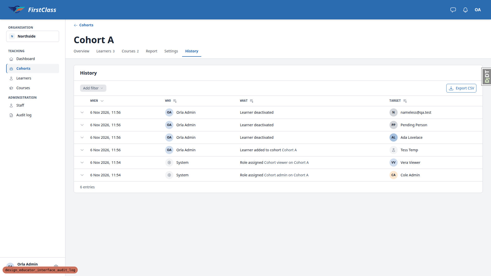
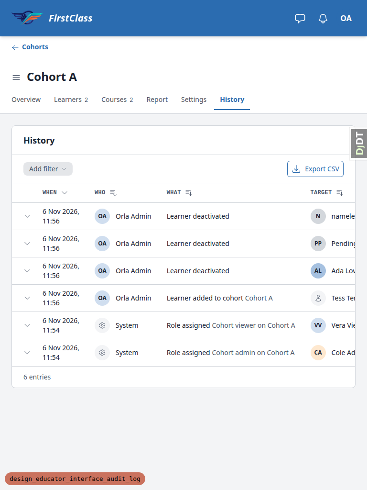
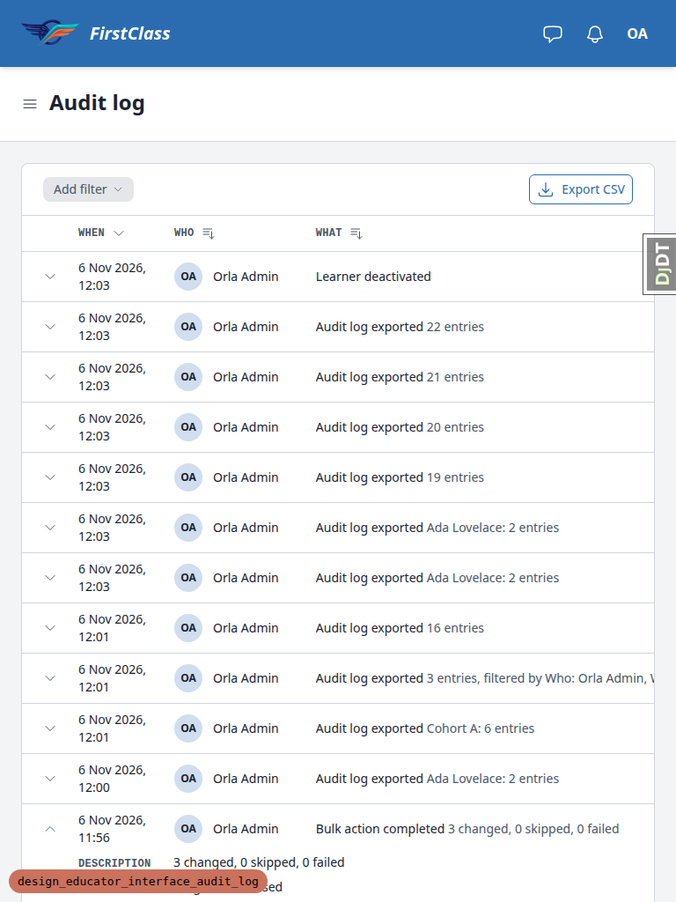
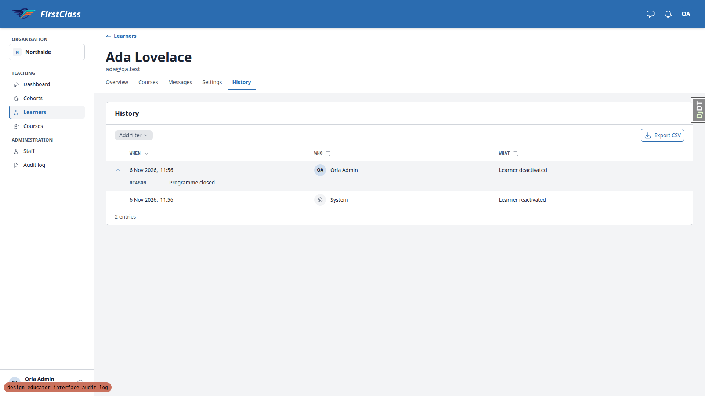
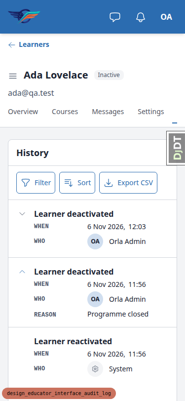

# Frontend QA report: educator audit log avatars, export and expandable rows

Run date: 2026-11-06. Branch: `design_educator_interface_audit_log`. Dev server: port 8466.

## Summary

- 22 test records: 20 pass, 2 fail.
  - Desktop (1920x1080): 17 tests, 16 pass, 1 fail (5.3).
  - Mobile (375x812): 3 tests, 3 pass, 0 fail.
  - Tablet (768x1024): 2 tests, 1 pass, 1 fail (8.5-cohort-audit).
- Design check: 8 rows, all with misses (6 are the deliberate commit 22cd0717e redesign, 2 add the tablet When wrap).
- 3 bugs documented: B1 (avatar colour mismatch), B2 (When cell wraps at 768px), B3 (spec and plan out of date after 22cd0717e).

## Methodology

- Playwright MCP at three viewports: 1920x1080 (desktop), 375x812 (mobile), 768x1024 (tablet).
- Screenshots were collected into `screenshots/` beside this report, and every image referenced here exists in that directory.
- CSV exports were read with an in-page `fetch` from the logged-in page.
- The DB was wiped and re-seeded per §0 of the plan (see General notes: the dev DB held residue from the previous run, and audit entries are append-only).
- Before the run the branch was rebased onto main (22 commits replayed, one date conflict in `docs/product/roadmap.md`, 12255 tests passed, pushed). The rebase helper's separate front-end check was folded into this run because its page list is this plan's pages at the same three viewports.

## Diff scoping

- Class: **FULL**.
- Trigger: templates/, static/ and .html/.css/.js paths changed.
- Changed non-spec files:
  - `.claude/agent-memory/sdd-qa-data-helper/MEMORY.md`
  - `.claude/agent-memory/sdd-qa-data-helper/reference_audit_log_history_command.md`
  - `claude_plugins/fls-dev/skills/alpine-js/SKILL.md`
  - `claude_plugins/fls-dev/skills/domain-glossary/SKILL.md`
  - `docs/product/educator-interface.md`
  - `docs/product/roadmap.md`
  - `freedom_ls/audit_log/README.md`
  - `freedom_ls/audit_log/actions.py`
  - `freedom_ls/audit_log/models.py`
  - `freedom_ls/audit_log/tests/invariants/test_vocabulary.py`
  - `freedom_ls/audit_log/tests/test_actions.py`
  - `freedom_ls/educator_interface/templates/educator_interface/data-table-cells/audit_details.html`
  - `freedom_ls/educator_interface/templates/educator_interface/data-table-cells/audit_target.html`
  - `freedom_ls/educator_interface/templates/educator_interface/data-table-cells/audit_what.html`
  - `freedom_ls/educator_interface/templates/educator_interface/data-table-cells/audit_who.html`
  - `freedom_ls/educator_interface/templates/educator_interface/partials/audit_log_card.html`
  - `freedom_ls/educator_interface/templates/educator_interface/partials/audit_log_card_targeted.html`
  - `freedom_ls/educator_interface/templates/educator_interface/partials/audit_person.html`
  - `freedom_ls/educator_interface/templates/educator_interface/partials/audit_row_detail.html`
  - `freedom_ls/educator_interface/tests/playwright/test_learner_page_flow.py`
  - `freedom_ls/educator_interface/tests/test_views.py`
  - `freedom_ls/educator_interface/views.py`
  - `freedom_ls/panel_framework/panels.py`
  - `freedom_ls/panel_framework/static/panel_framework/js/alpine-components.js`
  - `freedom_ls/panel_framework/tables.py`
  - `freedom_ls/panel_framework/templates/cotton/data-table-card.html`
  - `freedom_ls/panel_framework/templates/cotton/data-table.html`
  - `freedom_ls/panel_framework/templates/panel_framework/panels/_data_table_region_base.html`
  - `freedom_ls/panel_framework/templates/panel_framework/partials/table_toolbar.html`
  - `freedom_ls/panel_framework/tests/components/test_data_table.py`
  - `freedom_ls/panel_framework/tests/playwright/test_data_table_flow.py`
  - `freedom_ls/panel_framework/tests/stub_panels.py`
  - `freedom_ls/panel_framework/tests/templates/panel_framework/test_row_detail.html`
  - `freedom_ls/panel_framework/tests/test_panels.py`
  - `freedom_ls/panel_framework/tests/test_tables.py`
  - `freedom_ls/panel_framework/views.py`
  - `freedom_ls/qa_helpers/management/commands/qa_create_audit_log_history.py`
  - `tailwind.components.css`
- spec_dd/ files also changed (71 paths in total).
- Everything ran: desktop, mobile and tablet. Nothing was skipped.

## Smoke gate

Outcome: **pass**. Pages checked:

- `http://127.0.0.1:8466/`
- `http://127.0.0.1:8466/educator/organisations/northside/learners/<Ada>/__tabs/history`

## Results

| Test | Viewport | Status | Screenshot | Note |
|---|---|---|---|---|
| 1.1-1.8 | desktop | pass | [link](screenshots/page-2026-11-06T11-58-54-877Z.png) | Ada History: headers When/Who/What plus hidden header (now "Details", leading). Newest first. Hover tint, chevron opens and closes detail (REASON "Programme closed"), tab switch closes rows, system row has no toggle. Only differences from the plan are the 22cd0717e redesign. |
| 2.1-2.3 | desktop | pass | [link](screenshots/page-2026-11-06T11-59-20-587Z.png) | Tab order reaches the chevron with a visible focus ring. Enter opens, Space closes, aria-expanded and aria-controls present, closed detail absent from the accessibility tree. |
| 3.1-3.4 | desktop | pass | [link](screenshots/page-2026-11-06T11-59-33-155Z.png) | System row neutral cog circle plus "System". Deleted actor "Gone Person" neutral user circle, reason "=1+1" shown as plain text. Rae Removed and nameless learner Histories render. |
| 4.1-4.5 | desktop | pass | [link](screenshots/page-2026-11-06T12-00-23-649Z.png) | Learner History CSV export: 200, text/csv, attachment filename, UTF-8 BOM, expected header, 2 rows matching the screen. No `audit_log.exported` row in the learner History. Audit log gained "Audit log exported" (Ada Lovelace: 2 entries). When values carry microseconds, still ISO 8601 with offset. |
| 5.1-5.2 | desktop | pass | [link](screenshots/page-2026-11-06T12-00-46-383Z.png) | Cohort A History columns and rows correct, including nameless/Pending/Ada initials circles and Tess Temp's neutral circle, plus two role.assigned rows. |
| 5.3 | desktop | fail | [link](screenshots/page-2026-11-06T12-00-46-383Z.png) | Ada's avatar colour differs between learners list and Cohort A History (see B1). |
| 5.4 | desktop | pass | none | `<b>Cohort B</b>` rendered literally; zero `<b>` elements in the table. |
| 5.5 | desktop | pass | none | Cohort A export: BOM, 6 rows, no Ben Brown or Cohort B rows. Audit log gained "Cohort A: 6 entries". |
| 6.1-6.3 | desktop | pass | [link](screenshots/page-2026-11-06T12-01-23-862Z.png) | Add filter and Export CSV in one toolbar row. Bulk run is one row ("3 changed, 0 skipped, 0 failed"). Detail shows DESCRIPTION, REASON and ENTRIES with three lines, no "and N more". |
| 6.4-6.5 | desktop | pass | [link](screenshots/page-2026-11-06T12-01-36-135Z.png) | Filter chips, empty state with Clear filters, Export CSV keeps filters. Filtered export has exactly the three per-object deactivations sharing a run id. |
| 6.6-6.7 | desktop | pass | none | Unfiltered export: 16 rows, including run id sharing, System and Gone Person rows, prior export entries, and no row for itself. Reload shows the export entries with and without filter description. |
| 7.1-7.2 | desktop | pass | none | cohort.admin and cohort.viewer get 404 on both export URLs and on audit-log; no Audit log nav entry. |
| 7.3-7.4 | desktop | pass | none | south.admin sees only the Southside entry; Southside export has just that row; Northside audit-log export 404. |
| 9.1 | desktop | pass | none | Repeated exports never contain their own entry; second org export includes the first's entry. |
| 9.2-9.3 | desktop | pass | none | `export=xlsx` gives 404 with no new entry. Invalid filter with `export=csv` gives 200 with all entries, recorded without "filtered by". |
| 9.4 | desktop | pass | [link](screenshots/page-2026-11-06T12-03-50-417Z.png) | 500-character reason: row stays 48px tall, detail wraps all 500 characters inside the panel, no page-level overflow. Deactivate action lives on the Settings tab, not the page header. |
| 8.6 | desktop | pass | none | Layout probe on Ada History, Cohort A History and Audit log: no horizontal overflow, header and content regions present, tallest visible row 49px. |
| 8.1-8.2 | mobile | pass | [link](screenshots/page-2026-11-06T12-04-13-886Z.png) | Cards with a leading 44x44 chevron and labelled WHEN/WHO rows; chevron opens and closes the REASON inline; system card has no chevron; Filter, Sort and Export CSV in one row; no horizontal overflow. |
| 8.3 | mobile | pass | [link](screenshots/page-2026-11-06T12-04-23-344Z.png) | Cohort A History: six labelled cards with WHEN, WHO, TARGET and initials circles; no empty labelled field; no overflow. |
| 8.4 | mobile | pass | [link](screenshots/page-2026-11-06T12-04-36-508Z.png) | Audit log toolbar fits one row with 44px controls; bulk-run card opens with all sections and three entry lines; no overflow, scrollWidth 375. |
| 8.5-learner | tablet | pass | [link](screenshots/page-2026-11-06T12-05-02-625Z.png) | Ada History at 768 is a table, three 49px one-line rows, no page-level horizontal scroll. |
| 8.5-cohort-audit | tablet | fail | [link](screenshots/page-2026-11-06T12-05-07-533Z.png) | Cohort A History and Audit log rows are 57px because the When cell wraps (see B2). Audit log screenshot: [link](screenshots/page-2026-11-06T12-05-11-262Z.png). |

## Design check

| Test | Viewport | This run's screenshot | Design screenshot | Result |
|---|---|---|---|---|
| 1.8-design | desktop | screenshots/page-2026-11-06T11-58-54-877Z.png | design_screenshots/educator-audit-history-v2__09-learner-history.png | Misses: toggle is the leading cell under hidden "Details" (plan: last cell, hidden "More"); open detail has no fill and is indented past the toggle column (plan: tinted full-width panel). Both deliberate in 22cd0717e, and the design screenshot draws a leading chevron. |
| 5.2-design | desktop | screenshots/page-2026-11-06T12-00-46-383Z.png | design_screenshots/educator-audit-history-v2__10-cohort-history.png | Misses inherited from §1: leading toggle under hidden "Details"; no tinted panel fill (22cd0717e). |
| 6.2-design | desktop | screenshots/page-2026-11-06T12-01-23-862Z.png | design_screenshots/educator-audit-history-v2__11-organization-audit-log.png | Misses inherited from §1 via §5: leading toggle under hidden "Details"; no tinted panel fill (22cd0717e). |
| 1.8-design | mobile | screenshots/page-2026-11-06T12-04-13-886Z.png | design_screenshots/educator-audit-history-v2__09-learner-history.png | Misses: on cards the chevron leads the card (plan: last); card detail opens inline as labelled rows with no tint (22cd0717e). |
| 5.2-design | mobile | screenshots/page-2026-11-06T12-04-23-344Z.png | design_screenshots/educator-audit-history-v2__10-cohort-history.png | Misses inherited from §1: leading chevron and untinted inline detail (22cd0717e). |
| 6.2-design | mobile | screenshots/page-2026-11-06T12-04-36-508Z.png | design_screenshots/educator-audit-history-v2__11-organization-audit-log.png | Misses inherited from §1 via §5: leading chevron and untinted inline detail (22cd0717e). |
| 5.2-design | tablet | screenshots/page-2026-11-06T12-05-07-533Z.png | design_screenshots/educator-audit-history-v2__10-cohort-history.png | Misses: at 768 the When cell wraps to two lines ("Every row is one line at md and up"; "When reads as date then time on one line"); plus inherited §1 leading chevron and untinted detail (22cd0717e). |
| 6.2-design | tablet | screenshots/page-2026-11-06T12-05-11-262Z.png | design_screenshots/educator-audit-history-v2__11-organization-audit-log.png | Misses: at 768 the When cell wraps to two lines; plus inherited §1 leading chevron and untinted detail (22cd0717e). |

## B1: A learner's avatar colour differs between the learners list and the audit screens

Lane: green.

Manifestations:

- Test 5.3, desktop.

**Expected:** Ada's initials circle on Cohort A's History (Target) is the same colour as on `/educator/organisations/northside/learners`, as §5.3 and the `audit_person.html` comment ("a person is the same colour here as in the learner and member tables") require.

**Actual:** Ada is `panel-avatar-3` on the learners list and `panel-avatar-5` on the audit screens; the nameless learner is 5 versus 2. `data-table-cells/learner.html` passes `user_id="{{ learner.pk }}"` (the Learner row pk) to `c-panel-person-link`, while `audit_person.html` (and the staff and member cells) pass the User pk. `avatar_slot` hashes whichever id it is given.

## B2: When cell wraps to two lines at 768px on History tables with a Target column

Lane: green.

Manifestations:

- Test 8.5-cohort-audit, tablet.
- Test 5.2-design, tablet.
- Test 6.2-design, tablet.

**Expected:** At md (768px) and up every audit row is one line and When reads date then time on one line (plan §8.5, §1 design checklist); the table may scroll inside its wrapper.

**Actual:** On Cohort A's History and the organisation Audit log at 768px every row is 57px: the When cell's `<time class="inline-flex flex-wrap gap-x-1.5">` wraps "6 Nov 2026," and "11:56" onto two lines. Ada's History (no Target column) stays one line (49px). Desktop is fine.

## B3: Spec and QA plan still describe the trailing "More" toggle, tinted detail panel and "More" card disclosure that commit 22cd0717e replaced

Lane: red (product decision: which is the intended design, the spec/plan wording or the 22cd0717e build; then update the other).

Manifestations:

- Test 1.8-design, desktop.
- Test 5.2-design, desktop.
- Test 6.2-design, desktop.
- Test 1.8-design, mobile.
- Test 5.2-design, mobile.
- Test 6.2-design, mobile.

**Expected:** Per spec §(row detail) line 71 and the QA plan's §1/§8 checklist: toggle in a trailing column under a visually hidden "More" header; opening reveals a tinted full-width panel; mobile cards end with a "More" disclosure.

**Actual:** Toggle is a leading chevron column under a visually hidden "Details" header; the open detail has no fill of its own and is indented past the toggle column; mobile cards lead with the same chevron and label When/Who/Target. This is the deliberate redesign in 22cd0717e and matches the design screenshot's leading chevron. Not a code defect: the spec and plan are out of date.

## Bug status

- **FIXED** (commit: 891a99f9a) — B1: A learner's avatar colour differs between the learners list and the audit screens. The learner table cell now keys the avatar on the user pk. Re-verified live: Ada is `panel-avatar-5` and the nameless learner and Pending Person are `panel-avatar-2` on both the learners list and Cohort A's History. The fixer noted that the attention-row and cohort-report avatars (`cohort_report_body_region.html`, `cohort_needs_attention_region.html`, `dashboard_region.html`) still key on the Learner pk through `FlaggedLearnerRow.learner_id`, so they can still differ.
- **FIXED** (commit: 4d7419c71) — B2: The When cell wraps to two lines at 768px on History tables with a Target column. The shared `panel_framework/partials/datetime.html` gains `md:flex-nowrap`. Re-verified at 768: every row on the Audit log, Cohort A History and Ada History is 49px. Spot checks found no regressions on Ada's Overview tab or the Cohorts list at 768, or on the mobile cards at 375.
- **UNRESOLVED** — B3: The spec and QA plan still describe the trailing "More" toggle, tinted detail panel and "More" card disclosure that 22cd0717e replaced (reason: product decision on which is intended, the spec/plan wording or the 22cd0717e build; then update the other)

## General notes

- Pre-run: the dev DB held the previous QA run's residue (9 `audit_log.exported` entries, Ada deactivated by the earlier §9.4 run). Audit entries are append-only, so the DB was wiped (DB drop, DB create, Migrate) and re-seeded from §0.2: `create_demo_data --yes`, `qa_create_learner_administration_scenario`, then entries 3-7 via sdd:qa-data-helper. Tess Temp's Learner delete first needed her two CourseProgress rows removed (ProtectedError).
- Commit 22cd0717e ("Audit log rows: leading accordion toggle, indented detail, labelled cards") deliberately changed the row detail after the spec and this QA plan were written. The toggle is now the leading cell under a visually hidden "Details" header (plan: trailing cell, hidden "More"). The open detail row has no fill of its own and is indented past the toggle column (plan: "tinted full-width panel"). Mobile cards lose the "More" disclosure in favour of the same chevron, and label When/Who/Target. The design screenshot 09-learner-history draws a leading chevron, so the build follows the design. Tests were run against the current behaviour; plan wording that contradicts it is recorded as a design miss and a plan/spec update decision (B3).
- CSV When values include microseconds (for example `2026-11-06T11:56:37.474829+00:00`) where the plan's example has none; still ISO 8601 with offset.
- §9.4 says "deactivate from the page header"; the Deactivate action lives on the learner's Settings tab, not the page header.
- At 375 wide the learner page's tab strip scrolls horizontally and the active History tab sits off-screen on load (the tab strip predates this branch).
- Every `c-panel-avatar-chip` emits its own `<style>` block (7 on Ada's History, one per avatar); harmless but repetitive, from the existing chip component.
- Browser console errors in `qa-screenshots/` come from stale tabs of earlier runs polling dead ports (8796, 8096, ...). This run's server (8466) logged only the deliberate 404 probes and a favicon 404.
- `qa-screenshots/` held stale files from earlier runs (Nov 3-5 snapshots/logs and three named PNGs); only this run's PNGs were collected.

status: ok
reason: 3 bugs — 2 fixed, 1 unresolved; report rendered, screenshots verified
