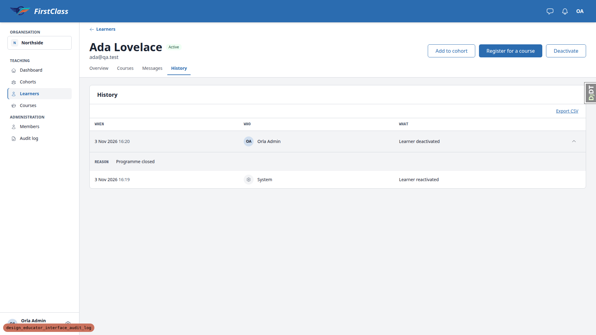
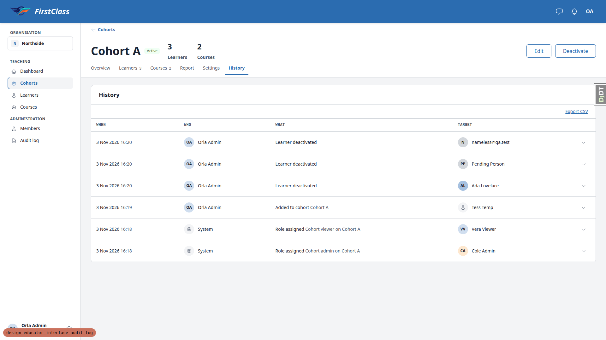
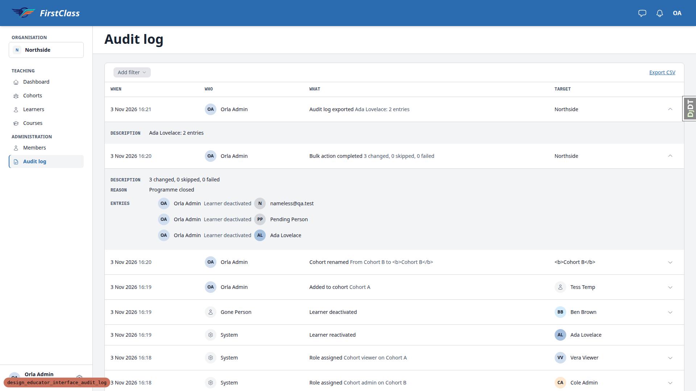
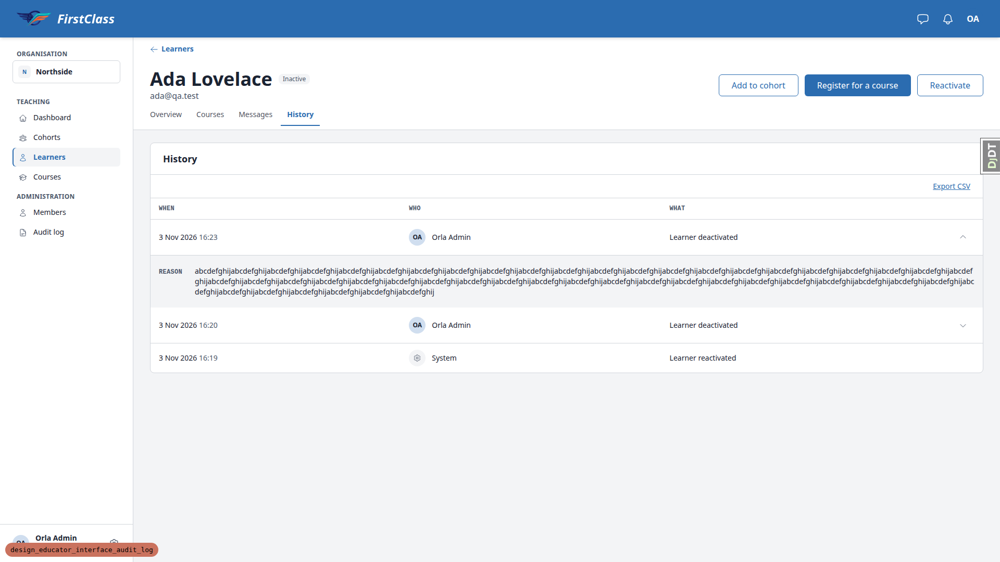
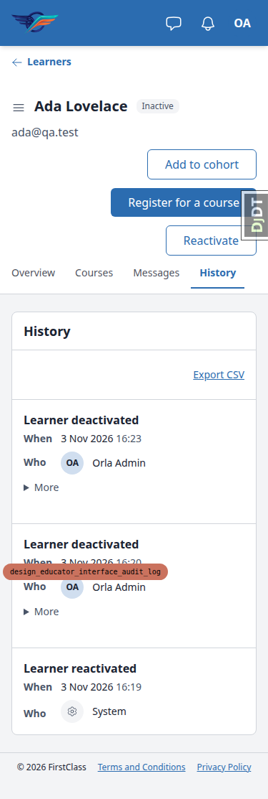
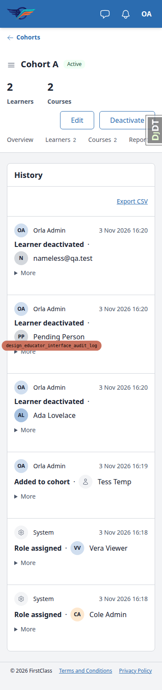
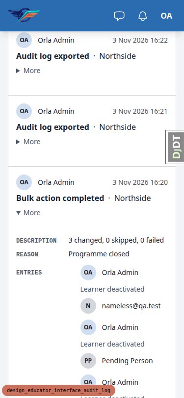
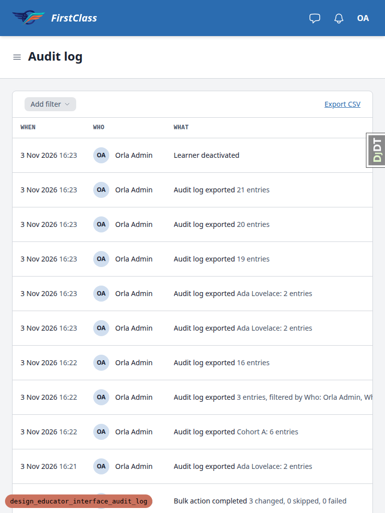

# Frontend QA report: design_educator_interface_audit_log

## Methodology

- Run on 2026-11-03 with Playwright MCP against a dev server on port 8858 serving branch `design_educator_interface_audit_log`.
- Logged in as `org.admin@qa.test`, plus `cohort.admin`, `cohort.viewer` and `south.admin` for §7.
- The dev DB was fully wiped and re-seeded per §0: `create_demo_data`, `qa_create_learner_administration_scenario`, then §0.2 items 3-7 via the qa-data-helper.
- Viewports: 1920x1080 (desktop), 375x812 (mobile), 768x1024 (tablet).
- CSV exports were fetched with `fetch()` from the logged-in page (same session cookie) rather than the network tool.
- Screenshots were collected into `screenshots/` beside this report, and every referenced image exists there.
- Before QA the branch was rebased onto main (35 upstream commits). Four additive conflicts were resolved in the import contracts, glossary, audit actions and vocabulary test. The full suite passed (11602 passed), pre-commit was clean, and the branch was pushed.
- The rebase helper's front-end check was folded into this run, because it would have visited the same pages at the same viewports. Console errors were checked. The only errors were deliberate 404 fetches and a favicon request on Django's 404 page.
- Upstream-change review: direction unchanged.

## Diff scoping

Class: **FULL**. Nothing was skipped.

Files that triggered it (template, static, css and js):

- `freedom_ls/educator_interface/templates/educator_interface/data-table-cells/audit_details.html`
- `freedom_ls/educator_interface/templates/educator_interface/data-table-cells/audit_target.html`
- `freedom_ls/educator_interface/templates/educator_interface/data-table-cells/audit_what.html`
- `freedom_ls/educator_interface/templates/educator_interface/data-table-cells/audit_when.html`
- `freedom_ls/educator_interface/templates/educator_interface/data-table-cells/audit_who.html`
- `freedom_ls/educator_interface/templates/educator_interface/partials/audit_log_card.html`
- `freedom_ls/educator_interface/templates/educator_interface/partials/audit_person.html`
- `freedom_ls/educator_interface/templates/educator_interface/partials/audit_row_detail.html`
- `freedom_ls/panel_framework/static/panel_framework/js/alpine-components.js`
- `freedom_ls/panel_framework/templates/cotton/data-table-card.html`
- `freedom_ls/panel_framework/templates/cotton/data-table.html`
- `freedom_ls/panel_framework/templates/panel_framework/panels/_data_table_region_base.html`
- `freedom_ls/panel_framework/templates/panel_framework/partials/table_toolbar.html`
- `freedom_ls/panel_framework/tests/templates/panel_framework/test_row_detail.html`
- `v2.dc.html`
- `progress/design_educator_interface_audit_log/design_source/Sidebar.dc.html`
- `progress/design_educator_interface_audit_log/design_source/_ds/first-class-design-system-3-019df673-15ac-7db6-b79d-fb4cdad66aad/_ds_bundle.js`
- `progress/design_educator_interface_audit_log/design_source/_ds/first-class-design-system-3-019df673-15ac-7db6-b79d-fb4cdad66aad/colors_and_type.css`
- `progress/design_educator_interface_audit_log/design_source/support.js`
- `tailwind.components.css`

## Smoke gate

Status: **pass**. Failure URL and reason: none.

Pages checked:

- `http://127.0.0.1:8858/`
- `/educator/organisations/northside/learners/<ada>/__tabs/history`

## Results by test

| Test | Viewport | Status | Notes | Screenshot |
|---|---|---|---|---|
| 1 | desktop | pass | When/Who/What columns plus sr-only More header. Bulk row is one line with the OA avatar and a hover tint. The chevron opens a tinted full-width REASON panel, rotates, and closes. Tab switch resets. System row has no toggle. Observation (B1): toggle aria-label is "More about learner.deactivated: Ada Lovelace" (raw action code, from `str(entry)`). |  |
| 2 | desktop | pass | Tab reaches the toggle with a visible focus ring. Enter opens (aria-expanded=true, focus stays) and Space closes. aria-controls is present. The closed panel row is absent from the a11y tree. | none |
| 3 | desktop | pass | System row: neutral circle with settings (cog) icon plus "System". Ben's deleted-actor row: neutral person icon plus "Gone Person", Reason `=1+1` as text. Nameless learner's History shows Orla's bulk row, and their target avatar reads "N" (§5/§6). Rae Removed was checked via the RR circle on the Audit log. | none |
| 4 | desktop | pass | Export CSV link sits right of the toolbar. File `history-ada-lovelace-2026-11-03.csv`, `text/csv; charset=utf-8`, BOM, correct header, 2 rows (ISO+offset When, System row empty email, Run ID on the bulk row), no `audit_log.exported` row. The Audit log gained "Audit log exported - Ada Lovelace: 2 entries", target Northside, and its detail shows only Description. It is not shown on Ada's History. | none |
| 5 | desktop | pass | Cohort A History: When/Who/What/Target/More. 3 bulk rows with target initials, Tess Temp with a neutral person icon, role rows. Ada's colour (panel-avatar-5) matches the learners list. The Cohort B markup row reads `<b>Cohort B</b>` literally (no `<b>` element). Export `history-cohort-a-2026-11-03.csv` has 6 rows, no Ben/Cohort B rows. The Audit log gained "Cohort A: 6 entries". |  |
| 6 | desktop | pass | Filters and Export CSV share one toolbar row. A bulk run is one row ("3 changed, 0 skipped, 0 failed"). Its detail shows Description, Reason and Entries (3 lines with both avatars, no "and N more"). Per-object rows are not listed separately. Who=Orla and What=Learner deactivated gives an empty state with Clear filters. Filtered export: 3 rows sharing a Run ID, no summary, `audit_log-northside-2026-11-03.csv`. Unfiltered export: 16 rows including summary, System, and Gone Person with `=1+1`, earlier export rows, not its own. After reload the top rows read "16 entries" and "3 entries, filtered by Who: Orla Admin, What: Learner deactivated". Two rows open independently. |  |
| 7 | desktop | pass | Cohort admin (Cole) and cohort viewer (Vera): learner History export and Audit log export both 404, and there is no Audit log in the sidebar. Southside admin (Sid): the Southside Audit log lists only Southside's role.assigned row. Export `audit_log-southside-2026-11-03.csv` holds only that row. Northside export 404. | none |
| 9 | desktop | pass | Ada History exported twice: +2 "Audit log exported" rows, and neither file contains an export row. Org Audit log exported twice: the second file's top row is the first export's entry ("19 entries"), not its own. `?audit_log-export=xlsx` gives 404 and no new row. `?audit_log-what=nope&audit_log-export=csv` gives 200 with the full 21-row export, and the entry reads "21 entries" with no "filtered by". Ada deactivated with a 500-char reason: the row stays one line (69px), the detail wraps the full reason in 3 lines inside the panel, table and wrapper widths are equal, and the page does not overflow. |  |
| 8.1 | mobile | **fail** (B2) | Ada's History at 375: cards replace the table and More (44px summary) opens and closes the Reason inline. The 500-char reason wraps inside the card with no overflow. But the card is the generic labelled card (label heading, then "When" and "Who" dt/dd rows), not the plan's "line one Who chip + When, line two label". See B2. |  |
| 8.2 | mobile | pass | Export CSV is visible below the History heading on a table with no filters or sort. Tap target 72x44. |  |
| 8.3 | mobile | pass | Cohort A cards: line one Who chip + When, line two label, visible "·" separator and Target with circle (Tess Temp neutral icon). No empty labelled fields. |  |
| 8.4 | mobile | pass | Audit log at 375: Filter and Export CSV (both 44px) fit on one row, with no page overflow. The table has no sortable columns, so there is no Sort button. The bulk card's More shows Description, Reason and three entry lines with avatars. |  |
| 8.5 | tablet | pass | At 768x1024 all three screens are tables again (cards hidden). Rows are 57-69px and one line. The Audit log and Cohort tables scroll inside their overflow-x:auto wrappers (995/868 px in 718), with no page-level horizontal scroll. Target and the More toggle need a horizontal scroll inside the wrapper on the Audit log at this width. |  |
| 8.6 | desktop | pass | Layout probe at 1920 on learner History, cohort History and Audit log: header and content regions present, no page or wrapper overflow, max row height 69px. | none |

## Design check

| Test | Viewport | This run | Design | Result |
|---|---|---|---|---|
| 1-design | desktop |  | [educator-audit-history-v2__09-learner-history.png](design_screenshots/educator-audit-history-v2__09-learner-history.png) | pass |
| 5-design | desktop |  | [educator-audit-history-v2__10-cohort-history.png](design_screenshots/educator-audit-history-v2__10-cohort-history.png) | pass |
| 6-design | desktop |  | [educator-audit-history-v2__11-organization-audit-log.png](design_screenshots/educator-audit-history-v2__11-organization-audit-log.png) | pass |
| 5-design | mobile |  | [educator-audit-history-v2__10-cohort-history.png](design_screenshots/educator-audit-history-v2__10-cohort-history.png) | pass |
| 6-design | mobile |  | [educator-audit-history-v2__11-organization-audit-log.png](design_screenshots/educator-audit-history-v2__11-organization-audit-log.png) | pass |
| 1-design | mobile |  | [educator-audit-history-v2__09-learner-history.png](design_screenshots/educator-audit-history-v2__09-learner-history.png) | pass |

## Bugs

### B1: Row-detail toggle's accessible name exposes the raw action code

Manifestations:

- Test 1, desktop
- Test 2, desktop

**Expected:** The "More about ..." button names the entry in the words a person reads, e.g. "More about Learner deactivated: Ada Lovelace".

**Actual:** The aria-label is "More about learner.deactivated: Ada Lovelace". `data-table.html` uses `row.label`, which `DataTable.get_row_label` defaults to `str(row)`, and `AuditLogEntry.__str__` is `<action code>: <target_label>`. `AuditLogEntryTable` does not override `get_row_label`.

### B2: Learner History mobile card uses the generic labelled card, not the Who+When / label layout

Manifestations:

- Test 8.1, mobile

**Expected:** Per the spec ("Mobile card" bullet) and QA §8.1: line one the Who chip and When, line two the label, then the More disclosure.

**Actual:** The learner History card shows the label as a heading, then "When" and "Who" dt/dd rows. The plan (`2. plan.md`:68, :395) sets `card_template` only on `TargetedAuditLogEntryTable`, so `AuditLogEntryTable` (learner History, no Target column) uses the default data-table card. Cohort History and the Audit log use the custom card correctly.

## Bug status

- B1: **FIXED** (commit: 7049527e8) — Row-detail toggle's accessible name exposes the raw action code. Re-verified on the learner History, cohort History and Audit log: names now read e.g. "More about Learner deactivated: Ada Lovelace".
- B2: **FIXED** — Learner History mobile card uses the generic labelled card, not the Who+When / label layout. Decision: the spec wins. The learner History now uses the audit card (line one Who + When, line two the label, then More). It leaves out the `· Target` part because every row is about the learner whose page it is. The cohort History and Audit log use `audit_log_card_targeted.html`, which adds the target.

## General notes

- Avatar chips each emit an inline `<style>` block. This is pre-existing panel-avatar-chip behaviour, not new.
- At 768px the Audit log's Target column and More toggle need a horizontal scroll inside the table wrapper. This is within the plan's "fits inside its scroll wrapper".
- The Audit log has no Sort button at 375 because it has no sortable columns.
- §3.3 Rae Removed was checked via the RR circle on the Audit log.
- The screenshot collector was given a staging folder holding only this run's PNGs, so older Playwright snapshot/console files were not swept into the spec dir.
- The plan's `.claude/fls-dev/scripts/qa_*` wrapper paths do not exist. The equivalents under `claude_plugins/sdd/scripts/` were used.
- Compression: none needed.

status: ok
reason: 2 bugs — 1 fixed, 1 unresolved; report rendered, screenshots verified
