# Frontend QA report: learner-interface-deadlines

65 tests ran: 64 passed, 1 failed (3.1.2). Two bugs are documented. B1 is the squeezed outline row title (the failing test 3.1.2). B2 is the layout probe flagging the open modal outline sheet on mobile (2.4.2 layout). Both bugs are already open todo decisions from earlier work: B1 is the todo "outline row title squeezed to a few characters by a wide deadline treatment", and B2 is the previous run's decision on whether the probe should ignore open modals. All 8 design checks passed. 11 of 12 layout probes were clean; the one flagged probe is B2.

## Methodology

- Driven with the Playwright MCP.
- Desktop at 1920x1080, with extra checks at 1280x800 and 1024x768. Mobile at 375x812. Tablet at 880x1240 (the plan's tablet width).
- Browser time zone: Africa/Johannesburg. One test (3.4.1) also ran in an America/Los_Angeles context, and 3.4.2 ran with JavaScript disabled.
- Screenshots were collected into `screenshots/`. Every image referenced below exists beside this report.
- The pre-step rebase was skipped at the user's request (see the note record under General notes). QA ran against the branch as it stands, including the other process's uncommitted changes.
- Data was seeded and reset through `sdd:qa-data-helper` (see Data changes).

## Diff scoping

Class: FULL. Nothing was skipped; every test in the plan ran.

Changed files considered: learner_interface templates, `freedom_ls/base/static/base/js/alpine-components.js`, `freedom_ls/learner_interface/views.py`, `freedom_ls/learner_interface/utils.py`, `freedom_ls/deadlines/resolver.py`, `freedom_ls/base/templatetags/time_tags.py`, `freedom_ls/site_aware_models/time_zones.py`.

## Smoke gate

Status: pass. Pages checked: `/` and `/courses/functionality-demo-course-parts/1/`. No failure URL or reason.

## Results

| Test | Viewport | Status | Notes | Screenshot |
|---|---|---|---|---|
| 1.1 | desktop | pass | Parts card: hero holds only the icon, org byline straddles the hero edge; stacked "Missed deadline / Welcome / 31 Jan 2024" at the bottom, Details at right. Dates print day-first per the brand voice rule. | 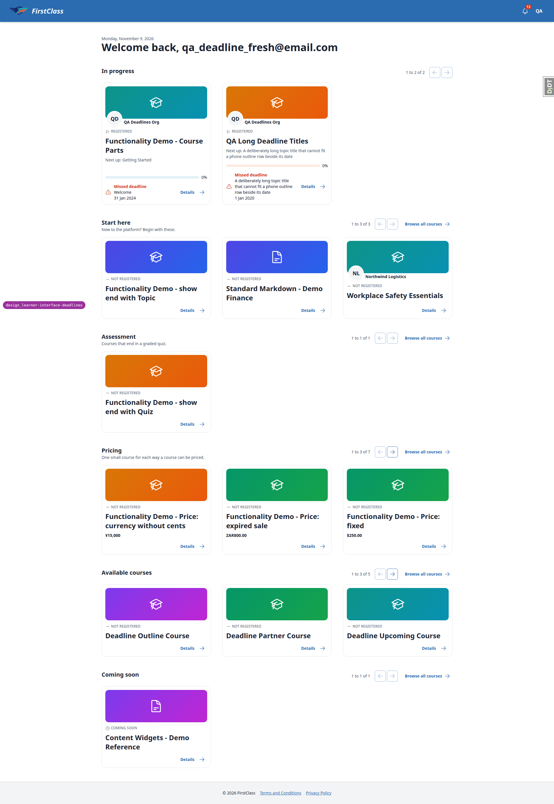 |
| 1.2.1 | desktop | pass | Long Deadline Titles card: long title wraps in full, no ellipsis, "1 Jan 2020" whole on its own line. |  |
| 1.4.1 | desktop | pass | Org byline overlaps the hero bottom edge; hero has no deadline text; deadline at the bottom. |  |
| 1.4.2 | desktop-1280/1024 | pass | Deadline stays the card's last line, title wraps, date whole; at 1024 Details drops to its own line at the right. No overflow. | 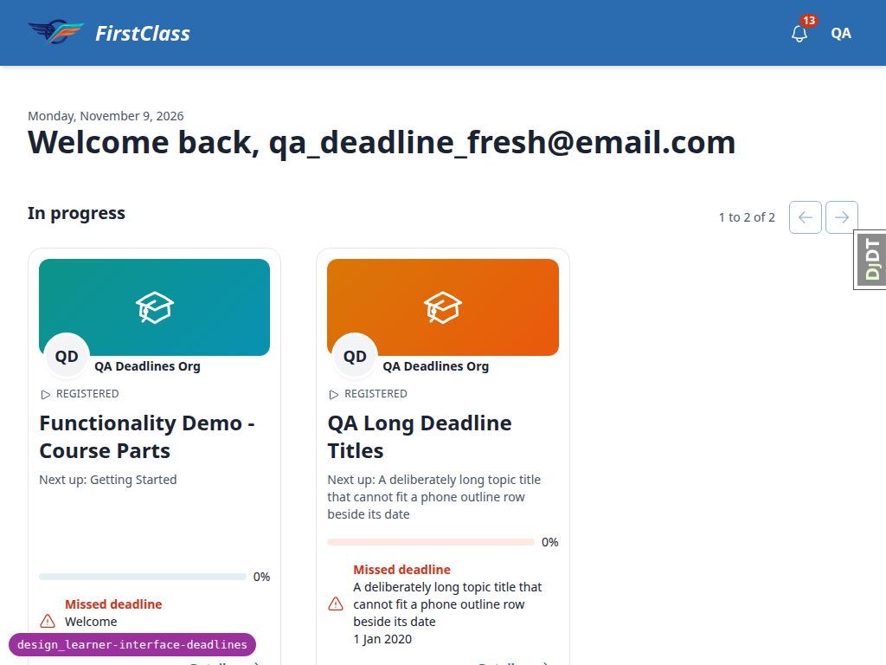 |
| 2.1.1 | desktop | pass | Outline deadline under the progress bar: warning icon, bold "Missed deadline", "Welcome", "31 Jan 2024, 23:59". No border, background or chip. | 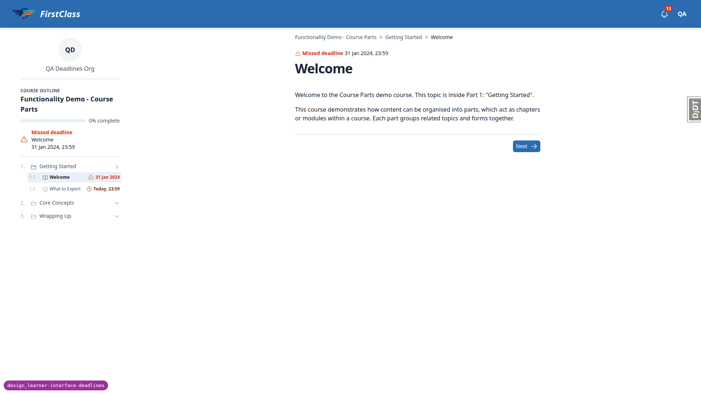 |
| 3.1.1 | desktop | pass | Row dates sit on the row line at right in the right tier colour; no chip; rows without a deadline show no date. | 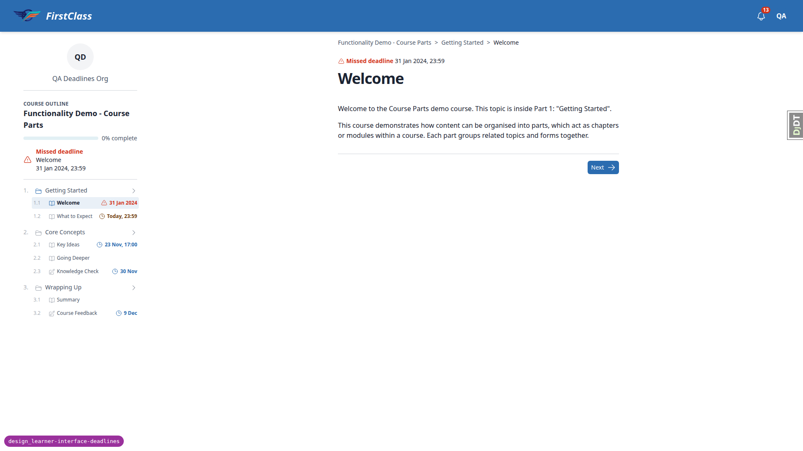 |
| 4.1.1 | desktop | pass | Header line above "Welcome": icon, bold "Missed deadline", date; 24px above, 12px below. |  |
| 3.3.2 | desktop | pass | Fresh learner course detail outline: no deadline elements, dates, "Closed" or tier icons. | 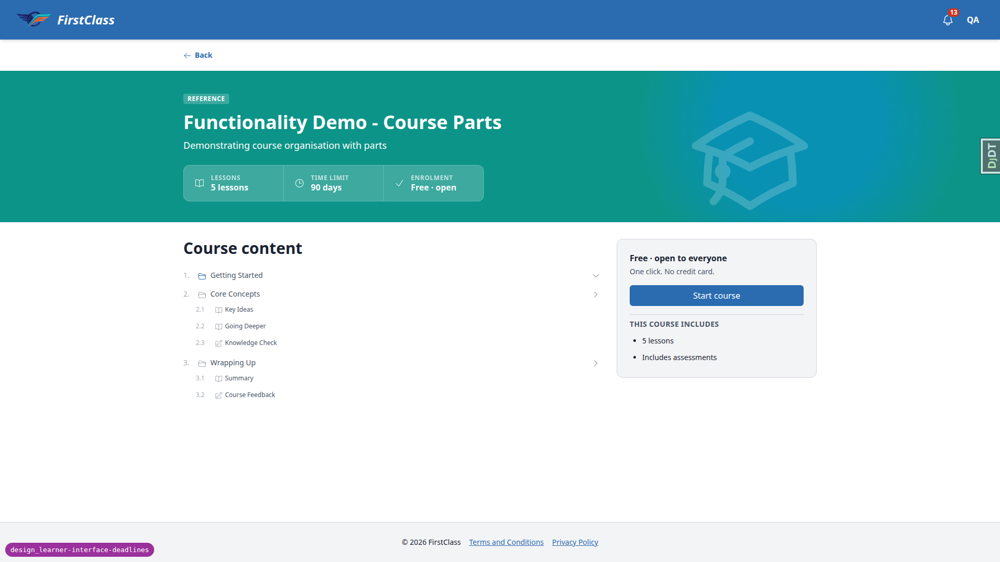 |
| 3.2.2 | desktop-1024 | pass | Docked panel: long title truncates with ellipsis, "1 Jan 2020" whole with warning icon; no overflow. |  |
| 4.3.4 | desktop | pass | Long-title topic: header line above the title, title wraps below, no overlap. |  |
| 3.4.1 | desktop | pass | America/Los_Angeles: Key Ideas "23 Nov, 07:00", today item "Today, 13:59" keeps warning colour, header "31 Jan 2024, 13:59". | none |
| 3.4.2 | desktop | pass | JS disabled: server text with "SAST" on rows, outline deadline and header; page reads correctly. | 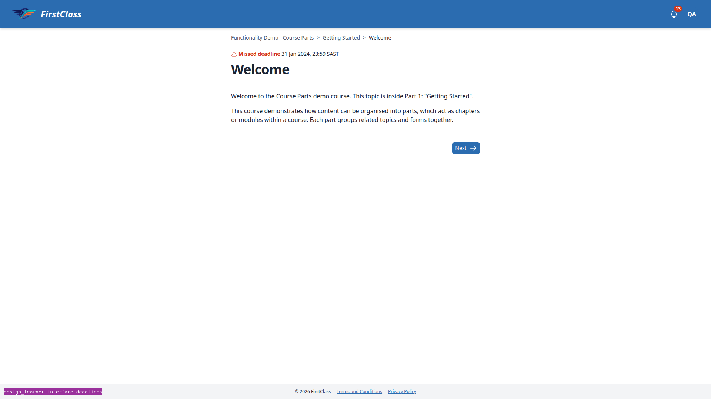 |
| 5.3.1 | desktop | pass | Fresh learner: no "Due", "Overdue", "was due", "Next deadline:" or "Expired" on dashboard, player, course detail, finish. | none |
| 5.4.1 | desktop | pass | No accessibility node named warning/deadline/locked/clock; "Missed deadline" plus the time are exposed on row, outline deadline and header. | none |
| 5.4.2 | desktop | pass | Dashboard card deadline text is exposed; hero icon is not. | none |
| 5.4.3 | desktop | pass | Forced colours: each tier identifiable by icon and word. |  |
| 2.2.6 | desktop | pass | Course finish page: outline rows show dates, no outline deadline. | none |
| 2.3.1 | desktop | pass | Next moved to /2/ without a full reload; outline deadline became "Deadline today What to Expect"; Previous kept it. | none |
| 2.3.2 | desktop | pass | Previous then Next both show "Deadline today, What to Expect" via HTMX swaps; deadline moves on completion. | none |
| 1.2.3 | desktop | pass | Welcome complete: clock icon, bold "Deadline" in warning colour, "What to Expect", "Today, 23:59". | none |
| 2.1.3 | desktop | pass | Outline deadline "Deadline today / What to Expect / 9 Nov 2026, 23:59" in warning colour. | none |
| 3.1.3 | desktop | pass | Completed rows show the completed icon and no date. | 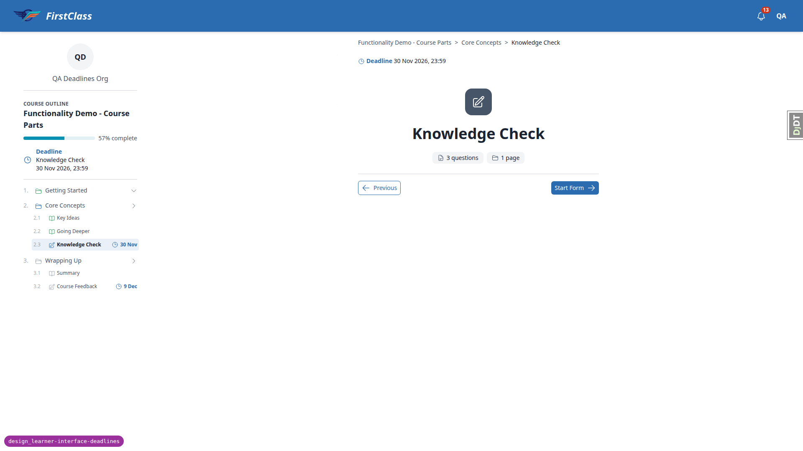 |
| 4.1.2-3 | desktop | pass | /2/ header "Deadline today" in warning; /3/ "Deadline 23 Nov 2026, 17:00" in primary. | none |
| 4.1.5-6 | desktop | pass | Completed item and item without a due date show no header line. | none |
| 4.3.1 | desktop | pass | Knowledge Check form page: header line stands alone under breadcrumbs; exam runner shows none. |  |
| 3.3.3 | desktop | pass | Parts course unlocks sequentially; locked later rows still show tier icon and date at right. |  |
| 1.2.4 | desktop | pass | Late learner card: lock, bold "Closed" error, "Welcome", "3 Feb 2024". | 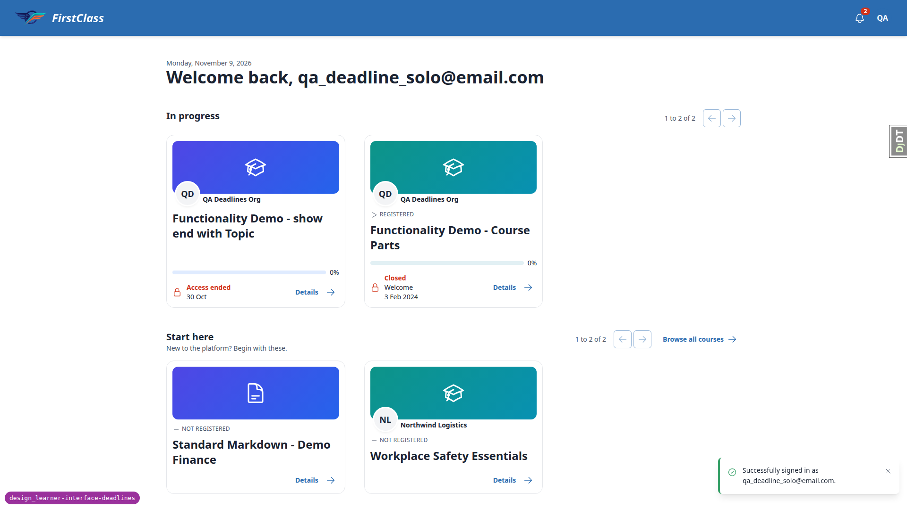 |
| 1.3.1a | desktop | pass | Closed deadline shows the date only, no "Closes". |  |
| 1.3.4 | desktop | pass | Plain ended card: lock, bold "Access ended", "30 Oct", Details at right, no deadline text. |  |
| 2.1.2 | desktop | pass | Late outline deadline: lock, bold "Closed", "Welcome", "3 Feb 2024, 23:59". | 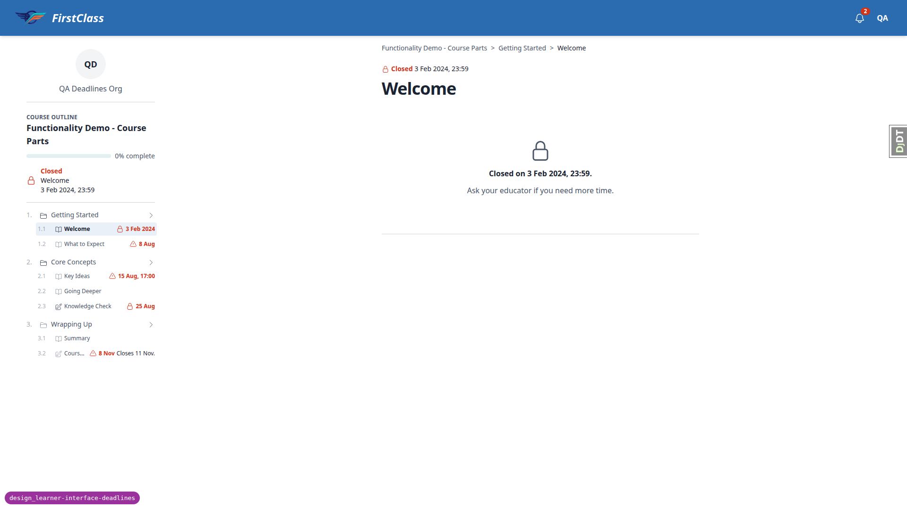 |
| 3.1.2 | desktop | FAIL | Welcome, Knowledge Check and sequentially locked rows are correct, but the Course Feedback row title is squeezed to "Cours..." by the "date + Closes" treatment at 1920 desktop. See B1. |  |
| 4.2.1-2 | desktop | pass | Closed-item page: header line, large centred lock, "Closed on 3 Feb 2024, 23:59.", muted "Ask your educator if you need more time."; no callout box. |  |
| 4.2.3 | desktop | pass | Late Knowledge Check: header "Closed 25 Aug 2026, 23:59", same centred icon and text, submit still offered. | none |
| 3.3.1 | desktop | pass | Late learner course detail outline: no dates, deadline elements or tier icons. |  |
| 2.2.5 | desktop | pass | Late learner plain course goes to course detail: no outline rows or outline deadline. | none |
| 1.3.3 | desktop | pass | Cohort learner card: stacked "Access ended / 30 May", Details at right, not in the eyebrow. |  |
| 2.2.4 | desktop | pass | Cohort learner player (outline_and_results): outline shows, no outline deadline. | none |
| 1.2.5a | desktop | pass | Restored learner: "Missed deadline / Welcome / 31 Jan 2024". | 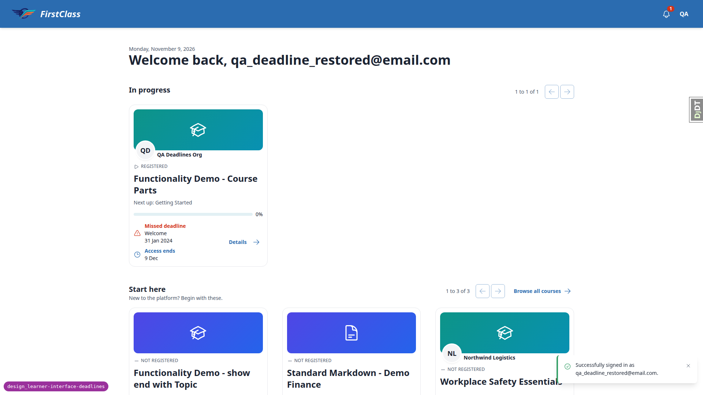 |
| 1.3.2 | desktop | pass | "Access ends 9 Dec" stacked under the deadline, same x and width, primary colour, not muted. |  |
| 5.5.2 | desktop | pass | Educator cohort overview shows no deadline-label or tier words. | 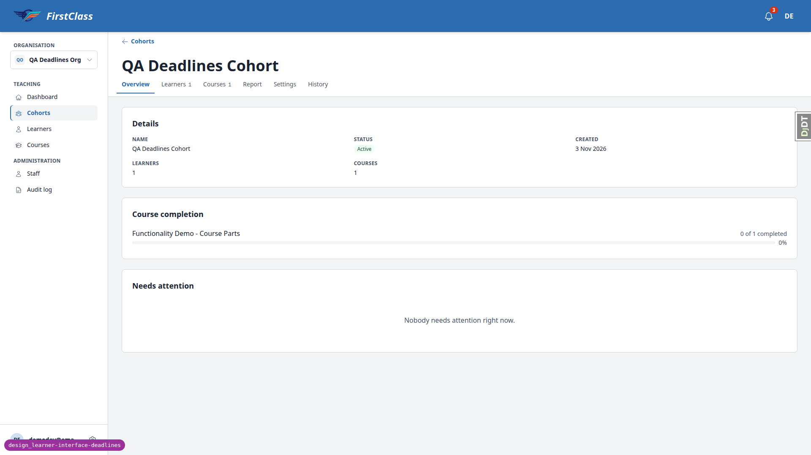 |
| 1.2.5b | desktop | pass | All items complete: "Deadline / Course / 9 Dec" primary; "Access ends 9 Dec" below. | none |
| 2.1.4 | desktop | pass | Outline deadline "Deadline / Course / 9 Dec 2026, 23:59" primary. | none |
| 2.1.5 | desktop | pass | Outline deadline names the same deadline as the card in every case checked. | none |
| 1.3.5a | desktop | pass | Plain course with no due dates: Details alone, no deadline line. | none |
| 2.2.3 | desktop | pass | Plain course player: nothing under the progress bar. | none |
| 1.3.1b | desktop | pass | Late learner: "Missed deadline / Course Feedback / 8 Nov Closes 11 Nov." Needed a course-wide override (see notes). | none |
| 2.2.2 | desktop | pass | Outline deadline "Missed deadline / Course Feedback / 8 Nov 2026, 23:59 Closes 11 Nov 2026, 23:59." | 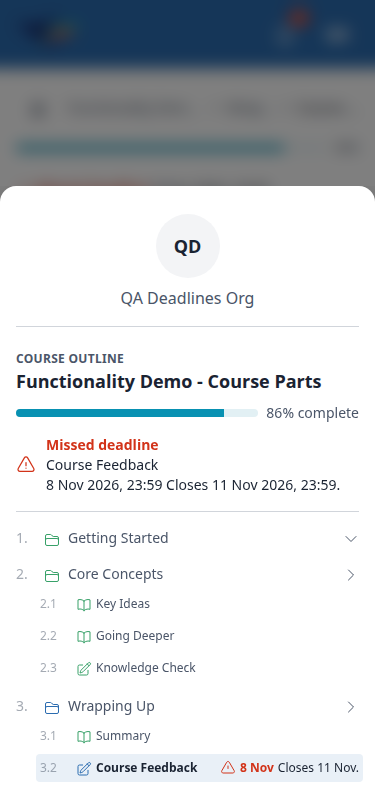 |
| 4.1.4 | mobile | pass | /7/ header "Missed deadline 8 Nov 2026, 23:59" then "Closes 11 Nov 2026, 23:59." wrapping between parts. | 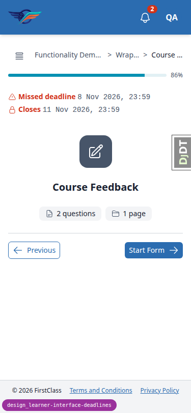 |
| 1.4.3 | mobile | pass | 375x812 rows: divider, stacked label, Details on its own line at right; no chip; no overflow. | 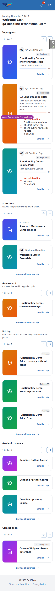 |
| 4.3.2 | mobile | pass | Header line above the title, left-aligned (x=16), 12px gap; date one unbroken span. |  |
| 2.4.2 | mobile | pass | 375 outline sheet: header, outline deadline, rows; deadline wraps inside the sheet; no horizontal overflow. (The layout probe for this view is flagged; see B2.) |  |
| 3.2.1 | mobile | pass | Sheet: long title ends in ellipsis, "1 Jan 2020" whole with warning icon; no overflow. | 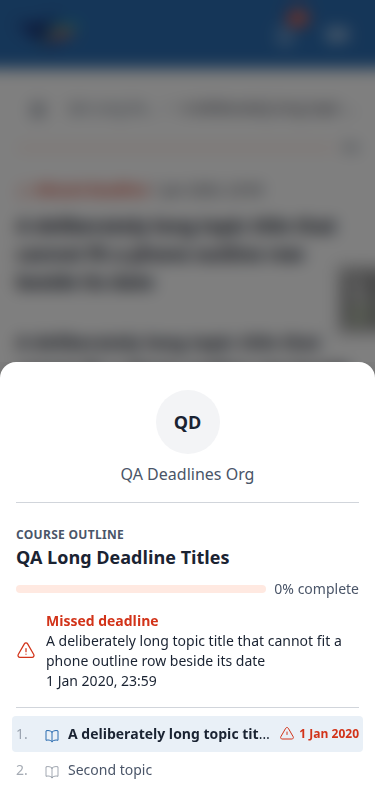 |
| 1.4.4 | tablet | pass | 880x1240: same row layout, divider, stacked label, Details at right; no overflow. | 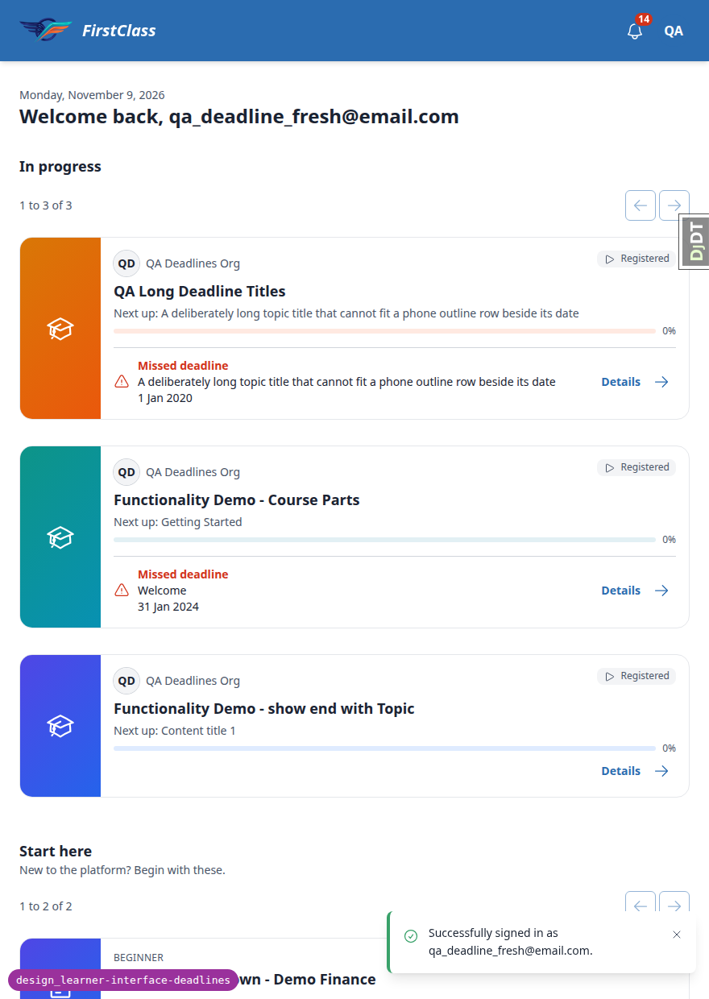 |
| 2.4.1 | tablet | pass | "Open course outline" sheet: header, outline deadline, rows; dates right-aligned; header deadline line above the title. | 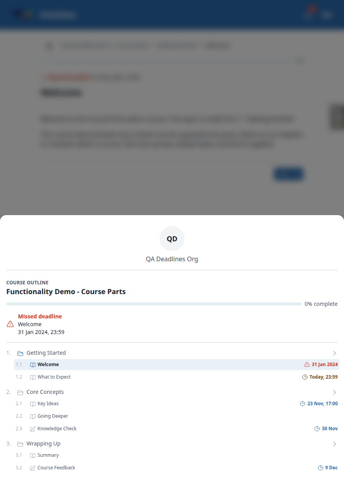 |
| 4.3.3 | tablet | pass | Header deadline line sits above the title. | 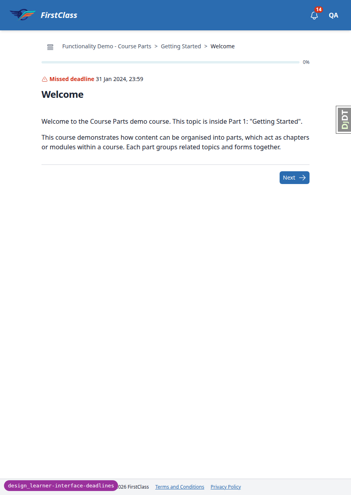 |
| 5.2 | desktop | pass | Every surface is a deadline-label; icon and bold text share one colour per tier on every surface; no muted dates, dots or chips. |  |
| 4.2.4 | mobile | pass | Closed-item page lock and text centred, header line above title, no callout, no overflow. Same at 880. | 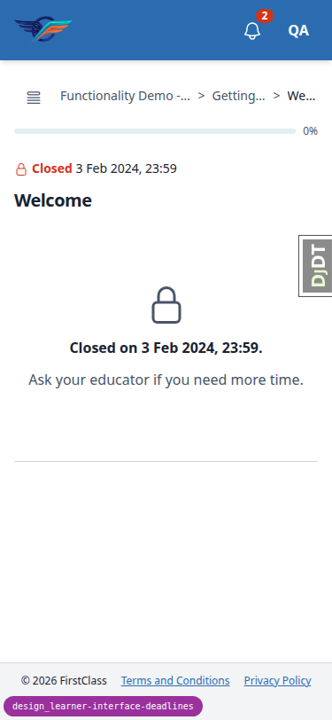 |
| 1.4.3-late | mobile | pass | Late learner baseline at 375: parts row "Closed / Welcome / 3 Feb 2024"; plain row "Access ended 30 Oct". | none |
| 5.5.1 | desktop | pass | All-courses page: no deadline-label elements or deadline text. | none |
| 5.5.3 | desktop | pass | No blog/article cards on the dashboard; unregistered course cards carry no deadline text. |  |
| 5.1 | desktop | pass | mark_overdue=off: card, row, outline deadline and header show "Deadline" in primary with the clock icon; no "Missed deadline" on the player. | 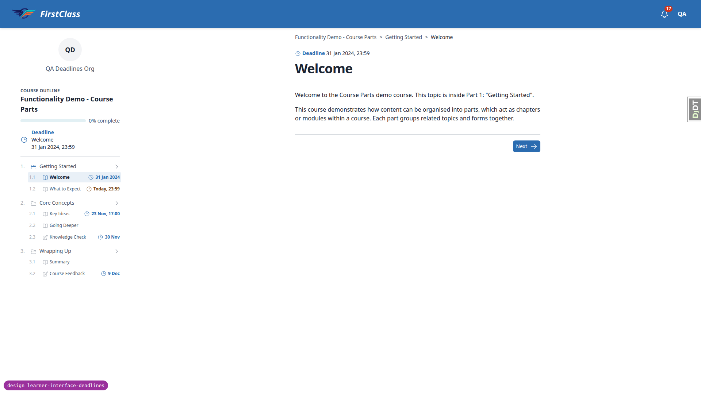 |
| 1.2.2 | desktop | pass | Covered by 5.1: card line clock icon and bold "Deadline" primary, "Welcome", "31 Jan 2024". | none |
| 2.2.1 | desktop | pass | Covered by 5.1: outline deadline clock, bold "Deadline" primary, "Welcome", full date. |  |
| 1.3.5 | desktop | pass | Completed plain course moved to Learning history with no deadline text. | none |
| 5.4.4 | all | pass | Regressions checklist against this run's screenshots; the only exception is the squeezed outline row title (B1). | none |

## Design check

| Test | Viewport | This run | Design | Result |
|---|---|---|---|---|
| 1.1-design | desktop |  |  | pass |
| 2.1-design | desktop |  |  | pass |
| 3.1-design | desktop |  |  | pass |
| 4.1-design | desktop |  |  | pass |
| 4.2-design | desktop |  |  | pass |
| 1.4-design | mobile |  |  | pass |
| 2.4-design | mobile |  |  | pass |
| 2.4-design | tablet |  |  | pass |

## B1: Outline row title squeezed to a few characters by the "date + Closes" treatment in the docked panel

Manifestations: 3.1.2 (desktop, 1920).

- Expected: design checklist ol-a says the title truncates before the date wraps or clips, but stays readable. The row's minimal label should not crowd the title down to a stub.
- Actual: late learner, docked outline at 1920. The Course Feedback row reads "Cours..." beside "8 Nov Closes 11 Nov."; the minimal label plus the Closes text take nearly the whole 272px row. In the full-width mobile and tablet sheet the title fits. Same defect as the open todo item already awaiting a decision.

## B2: Layout probe flags the open modal outline sheet as overlapping the header and content

Manifestations: 2.4.2 layout probe (mobile, 375).

- Expected: no layout flags.
- Actual: with the bottom-sheet dialog open, the probe reports "header and sidebar ink intersect" and "content and sidebar ink intersect". The sheet is a modal drawn over a blurred backdrop, so the overlap is by design. Whether the probe should ignore open modals is the open todo decision from the previous run.

## Layout probe

| Test | Viewport | URL | Screenshot | Result |
|---|---|---|---|---|
| 1.1 | desktop | / |  | clean |
| 1.4.2 | desktop-1024 | / |  | clean |
| 2.1.1 | desktop | /courses/functionality-demo-course-parts/1/ |  | clean |
| 3.3.2 | desktop | /courses/functionality-demo-course-parts/detail/ |  | clean |
| 3.2.2 | desktop-1024 | /courses/qa-long-deadline-titles/1/ |  | clean |
| 1.2.4 | desktop | / |  | clean |
| 4.2.1 | desktop | /courses/functionality-demo-course-parts/1/ |  | clean |
| 1.4.3 | mobile | / |  | clean |
| 2.4.2 | mobile | /courses/functionality-demo-course-parts/1/ |  | FLAGGED (B2): overlap: header and sidebar ink intersect; overlap: content and sidebar ink intersect |
| 1.4.4 | tablet | / |  | clean |
| 4.2.4 | mobile | /courses/functionality-demo-course-parts/1/ |  | clean |
| 4.2.4 | tablet | /courses/functionality-demo-course-parts/1/ | 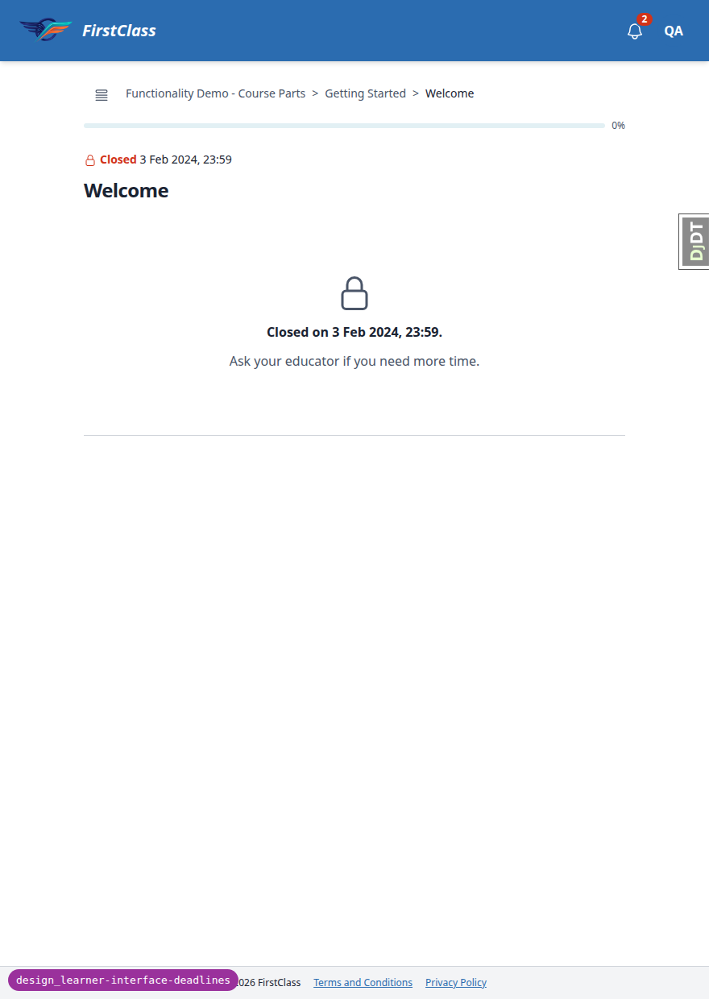 | clean |

## Data changes

| # | Via | Change |
|---|---|---|
| 1 | sdd:qa-data-helper | Section 0.3 seed: content_save demo_content, qa_create_deadlines_seed, qa_create_deadlines_seed_extras (today override on fresh learner What to Expect, QA Long Deadline Titles course, no deadline config rows). |
| 2 | sdd:qa-data-helper | Reset fresh learner parts-course progress (deleted 4 TopicProgress and the open Knowledge Check attempt made while browsing); registered fresh learner on functionality-demo-show-end-with-topic; completed all 7 parts items for the restored learner (no course finish); completed Welcome, What to Expect, Key Ideas, Going Deeper, Summary and submitted Knowledge Check for the late learner. |
| 3 | sdd:qa-data-helper | Added a course-wide fixed deadline override (today+30d, pk a96ab69f) on the late learner's parts record so the missed 30 Oct course time limit does not mask Course Feedback. |
| 4 | sdd:qa-data-helper | Restored the section 0.3 baseline (re-ran qa_create_deadlines_seed and extras, removing the late learner's override and every completion) and re-registered the fresh learner on the plain course. |
| 5 | sdd:qa-data-helper | Added CourseDeadlineConfig mark_overdue=off on the parts course (pk 5b8a81bd). |
| 6 | sdd:qa-data-helper | Deleted the mark_overdue=off CourseDeadlineConfig (5b8a81bd); completed every item of the plain course for the fresh learner and stamped the course completed. |
| 7 | sdd:qa-data-helper | Section 5.6 cleanup: deleted the fresh learner's today override (f24b886a) and the QA Long Deadline Titles course with its topics, placements, registration and record; no deadline config rows remained. |

## Bug status

| Bug | Title | Status |
|---|---|---|
| B1 | Outline row title squeezed to a few characters by the "date + Closes" treatment in the docked panel | **UNRESOLVED** (reason: how a minimal row fits "Closes …" is a design decision already awaiting the user in todo.md; not auto-fixed) |
| B2 | Layout probe flags the open modal outline sheet as overlapping the header and content | **UNRESOLVED** (reason: whether the probe should ignore an open modal is a decision already awaiting the user in todo.md; not auto-fixed) |

## General notes

- Pre-step rebase skipped at the user's request: the worktree held another process's in-flight staged date-display refactor (`freedom_ls/base/date_display.py`, cotton date/datetime components, about 25 templates; `time_zones.py` still being edited). QA ran against the branch as it stands, including those uncommitted changes.
- Date format: the QA plan's examples ("Jan 31, 2024, 11:59 PM") are outdated. The brand voice rule file sets "3 Nov 2026" / "3 Nov 2026, 07:37" (day-first, 24-hour) and localTime renders that. Every date was judged against the rule file (Rule 5).
- Plan wording superseded by the spec: late learner What to Expect and Key Ideas are sequentially locked, so their rows show the "Locked" status with the missed tier and no "Closed" (spec line 285), not a lock icon plus close date as 3.1.2 says.
- Plan 1.3.1 and 2.2.2 scenario does not arise from the seed alone: the late learner's 90-day course time limit (30 Oct) is itself a missed deadline earlier than Course Feedback's, so the band shows "Missed deadline Course 30 Oct" until a course-wide override moves the time limit. The seed (or the plan) should carry that override.
- Tangential, not from this branch: "Next up" on the parts course card names the part "Getting Started" rather than the first item "Welcome"; outline part rows show a right chevron when expanded and a down chevron when collapsed (`course_minimal_toc.html` uses icon `collapse` when expanded; unchanged by this branch); the outline progress bar track disappears under forced colours; the debug branch badge overlays page content in screenshots (dev tooling only).
- Compression: status ok, no PNG over 1024KB; nothing compressed.

status: ok · reason: 2 bugs — 0 fixed, 2 unresolved (both already open decisions in todo.md); report rendered, screenshots verified
