# Frontend QA report: learner interface deadlines

I ran the full test plan (`3. frontend_qa.md`) at FULL scope. Every test passed and I found no bugs. The smoke gate passed. Where the plan text disagreed with the spec or the voice rule, I judged against the spec and the rule file. Those cases are listed under General notes. Nothing in the diff was skipped.

## Methodology

- Playwright MCP at desktop 1920x1080, tablet 880x1240 and mobile 375x812. I also checked 1280x800 and 1024x768 for the dashboard card and the docked panel.
- The browser zone was Africa/Johannesburg. Two extra contexts were an America/Los_Angeles context (tests 3.4.1) and a JavaScript-disabled context (3.4.2). I also ran a forced-colours check (5.4.3) and an accessibility snapshot check (5.4.1, 5.4.2).
- Screenshots are collected in `screenshots/`. Every image referenced below exists beside this report.
- Seed data came from `qa_create_deadlines_seed` and `qa_create_deadlines_seed_extras`. Later data changes went through `sdd:qa-data-helper` (see Data Changes).

## Diff scoping

Class: FULL. The changed front-end files that triggered it:

- The shared date components: `cotton/date.html`, `cotton/datetime.html` and the panel framework datetime cells.
- The learner interface: the new `deadline-label` component and the deadline partials (`deadline_labels`, `course_deadline_line`, `course_footer_line`, `course_status_label`, `course_status_eyebrow`). Also `course_card`, `course_row`, `course_minimal_toc`, `course_toc_header`, `_course_base`, `course_topic`, `course_finish`, `course_item_closed` and `exam_previous_attempts`.
- Educator interface panels and cells that now use the date components.
- Report partials: `course_summary_table` and `learner_detail`.
- Alpine components JS and the design source CSS.

In total there were 175 changed files, many of them design sources. Nothing was skipped.

## Smoke gate

Outcome: pass. Pages checked: `/` and `/courses/functionality-demo-course-parts/1/`.

## Test results

| Test | Viewport | Result | Screenshot | Notes |
|---|---|---|---|---|
| 1.1 | desktop | pass | 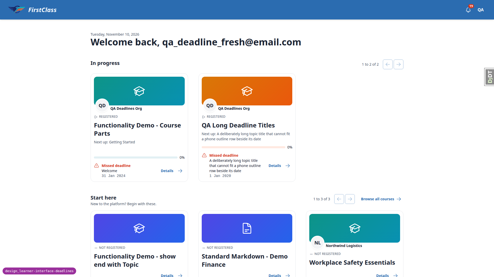 | Parts card: hero icon only, byline straddles hero edge, last line has warning icon, bold "Missed deadline", "Welcome", "31 Jan 2024" muted mono, Details at right. Date format follows voice.md. |
| 1.2.1 | desktop | pass |  | Long-title card: title wraps in full, "1 Jan 2020" whole on its own line. |
| 2.1.1 | desktop | pass | 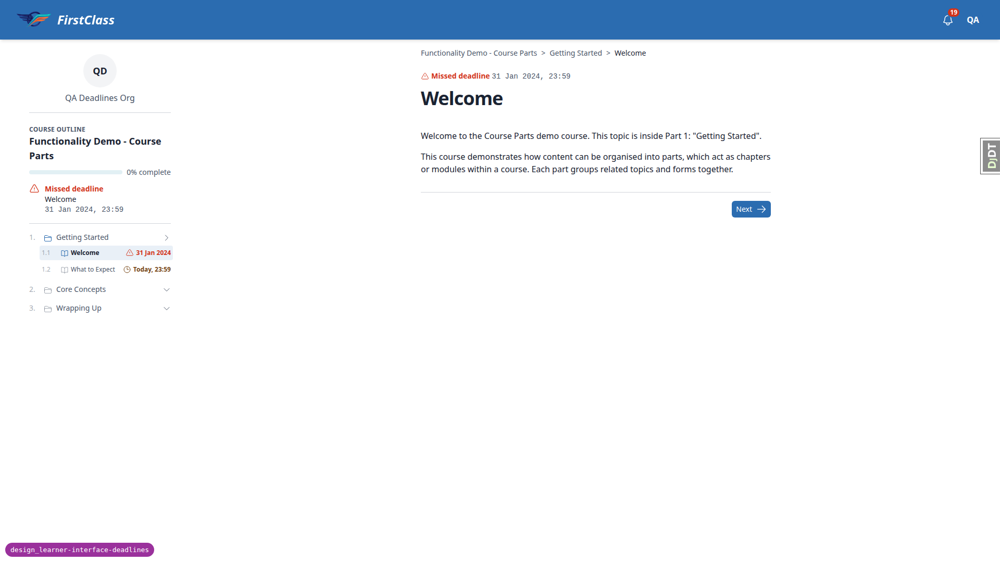 | Outline deadline: warning icon, "Missed deadline", "Welcome", "31 Jan 2024, 23:59"; no border, background or chip. |
| 4.1.1 | desktop | pass |  | Header line above the h1, left-aligned, no dot or chip, 12px below to title. |
| 3.1.1 | desktop | pass |  | Row dates and tier icons/colours correct; sr-only tier word present; no chip. |
| 5.4.1 | desktop | pass | none | A11y snapshot: no icon nodes named; "Missed deadline" and date exposed. |
| 3.3.2 | desktop | pass | none | Fresh learner course detail outline: no deadline-label, no dates. |
| 3.3.3 | desktop | pass |  | Sequentially locked rows carry sr-only "Locked" and keep tier icon and date. |
| 2.2.6 | desktop | pass | none | Finish page (fresh): outline rows show dates, no outline-deadline. |
| 5.5.1 | desktop | pass | none | All-courses page: no deadline-label; "Due" only in a course title. |
| 3.4.1 | desktop (LA zone) | pass | none | "Today, 13:59" keeps warning colour; Key Ideas "24 Nov, 07:00"; outline "31 Jan 2024, 13:59". |
| 3.4.2 | desktop (JS off) | pass | none | Dates render with zone: "Today, 23:59 SAST", "31 Jan 2024, 23:59 SAST". |
| 2.3.1 | desktop | pass | none | Next/Previous swap without full reload; outline deadline follows the current item. |
| 4.1.5 | desktop | pass | none | Completed Welcome has no header deadline line. |
| 2.1.3 | desktop | pass | 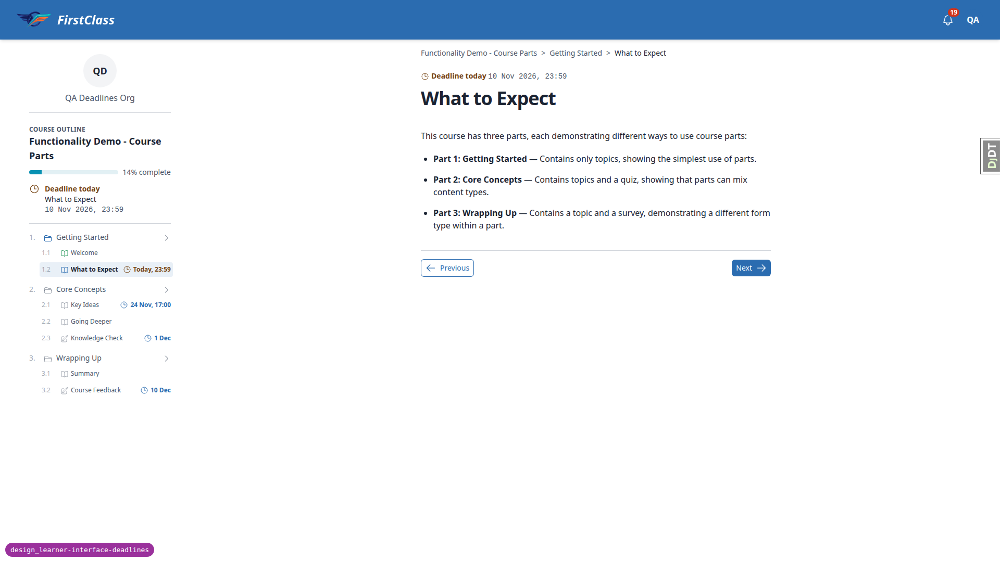 | Clock icon, "Deadline today" warning colour, "What to Expect", "10 Nov 2026, 23:59". |
| 4.1.2 | desktop | pass |  | Header: clock, "Deadline today" warning, date muted mono. |
| 3.1.3 | desktop | pass | 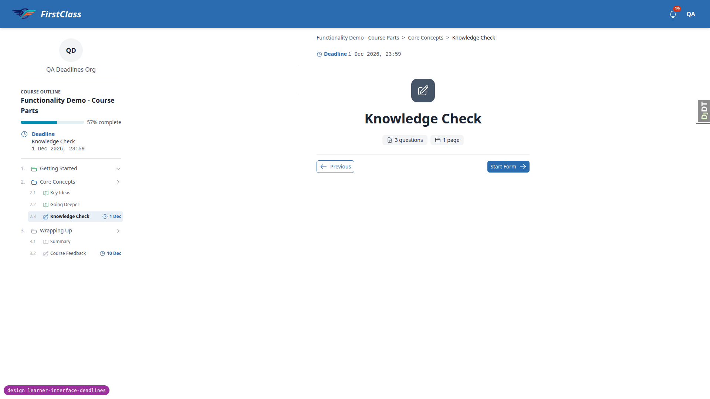 | Completed rows show no date. |
| 1.2.3 | desktop | pass | none | Card line: clock, "Deadline" warning, "What to Expect", "Today, 23:59". |
| 4.1.3 | desktop | pass | none | Key Ideas header: clock, "Deadline" primary, "24 Nov 2026, 17:00". |
| 4.1.6 | desktop | pass | none | Going Deeper: no header deadline line. |
| 4.3.1 | desktop | pass |  | Form page shows header line only; exam runner has none. |
| 1.2.4 | desktop | pass |  | Late card: lock, "Closed" error, "Welcome", "3 Feb 2024". |
| 1.3.4 | desktop | pass |  | Ended plain card: stacked "Access ended" lock, "31 Oct", no deadline text or eyebrow. |
| 1.3.1a | desktop | pass |  | Closed deadline shows no "Closes" label. |
| 2.1.2 | desktop | pass | 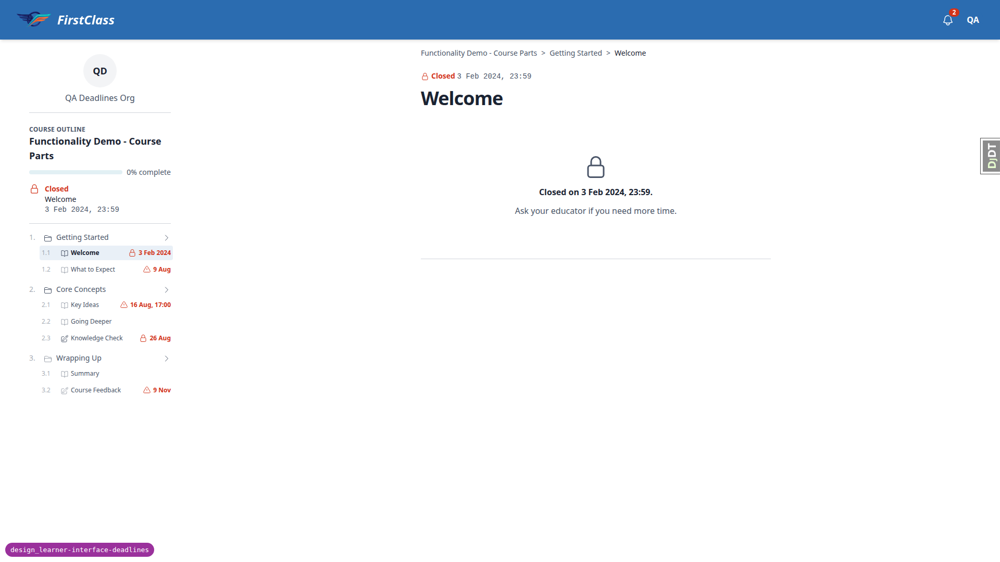 | Late outline deadline: lock, "Closed", "Welcome", "3 Feb 2024, 23:59". |
| 3.1.2 | desktop | pass |  | Closed rows show lock plus date. Sequentially locked rows show "Missed deadline" and no "Closed", as the spec requires (plan step 2 is out of date). |
| 4.2.1 | desktop | pass |  | Closed-item header: lock, "Closed", "3 Feb 2024, 23:59". |
| 4.2.2 | desktop | pass |  | Centred size-12 lock, "Closed on ..." text, no callout. |
| 4.2.3 | desktop | pass |  | Closed form with open attempt: same closed treatment, "Submit your answers" still offered. |
| 3.3.1 | desktop | pass |  | Late course detail outline: no dates, no visible "Closed". |
| 2.2.5 | desktop | pass | none | Ended plain course lands on course detail with access-ended notice. |
| 5.3 | desktop | pass | none | No "Due", "Overdue", "was due", "Next deadline:" or "Expired" on any checked page. |
| 1.2.5a | desktop | pass | none | Restored card: "Missed deadline", "Welcome", "31 Jan 2024". |
| 1.3.2 | desktop | pass | none | "Access ends" stacked under the deadline, same column, weight and icon size. |
| 1.3.3 | desktop | pass | 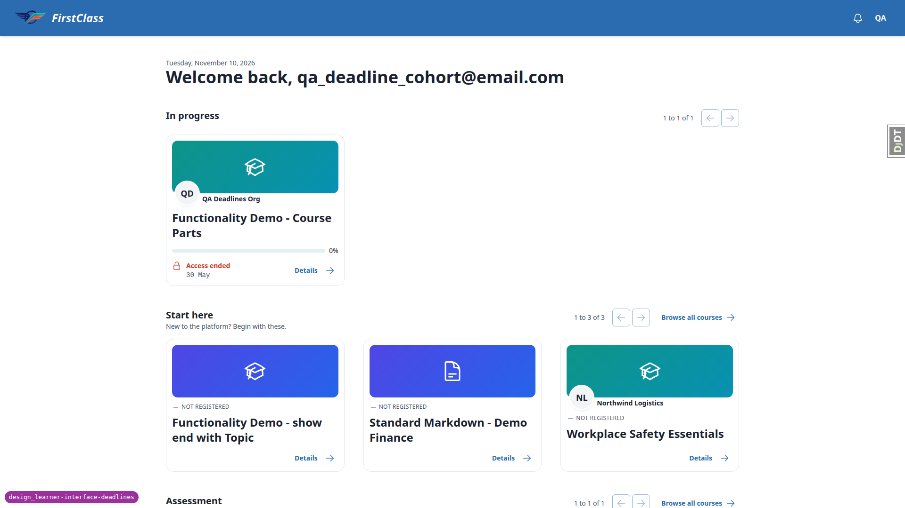 | Cohort card: stacked "Access ended" lock, "30 May", Details at right. |
| 2.2.4 | desktop | pass | none | Cohort learner player: outline shown, no outline deadline or header line. |
| 1.4.3 | mobile | pass | 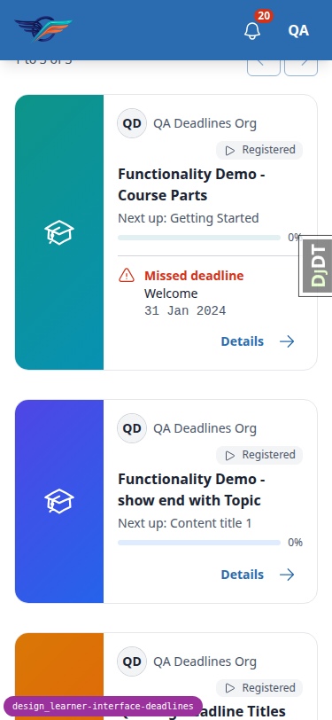 | Row stacked after divider, Details on its own line, scrollWidth 375. |
| 1.4.3-late | mobile | pass | 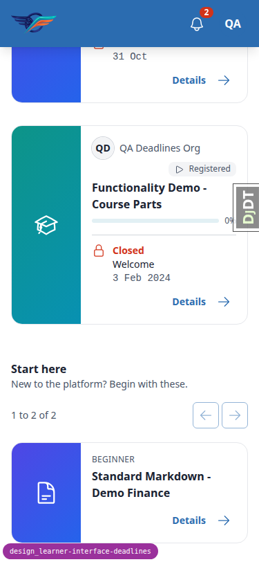 | Late row: "Closed", "Welcome", "3 Feb 2024". DjDT tab overlaps pagination arrow (dev tooling). |
| 4.2.4 | mobile | pass | 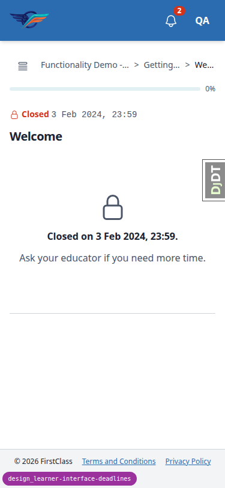 | Closed page: lock and text centred, no overflow. |
| 2.4.2-late | mobile | pass | 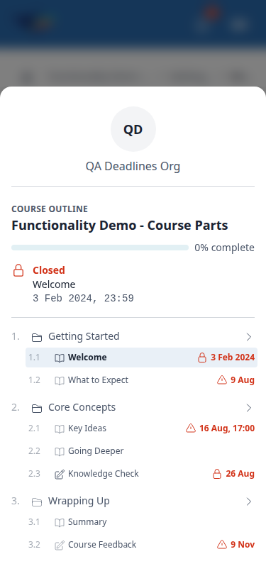 | Late learner sheet: outline deadline above rows, row dates whole, no overflow. |
| 1.4.4 | tablet | pass | 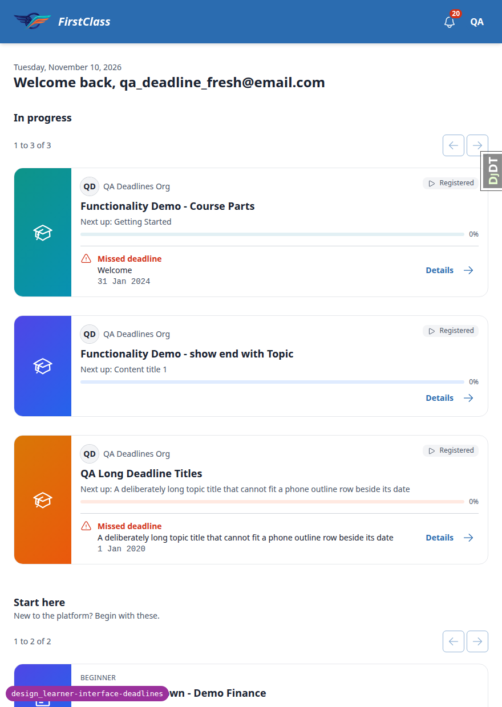 | Rows at 880 (also 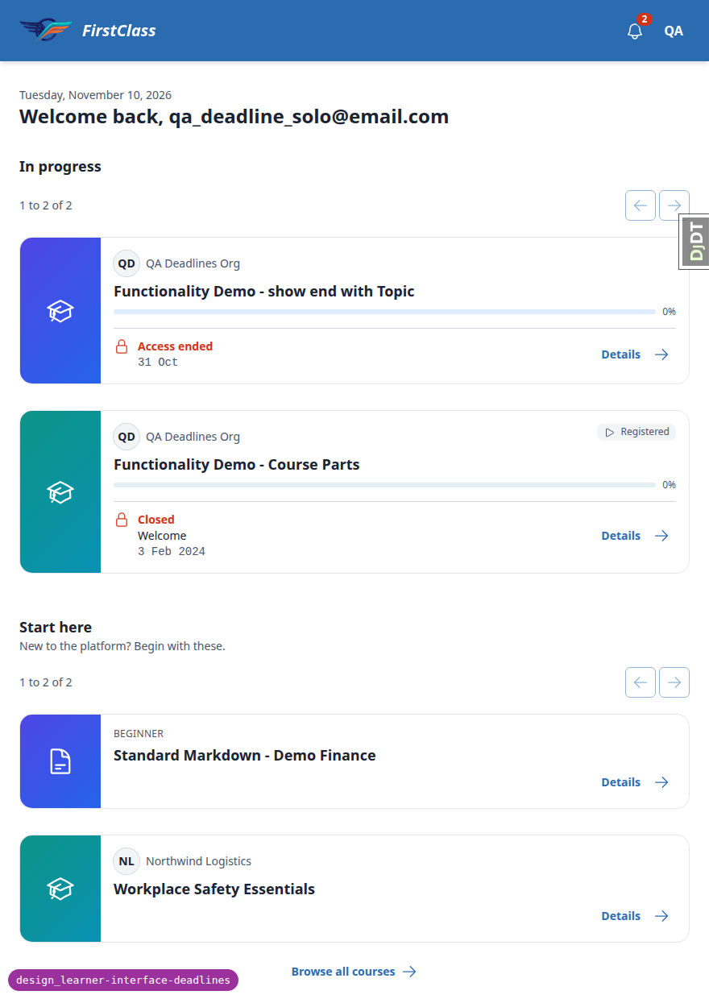): deadline below divider, Details right, no overflow. |
| 1.3.5a | tablet | pass |  | Plain registered course: bottom line holds Details alone. |
| 2.4.1 | tablet | pass |  | Sheet at 880: header, outline deadline, rows; scrollWidth 880. |
| 4.3.3 | tablet | pass |  | Header line above title, same left edge. |
| 3.2.1 | mobile | pass | 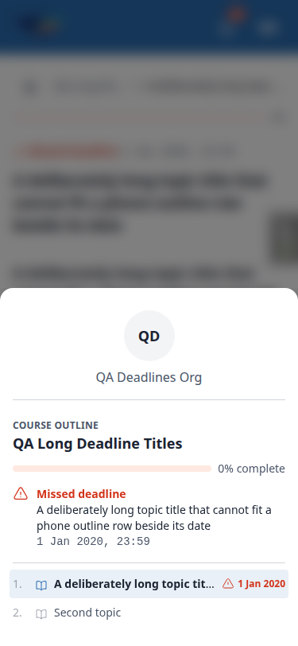 | Long row title truncates; "1 Jan 2020" whole; no overflow. |
| 4.3.2 | mobile | pass |  | Header line one line, left-aligned with title. |
| 1.4.2 | 1280x800 and 1024x768 | pass | 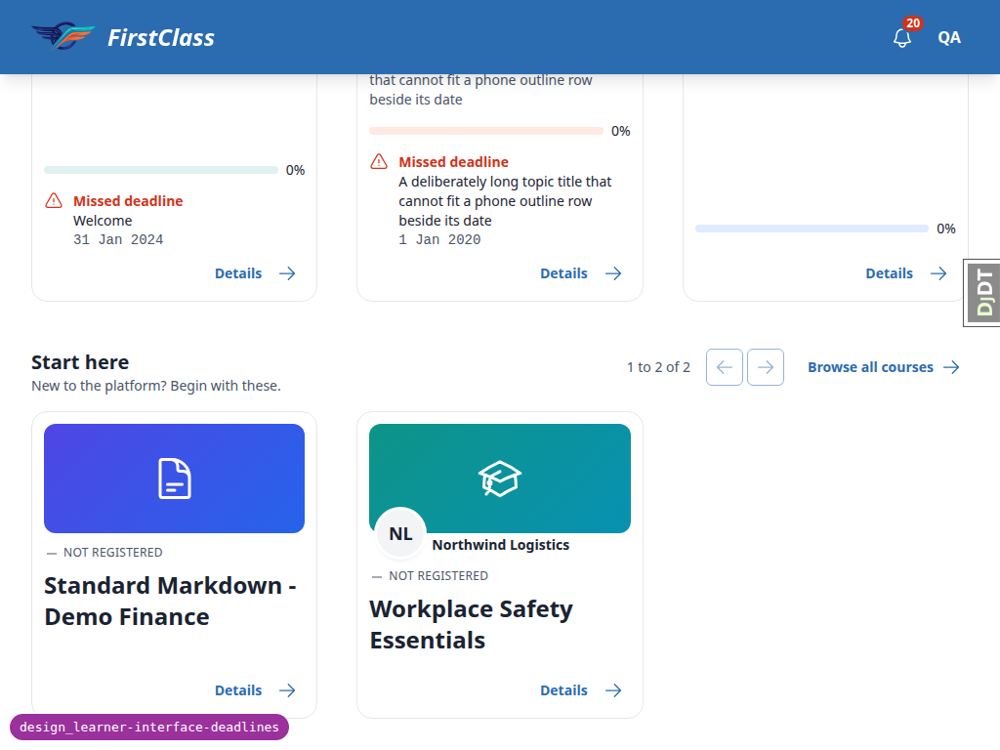 | 1280: Details beside the deadline. 1024: Details drops below at right; dates one line. |
| 3.2.2 | 1024x768 | pass | none | Docked panel: long title truncated, date one line. |
| 4.3.4 | desktop | pass | 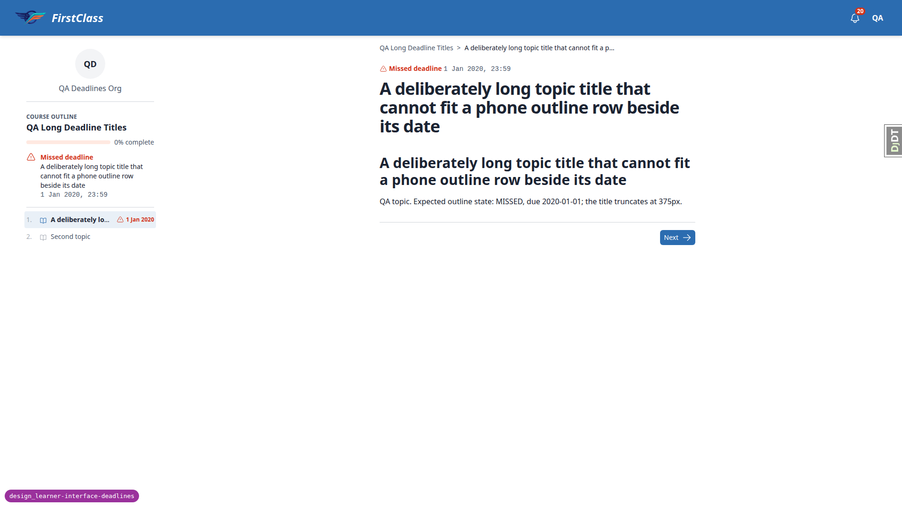 | Long-title topic: header line and title do not overlap. |
| 5.4.3 | desktop (forced colours) | pass | 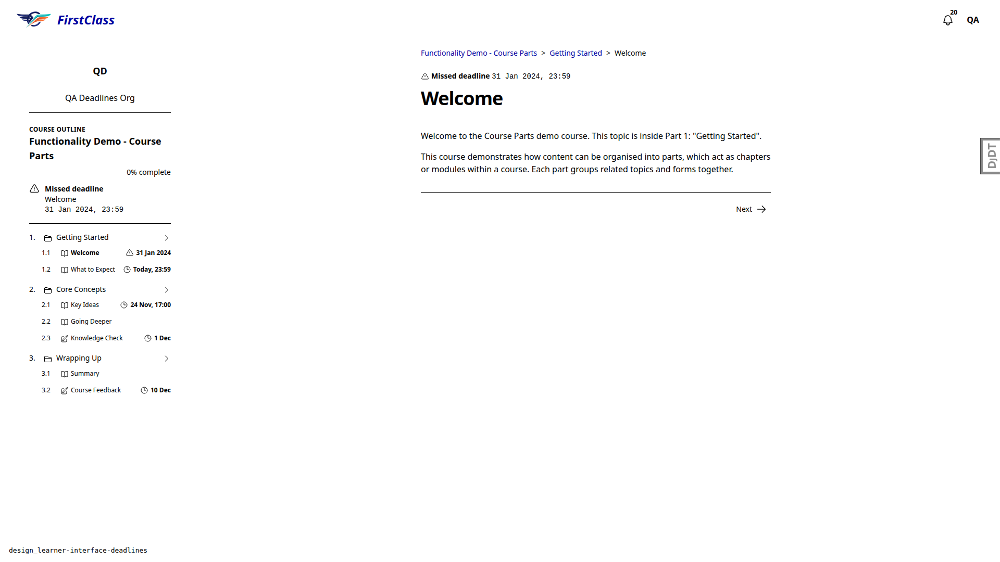 | Tiers still identifiable by icon and word. |
| 5.4.2 | desktop | pass | none | Card aria snapshot exposes "Missed deadline Welcome" and time; hero icon not exposed. |
| 5.5.2 | desktop | pass | none | Educator learner page: no deadline-label or tier words. |
| 5.2 | desktop | pass |  | Same tier colours on all surfaces; main text 600; dates muted mono. |
| 1.2.2 | desktop | pass | none | mark_overdue off: card "Deadline" primary, "Welcome", "31 Jan 2024". |
| 2.2.1 | desktop | pass | none | mark_overdue off: outline deadline primary. |
| 5.1 | desktop | pass | none | mark_overdue off: all surfaces "Deadline"; no "Missed deadline". |
| 1.2.5b | desktop | pass | none | Restored, all items done: "Deadline", "Course", "10 Dec"; "Access ends 10 Dec" under it. |
| 2.1.4 | desktop | pass | 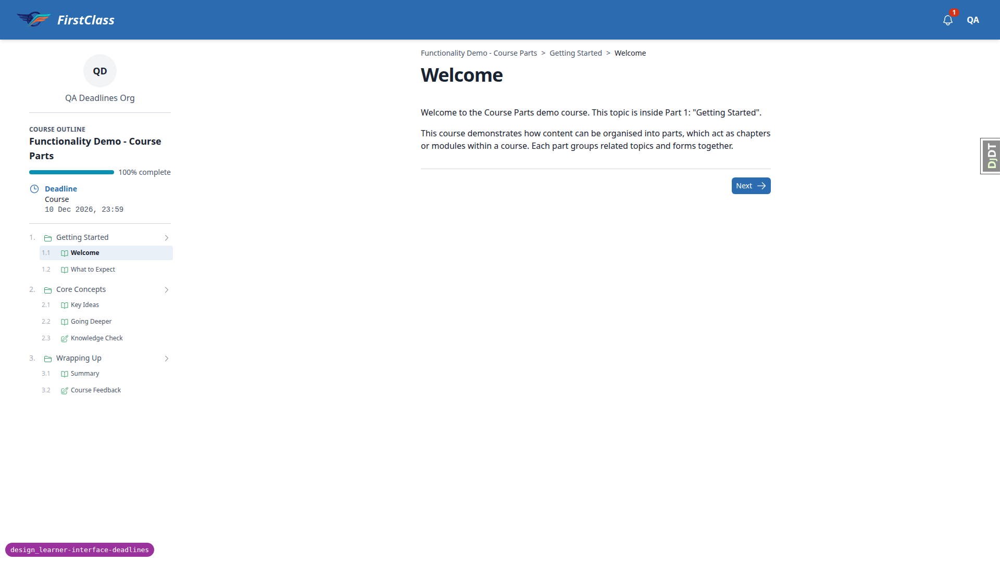 | Restored outline deadline: "Deadline", "Course", "10 Dec 2026, 23:59". |
| 2.1.5 | desktop | pass | none | Outline deadline names the same deadline as the card in every case checked. |
| 4.1.4 | desktop | pass | 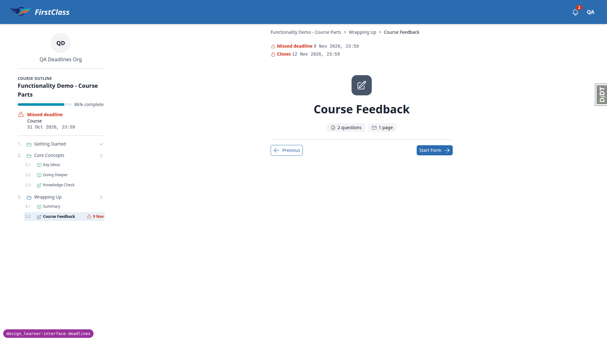 | "Missed deadline 9 Nov 2026" then a separate "Closes 12 Nov 2026, 23:59" label, not nested. |
| 1.3.5b | desktop | pass | none | Completed plain course: status COMPLETED, no deadline-label. |
| 2.2.3 | desktop | pass | none | Plain course player: outline present, no deadline surfaces. |
| 1.3.1b | desktop | pass | 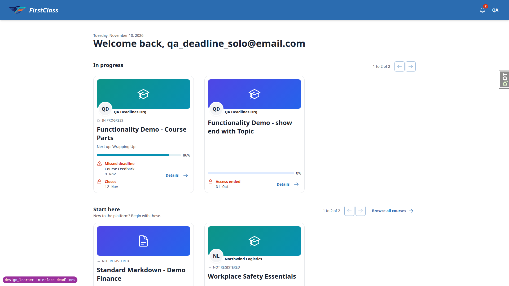 | "Missed deadline Course Feedback 9 Nov" then separate stacked "Closes 12 Nov". Needed a time-limit override (see Data Changes). |
| 2.2.2 | desktop | pass | 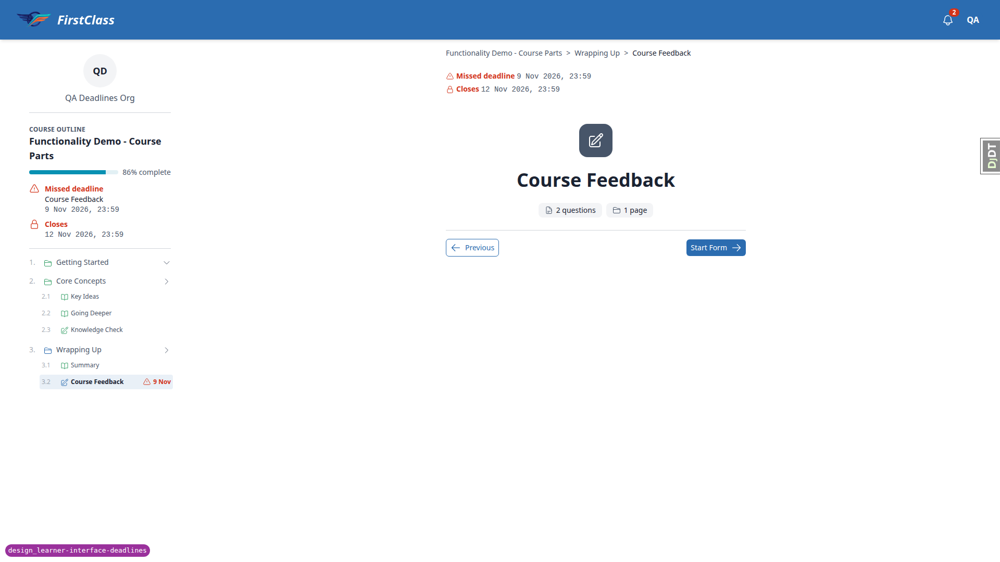 | Outline: "Missed deadline Course Feedback 9 Nov 2026, 23:59", then separate "Closes 12 Nov 2026, 23:59". |
| regressions | desktop | pass | none | Regression checklist held on every screenshot (hero icon only, no chip, no dot, Access ends stacked, one deadline per row, and the rest of the checklist). |

## Design check

| Test | Viewport | This run | Design | Result |
|---|---|---|---|---|
| 1.1-design | desktop |  | [cards__card-b.png](design_screenshots/cards__card-b.png) | pass |
| 3.1-design | desktop |  | [p-outline__ol-a.png](design_screenshots/p-outline__ol-a.png) | pass |
| 4.2-design | desktop |  | [mobile__m-player.png](design_screenshots/mobile__m-player.png) | pass |
| 1.4-design | mobile |  | [hero__hero-c.png](design_screenshots/hero__hero-c.png) | pass |
| 2.4-design | tablet |  | [tablet__tb-player.png](design_screenshots/tablet__tb-player.png) | pass |
| 2.4-design-mtoc | mobile |  | [mobile__m-toc.png](design_screenshots/mobile__m-toc.png) | pass |
| 4.1-design | mobile |  | [p-banner__bn-a.png](design_screenshots/p-banner__bn-a.png) | pass |
| 2.1-design | desktop |  | [mobile__m-toc.png](design_screenshots/mobile__m-toc.png) | pass |

No misses were recorded in any design comparison.

## Layout probe

| Test | Viewport | URL | Screenshot | Result |
|---|---|---|---|---|
| 1.1 | desktop | `/` |  | clean |
| 2.1.1 | desktop | `/courses/functionality-demo-course-parts/1/` |  | clean |
| 4.3.1 | desktop | `/courses/functionality-demo-course-parts/5/` |  | clean |
| 4.2.3 | desktop | `/courses/functionality-demo-course-parts/5/` |  | clean |
| 1.4.3 | mobile | `/` | 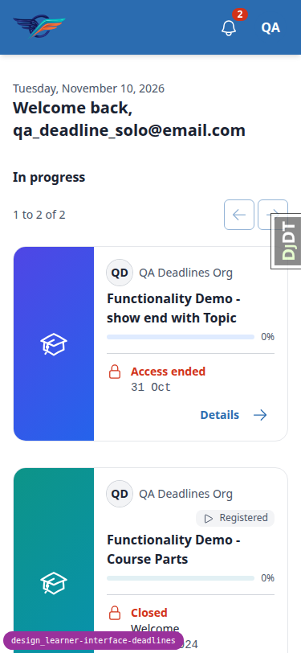 | clean |
| 4.2.4 | mobile | `/courses/functionality-demo-course-parts/1/` |  | clean |
| 1.4.4 | tablet | `/` |  | clean |

## Data changes

| What changed | Via |
|---|---|
| Ran `qa_create_deadlines_seed` and `qa_create_deadlines_seed_extras`. Fresh, late, restored and cohort learners were rebuilt. Added a today-item override 825593ee on What to Expect (2026-11-10 23:59) and the QA Long Deadline Titles course 15509035 under QA Deadlines Org. No config rows. | sdd:qa-data-helper |
| The fresh learner completed Welcome, What to Expect, Key Ideas and Going Deeper through the player and started a Knowledge Check attempt (tests 2.3, 4.1, 4.3). | browser (learner action) |
| Undid the fresh learner's parts-course progress (4 TopicProgress, 1 open form attempt) and registered fresh on `functionality-demo-show-end-with-topic`. | sdd:qa-data-helper |
| Added CourseDeadlineConfig 9c589e70 (mark_overdue off) on the parts course. Completed every item for the restored learner without stamping the course complete. | sdd:qa-data-helper |
| Deleted CourseDeadlineConfig 9c589e70. Undid the restored learner's completions (back to 0%). Completed the late learner's Welcome, What to Expect, Key Ideas, Going Deeper and Summary, and submitted its open Knowledge Check. Completed and stamped the fresh learner's plain course. | sdd:qa-data-helper |
| Added LearnerDeadlineOverride e6466d67 moving the late learner's parts-course time limit to 2026-12-10. The plan's 1.3.1/2.2.2 scenario assumed the 90-day time limit was not already past. The registration is 100 days old, so the time-limit end (31 Oct) was the earliest missed deadline and correctly beat Course Feedback. | sdd:qa-data-helper |
| Cleanup (§5.6): re-ran `qa_create_deadlines_seed` without extras to restore seed state. This removed the today-item override, the late learner time-limit override, all QA completions and the fresh learner's plain and long-title registrations. Deleted the QA Long Deadline Titles course, placements and topics. Confirmed no deadline config rows remain. | sdd:qa-data-helper |

## Bug status

No bugs were found this run. Every test passed.

## General notes

- **Pre-step rebase.** 46 commits were replayed onto origin/main (33 of them new). One import conflict in `learner_interface/tests/views/test_course_player.py` was resolved by keeping both imports. The lost-change check exited 2. I verified all four REVIEW paths as the branch's own changes with main's additions intact. The upstream-change review found the direction unchanged. The working tree held another process's staged, uncommitted date-display work (the c-date and c-datetime components and the voice.md date rule). I committed it as "wip before rebase onto main". The targeted test run then had 3 failures from that work: c-datetime rendered newlines into its text, and the finish-page test still expected the old "November 10, 2026" format. I fixed both in c7a09f8ce (component whitespace, and the test now uses display_date). The affected modules then passed (820 tests). The branch was pushed with `--force-with-lease`.
- **Date format.** voice.md is the newest rule file. It sets one format: "31 Jan 2024" and "31 Jan 2024, 23:59" (24-hour). The plan's examples ("Jan 31, 2024, 11:59 PM") predate that rule, so I judged dates against voice.md. The plan text should be updated through capture-feedback when convenient.
- **Plan text out of date versus the spec** (judged by the spec):
  - 3.1 step 2 expects What to Expect and Key Ideas to show a lock and close date for the late learner. They are sequentially locked, and the spec says such rows show "Locked" and no "Closed". They show "Missed deadline".
  - 1.3.1 and 2.2.2 assume the late learner's time limit is not past. With a 100-day-old registration and a 90-day limit, the time-limit end (31 Oct) is the earliest missed deadline and correctly wins. I added a time-limit override to reach the Closes scenario.
  - 1.1 expects "Next up: Welcome". The card reads "Next up: Getting Started", which is the part.
- **Out-of-scope observations.** None of these are deadline surfaces, and they are likely pre-existing:
  - Outline part chevrons point down when collapsed and right when expanded, on both the player outline and the course detail outline.
  - The course detail page offers "Start course" and "One click. No credit card." to an already-registered learner.
  - In forced-colours mode the outline progress bar and the current-row highlight disappear.
  - The closed topic page (Welcome, first item) shows no footer Next/Previous, only a divider.
  - The collapsed DjDT tab overlaps the dashboard pagination arrow at 375 and 880 (dev tooling only).

status: ok · reason: report rendered, 0 bugs documented, screenshots verified
