# Frontend QA report: learner interface deadlines

Run date 2026-11-08, branch `design_learner-interface-deadlines`. The run used three viewports: desktop 1920x1080, tablet 880x1240 and mobile 375x812. The browser zone was Africa/Johannesburg. The test plan is `3. frontend_qa.md`. The run recorded 65 test results: 63 pass, 1 fail (3.1.2-row) and 1 skip (5.5.3). It also recorded 8 design comparisons (all pass) and 23 layout probes (22 clean, 1 flagged). Two bugs are documented below (B1, B2). Both need a human decision and are unresolved.

## Methodology

- Manual run through the Playwright MCP, following the plan in `3. frontend_qa.md`.
- Screenshots were collected into `screenshots/` beside this report. Every image this report references exists there; no referenced file is missing. The older tracked images in `screenshots/final/` are unrelated to this run and are not used.
- Compression found nothing over 1MB.
- The run did not abort at the smoke gate.

## Diff scoping

- Class: **FULL**.
- Why: rule 1, templates/, static/ and .html/.js paths changed. The triggers are the learner_interface templates (`course_card.html`, `course_row.html`, `course_topic.html`, `course_item_closed.html`, `course_minimal_toc.html`, `deadline_labels.html`, `cotton/deadline-label.html` and others) and `freedom_ls/base/static/base/js/alpine-components.js`.
- Changed files: about 170.
- Skipped: nothing. Desktop, mobile and tablet all ran.

## Smoke gate

Pass. Pages loaded: `/` and `/courses/functionality-demo-course-parts/1/`.

## Results by test

| Test | Viewport | Status | Notes | Screenshot |
|---|---|---|---|---|
| 1.1 | desktop | pass | Parts card has the icon alone in the hero, org byline straddling the hero edge, and "Missed deadline / Welcome / 31 Jan 2024" as the last line with Details at the right. Dates use main's new "31 Jan 2024" format, not the plan's "Jan 31, 2024". "Next up" reads "Getting Started" (the part), not the plan's "Welcome". |  |
| 1.2.1 | desktop | pass | Long-title card shows "Missed deadline", the full title wrapped with no ellipsis, and "1 Jan 2020" whole on its own line. |  |
| 1.2.2 | desktop | pass | With mark_overdue off the card reads clock + "Deadline" in primary, "Welcome", "31 Jan 2024". See 5.1. | 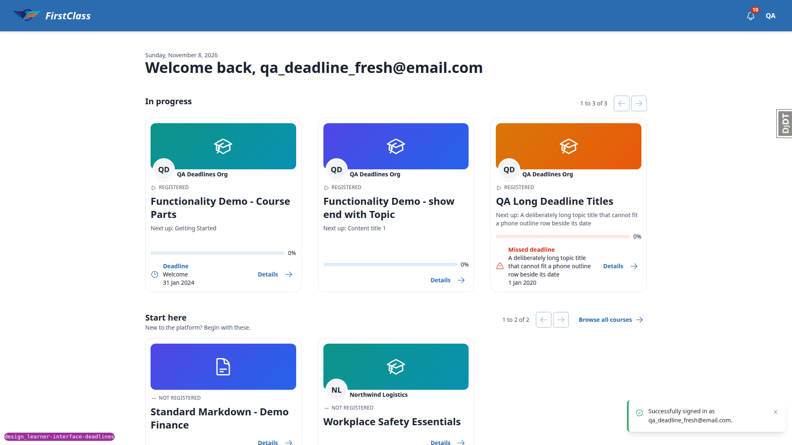 |
| 1.2.3 | desktop | pass | Fresh learner with Welcome complete: clock + bold "Deadline" in warning text colour, "What to Expect", "Today, 23:59". | none |
| 1.2.4 | desktop | pass | Late learner parts card: lock icon, bold "Closed" in error colour, "Welcome", "3 Feb 2024"; no "Closes". |  |
| 1.2.5a | desktop | pass | Restored learner baseline: "Missed deadline", "Welcome", "31 Jan 2024". | 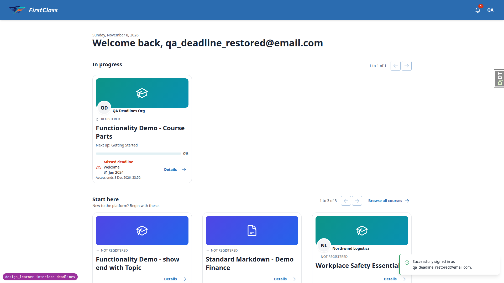 |
| 1.2.5b | desktop | pass | Restored learner with every dated item complete: clock + bold "Deadline" in primary, "Course", "8 Dec" (this year, no year). | 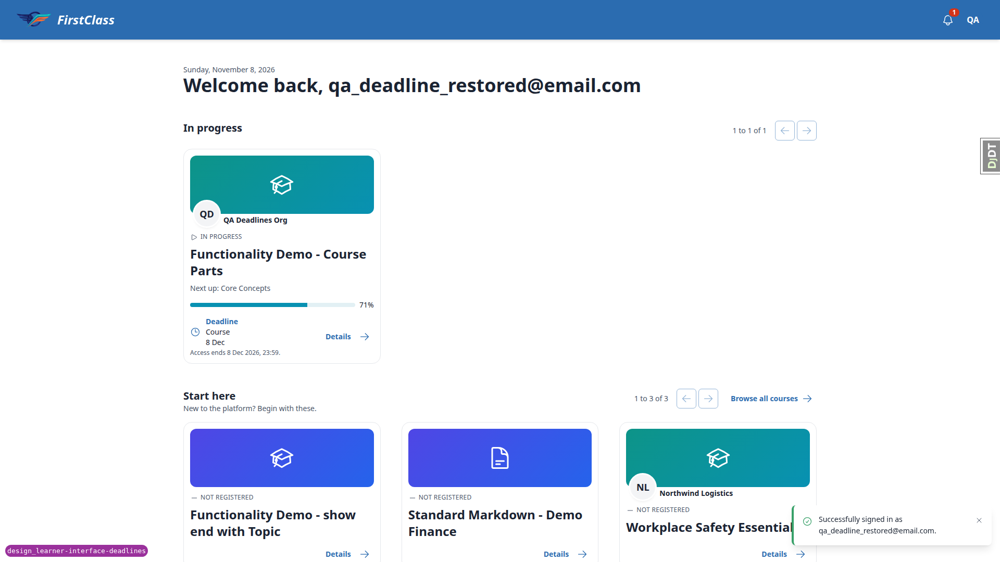 |
| 1.3.1a | desktop | pass | Closed deadline date reads "3 Feb 2024" only, with no "Closes". |  |
| 1.3.1b | desktop | pass | Late learner with all items done reads "Missed deadline / Course / 29 Oct", not the plan's "Course Feedback". Correct per spec rule 4: the 90-day time limit ended 29 Oct, before Course Feedback's 7 Nov. The card's "Closes" text is checked on the row and header instead. | 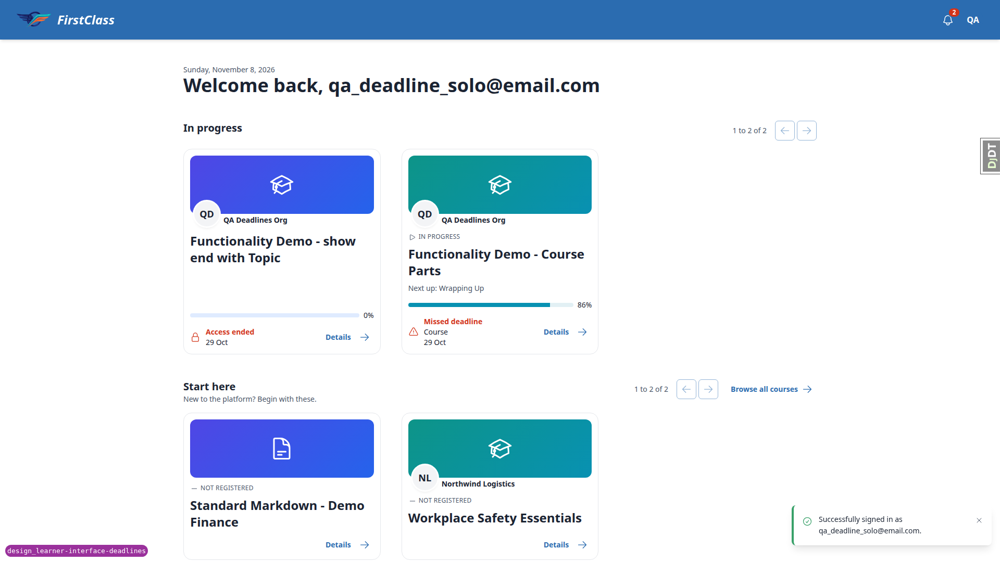 |
| 1.3.2 | desktop | pass | "Access ends 8 Dec 2026, 23:59." shows as a text-xs muted line under the deadline at the card bottom. |  |
| 1.3.3 | desktop | pass | Cohort learner: stacked lock + bold "Access ended" in error colour, "30 May" in standard text colour, Details at right, not in the eyebrow. |  |
| 1.3.4 | desktop | pass | Late learner plain-course card: lock + bold "Access ended", "29 Oct" in standard text colour, Details at right. |  |
| 1.3.5 | desktop | pass | Fully completed plain course sits in Completed with eyebrow "COMPLETED" and no deadline text. | none |
| 1.3.5a | desktop | pass | Registered plain course with no deadlines: the bottom line holds Details alone. | none |
| 1.4.1 | desktop | pass | Long-title card draws the byline across the hero's bottom edge; the hero holds no deadline text and the deadline is at the bottom. |  |
| 1.4.2 | desktop | pass | At 1280x800 and 1024x768 the deadline stays the last line and the long title wraps. At 1024 Details drops to its own line at the right. A transient sign-in toast overlaps the right card in the shot. | 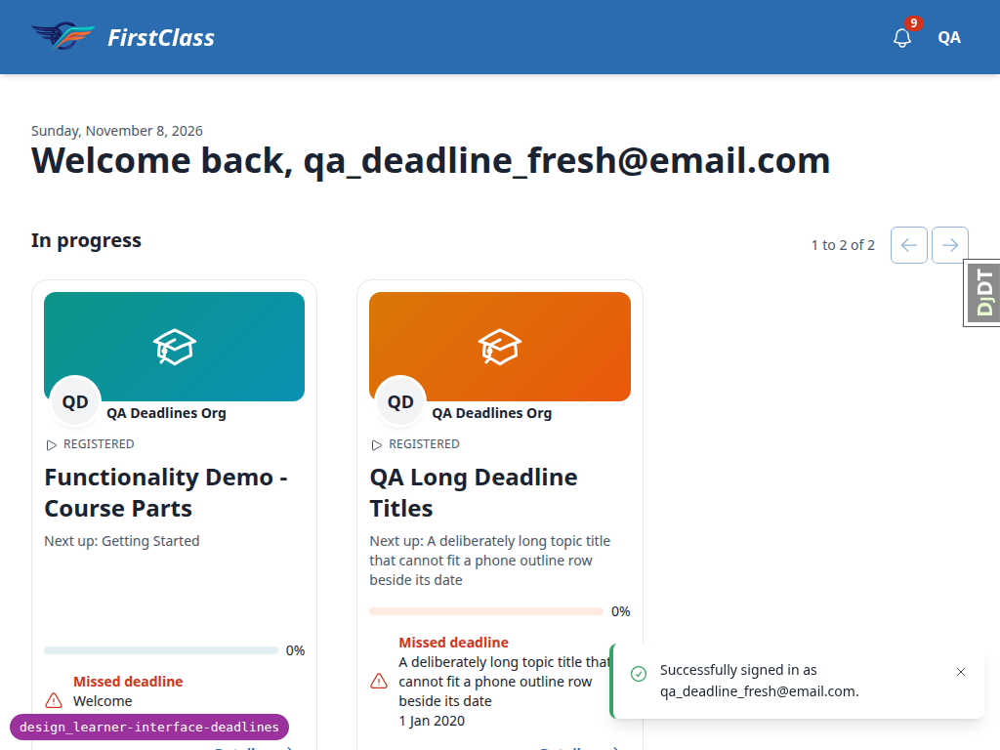 |
| 1.4.3 | mobile | pass | Course row has a divider, stacked label, "Missed deadline / Welcome / 31 Jan 2024", and Details on its own line at the right. Document width 375. The DjDT tab covers the pagination arrow (dev tooling). | 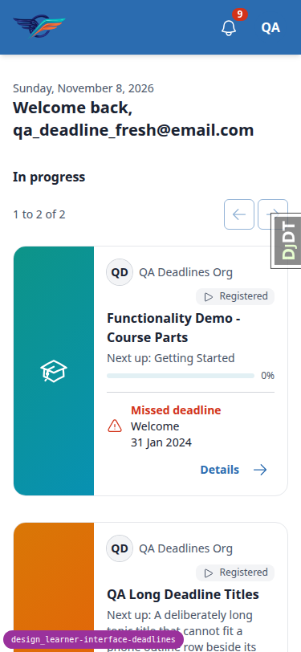 |
| 1.4.3-late | mobile | pass | Late learner rows: plain course "Access ended / 29 Oct"; parts course "Closed / Welcome / 3 Feb 2024". No chip, no overflow. | 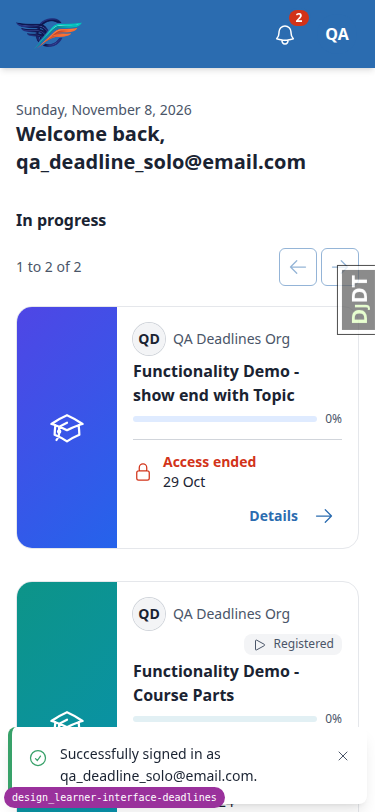 |
| 1.4.4 | tablet | pass | Divider above the bottom line, stacked label, Details on the same line at the right, long title in full, no overflow. | 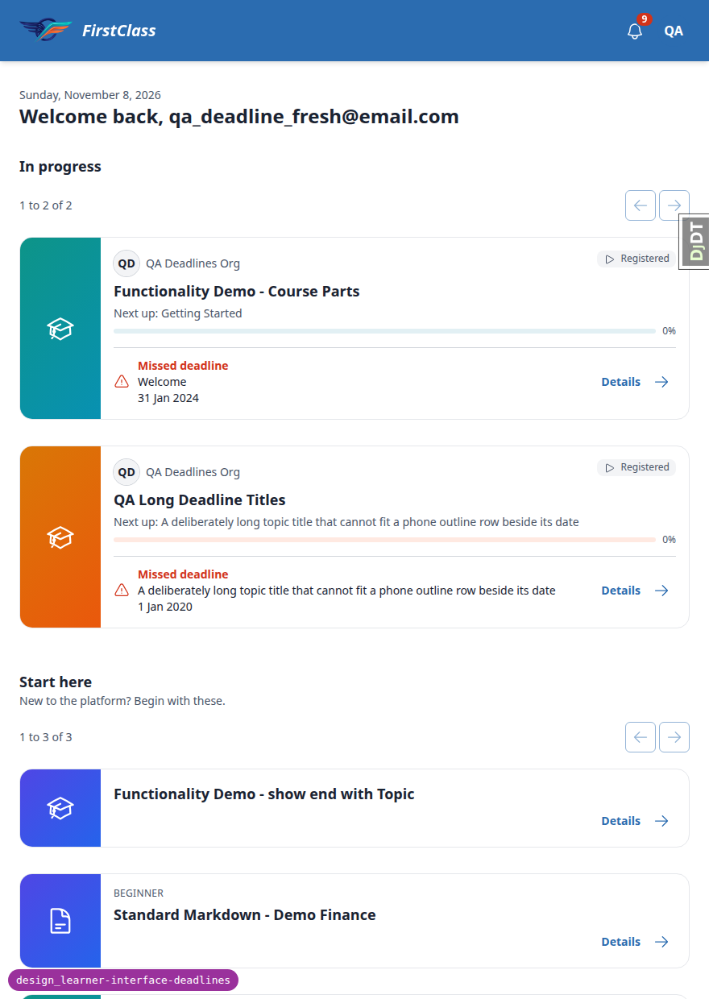 |
| 2.1.1 | desktop | pass | Outline deadline under the progress bar: warning icon, bold "Missed deadline", "Welcome", "31 Jan 2024, 23:59"; computed border 0, transparent background, padding 0; no chip. |  |
| 2.1.2 | desktop | pass | Late learner outline deadline: lock, bold "Closed", "Welcome", "3 Feb 2024, 23:59", the same item as the dashboard card. |  |
| 2.1.3 | desktop | pass | Clock + bold "Deadline today" in warning text colour, "What to Expect", "8 Nov 2026, 23:59". | 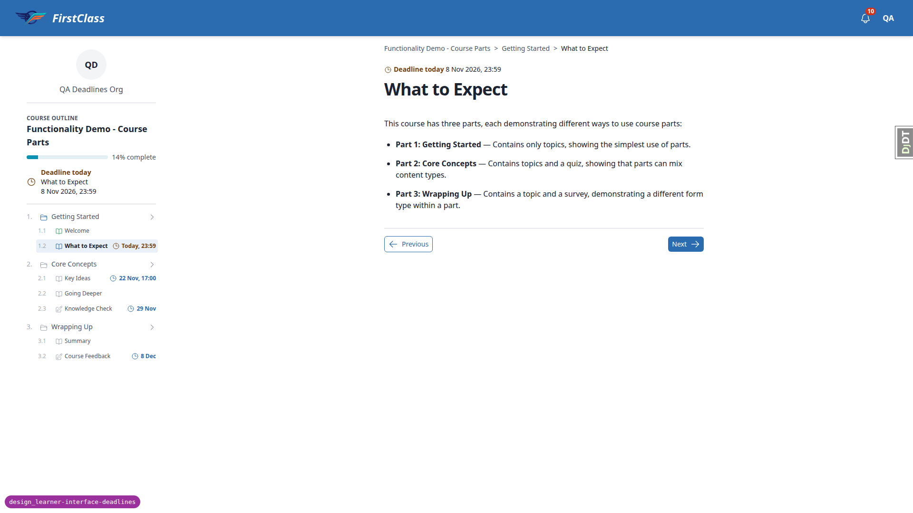 |
| 2.1.4 | desktop | pass | Clock + bold "Deadline" in primary, "Course", "8 Dec 2026, 23:59"; names the same deadline as the card. | 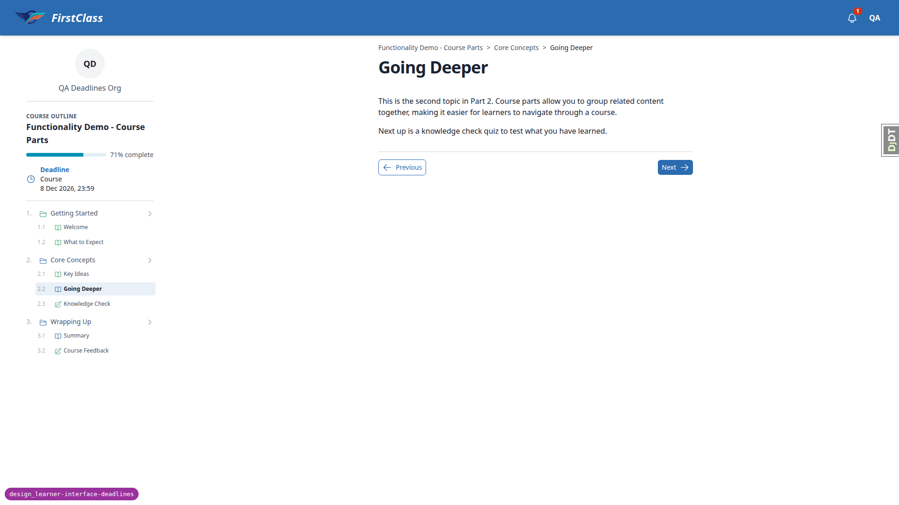 |
| 2.2.1 | desktop | pass | With mark_overdue off: outline deadline clock + "Deadline" in primary, "Welcome", full date. See 5.1. |  |
| 2.2.3 | desktop | pass | Fresh learner on the plain course: no outline deadline, no row dates, no header line. | none |
| 2.2.4 | desktop | pass | Cohort learner with ended access: outline shows with no outline deadline and no header line. Rows still carry dates and "Missed deadline" for screen readers; the spec is silent on this (see General notes). | 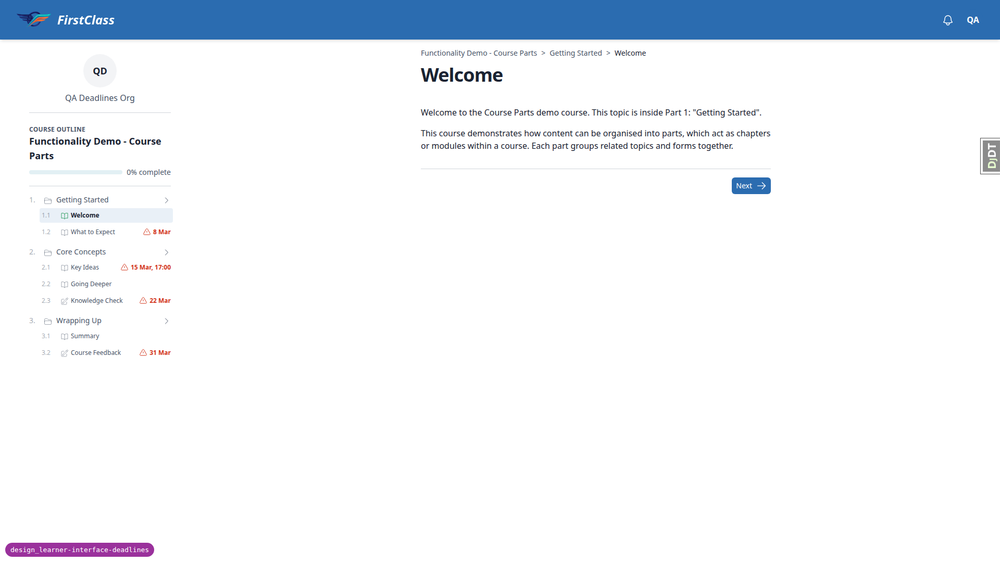 |
| 2.2.5 | desktop | pass | Late learner on the ended plain course: the player redirects to the detail page, with no outline rows or outline deadline. | none |
| 2.2.6 | desktop | pass | Finish page (fresh and late): outline rows show their dates (5 outline-row-date), no outline-deadline. | none |
| 2.3.1 | desktop | pass | Next goes to `/2/` over HTMX with the dialog staying open. Next completes Welcome, so the outline deadline reads "Deadline today / What to Expect / 8 Nov 2026, 23:59", unchanged after Previous. Panel scroll could not be exercised. | none |
| 2.3.2 | desktop | pass | Next from `/2/` swaps to `/3/` over HTMX. Next completes What to Expect, so the outline deadline moves to "Deadline / Key Ideas / 22 Nov 2026, 17:00" and stays after Previous. The plan expected "What to Expect" both times. | none |
| 2.4.1 | tablet | pass | "Open course outline" opens the sheet with the outline deadline above the rows and dates right-aligned on one line. No overflow at 880. |  |
| 2.4.2 | mobile | pass | 375 sheet: the outline deadline wraps inside the sheet above the rows, every row date is inside the sheet, document width 375. | 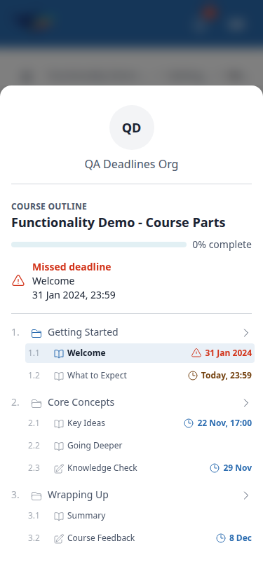 |
| 3.1.1 | desktop | pass | Rows show the right icon, tier colour and a single-line date at the right: Welcome "31 Jan 2024", What to Expect "Today, 23:59", Key Ideas "22 Nov, 17:00", Knowledge Check "29 Nov", Course Feedback "8 Dec". No pill or background. |  |
| 3.1.2 | desktop | pass | Late learner rows: Welcome lock + "3 Feb 2024", Knowledge Check lock + "24 Aug". What to Expect and Key Ideas show the warning icon and "Missed deadline" because they are sequentially locked (spec rule; plan text predates it). Course Feedback shows "7 Nov" plus "Closes 10 Nov." and its title truncates to "Cours..." (see B1). |  |
| 3.1.2-row | desktop | fail | Course Feedback row (late learner, inside its grace window) leaves only "Cours..." of the title in the 320px docked panel. Same at baseline. See B1. | 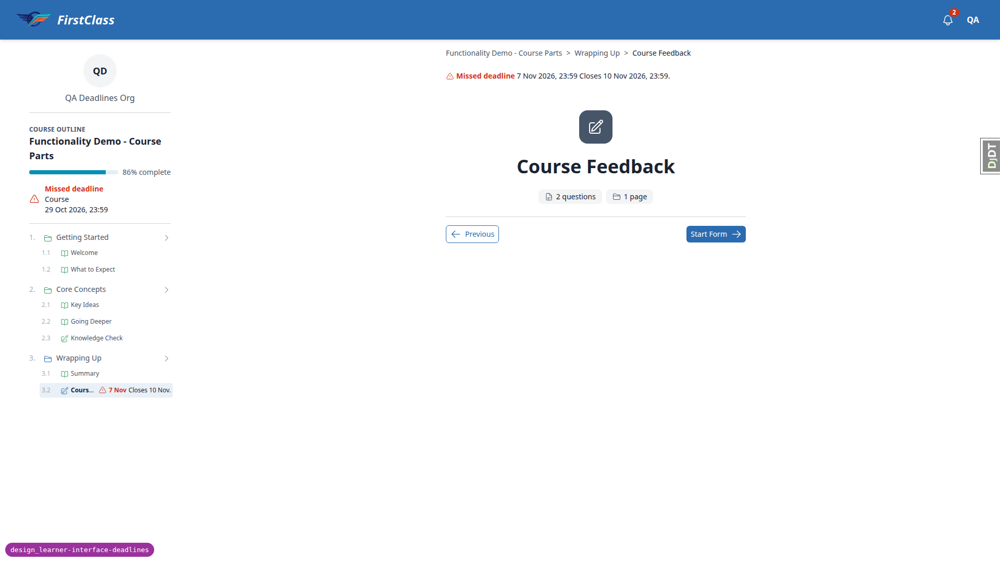 |
| 3.1.3 | desktop | pass | Completed Welcome row shows the completed icon and no date. |  |
| 3.2.1 | mobile | pass | Long-title row ends in an ellipsis; warning icon + "1 Jan 2020" in error colour stay whole inside the sheet. Document width 375. The layout probe flags this view (see B2). | 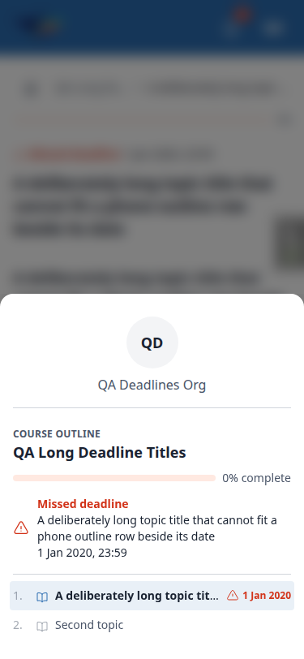 |
| 3.2.2 | desktop | pass | At 1024x768 with the panel docked, the long title truncates with an ellipsis and the icon + "1 Jan 2020" stay whole. No horizontal overflow. | 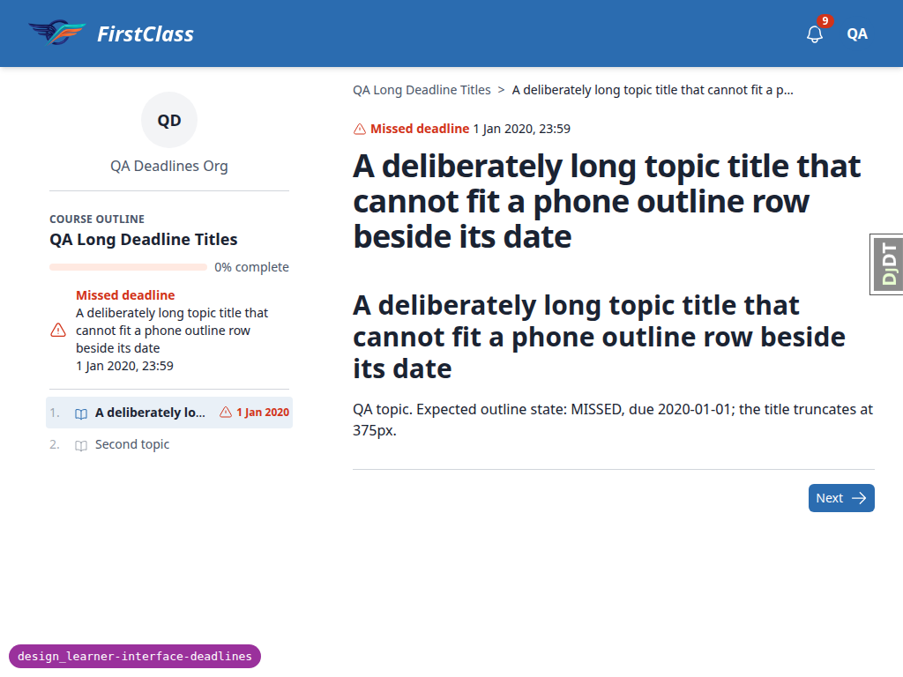 |
| 3.3.1 | desktop | pass | Course detail (`/courses/<slug>/detail/`), late learner: Welcome and Knowledge Check show lock + "Closed", no chip, no dates. What to Expect and Key Ideas show no "Closed" because they are sequentially locked (spec rule; plan text predates it). |  |
| 3.3.2 | desktop | pass | Fresh learner course detail: no dates, no "Closed", no deadline-label. | none |
| 3.3.3 | desktop | pass | The parts course locks sequentially: rows from 1.2 on carry "Locked" for screen readers and keep their tier-coloured icon and date. |  |
| 3.4.1 | desktop | pass | Browser zone America/Los_Angeles: outline deadline and header "31 Jan 2024, 13:59", Key Ideas "22 Nov, 07:00", today row "Today, 13:59" keeps warning colour. | none |
| 3.4.2 | desktop | pass | JavaScript disabled: header line, outline deadline and rows show server text with "SAST". The docked outline panel is not drawn without JS (side-panel dialog in `_base_interface.html`, not changed by this branch). |  |
| 4.1.1 | desktop | pass | Header line above "Welcome", left-aligned with the title: warning icon, bold "Missed deadline", "31 Jan 2024, 23:59", no "·", no chip. 24px above, 12px to the title. |  |
| 4.1.2 | desktop | pass | `/2/` header: clock + bold "Deadline today" in warning colour, "8 Nov 2026, 23:59". |  |
| 4.1.3 | desktop | pass | `/3/` header: clock + bold "Deadline" in primary, "22 Nov 2026, 17:00". | 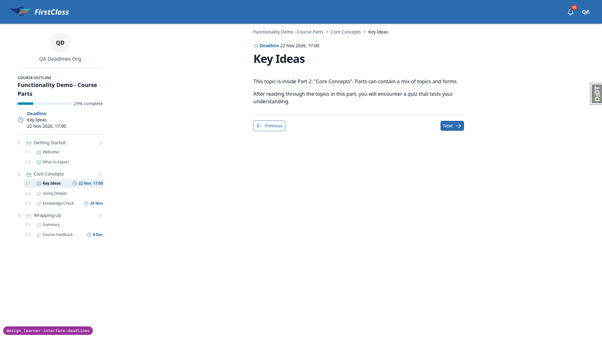 |
| 4.1.4 | desktop | pass | Late learner `/7/` (Course Feedback form): "Missed deadline", "7 Nov 2026, 23:59", and "Closes 10 Nov 2026, 23:59." in normal weight; stands alone under the breadcrumbs. Needed Going Deeper and Summary completed to pass the sequential lock. |  |
| 4.1.5 | desktop | pass | Welcome complete: `/1/` has no header deadline line. | none |
| 4.1.6 | desktop | pass | Going Deeper (no due date, restored learner): no header deadline line. |  |
| 4.2.1-2 | desktop | pass | Closed-item page: header "Closed 3 Feb 2024, 23:59"; body has a centred lock, "Closed on 3 Feb 2024, 23:59." and muted "Ask your educator if you need more time."; no callout. |  |
| 4.2.3 | desktop | pass | Late learner Knowledge Check (`/5/`): header "Closed 24 Aug 2026, 23:59", same centred icon and text, "Submit your answers" still offered. Footer unchanged from main. | none |
| 4.2.4 | mobile | pass | 375 closed page: lock and both lines centred, no callout, header line above the title, document width 375. |  |
| 4.3.2 | mobile | pass | 375: header line above "Welcome", left-aligned at x=16, fits one line; mobile progress bar under the breadcrumbs. | 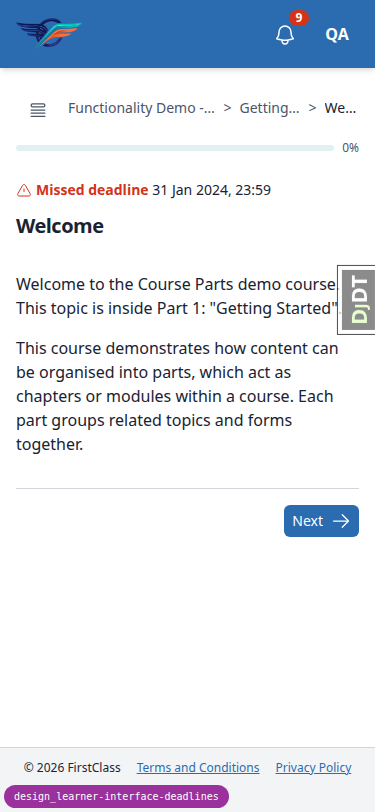 |
| 4.3.3 | tablet | pass | At 880 the header line sits above the title, both left at x=104, 12px gap. |  |
| 4.3.4 | desktop | pass | Long-title topic: header line "Missed deadline 1 Jan 2020, 23:59" above the title, both at x=808; the title wraps with a 12px gap and no overlap. | 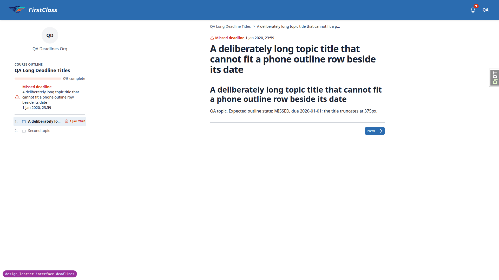 |
| 5.1 | desktop | pass | mark_overdue off, fresh learner: card, Welcome row, outline deadline and header line all show clock + "Deadline" in primary. No "Missed deadline" on the parts course card or player. Covers 1.2.2 and 2.2.1. |  |
| 5.2 | desktop | pass | Every surface holds `[data-testid=deadline-label]` with the expected layout. Missed icon colour and bold text match across card, outline, rows and header. No `.chip` inside any deadline surface; no "·". |  |
| 5.3 | desktop | pass | Fresh and late learners on dashboard, player, course detail, finish page and `/courses/`: no "Due", "Overdue", "was due", "Next deadline:" or "Expired" in learner copy. The only "Due" hit is the demo course title "Functionality Demo - Per-placement Due Dates". | none |
| 5.4.1 | desktop | pass | Accessibility snapshot of player `/1/`: icons are aria-hidden; Welcome row exposes "Missed deadline" + "31 Jan 2024"; outline deadline and header line expose "Missed deadline" and "31 Jan 2024, 23:59". | none |
| 5.4.2 | desktop | pass | Dashboard accessibility tree exposes "Missed deadline", the item title and the date; the hero icon is not exposed. | none |
| 5.4.3 | desktop | pass | Forced colours on: the screenshot has no author colour anywhere by design; tier colours are checked in 5.2. forced-colors active: header and outline deadline keep icon + "Missed deadline"; rows are told apart by warning vs clock icons and the "Today, 23:59" date. The outline progress bar track disappears (not a deadline surface). | 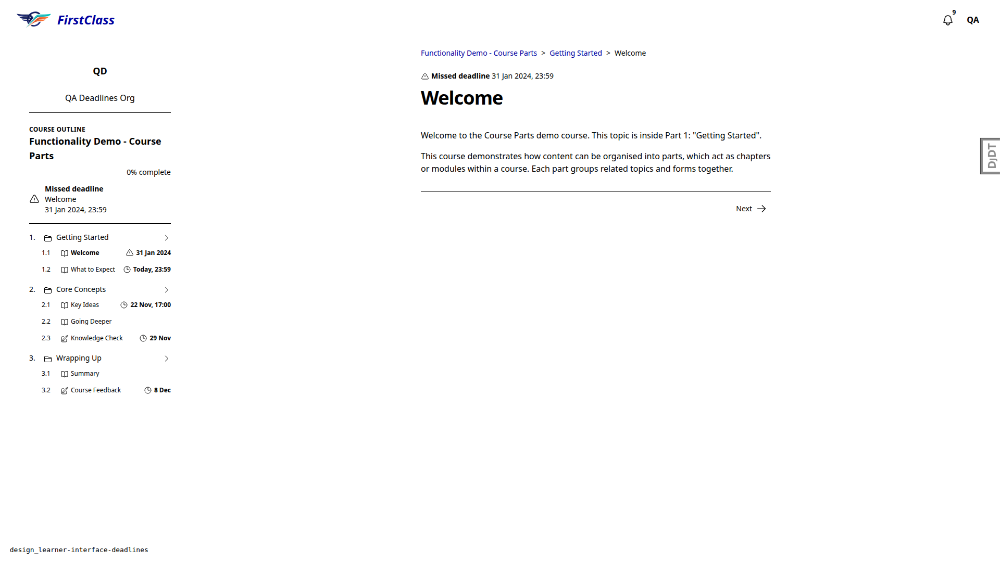 |
| 5.4.4 | desktop | pass | Regressions checklist across the run: hero holds only the icon, byline straddles the hero edge, no chip in any deadline surface, outline-deadline has no border or background, deadline is the last line, closed page has no callout, tier colours match across surfaces. | none |
| 5.5.1 | desktop | pass | All-courses page, fresh learner: no deadline-label and no deadline text. The late learner sees "Access ended" on the ended plain course. | none |
| 5.5.2 | desktop | pass | Superuser, QA Deadlines Cohort Report tab: no deadline-label and no deadline tier words. | 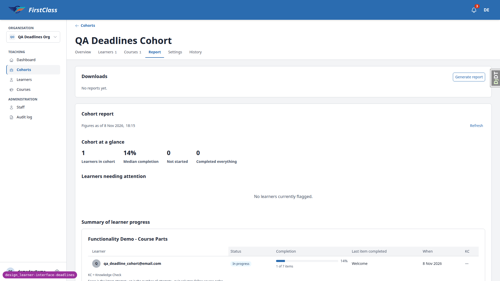 |
| 5.5.3 | desktop | skip | No blog or article cards on the dashboard for these learners; nothing to check. | none |

## Design check

| Test | Viewport | This run | Design | Result |
|---|---|---|---|---|
| 1.1-design | desktop |  | 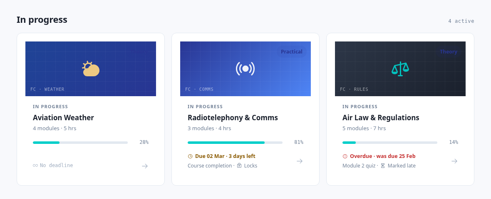 | pass |
| 3.1-design | desktop |  | 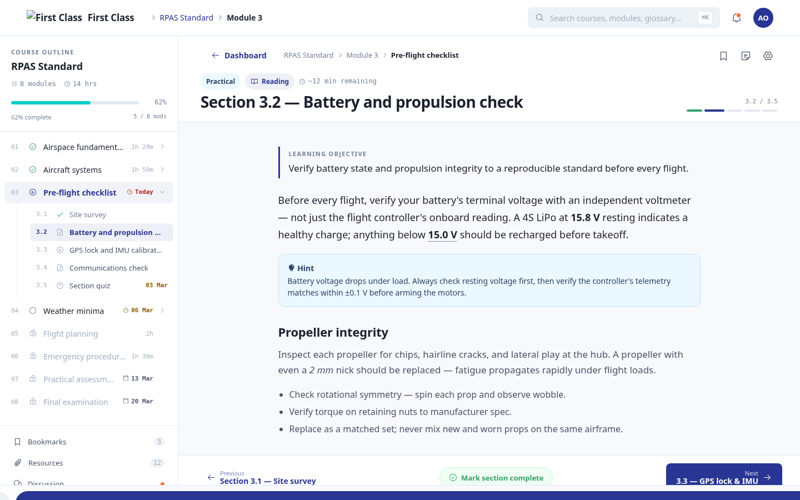 | pass |
| 4.1-design | desktop |  | 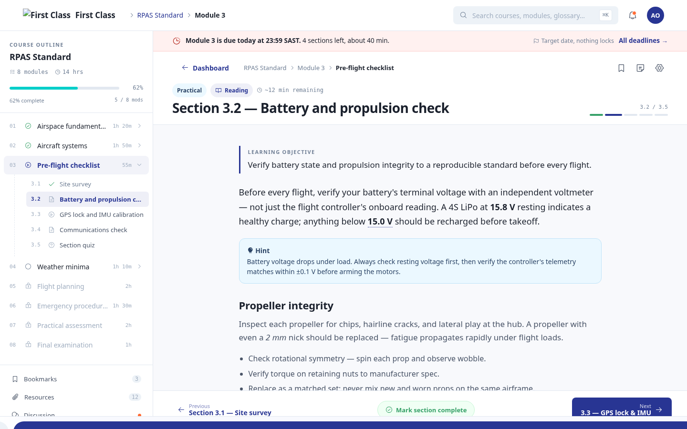 | pass |
| 2.1-design | desktop |  | 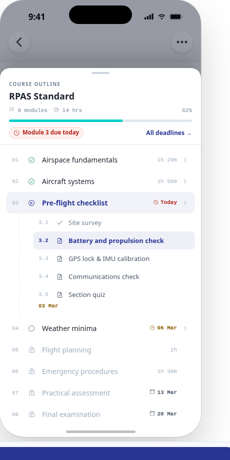 | pass |
| 1.4-design | tablet |  | 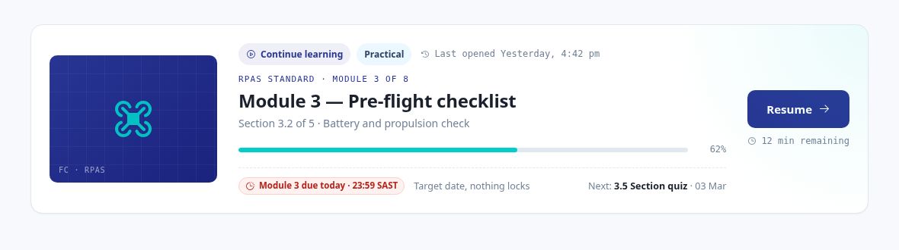 | pass |
| 2.4-design | tablet |  | 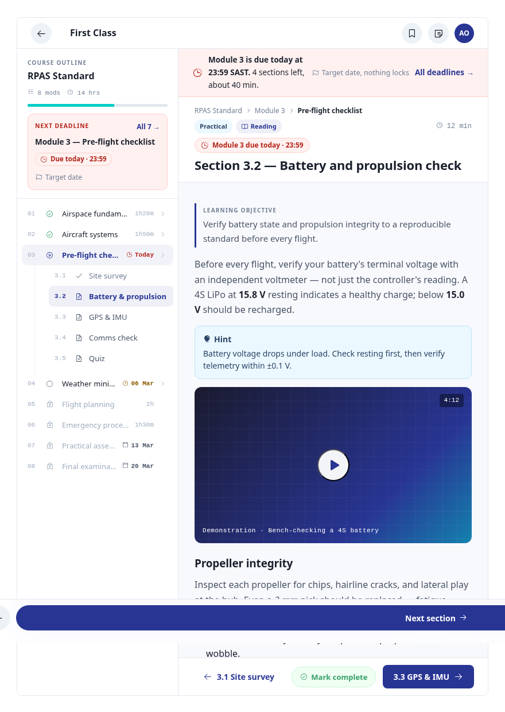 | pass |
| 2.4-design-mobile | mobile |  |  | pass |
| 4.2-design | mobile |  | 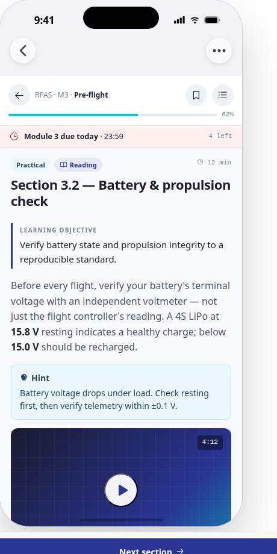 | pass |

## B1: Grace-window outline row squeezes its title to a few characters

Manifestations:

- 3.1.2-row, desktop

Screenshots:

Expected: a dated outline row keeps a readable title. The title truncates before the date wraps, but the item stays identifiable.

Actual: the Course Feedback row (late learner, missed and inside its grace window) carries "7 Nov" and "Closes 10 Nov." on the row line. In the 320px docked panel the title truncates to "Cours...". The spec (minimal layout) puts "Closes ..." on the row line and removed the second line, so moving or shortening it is a UX decision.

## B2: Layout probe flags an open modal outline sheet as overlapping the content

Manifestations:

- 3.2.1, mobile

Screenshots:

Expected: no layout flag for a bottom sheet the learner opened on purpose.

Actual: with the outline sheet open at 375px, the probe reports "overlap: content and sidebar ink intersect". The sheet is a modal dialog over a dimmed page by design (same at tablet, where the content happened to end above the sheet). Whether the generic probe should skip open modal dialogs, or the config's sidebar selector should exclude the modal state, is a tooling decision.

## Layout probe

| Test | Viewport | URL | Screenshot | Result |
|---|---|---|---|---|
| 1.1 | desktop | / | [link](screenshots/page-2026-11-08T18-06-57-970Z.png) | clean |
| 1.2.4 | desktop | / | [link](screenshots/page-2026-11-08T18-07-26-227Z.png) | clean |
| 1.3.3 | desktop | / | [link](screenshots/page-2026-11-08T18-07-42-913Z.png) | clean |
| 1.4.2 | desktop | / (1024x768) | [link](screenshots/page-2026-11-08T18-08-16-212Z.png) | clean |
| 2.1.1 | desktop | /courses/functionality-demo-course-parts/1/ | [link](screenshots/page-2026-11-08T18-08-33-273Z.png) | clean |
| 3.1.1 | desktop | /courses/functionality-demo-course-parts/1/ (panel expanded) | [link](screenshots/element-2026-11-08T18-08-51-360Z.png) | clean |
| 3.3.1 | desktop | /courses/functionality-demo-course-parts/detail/ | [link](screenshots/page-2026-11-08T18-10-22-318Z.png) | clean |
| 4.2.1 | desktop | /courses/functionality-demo-course-parts/1/ | [link](screenshots/page-2026-11-08T18-10-36-445Z.png) | clean |
| 2.2.4 | desktop | /courses/functionality-demo-course-parts/1/ (cohort) | [link](screenshots/page-2026-11-08T18-11-33-115Z.png) | clean |
| 4.3.4 | desktop | /courses/qa-long-deadline-titles/1/ | [link](screenshots/page-2026-11-08T18-11-51-386Z.png) | clean |
| 3.2.2 | desktop | /courses/qa-long-deadline-titles/1/ (1024x768) | [link](screenshots/page-2026-11-08T18-12-02-438Z.png) | clean |
| 1.4.3 | mobile | / | [link](screenshots/page-2026-11-08T18-13-13-163Z.png) | clean |
| 1.4.4 | tablet | / | [link](screenshots/page-2026-11-08T18-13-27-562Z.png) | clean |
| 2.4.1 | tablet | /courses/functionality-demo-course-parts/1/ (sheet open) | [link](screenshots/page-2026-11-08T18-13-38-883Z.png) | clean |
| 4.3.2 | mobile | /courses/functionality-demo-course-parts/1/ | [link](screenshots/page-2026-11-08T18-13-49-867Z.png) | clean |
| 3.2.1 | mobile | /courses/qa-long-deadline-titles/1/ (sheet open) | [link](screenshots/page-2026-11-08T18-14-03-032Z.png) | overlap: content and sidebar ink intersect (see B2) |
| 4.2.4 | mobile | /courses/functionality-demo-course-parts/1/ (late) | [link](screenshots/page-2026-11-08T18-14-39-030Z.png) | clean |
| 5.5.2 | desktop | /educator/organisations/qa-deadlines-org/cohorts/&lt;pk&gt;/__tabs/report | [link](screenshots/page-2026-11-08T18-15-25-767Z.png) | clean |
| 4.1.2 | desktop | /courses/functionality-demo-course-parts/2/ | [link](screenshots/page-2026-11-08T18-17-40-354Z.png) | clean |
| 4.1.3 | desktop | /courses/functionality-demo-course-parts/3/ | [link](screenshots/page-2026-11-08T18-18-00-147Z.png) | clean |
| 4.1.6 | desktop | /courses/functionality-demo-course-parts/4/ | [link](screenshots/page-2026-11-08T18-18-15-740Z.png) | clean |
| 4.1.4 | desktop | /courses/functionality-demo-course-parts/7/ | [link](screenshots/page-2026-11-08T18-18-43-498Z.png) | clean |
| 5.1 | desktop | /courses/functionality-demo-course-parts/1/ | [link](screenshots/page-2026-11-08T18-20-01-421Z.png) | clean |

## Data changes

| What changed | Via |
|---|---|
| 0.3 seed: `qa_create_deadlines_seed` on DemoDev (demo content already loaded). New `qa_create_deadlines_seed_extras` added the fresh learner's today override on What to Expect (2026-11-08 23:59) and the QA Long Deadline Titles course (QA Deadlines Org) with the fresh learner registered. Added `qa_set_item_completion` and `qa_course_deadline_config` helper commands. | sdd:qa-data-helper |
| Batch 1: fresh learner Welcome complete; restored learner Welcome, What to Expect, Key Ideas, Course Feedback complete and Knowledge Check passed; late learner Welcome, What to Expect, Key Ideas, Going Deeper, Summary complete and Knowledge Check passed (the seeded open KC attempt was finished and deleted); fresh learner registered on the plain course. `qa_set_item_completion` changed to answer quizzes correctly. | sdd:qa-data-helper |
| Batch 2: fresh and restored learners' parts-course progress undone to 0% (including visit-created incomplete rows); CourseDeadlineConfig mark_overdue=off added on the parts course. | sdd:qa-data-helper |
| Batch 3: deleted the parts-course CourseDeadlineConfig (mark_overdue off); none remain. | sdd:qa-data-helper |
| Batch 4: fresh learner's parts-course progress undone to 0%; fresh learner completed every item of the plain course (course completed); `qa_set_item_completion` gained `--finish-course`. | sdd:qa-data-helper |
| Batch 5 cleanup: re-ran `qa_create_deadlines_seed` (removes the today override, fresh learner's plain and long-title registrations, all batch completions; restores the late learner's open KC attempt); deleted the QA Long Deadline Titles course, topics and placements; confirmed 0 Course/Organisation/Site deadline configs and 0 fresh-learner overrides. | sdd:qa-data-helper |

## Bug status

- **UNRESOLVED** — Grace-window outline row squeezes its title to a few characters (reason: UX decision; the spec puts "Closes …" on the minimal row line and removed the second line, so where that text goes, or whether the row drops it, is a product call)
- **UNRESOLVED** — Layout probe flags an open modal outline sheet as overlapping the content (reason: tooling decision; whether the generic layout probe should skip an open modal dialog, or the project's `sidebar` region selector should exclude the modal sheet state)

## General notes

- Pre-step rebase: this run rebased onto origin/main (30 commits, no conflicts, full suite 12445 passed). While it ran, main moved to 90ee8011a and another process rebased the branch again and pushed. QA ran on 383dfbc89 plus that process's staged, uncommitted work (date_display / cotton date components) which was in the working tree during the run.
- Date format: main's commit 27e4d2d2b changed localTime to "31 Jan 2024" / "8 Nov 2026, 23:59" (24-hour, day-month) in every locale. The plan's "Jan 31, 2024, 11:59 PM" wording predates it; all dates were judged against the new format. The plan should be updated.
- Plan expectations that predate the code or seed:
  - 3.1.2 and 3.3.1 expect "Closed" on What to Expect and Key Ideas for the late learner, but those rows are sequentially locked, and the spec says a row closed after a sequential lock shows "Locked" and no "Closed".
  - 1.3.1 and 2.2.2 expect the late learner's card to name Course Feedback once earlier items are done, but the seed's 100-day-old registration has passed its 90-day time limit (29 Oct), which is the earliest past deadline and wins per spec rule 4. The card's "Closes" text could not be shown with this seed.
  - 2.3.2 expects What to Expect to stay the outline deadline after Next from `/2/`, but Next completes the item.
  - 1.1 "Next up: Welcome" reads "Next up: Getting Started" (the part).
  - `/courses/<slug>/` redirects registered learners to the player; the course detail page is `/courses/<slug>/detail/`.
- 4.1.4 needed the late learner to complete Going Deeper and Summary as well, to pass the sequential lock to Course Feedback.
- Cohort learner (access ended under outline_and_results): outline rows still show dates with "Missed deadline" for screen readers. The spec says nothing about rows under ended access; worth a look.
- Without JavaScript the docked outline panel is not drawn at desktop (side-panel dialog in `_base_interface.html` needs JS); not changed by this branch.
- Under forced-colors the outline progress bar track disappears (not a deadline surface).
- The registered learner on the course detail page still sees "Start course" / "Free · open to everyone" (not deadline-related, unchanged by this branch).
- The collapsed DjDT tab overlaps the dashboard pagination's next arrow at mobile and tablet widths in screenshots (dev tooling only).
- Knowledge Check passing for test setup required the data helper to answer the quiz correctly; the seeded open attempt was replaced, then restored by the final seed re-run.
- New QA helper commands left in `freedom_ls/qa_helpers/management/commands/`: `qa_create_deadlines_seed_extras` (plan 0.3 items 3-4), `qa_set_item_completion` (complete/undo items, `--finish-course`), `qa_course_deadline_config` (add/delete a course deadline config), each with a dev_tooling test.
- Test 3.1.1 relied on expanding parts 2 and 3 of the outline, which start collapsed.

status: ok · reason: 2 bugs — 0 fixed, 2 unresolved; report rendered, screenshots verified
