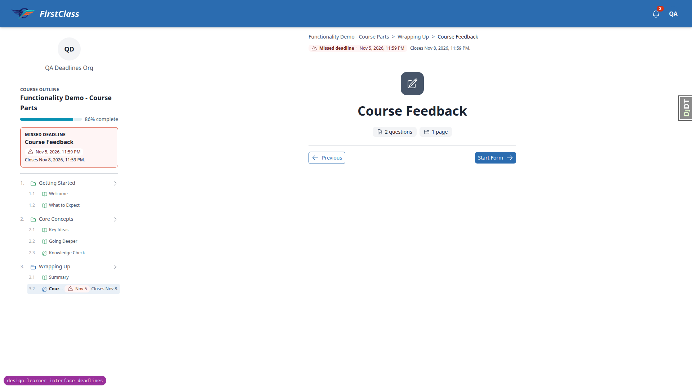
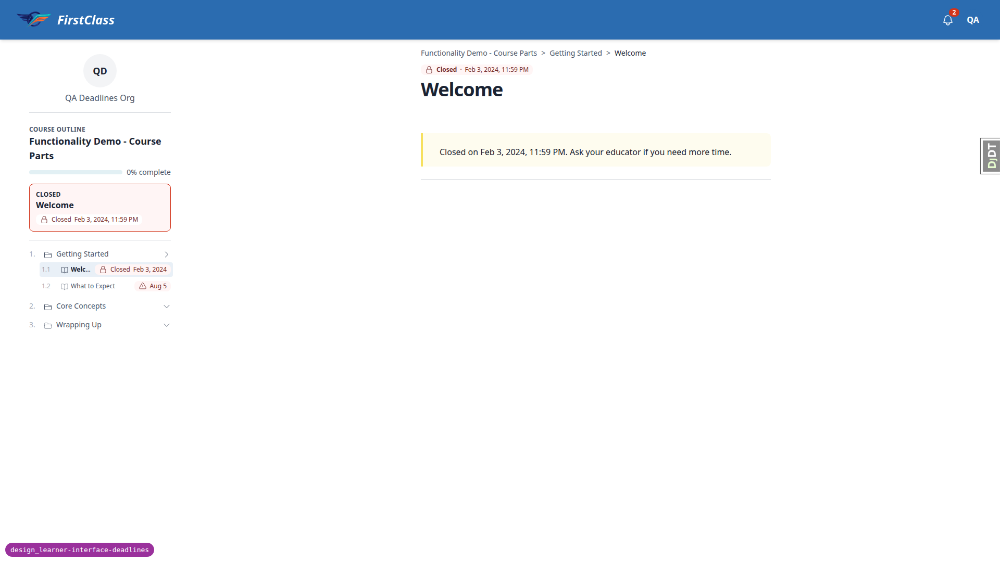

# Frontend QA report: design_learner-interface-deadlines

## Methodology

- Playwright MCP run at desktop 1920x1080 (plus 1280 and 1024), tablet 880x1240 and 768x1024, and mobile 375x812.
- Browser time zone: Africa/Johannesburg (one test also ran as America/Los_Angeles, and one with JavaScript disabled).
- Screenshots are collected in `screenshots/` beside this report. Every image referenced here exists.
- Tests were judged against the current spec where the plan is stale. Commit 0f40faa9b changed the spec after the plan was written. See the general notes.

## Diff scoping

- Class: FULL.
- Triggering files: `course_deadline_band.html`, `course_toc_header.html`, `deadline_labels.html` (all under `freedom_ls/learner_interface/templates/learner_interface/partials/`), `freedom_ls/base/static/base/js/alpine-components.js`, `freedom_ls/learner_interface/views.py`, `freedom_ls/deadlines/resolver.py`, and other templates/ and static/ paths (Rule 1).
- Skipped: nothing.

## Smoke gate

Outcome: pass. Pages checked: `/` and `/courses/functionality-demo-course-parts/1/`.

## Design check

| Test id | Viewport | This run | Design | Result |
|---|---|---|---|---|
| 1.1-design | desktop | [shot](screenshots/page-2026-11-06T12-30-00-242Z.png) | [cards__card-c](design_screenshots/cards__card-c.png) | pass |
| 2.1-design | desktop | [shot](screenshots/page-2026-11-06T12-29-27-649Z.png) | [p-sb__sb-b](design_screenshots/p-sb__sb-b.png) | pass |
| 3.1-design | desktop | [shot](screenshots/page-2026-11-06T12-29-27-649Z.png) | [p-outline__ol-a](design_screenshots/p-outline__ol-a.png) | pass |
| 4.1-design | desktop | [shot](screenshots/page-2026-11-06T12-31-10-158Z.png) | [p-head__hd-a](design_screenshots/p-head__hd-a.png) | pass |
| 2.4-design | mobile | [shot](screenshots/page-2026-11-06T12-35-00-420Z.png) | [mobile__m-toc](design_screenshots/mobile__m-toc.png) | pass |
| 2.4-design | tablet | [shot](screenshots/page-2026-11-06T12-36-18-703Z.png) | [tablet__tb-player](design_screenshots/tablet__tb-player.png) | pass |

## Test results

| Test id | Viewport | Status | Screenshot | Notes |
|---|---|---|---|---|
| 1.1 | desktop | pass | [shot](screenshots/page-2026-11-06T12-30-00-242Z.png) | Parts-course band inside the hero bottom, red tint, warning icon, "Missed deadline", "Welcome", "Jan 31, 2024" on the second line. No "Next deadline" in the body. |
| 1.2 | desktop | pass | [shot](screenshots/page-2026-11-06T12-30-46-609Z.png) | Long-title card: red band, title ellipsised, date whole. Late learner band "Closed Welcome Feb 3, 2024" with lock icon. Restored learner baseline "Missed deadline Welcome Jan 31, 2024". |
| 1.3 | desktop | pass | [shot](screenshots/page-2026-11-06T12-30-46-609Z.png) | Late learner band shows "Feb 3, 2024" only. Restored learner shows "Access ends Dec 6, 2026, 11:59 PM." Cohort learner: no band, "Access ended May 30, 2026" chip in the footer line. Ended plain course: no band. |
| 2.1 | desktop | pass | [shot](screenshots/page-2026-11-06T12-29-27-649Z.png) | Fresh learner: red card "Missed deadline", "Welcome", chip "Jan 31, 2024, 11:59 PM". Late learner: "Closed" with lock icon. Card matches the dashboard band. |
| 2.2 | desktop | pass | — | Cohort learner (ended, outline_and_results): outline shows, no card. Late learner plain course redirects to /detail/ with the access-ended notice: no outline rows, no card. |
| 3.3 | desktop | pass | [shot](screenshots/page-2026-11-06T12-32-07-941Z.png) | Welcome and Knowledge Check carry a red "Closed" chip with lock icon, no dates. Sequentially locked rows show no Closed chip (spec rule). The plan's four chips is stale. |
| 4.1 | desktop | pass | [shot](screenshots/page-2026-11-06T12-31-10-158Z.png) | Chip row above the title (current spec). Fresh /1/: "Missed deadline · Jan 31, 2024, 11:59 PM". Late /1/: "Closed · Feb 3, 2024, 11:59 PM" with lock icon. |
| 3.1 | desktop | pass | [shot](screenshots/page-2026-11-06T12-29-27-649Z.png) | Fresh learner: Welcome red chip "Jan 31, 2024"; What to Expect amber "Today, 11:59 PM"; Key Ideas muted "Nov 20, 05:00 PM"; Knowledge Check "Nov 27"; Course Feedback "Dec 6". Late learner: Welcome and Knowledge Check "Closed"; Course Feedback "Missed deadline Nov 5 Closes Nov 8."; locked rows show "Missed deadline" not Closed. |
| 3.2 | desktop | pass | [shot](screenshots/page-2026-11-06T12-33-19-287Z.png) | 1024x768 docked panel: long title truncates, "Jan 1, 2020" chip whole. 1920 also fine ([shot](screenshots/page-2026-11-06T12-33-12-926Z.png)). |
| 1.4 | desktop | pass | [shot](screenshots/page-2026-11-06T12-33-36-347Z.png) | Org mark overlaps only the band's second line; text readable. At 1280 and 1024 the date stays whole and the long title truncates. |
| 3.4 | desktop | pass | [shot](screenshots/page-2026-11-06T12-34-00-000Z-nojs.png) | America/Los_Angeles: card "Jan 31, 2024, 01:59 PM", Key Ideas "Nov 20, 07:00 AM", today item "Today, 01:59 PM". JS off: server text in SAST ("31 Jan 2024, 23:59 SAST"). |
| 4.2 | desktop | pass | [shot](screenshots/page-2026-11-06T12-33-12-926Z.png) | Long topic title wraps; header chip above it, no overlap. |
| 5.2 | desktop | pass | — | No "Due", "Overdue", "was due", "Next deadline:" or "Expired" in fresh/late learner UI. The only "Due" is a demo course title. |
| 5.3 | desktop | pass | [shot](screenshots/page-2026-11-06T12-34-21-535Z.png) | No unnamed icon nodes. Outline row and header expose "Missed deadline" and the time. forced-colors: each chip keeps a 1px solid border; icons and words identify tiers. |
| 5.4 | desktop | pass | — | All-courses page rows show no deadline text. |
| 2.2 | desktop | pass | — | Finish page as fresh learner: outline rows show dates, no next-deadline card. |
| 1.4 | mobile | pass | [shot](screenshots/page-2026-11-06T12-34-48-443Z.png) | Fresh: red "Missed deadline" chip, "Welcome Jan 31, 2024, 11:59 PM". Late: red "Closed" chip with lock, "Welcome Feb 3, 2024, 11:59 PM". No overflow. ([second shot](screenshots/page-2026-11-06T12-35-30-198Z.png)) |
| 2.4 | mobile | pass | [shot](screenshots/page-2026-11-06T12-35-00-420Z.png) | Outline sheet: org mark, header, next-deadline card, rows with right-aligned dates. No overflow. |
| 3.2 | mobile | pass | [shot](screenshots/page-2026-11-06T12-35-19-434Z.png) | Long title ends in an ellipsis; "Jan 1, 2020" chip whole inside the sheet; no overflow. |
| 4.2 | mobile | pass | [shot](screenshots/page-2026-11-06T12-34-56-917Z.png) | Header chip above the title, under the breadcrumbs and mobile progress bar. |
| 2.3 | desktop | pass | [shot](screenshots/page-2026-11-06T12-37-31-592Z.png) | Next on an unfinished topic completes it; page swapped to /2/ without a full reload. Card refreshed to "Next deadline What to Expect". Previous/Next also kept the document. |
| 1.2 | desktop | pass | — | Welcome complete: band bg-warning-light, clock icon, "Deadline", "What to Expect", "Today, 11:59 PM". |
| 2.1 | desktop | pass | [shot](screenshots/page-2026-11-06T12-37-31-592Z.png) | Welcome complete: amber card, eyebrow "Next deadline", "What to Expect", amber chip "Nov 6, 2026, 11:59 PM". |
| 3.1 | desktop | pass | [shot](screenshots/page-2026-11-06T12-37-31-592Z.png) | Completed Welcome row: completed status, no date. |
| 4.1 | desktop | pass | [shot](screenshots/page-2026-11-06T12-37-31-592Z.png) | /2/ today item: amber "Deadline today · Nov 6, 2026, 11:59 PM" chip. /1/ after Welcome done: no chip. |
| 2.4 | tablet | pass | [shot](screenshots/page-2026-11-06T12-36-18-703Z.png) | 880x1240: outline sheet with header, card, rows with right-aligned treatment. Header chip above the title. No overflow. 768x1024 also clean ([shot](screenshots/page-2026-11-06T12-36-29-229Z.png)). |
| 1.4 | tablet | pass | [shot](screenshots/page-2026-11-06T12-36-07-219Z.png) | 880 course rows: "Missed deadline" chip, title and full date; no overflow. |
| 4.1 | desktop | pass | — | /3/ Key Ideas: neutral "Deadline · Nov 20, 2026, 05:00 PM" chip. /4/ Going Deeper: no chip; card names Knowledge Check. |
| 4.2 | desktop | pass | [shot](screenshots/page-2026-11-06T12-38-24-982Z.png) | Knowledge Check form page: neutral "Deadline · Nov 27, 2026, 11:59 PM" chip above the form title. Exam runner: no chip, no card ([shot](screenshots/page-2026-11-06T12-38-30-272Z.png)). |
| 5.4 | desktop | pass | [shot](screenshots/page-2026-11-06T12-39-40-176Z.png) | Educator interface as superuser: no deadline tier, band or tier words. No blog/article cards on the learner dashboard. |
| 1.3 | desktop | pass | — | Late learner with earlier items done: band bg-error-light "Missed deadline Course Feedback Nov 5 Closes Nov 8." Completed plain course sits in "Learning history" with no band. |
| 1.2 | desktop | pass | — | Every dated item done: neutral band (bg-surface-2) "Deadline Course Dec 6". |
| 2.1 | desktop | pass | — | Every dated item done: neutral card, "Next deadline", "Course", "Dec 6, 2026, 11:59 PM". Matches the dashboard band. |
| 2.2 | desktop | pass | [shot](screenshots/page-2026-11-06T12-43-22-754Z.png) | Late learner: card "Missed deadline", "Course Feedback", red chip "Nov 5, 2026, 11:59 PM", then "Closes Nov 8, 2026, 11:59 PM." Plain course with no deadlines: no card. |
| 4.1 | desktop | pass | [shot](screenshots/page-2026-11-06T12-43-22-754Z.png) | Late learner /7/: red "Missed deadline · Nov 5, 2026, 11:59 PM" chip then "Closes Nov 8, 2026, 11:59 PM." above the title. |
| 3.1-closes-row | desktop | fail | [shot](screenshots/page-2026-11-06T12-43-22-754Z.png) | Docked 320px outline: Course Feedback row shows chip "Nov 5" and "Closes Nov 8.", leaving the title as "Cour…". Welcome's "Closed Feb 3, 2024" leaves "Welc…" ([shot](screenshots/page-2026-11-06T12-31-10-158Z.png)). See B1. |
| 5.1 | desktop | pass | [shot](screenshots/page-2026-11-06T12-46-12-823Z.png) | mark_overdue off, fresh learner: neutral band "Deadline Welcome Jan 31, 2024"; outline row muted "Deadline Jan 31, 2024"; card eyebrow "Deadline"; header "Deadline · Jan 31, 2024, 11:59 PM". No "Missed deadline". |

## B1: Outline row title squeezed to a few characters by a wide deadline treatment

Manifestations: test 3.1-closes-row, desktop (docked outline, 320px panel).

- Expected: an outline row in the docked panel stays identifiable. Enough of the item title shows beside its deadline treatment to tell which item it is.
- Actual: Course Feedback's row ("Nov 5" chip plus "Closes Nov 8.") truncates the title to "Cour…". Welcome's "Closed Feb 3, 2024" chip truncates it to "Welc…". The row follows the spec's rule (title truncates, date shrink-0), so the fix is a UX choice: drop or shorten the row's Closes text, wrap the treatment onto a second line when tight, or give the title a minimum width.

## Layout probe

| Test id | Viewport | URL | Screenshot | Result |
|---|---|---|---|---|
| 1.1 | desktop | `/` | [shot](screenshots/page-2026-11-06T12-30-00-242Z.png) | clean |
| 2.1 | desktop | `/courses/functionality-demo-course-parts/1/` | [shot](screenshots/page-2026-11-06T12-29-27-649Z.png) | clean |
| 4.1 | desktop | `/courses/functionality-demo-course-parts/1/` | [shot](screenshots/page-2026-11-06T12-31-10-158Z.png) | clean |
| 3.2 | desktop | `/courses/qa-long-deadline-titles/1/` | [shot](screenshots/page-2026-11-06T12-33-19-287Z.png) | clean |
| 1.4 | desktop | `/` | [shot](screenshots/page-2026-11-06T12-33-36-347Z.png) | clean |
| 1.4 | mobile | `/` | [shot](screenshots/page-2026-11-06T12-34-48-443Z.png) | clean |
| 2.4 | mobile | `/courses/functionality-demo-course-parts/1/` | [shot](screenshots/page-2026-11-06T12-35-00-420Z.png) | flags: overlap: header and sidebar ink intersect; overlap: content and sidebar ink intersect. Note: probe ran with the outline bottom sheet open. The modal sheet is drawn over the page by design, so these are the open modal, not a layout defect. The page with the sheet closed ([shot](screenshots/page-2026-11-06T12-34-56-917Z.png)) has no flags. |
| 4.2 | mobile | `/courses/functionality-demo-course-parts/1/` | [shot](screenshots/page-2026-11-06T12-34-56-917Z.png) | clean |
| 2.3 | desktop | `/courses/functionality-demo-course-parts/2/` | [shot](screenshots/page-2026-11-06T12-37-31-592Z.png) | clean |
| 2.4 | tablet | `/courses/functionality-demo-course-parts/1/` | [shot](screenshots/page-2026-11-06T12-36-29-229Z.png) | clean |
| 1.4 | tablet | `/` | [shot](screenshots/page-2026-11-06T12-36-07-219Z.png) | clean |
| 4.2 | desktop | `/courses/functionality-demo-course-parts/5/` | [shot](screenshots/page-2026-11-06T12-38-24-982Z.png) | clean |
| 4.1 | desktop | `/courses/functionality-demo-course-parts/7/` | [shot](screenshots/page-2026-11-06T12-43-22-754Z.png) | clean |
| 5.1 | desktop | `/courses/functionality-demo-course-parts/1/` | [shot](screenshots/page-2026-11-06T12-46-12-823Z.png) | clean |

## Data changes

| What changed | Via |
|---|---|
| content_save demo_content DemoDev; qa_create_deadlines_seed (4 qa_deadline_* learners, site zone Africa/Johannesburg); today-item LearnerDeadlineOverride a7144252 on What to Expect for the fresh learner; QA Long Deadline Titles course (QA Deadlines Org) with the fresh learner registered; no deadline config rows | sdd:qa-data-helper |
| As qa_deadline_fresh, clicked Next through Welcome, What to Expect, Key Ideas and Going Deeper (completing them) and started the Knowledge Check form (open attempt) | learner actions in the browser |
| Reset the fresh learner parts-course progress to baseline; restored learner: completed Welcome, What to Expect, Key Ideas, Course Feedback and Knowledge Check; late learner: completed Welcome, What to Expect, Key Ideas, Going Deeper, Summary and Knowledge Check, plus a course-wide FIXED LearnerDeadlineOverride 64dc3c7d (today+30); fresh learner registered on the plain course and completed it | sdd:qa-data-helper |
| Created CourseDeadlineConfig 6a7c73db for the parts course with mark_overdue=off | sdd:qa-data-helper |
| 5.5 cleanup: deleted CourseDeadlineConfig 6a7c73db, the today-item override, the QA Long Deadline Titles course and registration, the late learner course-wide override 64dc3c7d, the fresh learner plain-course registration; reverted restored/late learner completions | sdd:qa-data-helper |

## Bug status

| Bug | Status |
|---|---|
| B1 | **UNRESOLVED** — Outline row title squeezed to a few characters by a wide deadline treatment (reason: the row follows the spec's truncate rule; fixing it needs a UX decision on how a row with a chip and a Closes line should fit the 320px panel) |

## General notes

- The test plan predates commit 0f40faa9b ("match the deadline surfaces to the design screenshots"), which changed the spec. The header deadline is now a chip row above the title (design p-head__hd-a; hd-b is out of scope). Access ended moved from the eyebrow to the footer line. Timed deadlines show their time on rows and the band (Decision 5). Tests were judged against the current spec and design table. The plan's section 3.1 ("Today", no time), 3.3 (four Closed chips; sequentially locked rows show no Closed chip by the spec's rule), 4.1 and 4.2 (card to the right of the title, stacking below lg) and 1.3.3 (Access ended eyebrow) wording is stale and should be updated.
- Times use a 2-digit hour ("05:00 PM", "01:59 PM") because localTime passes hour: '2-digit'. The same option is on main for the full format, so this predates the branch. The plan expects "5:00 PM".
- Section 2.3: Next on an unfinished topic completes it, so the plan's "card still reads Missed deadline Welcome after Next" cannot hold. The swap kept the document (no full reload) and the card refreshed correctly.
- Outside this branch's scope: the course detail page shows "Start course" and "Free · open to everyone" to registered learners at 0% progress. The cohort learner (access ended, outline_and_results) still sees Missed deadline chips on outline rows (the spec only removes the card).
- Pre-step rebase: 23 commits replayed onto origin/main; conflicts in `.claude/agent-memory/sdd-qa-data-helper/MEMORY.md` (kept both sides) and `docs/product/learner-experience.md` (rerere resolution kept). Lost-change check: review paths were main's context only. Full tier: 2 failures. One was a flaky Playwright cohort-report focus test (passes alone). The other, test_all_courses_row_with_an_empty_eyebrow_draws_no_eyebrow_line, already failed on the branch because the new footer line uses justify-between; fixed in 370d8e2ad by targeting the eyebrow's "items-start justify-between". Branch force-pushed with lease.
- The layout probe on the open mobile outline sheet reports header/content overlap with the sidebar; that is the modal bottom sheet drawn over the page, not a defect. The DjDT tab handle sits at the right edge in screenshots (collapsed toolbar).

status: ok · reason: 1 bug — 0 fixed, 1 unresolved (red lane, UX decision); report rendered, screenshots verified
