# Frontend QA report: design_learner-interface-deadlines

Frontend QA run of `3. frontend_qa.md` for the learner-interface deadline display (dashboard band, course player next-deadline card, outline row chips, item header card, closed-item page). The smoke gate passed and almost all tests passed. Two bugs were found: B1 (the dashboard band loses the item title on narrow cards with an organisation mark, 1024x768) and B2 (a stray space before the full stop in the dashboard course-row deadline line, mobile and tablet).

## Methodology

- Playwright MCP against a dev server on port 8448; the branch badge was confirmed to match `design_learner-interface-deadlines`.
- Browser time zone: Africa/Johannesburg (America/Los_Angeles and JS-disabled contexts used for test 3.4).
- Viewports: 1920x1080 desktop, 1280x800 and 1024x768 for card widths, 375x812 mobile, 880x1240 (the plan's tablet) and 768x1024 tablet.
- Screenshots were collected into `screenshots/` beside this report, and every referenced image exists there.
- The branch was rebased onto main before the run (11,608 tests passed after the rebase; upstream review: unchanged).

## Diff scoping

- Class: **FULL**.
- Changed files:
  - `.claude/agent-memory/sdd-qa-data-helper/MEMORY.md`
  - `.claude/agent-memory/sdd-qa-data-helper/reference_deadline_outline_scenario_command.md`
  - `freedom_ls/accounts/allauth_account_adapter.py`
  - `freedom_ls/accounts/utils.py`
  - `freedom_ls/base/static/base/js/alpine-components.js`
  - `freedom_ls/deadlines/resolver.py`
  - `freedom_ls/deadlines/templatetags/deadline_tags.py`
  - `freedom_ls/deadlines/tests/templatetags/test_deadline_tags.py`
  - `freedom_ls/deadlines/tests/test_resolver.py`
  - `freedom_ls/learner_interface/templates/cotton/course-card-shell.html`
  - `freedom_ls/learner_interface/templates/learner_interface/_course_base.html`
  - `freedom_ls/learner_interface/templates/learner_interface/course_item_closed.html`
  - `freedom_ls/learner_interface/templates/learner_interface/course_topic.html`
  - `freedom_ls/learner_interface/templates/learner_interface/partials/course_card.html`
  - `freedom_ls/learner_interface/templates/learner_interface/partials/course_deadline_band.html`
  - `freedom_ls/learner_interface/templates/learner_interface/partials/course_deadline_line.html`
  - `freedom_ls/learner_interface/templates/learner_interface/partials/course_minimal_toc.html`
  - `freedom_ls/learner_interface/templates/learner_interface/partials/course_toc_header.html`
  - `freedom_ls/learner_interface/templates/learner_interface/partials/deadline_labels.html`
  - `freedom_ls/learner_interface/tests/playwright/test_course_browse_flow.py`
  - `freedom_ls/learner_interface/tests/test_utils.py`
  - `freedom_ls/learner_interface/tests/views/test_course_detail.py`
  - `freedom_ls/learner_interface/tests/views/test_course_player.py`
  - `freedom_ls/learner_interface/tests/views/test_dashboard.py`
  - `freedom_ls/learner_interface/utils.py`
  - `freedom_ls/learner_interface/views.py`
  - `freedom_ls/qa_helpers/management/commands/qa_create_deadline_outline_scenario.py`
  - `freedom_ls/site_aware_models/tests/test_time_zones.py`
  - `freedom_ls/site_aware_models/time_zones.py`
- Skipped: nothing. Desktop, mobile and tablet all ran.

## Smoke gate

Outcome: **pass**. Pages checked: `/` and `/courses/functionality-demo-course-parts/1/`.

## Results by section

| Test | Viewport | Result | Screenshot | Notes |
|---|---|---|---|---|
| 1.1 | desktop | pass | 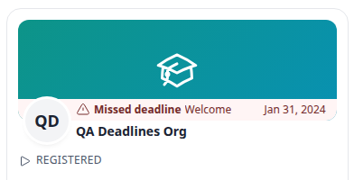 | Red band in the hero bottom: warning icon, bold "Missed deadline", "Welcome", "Jan 31, 2024" on the right, no time. No deadline line in the body. Body reads "Next up: Getting Started" (part title), not "Next up: Welcome" as the plan says; the next-up wording predates this branch. |
| 1.2 | desktop | pass | 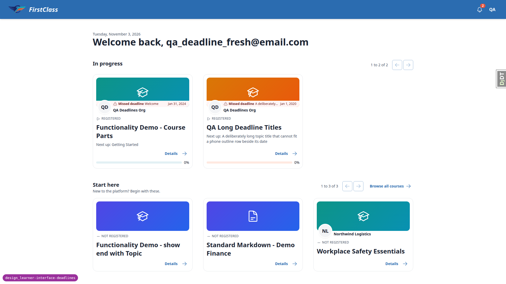 | Step 1: QA Long Deadline Titles band is red "Missed deadline", the long title is truncated with an ellipsis, and "Jan 1, 2020" is whole. |
| 1.4 | desktop | pass |  | Step 1 at 1920: the organisation mark sits over the band's left edge; band content is padded past it, so "Missed deadline" and the title are fully readable. |
| 1.4 | 1280x800 | pass | 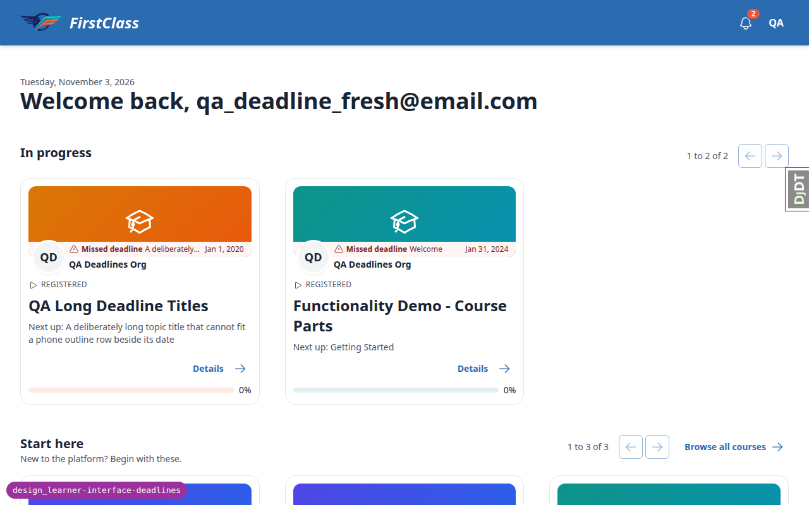 | Date whole; long title truncates to 87px, Welcome whole. |
| 1.4 | 1024x768 | **fail** | 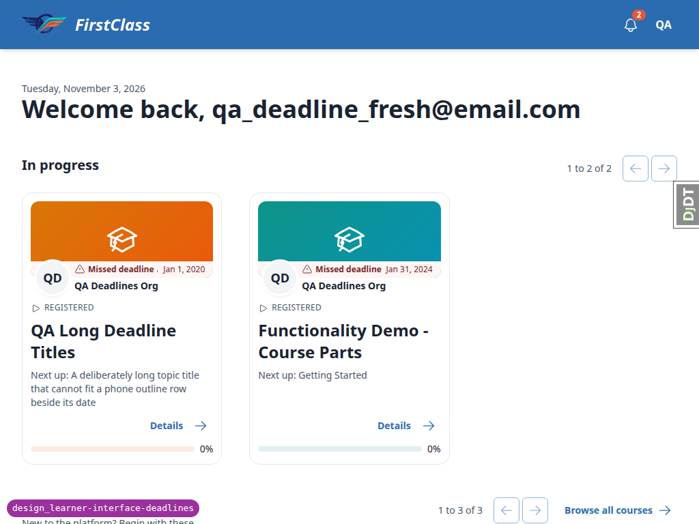 | Cards with an organisation mark: the band title collapses to 0-2px, so the band reads only "Missed deadline ... Jan 31, 2024" with no item name. The band pads 64px (`pl-16` in `course-card-shell.html`) to clear the mark, leaving no room for the title beside the tier word and date in a ~268px hero. See B1. |
| 2.1 | desktop | pass | 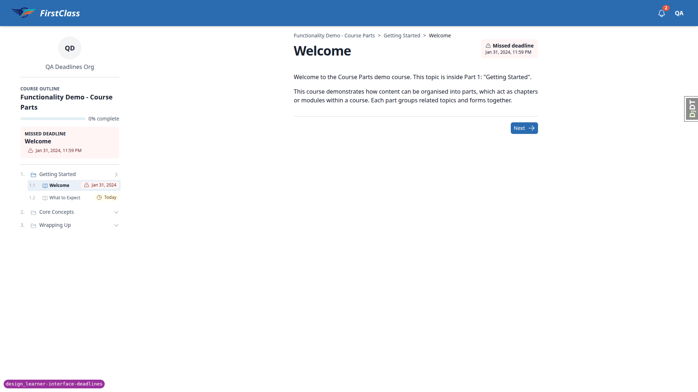 | Step 1: red card under the progress bar: eyebrow "Missed deadline", bold "Welcome", warning icon + "Jan 31, 2024, 11:59 PM". Names the same deadline as the dashboard band. |
| 4.1 | desktop | pass |  | Step 1: red header card right of "Welcome": warning icon, bold "Missed deadline", "Jan 31, 2024, 11:59 PM". Nothing deadline-related above the title. |
| 3.1 | desktop | pass | 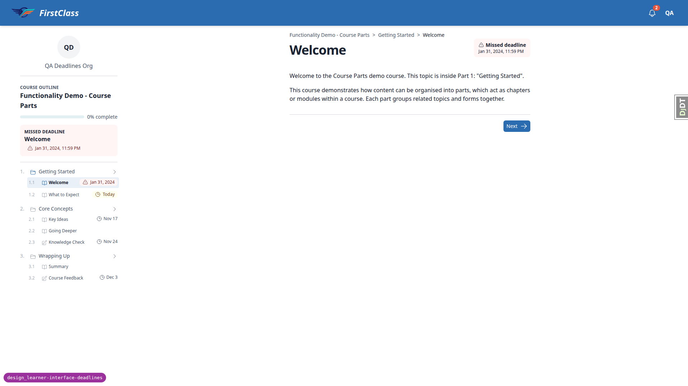 | Welcome: red chip with warning icon "Jan 31, 2024", "Missed deadline" in the accessible text. What to Expect: amber "Today". Key Ideas Nov 17, Knowledge Check Nov 24, Course Feedback Dec 3: muted clock. Going Deeper, Summary and part rows have no date. All on the row line. The current row keeps its highlight with the chip inside. |
| 3.3 | desktop | pass |  | Step 2: fresh course detail page has no dates and no chips. Step 3: the course locks sequentially; locked rows (sr-only "Locked") show muted dates, never a Closed chip. Locked item URLs redirect to the course detail page. |
| 2.2 | desktop | pass | 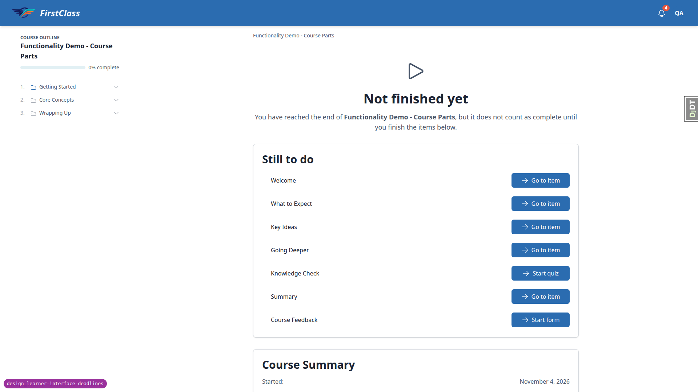 | Step 6: finish page as the fresh learner: outline rows show their dates, no next-deadline card. |
| 4.2 | desktop | pass | 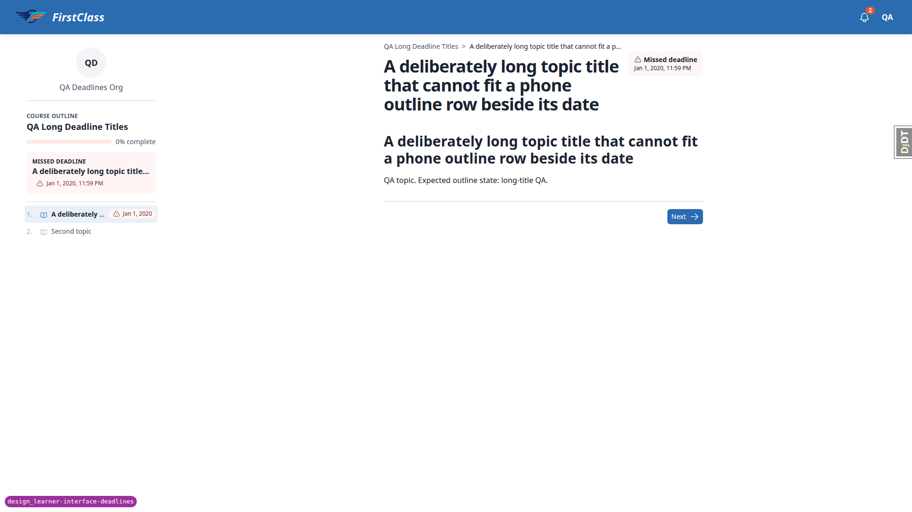 | Step 4: the long title wraps over 3 lines; the header card keeps 157px width at the right, no overlap. |
| 3.2 | 1024x768 | pass | 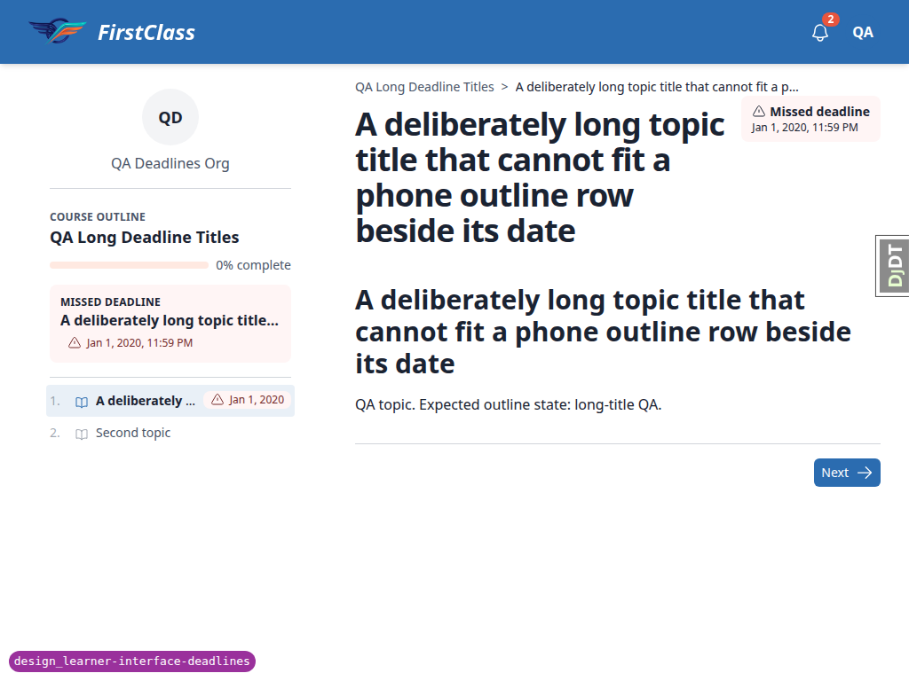 | Step 2: docked panel; the long-title row truncates with an ellipsis and the "Jan 1, 2020" chip is whole. The header card is still beside the title at 1024 (lg). |
| 5.2 | desktop | pass | none | Fresh learner: dashboard, player item 1, course detail and finish page contain no Due/Overdue/was due/Next deadline:/Expired. `/courses/` matches only the demo course title "Functionality Demo - Per-placement Due Dates" (content, not UI copy). |
| 5.4 | desktop | pass | none | Step 1: `/courses/` as the fresh learner shows no deadline text or `<time>` elements. |
| 1.2 | desktop | pass | 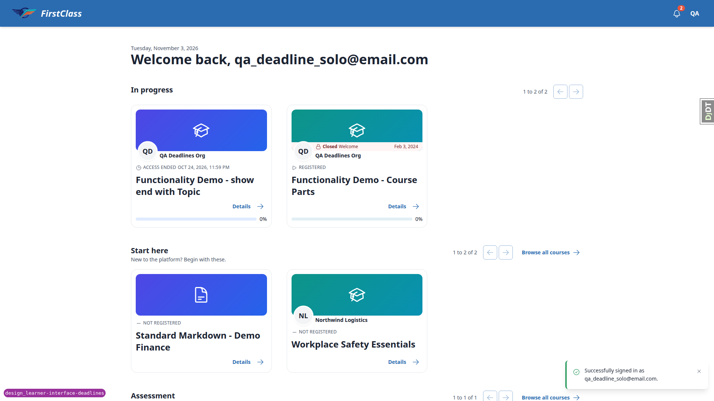 | Step 4: late learner band is red with a lock icon, "Closed Welcome Feb 3, 2024"; it names the item. |
| 1.3 | desktop | pass |  | Step 1 (first part): the closed band shows "Feb 3, 2024" only, no Closes. Step 4: the plain course card (ended, nothing) shows the "Access ended Oct 24, 2026, 11:59 PM" eyebrow and no band. |
| 2.1 | desktop | pass | 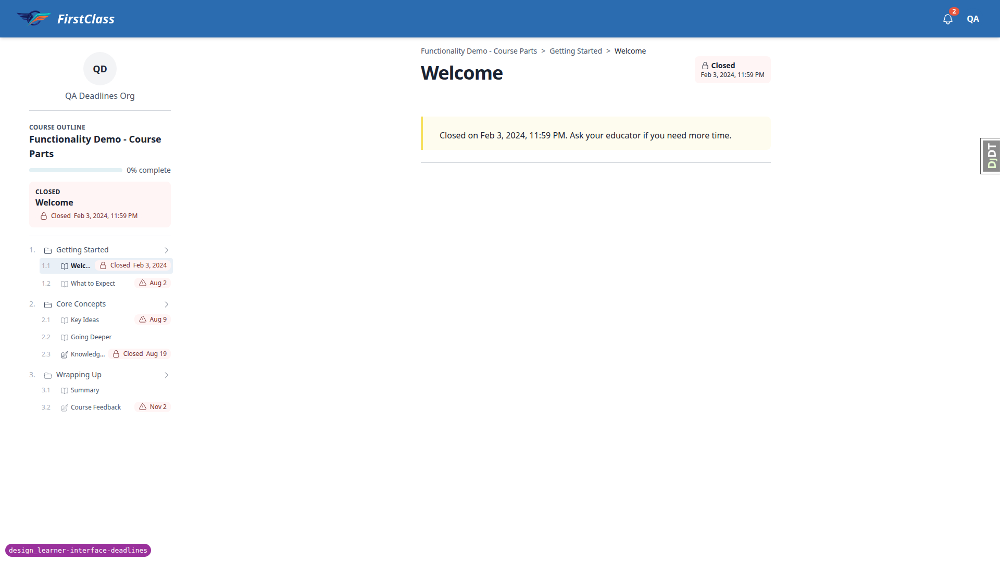 | Step 2: the late learner's `/1/` opens the closed-item page; card eyebrow "Closed", "Welcome", lock icon "Closed Feb 3, 2024, 11:59 PM". Matches the dashboard band. |
| 4.1 | desktop | pass |  | Step 5: closed-item page header card: lock icon, "Closed", "Feb 3, 2024, 11:59 PM"; the notice "Closed on Feb 3, 2024, 11:59 PM. Ask your educator..." is unchanged. |
| 3.1 | desktop | pass |  | Step 2: Welcome and Knowledge Check rows have a red lock chip "Closed Feb 3, 2024" / "Closed Aug 19"; Course Feedback has red "Missed deadline" Nov 2 (yesterday). What to Expect and Key Ideas show "Missed deadline" Aug 2 / Aug 9, not "Closed" as the plan says: they sit behind the sequential lock and spec line 200 says rows closed after a sequential lock show "Locked" with no Closed chip. The build follows the spec; the plan wording is out of date. The Welcome title truncates to "Welc..." beside the wide Closed chip at desktop, as designed (the title truncates before the date). |
| 3.3 | desktop | pass | 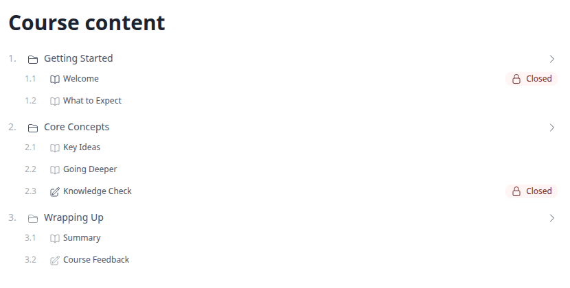 | Step 1: late learner course detail: Welcome and Knowledge Check carry a red lock "Closed" chip inline with no date; What to Expect, Key Ideas (behind the sequential lock, per spec) and Course Feedback show no chip; no dates anywhere. |
| 2.2 | desktop | pass | 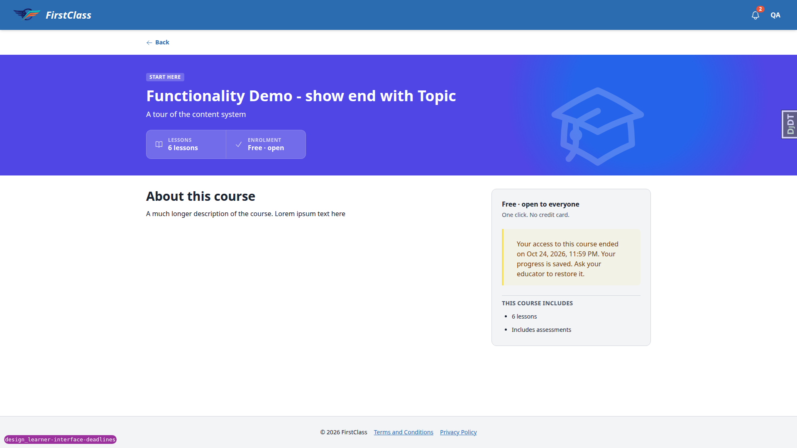 | Step 5: late learner plain course (ended, nothing): `/1/` and `/finish/` redirect to the detail page with the access-ended notice; no outline rows, no card. |
| 5.2 | desktop | pass | none | Late learner: dashboard, player item 1 (closed-item page), course detail and finish page contain no Due/Overdue/was due/Next deadline:/Expired. |
| 1.3 | desktop | pass | 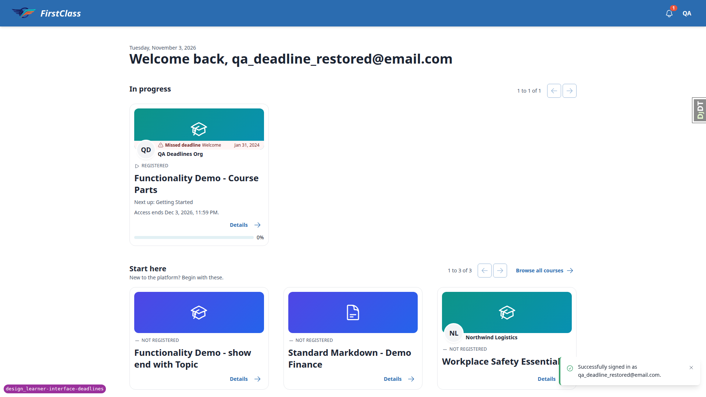 | Step 2: restored learner card body: "Next up: Getting Started" then "Access ends Dec 3, 2026, 11:59 PM." in the body, not the band; band "Missed deadline Welcome Jan 31, 2024" (also 1.2 step 5, first part). Step 3: cohort learner card "Access ended May 30, 2026, 11:59 PM" eyebrow, no band. |
| 2.2 | desktop | pass | 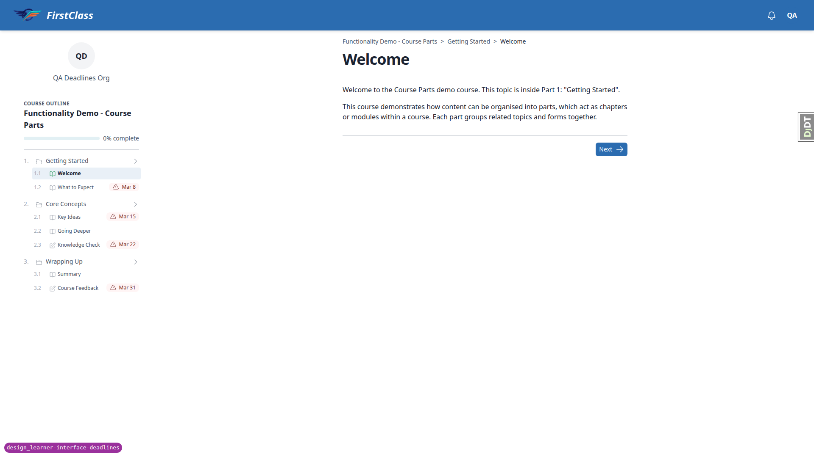 | Step 4: cohort learner (access ended, outline_and_results): the outline shows, no next-deadline card. Outline rows still show red "Missed deadline" chips (Mar 8, Mar 15 ...) after access ended; the spec does not cover rows under ended access, noted only. |
| 2.1 | desktop | pass | 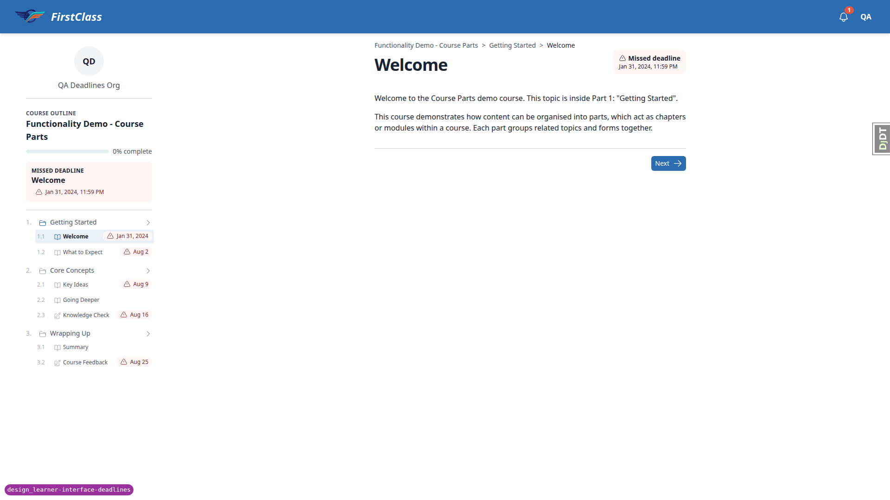 | Restored learner (no completions): card "Missed deadline Welcome Jan 31, 2024, 11:59 PM", matching the dashboard band. |
| 2.3 | desktop | pass | 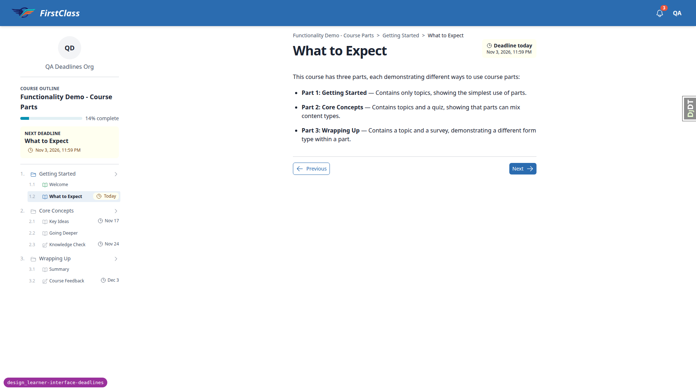 | Next is a button that POSTs over HTMX and completes the item (item 2 is locked until then), so step 1's "card still reads Missed deadline Welcome after Next" cannot hold: after Next the card correctly reads "Next deadline What to Expect". The URL moves /1/ -> /2/ -> /1/ -> /2/ with no full reload (the page JS marker survives); the card stays under the progress bar and reads "Next deadline What to Expect" after every Next and Previous (step 2). |
| 2.1 | desktop | pass |  | Step 3: Welcome complete: amber card, eyebrow "Next deadline", "What to Expect", clock icon "Nov 3, 2026, 11:59 PM". |
| 4.1 | desktop | pass |  | Step 2: `/2/` amber header card, clock icon, "Deadline today", "Nov 3, 2026, 11:59 PM". Step 6: completed Welcome `/1/` shows no header card. |
| 3.1 | desktop | pass |  | Step 3: the completed Welcome row shows the green completed icon, no date. |
| 1.2 | desktop | pass | 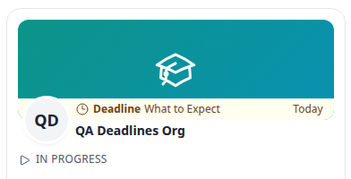 | Step 3: Welcome complete: band amber (`bg-warning-light`), clock icon, "Deadline", "What to Expect", right text exactly "Today". Step 5: restored learner with all dated items done: band neutral "Deadline Course Dec 3" (no year); body "Access ends Dec 3, 2026, 11:59 PM." |
| 2.1 | desktop | pass | 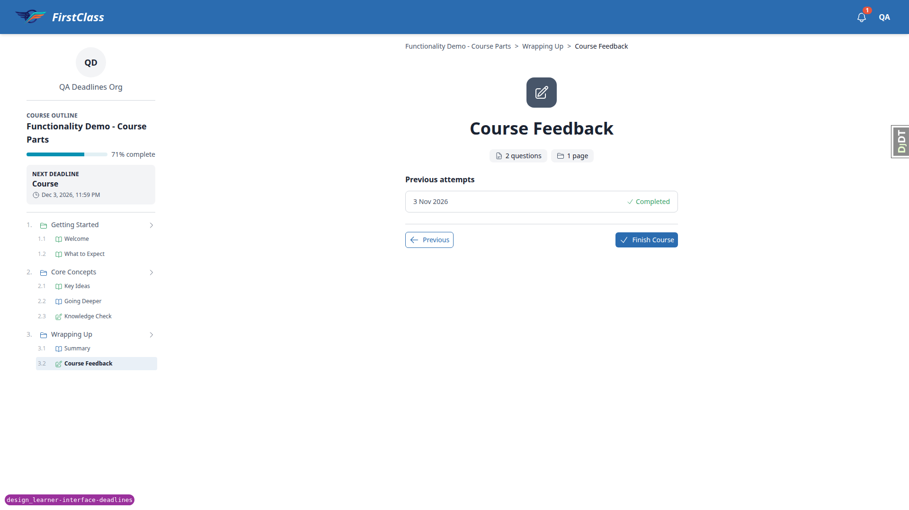 | Step 4: restored learner, all dated items done: card eyebrow "Next deadline", "Course", "Dec 3, 2026, 11:59 PM". Matches the band. |
| 4.1 | desktop | pass | 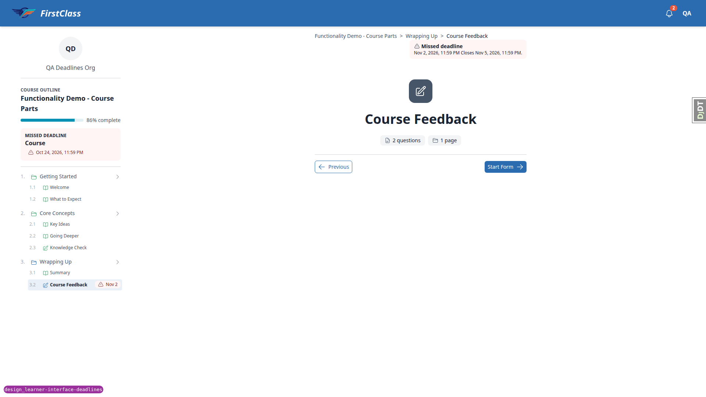 | Step 4: late learner `/7/` Course Feedback: red header card "Missed deadline", "Nov 2, 2026, 11:59 PM Closes Nov 5, 2026, 11:59 PM." |
| 4.2 | desktop | pass |  | Step 1 (form page): the form draws its own title in the content; the header row shows only the header card at the right of an empty title area. |
| 1.3 | desktop | pass | 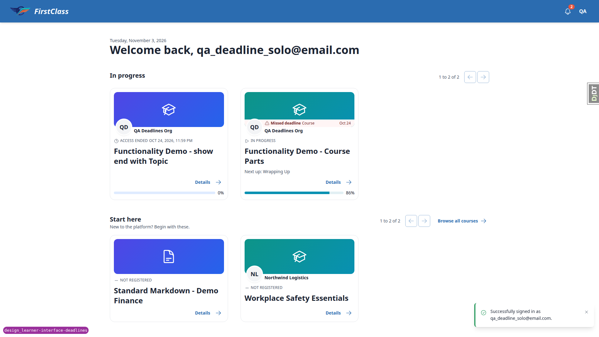 | Step 1: with Welcome-Key Ideas complete and Knowledge Check submitted, the late learner's band reads "Missed deadline Course Oct 24", not "Course Feedback": the 90-day time limit from the 100-day-old registration passed Oct 24, before Course Feedback's Nov 2. Spec rule 4 counts the time limit end as a deadline titled "Course" (the learner has end_course_access=off, which the spec does not exempt). The build follows the spec; the plan expectation overlooked the time limit. The Closes line was re-tested after a time-limit override. |
| 5.1 | desktop | pass | 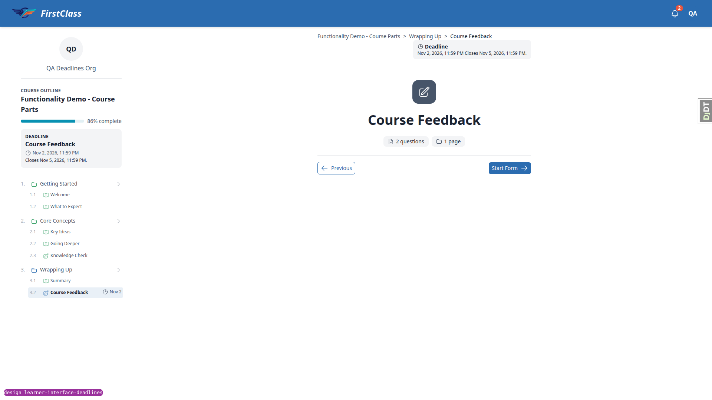 | Run on the late learner (the fresh learner's Welcome was already completed by the Next button). mark_overdue=off: band neutral `bg-surface-2` "Deadline Course Feedback Nov 2 Closes Nov 5."; next-deadline card eyebrow "Deadline" (not "Next deadline"), full date and Closes; header card on `/7/` neutral "Deadline"; no "Missed deadline" anywhere on the dashboard or player. Config deleted via admin afterwards. |
| 2.2 | desktop | pass | 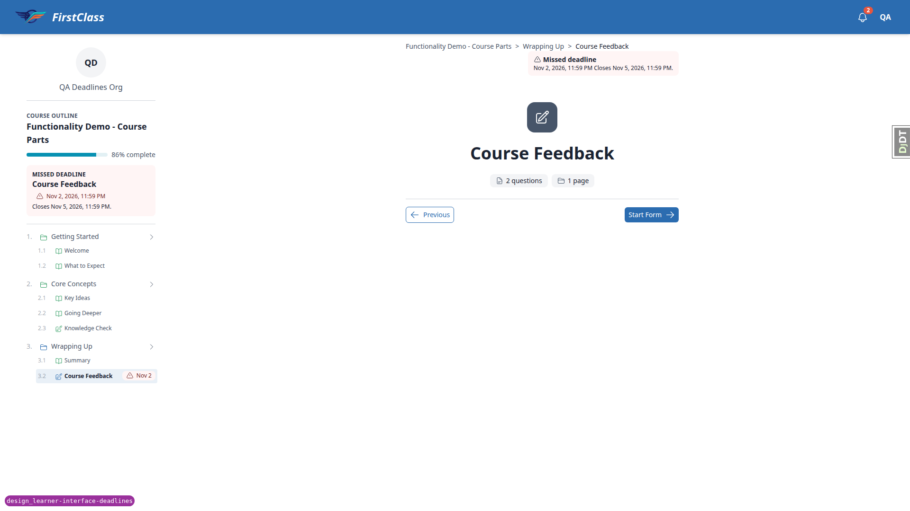 | Step 1 (late learner): mark_overdue off gives eyebrow "Deadline". Step 2: card "Missed deadline", "Course Feedback", red chip "Nov 2, 2026, 11:59 PM", then "Closes Nov 5, 2026, 11:59 PM." |
| 1.3 | desktop | pass |  | Step 1 after the time-limit override: band red "Missed deadline Course Feedback Nov 2 Closes Nov 5." At 1920 the title truncates to "Cour..." beside the org mark padding (see B1). |
| 3.4 | desktop | pass | 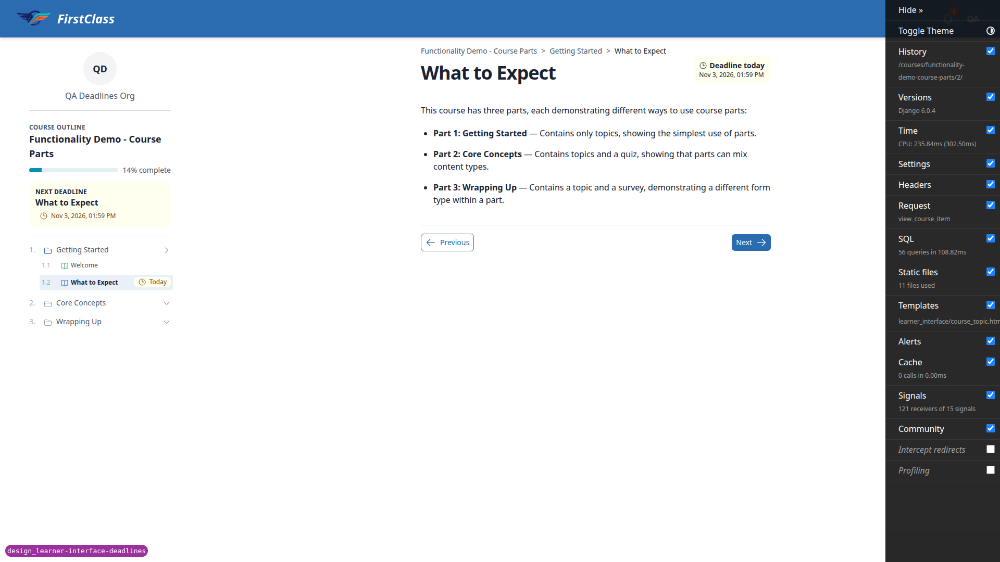 | Step 1 (America/Los_Angeles): the Key Ideas row is still "Nov 17"; the today row is still "Today"; the card and header show the full time "Nov 3, 2026, 01:59 PM" (Pacific instant). The plan writes "1:59 PM"; the leading zero comes from `hour:"2-digit"` in the local-time formatter, which predates this branch. Step 2 (JS disabled): server text shown: rows "17 Nov", "24 Nov", "3 Dec", "Today"; card/header "3 Nov 2026, 23:59 SAST"; dashboard "1 Jan 2020". |
| 5.3 | desktop | pass | 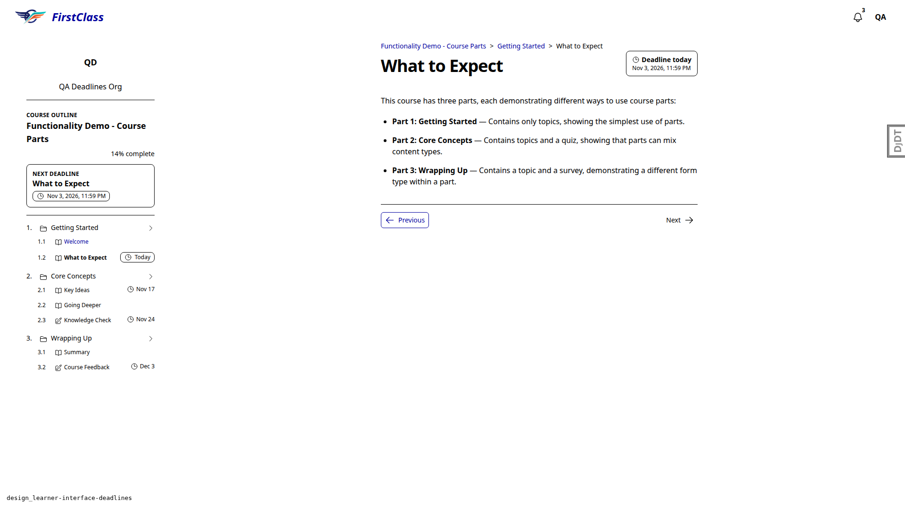 | Step 1: the aria snapshot has no node named warning/deadline/locked/clock (icons sit in aria-hidden wrappers); an outline row exposes "Missed deadline" + time; the header card exposes "Missed deadline" + "Jan 1, 2020, 11:59 PM" (checked on the long-title course since parts Welcome was complete). Step 2: the dashboard band paragraph and its time are in the tree; the hero icon is not. Step 3: with forced colours active, bands, card and chips keep a 1px solid border, and the clock icon + "Today"/"Deadline today" are readable. The progress bar and Next button lose their outline under forced colours (not touched by this branch). |
| 4.1 | desktop | pass | 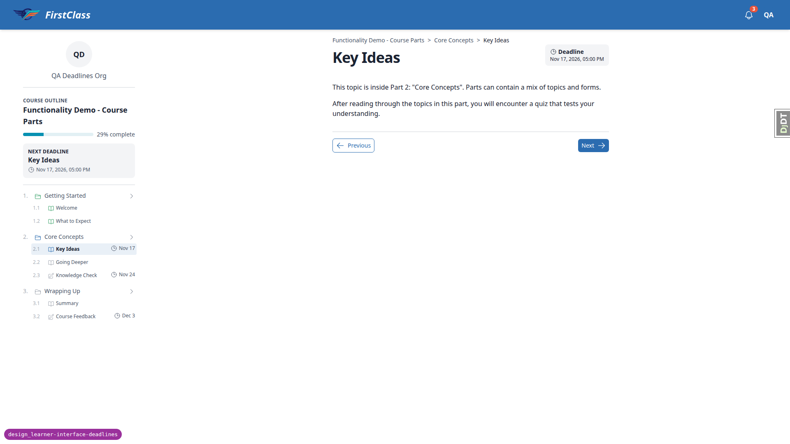 | Step 3: `/3/` Key Ideas neutral (`bg-surface-2`) header card "Deadline", "Nov 17, 2026, 05:00 PM" (the plan writes 5:00 PM; the leading zero is the pre-existing 2-digit hour format). Card "Next deadline Key Ideas". Step 7: Going Deeper (no due date) shows no card. |
| 4.2 | desktop | pass | 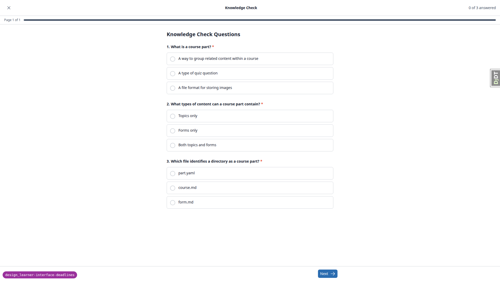 | Step 1: Knowledge Check (item 5) form page: neutral header card "Deadline Nov 24, 2026, 11:59 PM" right of an empty title area. Start Form -> `/5/fill_form/1`: the exam runner shows no header card or deadline text. |
| 1.4 | mobile | **fail** | 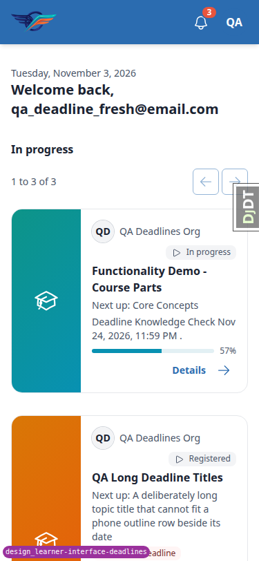 | Step 3: course rows with an upcoming deadline read "Deadline Knowledge Check Nov 24, 2026, 11:59 PM ." with a stray space before the full stop. The tier-date partial in `deadline_labels.html` ends in a newline after ``, and the line partial appends "." straight after it. No horizontal overflow (scrollWidth 375). See B2. |
| 1.4 | mobile | pass | 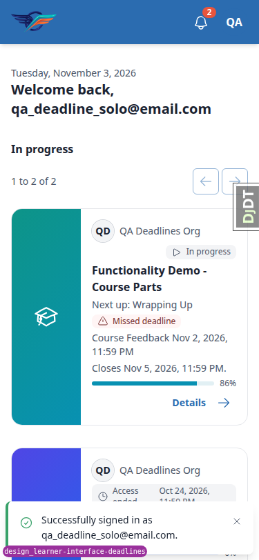 | Step 3 (late learner): the row reads a red "Missed deadline" chip with warning icon, "Course Feedback Nov 2, 2026, 11:59 PM", "Closes Nov 5, 2026, 11:59 PM." and names the item. The Closed-chip row was not re-checked on mobile because the late learner's closed items were completed for later steps; the Closed chip is the same component checked at desktop. The plain-course "Access ended Oct 24, 2026, 11:59 PM" status chip wraps to two lines but stays readable (`course_row.html` not touched by this branch). |
| 3.2 | mobile | pass | 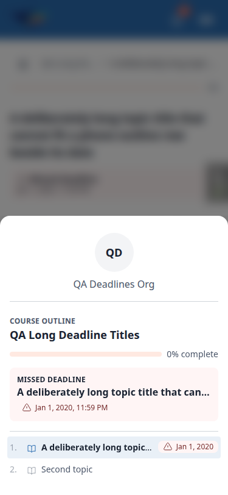 | Step 1: outline sheet: the long-title row ends in an ellipsis; the red chip "Jan 1, 2020" is whole (right edge 351 inside the 375 sheet); Second topic has no date; the card is above the rows; page scrollWidth 375. |
| 4.2 | mobile | pass | 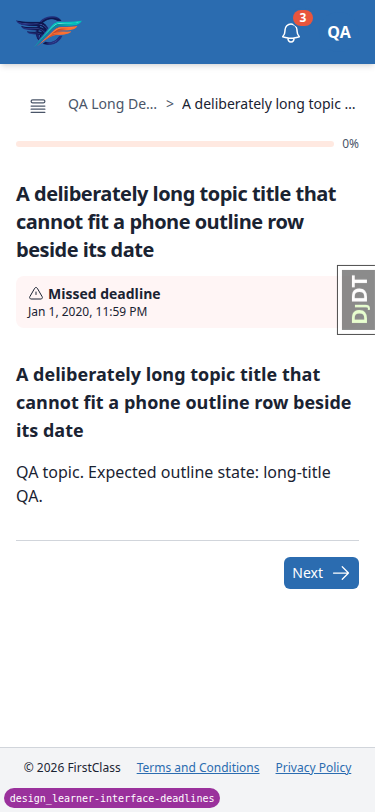 | Step 2: the header card sits under the title, full width of the text column; the mobile progress bar shows under the breadcrumbs. |
| 2.4 | mobile | pass | 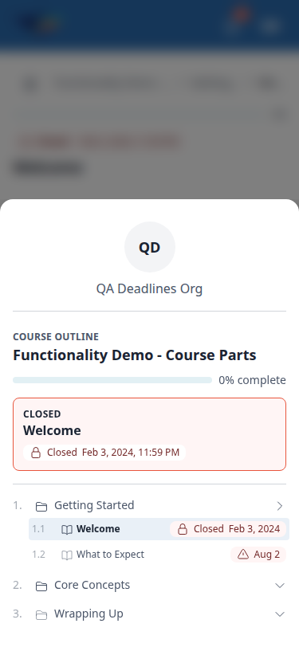 | Step 2: the sheet shows header, card, rows. The card chip "Nov 2, 2026, 11:59 PM" and "Closes Nov 5, 2026, 11:59 PM." wrap inside the card; no element extends past the sheet; scrollWidth 375. |
| 1.4 | tablet | **fail** | 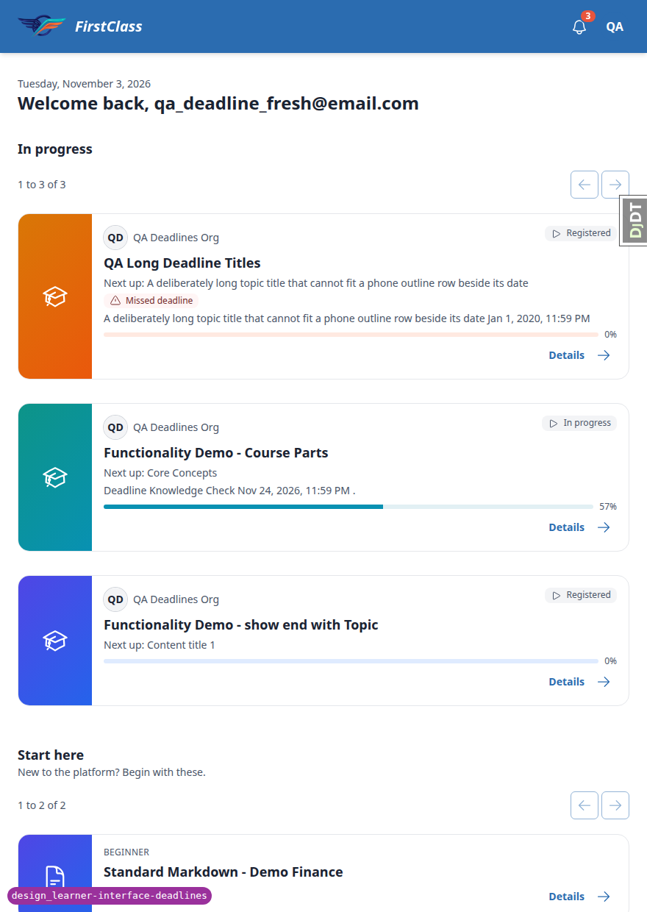 | Same stray space as mobile: course row "Deadline Knowledge Check Nov 24, 2026, 11:59 PM .". Otherwise rows read correctly: missed chip + title + full date; the plain course (no deadlines) row has no deadline line. No overflow at 880 or 768. See B2. |
| 2.4 | tablet | pass | 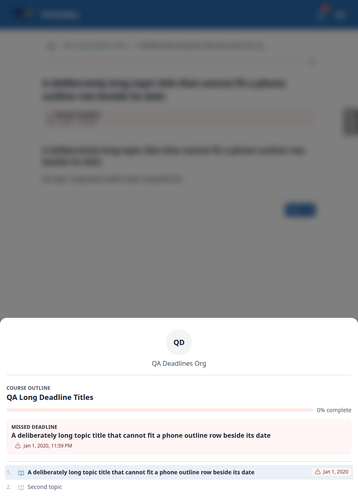 | Step 1 (880x1240 and 768x1024): "Open course outline" opens the sheet: header, missed card, rows with the chip right-aligned on one line. scrollWidth equals the viewport at both widths. |
| 4.2 | tablet | pass | 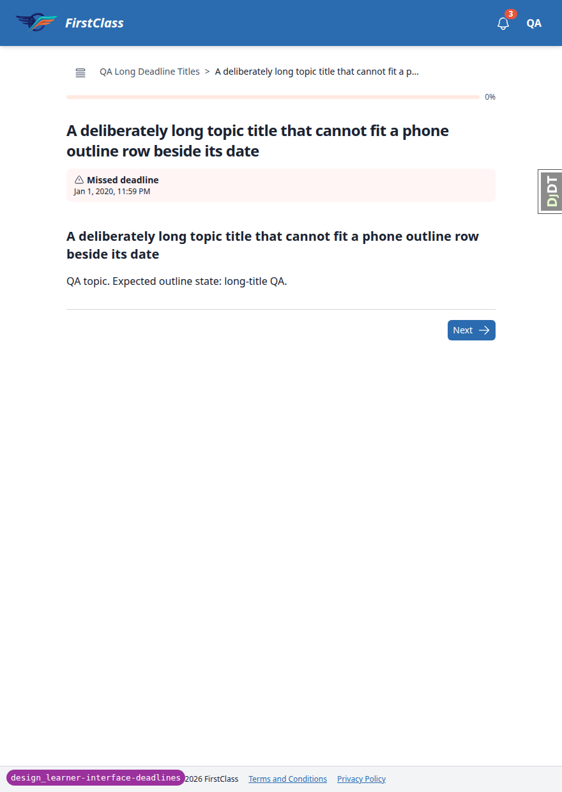 | Step 3: at 880 and 768 the header card stacks under the title (card top 264 below h1 bottom 252, same left edge). |
| 2.2 | desktop | pass | 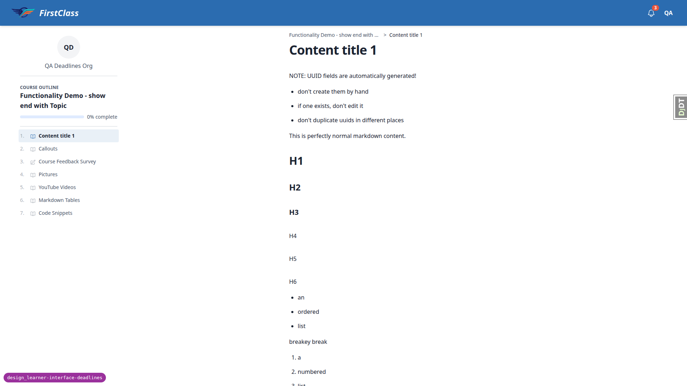 | Step 3: fresh learner on the plain course (no deadlines): no card under the progress bar, no `<time>` elements. |
| 5.4 | desktop | pass | 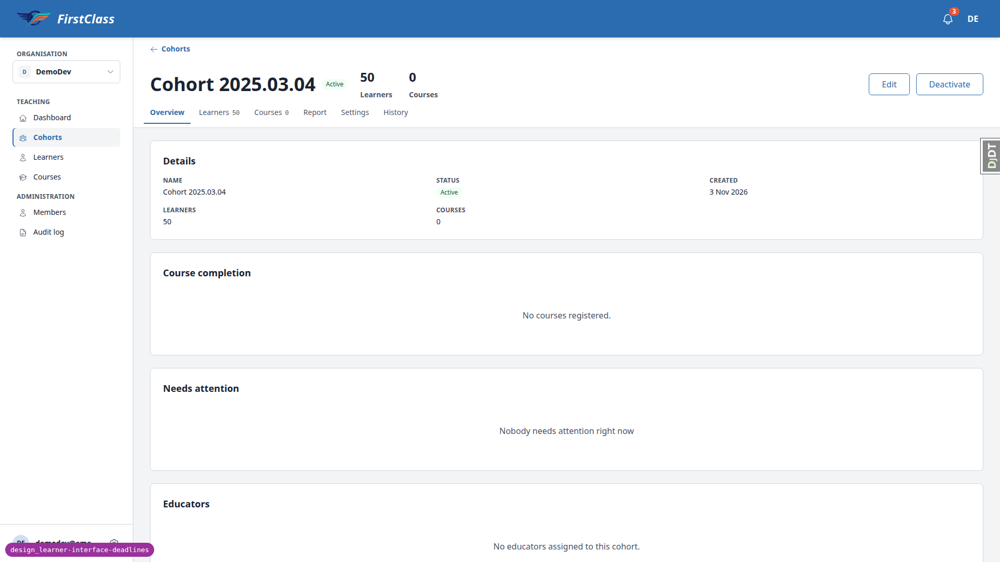 | Step 2: the educator cohort page as superuser shows no deadline tier words or band. Step 3: the dashboard shows no blog/article cards on this site, nothing to check. |
| 1.3 | desktop | pass | 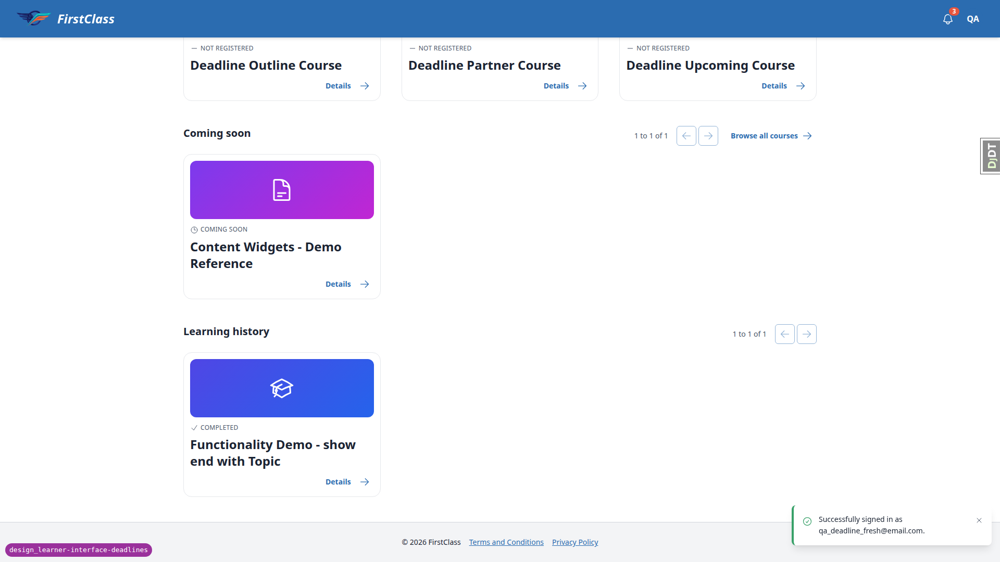 | Step 5: before completion the plain-course card had no band (no due dates); after completing every item it moved to "Learning history" as COMPLETED with no band. |

## Design check

| Test | Viewport | This run | Design | Result |
|---|---|---|---|---|
| 1.1-design | desktop |  | 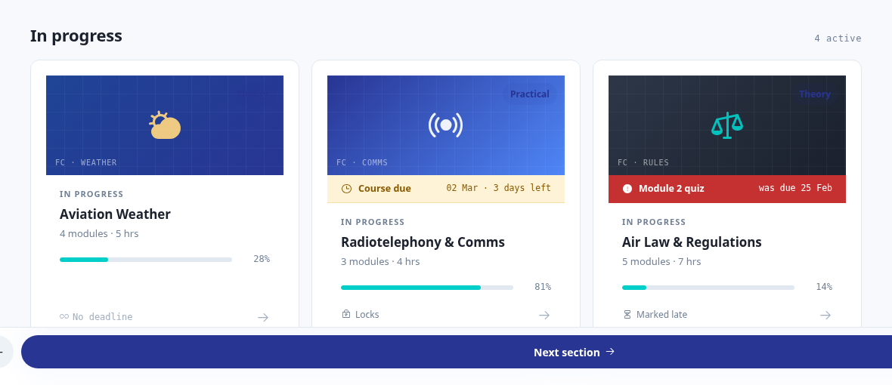 | pass |
| 1.1-design | 1024x768 |  |  | **fail**: band left: icon, bold tier word, then the title; the title collapses to zero width on cards with an organisation mark, so the title is missing rather than truncated (B1) |
| 2.4-design | mobile |  |  | pass |
| 2.4-design | tablet |  |  | pass |
| 2.1-design | desktop |  | 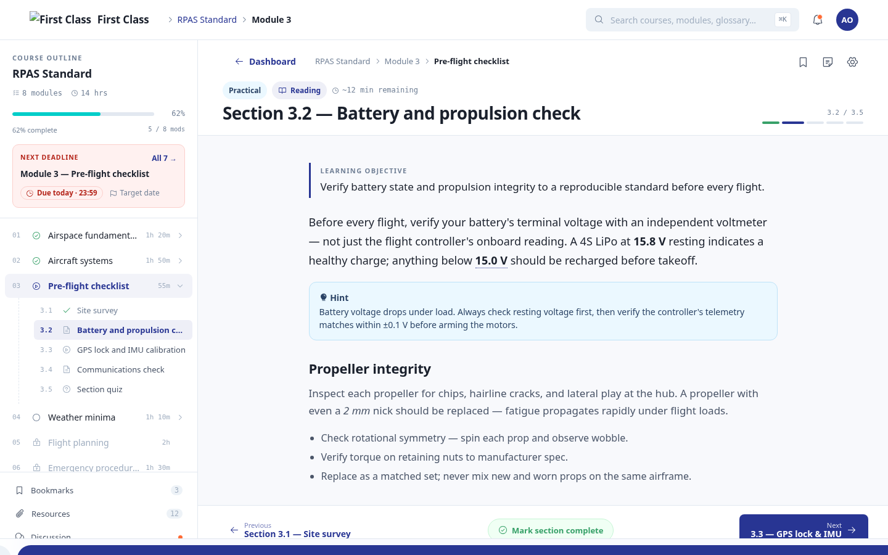 | pass |
| 3.1-design | desktop |  |  | pass |
| 4.1-design | desktop |  | 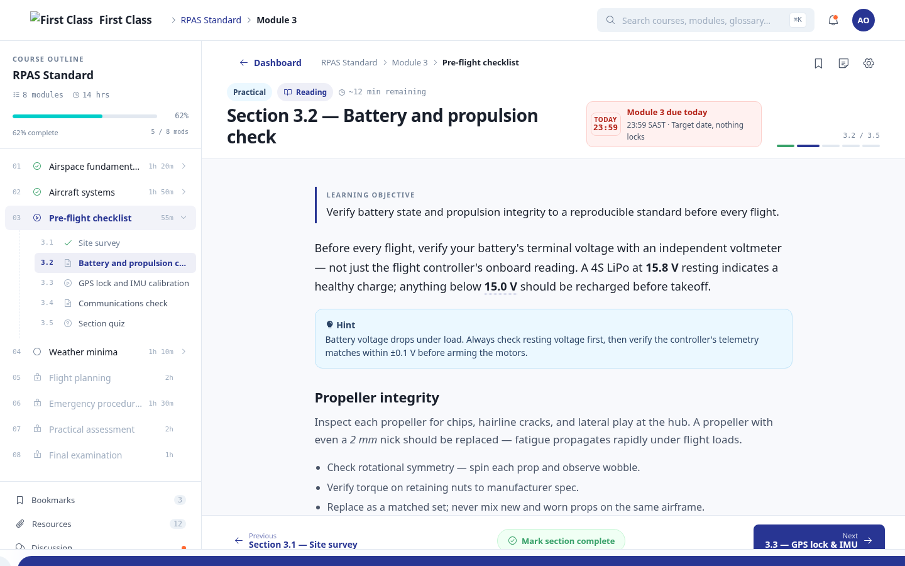 | pass |

## B1: Dashboard band drops the item title on narrow cards with an organisation mark

Manifestations:
- Test 1.4, 1024x768
- Test 1.1-design, 1024x768

- **Expected:** The band's title shortens with an ellipsis and stays visible beside the tier word and the whole date (plan 1.4 step 2, design checklist "the title truncates").
- **Actual:** At 1024x768 (three cards a row, ~268px hero) the title span collapses to 0-2px, so the band reads "Missed deadline ... Jan 31, 2024" with no item name. The card shell pads the band 64px (`course-card-shell.html`: `[&>*]:pl-16`) to clear the raised organisation mark, which leaves no width for the title. At 1920 the same squeeze cuts "Course Feedback" to "Cour..." when a Closes date is present. Fixing it needs a layout choice (wrap the date to a second line, shorten the tier word, shrink or move the mark offset).

## B2: Stray space before the full stop in the course row deadline line

Manifestations:
- Test 1.4, mobile
- Test 1.4, tablet

- **Expected:** "Deadline Knowledge Check Nov 24, 2026, 11:59 PM."
- **Actual:** "Deadline Knowledge Check Nov 24, 2026, 11:59 PM ." The tier-date partial in `learner_interface/partials/deadline_labels.html` ends with a newline after `` inside the partialdef, and the line partial appends "." directly after ``, so the rendered whitespace shows as a space before the period on dashboard course rows (tablet and mobile).

## Layout probe

| Test | Viewport | URL | Screenshot | Result |
|---|---|---|---|---|
| 1.1 | desktop | `/` |  | clean |
| 1.4 | 1280x800 | `/` |  | clean |
| 1.4 | 1024x768 | `/` |  | clean |
| 2.1 | desktop | `/courses/functionality-demo-course-parts/1/` |  | clean |
| 2.2 | desktop | `/courses/functionality-demo-course-parts/finish/` |  | clean |
| 4.2 | desktop | `/courses/qa-long-deadline-titles/1/` |  | clean |
| 3.2 | 1024x768 | `/courses/qa-long-deadline-titles/1/` |  | flags: "overflow: header ink spans x=400..1099 in a 1024px viewport"; "overlap: header and sidebar ink intersect"; "overlap: content and sidebar ink intersect". Probe false positive: flags come from ellipsis-clipped text (breadcrumb scrollWidth 519 in a 320px box; outline row title scrollWidth 637 in 248px). documentElement scrollWidth equals clientWidth (1024); the screenshot shows no overflow or overlap. Recorded as pass. |
| 1.2 | desktop | `/` |  | clean |
| 4.1 | desktop | `/courses/functionality-demo-course-parts/1/` |  | clean |
| 4.1 | desktop | `/courses/functionality-demo-course-parts/2/` |  | clean |
| 1.4 | mobile | `/` |  | clean |
| 3.2 | mobile | `/courses/qa-long-deadline-titles/1/` |  | flags: "overflow: header ink spans x=16..701 in a 375px viewport"; "overflow: sidebar ink spans x=0..665 in a 375px viewport"; "overlap: content and sidebar ink intersect". Probe false positive: ellipsis-clipped breadcrumb and outline-row text measured at scrollWidth, and the sheet is a modal over the content by design; documentElement scrollWidth is 375 and nothing visibly overflows. Recorded as pass. |
| 4.2 | mobile | `/courses/qa-long-deadline-titles/1/` |  | flags: "overflow: header ink spans x=16..701 in a 375px viewport". Probe false positive from the ellipsis-clipped breadcrumb; scrollWidth 375. Recorded as pass. |
| 2.4 | mobile | `/courses/functionality-demo-course-parts/7/` |  | flags: "overflow: header ink spans x=16..410 in a 375px viewport"; "overflow: sidebar ink spans x=0..387 in a 375px viewport"; "overlap: header and sidebar ink intersect"; "overlap: content and sidebar ink intersect". Probe false positive: clipped breadcrumb text and the modal sheet over content; a scan of every element in the sheet found none past its edges, scrollWidth 375. Recorded as pass. |
| 1.4 | tablet (880x1240) | `/` |  | clean |
| 1.4 | 768x1024 | `/` | 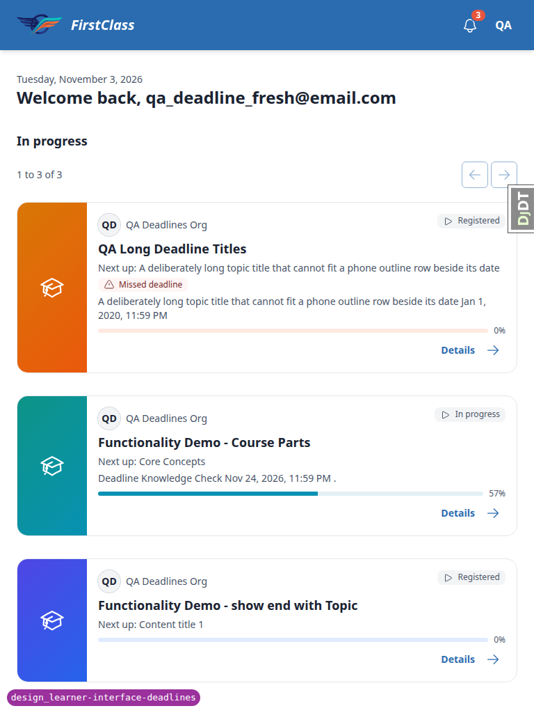 | clean |
| 4.2 | tablet (880x1240) | `/courses/qa-long-deadline-titles/1/` |  | clean |
| 4.2 | 768x1024 | `/courses/qa-long-deadline-titles/1/` | 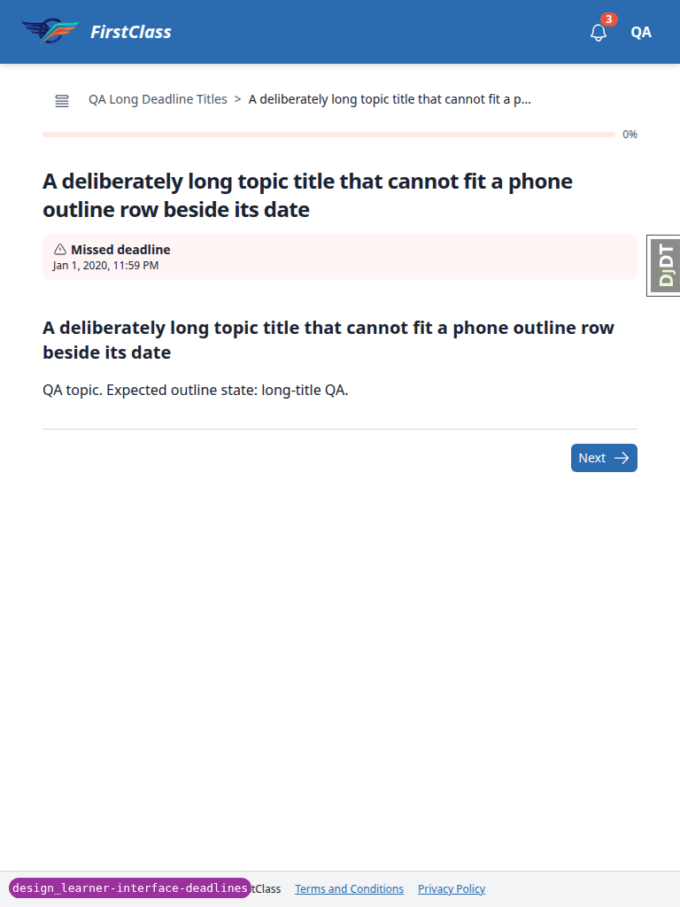 | flags: "overflow: header ink spans x=48..799 in a 768px viewport". Probe false positive from the ellipsis-clipped breadcrumb; scrollWidth 768. Recorded as pass. |

## Data changes

| What changed | Via |
|---|---|
| content_save demo_content DemoDev and qa_create_deadlines_seed (superuser, site zone, fresh/solo/restored/cohort/none learners) | sdd:qa-data-helper |
| LearnerDeadlineOverride eea147eb on the fresh learner's What to Expect: due 2026-11-03 23:59 (the today item) | sdd:qa-data-helper |
| Course QA Long Deadline Titles (ab93a4c5) with 2 topics, org QA Deadlines Org, fresh learner registered (cc4e9a44) | sdd:qa-data-helper |
| Deleted leftover CourseDeadlineConfig dd6106ce (Deadline Outline Course) so no config rows exist | sdd:qa-data-helper |
| Welcome TopicProgress completed for qa_deadline_fresh on the parts course (the Next button completes the item) | app UI (fresh learner clicked Next on Welcome) |
| Restored learner: Welcome/What to Expect/Key Ideas complete, Knowledge Check and Course Feedback submitted (CP 36fe6746) | sdd:qa-data-helper |
| Late learner: Welcome, What to Expect, Key Ideas, Going Deeper, Summary complete; the seed's open Knowledge Check attempt completed (CP 9cb854ee) | sdd:qa-data-helper |
| Fresh learner registered on functionality-demo-show-end-with-topic (registration 613e521e) | sdd:qa-data-helper |
| LearnerDeadlineOverride b45694a8 (course-wide FIXED 2026-12-03) on the late learner's parts record so the passed 90-day limit no longer hides Course Feedback | sdd:qa-data-helper |
| Added then deleted CourseDeadlineConfig 9dc85723 (parts course, mark_overdue=off) | admin UI as superuser |
| Fresh learner completed What to Expect, Key Ideas, Going Deeper on the parts course and opened a Knowledge Check attempt | app UI (fresh learner clicked Next / Start Form) |
| Fresh learner completed every item of functionality-demo-show-end-with-topic (CP 89cbb1f6 at 100%, completed_time set) | sdd:qa-data-helper |
| §5.5 cleanup: deleted the today override eea147eb, the late learner's override b45694a8 and the QA Long Deadline Titles course with its topics, placements, registration and progress; re-ran `qa_create_deadlines_seed`, which returned the four learners to seed state and removed every completion and form attempt made this run. No site, organisation or course deadline config rows remain. | sdd:qa-data-helper |

## Bug status

- **UNRESOLVED**: B1, Dashboard band drops the item title on narrow cards with an organisation mark (reason: fitting the tier word, title and date beside the raised organisation mark in a ~268px card needs a layout decision: wrap the date to a second line, shorten the tier word, or shrink/move the mark's 64px offset)
- **FIXED** (commit: 58c8ff127): B2, Stray space before the full stop in the course row deadline line. Re-verified at 880x1240: the row reads "Deadline Knowledge Check Nov 24, 2026, 11:59 PM." The band, header card and outline rows were spot-checked and are unchanged.

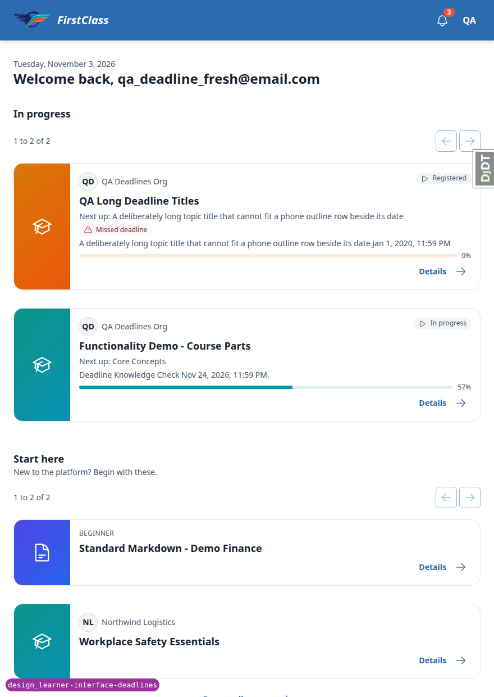

Full run after the fix: 11,222 passed, 0 failed (`uv run pytest -n auto`). That command used the `addopts` marker filter, so it also skipped the `dev_tooling` tests. The fix touches only `deadline_labels.html` and its new test. The post-rebase run earlier this session included `dev_tooling` and passed (11,608 passed).

## General notes

- **Plan vs spec.** Plan section 3.1 step 2 and section 3.3 step 1 expect a Closed chip on What to Expect and Key Ideas for the late learner, but those rows sit behind the sequential lock and spec line 200 says such rows show "Locked" with no Closed chip; the build follows the spec. Plan section 1.3 step 1 expects "Course Feedback" in the late learner's band, but the seed's 90-day time limit had passed (Oct 24), and spec rule 4 counts the time limit end as a deadline titled "Course"; a course-wide learner override moved the limit so the Closes line could be tested. Plan section 2.3 step 1 expects the card to still read "Missed deadline Welcome" after Next, but Next completes the item (the next item is locked until then), so the card correctly moves on. The plan's test plan text could be updated for these.
- Times print with a two-digit hour ("05:00 PM", "01:59 PM") where the plan writes "5:00 PM"/"1:59 PM"; the `hour:"2-digit"` option predates this branch.
- The card body reads "Next up: <part title>" (e.g. "Getting Started"), not the item title as the plan says; this predates this branch.
- Outline part chevrons point right when a part is expanded and down when collapsed; the outline template's chevrons are not touched by this branch.
- The cohort learner (access ended, outline_and_results) still sees red "Missed deadline" chips on outline rows; the spec does not cover rows under ended access.
- On mobile the plain course "Access ended Oct 24, 2026, 11:59 PM" status chip wraps to two lines (`course_row.html` not touched by this branch).
- Under forced colours, the progress bar and the Next button lose their outline (not touched by this branch).
- The layout probe flags ellipsis-clipped text at its full scroll width (breadcrumbs, truncated outline titles) and the mobile sheet as overlap; each was checked (documentElement scrollWidth equals the viewport) and recorded as pass with the flags kept.
- Console errors seen were from other servers' stale tabs and a report-only CSP violation from the demo course's YouTube embed; none from this feature.
- The rebase front-end check was covered by this run (same pages, same three viewports); main's upstream front-end changes were admin-only.
- The mobile Closed-chip row was not re-checked because the late learner's closed items were completed for later steps; the chip is the same component verified at desktop.

status: ok · reason: 2 bugs, 1 fixed, 1 unresolved; report rendered, screenshots verified
