# Frontend QA report: design learner course organisations

## Methodology

QA was run via Playwright MCP at 1920x1080 (desktop), 375x812 (mobile) and 768x1024 (tablet) against a per-branch dev server. Data was seeded from the plan's §0, plus course-to-organisation attachments made by the qa-data-helper:

| Plan placeholder | Course |
|---|---|
| skyline-course | functionality-demo-show-end-with-topic |
| coastal-course | functionality-demo-show-end-with-quiz |
| multi-course | functionality-demo-course-parts |
| default-course | standard-markdown-demo-finance |
| Skyline gated course | qa-cybersecurity-incident-response |
| Northside | functionality-demo-price-fixed |
| RPAS | functionality-demo-price-currency-without-cents |
| long name | functionality-demo-price-on-request |

The helper also set audience=public on those 8 courses.

Screenshots were collected into `screenshots/` beside this report, and every referenced image exists there.

The branch was rebased onto main first: 18 commits, no conflicts. The full test tier gave 10204 passed and 1 failure, in panel_framework `test_quick_view_drawer`. That test passed on rerun alone, so it is flaky under `-n auto`. The rebase helper's front-end check was folded into this run, since it would visit the same pages at the same viewports.

## Diff scoping

Class: FULL. Changed files that drive the front end:

- `freedom_ls/learner_interface/templates/cotton/organisation-mark.html`
- `freedom_ls/learner_interface/templates/cotton/organisation-byline.html`
- `freedom_ls/learner_interface/templates/cotton/course-card-shell.html`
- `freedom_ls/learner_interface/templates/cotton/course-row-shell.html`
- `freedom_ls/learner_interface/templates/learner_interface/course_detail.html`
- `freedom_ls/course_applications/templates/course_applications/partials/dashboard_applications.html`
- plus Python, migrations and spec files

Skipped: nothing. Everything ran, at desktop, mobile and tablet.

## Smoke gate

Status: **pass**. Pages checked:

- `/`
- `/courses/functionality-demo-show-end-with-topic/` (redirects a registered admin to the player at `/1/`)
- `/courses/`

No failure URL and no failure reason.

## Results

### Scenario 1: admin profile logo and bio

| Test | Viewport | Status | Notes | Screenshot |
|---|---|---|---|---|
| 1.1-1.2 | desktop | pass | Skyline change form has Name, Slug (read-only), Logo (light), Logo (dark), Profile logo, Bio, in that order. The profile logo help text covers the circle, the square >=128x128 advice, cropping of other shapes, and the light logo shown without a circle. Bio is a textarea (maxlength 500) with help text stating the limit. | 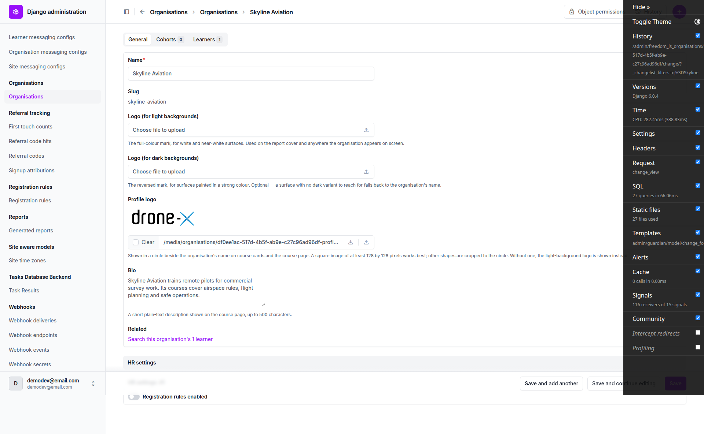 |
| 1.3 | desktop | pass | With maxlength removed client-side, 501 chars was rejected: "Ensure this value has at most 500 characters (it has 501)." on Bio. | 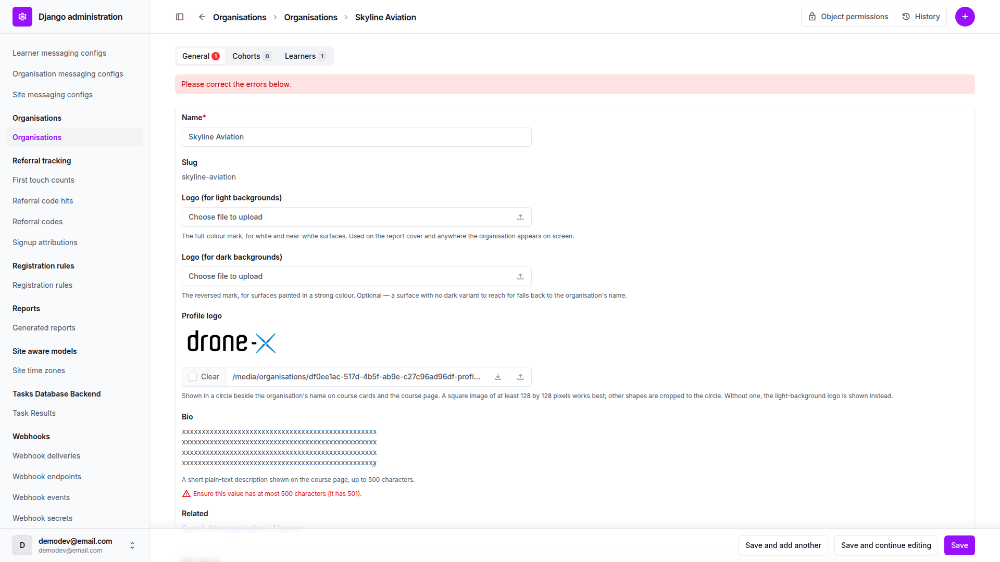 |
| 1.4 | desktop | pass | Two-sentence bio saved. | |
| 1.5 | desktop | pass | A text file renamed .png was rejected: "File is not a readable image. Use PNG, JPEG or WebP." on Profile logo. | 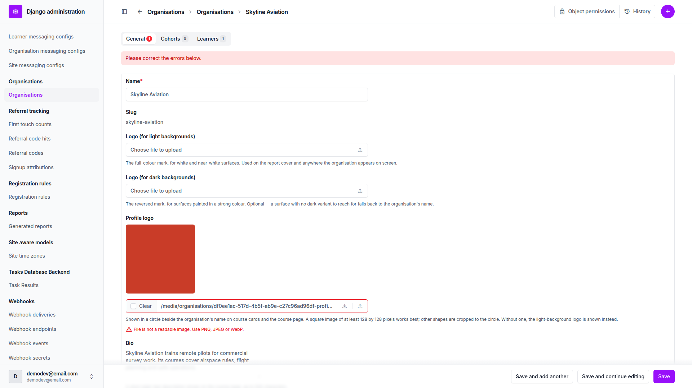 |
| 1.6-1.7 | desktop | pass | A wide 400x150 PNG was accepted as `organisations/<pk>-profile.png`. A square JPEG was then stored as `<pk>-profile.jpg`, and media holds only the .jpg for the pk (the .png is gone). | |
| 1.8 | desktop | pass | Clear removed the profile logo and the `-profile.jpg` object. Skyline has no logo or logo_on_dark, so "logo untouched" is covered in 6.4 on RPAS Training. The square JPEG was re-uploaded. | |

### Scenario 2: dashboard cards

| Test | Viewport | Status | Notes | Screenshot |
|---|---|---|---|---|
| 2.3 | desktop | pass | Coastal shows the wide logo object-contain with a p-1 inset in the circle. Northwind Workplace Safety Essentials shows "NL" in a grey circle. Demo Finance (DemoDev default org only) and no-org courses show no byline. multi-course is not on the dashboard sections, so it was checked on /courses/ in Scenario 3. | 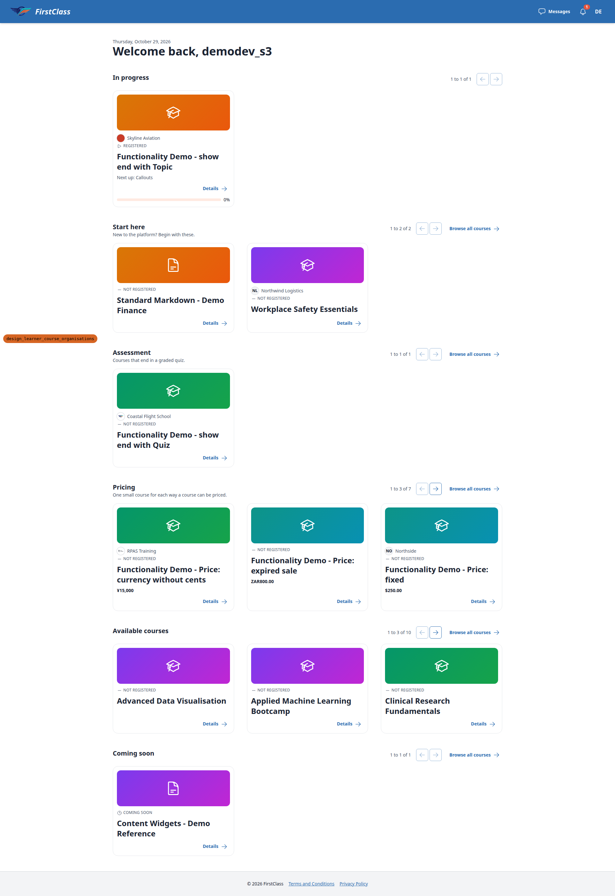 |
| 2.4 | desktop | pass | Accent tile inset 13px on left, top and right. Tile radius 12px is less than card radius 16px. Byline, title and tile share the left edge (x=365). Progress bar and Details link are at the card foot as before. |  |
| 2.5 | desktop | pass | The 147-char organisation name shows on one line (24px) with nowrap and ellipsis, and the title attribute carries the full name. |  |
| 2.6 | desktop | pass | Anonymous dashboard shows the same bylines. "Free" and "By application" badges render in the status slot under the byline. | 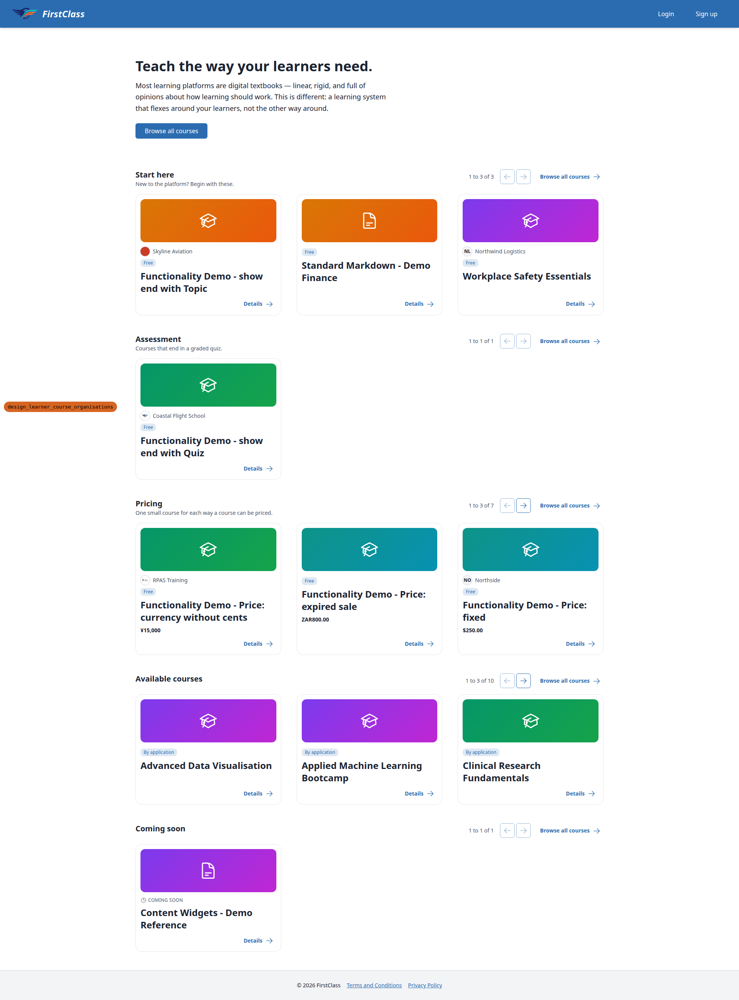 |
| 2.1-2.2 | desktop | pass | demodev_s3 was registered and started the course. The In progress card shows the round Skyline mark (profile logo, object-cover), "Skyline Aviation", "IN PROGRESS", then the title. | 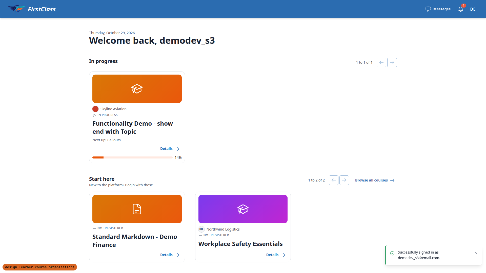 |
| 2.7/3.8 | mobile | pass | Signed-in dashboard at 375 shows rows with byline and difficulty as on /courses/. No horizontal scroll. "Browse all courses" links are centred (x=188 of 187.5). The byline squeeze on the in-progress row is B2. | 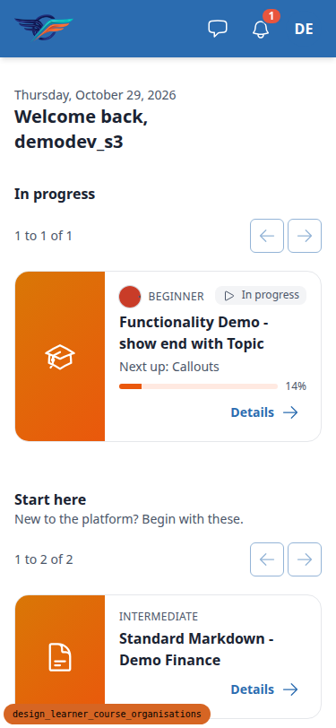 |
| 2.7/3.7/3.8 | tablet | pass | At 768 (signed in and anonymous) the dashboard and /courses/ show rows. No horizontal scroll, no row clips its chips, and no byline name is squeezed below 40px. | 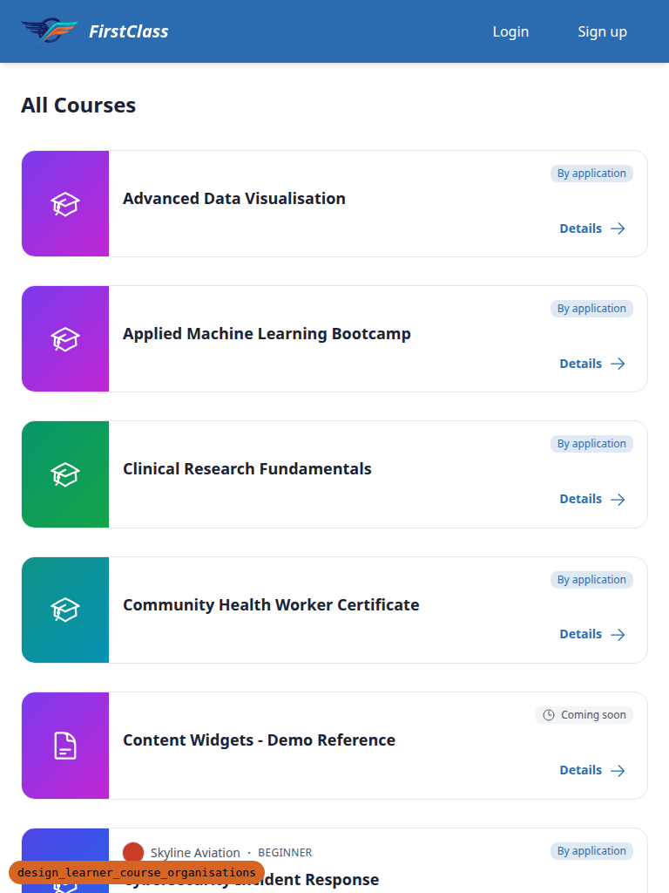 |

### Scenario 3: all-courses rows

| Test | Viewport | Status | Notes | Screenshot |
|---|---|---|---|---|
| 3.1-3.2 | desktop | pass | Anonymous /courses/: the Skyline row has the mark, "Skyline Aviation" and "BEGINNER" top-left, a "Free" chip top-right, the title under the eyebrow, and a borderless "Details" link with a chevron at bottom-right. No separate price or status line. | 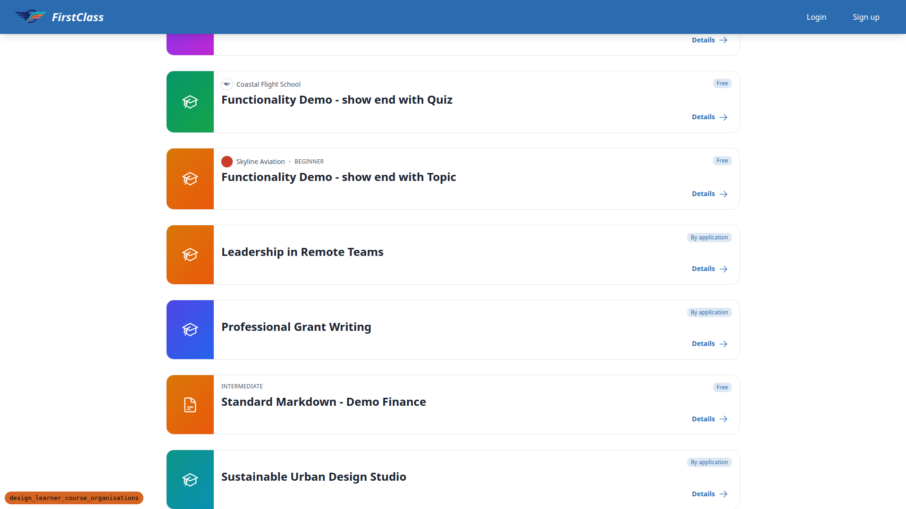 |
| 3.3 | desktop | pass | Coastal row has the wide logo in the circle and the name, with no dot and no difficulty. Course Parts shows "ADVANCED" alone at left, and Demo Finance shows "INTERMEDIATE" alone. Rows with neither have an empty left half with chips top-right. A priced gated row shows "By application" plus a muted price chip. | 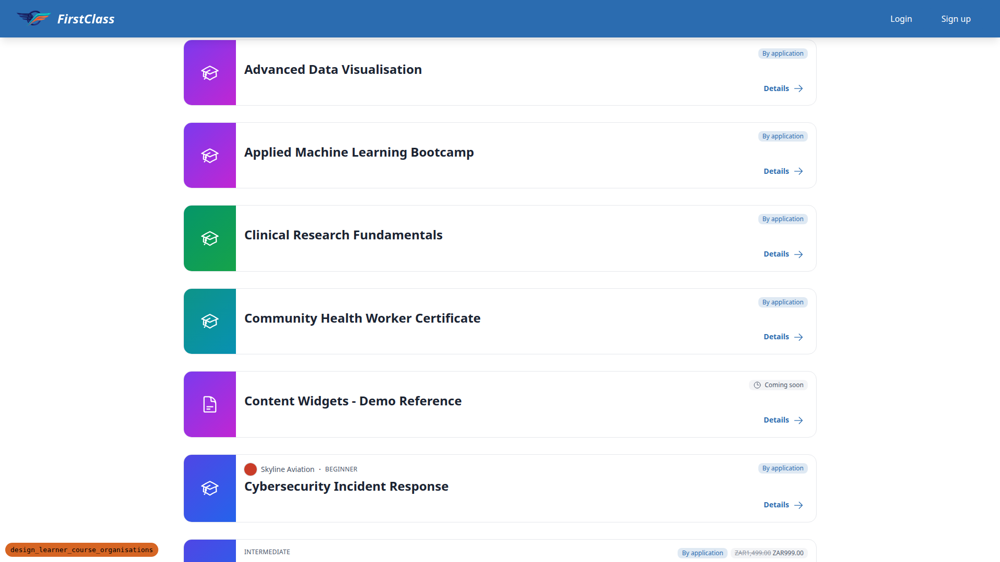 |
| 3.4 | desktop | pass | Rows are separate 1px-bordered cards with a 32px gap and no divide-y. Hover adds the same shadow-md as the dashboard cards (neither translates). |  |
| 3.5 | desktop | pass | As demodev_s3, the Skyline row shows a grey "In progress" chip with the play icon top-right and no Free chip, and the 14% progress bar sits above Details. Unregistered rows show no status chip or access badge, only a price chip when priced (Northside $250.00). | 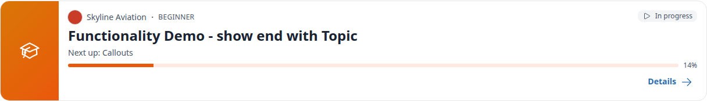 |
| 3.6 | desktop | pass | Tabbing reached all 22 visible Details links. Each has the accessible name "Details for <course title>" and the visible text "Details". | |
| 3.7 | mobile | **fail** | At 375 the chip group (flex shrink-0 flex-wrap) never wraps. On "Functionality Demo - Application gated course" the 249px chip group sits in a 209px eyebrow line, so "By application" overlaps "INTERMEDIATE" and the sale-price chip is clipped (article scrollWidth 378 > 343). On rows with byline, difficulty and a chip, the organisation name collapses to 0px with no ellipsis and the 24px mark overflows its 12px box over the middle dot. The page itself has no horizontal scroll. See **B2**. | 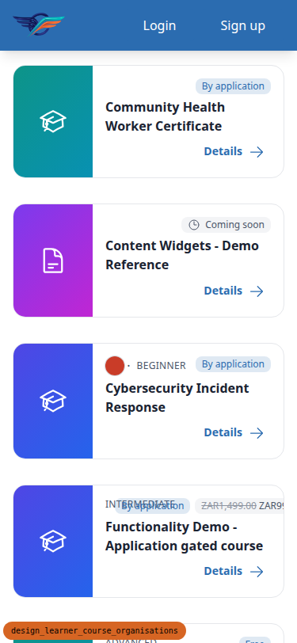 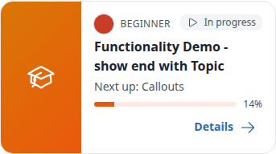 |

### Scenario 4: applications panel

| Test | Viewport | Status | Notes | Screenshot |
|---|---|---|---|---|
| 4.1-4.2 | desktop | pass | demodev@email.com sees 3 rows in the /courses/ row layout, with the accent panel left and one chip top-right ("Incomplete" or "Pending review"). There is no Free or price chip. Each row has a title, the draft sentence on drafts, and a footer with Details then Continue application / View my application. The Cybersecurity Incident Response row shows the mark, "Skyline Aviation" and "BEGINNER", and the other rows have an empty left half. | 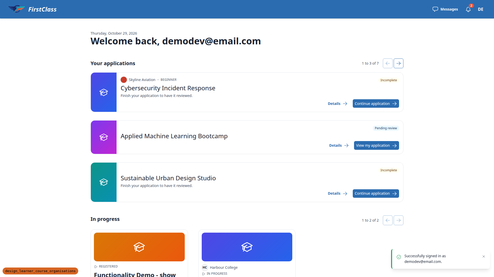 |
| 4.3 | desktop | pass | Details goes to `/courses/qa-cybersecurity-incident-response/detail/`. The title and Continue application both go to `/applications/application/<pk>/page/1/`. | |
| 4.4 | desktop | pass | Next page swapped in rows 4-6 in the same row layout, and the position text reads "4 to 6 of 7". Focus stays on the pager's Next control rather than the panel heading (see General notes b). | 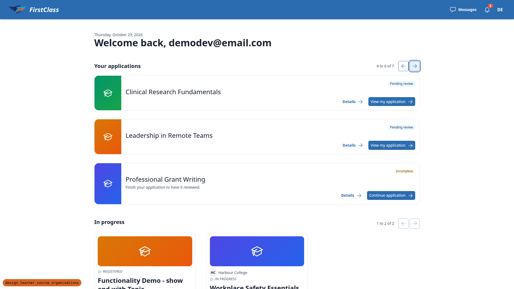 |
| 4.5 | mobile | pass | At 375 the application button is hidden and a chevron shows at the right of the footer. Details still shows, tapping the row body opens the application page, and there is no horizontal scroll. The Skyline byline on the first row is squeezed to "S…" (B2). | 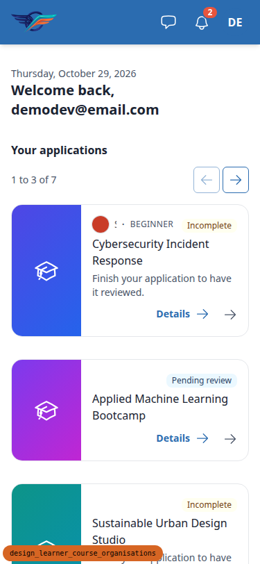 |
| 4.6 | desktop | pass | qa-no-apps@example.com sees no "Your applications" panel. | |
| 4.7 | desktop | pass | Anonymous: /courses/qa-cybersecurity-incident-response/detail/, then Apply now, then the your-details form, then a draft is created. `/` then shows the panel with that draft row, including the Skyline byline and BEGINNER. | 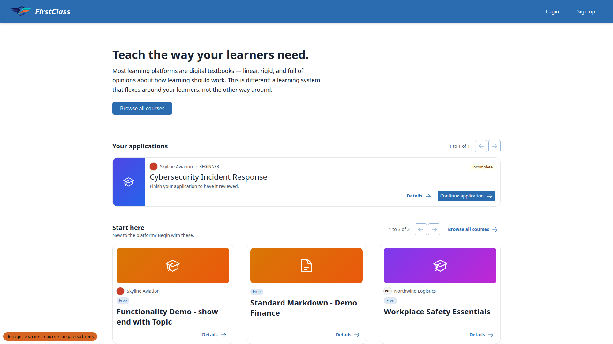 |

### Scenario 5: course detail page

| Test | Viewport | Status | Notes | Screenshot |
|---|---|---|---|---|
| 5.1-5.3 | desktop | pass | Anonymous /courses/functionality-demo-show-end-with-topic/detail/. The hero has the white-filled round mark and "Skyline Aviation" in white, a translucent rule, then the category chip, title, subtitle and stats. The byline is not a link. The sidebar has a bordered card under the sign-up panel with the 48px mark, bold name and bio as small muted text. No links and no course count. | 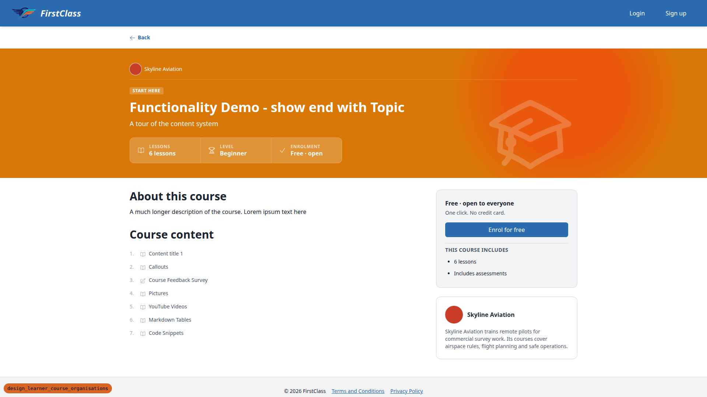 |
| 5.4 | desktop | pass | The sign-up panel and organisation card share one sticky wrapper (top 24px, overflow-y auto, max-height viewport-based). They move together and cannot overlap. | |
| 5.5 | desktop | pass | Coastal: the hero byline has the wide logo object-contain in the white circle. The sidebar card has the mark and name, with no bio paragraph. | 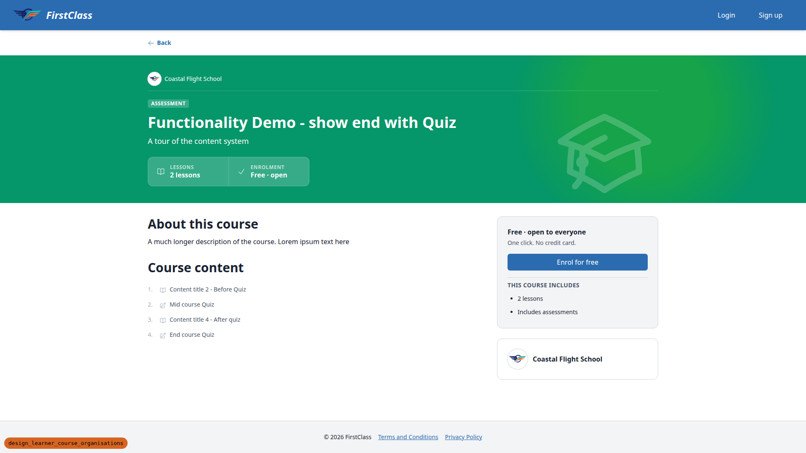 |
| 5.6 | desktop | pass | Course Parts (multi-org) and Demo Finance (default org) show no hero byline, no rule and no organisation card. The sign-up panel is still in a sticky wrapper. | |
| 5.7 | desktop | **fail** | A 500-character bio across several lines (5 line breaks, textarea value length 500, within maxlength=500) is rejected on save: "Ensure this value has at most 500 characters (it has 505)." The browser submits each line break as CRLF and the server counts the \r. A 495-char multi-line bio saved fine: line breaks kept, "&lt;b&gt;" shown as text, and the sticky block scrolls within itself at 1920x600 (scrollHeight 689 > 552). The Enrol button's 4px focus ring has 29px clearance and is not clipped. See **B1**. |  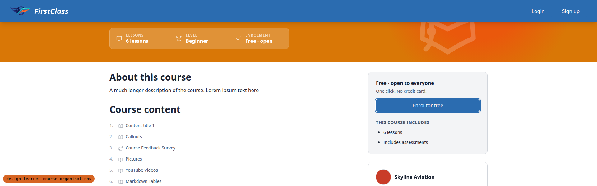 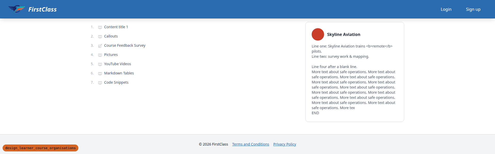 |
| 5.8 | desktop | pass | Signed in as demodev_s3 (registered), the detail page shows the same hero byline and organisation card. | |
| 5.9 | mobile | pass | At 375 the hero byline sits above the category chip, and the organisation card follows the sign-up panel above "About this course". No horizontal scroll. | 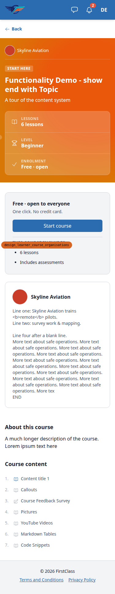 |
| 5.9 | tablet | pass | At 768 the page stacks as sign-up panel, organisation card, then "About this course". No horizontal scroll. | |
| 5.10 | desktop | pass | The JSON-LD block has no `provider` entry, anonymous or signed in. | |

### Scenario 6: fallbacks and profile logo everywhere

| Test | Viewport | Status | Notes | Screenshot |
|---|---|---|---|---|
| 6.1 | desktop | pass | Northside (no logos) on "Price: fixed" shows a grey circle with "NO" on the /courses/ row, the detail hero and the sidebar card. No broken images. | 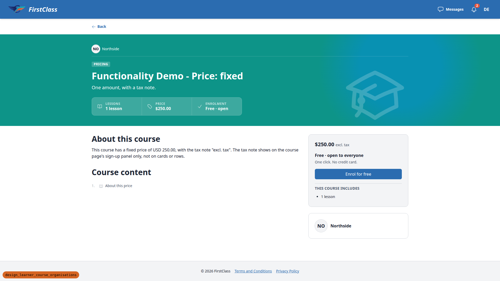 |
| 6.2 | desktop | pass | Renamed to "2024": the mark shows a generic svg icon with no letters on row, hero and card. Renamed back to Northside. |  |
| 6.3 | desktop | pass | After the Northwind profile logo upload, the dashboard card, /courses/ row and detail hero and card all switched from "NL" to the image at once. After clearing, all went back to "NL". | |
| 6.4 | desktop | pass | RPAS Training (has a .webp logo): with a profile logo the row draws `<pk>-profile.jpg` object-cover. After Clear it draws the .webp logo object-contain. The logo file and field were untouched (this also covers 1.8's "logo untouched"). | |
| 6.5 | desktop | pass | In the course player for the Skyline course as demodev_s3, the sidebar organisation chip is the existing monogram plus truncated name (`course_organisation_chip.html` untouched). It uses no organisation-mark component and not the profile logo. | 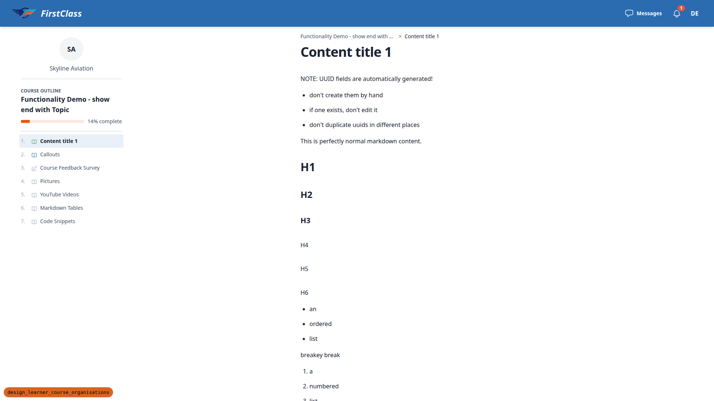 |
| 6.6 | desktop | pass | `/articles/getting-started-with-articles/` compact course-card embeds take the inset tile (13px inset, 12px tile radius vs 16px card) and show no byline, even though "Price: fixed" now has Northside attached. | 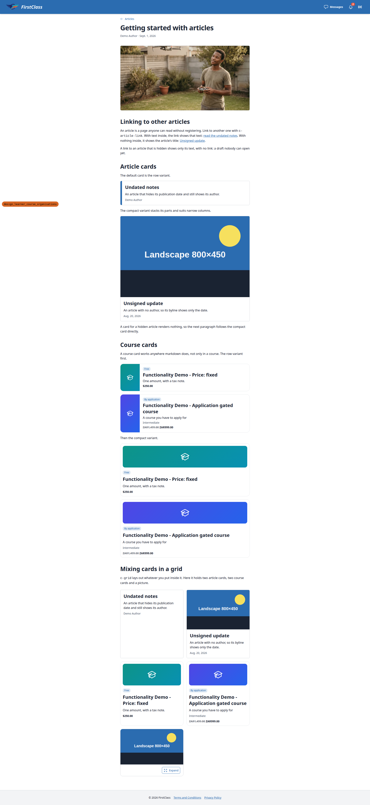 |

### Scenario 7: themed site

| Test | Viewport | Status | Notes | Screenshot |
|---|---|---|---|---|
| 7.1 | desktop | skip | No second site with the first_class theme is configured locally (DemoDev only uses the first_class logo images via settings_dev). Skipped as the plan allows. | |

## Design check

| Test | Viewport | This run | Design | Result |
|---|---|---|---|---|
| 2.0-design | desktop | [page-2026-10-29T09-36-38-104Z.png](screenshots/page-2026-10-29T09-36-38-104Z.png) | [cards__b.png](design_screenshots/cards__b.png) | pass |
| 3.0-design | desktop | [page-2026-10-29T09-36-57-809Z.png](screenshots/page-2026-10-29T09-36-57-809Z.png) | [index__ig2.png](design_screenshots/index__ig2.png) | pass |
| 5.0-design-d1 | desktop | [page-2026-10-29T09-39-57-124Z.png](screenshots/page-2026-10-29T09-39-57-124Z.png) | [detail__d1.png](design_screenshots/detail__d1.png) | pass |
| 5.0-design-d6 | desktop | [page-2026-10-29T09-40-27-731Z.png](screenshots/page-2026-10-29T09-40-27-731Z.png) | [detail__d6.png](design_screenshots/detail__d6.png) | pass |
| 3.0-design | mobile | [page-2026-10-29T09-45-43-826Z.png](screenshots/page-2026-10-29T09-45-43-826Z.png) | [index__ig2.png](design_screenshots/index__ig2.png) | fail. (1) The tag chips sit top-right on the same line as the byline, but at 375 the chip group overflows instead of wrapping, overlapping the difficulty and clipping the price chip off the card edge. (2) The byline and the difficulty share one line at the top-left, but the organisation name collapses to zero width and the mark overlaps the middle dot when a chip shares the line. |
| 5.0-design-d1 | mobile | [page-2026-10-29T09-46-27-926Z.png](screenshots/page-2026-10-29T09-46-27-926Z.png) | [detail__d1.png](design_screenshots/detail__d1.png) | pass |
| 5.0-design-d6 | mobile | [page-2026-10-29T09-46-27-926Z.png](screenshots/page-2026-10-29T09-46-27-926Z.png) | [detail__d6.png](design_screenshots/detail__d6.png) | pass |
| 3.0-design | tablet | [page-2026-10-29T09-47-03-019Z.png](screenshots/page-2026-10-29T09-47-03-019Z.png) | [index__ig2.png](design_screenshots/index__ig2.png) | pass |

## Bugs

### B1: A 500-character multi-line organisation bio is rejected because line breaks are counted as CRLF

Manifestations:

- 5.7, desktop

Screenshot:

**Expected:** A bio of 500 characters across several lines, which the textarea's maxlength=500 allows, saves, as test 5.7 requires.

**Actual:** Save fails with "Ensure this value has at most 500 characters (it has 505)." The browser submits each of the 5 line breaks as `\r\n`, and the bio field's max_length counts the `\r` characters.

### B2: Row eyebrow chip group never wraps at phone width, overlapping the difficulty, clipping chips and collapsing the byline

Manifestations:

- 3.7, mobile
- 3.0-design, mobile
- 2.7/3.8, mobile
- 4.5, mobile

Screenshots:

**Expected:** Per 3.7, at 375 the chips wrap under each other at the right when there is no room, and the byline truncates (with an ellipsis) rather than pushing the chips off. Nothing overlaps or is clipped.

**Actual:** The chip group is `flex shrink-0 flex-wrap`, so it never shrinks and therefore never wraps. On "Functionality Demo - Application gated course" the 249px chip group sits in a 209px line: "By application" overlaps "INTERMEDIATE" and the sale-price chip is clipped at the card edge. On rows with byline, difficulty and a chip, the organisation name collapses to 0px (no ellipsis) and the 24px mark overflows its 12px box over the middle dot. This affects Skyline rows on /courses/, the signed-in dashboard and the applications panel.

## Bug status

| Bug | Status |
|---|---|
| B1 | **FIXED** (commit: 7b1ec983b) — A 500-character multi-line organisation bio is rejected because line breaks are counted as CRLF. Re-verified: the 500-character bio with 5 line breaks saves; 502 characters is still rejected. |
| B2 | **FIXED** (commit: 04af3af41) — Row eyebrow chip group never wraps at phone width, overlapping the difficulty, clipping chips and collapsing the byline. Re-verified at 375/768/1920 on /courses/ and the dashboard (anonymous and signed in) and on the applications panel: no overflow, overlap or clipping; at 375 the name ellipsis-truncates and the chips wrap under each other; at 768 and 1920 the chips stay on the byline's line. After the fix, at 375: 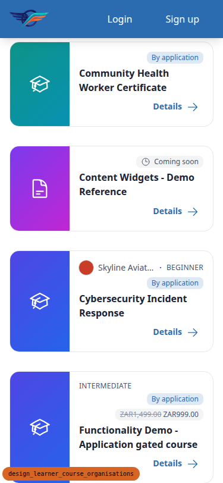 |

## General notes

- (a) The plan's `/courses/<slug>/` URL redirects anonymous visitors to login. The public detail page is `/courses/<slug>/detail/`. The plan should say so.
- (b) 4.4: focus stays on the pager control rather than moving to the panel heading. The shared section-pagination component does this by design and this branch didn't touch it, so the plan's wording is wrong, not the code.
- (c) Right after completing the first topic, the dashboard card read "Registered"/0% for about 30s before showing "In progress"/14%. This is progress recalculation timing outside this branch.
- (d) The applications panel titles are font-medium (unchanged from main) while /courses/ row titles are bold. This is a visual difference the checklist doesn't cover.
- (e) Scenario 7 was skipped: there is no first_class-themed second site locally.
- (f) The screenshots directory also holds Playwright accessibility snapshots (.yml) and console logs that the collect script moved along with the PNGs.
- (g) The 1.8 "logo untouched" half was verified on RPAS Training in 6.4, because Skyline has no logo.

status: ok · reason: 2 bugs — 2 fixed, 0 unresolved; report rendered, screenshots verified
