# QA report: design learner course organisations

QA ran on 2026-10-30 against branch design_learner_course_organisations, with the dev server on port 8739. There are 50 test records: 42 at desktop (40 pass, 1 fail, 1 skip), 5 at mobile (5 pass) and 3 at tablet (3 pass). There are 10 design-check records, all passing. One bug was found (B1, the long organisation name tooltip never shows) and it is unresolved.

## Methodology

Screenshots were taken through Playwright MCP and collected into `screenshots/` beside this report, so every image reference below resolves relative to the report. Three viewports were used: desktop 1920x1080, mobile 375x812 and tablet 768x1024.

Logins used: demodev@email.com (admin), demodev_s3@email.com (learner registered through Skyline Aviation), qa-no-apps@example.com, and an anonymous session.

The course-organisation setup chosen for the plan's placeholders:

- `<skyline-course>` = functionality-demo-show-end-with-topic
- `<coastal-course>` = functionality-demo-price-fixed
- `<multi-course>` = functionality-demo-course-parts
- `<default-course>` = functionality-demo-price-from
- gated Skyline course = qa-cybersecurity-incident-response
- Northside on functionality-demo-price-range
- RPAS Training on functionality-demo-price-on-request
- long-name organisation on functionality-demo-price-sale-with-an-end-date
- `<northwind-slug>` = workplace-safety-essentials-2
- `<harbour-slug>` = workplace-safety-essentials

## Diff scoping

Class: FULL. It fired because templates changed. Changed files:

- freedom_ls/learner_interface/templates/cotton/: course-card-shell.html, course-row-shell.html, organisation-byline.html, organisation-mark.html
- freedom_ls/learner_interface/templates/learner_interface/: course_detail.html, partials/course_card.html, partials/course_row.html
- freedom_ls/course_applications/templates/course_applications/partials/dashboard_applications.html
- freedom_ls/organisations/: admin.py, forms.py, models.py
- freedom_ls/learner_interface/: views.py, utils.py
- freedom_ls/content_engine/models/courses.py
- freedom_ls/course_applications/: backends.py, queries.py

Nothing was skipped: all three viewport passes ran.

## Smoke gate

Outcome: pass. Pages loaded: http://127.0.0.1:8739/ and http://127.0.0.1:8739/courses/.

## Results by scenario

### Scenario 1: the admin edits a profile logo and a bio

| Test | Viewport | Status | Notes | Screenshot |
|---|---|---|---|---|
| 1.1 | desktop | pass | Logged in as demodev@email.com, admin organisation list opens Skyline Aviation change form. | 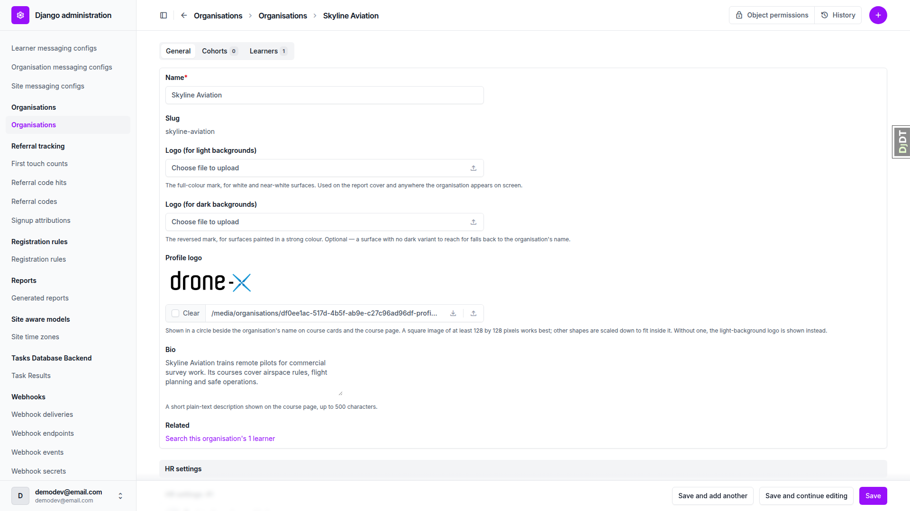 |
| 1.2 | desktop | pass | Field order Name, Slug (read-only), Logo (for light backgrounds), Logo (for dark backgrounds), Profile logo, Bio. Profile logo help mentions circle, 128x128 square, light logo fallback; it says other shapes are "scaled down to fit inside it", which matches the spec's fitted-not-cropped decision (the plan's word "cropped" is stale). Bio is a textarea, help states 500-character limit. |  |
| 1.3 | desktop | pass | 501-character bio rejected: "Ensure this value has at most 500 characters (it has 501)" on Bio; nothing else changed. | 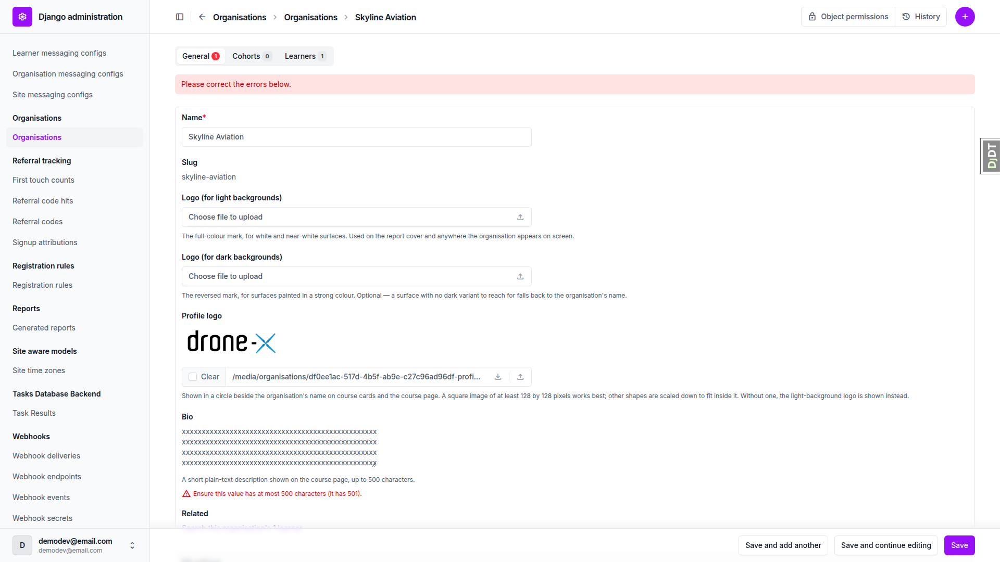 |
| 1.4 | desktop | pass | Two-sentence bio saved successfully. | |
| 1.5 | desktop | pass | Text file renamed .png rejected on Profile logo: "File is not a readable image. Use PNG, JPEG or WebP." | 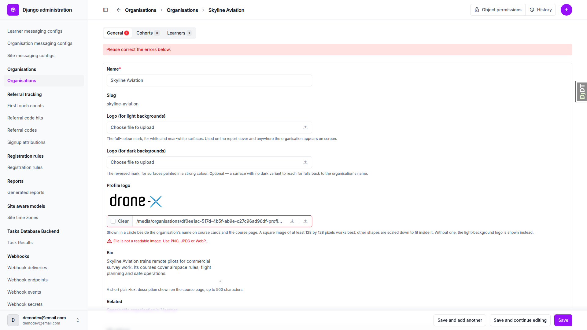 |
| 1.6 | desktop | pass | Wide 400x120 PNG accepted; stored as organisations/&lt;pk&gt;-profile.png. | |
| 1.7 | desktop | pass | Square JPEG accepted; stored name ends -profile.jpg; media/organisations/ holds one -profile object for the pk (the .jpg), the earlier .png is gone. | |
| 1.8 | desktop | pass | Clear + save: profile_logo empty, -profile.jpg removed from media/organisations/, logo and logo_on_dark untouched (both empty as before). Square JPEG re-uploaded afterwards. | |

### Scenario 2: the dashboard cards (design state cards__b)

| Test | Viewport | Status | Notes | Screenshot |
|---|---|---|---|---|
| 2.1 | desktop | pass | demodev_s3 registered through Skyline Aviation on functionality-demo-show-end-with-topic (qa_register_org_course); the course was already in progress (14%, Next up: Callouts) from the registration seeded earlier. | 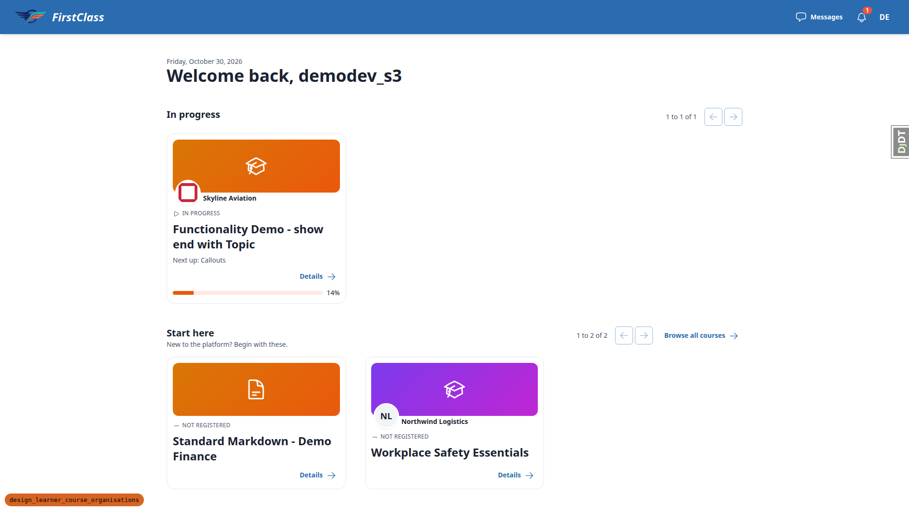 |
| 2.2 | desktop | pass | In progress card: under the tile a 48px round mark with the Skyline profile logo (object-contain, white ring), "Skyline Aviation", then the "IN PROGRESS" status line, then the title. The mark straddles the tile's bottom edge by 24px (byline is -mt-6, ml-2); the design draws a smaller mark fully below the tile. |  |
| 2.3 | desktop | pass | Discovery cards: Coastal shows the wide logo object-contain with a 4px inset; Workplace Safety Essentials (Northwind) shows "NL" in a grey circle; Price: from (DemoDev only) shows no byline; a course with no organisation shows no byline. Course Parts (multi) is not on any dashboard section page for this learner, verified on /courses/ and its detail page instead. | 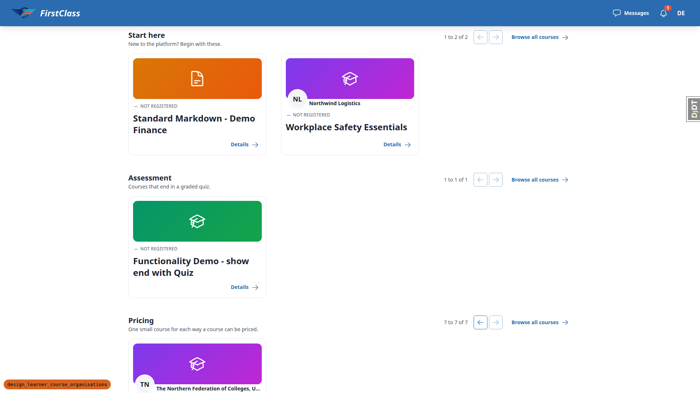 |
| 2.4 | desktop | pass | Every card: tile inset 13px left/right/top with 12px corners inside a 16px card; the title starts at the tile's left edge; the progress bar and Details link sit in their usual places (Details 13px from the card's right edge). |  |
| 2.5 | desktop | fail | The ~150-character organisation name truncates with an ellipsis on one line and the span carries the full name in a title attribute, but hovering it never shows the tooltip: the card's stretched title link (before:absolute before:inset-0) sits above the byline, so document.elementFromPoint over the name returns that link, which has no title in its ancestor chain. Playwright's hover on the span is likewise intercepted by the link. The same applies to the /courses/ row eyebrow. See B1. |  |
| 2.6 | desktop | pass | Anonymous dashboard discovery cards show the bylines (Skyline profile logo, NL initials for Northwind, none for the standard-markdown course); Free badge renders in the status position under the byline. | 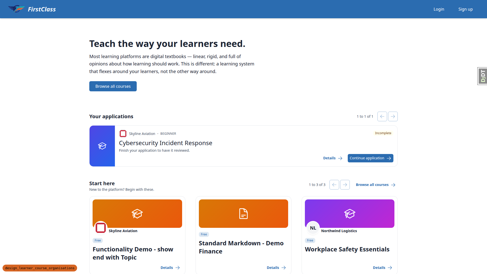 |
| 2.7 | mobile | pass | At 375 the dashboard sections show rows (accent panel full height at the left) instead of cards; Skyline row shows the mark, truncated "Skyline Avi…" · BEGINNER and the In progress chip; no horizontal scroll (document width 375). | 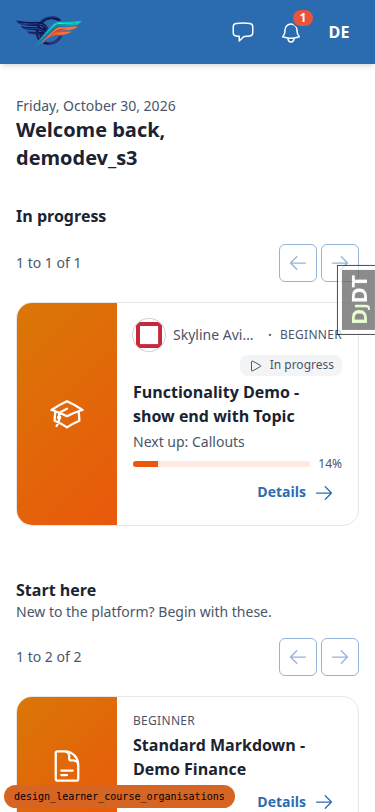 |
| 2.7 | tablet | pass | At 768 the dashboard shows rows (720px wide) in every section including Your applications, where Details and the application button are both visible; desktop nav (Messages, notifications, user menu) is used; no horizontal scroll. | 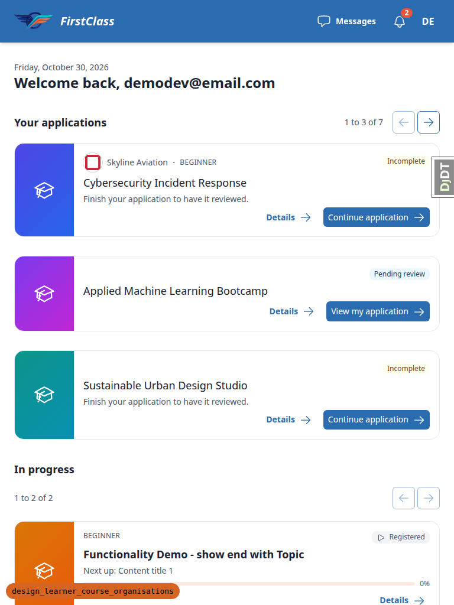 |

### Scenario 3: the all-courses rows (design state index__ig2)

| Test | Viewport | Status | Notes | Screenshot |
|---|---|---|---|---|
| 3.1 | desktop | pass | Anonymous /courses/ at 1920 loads with 22 rows. | 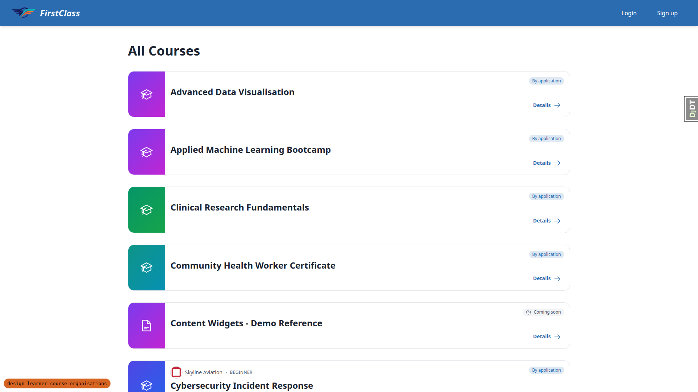 |
| 3.2 | desktop | pass | Skyline row: round mark + "Skyline Aviation" · "BEGINNER" (small uppercase muted) top-left; "Free" chip top-right (gated Skyline course shows "By application"); priced rows show a grey chip-muted price chip; title under the eyebrow; Details bottom-right as a borderless btn-link with chevron. No other price line or status text on the row. | 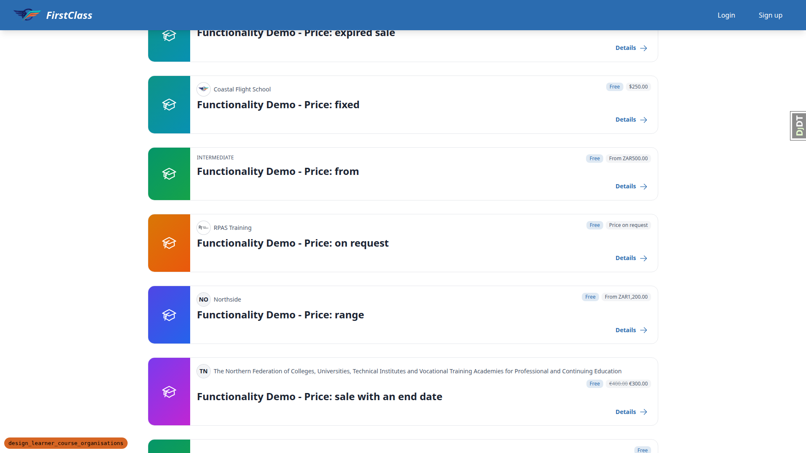 |
| 3.3 | desktop | pass | Coastal row: wide logo fitted (object-contain) in the circle, name, no dot, no difficulty. Course Parts (multi): "ADVANCED" alone, no byline, no dot. Price: from (DemoDev only): "INTERMEDIATE" alone. Rows with neither: empty left half, chips still top-right. |  |
| 3.4 | desktop | pass | Rows are separate 1px-bordered rounded cards with a visible gap and no divider; hovering a row applies translate -4px and a shadow (lift). |  |
| 3.5 | desktop | pass | Signed in as demodev_s3: the Skyline row shows one "In progress" chip-muted chip with the play icon top-right and no Free chip; its progress bar sits in the footer above the Details link. Unregistered rows show no status chip and no access badge (gated rows show no chip at all), only the price chip where priced. | 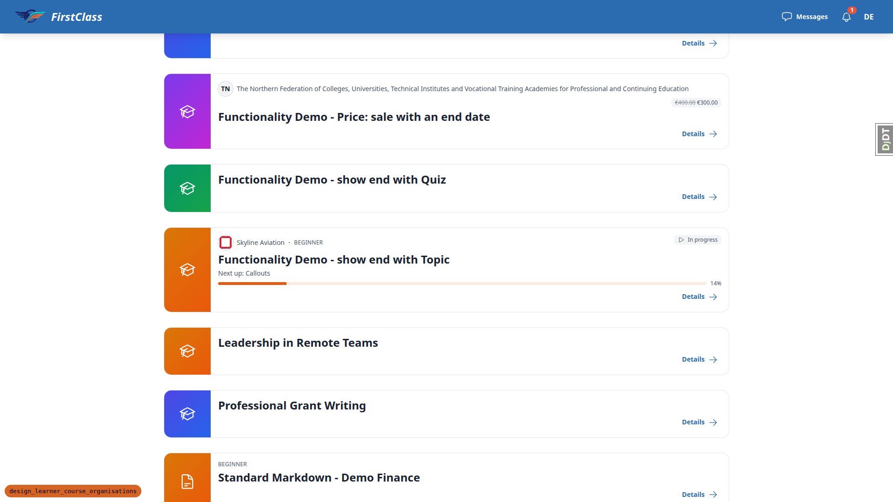 |
| 3.6 | desktop | pass | All 22 Details links are tabbable and reached by Tab; accessible name is "Details for &lt;course title&gt;" via an sr-only span, visible label "Details". | |
| 3.7 | mobile | pass | /courses/ at 375: no horizontal scroll; long and medium organisation names truncate with an ellipsis (scrollWidth > clientWidth); chips stay at the right and wrap under the byline line when there is no room; nothing overflows its row. | 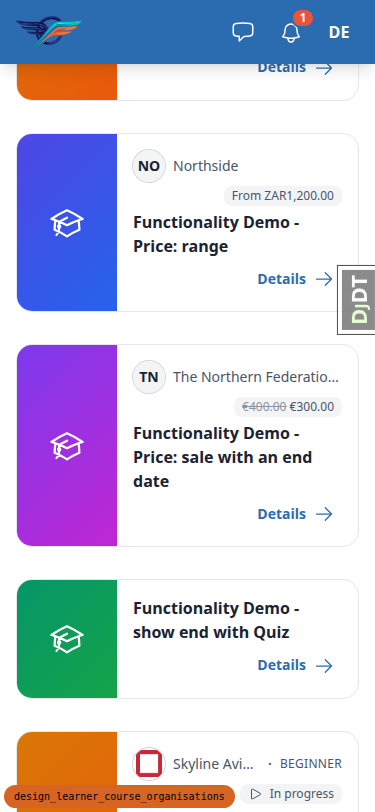 |
| 3.7 | tablet | pass | /courses/ at 768: no horizontal scroll; the ~150-character name truncates with an ellipsis and its price chip wraps to the line below; rows with no organisation show the difficulty alone or an empty left half. | 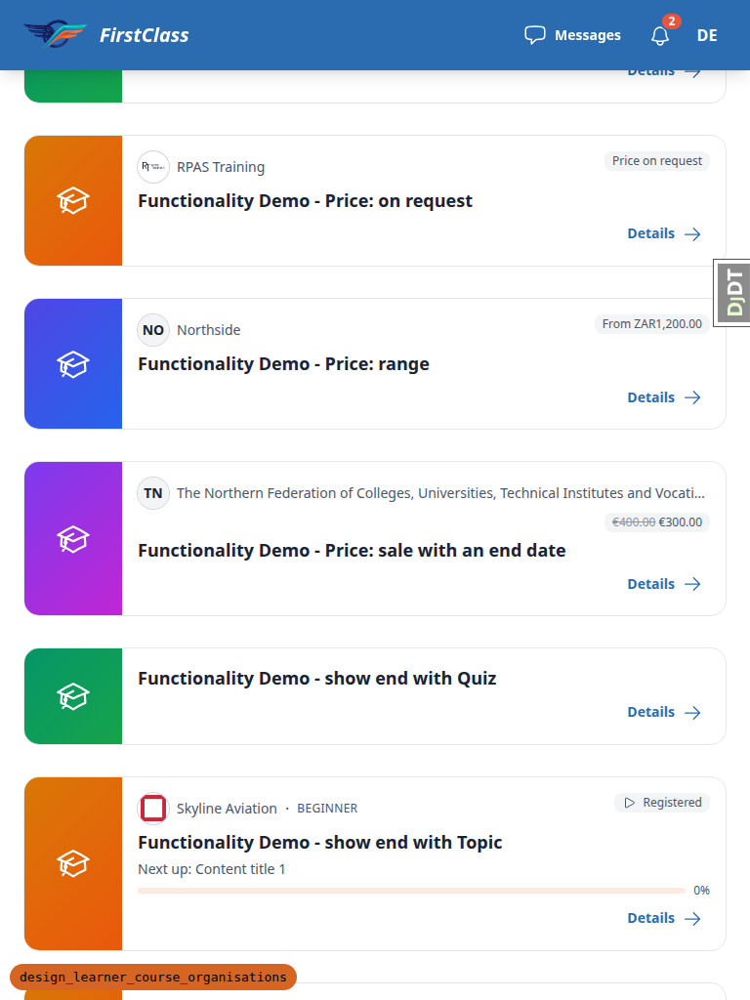 |
| 3.8 | mobile | pass | Signed in at 375 each dashboard section lists the same rows as /courses/ with byline and difficulty; a row without an organisation shows "BEGINNER" alone with no leading dot; the "Browse all courses" link is centred (text-align center, centre offset 0px) under the rows. |  |

### Scenario 4: the applications panel

| Test | Viewport | Status | Notes | Screenshot |
|---|---|---|---|---|
| 4.1 | desktop | pass | Your applications panel: three rows in the /courses/ row layout, accent panel left, one chip top-right (Incomplete in amber/warning, Pending review in blue/info), no Free or price chip, title, "Finish your application to have it reviewed." on drafts, footer with Details then Continue application / View my application right-aligned. | 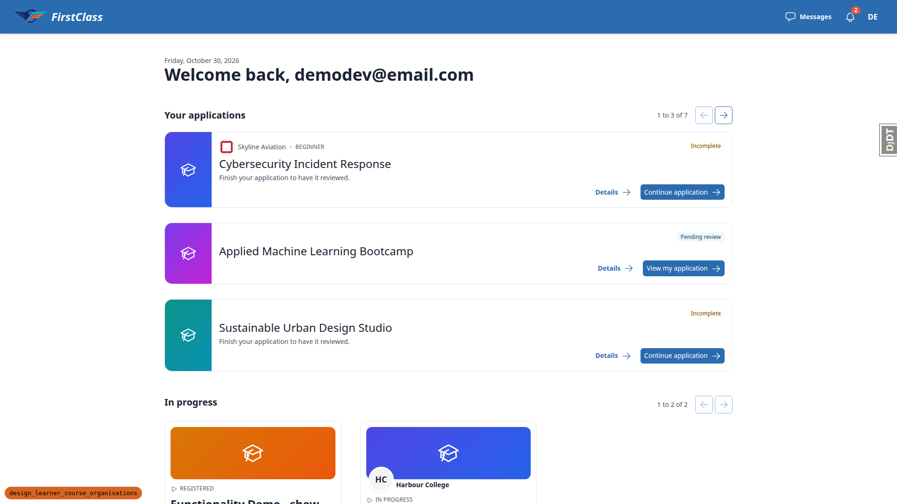 |
| 4.2 | desktop | pass | Cybersecurity Incident Response row (Skyline Aviation) shows the mark with the uploaded square JPEG, "Skyline Aviation · BEGINNER"; the other rows have an empty left half. |  |
| 4.3 | desktop | pass | Details -> /courses/qa-cybersecurity-incident-response/detail/ (course detail). Title link and Continue application both -> /applications/status/&lt;pk&gt;/ which, for a draft, lands on the application form page 1 (existing status-page behaviour). | |
| 4.4 | desktop | pass | Next page swaps page 2 in via htmx with the same row layout, position text updates to "4 to 6 of 7". Keyboard activation (Enter) moves focus to the panel heading (tabindex=-1); a mouse click leaves focus on the pager link, identical to the unchanged Available courses pager. | |
| 4.5 | mobile | pass | At 375 the application button is hidden (0px), a 20px chevron shows at the right of the footer line, "Details" still shows, the row is covered by the stretched title link so tapping the footer area opens the application page; no horizontal scroll, nothing overflows the row. | 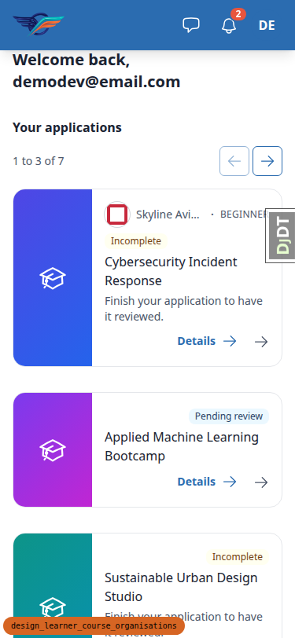 |
| 4.6 | desktop | pass | qa-no-apps@example.com dashboard shows no Your applications panel. | 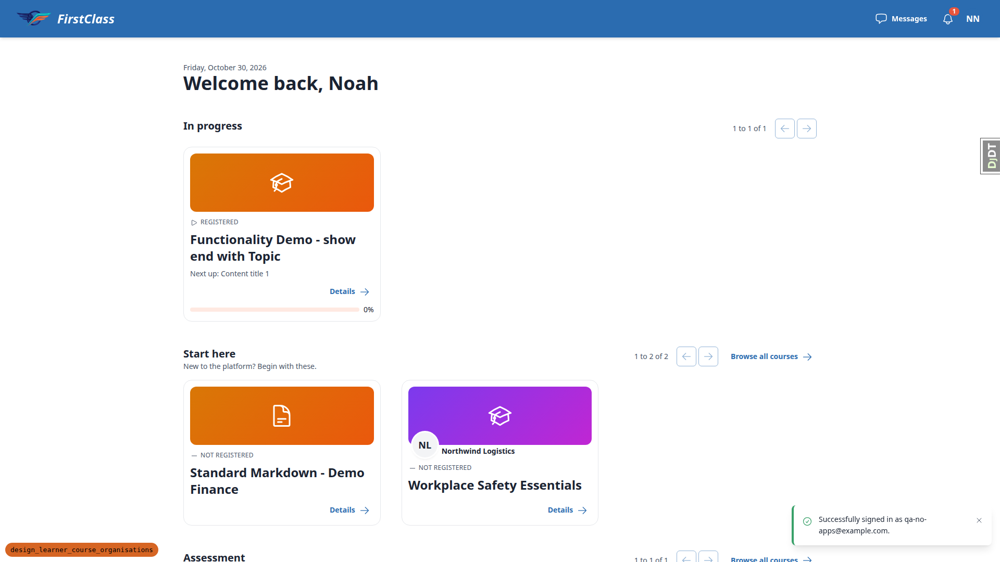 |
| 4.7 | desktop | pass | Anonymous: Apply now on the Skyline gated course detail page, filled Your details, Next; / then shows the panel with the draft row in the row layout with the Skyline Aviation · BEGINNER byline, Incomplete chip, Details + Continue application. |  |

### Scenario 5: the course detail page (design states detail__d1 and detail__d6)

| Test | Viewport | Status | Notes | Screenshot |
|---|---|---|---|---|
| 5.1 | desktop | pass | Anonymous /courses/functionality-demo-show-end-with-topic/detail/ at 1920 (the bare /courses/&lt;slug&gt;/ URL is the player and redirects anonymous visitors to login; detail pages live at /detail/). | 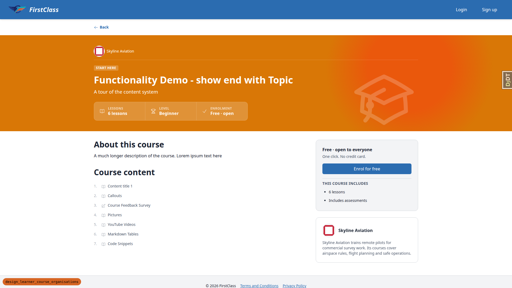 |
| 5.2 | desktop | pass | Hero: byline first (40px white-filled round mark with the Skyline profile logo, name in white), then a 1px white/20 rule, then the START HERE chip, title, subtitle and stats strip. No links in the byline or rule. |  |
| 5.3 | desktop | pass | Sidebar: under the sign-up panel, same 384px width, 1px bordered card, 48px mark, name semibold on the same line, bio 14px muted below. No course count, no link. |  |
| 5.4 | desktop | pass | At 1920x600 scrolled 400px the sign-up panel and the organisation card stay together in one sticky block (top 24px); the card's top is below the panel's bottom, no overlap. | 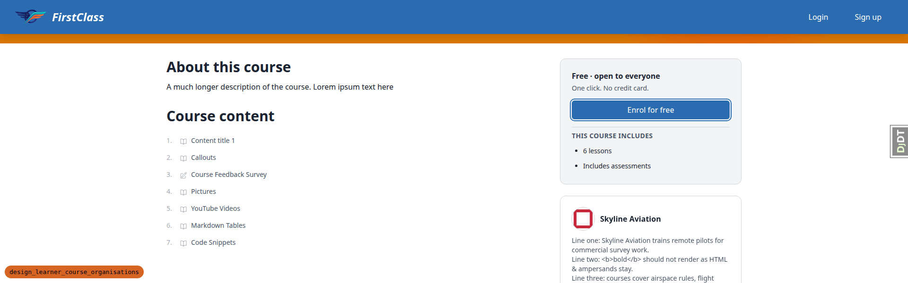 |
| 5.5 | desktop | pass | Coastal detail: hero byline with the wide logo object-contain in the white circle; sidebar card with mark and name only, no bio paragraph. | 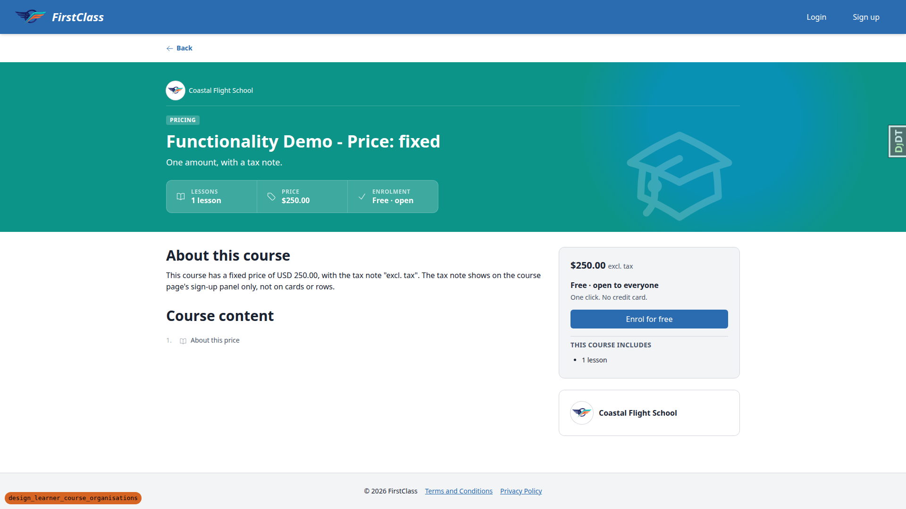 |
| 5.6 | desktop | pass | Course Parts (Skyline + Coastal) and Price: from (DemoDev only): no hero byline, no rule, no organisation card; the sign-up panel block is still position: sticky. | |
| 5.7 | desktop | pass | 500-character 6-line bio: line breaks kept (6 br), "&lt;b&gt;" shown as literal text (not rendered as HTML), ampersand intact. Sticky block has overflow-y auto with max-h calc(100dvh-3rem); scrolling it reaches the end of the bio. The Enrol button's focus ring (2px ring) is not clipped thanks to the block's 4px padding. |  |
| 5.8 | desktop | pass | As demodev_s3 (registered through Skyline) the detail page shows the same hero byline, rule and sidebar card; the panel's CTA reads Continue. | |
| 5.9 | mobile | pass | At 375 the hero byline sits above the START HERE chip; the sidebar block is order-first so the sign-up panel, then the organisation card, come before "About this course"; no horizontal scroll. | 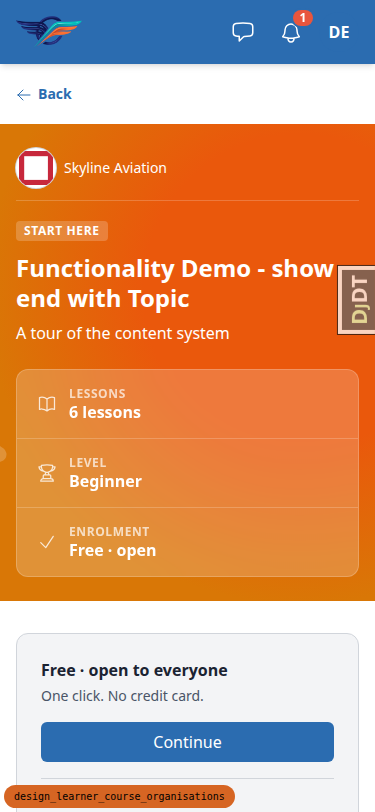 |
| 5.9 | tablet | pass | At 768 the hero byline sits above the chip; sign-up panel then organisation card (both 720px) precede "About this course"; the 500-character bio keeps its line breaks; no horizontal scroll. | 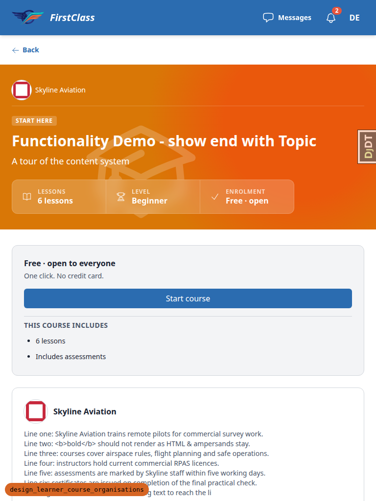 |
| 5.10 | desktop | pass | The single JSON-LD block has keys @context, @type, name, description, url, isAccessibleForFree, educationalLevel; no provider entry. | |

### Scenario 6: the mark's fallbacks and the profile logo everywhere

| Test | Viewport | Status | Notes | Screenshot |
|---|---|---|---|---|
| 6.1 | desktop | pass | Northside (no logo) on Price: range: grey circle with "NO" on the /courses/ row, in the detail hero (40px, white circle) and on the sidebar card (48px); no broken image. | 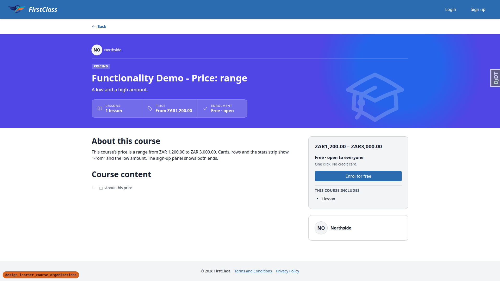 |
| 6.2 | desktop | pass | Renamed Northside to "2024": the row's mark shows a generic icon (svg) instead of letters. Renamed back afterwards. | 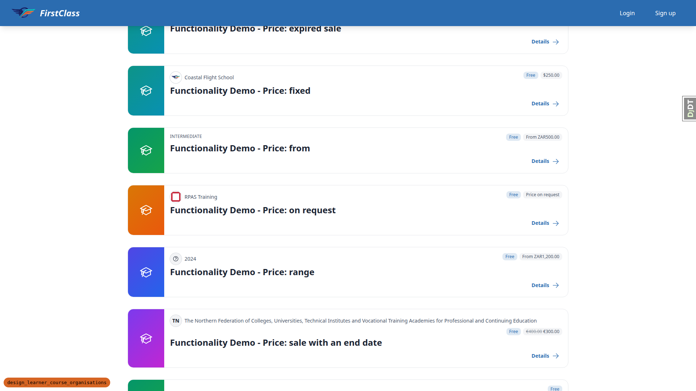 |
| 6.3 | desktop | pass | Profile logo on Northwind Logistics: / (dashboard card), /courses/ row, and the detail hero + card all switched from "NL" to the image at once. Cleared: all surfaces back to "NL". |  |
| 6.4 | desktop | pass | RPAS Training (has a logo) with a profile logo: /courses/ draws the profile logo (-profile.jpg). Cleared: the wide webp logo is drawn with object-contain, fitted not cropped. |  |
| 6.5 | desktop | pass | Course player sidebar for the Skyline course shows the pre-existing large 64px "SA" monogram chip, unchanged by this work. | 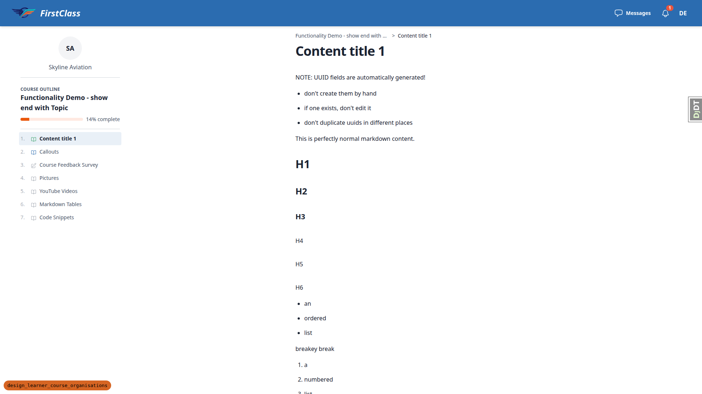 |
| 6.6 | desktop | pass | /articles/getting-started-with-articles/ embeds course cards: the compact variant renders the card shell with the inset tile (13px, 12px corners) and no byline; the default embed renders the row shell, also without a byline (the embedded Price: fixed course belongs to Coastal Flight School). | 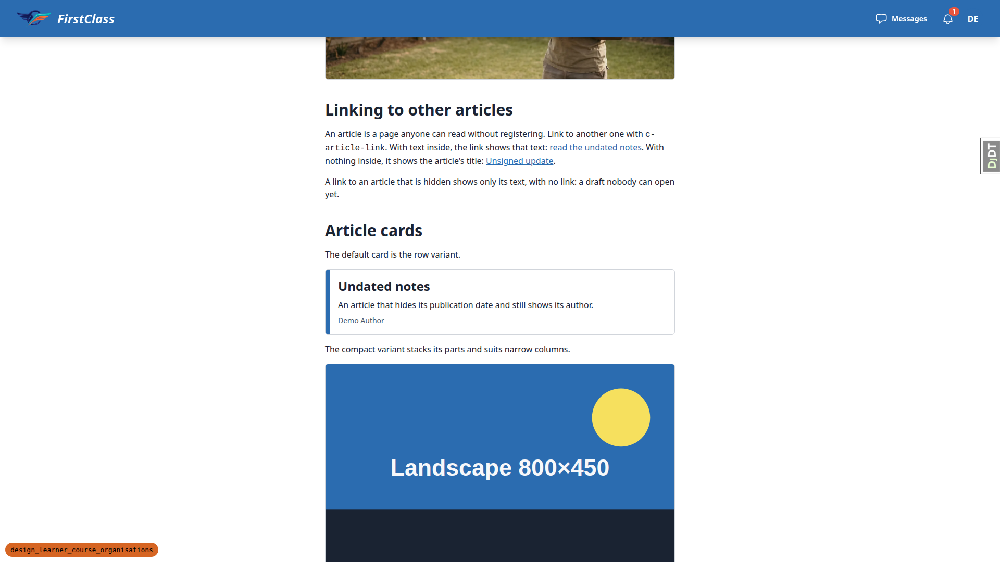 |

### Scenario 7: a themed site

| Test | Viewport | Status | Notes | Screenshot |
|---|---|---|---|---|
| 7.1 | desktop | skip | Skipped as the plan allows: the theme is selected per process by the FLS_THEME environment variable (settings_base.py), not per site, and no second site runs the first_class theme locally. | |

## Design check

| Test | Viewport | This run | Design | Result |
|---|---|---|---|---|
| 2.2-design | desktop |  | 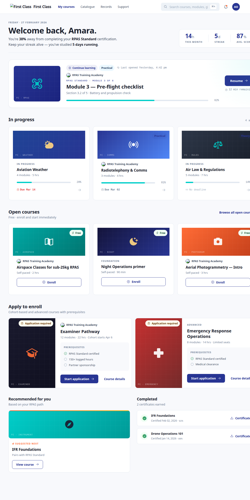 | pass |
| 3.2-design | desktop |  | 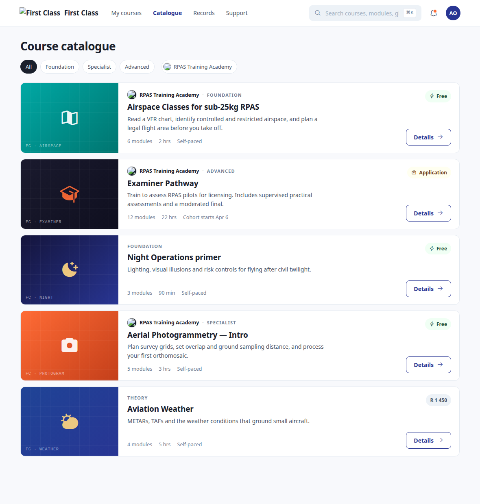 | pass |
| 3.2-design | mobile |  |  | pass |
| 3.2-design | tablet |  |  | pass |
| 5.2-design | desktop |  | 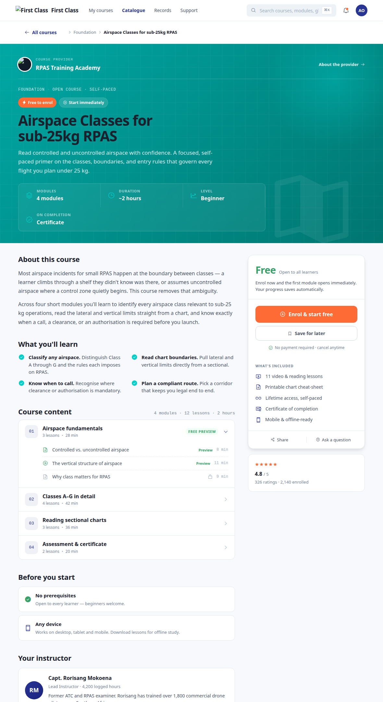 | pass |
| 5.2-design | mobile |  |  | pass |
| 5.2-design | tablet |  |  | pass |
| 5.3-design | desktop |  | 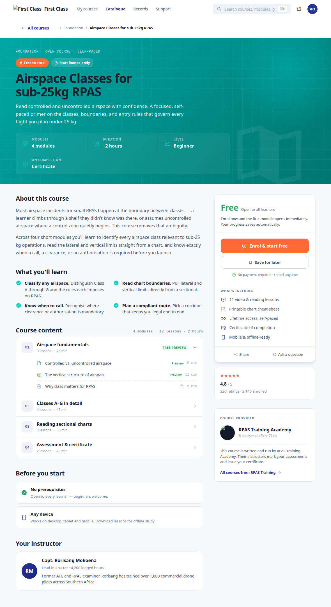 | pass |
| 5.3-design | mobile |  |  | pass |
| 5.3-design | tablet |  |  | pass |

## Bugs

### B1: Long organisation name tooltip never shows: the stretched title link covers the byline

Manifestations:

- 2.5 (desktop)

Screenshots:

Expected: Hovering a truncated organisation name on a dashboard card (and on a /courses/ row) shows the full name as a native tooltip from the span's title attribute.

Actual: The byline span carries the full name in a title attribute and truncates with an ellipsis, but the card's title link is a stretched link (before:absolute before:inset-0) stacked above the byline, so the element under the cursor is that <a> (no title in its ancestor chain) and the browser never shows the tooltip. Playwright's hover on the span is intercepted by the same link. The /courses/ row eyebrow has the same overlay and the same problem; the Details link already escapes the overlay with 'relative z-10'.

## Bug status

| Status |
|---|
| **FIXED** (commit: 36bc98081) - B1: Long organisation name tooltip never shows: the stretched title link covers the byline. The organisation name span is now `relative z-10` and forwards its click to the card's title link; re-verified on the dashboard card and the /courses/ row against the live server, and the player, detail page and user menu were spot-checked with no console errors. |

## General notes

1. On dashboard cards the 48px mark straddles the accent tile's bottom edge by 24px (byline is -mt-6 ml-2), so the byline text starts 8px right of the tile's left edge; the design draws a smaller mark fully below the tile. Every checklist line is still met.
2. With the ~150-character organisation name the row's chips drop to the line below the byline at 1920 and 768 instead of the byline truncating first; the plan accepts chips wrapping.
3. The plan's Scenario 1.2 says non-square profile logos are "cropped"; the spec's decision is fitted-not-cropped and the help text says "scaled down to fit inside it", so the plan wording is stale.
4. /courses/&lt;slug&gt;/ is the player (login-redirect for anonymous visitors); the detail page the plan means is /courses/&lt;slug&gt;/detail/.
5. The default (non-compact) course-card embed on an article renders the row shell without a byline even though the embedded course has an organisation; the plan only specifies the compact variant.
6. The Course Parts multi-organisation course does not appear in any dashboard section for the learner, so its card was not seen; verified on /courses/ and its detail page.
7. Scenario 1 was driven through the admin UI; the Scenario 5.7 bio and the Scenario 6 renames and logo swaps were applied through the ORM to save login round-trips, then verified in the browser.

Further notes:

- Scenario 7 was skipped: the theme is selected per process by the FLS_THEME environment variable (settings_base.py), not per site, and no second site runs the first_class theme locally (test 7.1).
- The dashboard cards design state cards__b only exists at desktop, because below 1024px the dashboard shows rows. The mobile and tablet design rows therefore use index__ig2.
- Course Parts was not seen on the dashboard.
- Data mutations for scenarios 5.7 and 6 were applied through the ORM and verified in the browser.
- One leftover file, `media/organisations/30601f7b-b15f-470e-9a69-97ad77a530bc-profile.png`, from an earlier run sits in the media directory with no database row pointing at it. It is harmless residue and was not created by this run.

status: ok
reason: 1 bug - 1 fixed (36bc98081), 0 unresolved; report rendered, 26 screenshots verified
