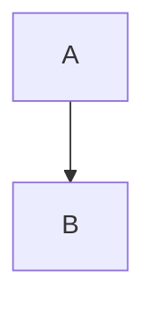

# Frontend QA: downstream bugs, October 2026 bundle

Every scenario names the page, the login, what to do and what to expect. Use a fresh private
window per login. Passwords equal the email address. django-axes locks an email after five
failed logins; run `uv run python manage.py axes_reset` if you trip it.

## 0. Setup

```bash
npm run tailwind_build
uv run python manage.py create_demo_data --yes
uv run python manage.py content_save ./demo_content DemoDev
uv run python manage.py qa_create_course_player_learner
uv run python manage.py qa_create_form_count_edge_cases
uv run python manage.py qa_create_course_access_types
uv run python manage.py qa_create_deadlines_seed
uv run python manage.py qa_create_dashboard_applications_panel
uv run python manage.py qa_create_coming_soon_sections
uv run python manage.py content_save ./qa-artifacts/qa_bundle_content DemoDev
PORT=$(.claude/ds/scripts/find_available_port.sh)
uv run python manage.py runserver $PORT
```

- Base URL: `http://127.0.0.1:$PORT`. Dashboard `/`, all courses `/courses/`, course detail
  `/courses/<slug>/detail/`, player item `/courses/<slug>/<n>/`, admin `/admin/`.
- Logins: site admin `demodev@email.com`; learners `demodev_s1@email.com` to
  `demodev_s50@email.com`; the seeds above print their own learners (`demodev_quizqa@email.com`
  for the empty-form course, the course-player learner, the access-types learner, the
  `qa_deadline_*` learners, `qa-one-app@example.com`).
- Course slugs are derived from titles. Find each in the admin course list
  (`/admin/freedom_ls_content_engine/course/`) or by hovering cards on `/courses/`.
- Site name: the `Site.name` of DemoDev as shown in the header. Call it `<site>` below.

### 0.1 QA content directory

Before the second `content_save` above, create `qa-artifacts/qa_bundle_content/` (gitignored
scratch) with this content. UUIDs may be any fresh `uuid4` values.

`course_categories.yaml`:

```yaml
---
content_type: COURSE_CATEGORIES
categories:
  - slug: qa-bundle
    title: QA bundle
    description: "**IMPORTANT:** read every item in order."
    uuid: <uuid>
```

`qa-bundle-course/course.md`:

```markdown
---
content_type: COURSE
title: QA Bundle Course
subtitle: Nested widgets, code and quizzes
description: A course for checking nested widgets and quiz review.
categories:
  - qa-bundle
uuid: <uuid>
---
Body text.
```

`qa-bundle-course/1. widgets/content.md`:

````markdown
---
content_type: TOPIC
title: Nested widgets
uuid: <uuid>
---
<c-accordion title="A formula inside an accordion">
Some **bold** text and a formula:

<c-equation label="1">E = mc^2</c-equation>

<c-table caption="Plan comparison">
| Plan | Price |
|------|-------|
| Free | 0 |
</c-table>
</c-accordion>

<c-admonition type="note" title="Equation in a note">
<c-equation>a^2 + b^2 = c^2</c-equation>
</c-admonition>

<c-flashcard>
<c-slot name="front">What is the identity?</c-slot>
<c-slot name="back"><c-equation>e^{i\pi} + 1 = 0</c-equation></c-slot>
</c-flashcard>

A fenced example that must stay literal:

```html
<c-accordion title="Example">
Example body
</c-accordion>
```

A very wide code block:

```text
aaaaaaaaaaaaaaaaaaaaaaaaaaaaaaaaaaaaaaaaaaaaaaaaaaaaaaaaaaaaaaaaaaaaaaaaaaaaaaaaaaaaaaaaaaaaaaaaaaaaaaaaaaaaaaaaaaaaaaaaaaaaaaaaaaaaaaaaaaaaaaaaaaaaaaaaaaaaaaaaaaaaaaaaaaaaaaaaaaaaaaaaaaaaaaaaaaaaaaaaaaaaaaaaaaaaaaaaaaaaaaaaaaaaaaaaaaaaaaaaaaaaaaa
```


````

`qa-bundle-course/2. quiz/form.md`:

```markdown
---
content_type: FORM
strategy: QUIZ
title: Review quiz
quiz_show_incorrect: true
quiz_pass_percentage: 100
uuid: <uuid>
---
```

`qa-bundle-course/2. quiz/1. page.yaml`:

```yaml
---
content_type: FORM_PAGE
title: Page 1
uuid: <uuid>
---
question: Pick the right one
type: multiple_choice
required: true
uuid: <uuid>
options:
- text: Right answer
  value: right
  correct: true
  uuid: <uuid>
- text: Unmarked option
  value: unmarked
  uuid: <uuid>
- text: Wrong answer
  value: wrong
  correct: false
  uuid: <uuid>
---
question: Your phone number
type: phone
required: true
uuid: <uuid>
```

`qa-bundle-course/3. survey/form.md` (a save-on-exit form):

```markdown
---
content_type: FORM
strategy: CATEGORY_VALUE_SUM
title: Feedback survey
uuid: <uuid>
---
```

`qa-bundle-course/3. survey/1. page.yaml` with one required `multiple_choice` question with
two options (`value: a`, `value: b`, no `correct` keys) and `3. survey/2. page.yaml` with one
more, so the survey has two pages.

Register `demodev_s1@email.com` for QA Bundle Course from its detail page ("Enrol for free")
when a scenario needs it.

### 0.2 A content directory that must fail

`qa-artifacts/qa_pageless_content/pageless-course/course.md` (COURSE, title "Pageless course")
with `pageless-course/1. empty/form.md` (FORM, strategy QUIZ) and no page file beside it. Do
not `content_save` it; Scenario 15 runs the validator on it.

## Scenario 1: Honeypot does not echo its value

1. Open `/accounts/signup/` anonymously. In the browser devtools console run
   `document.querySelector('input[name=fax_number]').value = 'spam'`, fill the rest of the form
   validly with a new email, submit.
2. **Expect:** the page re-renders with the message starting "We couldn't process this sign-up."
   In devtools, the `fax_number` input has no `value` attribute and an empty value.
3. Clear nothing; fill the password fields again and submit. **Expect:** the signup now succeeds
   (the verification-sent page), proving the honeypot was not resent.
4. Repeat steps 1-2 on the anonymous applicant-details page: open the application-gated demo
   course's detail page anonymously, click "Apply now", fill the details form with the honeypot
   set via devtools. **Expect:** the same re-render with an empty honeypot.

## Scenario 2: Profile form name rule

1. Log in as `demodev_s1@email.com`. Open `/accounts/profile/`.
2. Clear the first name, submit. **Expect:** the page re-renders with "This field is required."
   beside the first-name field, status 422 is not required here (full-page POST), nothing saved.
3. Enter three spaces as the first name, submit. **Expect:** the same error.
4. Enter "Ada", submit. **Expect:** a redirect to `/accounts/profile/` (the URL bar stays on it,
   a reload does not re-POST) and a "Profile saved" toast.
5. As `demodev@email.com`, open `/admin/freedom_ls_accounts/sitesignuppolicy/`, open or add the
   DemoDev policy, untick **Require name**, save. As `demodev_s1@email.com`, open the profile
   page. **Expect:** the label reads "First name (optional)"; a blank first name saves.
   Re-tick **Require name** afterwards.

## Scenario 3: Header links come back to the page

1. Anonymously open `/courses/<any demo slug>/detail/`. Hover "Log in" and "Sign up" in the
   header. **Expect:** both hrefs end `?next=/courses/<slug>/detail/`, labels "Log in" and
   "Sign up" (not "Login").
2. Click "Log in", log in as `demodev_s1@email.com`. **Expect:** you land back on the detail
   page.
3. Anonymously open `/`. **Expect:** both header hrefs are bare (`/accounts/login/`,
   `/accounts/signup/`).
4. Open `/accounts/login/` directly. **Expect:** bare header hrefs. Open
   `/accounts/login/?next=/courses/` . **Expect:** the header "Sign up" carries
   `next=/courses/` unchanged.
5. Open `/no-such-page/`. **Expect:** a 404 page whose header links are bare and whose body
   nowhere contains `/no-such-page/`.
6. Open `/courses/<slug>/detail/?x=<script>` . **Expect:** the `next` in the header is
   URL-encoded and the page source has no raw `<script>` from it.

## Scenario 4: Header heading, skip link, titles, meta description, 404 button

1. Log in as `demodev_s1@email.com`, open `/`. Press Tab once. **Expect:** a visible "Skip to
   main content" link appears at the top left; press Enter and the next Tab moves into the page
   content (the dashboard). In devtools, `document.querySelectorAll('h1').length` is 1 and that
   h1 is not the site name; the site name in the header is a `<span>` inside the logo link.
2. **Expect** the tab title reads `Dashboard — <site>`. Open `/courses/`: title
   `All Courses — <site>`. Open a course item `/courses/<parts-course-slug>/1/`: title
   `<item> — <part> — <course> — <site>` with the site name once. Open `/blog/` (if the demo
   has articles): the blog name then the site name, once.
3. Log out. Open `/`. **Expect:** the tab title is exactly `<site>` (no "Dashboard"). View
   source: `<meta name="description" content="Learning management system">`.
4. In `config/settings_dev.py` (or an env override) set `META_DESCRIPTION = "Courses for
   pilots"`, restart the server, reload `/` anonymously. **Expect:** the description meta reads
   "Courses for pilots". Open a course detail page. **Expect:** its description meta is the
   course's own description, not the site value. Remove the setting afterwards.
5. Anonymously open `/no-such-page/`. **Expect:** the primary button "Go to the home page"
   links `/`; "Browse courses" beside it. Log in, open `/no-such-page/` again. **Expect:** "Go to
   your dashboard".
6. Open any error page at 390px width. **Expect:** the skip link still appears first on Tab.

## Scenario 5: allauth pages

Log in as `demodev_s1@email.com` unless stated.

1. Open `/accounts/logout/`. **Expect:** heading "Log out", body "Log out of <site>?", exactly
   one button ("Log out") and a "Cancel" link to `/`; no side nav, no "Sign Out" anywhere. Click
   Cancel: you are on `/`, still logged in. Open it again, click "Log out": you are logged out.
2. Log in again. Open `/accounts/email/`. **Expect:** heading "Email address"; the one address
   shows "Verified" and "Primary" tags and no action buttons; "Add another email address" heads
   the add form; the side nav lists "Email address" and "Change password" only, no logout
   button. Tab title `Email address — <site>`.
3. Add `second_<random>@example.com`. **Expect:** the new row shows "Unverified", with
   "Resend confirmation" and "Remove" buttons and no "Make primary". Check the dev mailbox
   (console or `/admin/` mail log, whichever the dev settings use). **Expect:** the mail body
   says "Someone added this email address to a <site> account … If it wasn't you, ignore this
   email: nothing changes unless the link is opened."
4. Add an address that already belongs to `demodev_s2@email.com`. **Expect:** the page response
   is indistinguishable from step 3 (same message, same row state).
5. Open `/accounts/password/change/`. **Expect:** heading "Change your password", button
   "Change password", manage nav present.
6. Log out. Open `/accounts/password/reset/`. **Expect:** heading in sentence case ("Reset your
   password"), one primary button. Submit `demodev_s1@email.com`. **Expect:** the "done" page
   with a sentence-case heading. Open the reset link from the mail. **Expect:** heading "Choose a
   new password", button "Save password", a cancel link rendered as a text link, not a second
   primary button. Set a new password. **Expect:** the "done" page. Reset the password back to
   the email afterwards via the same flow or the admin.
7. Open the same reset link again. **Expect:** "This reset link no longer works. Reset links
   expire after use or after a few days." with a primary "Request a new reset link"; never "Bad
   Token".
8. Sign up a new account with `next=/courses/<slug>/detail/` on the signup URL. **Expect:**
   the verification-sent page is headed "Check your email" with the spec's body, a "Log in" link
   and no "contact us". The confirmation mail's link contains `next=/courses/<slug>/detail/`.
   Open that link in a different private window. **Expect:** heading "Confirm your email
   address", body "Confirm that **<email>** is your email address.", a "Confirm" button; view
   source shows a hidden `next` input. Click Confirm. **Expect:** you land on the login page
   with `next`, and logging in takes you to the course detail page.
9. Re-open the used confirmation link while logged in as that new user. **Expect:** "Email
   address already confirmed", "You don't need to do anything else." and a "Go to your dashboard"
   link. Open `/accounts/confirm-email/notakey/` logged out. **Expect:** "This confirmation link
   no longer works. Log in and we'll send you a new one." with a "Log in" link.
10. For a user with no usable password (create one in the admin with an unusable password, or
    use a claim link from Scenario 6 on a new address), open `/accounts/password/set/`.
    **Expect:** heading "Set your password", lead "Your email is confirmed. Choose a password to
    finish setting up your account.", button "Set password", no side nav.
11. The user menu (avatar) still offers "Log out".

## Scenario 6: Signup page accessibility and the interest lead line

1. Anonymously open `/accounts/signup/`. Submit the empty form. **Expect:** focus lands on the
   first field with an error; in devtools that input has `aria-invalid="true"` and an
   `aria-describedby` pointing at an element whose text is the error, rendered after the input.
   The first-name input has `autocomplete="given-name"`, last name `family-name`.
2. Submit with a valid email that already exists and matching passwords. **Expect:** a non-field
   error (or allauth's existing-account behaviour) inside a block with `role="alert"`; when it has
   text, focus is on that block.
3. Open a coming-soon course (from `qa_create_coming_soon_sections`, e.g. "Mix Bravo") detail
   page anonymously and click "I'm interested". **Expect:** the signup page shows, above the
   form, "Create an account to register your interest in Mix Bravo."
4. Open `/accounts/signup/?next=/courses/soon-hidden/deferred-express-interest/` (the hidden
   coming-soon course). **Expect:** no lead line. Open
   `/accounts/signup/?next=/evil/` and `?next=https://example.com/`. **Expect:** no lead line,
   page renders normally.

## Scenario 7: Claim page copy

1. Anonymously apply to the application-gated demo course with the email of
   `demodev_s3@email.com` (an existing account). Open the claim link from the mail.
   **Expect:** "You already have an account with this email address. You'll set a new password
   for it, and your old password will stop working."
2. Repeat with a brand-new address. **Expect:** the "new account" sentence as before.

## Scenario 8: Course access copy and the enrolment icon

1. Log in as the `qa_create_course_access_types` learner. Open the free QA course's detail page.
   **Expect:** "Free · open to everyone" and "One click. No credit card." (unregistered). Click
   "Enrol for free", then return to the detail page. **Expect:** "You're enrolled" with no
   subtext; the Enrolment stat still reads "Free · open" with a tick icon; the free badge shows.
2. As `demodev@email.com`, register that learner for the application-gated QA course directly
   (`/admin/freedom_ls_learner_management/learnercourseregistration/add/`). As the learner, open
   the gated course's detail page. **Expect:** "You're enrolled", Enrolment stat "By
   application", no free badge; view source: the JSON-LD has `"isAccessibleForFree": false`.
   The button reads "Continue" or "Start course" and opens the player.
3. Open a coming-soon course detail page. **Expect:** Enrolment stat "Coming soon" with an info
   icon (not a tick); subtext "Register your interest so we know to run it."
4. Open the gated course detail page as `demodev_s4@email.com` (unregistered). **Expect:**
   "Apply now" and "Application required" unchanged.

## Scenario 9: Applications panel and the apply view

1. Log in as `demodev@email.com` (seven applications from the seed). Open `/`. Note the three
   newest in "Your applications". As admin, register yourself directly for the course of the
   newest draft. Reload `/`. **Expect:** that application is gone from the panel; the others
   remain; paging still works and each page link carries the page in the URL after a click
   (`?applications_page=2` or the panel's own param appears in the address bar, Back returns to
   the previous page state without a full reload loop).
2. As `demodev_s1@email.com`, open `/courses/<free demo slug>/apply/` directly. **Expect:** a
   redirect to that course's detail page and no application in the admin
   (`/admin/freedom_ls_course_applications/courseapplication/`). Also POST to it from the
   console (`fetch(location.pathname, {method: 'POST', headers: {'X-CSRFToken': …}})`).
   **Expect:** a 302 to the detail page, still no row.
3. As `qa-one-app@example.com` (one draft on a gated course), open that course's `/apply/`.
   **Expect:** the application status page, as before.

## Scenario 10: Continue, locked items and the section pager

1. Log in as the `qa_create_course_player_learner` learner. Open the detail page of the course
   with progress. **Expect:** the button reads "Continue"; its href is `/courses/<slug>/` (the
   bare course URL). Click it. **Expect:** you land on the item you last opened, not item 1.
   Press the browser Back button. **Expect:** you return to the detail page, not a loop.
2. Open the detail page of the course with no progress. **Expect:** "Start course" linking
   `/courses/<slug>/1/`.
3. In the parts demo course (`Functionality Demo - Course Parts`) as a learner who has not
   passed its knowledge-check quiz, open an item after the quiz directly
   (`/courses/<slug>/<n>/` with a high n). **Expect:** a redirect to the detail page and a toast
   `Finish the earlier steps of the course to open "<item title>".`
4. Make the resume pointer sit on a locked item: open the item just before the quiz, then as
   admin set that learner's `CourseProgress.last_accessed_item` in the admin to a collection
   item after the quiz. As the learner open `/courses/<slug>/`. **Expect:** you land on the
   first open, incomplete item (not the detail page, no toast).
5. On `/` as `demodev@email.com`, in a dashboard section with more than three courses (the
   "QA Soon Mix" section), click the pager's next arrow. **Expect:** the section swaps and the
   address bar gains `?<section>_page=2` without a reload. Reload the page. **Expect:** page 2
   is still shown. Click Back. **Expect:** page 1 again.

## Scenario 11: Nested components, code blocks, section description, hero icon

1. Register `demodev_s1@email.com` for QA Bundle Course and open item 1.
2. Expand the accordion. **Expect:** `E = mc^2` is typeset (KaTeX rendering, not raw text), the
   table inside it has a bordered scroll wrapper with its "Plan comparison" caption, and
   "**bold**" renders bold. The note admonition shows a typeset equation. Flip the flashcard:
   the back shows a typeset equation.
3. **Expect:** the fenced HTML example renders as literal code showing `<c-accordion
   title="Example">` and no `markdown="1"`. The mermaid fence renders as a plain code block.
4. Resize to 390px wide. **Expect:** the wide code block scrolls horizontally inside its box and
   the page itself does not scroll sideways (`document.documentElement.scrollWidth ===
   window.innerWidth` in the console).
5. Adversarial: edit the topic to add, inside the accordion, `<script>alert(1)</script>`,
   `<a href="javascript:alert(1)">x</a>` and `[x](javascript:alert(1))`, re-run `content_save`,
   reload. **Expect:** no alert, no `javascript:` href in the source, the script tag gone.
   Remove the lines and re-save.
6. Open `/` as that learner. **Expect:** the "QA bundle" section's description renders
   "IMPORTANT:" in bold.
7. Open the QA course detail page at 390px, 768px and 1280px widths. **Expect:** at 390px no
   large faded icon in the hero; at 768px it appears near the right edge; at 1280px it sits
   further in from the right as before. No horizontal scroll at any width.

## Scenario 12: Form noun, leave and save, result page

1. As `demodev_s1@email.com` open QA Bundle Course item 2 (the quiz). **Expect:** "Start quiz".
   Click it. **Expect:** the exit button's accessible name is "Exit quiz"; opening it shows the
   dialog "Leave the quiz?".
2. Open item 3 (the survey). **Expect:** "Start form". Click it. Answer page 1's question,
   do not press Next; open the exit dialog ("Leave the form?"). **Expect:** the body "Your
   progress is saved — you can resume later." and buttons "Keep going" and "Leave and save".
   Click "Leave and save". **Expect:** you are on the survey start page with "Continue form".
   Click it. **Expect:** page 1 shows your answer selected.
3. Repeat with a required question left blank, click "Leave and save". **Expect:** no
   validation trap; you return to the start page.
4. Open `/courses/<qa-slug>/3/complete` directly before completing the survey. **Expect:** a
   redirect to the survey start page. Same for `/courses/<qa-slug>/2/complete` for the quiz.
5. In the demo course "Functionality Demo - show end with Quiz", start the quiz at item 3 (a
   submit-on-exit quiz), answer one question, open the exit dialog. **Expect:** "Leave and
   submit" (unchanged). Using devtools, change the form's `formaction` to the save-and-exit
   URL (`/courses/<slug>/3/save-and-exit`) and submit. **Expect:** a redirect to the start page
   and the attempt neither scored nor saved (the start page still offers "Continue quiz" with the
   page 1 answer absent, or "Start quiz" if nothing was recorded).
6. Finish the quiz failing it. **Expect:** the result page's button reads "Try again"; the
   course finish page's "Still to do" list reads "Try again" for it. For an untouched form in
   "Still to do" it reads "Start quiz" or "Start form".

## Scenario 13: Unmarked options, phone answers, finish page dates

1. In QA Bundle Course item 2, start the quiz, pick "Unmarked option", enter phone "hello",
   press Next. **Expect:** the phone field errors with `You entered "hello". Enter a phone number
   with at least 7 digits.` Try "12345": same message. Enter "+27 (0)82 123-4567": accepted.
2. Submit the quiz. **Expect:** on the review page, "Unmarked option" is marked incorrect (red
   icon labelled "Marked incorrect"), not "Not marked". In the admin, the option row's
   **correct** is still unset (null).
3. Open the course finish page `/courses/<qa-slug>/finish/`. **Expect:** "Started:" shows a
   date like "29 Oct 2026".

## Scenario 14: Course time limit, outline chevrons, empty form

1. Log in as `qa_deadline_solo@email.com`. Open `/`. **Expect:** the parts course card reads
   "Missed deadline Course time limit <date>" (its record is 100 days old against a 90-day
   limit). Nowhere does "Course 31 Mar" style text (the bare word "Course") appear as a deadline
   title.
2. Open an item of that course. **Expect:** the outline header shows a "Missed deadline" chip
   and "Course time limit: <date>". As `qa_deadline_fresh@email.com` the header shows "Course
   time limit: <date>" without the chip. In a course without a time limit (any price demo
   course) the header shows no such line.
3. In the parts course outline, click a part's toggle. **Expect:** one chevron per part that
   points down when collapsed and rotates to point up when expanded, the way a content accordion
   does; no icon swap or flicker. Collapse it again: it rotates back.
4. Log in as `demodev_quizqa@email.com`. Open the empty-form course (`qa-empty-form-course`)
   item 1. **Expect:** no start button; the text "This form has no questions yet." (it is a
   CATEGORY_VALUE_SUM form). Open `/courses/qa-empty-form-course/1/start` directly (the start
   URL). **Expect:** a redirect back to the start page, and no form sitting is created
   (`/admin/freedom_ls_form_engine/formprogress/` shows none for this learner and form).

## Scenario 15: Content validation

1. Run `uv run python manage.py content_validate qa-artifacts/qa_pageless_content`. **Expect:**
   failure with a line `…/1. empty/form.md: this form has no pages. Add a page file under it, or
   remove it from …/pageless-course/course.md.`
2. Add `children:` to that course.md listing only a topic you add beside it, and re-run.
   **Expect:** the run passes (the page-less form is not placed).
3. Run `uv run python manage.py content_validate qa-artifacts/qa_bundle_content`. **Expect:**
   it passes and logs a warning `…/1. widgets/content.md: Mermaid diagrams aren't rendered; this
   block will show as code.`
4. Run the bundled validator the same way on both directories:
   `uv run --no-project --with pydantic --with pyyaml --with python-frontmatter --with babel python claude_plugins/fls-content/validate/validate.py qa-artifacts/qa_pageless_content`
   from a directory holding a `.fls-content.yaml` (copy one from a content repo or create a
   minimal one). **Expect:** the same failure and the same pass.
5. Run `uv run python manage.py content_save ./demo_content DemoDev` again. **Expect:** it
   still succeeds (every demo form has pages; application forms are exempt).

## Scenario 16: Portable tests

1. Run `FREEDOM_LS_ICON_SET=phosphor uv run pytest freedom_ls/icons/tests/test_backend.py -q`
   and the same with `heroicons`. **Expect:** both pass.
2. Run `uv run pytest freedom_ls/educator_interface/tests/test_sidebar.py -q` with
   `MESSAGING_ENABLED` at its default in `settings_base.py` (temporarily comment the
   `settings_dev.py` override) and with it on. **Expect:** both pass. Restore the override.
